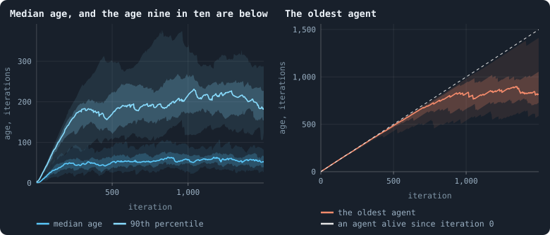
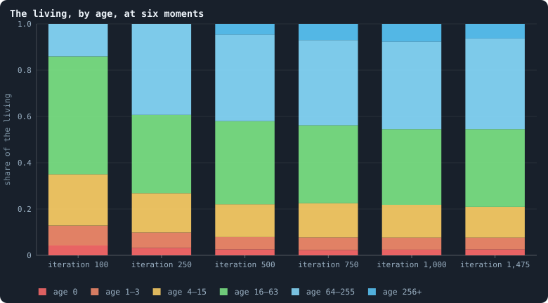
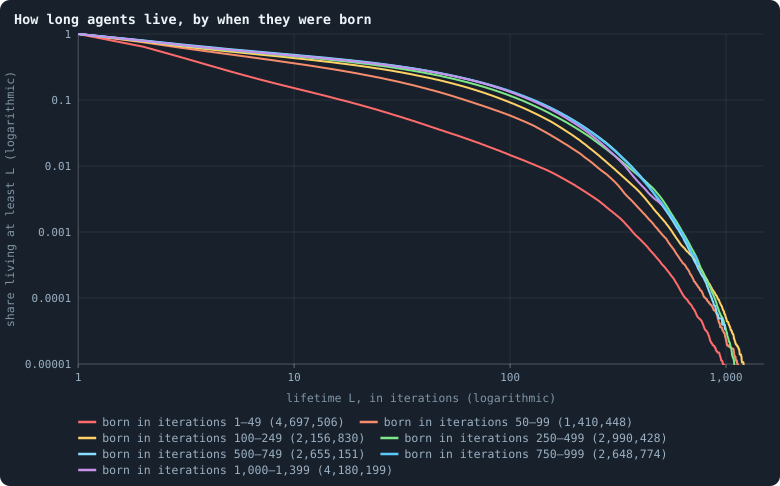
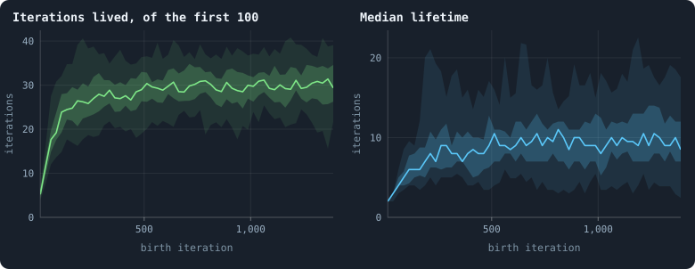
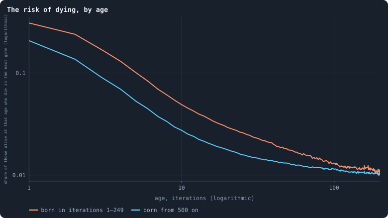
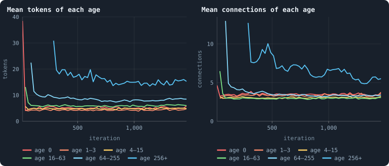
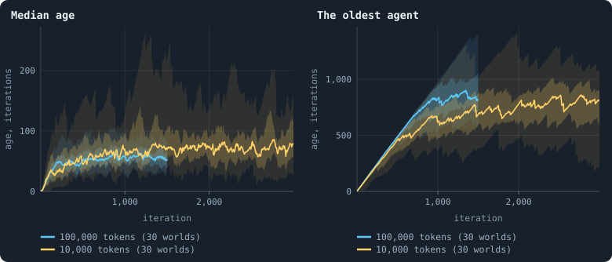

# How ages change over a world's life

[Chapter 12](12-births-deaths-and-ages.md) measured how long agents live and
how old the living are at the end of a run. This chapter follows ages and
lifetimes through a world's whole life: how old the living are at each
moment, how long the agents born at each moment live, and at which age an
agent is most at risk.

> [!question] Questions of this chapter
> - How old are the living, iteration by iteration — the typical agent and the
>   oldest?
> - Do agents born late in a world's life live longer than agents born early?
> - At which age is an agent most likely to die, and does that change?
> - Who are the old: rich, well connected, or neither?
> - Do ages behave the same in a world a tenth the size?

<!-- runs E10 -->
> [!info] The runs behind this chapter
> **30 runs.** Every condition below is run once for every seed (1 to 30), for 1,500 iterations — or until its world dies out. Every setting is that of the baseline **B1** (the algorithm exactly as a new run is offered it) unless the condition changes it.
>
> - **baseline** — changes nothing: B1 as it is; 100,000 tokens. Runs `B1-100000-s001` … `B1-100000-s030`.
>
> To make these runs again: `python3 gol_lab.py run E10`, or ▶ in the Book tab of a computer running `gol_server.py`. Each run writes its settings, seed and engine version beside its frames, in `GraphOfLifeRuns/<run>/meta.json` and `provenance.json`.

> [!info]- Every setting of these runs
> | setting | baseline | what it is |
> |---|---|---|
> | [`total_tokens`](../notes/settings.md#total_tokens) | 100,000 | The number of tokens in the world, *T*. It never changes during a run. |
> | [`n_nodes`](../notes/settings.md#n_nodes) | 0 | How many founders the world starts with. 0 means one founder per hundred tokens: *n* = ⌊*T* / 100⌋. |
> | [`k_neighbors`](../notes/settings.md#k_neighbors) | 0 | How many neighbours each founder starts with in the ring. 0 means *k* = max(⌊*n* / 100⌋, 5); an odd *k* is wired as *k* − 1. |
> | [`rewire_p`](../notes/settings.md#rewire_p) | 0.2 | In the starting ring, the probability that a connection is moved to a founder chosen at random (Watts–Strogatz). |
> | [`hidden_layers`](../notes/settings.md#hidden_layers) | 50, 45, 40, 35, 30 | The widths of the brain's hidden layers, in order from input to output. |
> | [`brain_kind`](../notes/settings.md#brain_kind) | float16 | How weights are stored: `float` (64-bit), `float16` (16-bit, computed in 64-bit) or `binary` (−1, 0, +1). |
> | [`brain_bits`](../notes/settings.md#brain_bits) | 16 | Only for binary brains: how many input rows encode one number. Unused by float and float16 brains. |
> | [`message_amount`](../notes/settings.md#message_amount) | 30 | How many numbers one message holds. Each agent sends one message to itself and one to each neighbour, every phase. |
> | [`random_input_amount`](../notes/settings.md#random_input_amount) | 5 | How many random numbers, drawn uniformly from −2 to 2, a brain reads per neighbour, every time it looks. |
> | [`exchange_messages`](../notes/settings.md#exchange_messages) | on | Whether agents send and read messages at all. |
> | [`message_prepass`](../notes/settings.md#message_prepass) | on | Whether every phase begins with an extra look in which agents only write messages, so the look that acts reads messages written this phase. |
> | [`allow_handover`](../notes/settings.md#allow_handover) | on | Whether a parent may move some of its own connections to its newborn child. |
> | [`allow_revolutions`](../notes/settings.md#allow_revolutions) | on | Whether a coalition of smaller stakers can take a node from its largest staker (see the note *How a coalition takes a node*). |
> | [`allow_gifting`](../notes/settings.md#allow_gifting) | off | Whether agents may give tokens to neighbours during reproduction. Off in every run of this book. |
> | [`random_decisions`](../notes/settings.md#random_decisions) | off | The control: every number a brain would produce is replaced by a random draw from the standard normal distribution. |
> | [`prune_after`](../notes/settings.md#prune_after) | blotto | After which phase connections that carried no tokens are cut: `blotto` (the game), `reproduction`, or `both`. |
> | [`inactive_window`](../notes/settings.md#inactive_window) | phase | How long a connection may go unused: `phase` means it must carry tokens in the phase being judged; `iteration` allows the two last phases. |
> | [`redistribution`](../notes/settings.md#redistribution) | uniform | How the tokens of removed agents are shared: `uniform` gives every survivor the same chance at each token; `by_tokens` weights by what a survivor holds; `poorest` raises the poorest to one common level first; `newborns` gives them to this iteration's children, `parents` to their parents, once per child (both `uniform` in an iteration without births). |
> | [`tokens_created_per_phase`](../notes/settings.md#tokens_created_per_phase) | 0 | Tokens added to the world at every cleanup. 0 keeps the supply fixed. |
> | [`mutate_on_replication`](../notes/settings.md#mutate_on_replication) | off | Whether a brain changes only when it is copied — into a newborn, or into a node its owner has just won — instead of also after every game, wherever it sits. |
> | [`incumbency`](../notes/settings.md#incumbency) | 1.0 | How many times over an agent's stake on its own node counts when the game decides who takes the node. 1 is the old rule. |
> | [`birth_links`](../notes/settings.md#birth_links) | 0 | How many of its parent's neighbours a newborn is joined to, drawn at random, besides its parent itself; 0 leaves every link to the brain's choice. |
> | [`mend_on_death`](../notes/settings.md#mend_on_death) | off | Whether the neighbours of an agent that dies are joined up where its death would leave them in separate pieces. |
> | [`prune_needs`](../notes/settings.md#prune_needs) | 0 | How many neighbours the two ends of an unused connection must share for it to be cut; 0 cuts every unused connection. |
> | [`valence`](../notes/settings.md#valence) | 0 | The most connections an agent's brain may choose to hold (0 = no limit). An agent at its limit cannot have a child. |
> | [`keep_home`](../notes/settings.md#keep_home) | 0.0 | The share of an agent's tokens — rounded up, never less than one — that stays on its own node whatever its brain says; a parent also keeps one. 0 is the old rule. |
> | [`max_age`](../notes/settings.md#max_age) | 0 | The age at which an agent dies (0 = never); its tokens are shared out like those of any other dead agent. |
> | [`min_child`](../notes/settings.md#min_child) | 1 | The fewest tokens a child can be born with; a parent that would give less has no child. |
> | [`mix_at_birth`](../notes/settings.md#mix_at_birth) | off | Whether a newborn's brain is its parent's mixed with a mate's — one of the parent's neighbours, drawn at random — each hidden unit whole from one or the other by an even chance, before it mutates; off, a newborn has a copy of its parent's brain. |
> | [`link_search`](../notes/settings.md#link_search) | off | Whether an agent may reach beyond its neighbours to propose a link: off; jump, a walk as many steps long as the tokens it spends in one iteration, with a link proposed where it ends; walk, a scout that goes one step further in every iteration it pays for; or reach, a jump whose steps are free, as many as the tokens it holds would pay for. A paid step costs one token, paid to the agent it enters, and never the last. |
> | [`link_steering`](../notes/settings.md#link_steering) | random | Which way each step of a search goes: to a neighbour drawn at random, or to the one the searcher would most like a link with (looking). |
> | [`link_consent`](../notes/settings.md#link_consent) | mutual | Who has to agree to a link a search proposes: both ends (mutual), or only the one who proposes (forced). Nobody at its valence gets a new link either way. |
> | [`mutation_probability`](../notes/settings.md#mutation_probability) | 0.2 | The probability that a brain changes when it is copied to a child, and again, for every brain, after every game. |
> | [`mutation_noise_std`](../notes/settings.md#mutation_noise_std) | 0.2 | How large a change to one weight is: a normal draw with standard deviation this times 1/√(fan-in) of its layer. |
> | [`mutation_sparsity`](../notes/settings.md#mutation_sparsity) | 0.1 | The share of a brain's numbers a change touches; also the probability, for each weight matrix and bias vector, of a rarer reset that redraws that share of it. |
> | [`extinction_threshold`](../notes/settings.md#extinction_threshold) | 20 | A run stops, as extinct, when an iteration ends (after its game) with this many agents or fewer. |
> | seeds | 1 to 30 | one run per seed |
> | iterations | 1,500 | how far each run goes, unless its world dies first |
>
> A value in **bold** differs from the baseline B1.
<!-- /runs -->

## Why ask

A world whose size holds still is not necessarily in a steady state. If births
slow while deaths slow too, the population can stay the same size while it
grows older — births do slow, over a world's first few hundred iterations
([Chapter 10](10-a-worlds-life.md)) — and an older population is a
different one: older agents have had more time to gather connections and
tokens, and their brains have survived more games. For evolution, what matters
is how long a brain lasts and what it does in that time; for a picture of a
world as a physical system, whether it ever reaches an equilibrium.

Two views of age are needed ([Age and lifetime](../notes/age-and-lifetime.md)):
the **ages of the living** at a moment — a sample weighted towards long lives —
and the **lifetimes** of the agents born at a moment, followed until they end.
And one number per age connects them, the **hazard**: of the agents that reach
an age, the share that die at it.

## How old the living are, iteration by iteration

At iteration 0 every agent is a founder or a founder's first child, and all
are of age 0. From then on, after every game, a frame lists the age of every
agent alive:

<!-- figure ages/over-time -->

**How old the living are.** After every game of the 30 worlds. Left: the median age of the agents alive, and the age that nine in ten of them are below (the 90th percentile). Right: the age of the oldest agent alive; the dashed diagonal is the age of an agent alive since iteration 0, which only the oldest can follow. For each, the line is the median of the worlds at each iteration, the darker band holds the middle half of them (from the 25th to the 75th percentile) and the paler band nine in ten (5th to 95th).

> [!example]- How to make this figure
> **Runs.** The 30 baseline runs `B1-100000-s001` … `B1-100000-s030`: the baseline B1 at 100,000 tokens, seeds 1 to 30, 1,500 iterations each (every setting is listed in [Chapter 9](09-thirty-worlds.md)). They are made with `python3 gol_lab.py run E10`.
>
> **Data.** From each run's frames after every game (frame `2·t + 1`, `gol_store.read_frame`), read in order by `book_chapters.ages.lifelines`: every agent's `ages` entry gives its birth iteration (the frame's iteration minus its age), and the last frame it is in its last iteration alive.
>
> 1. After every game, the median, the 90th percentile and the largest of `ages`.
> 2. Cut the 1,500 iterations into 600 stretches of 2.5 and take each world's mean in each stretch.
> 3. In each stretch, take the median, the 25th and 75th and the 5th and 95th percentiles of those means over the worlds that still have a value there (a world that died has none after its death).
>
> **To make it again:** `python3 book_figures.py ages`.
<!-- /figure -->

The median age climbs for two hundred iterations — 12 at iteration 50, 28 at
100, 48 at 200 — and then stops. It is 46 at iteration 300, 51 at 500, 57 at
1,000 and 51 at the last iteration, and over the settled stretch from 500 to
1,499 the median world's median age is **55 iterations** (the middle half of
the worlds between 51 and 60). The age that nine in ten of the living are
below stops a little later, near 200: 182 at iteration 300, 216 at 1,000, 183
at the end. The ages of the living stop changing long before a world's life
is over.

The oldest agent behaves differently. For three hundred iterations it is
someone alive since the start: at iteration 300 the oldest agent of the
median world is 296 iterations old. Then it falls behind the diagonal — 487
at iteration 500, 703 at 750, 825 at 1,000 — and from there it goes no
further: 841 at 1,250, 820 at the end. The agents of the start do not last:
of those born in iteration 0, 37 are still alive at iteration 25 in the
median world, 2 or 3 at iteration 100, none at 200; the last of them died at
iteration 161 in the median world (the earliest at 24, the latest at 702).

Why should the oldest stop near 850? Not because agents wear out — the
section on the risk of dying, below, finds no sign of that. It is a matter of
numbers. A settled world has about 500 births in every iteration (3.5 per
hundred agents, of some 14,400), but nearly a third of the newborns die in
the iteration they are born in
([Chapter 12](12-births-deaths-and-ages.md)), so about *B* = 345 in every
iteration live through their first game — 2.4 per hundred agents. A share
*S*(100) = 0.13 of these live to an age of 100 iterations (the curves of
[Chapter 12](12-births-deaths-and-ages.md) count exactly these agents); and from then on about *h* = 1% of
those left die in every game, whatever their age. The number of agents alive
that are older than *L* is then about

$$
N(L) \approx \frac{B \, S(100)}{h} \, (1-h)^{L-100}
= \frac{345 \times 0.13}{0.01} \, 0.99^{\,L-100}
\approx 4{,}500 \times 0.99^{\,L-100} ,
$$

which falls to one at *L* ≈ 100 + ln 4,500 / −ln 0.99 ≈ 940 — near the 820
to 850 that the oldest agent reaches, given that *h* is not quite constant.
(All 500 births with the same *S*(100) would give *L* ≈ 975, too high: 0.13
is a share of the agents that live through their first game, not of all
newborns.) A world holds a few agents near that age at any time and almost
never one much older: the oldest agent is where the long tail of lifetimes
runs out of agents.

## The living, by age

Sorting the living into age classes that widen fourfold shows the whole age
structure at a few moments:

<!-- figure ages/pyramids -->

**The living, by age, at six moments.** All agents alive after the games of 100, 250, 500, 750, 1,000 and 1,475, pooled over the 30 worlds and sorted by age in classes that widen fourfold: born in that very iteration (age 0), 1 to 3, 4 to 15, 16 to 63, 64 to 255, and 256 iterations or more. Each column adds up to 1.

> [!example]- How to make this figure
> **Runs.** The 30 baseline runs `B1-100000-s001` … `B1-100000-s030`: the baseline B1 at 100,000 tokens, seeds 1 to 30, 1,500 iterations each (every setting is listed in [Chapter 9](09-thirty-worlds.md)). They are made with `python3 gol_lab.py run E10`.
>
> **Data.** From each run's frames after every game (frame `2·t + 1`, `gol_store.read_frame`), read in order by `book_chapters.ages.lifelines`: every agent's `ages` entry gives its birth iteration (the frame's iteration minus its age), and the last frame it is in its last iteration alive.
>
> 1. Every 25 iterations, count the agents of each age class; pool the worlds.
> 2. Divide each class by the agents of the moment and stack.
>
> **To make it again:** `python3 book_figures.py ages`.
<!-- /figure -->

At iteration 100, half of the living (51%) are 16 to 63 iterations old: they
were born in iterations 37 to 84, as the boom of
[Chapter 11](11-the-first-hundred-iterations.md) turned into its crash, and
few agents born since have lasted. At iteration 250 that generation has
moved on, and 39% of the living are 64 to 255 iterations old. From iteration
500 on, the columns hardly change: about 2.5% of the living were born in that
very iteration, 5% are 1 to 3 iterations old, 13 to 15% are 4 to 15, about a
third are 16 to 63, 37 to 39% are 64 to 255 and 5 to 8% are older. The shape
of the population is set by iteration 500 and holds.

## How long the agents of each period live

Ages of the living mix agents born at many times. Lifetimes separate them:
group the agents that lived through their first game, as in
[Chapter 12](12-births-deaths-and-ages.md), by the period in which they were
born — a **cohort** ([Age and lifetime](../notes/age-and-lifetime.md)) — and
follow each group to its end:

<!-- figure ages/cohorts -->

**How long agents live, by when they were born.** Of all agents born in each period of the 30 worlds' lives that took part in at least one game, the share that lived at least L iterations. A life is counted from the iteration of birth to the last iteration after whose game the agent was alive, both included; lives still going at the end of a run are counted as far as they went (Kaplan–Meier, as in [Chapter 12](12-births-deaths-and-ages.md)). A period's line stops at the longest life its agents could have had before the run ended. Both axes logarithmic.

> [!example]- How to make this figure
> **Runs.** The 30 baseline runs `B1-100000-s001` … `B1-100000-s030`: the baseline B1 at 100,000 tokens, seeds 1 to 30, 1,500 iterations each (every setting is listed in [Chapter 9](09-thirty-worlds.md)). They are made with `python3 gol_lab.py run E10`.
>
> **Data.** From each run's frames after every game (frame `2·t + 1`, `gol_store.read_frame`), read in order by `book_chapters.ages.lifelines`: every agent's `ages` entry gives its birth iteration (the frame's iteration minus its age), and the last frame it is in its last iteration alive.
>
> 1. For every agent, its birth iteration b and its last iteration alive d; d − b + 1 iterations lived; alive after the run's last game: still going.
> 2. Sort the agents by b into the periods shown, pool the worlds, and estimate S(L) by Kaplan–Meier (`book_chapters.ages.survival`).
>
> **To make it again:** `python3 book_figures.py ages`.
<!-- /figure -->

Agents born in the first fifty iterations lived short lives: their median
lifetime was 2 iterations, 15% reached 10 and 1.5% reached 100. Each later
period did better — a median of 4 iterations for those born in iterations 50
to 99, 6 for 100 to 249, 7 for 250 to 499 — and from iteration 500 on the
improvement stops. The three cohorts born from iteration 500 on have the same
curve: a median lifetime of 8 iterations, 47 to 48% living at least 10, 13 to
14% at least 100. Their three lines lie on top of one another. (The median
lifetime is the longest *L* that more than half of the lives reach.)

## Life expectancy, birth by birth

A finer view: for every stretch of 25 birth iterations, in each world on its
own, how many of their first 100 iterations the agents live on average — the
**restricted mean lifetime**, the area under the survival curve up to 100
([Age and lifetime](../notes/age-and-lifetime.md)), which every agent born at
least 100 iterations before the end can be measured by in full:

<!-- figure ages/expectancy -->

**Life expectancy over a world's life.** Agents born in each stretch of 25 iterations (those born at iteration 0, the founders and their first children, left out). Left: how many of their first 100 iterations they live on average — the sum of the Kaplan–Meier curve up to L = 100, a mean that every stretch born at least 100 iterations before the end can be measured by in full. Right: the median lifetime, the longest L that more than half of them live. For each world separately; the line is the median of the 30 worlds, the darker band the middle half and the paler band nine in ten.

> [!example]- How to make this figure
> **Runs.** The 30 baseline runs `B1-100000-s001` … `B1-100000-s030`: the baseline B1 at 100,000 tokens, seeds 1 to 30, 1,500 iterations each (every setting is listed in [Chapter 9](09-thirty-worlds.md)). They are made with `python3 gol_lab.py run E10`.
>
> **Data.** From each run's frames after every game (frame `2·t + 1`, `gol_store.read_frame`), read in order by `book_chapters.ages.lifelines`: every agent's `ages` entry gives its birth iteration (the frame's iteration minus its age), and the last frame it is in its last iteration alive.
>
> 1. For each world and stretch of 25 birth iterations with at least 20 births, the Kaplan–Meier curve S(L) of their lives.
> 2. Left: Σ S(L) for L = 1 … 100. Right: the largest L with S(L) > ½.
>
> **To make it again:** `python3 book_figures.py ages`.
<!-- /figure -->

An agent born in iterations 1 to 24 lived 5 of its first 100 iterations, in
the median world; one born in 50 to 74, 18; one born in 100 to 124, 24. By
iteration 250 the expectancy is 27, and from iteration 500 on it hovers
between 28 and 31 for the rest of the run. The median lifetime does the same,
from 2 iterations to between 8 and 11. Life expectancy rises through a
world's first five hundred iterations — its youth
([Chapter 11](11-the-first-hundred-iterations.md)) and the slowing of its
turnover after it ([Chapter 10](10-a-worlds-life.md)) — and then it holds
still.

## The risk of dying at each age

The **hazard** says, for an agent that has reached an age, how likely it is
to die at that age — of the agents still alive after the game at which they
were *a* iterations old, the share gone after the next
([Age and lifetime](../notes/age-and-lifetime.md)):

<!-- figure ages/hazard -->

**The risk of dying, by age.** Of the agents alive after the game at which they were a given age, the share that is gone after the next game — the agent's chance of dying at that age, pooled over the worlds, for agents born early in a world's life (orange) and in its settled life (blue). An age is drawn only where at least 200 agents reached it.

> [!example]- How to make this figure
> **Runs.** The 30 baseline runs `B1-100000-s001` … `B1-100000-s030`: the baseline B1 at 100,000 tokens, seeds 1 to 30, 1,500 iterations each (every setting is listed in [Chapter 9](09-thirty-worlds.md)). They are made with `python3 gol_lab.py run E10`.
>
> **Data.** From each run's frames after every game (frame `2·t + 1`, `gol_store.read_frame`), read in order by `book_chapters.ages.lifelines`: every agent's `ages` entry gives its birth iteration (the frame's iteration minus its age), and the last frame it is in its last iteration alive.
>
> 1. For agents born in the period, with d − b + 1 iterations lived: at each L, the lives still going at L (lasting at least L) and those ending at L (lasting exactly L, not still going at the end).
> 2. Divide the second by the first (`book_chapters.ages.hazard`).
>
> **To make it again:** `python3 book_figures.py ages`.
<!-- /figure -->

For an agent born in the settled stretch, the risk is 21% at age 1, 14% at
age 2, 9% at 3, 5% at 5, 2.7% at 10, 1.8% at 20, 1.3% at 50, 1.1% at 100 and
1.0% at 200. It falls at every age. There is **no ageing**: an old agent is
never more at risk than a young one, and beyond an age of about a hundred the
risk hardly changes — about one game in a hundred is an old agent's last,
whether it is a hundred iterations old or four hundred. A constant risk
makes the survival curve fall exponentially from there on — a straight line
if the share is drawn on a logarithmic axis against a plain axis of *L* —
which is what lets the estimate of the oldest agent above work.

Agents born early, in iterations 1 to 249, were at more risk at every age —
31% at age 1, 4.9% at 10, 1.3% at 100 — and most of all when young. The
difference between the two periods shrinks with age: an agent of the early
period that had lived a hundred iterations was almost as safe as one born
later.

A risk that falls with age can have two causes, and the figure cannot tell
them apart. Either each agent becomes safer as it lives, gathering tokens
and connections; or agents differ from birth, the fragile ones die first, and
those left are the robust — the risk of each agent stays what it was, but the
mix changes. The next figure looks at what the old have.

## Who the old are

Every 25 iterations, the agents of each age class, with their mean tokens and
mean number of connections:

<!-- figure ages/wealth-age -->

**Who the old are.** Every 25 iterations, the agents alive after the game in each age class: their mean tokens (left) and mean number of connections (right); each line is the median over the 30 worlds of the class's mean.

> [!example]- How to make this figure
> **Runs.** The 30 baseline runs `B1-100000-s001` … `B1-100000-s030`: the baseline B1 at 100,000 tokens, seeds 1 to 30, 1,500 iterations each (every setting is listed in [Chapter 9](09-thirty-worlds.md)). They are made with `python3 gol_lab.py run E10`.
>
> **Data.** From each run's frames after every game (frame `2·t + 1`, `gol_store.read_frame`), read in order by `book_chapters.ages.lifelines`: every agent's `ages` entry gives its birth iteration (the frame's iteration minus its age), and the last frame it is in its last iteration alive.
>
> 1. Every 25 iterations, for each age class, the mean of `tokens` and of the connections each agent has in `edges`.
> 2. Median over the worlds.
>
> **To make it again:** `python3 book_figures.py ages`.
<!-- /figure -->

At the last iteration, in the median world, a newborn holds 5.9 tokens and
has 3.6 connections — what its parent gave it at birth
([Chapter 31](31-how-agents-have-children.md)). A few iterations later the
young hold less: 4.7 tokens at ages 1 to 3, 4.9 at 4 to 15, with three
connections. From then on the older the class, the richer: 6.0 tokens at 16
to 63, 8.5 at 64 to 255, **15.3** at 256 and over — three times what the
young hold — and 5.5 connections. On average, the old are the rich and the
well connected. Whether they became rich by living long, or lived long
because they were rich, is the same question as above;
[Chapter 21](21-do-the-rich-stay-rich.md) follows single agents' tokens from
game to game.

> [!info] Added later: connections give age
> [Chapter 22](22-how-the-network-grows.md) sorts the living by age and looks
> at the median instead of the mean: the median agent has 2 connections at
> every age, from a few iterations to over 700. The old classes' higher means
> come from the hubs among them, which die far less often than leaves
> ([Chapter 21](21-do-the-rich-stay-rich.md)), and an agent's tokens follow
> its connections ([Chapter 34](34-how-properties-scale-together.md)).
> Connections give an agent age, not age connections. And an agent's age is
> its node's, not its brain's, which may have arrived in the last game
> ([Chapter 39](39-questioning-the-mechanics.md)).

## The ages of a steady world

If a world's births never changed and every agent's life followed the same
survival curve *S*, the ages of the living would follow from *S* alone. The
agents of age *a* alive after a game are those born *a* iterations earlier
whose lives lasted at least *a* + 1 games; with *B* newborns per iteration
that live through their first game, there are *B* · *S*(*a* + 1) of them. So
the share of the living at age *a* is

$$
\frac{S(a+1)}{\sum_{L \ge 1} S(L)} ,
$$

and the sum in the denominator is the mean lifetime. This is the identity of
a stationary population in demography, and it gives a check: if the settled
worlds are in such a state, their ages should follow from their lifetimes.

Pool every life begun from iteration 500 to 1,399 and follow it up to 999
iterations. The mean lifetime is 41.3 iterations, so the newborns should be
1 / 41.3 = **2.4%** of the living, and the median age of the living should be
**55**. The pyramid measured 2.3 to 2.6%, and the median age of the living
over the settled stretch was 55. The large worlds are in a steady state of
ages from about iteration 500 on: their births per hundred agents are 3.3 to
3.6 in every stretch of 250 iterations from then on, and the lives follow one
curve.

## Two sizes

The worlds of 10,000 tokens, which first made Parts II and III, ran for 3,000
iterations. Their ages, beside these:

<!-- figure ages/two-sizes -->

**Ages in worlds of two sizes.** The median age and the oldest agent after every game, in the 30 worlds of 100,000 tokens (blue, 1,500 iterations) and in the 30 worlds of 10,000 tokens of the first edition, Experiment 2 (yellow, 3,000 iterations). The line is the median of the worlds at each iteration, the darker band holds the middle half of them (from the 25th to the 75th percentile) and the paler band nine in ten (5th to 95th); a world that died is no longer counted.

> [!example]- How to make this figure
> **Runs.** The 30 baseline runs `B1-100000-s001` … `B1-100000-s030`: the baseline B1 at 100,000 tokens, seeds 1 to 30, 1,500 iterations each (every setting is listed in [Chapter 9](09-thirty-worlds.md)). They are made with `python3 gol_lab.py run E10`. The 30 baseline runs `B1-10000-s001` … `B1-10000-s030`: the baseline B1 at 10,000 tokens, seeds 1 to 30, 3,000 iterations each (every setting is listed in [Chapter 10](10-a-worlds-life.md)). They are made with `python3 gol_lab.py run E02`.
>
> **Data.** From each run's frames after every game (frame `2·t + 1`, `gol_store.read_frame`), read in order by `book_chapters.ages.lifelines`: every agent's `ages` entry gives its birth iteration (the frame's iteration minus its age), and the last frame it is in its last iteration alive.
>
> 1. As in the first figure, for both sets of worlds.
> 2. In each stretch, take the median, the 25th and 75th and the 5th and 95th percentiles of those means over the worlds that still have a value there (a world that died has none after its death).
>
> **To make it again:** `python3 book_figures.py ages`.
<!-- /figure -->

The small worlds' living are younger at first and older later. At iteration
500 their median age was 43 in the median world; at 1,000, 68, and at 1,499,
70 — while the large worlds stayed between 51 and 57 — and over the whole
settled stretch of 500 to 2,999 the median world's median age was 74, where
the large worlds' is 55. The small worlds also differ far more from one
another: a tenth as many agents makes every number noisier.

Their lives explain part of it. Lives begun in the settled stretch lasted
much the same at both sizes at first — at least 10 iterations for 48% of them
in the small worlds, 47% in the large — and young agents died equally often:
21% at age 1, 2.7% at age 10. But old agents died less often in the small
worlds: 0.96% per game at age 100 against 1.14%, 0.84% at age 200 against
1.02%. More long lives, a mean lifetime of 46.7 iterations instead of 41.3,
and a steady small world would have a median age of 65. The rest is that the
small worlds were not steady: their births per hundred agents went on falling
after iteration 500, from 3.4 in iterations 500 to 749 to between 2.7 and 2.9
from iteration 1,250 on, so their living grew older than a steady state with
those lives would be — while the large worlds' births held still. Why old
agents die less often in a small world is open. One candidate is the cuts:
an agent is cut off in a game about a fifth more often in a world of 100,000
tokens than in one of 10,000 ([Chapter 12](12-births-deaths-and-ages.md)),
and being old is no protection when every connection between an agent's
region and the rest of the world carries no tokens in the same game, so that
all of them are cut together and the region dies
([Chapter 36](36-how-a-world-breaks.md) calls it a border going quiet).

## What this means

Ages settle. By iteration 500 a world of 100,000 tokens has the same age
structure, the same life expectancy and the same risk at every age that it
will have at iteration 1,500: about 2.4% of its agents are newborns, half are
younger than 55, and an agent that lives through its first game can expect
some 41 iterations. Its first five hundred iterations — the youth of
[Chapter 11](11-the-first-hundred-iterations.md) and the slowing of its
turnover after it ([Chapter 10](10-a-worlds-life.md)) — are the only time the
ages change. The ages of its living follow from its lifetimes, as those of a
stationary population do.

Agents do not age. The risk of dying falls with age and then holds near one
game in a hundred; long lives are almost memoryless, and the oldest agent is
set by how many agents there are, not by any limit on a life. The old are the
rich.

For open-ended evolution this is a world whose demography is finished early:
from iteration 500 on nothing about who lives how long changes. Evolution, if
it acts, would have to act inside that steady turnover — through which brains
the 2.4% of newborns carry, and which brains take over nodes in the games
([Chapter 18](18-genotypes-and-lineages.md)) — not through how long agents
last.

> [!info] Added later: the brains settle even earlier
> [Chapter 46](46-how-to-tell-a-world-that-keeps-evolving.md) played the
> brains of different eras of ten worlds of 5,000 tokens against each other.
> The baseline's brains improve over their first 50 to 100 iterations and
> not after: from then on every era ties with the one before it. Inside this
> steady turnover, the brains stop improving even before the ages stop
> changing.

To make every figure of this chapter: `python3 book_figures.py ages`.

<!-- turns -->
---

← [Chapter 12 · Births, deaths and ages](12-births-deaths-and-ages.md) · [Contents](../README.md) · [Chapter 14 · How much does the seed decide?](14-how-much-does-the-seed-decide.md) →
<!-- /turns -->
