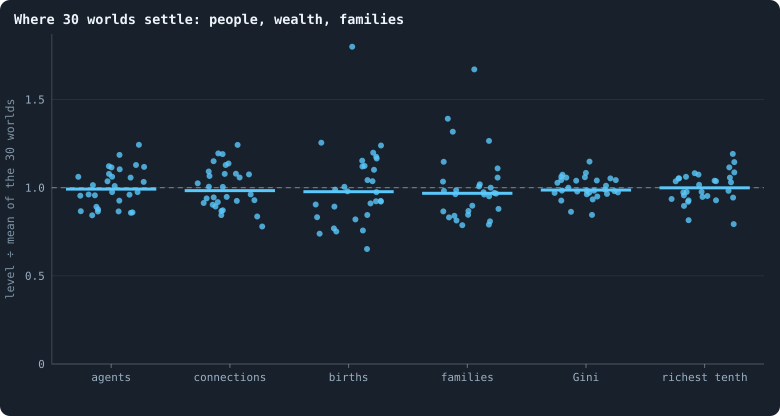
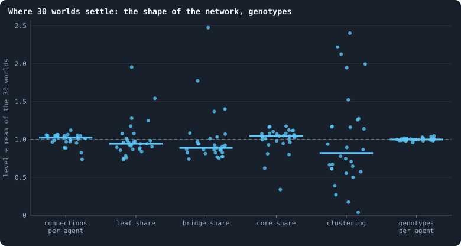
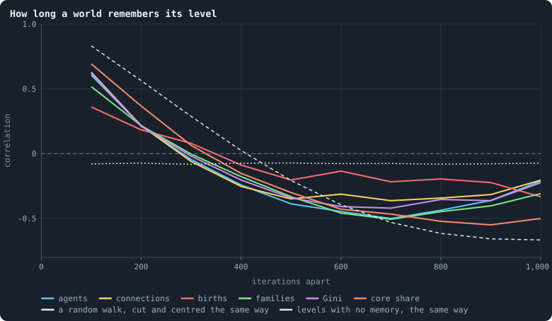
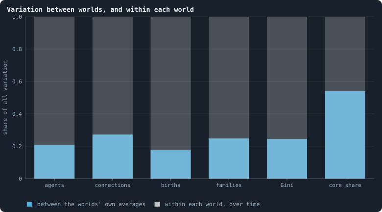
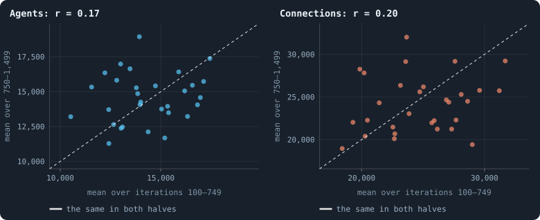
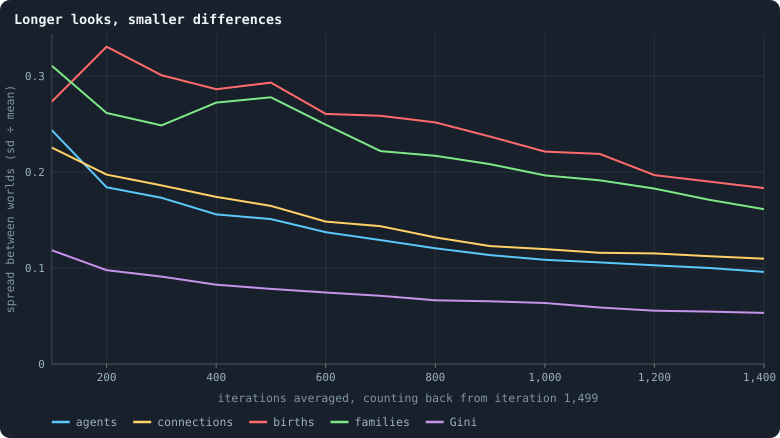
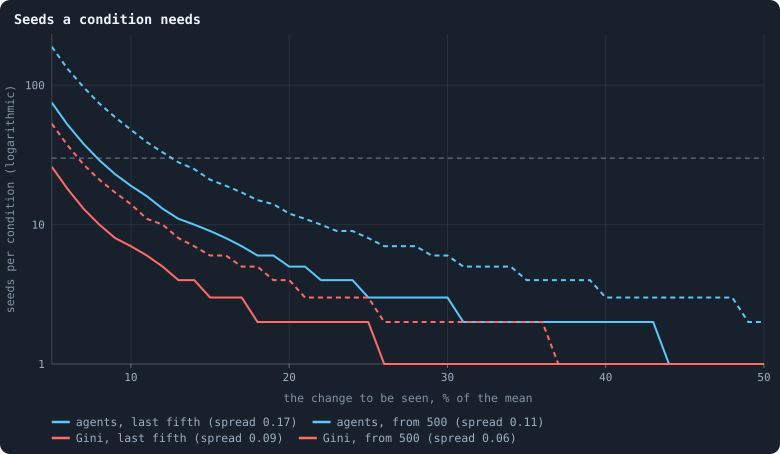

# How much does the seed decide?

Thirty worlds of the same settings differ only in their seed — and therefore
in their starting ring, their founders' brains and every random choice they
ever make.

> [!question] Questions of this chapter
> - How different do thirty such worlds end up?
> - Is the difference something each seed fixes for good, or does it come and
>   go?
> - How many seeds does an experiment need to see that a change of setting
>   changed something?

The worlds are the thirty of 100,000 tokens of [Chapter 9](09-thirty-worlds.md),
all of which lived to the end; the thirty of 10,000 tokens this chapter was
first written from are given beside them.

<!-- runs E10 -->
> [!info] The runs behind this chapter
> **30 runs.** Every condition below is run once for every seed (1 to 30), for 1,500 iterations — or until its world dies out. Every setting is that of the baseline **B1** (the algorithm exactly as a new run is offered it) unless the condition changes it.
>
> - **baseline** — changes nothing: B1 as it is; 100,000 tokens. Runs `B1-100000-s001` … `B1-100000-s030`.
>
> To make these runs again: `python3 gol_lab.py run E10`, or ▶ in the Book tab of a computer running `gol_server.py`. Each run writes its settings, seed and engine version beside its frames, in `GraphOfLifeRuns/<run>/meta.json` and `provenance.json`.

> [!info]- Every setting of these runs
> | setting | baseline | what it is |
> |---|---|---|
> | [`total_tokens`](../notes/settings.md#total_tokens) | 100,000 | The number of tokens in the world, *T*. It never changes during a run. |
> | [`n_nodes`](../notes/settings.md#n_nodes) | 0 | How many founders the world starts with. 0 means one founder per hundred tokens: *n* = ⌊*T* / 100⌋. |
> | [`k_neighbors`](../notes/settings.md#k_neighbors) | 0 | How many neighbours each founder starts with in the ring. 0 means *k* = max(⌊*n* / 100⌋, 5); an odd *k* is wired as *k* − 1. |
> | [`rewire_p`](../notes/settings.md#rewire_p) | 0.2 | In the starting ring, the probability that a connection is moved to a founder chosen at random (Watts–Strogatz). |
> | [`hidden_layers`](../notes/settings.md#hidden_layers) | 50, 45, 40, 35, 30 | The widths of the brain's hidden layers, in order from input to output. |
> | [`brain_kind`](../notes/settings.md#brain_kind) | float16 | How weights are stored: `float` (64-bit), `float16` (16-bit, computed in 64-bit) or `binary` (−1, 0, +1). |
> | [`brain_bits`](../notes/settings.md#brain_bits) | 16 | Only for binary brains: how many input rows encode one number. Unused by float and float16 brains. |
> | [`message_amount`](../notes/settings.md#message_amount) | 30 | How many numbers one message holds. Each agent sends one message to itself and one to each neighbour, every phase. |
> | [`random_input_amount`](../notes/settings.md#random_input_amount) | 5 | How many random numbers, drawn uniformly from −2 to 2, a brain reads per neighbour, every time it looks. |
> | [`exchange_messages`](../notes/settings.md#exchange_messages) | on | Whether agents send and read messages at all. |
> | [`message_prepass`](../notes/settings.md#message_prepass) | on | Whether every phase begins with an extra look in which agents only write messages, so the look that acts reads messages written this phase. |
> | [`allow_handover`](../notes/settings.md#allow_handover) | on | Whether a parent may move some of its own connections to its newborn child. |
> | [`allow_revolutions`](../notes/settings.md#allow_revolutions) | on | Whether a coalition of smaller stakers can take a node from its largest staker (see the note *How a coalition takes a node*). |
> | [`allow_gifting`](../notes/settings.md#allow_gifting) | off | Whether agents may give tokens to neighbours during reproduction. Off in every run of this book. |
> | [`random_decisions`](../notes/settings.md#random_decisions) | off | The control: every number a brain would produce is replaced by a random draw from the standard normal distribution. |
> | [`prune_after`](../notes/settings.md#prune_after) | blotto | After which phase connections that carried no tokens are cut: `blotto` (the game), `reproduction`, or `both`. |
> | [`inactive_window`](../notes/settings.md#inactive_window) | phase | How long a connection may go unused: `phase` means it must carry tokens in the phase being judged; `iteration` allows the two last phases. |
> | [`redistribution`](../notes/settings.md#redistribution) | uniform | How the tokens of removed agents are shared: `uniform` gives every survivor the same chance at each token; `by_tokens` weights by what a survivor holds; `poorest` raises the poorest to one common level first; `newborns` gives them to this iteration's children, `parents` to their parents, once per child (both `uniform` in an iteration without births); `children` leaves each dead agent's estate to its own living children (`uniform` where there are none). |
> | [`tokens_created_per_phase`](../notes/settings.md#tokens_created_per_phase) | 0 | Tokens added to the world at every cleanup. 0 keeps the supply fixed. |
> | [`mutate_on_replication`](../notes/settings.md#mutate_on_replication) | off | Whether a brain changes only when it is copied — into a newborn, or into a node its owner has just won — instead of also after every game, wherever it sits. |
> | [`incumbency`](../notes/settings.md#incumbency) | 1.0 | How many times over an agent's stake on its own node counts when the game decides who takes the node. 1 is the old rule. |
> | [`birth_links`](../notes/settings.md#birth_links) | 0 | How many of its parent's neighbours a newborn is joined to, drawn at random, besides its parent itself; 0 leaves every link to the brain's choice. |
> | [`mend_on_death`](../notes/settings.md#mend_on_death) | off | Whether the neighbours of an agent that dies are joined up where its death would leave them in separate pieces. |
> | [`prune_needs`](../notes/settings.md#prune_needs) | 0 | How many neighbours the two ends of an unused connection must share for it to be cut; 0 cuts every unused connection. |
> | [`valence`](../notes/settings.md#valence) | 0 | The most connections an agent's brain may choose to hold (0 = no limit). An agent at its limit cannot have a child. |
> | [`keep_home`](../notes/settings.md#keep_home) | 0.0 | The share of an agent's tokens — rounded up, never less than one — that stays on its own node whatever its brain says; a parent also keeps one. 0 is the old rule. |
> | [`max_age`](../notes/settings.md#max_age) | 0 | The age at which an agent dies (0 = never); its tokens are shared out like those of any other dead agent. |
> | [`buy_life`](../notes/settings.md#buy_life) | off | Whether an agent that has reached max_age may live on by paying one token an iteration into the estate of the dead — never its last, so one with a single token left dies. Needs max_age. |
> | [`min_child`](../notes/settings.md#min_child) | 1 | The fewest tokens a child can be born with; a parent that would give less has no child. |
> | [`mix_at_birth`](../notes/settings.md#mix_at_birth) | off | Whether a newborn's brain is its parent's mixed with a mate's — one of the parent's neighbours, drawn at random — each hidden unit whole from one or the other by an even chance, before it mutates; off, a newborn has a copy of its parent's brain. |
> | [`mix_mates`](../notes/settings.md#mix_mates) | any | Under mix_at_birth, who may be the mate: any neighbour of the parent, or only parents — a neighbour with a living child of its own (with none, the newborn's brain is a copy). |
> | [`link_search`](../notes/settings.md#link_search) | off | Whether an agent may reach beyond its neighbours to propose a link: off; jump, a walk as many steps long as the tokens it spends in one iteration, with a link proposed where it ends; walk, a scout that goes one step further in every iteration it pays for; or reach, a jump whose steps are free, as many as the tokens it holds would pay for. A paid step costs one token, paid to the agent it enters, and never the last. |
> | [`link_steering`](../notes/settings.md#link_steering) | random | Which way each step of a search goes: to a neighbour drawn at random, or to the one the searcher would most like a link with (looking). |
> | [`link_consent`](../notes/settings.md#link_consent) | mutual | Who has to agree to a link a search proposes: both ends (mutual), or only the one who proposes (forced). Nobody at its valence gets a new link either way. |
> | [`proto`](../notes/settings.md#proto) | none | Rules first played in the pilots' prototype, by name: came_from and helped_by (an input row each), contest = lottery, pool by genotype or family, kin_sense, tag_rate, mate_pays, grow, unit_token, link_token. Empty in every run but those that ask for one; only the prototype's world plays them (see the settings note). |
> | [`mutation_probability`](../notes/settings.md#mutation_probability) | 0.2 | The probability that a brain changes when it is copied to a child, and again, for every brain, after every game. |
> | [`mutation_noise_std`](../notes/settings.md#mutation_noise_std) | 0.2 | How large a change to one weight is: a normal draw with standard deviation this times 1/√(fan-in) of its layer. |
> | [`mutation_sparsity`](../notes/settings.md#mutation_sparsity) | 0.1 | The share of a brain's numbers a change touches; also the probability, for each weight matrix and bias vector, of a rarer reset that redraws that share of it. |
> | [`extinction_threshold`](../notes/settings.md#extinction_threshold) | 20 | A run stops, as extinct, when an iteration ends (after its game) with this many agents or fewer. |
> | seeds | 1 to 30 | one run per seed |
> | iterations | 1,500 | how far each run goes, unless its world dies first |
>
> A value in **bold** differs from the baseline B1.
<!-- /runs -->

## Where the worlds settle

Measure each world by its mean over its settled life, iterations 500 to 1,499,
and divide by the mean of the thirty, so that 1 is the average world:

<!-- figure seed/dots-1 -->

**Where 30 worlds settle: people, wealth, families.** One dot per world: its mean over iterations 500 to 1,499, divided by the mean of that value over the 30 worlds, so that every statistic is on the same scale and 1 is the average world. The bar is the median. A column of dots close to 1 means the worlds settle alike; a tall column, that they do not. The dots are spread sideways only so they do not hide one another.

> [!example]- How to make this figure
> **Runs.** The 30 baseline runs `B1-100000-s001` … `B1-100000-s030`: the baseline B1 at 100,000 tokens, seeds 1 to 30, 1,500 iterations each (every setting is listed in [Chapter 9](09-thirty-worlds.md)). They are made with `python3 gol_lab.py run E10`.
>
> **Data.** From each run's `GraphOfLifeRuns/<run>/stats.jsonl`, which holds one row per recorded phase: `phase` 1 is the world just after reproduction, `phase` 2 just after the game, and every statistic is a field of the row (see [What a run records](../notes/frames-and-stats.md)).
>
> 1. For each run and statistic, average the statistic over the rows with 500 ≤ `iteration` ≤ 1,499 (rows with `phase` 1 for births, 2 for the rest; `a/b` means the row's `a` divided by its `b`).
> 2. Divide each run's average by the mean of the 30 averages.
> 3. Plot one dot per run, with a bar at the median.
>
> **To make it again:** `python3 book_figures.py seed`.
<!-- /figure -->

<!-- figure seed/dots-2 -->

**Where 30 worlds settle: the shape of the network, genotypes.** One dot per world: its mean over iterations 500 to 1,499, divided by the mean of that value over the 30 worlds, so that every statistic is on the same scale and 1 is the average world. The bar is the median. A column of dots close to 1 means the worlds settle alike; a tall column, that they do not. The dots are spread sideways only so they do not hide one another.

> [!example]- How to make this figure
> **Runs.** The 30 baseline runs `B1-100000-s001` … `B1-100000-s030`: the baseline B1 at 100,000 tokens, seeds 1 to 30, 1,500 iterations each (every setting is listed in [Chapter 9](09-thirty-worlds.md)). They are made with `python3 gol_lab.py run E10`.
>
> **Data.** From each run's `GraphOfLifeRuns/<run>/stats.jsonl`, which holds one row per recorded phase: `phase` 1 is the world just after reproduction, `phase` 2 just after the game, and every statistic is a field of the row (see [What a run records](../notes/frames-and-stats.md)).
>
> 1. For each run and statistic, average the statistic over the rows with 500 ≤ `iteration` ≤ 1,499 (rows with `phase` 1 for births, 2 for the rest; `a/b` means the row's `a` divided by its `b`).
> 2. Divide each run's average by the mean of the 30 averages.
> 3. Plot one dot per run, with a bar at the median.
>
> **To make it again:** `python3 book_figures.py seed`.
<!-- /figure -->

The columns differ a great deal in height. The share of agents that are
distinct genotypes is almost the same in every world (a
[spread](../notes/spread-between-worlds.md), sd ÷ mean, of 0.02); inequality
(Gini, 0.06), connections per agent (0.08) and the share held by the richest
tenth (0.09) vary little; the number of agents (0.11) and connections (0.12)
vary more, families (0.20) and births (0.22) more still. These counts vary
*less* than in the worlds of 10,000 tokens — the number of agents had a spread
of 0.17 there, connections 0.19 — as larger worlds average more of their own
accidents away.

The shape of the network does the opposite. The share of agents that are
leaves varies with a spread of 0.25 (0.12 at 10,000 tokens), the share of
connections that are bridges 0.35 (0.24), the share of agents in the core 0.17
(0.13) and clustering 0.62 (0.34). And these columns are not one even spread:
most worlds sit together, and a few lie far out — the same few for leaves,
bridges and the core, and among the lowest for clustering. They are the worlds
in which a single agent became a **hub** joined to a sixth of the world or
more: in the world with seed 28, on average 58% of
all agents were neighbours of one agent over its settled life, and 72% of its
connections were bridges. Seven of the thirty worlds had a hub that held, on
average, a tenth of the world or more, and across all thirty the share of
agents in the core goes with the share joined to the largest hub almost
exactly (a correlation of −0.96). [Chapter 17](17-what-shape-does-the-network-take.md)
shows what such a world looks like and [Chapter 33](33-the-largest-and-the-smallest.md)
how a hub grows and falls. Hubs of this kind were there in the worlds of 10,000 tokens
too — ten of the 26 had a hub that held, on average, a tenth of the world or
more, three a fifth or more — but there the shape of a world went with its hub
far more loosely (a correlation of −0.54). At 100,000 tokens the hub is almost
the whole of it.

## A world forgets

The single worlds of [Chapter 10](10-a-worlds-life.md) wander. How fast? Correlate each world's level
in a stretch of 100 iterations with its level some iterations later:

<!-- figure seed/memory -->

**How long a world remembers its level.** For each statistic, the correlation between a world's level in one stretch of 100 iterations and its level a given number of iterations later, over all pairs of stretches in the 30 worlds. 1 would mean a world stays exactly where it was; 0 that where it was says nothing about where it will be. Because each world's own mean is taken away first, a world cut into only 14 stretches shows negative correlations at long lags even if it simply wandered: the grey dashes are what a random walk, cut and centred the same way, gives (averaged over 200 sets of as many walks), and the grey dots what levels with no memory at all give.

> [!example]- How to make this figure
> **Runs.** The 30 baseline runs `B1-100000-s001` … `B1-100000-s030`: the baseline B1 at 100,000 tokens, seeds 1 to 30, 1,500 iterations each (every setting is listed in [Chapter 9](09-thirty-worlds.md)). They are made with `python3 gol_lab.py run E10`.
>
> **Data.** From each run's `GraphOfLifeRuns/<run>/stats.jsonl`, which holds one row per recorded phase: `phase` 1 is the world just after reproduction, `phase` 2 just after the game, and every statistic is a field of the row (see [What a run records](../notes/frames-and-stats.md)).
>
> 1. For each run, cut iterations 100 to 1,499 into 14 stretches of 100 and take the mean of the statistic in each.
> 2. Subtract from each run's 14 values their own mean, so that only the run's movement remains.
> 3. For a lag of L stretches, pair every stretch with the one L later, in every run, and take the Pearson correlation of all the pairs together.
> 4. References: 30 series of 1,400 steps, each step normal with mean 0 — summed (a random walk) or not (no memory) — cut, centred and correlated the same way; the mean over 200 such sets (generator seeded with 13).
>
> **To make it again:** `python3 book_figures.py seed`.
<!-- /figure -->

A hundred iterations on, a world is still much where it was: the correlation
is 0.61 for the number of agents and 0.62 for inequality. Two hundred on, it
is about a third of that (0.21 for both); three hundred on, nothing is left.
The share of agents in the core is remembered a little longer (0.37 after 200
iterations), births a little less (0.36 after 100).

Then every line goes below zero, to about −0.5 at 700 iterations — and this is
not a real anti-memory. Each world was measured against its own average, so a
world above it in some stretches must be below it in others; with only 14
stretches per world, that alone pulls distant stretches to opposite sides.
How much it pulls depends on how the world moves, and the two grey lines
bracket it: a level that wanders without limit (a random walk, dashed),
measured the same way, falls from 0.83 at one stretch to −0.66 at nine, and a
level with no memory at all (dotted) sits at −0.08 everywhere. The worlds
forget far faster than the random walk — at 100 and 200 iterations they are
well below it — and their dip at long lags is what centring does to a level
that has drifted within the window. In the worlds of 10,000 tokens, with 29
stretches per world, the same dip was only −0.1 to −0.17
([Autocorrelation](../notes/autocorrelation.md)).

## The seed, or time?

All the variation in a statistic's 100-iteration levels — 14 stretches in
each of 30 worlds — can be split into the part that lies between the worlds'
own averages and the part that is each world moving around its own average
([Between and within](../notes/between-and-within.md)):

<!-- figure seed/between -->

**Variation between worlds, and within each world.** All the variation of a statistic's 100-iteration levels — 14 stretches in each of 30 worlds — split into the part that lies between the worlds' own averages (blue) and the part that is each world moving around its own average (the rest of the column, grey).

> [!example]- How to make this figure
> **Runs.** The 30 baseline runs `B1-100000-s001` … `B1-100000-s030`: the baseline B1 at 100,000 tokens, seeds 1 to 30, 1,500 iterations each (every setting is listed in [Chapter 9](09-thirty-worlds.md)). They are made with `python3 gol_lab.py run E10`.
>
> **Data.** From each run's `GraphOfLifeRuns/<run>/stats.jsonl`, which holds one row per recorded phase: `phase` 1 is the world just after reproduction, `phase` 2 just after the game, and every statistic is a field of the row (see [What a run records](../notes/frames-and-stats.md)).
>
> 1. Take each run's 14 stretch means as for the figure above.
> 2. Between: the variance (n − 1 in the denominator) of the 30 runs' own averages.
> 3. Within: the mean over runs of the variance of each run's 14 values.
> 4. Draw between ÷ (between + within).
>
> **To make it again:** `python3 book_figures.py seed`.
<!-- /figure -->

For the counts, about a fifth to a quarter of the variation lies between the
worlds — 21% for the number of agents, 27% for connections, 25% for
inequality. The rest, about three quarters, is each world wandering, and
even the part between worlds is partly wandering that 1,400 iterations did not
average away. The share of agents in the core is the exception: 54% of its
variation lies between the worlds' own averages (24% at 10,000 tokens). Which
shape a world settles into — with a giant hub or without — is more its own
than how many agents it holds.

A sharper test: is a world that is crowded in the first half of its life
also crowded in the second?

<!-- figure seed/halves -->

**First half against second half.** One dot per world. Left: its mean number of agents over iterations 100–749 (x) against its mean over iterations 750–1,499 (y). Right: the same for connections. A dot on the dashed diagonal had the same mean in both halves. r is the correlation over the 30 dots.

> [!example]- How to make this figure
> **Runs.** The 30 baseline runs `B1-100000-s001` … `B1-100000-s030`: the baseline B1 at 100,000 tokens, seeds 1 to 30, 1,500 iterations each (every setting is listed in [Chapter 9](09-thirty-worlds.md)). They are made with `python3 gol_lab.py run E10`.
>
> **Data.** From each run's `GraphOfLifeRuns/<run>/stats.jsonl`, which holds one row per recorded phase: `phase` 1 is the world just after reproduction, `phase` 2 just after the game, and every statistic is a field of the row (see [What a run records](../notes/frames-and-stats.md)).
>
> 1. For `nodes` and `edges`, average over the rows with `phase` = 2 and 100 ≤ `iteration` ≤ 749, and over 750 ≤ `iteration` ≤ 1,499.
> 2. Plot the second against the first, one dot per run; r is their Pearson correlation ([correlation](../notes/correlation.md)).
>
> **To make it again:** `python3 book_figures.py seed`.
<!-- /figure -->

Hardly: the correlation between the halves over the 30 worlds is 0.17 for the
number of agents and 0.20 for connections, and random pairings of first and
second halves ([a permutation test](../notes/permutation-test.md)) give one at
least that large 18 and 14 times in 100. At 10,000 tokens connections had kept
something of their own (0.41, reached by random pairings only 2 times in 100);
at this size nothing of the kind shows.

## Longer looks, smaller differences

A world forgets its level within a few hundred iterations, so its mean over a
longer stretch averages more of its wandering away, and the worlds look more
alike:

<!-- figure seed/stretch -->

**Longer looks, smaller differences.** For each statistic, how much the 30 worlds differ — the standard deviation of their averages divided by the mean — when each world is measured by its average over its last L iterations, for L from 100 to 1,400.

> [!example]- How to make this figure
> **Runs.** The 30 baseline runs `B1-100000-s001` … `B1-100000-s030`: the baseline B1 at 100,000 tokens, seeds 1 to 30, 1,500 iterations each (every setting is listed in [Chapter 9](09-thirty-worlds.md)). They are made with `python3 gol_lab.py run E10`.
>
> **Data.** From each run's `GraphOfLifeRuns/<run>/stats.jsonl`, which holds one row per recorded phase: `phase` 1 is the world just after reproduction, `phase` 2 just after the game, and every statistic is a field of the row (see [What a run records](../notes/frames-and-stats.md)).
>
> 1. For each length L, average the statistic over the rows with 1,500 − L ≤ `iteration` ≤ 1,499 in each run.
> 2. Divide the standard deviation of the 30 averages (n − 1 in the denominator) by their mean.
>
> **To make it again:** `python3 book_figures.py seed`.
<!-- /figure -->

Measured over its last 100 iterations, the number of agents varies between
worlds by 0.24 of the mean; over the last 300 — the last fifth — by 0.17; over
the last 1,400 by 0.10. Inequality falls from 0.12 to 0.05, families from 0.31
to 0.16, connections from 0.23 to 0.11. Births vary most and fall most slowly
(0.27 to 0.18).

## How many seeds an experiment needs

From the spread *c* follows how many worlds each condition needs ([How many seeds](../notes/seeds-needed.md)):

<!-- figure seed/seeds-needed -->

**Seeds a condition needs.** How many worlds each of two conditions needs for a change of a given size in the average to be found four times in five at the 5% level, if worlds vary as much as these do. Dashed: worlds measured over their last fifth (iterations 1,200–1,499); solid: over iterations 500–1,499. The grey line is 30 seeds.

> [!example]- How to make this figure
> **Runs.** The 30 baseline runs `B1-100000-s001` … `B1-100000-s030`: the baseline B1 at 100,000 tokens, seeds 1 to 30, 1,500 iterations each (every setting is listed in [Chapter 9](09-thirty-worlds.md)). They are made with `python3 gol_lab.py run E10`.
>
> **Data.** From each run's `GraphOfLifeRuns/<run>/stats.jsonl`, which holds one row per recorded phase: `phase` 1 is the world just after reproduction, `phase` 2 just after the game, and every statistic is a field of the row (see [What a run records](../notes/frames-and-stats.md)).
>
> 1. Measure each run by its average over the stretch, and compute the spread c = sd ÷ mean of the 30 averages.
> 2. For a change Δ (as a share of the mean), n = 2 (z₁ + z₂)² c² / Δ², with z₁ = 1.960 (5%, two-sided) and z₂ = 0.842 (power 80%); round up.
>
> **To make it again:** `python3 book_figures.py seed`.
<!-- /figure -->

Measured over the last fifth of the runs (dashed), seeing a change of 10% in
the number of agents takes 48 seeds per condition; measured over the settled
life (solid), 19 — where the worlds of 10,000 tokens needed 100 and 46. For
inequality, 14 and 7. With 30 seeds per condition and the settled-life
measure, the smallest change that can be seen four times in five is about 8%
in the number of agents, 9% in connections and 5% in inequality. Larger
worlds make sharper experiments — at a price: each costs about eight times the
computing ([Chapter 9](09-thirty-worlds.md)).

Two more things this means for experiments:

- **Pairing by seed helps little.** Two conditions run with the same seed
  share their starting ring and founders — and, since the seed hardly decides
  where a world goes, little else. A comparison seed by seed is about as noisy
  as one between unrelated worlds.
- **Shape needs more seeds than size.** Whether a world grows a giant hub is
  something a few worlds in thirty do; a change of setting that made it twice
  as common would need far more than thirty seeds to see.

## What was expected

Before the runs of 10,000 tokens, as Experiment 3:

<!-- runs E03 -->
> [!info] The runs behind this chapter
> These are the runs of Experiment 2; nothing new was run for this chapter.
>
> **30 runs.** Every condition below is run once for every seed (1 to 30), for 3,000 iterations — or until its world dies out. Every setting is that of the baseline **B1** (the algorithm exactly as a new run is offered it) unless the condition changes it.
>
> - **baseline** — changes nothing: B1 as it is; 10,000 tokens. Runs `B1-10000-s001` … `B1-10000-s030`.
>
> To make these runs again: `python3 gol_lab.py run E02`, or ▶ in the Book tab of a computer running `gol_server.py`. Each run writes its settings, seed and engine version beside its frames, in `GraphOfLifeRuns/<run>/meta.json` and `provenance.json`.

> [!info]- Every setting of these runs
> | setting | baseline | what it is |
> |---|---|---|
> | [`total_tokens`](../notes/settings.md#total_tokens) | 10,000 | The number of tokens in the world, *T*. It never changes during a run. |
> | [`n_nodes`](../notes/settings.md#n_nodes) | 0 | How many founders the world starts with. 0 means one founder per hundred tokens: *n* = ⌊*T* / 100⌋. |
> | [`k_neighbors`](../notes/settings.md#k_neighbors) | 0 | How many neighbours each founder starts with in the ring. 0 means *k* = max(⌊*n* / 100⌋, 5); an odd *k* is wired as *k* − 1. |
> | [`rewire_p`](../notes/settings.md#rewire_p) | 0.2 | In the starting ring, the probability that a connection is moved to a founder chosen at random (Watts–Strogatz). |
> | [`hidden_layers`](../notes/settings.md#hidden_layers) | 50, 45, 40, 35, 30 | The widths of the brain's hidden layers, in order from input to output. |
> | [`brain_kind`](../notes/settings.md#brain_kind) | float16 | How weights are stored: `float` (64-bit), `float16` (16-bit, computed in 64-bit) or `binary` (−1, 0, +1). |
> | [`brain_bits`](../notes/settings.md#brain_bits) | 16 | Only for binary brains: how many input rows encode one number. Unused by float and float16 brains. |
> | [`message_amount`](../notes/settings.md#message_amount) | 30 | How many numbers one message holds. Each agent sends one message to itself and one to each neighbour, every phase. |
> | [`random_input_amount`](../notes/settings.md#random_input_amount) | 5 | How many random numbers, drawn uniformly from −2 to 2, a brain reads per neighbour, every time it looks. |
> | [`exchange_messages`](../notes/settings.md#exchange_messages) | on | Whether agents send and read messages at all. |
> | [`message_prepass`](../notes/settings.md#message_prepass) | on | Whether every phase begins with an extra look in which agents only write messages, so the look that acts reads messages written this phase. |
> | [`allow_handover`](../notes/settings.md#allow_handover) | on | Whether a parent may move some of its own connections to its newborn child. |
> | [`allow_revolutions`](../notes/settings.md#allow_revolutions) | on | Whether a coalition of smaller stakers can take a node from its largest staker (see the note *How a coalition takes a node*). |
> | [`allow_gifting`](../notes/settings.md#allow_gifting) | off | Whether agents may give tokens to neighbours during reproduction. Off in every run of this book. |
> | [`random_decisions`](../notes/settings.md#random_decisions) | off | The control: every number a brain would produce is replaced by a random draw from the standard normal distribution. |
> | [`prune_after`](../notes/settings.md#prune_after) | blotto | After which phase connections that carried no tokens are cut: `blotto` (the game), `reproduction`, or `both`. |
> | [`inactive_window`](../notes/settings.md#inactive_window) | phase | How long a connection may go unused: `phase` means it must carry tokens in the phase being judged; `iteration` allows the two last phases. |
> | [`redistribution`](../notes/settings.md#redistribution) | uniform | How the tokens of removed agents are shared: `uniform` gives every survivor the same chance at each token; `by_tokens` weights by what a survivor holds; `poorest` raises the poorest to one common level first; `newborns` gives them to this iteration's children, `parents` to their parents, once per child (both `uniform` in an iteration without births); `children` leaves each dead agent's estate to its own living children (`uniform` where there are none). |
> | [`tokens_created_per_phase`](../notes/settings.md#tokens_created_per_phase) | 0 | Tokens added to the world at every cleanup. 0 keeps the supply fixed. |
> | [`mutate_on_replication`](../notes/settings.md#mutate_on_replication) | off | Whether a brain changes only when it is copied — into a newborn, or into a node its owner has just won — instead of also after every game, wherever it sits. |
> | [`incumbency`](../notes/settings.md#incumbency) | 1.0 | How many times over an agent's stake on its own node counts when the game decides who takes the node. 1 is the old rule. |
> | [`birth_links`](../notes/settings.md#birth_links) | 0 | How many of its parent's neighbours a newborn is joined to, drawn at random, besides its parent itself; 0 leaves every link to the brain's choice. |
> | [`mend_on_death`](../notes/settings.md#mend_on_death) | off | Whether the neighbours of an agent that dies are joined up where its death would leave them in separate pieces. |
> | [`prune_needs`](../notes/settings.md#prune_needs) | 0 | How many neighbours the two ends of an unused connection must share for it to be cut; 0 cuts every unused connection. |
> | [`valence`](../notes/settings.md#valence) | 0 | The most connections an agent's brain may choose to hold (0 = no limit). An agent at its limit cannot have a child. |
> | [`keep_home`](../notes/settings.md#keep_home) | 0.0 | The share of an agent's tokens — rounded up, never less than one — that stays on its own node whatever its brain says; a parent also keeps one. 0 is the old rule. |
> | [`max_age`](../notes/settings.md#max_age) | 0 | The age at which an agent dies (0 = never); its tokens are shared out like those of any other dead agent. |
> | [`buy_life`](../notes/settings.md#buy_life) | off | Whether an agent that has reached max_age may live on by paying one token an iteration into the estate of the dead — never its last, so one with a single token left dies. Needs max_age. |
> | [`min_child`](../notes/settings.md#min_child) | 1 | The fewest tokens a child can be born with; a parent that would give less has no child. |
> | [`mix_at_birth`](../notes/settings.md#mix_at_birth) | off | Whether a newborn's brain is its parent's mixed with a mate's — one of the parent's neighbours, drawn at random — each hidden unit whole from one or the other by an even chance, before it mutates; off, a newborn has a copy of its parent's brain. |
> | [`mix_mates`](../notes/settings.md#mix_mates) | any | Under mix_at_birth, who may be the mate: any neighbour of the parent, or only parents — a neighbour with a living child of its own (with none, the newborn's brain is a copy). |
> | [`link_search`](../notes/settings.md#link_search) | off | Whether an agent may reach beyond its neighbours to propose a link: off; jump, a walk as many steps long as the tokens it spends in one iteration, with a link proposed where it ends; walk, a scout that goes one step further in every iteration it pays for; or reach, a jump whose steps are free, as many as the tokens it holds would pay for. A paid step costs one token, paid to the agent it enters, and never the last. |
> | [`link_steering`](../notes/settings.md#link_steering) | random | Which way each step of a search goes: to a neighbour drawn at random, or to the one the searcher would most like a link with (looking). |
> | [`link_consent`](../notes/settings.md#link_consent) | mutual | Who has to agree to a link a search proposes: both ends (mutual), or only the one who proposes (forced). Nobody at its valence gets a new link either way. |
> | [`proto`](../notes/settings.md#proto) | none | Rules first played in the pilots' prototype, by name: came_from and helped_by (an input row each), contest = lottery, pool by genotype or family, kin_sense, tag_rate, mate_pays, grow, unit_token, link_token. Empty in every run but those that ask for one; only the prototype's world plays them (see the settings note). |
> | [`mutation_probability`](../notes/settings.md#mutation_probability) | 0.2 | The probability that a brain changes when it is copied to a child, and again, for every brain, after every game. |
> | [`mutation_noise_std`](../notes/settings.md#mutation_noise_std) | 0.2 | How large a change to one weight is: a normal draw with standard deviation this times 1/√(fan-in) of its layer. |
> | [`mutation_sparsity`](../notes/settings.md#mutation_sparsity) | 0.1 | The share of a brain's numbers a change touches; also the probability, for each weight matrix and bias vector, of a rarer reset that redraws that share of it. |
> | [`extinction_threshold`](../notes/settings.md#extinction_threshold) | 20 | A run stops, as extinct, when an iteration ends (after its game) with this many agents or fewer. |
> | seeds | 1 to 30 | one run per seed |
> | iterations | 3,000 | how far each run goes, unless its world dies first |
>
> A value in **bold** differs from the baseline B1.
<!-- /runs -->

<!-- thesis E03 -->
> [!quote] The thesis of Experiment 3, written down before any of its runs existed
> **The claim.** Thirty seeds give thirty different histories, but the same kind of world. Where a world ends up — how many agents, how many connections, how unequal — differs from seed to seed by less than a fifth of its typical value. Thirty seeds per condition are enough to see a change of a tenth in those.
>
> **Why it would be so.** A seed decides the starting ring and every coin the world throws, so no two runs share a single event. But each run is made of thousands of agents and thousands of iterations, and a world with that much going on averages its own accidents away, the way two different shuffles of a large deck still hold the same number of each suit.
>
> **It holds if:** For the population, the connections and the Gini coefficient of wealth at the end of the runs, the standard deviation across the thirty seeds is below a fifth of the mean, and the number of seeds needed to see a 10% change is at most thirty.
>
> **It fails if:** One of these varies across seeds by more than a fifth of its mean, or the endings fall into separate groups — some seeds settling at one level, others at another. Then the seed is part of the story, and every later experiment needs more seeds than planned, or must look at the seeds one by one.
<!-- /thesis -->

It was checked, as planned, on the last fifth of each run (iterations
2,400–2,999). Inequality passed both of its tests: its spread was 0.13, and 26
seeds would see a change of a tenth. Connections passed the first and failed
the second (0.19; 58 seeds). The number of agents failed both (0.25; 100
seeds). So the thesis was refuted, narrowly — and it held in what it says about
*kind*: there were no separate groups of worlds.

**At 100,000 tokens**, on the last fifth of each run (iterations 1,200–1,499),
the thesis is refuted again, more narrowly. All three spreads are now below a
fifth — the number of agents 0.17, connections 0.19, inequality 0.09 — but
seeing a change of a tenth still takes more than thirty seeds for the first
two (48 and 55), and 14 for inequality. On kind it holds less well than before:
in agents, connections and inequality the worlds spread evenly, but in the
shape of their network a few lie far from the rest — the worlds of a giant hub.

What the thesis missed at both sizes is where the spread comes from. It is
mostly not the seed but time: each world wanders, and the end of a run catches
it wherever it happens to be. That is why every later chapter measures worlds
over their settled life, from iteration 500 on.

To make every figure of this chapter: `python3 book_figures.py seed`.

<!-- turns -->
---

← [Chapter 13 · How ages change over a world's life](13-how-ages-change.md) · [Contents](../README.md) · [Chapter 15 · Where do the tokens go?](15-where-do-the-tokens-go.md) →
<!-- /turns -->
