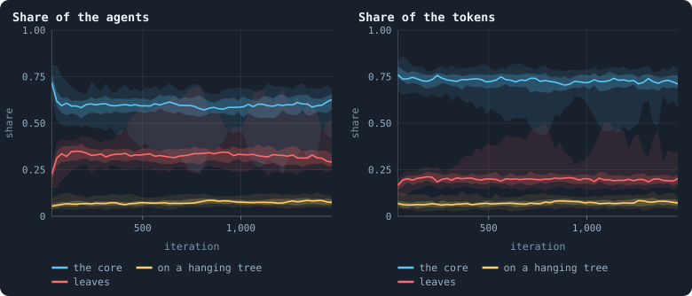
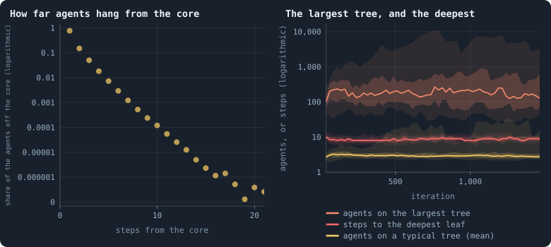
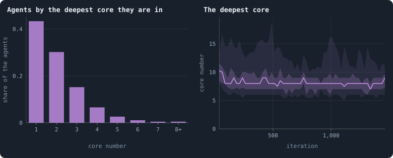
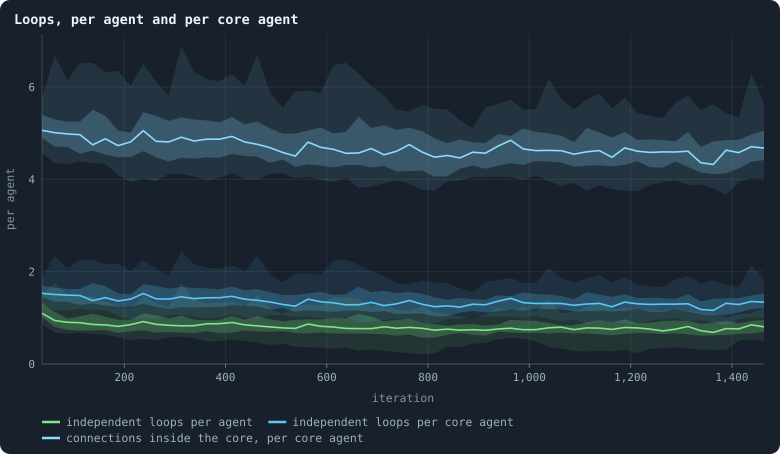
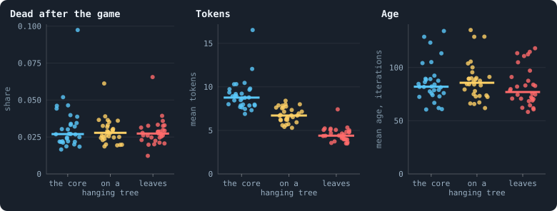
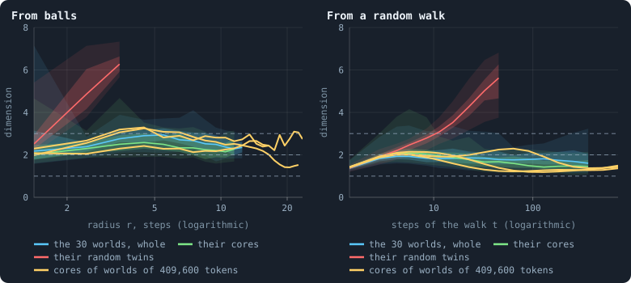
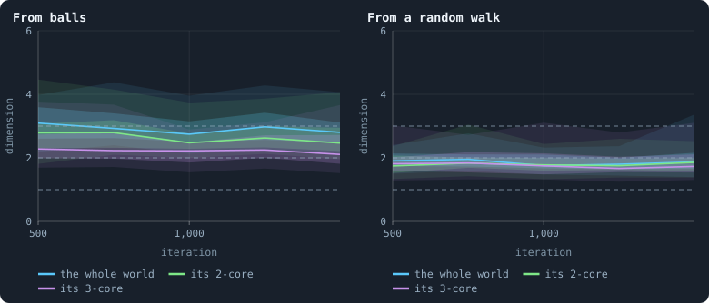

# The core of a world

Peel away every agent with one connection or none, again and again, and what
is left is a world's **core**: the agents that lie on a loop, or on a path
between loops ([Core, trees and leaves](../notes/core-trees-leaves.md)).
Everything peeled hangs off the core in trees. [Chapter 17](17-what-shape-does-the-network-take.md)
found that the core holds more than half the agents, and
[Chapter 24](24-how-many-dimensions-does-a-world-have.md) measured how many
dimensions a whole world has. This chapter asks the same of the core.

> [!question] Questions of this chapter
> - How much of a world is core — of its agents, and of its tokens?
> - How many dimensions does the core have, by the same two rulers that
>   measured the whole world? Is the core a space of its own, with the trees as
>   decoration — or are the trees what makes a world look the way it does?
> - How far do the trees hang from the core, and how large are they?
> - How deep does the core go: is there a core within the core?
> - Who lives in the core, and who on the trees — and where do agents die?

<!-- runs E10 -->
> [!info] The runs behind this chapter
> **30 runs.** Every condition below is run once for every seed (1 to 30), for 1,500 iterations — or until its world dies out. Every setting is that of the baseline **B1** (the algorithm exactly as a new run is offered it) unless the condition changes it.
>
> - **baseline** — changes nothing: B1 as it is; 100,000 tokens. Runs `B1-100000-s001` … `B1-100000-s030`.
>
> To make these runs again: `python3 gol_lab.py run E10`, or ▶ in the Book tab of a computer running `gol_server.py`. Each run writes its settings, seed and engine version beside its frames, in `GraphOfLifeRuns/<run>/meta.json` and `provenance.json`.

> [!info]- Every setting of these runs
> | setting | baseline | what it is |
> |---|---|---|
> | [`total_tokens`](../notes/settings.md#total_tokens) | 100,000 | The number of tokens in the world, *T*. It never changes during a run. |
> | [`n_nodes`](../notes/settings.md#n_nodes) | 0 | How many founders the world starts with. 0 means one founder per hundred tokens: *n* = ⌊*T* / 100⌋. |
> | [`k_neighbors`](../notes/settings.md#k_neighbors) | 0 | How many neighbours each founder starts with in the ring. 0 means *k* = max(⌊*n* / 100⌋, 5); an odd *k* is wired as *k* − 1. |
> | [`rewire_p`](../notes/settings.md#rewire_p) | 0.2 | In the starting ring, the probability that a connection is moved to a founder chosen at random (Watts–Strogatz). |
> | [`hidden_layers`](../notes/settings.md#hidden_layers) | 50, 45, 40, 35, 30 | The widths of the brain's hidden layers, in order from input to output. |
> | [`brain_kind`](../notes/settings.md#brain_kind) | float16 | How weights are stored: `float` (64-bit), `float16` (16-bit, computed in 64-bit) or `binary` (−1, 0, +1). |
> | [`brain_bits`](../notes/settings.md#brain_bits) | 16 | Only for binary brains: how many input rows encode one number. Unused by float and float16 brains. |
> | [`message_amount`](../notes/settings.md#message_amount) | 30 | How many numbers one message holds. Each agent sends one message to itself and one to each neighbour, every phase. |
> | [`random_input_amount`](../notes/settings.md#random_input_amount) | 5 | How many random numbers, drawn uniformly from −2 to 2, a brain reads per neighbour, every time it looks. |
> | [`exchange_messages`](../notes/settings.md#exchange_messages) | on | Whether agents send and read messages at all. |
> | [`message_prepass`](../notes/settings.md#message_prepass) | on | Whether every phase begins with an extra look in which agents only write messages, so the look that acts reads messages written this phase. |
> | [`allow_handover`](../notes/settings.md#allow_handover) | on | Whether a parent may move some of its own connections to its newborn child. |
> | [`allow_revolutions`](../notes/settings.md#allow_revolutions) | on | Whether a coalition of smaller stakers can take a node from its largest staker (see the note *How a coalition takes a node*). |
> | [`allow_gifting`](../notes/settings.md#allow_gifting) | off | Whether agents may give tokens to neighbours during reproduction. Off in every run of this book. |
> | [`random_decisions`](../notes/settings.md#random_decisions) | off | The control: every number a brain would produce is replaced by a random draw from the standard normal distribution. |
> | [`prune_after`](../notes/settings.md#prune_after) | blotto | After which phase connections that carried no tokens are cut: `blotto` (the game), `reproduction`, or `both`. |
> | [`inactive_window`](../notes/settings.md#inactive_window) | phase | How long a connection may go unused: `phase` means it must carry tokens in the phase being judged; `iteration` allows the two last phases. |
> | [`redistribution`](../notes/settings.md#redistribution) | uniform | How the tokens of removed agents are shared: `uniform` gives every survivor the same chance at each token; `by_tokens` weights by what a survivor holds; `poorest` raises the poorest to one common level first; `newborns` gives them to this iteration's children, `parents` to their parents, once per child (both `uniform` in an iteration without births); `children` leaves each dead agent's estate to its own living children (`uniform` where there are none). |
> | [`tokens_created_per_phase`](../notes/settings.md#tokens_created_per_phase) | 0 | Tokens added to the world at every cleanup. 0 keeps the supply fixed. |
> | [`mutate_on_replication`](../notes/settings.md#mutate_on_replication) | off | Whether a brain changes only when it is copied — into a newborn, or into a node its owner has just won — instead of also after every game, wherever it sits. |
> | [`incumbency`](../notes/settings.md#incumbency) | 1.0 | How many times over an agent's stake on its own node counts when the game decides who takes the node. 1 is the old rule. |
> | [`birth_links`](../notes/settings.md#birth_links) | 0 | How many of its parent's neighbours a newborn is joined to, drawn at random, besides its parent itself; 0 leaves every link to the brain's choice. |
> | [`mend_on_death`](../notes/settings.md#mend_on_death) | off | Whether the neighbours of an agent that dies are joined up where its death would leave them in separate pieces. |
> | [`prune_needs`](../notes/settings.md#prune_needs) | 0 | How many neighbours the two ends of an unused connection must share for it to be cut; 0 cuts every unused connection. |
> | [`valence`](../notes/settings.md#valence) | 0 | The most connections an agent's brain may choose to hold (0 = no limit). An agent at its limit cannot have a child. |
> | [`keep_home`](../notes/settings.md#keep_home) | 0.0 | The share of an agent's tokens — rounded up, never less than one — that stays on its own node whatever its brain says; a parent also keeps one. 0 is the old rule. |
> | [`max_age`](../notes/settings.md#max_age) | 0 | The age at which an agent dies (0 = never); its tokens are shared out like those of any other dead agent. |
> | [`buy_life`](../notes/settings.md#buy_life) | off | Whether an agent that has reached max_age may live on by paying one token an iteration into the estate of the dead — never its last, so one with a single token left dies. Needs max_age. |
> | [`min_child`](../notes/settings.md#min_child) | 1 | The fewest tokens a child can be born with; a parent that would give less has no child. |
> | [`mix_at_birth`](../notes/settings.md#mix_at_birth) | off | Whether a newborn's brain is its parent's mixed with a mate's — one of the parent's neighbours, drawn at random — each hidden unit whole from one or the other by an even chance, before it mutates; off, a newborn has a copy of its parent's brain. |
> | [`mix_mates`](../notes/settings.md#mix_mates) | any | Under mix_at_birth, who may be the mate: any neighbour of the parent, or only parents — a neighbour with a living child of its own (with none, the newborn's brain is a copy). |
> | [`link_search`](../notes/settings.md#link_search) | off | Whether an agent may reach beyond its neighbours to propose a link: off; jump, a walk as many steps long as the tokens it spends in one iteration, with a link proposed where it ends; walk, a scout that goes one step further in every iteration it pays for; or reach, a jump whose steps are free, as many as the tokens it holds would pay for. A paid step costs one token, paid to the agent it enters, and never the last. |
> | [`link_steering`](../notes/settings.md#link_steering) | random | Which way each step of a search goes: to a neighbour drawn at random, or to the one the searcher would most like a link with (looking). |
> | [`link_consent`](../notes/settings.md#link_consent) | mutual | Who has to agree to a link a search proposes: both ends (mutual), or only the one who proposes (forced). Nobody at its valence gets a new link either way. |
> | [`mutation_probability`](../notes/settings.md#mutation_probability) | 0.2 | The probability that a brain changes when it is copied to a child, and again, for every brain, after every game. |
> | [`mutation_noise_std`](../notes/settings.md#mutation_noise_std) | 0.2 | How large a change to one weight is: a normal draw with standard deviation this times 1/√(fan-in) of its layer. |
> | [`mutation_sparsity`](../notes/settings.md#mutation_sparsity) | 0.1 | The share of a brain's numbers a change touches; also the probability, for each weight matrix and bias vector, of a rarer reset that redraws that share of it. |
> | [`extinction_threshold`](../notes/settings.md#extinction_threshold) | 20 | A run stops, as extinct, when an iteration ends (after its game) with this many agents or fewer. |
> | seeds | 1 to 30 | one run per seed |
> | iterations | 1,500 | how far each run goes, unless its world dies first |
>
> A value in **bold** differs from the baseline B1.
<!-- /runs -->

## Why ask

The core is where a world can hold anything together. Every connection in it
lies on a loop or on a path between loops. Cutting one on a loop splits
nothing — there is another way round — but one on a path between loops is a
bridge, and its loss splits the core in two ([Bridges](../notes/bridges.md)):
in one world of [Chapter 36](36-how-a-world-breaks.md), a third to almost
half of the world hung on a single connection for 140 iterations. A tree is
cut off whole by the loss of the one connection that holds it. Anything
larger than an agent that might persist and evolve — a group of agents that
holds together while its members come and go — can only live in the core.

And the core is the better candidate for a **space**, in the sense of
[Chapter 7](07-physical-inspiration.md). The trees branch: a tree of depth *d*
can hold a number of agents that grows exponentially with *d*, and a ball of
radius *r* around an agent swells with every tree it meets. Such growth makes a
network look higher-dimensional than the space it hangs from. So if the worlds
have a dimension of their own, it should show most cleanly in their cores —
and the difference between a world's dimension and its core's says how much
the trees inflate it.

## Peeling a world

Every 25 iterations, at the start of the game, each world is peeled, and its
agents and tokens are counted in the three parts:

<!-- figure core/parts -->

**Core, trees and leaves.** At the start of the game of every 25th iteration of the 30 worlds: the share of the agents (left) and of the tokens (right) in the core, on the hanging trees (agents with two connections or more that the peeling removes), and on leaves (agents with one connection). The line is the median of the worlds at each iteration, the darker band holds the middle half of them (from the 25th to the 75th percentile) and the paler band nine in ten (5th to 95th).

> [!example]- How to make this figure
> **Runs.** The 30 baseline runs `B1-100000-s001` … `B1-100000-s030`: the baseline B1 at 100,000 tokens, seeds 1 to 30, 1,500 iterations each (every setting is listed in [Chapter 9](09-thirty-worlds.md)). They are made with `python3 gol_lab.py run E10`.
>
> **Data.** From each run's frames, read every 25 iterations by `book_chapters.core.core_shape`: frame `2·t` (the start of the game of t) and frame `2·t + 1` (after it), `gol_store.read_frame`.
>
> 1. Peel every agent with one connection or none, again and again; what is never peeled is the core; leaves are agents with one connection; the rest of the peeled are on trees.
> 2. Count the agents and add up the tokens of each part; divide by the world's.
>
> **To make it again:** `python3 book_figures.py core`.
<!-- /figure -->

Over the settled stretch the core holds **60%** of the agents in the median
world (the middle half of the worlds between 56% and 63%), the hanging trees
7.5% and the leaves 32%. These are counted at the start of a game, just after
the births; [Chapter 17](17-what-shape-does-the-network-take.md) counts after
the game, when the core holds 57% and the leaves 35%. The core holds more of
the tokens than of the agents — **73%** — and the leaves less: 20% of the
tokens on 32% of the agents. The shares settle within the first hundred
iterations and do not move after.

## How far the trees hang

A breadth-first search outwards from all core agents at once gives every
other agent its distance from the core, and the core agent its tree hangs
from:

<!-- figure core/trees -->

**The trees that hang off the core.** Left: of all agents off the core at the start of the games of every 25th iteration from 500 on, pooled over the worlds, the share at each number of steps from the core, on a logarithmic axis: a straight falling line is a share that shrinks by the same factor with every step. Right: every 25 iterations, the number of agents hanging from the core agent that holds the most, the steps from the core to the farthest agent, and the mean number hanging from a core agent that holds any. The line is the median of the worlds at each iteration, the darker band holds the middle half of them (from the 25th to the 75th percentile) and the paler band nine in ten (5th to 95th).

> [!example]- How to make this figure
> **Runs.** The 30 baseline runs `B1-100000-s001` … `B1-100000-s030`: the baseline B1 at 100,000 tokens, seeds 1 to 30, 1,500 iterations each (every setting is listed in [Chapter 9](09-thirty-worlds.md)). They are made with `python3 gol_lab.py run E10`.
>
> **Data.** From each run's frames, read every 25 iterations by `book_chapters.core.core_shape`: frame `2·t` (the start of the game of t) and frame `2·t + 1` (after it), `gol_store.read_frame`.
>
> 1. Peel as above; a breadth-first search out of every core agent at once gives every other agent its steps from the core and the core agent its tree hangs from (`book_chapters.core.hanging`).
> 2. Count the agents per step and per core agent.
>
> **To make it again:** `python3 book_figures.py core`.
<!-- /figure -->

Most of what hangs off the core hangs close to it. Of the agents off the
core, 77% are one step from it — mostly leaves joined straight to a core
agent — 15% are two steps away, 5% three, 1.8% four. From the third step on,
each step holds about 40% of the agents of the one before: on the logarithmic
axis the points fall along a straight line, the mark of a share that shrinks
by the same factor at every step. The deepest agent of a world is about **9
steps** from the core. A core agent from which anything hangs carries 3
agents on average, but the largest tree of a world holds some 345 agents in
the median world (the middle half between 190 and 650): the trees are small,
with a few large ones.

## A core within the core

Peeling can go on. Remove, again and again, every agent with fewer than three
connections, and what is left is the **3-core**; with fewer than *k*, the
*k*-core. An agent's **core number** is the deepest core it belongs to: 1 for
the trees and leaves, which the first peeling removes, 2 for the agents of the
core that the 3-core no longer holds, and so on — a world as an onion:

<!-- figure core/onion -->

**A world as an onion.** An agent's core number is the largest k such that it belongs to the k-core: what is left when every agent with fewer than k connections is removed, again and again. Core number 1 is everything peeled to reach the 2-core (trees and leaves), 2 the agents of the 2-core that the 3-core no longer holds, and so on. Left: the share of agents with each core number, at the start of every 25th game from 500 on, pooled over the worlds. Right: the deepest core number in a world every 25 iterations; the line is the median of the worlds at each iteration, the darker band holds the middle half of them (from the 25th to the 75th percentile) and the paler band nine in ten (5th to 95th).

> [!example]- How to make this figure
> **Runs.** The 30 baseline runs `B1-100000-s001` … `B1-100000-s030`: the baseline B1 at 100,000 tokens, seeds 1 to 30, 1,500 iterations each (every setting is listed in [Chapter 9](09-thirty-worlds.md)). They are made with `python3 gol_lab.py run E10`.
>
> **Data.** From each run's frames, read every 25 iterations by `book_chapters.core.core_shape`: frame `2·t` (the start of the game of t) and frame `2·t + 1` (after it), `gol_store.read_frame`.
>
> 1. `networkx.core_number` of the network at the start of the game.
> 2. Count the agents of each core number (8 and more together); and the largest.
>
> **To make it again:** `python3 book_figures.py core`.
<!-- /figure -->

Two agents in five have core number 1, three in ten core number 2, 15%
core number 3, 7% core number 4, and from there each shell holds less than
half the one before. The deepest core of a world has core number **8** in the
median world: a small group of agents each joined to at least eight others of
the group — a world's densest knot.

## The loops live in the core

A world after cleanup is one piece. Its number of **independent loops** — the
connections that could be cut without splitting it, its cycle rank,
connections − agents + 1 ([Loops](../notes/loops.md)) — counts how much it is
more than a tree. All of those loops are in the core:

<!-- figure core/loops -->

**Loops, per agent and per core agent.** Every 25 iterations at the start of the game: the number of independent loops of a world — connections minus agents plus one, its cycle rank ([Loops](../notes/loops.md)) — divided by its agents and by the agents of its core, which holds every loop; and the mean number of connections a core agent has to other core agents. The line is the median of the worlds at each iteration, the darker band holds the middle half of them (from the 25th to the 75th percentile) and the paler band nine in ten (5th to 95th).

> [!example]- How to make this figure
> **Runs.** The 30 baseline runs `B1-100000-s001` … `B1-100000-s030`: the baseline B1 at 100,000 tokens, seeds 1 to 30, 1,500 iterations each (every setting is listed in [Chapter 9](09-thirty-worlds.md)). They are made with `python3 gol_lab.py run E10`.
>
> **Data.** From each run's frames, read every 25 iterations by `book_chapters.core.core_shape`: frame `2·t` (the start of the game of t) and frame `2·t + 1` (after it), `gol_store.read_frame`.
>
> 1. Cycle rank = connections − agents + 1 (the world is one piece after every cleanup).
> 2. Divide by the agents, and by the core's agents; connections with both ends in the core, twice, over the core's agents.
>
> **To make it again:** `python3 book_figures.py core`.
<!-- /figure -->

A settled world has **0.82** independent loops per agent, and **1.34** per
agent of its core. Inside the core, an agent has on average 4.7 connections
to other core agents: a network in which every agent has 4.7 connections has
4.7 / 2 − 1 = 1.35 loops per agent, as many as are counted. The core has 2.3
connections per agent where a tree would have one; each of the 1.3 more closes
a loop.

## Who lives where

Which part an agent is in at the start of a game, and what it has:

<!-- figure core/where -->

**Who lives where.** At the start of the games of every 25th iteration from 500 on: for the agents of the core, of the trees and the leaves, the share no longer alive after that game, their mean tokens, and their mean age. One dot per world; the bar is the median.

> [!example]- How to make this figure
> **Runs.** The 30 baseline runs `B1-100000-s001` … `B1-100000-s030`: the baseline B1 at 100,000 tokens, seeds 1 to 30, 1,500 iterations each (every setting is listed in [Chapter 9](09-thirty-worlds.md)). They are made with `python3 gol_lab.py run E10`.
>
> **Data.** From each run's frames, read every 25 iterations by `book_chapters.core.core_shape`: frame `2·t` (the start of the game of t) and frame `2·t + 1` (after it), `gol_store.read_frame`.
>
> 1. Peel as above; for each part, the agents of frame `2·t` missing from frame `2·t + 1`, and the means of `tokens` and `ages`.
> 2. Pool the looks of a world; one dot per world.
>
> **To make it again:** `python3 book_figures.py core`.
<!-- /figure -->

A core agent holds 8.8 tokens on average, an agent of a tree 6.7, a leaf 4.4.
Core agents are a little younger than tree agents (82 iterations against 86
on average) and older than leaves (77). But in a game they all die alike:
**2.7%** of the core agents at the start of a game are gone after it, 2.8% of
the tree agents and 2.7% of the leaves. Hanging from the world by a single
connection does not make a leaf more likely to die. A tree is cut off whole
by the loss of one connection, but agents in the core are lost in other ways
just as often: by starving, and by whole parts of the core going quiet at
once ([Chapter 36](36-how-a-world-breaks.md)).

## How many dimensions the core has

The two rulers of [Chapter 24](24-how-many-dimensions-does-a-world-have.md)
measure a network's dimension: from how the number of agents within *r*
steps grows with *r* (balls), and from how often a random walk is back where
it started after *t* steps (walks). Both, on the whole world, on its core
alone, and on a random twin of the world, wired at random with the same
connections per agent:

<!-- figure core/dimension -->

**How many dimensions the core has.** The two rulers of [Chapter 24](24-how-many-dimensions-does-a-world-have.md) — the local dimension from how balls grow, and the spectral dimension from how a random walk spreads — on the 30 worlds after their last game (blue), on their cores alone (green), and on their random twins (red); each line is the median of the worlds, the darker band the middle half of them and the paler band nine in ten. Yellow: the cores of the three worlds of 409,600 tokens of [Chapter 42](42-how-does-a-worlds-size-follow-its-tokens.md).

> [!example]- How to make this figure
> **Runs.** The 30 baseline runs `B1-100000-s001` … `B1-100000-s030`: the baseline B1 at 100,000 tokens, seeds 1 to 30, 1,500 iterations each (every setting is listed in [Chapter 9](09-thirty-worlds.md)). They are made with `python3 gol_lab.py run E10`. The three worlds of 409,600 tokens of Experiment 8 (`B1-409600-s001` … `-s003`, [Chapter 42](42-how-does-a-worlds-size-follow-its-tokens.md); `python3 gol_lab.py run E08`), after their last game.
>
> **Data.** From each run's frames, `GraphOfLifeRuns/<run>/frames/`, read with `gol_store.read_frame(run, index)`; frame `2·t` is iteration *t* after reproduction and frame `2·t + 1` after the game.
>
> 1. Read each run's last frame; build its network from `edges`; its core by peeling; its random twin by `book_graph.degree_preserving` (seed 23).
> 2. Each network's largest piece, measured as in [Chapter 24](24-how-many-dimensions-does-a-world-have.md) (`book_chapters.space.measure`).
>
> **To make it again:** `python3 book_figures.py core`.
<!-- /figure -->

By balls the core reads **2.5** in the median world (the middle half between
2.2 and 3.0), the whole world 2.8. By walks the two read the same, **1.9**.
The random twins read 6.5 by balls and 3.3 by walks — no dimension at all in
the sense of a space, since a random network's balls grow exponentially and
their reading only rises with *r*. The core of a world is a space as the
world is — between two and three dimensions by balls, a little under two by
walks — and a little lower by balls than the world: the trees inflate how
fast a ball grows, by about 0.3 dimensions, as this chapter supposed — they
add agents to every ball without adding a direction to move in. The random
walk is hardly affected: it spends a few steps in a tree and comes back.

The size of a world matters more than its trees. In the worlds of 10,000
tokens the core reads 2.0 by balls (the whole world 2.3), and in the three
worlds of 409,600 tokens of [Chapter 42](42-how-does-a-worlds-size-follow-its-tokens.md),
about 42,000 core agents each, 2.7 over radii 3 to 14 (the whole world 3.3),
and 3.1 at radii 3 to 6. By walks the cores read 1.6, 1.9 and 1.5. The core's dimension by balls grows with the world, as
the world's does, and has not settled at any of these sizes. Chapter 61,
planned (see [the contents](../README.md)), is to follow it further.

## Over a world's life

The same readings after the games of five moments of the settled life, for
the whole world, its core and its 3-core:

<!-- figure core/over-life -->

**The core's dimension over a world's life.** After the games of iterations 500, 750, 1,000, 1,250 and 1,499 of the 30 worlds: each ruler's typical reading — the median of its values over the scales of [Chapter 24](24-how-many-dimensions-does-a-world-have.md)'s plateau — on the whole world, on its 2-core and on its 3-core (what is left when agents with fewer than three connections inside the core are peeled away too). The line is the median of the worlds at each iteration, the darker band holds the middle half of them (from the 25th to the 75th percentile) and the paler band nine in ten (5th to 95th).

> [!example]- How to make this figure
> **Runs.** The 30 baseline runs `B1-100000-s001` … `B1-100000-s030`: the baseline B1 at 100,000 tokens, seeds 1 to 30, 1,500 iterations each (every setting is listed in [Chapter 9](09-thirty-worlds.md)). They are made with `python3 gol_lab.py run E10`.
>
> **Data.** From each run's frames, read every 25 iterations by `book_chapters.core.core_shape`: frame `2·t` (the start of the game of t) and frame `2·t + 1` (after it), `gol_store.read_frame`.
>
> 1. At each moment, the network after the game, its 2-core, and its 3-core (`networkx.core_number` ≥ 3).
> 2. Both rulers on the largest piece of each (`book_chapters.space.measure`); the median of the readings over the plateau's scales.
>
> **To make it again:** `python3 book_figures.py core`.
<!-- /figure -->

Nothing moves much. By balls the whole world reads 3.1 at iteration 500 and
2.8 at the end, its core 2.8 and 2.5, its 3-core 2.3 and 2.1; by walks all
three read between 1.7 and 2.0 at every moment. The bands of the worlds are
far wider than any change: a world's dimension is set by iteration 500, and
each world keeps its own.

## What this means

A world is a mesh with trees on it. Three agents in five are in the mesh,
holding three quarters of the tokens and every loop; the rest hang off it in
small trees, mostly a single step deep. Inside the mesh is a denser mesh, and
inside that a denser one still, down to a knot of agents each joined to
eight others.

The mesh is a space. By balls the core has between two and three dimensions,
a little fewer than the whole world because trees inflate a ball's growth;
by walks a little under two (1.5 to 1.9 at the three sizes), as the world
reads. It is not a random network: its random twin has no dimension at all.
So a world's dimension is not an artefact of its trees; it is the dimension
of its core, and by balls, like the world's, it grows with the world's size
over the sizes run so far.

For open-ended evolution, the core is where anything lasting would have to
live: a group of agents that holds together needs loops, and the loops are
all in the core. That the core dies as fast as the leaves — 2.7% in every
game — means the core as a whole is not protected either. A part of the
world that lasted would show as agents of the core that die less often than
the rest; in these worlds there is none but the hubs, which die about half as
often as other agents ([Chapter 21](21-do-the-rich-stay-rich.md)) — and a
hub is a place, not an individual: the brain on it changes in nearly every
game ([Chapter 16](16-how-the-game-is-played.md)).

To make every figure of this chapter: `python3 book_figures.py core`.

<!-- turns -->
---

← [Chapter 24 · How many dimensions does a world have?](24-how-many-dimensions-does-a-world-have.md) · [Contents](../README.md) · [Chapter 26 · Meta I · What the baseline world is](26-meta-1.md) →
<!-- /turns -->
