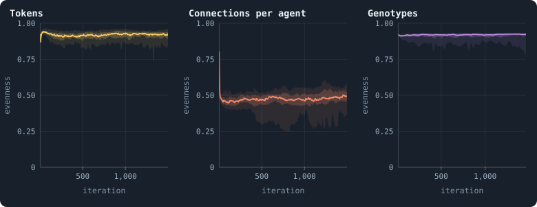
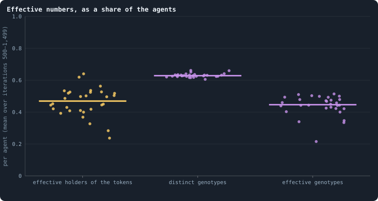
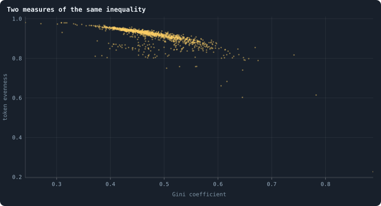

# How even is a world?

[Chapter 15](15-where-do-the-tokens-go.md) measured how unequally tokens are
held with the Gini coefficient. This chapter measures the same thing with a
second tool, **entropy** — and then uses that tool on two things a Gini cannot
measure at all, because they are not amounts: how the agents are spread over
the numbers of connections, and over the genotypes. Part III begins here: a
chapter for every statistic the viewer shows, read on the thirty baseline
worlds of 100,000 tokens of [Chapter 9](09-thirty-worlds.md), with the thirty
of 10,000 tokens it was first written from beside them where they differ.

> [!question] Questions of this chapter
> - How evenly are tokens, connections and genotypes spread over the agents?
> - How many agents would hold the tokens, if each held an equal share and the
>   tokens were as even as they are? How many genotypes are there, in effect?
> - Do entropy and the Gini coefficient say the same thing?

<!-- runs E10 -->
> [!info] The runs behind this chapter
> **30 runs.** Every condition below is run once for every seed (1 to 30), for 1,500 iterations — or until its world dies out. Every setting is that of the baseline **B1** (the algorithm exactly as a new run is offered it) unless the condition changes it.
>
> - **baseline** — changes nothing: B1 as it is; 100,000 tokens. Runs `B1-100000-s001` … `B1-100000-s030`.
>
> To make these runs again: `python3 gol_lab.py run E10`, or ▶ in the Book tab of a computer running `gol_server.py`. Each run writes its settings, seed and engine version beside its frames, in `GraphOfLifeRuns/<run>/meta.json` and `provenance.json`.

> [!info]- Every setting of these runs
> | setting | baseline | what it is |
> |---|---|---|
> | [`total_tokens`](../notes/settings.md#total_tokens) | 100,000 | The number of tokens in the world, *T*. It never changes during a run. |
> | [`n_nodes`](../notes/settings.md#n_nodes) | 0 | How many founders the world starts with. 0 means one founder per hundred tokens: *n* = ⌊*T* / 100⌋. |
> | [`k_neighbors`](../notes/settings.md#k_neighbors) | 0 | How many neighbours each founder starts with in the ring. 0 means *k* = max(⌊*n* / 100⌋, 5); an odd *k* is wired as *k* − 1. |
> | [`rewire_p`](../notes/settings.md#rewire_p) | 0.2 | In the starting ring, the probability that a connection is moved to a founder chosen at random (Watts–Strogatz). |
> | [`hidden_layers`](../notes/settings.md#hidden_layers) | 50, 45, 40, 35, 30 | The widths of the brain's hidden layers, in order from input to output. |
> | [`brain_kind`](../notes/settings.md#brain_kind) | float16 | How weights are stored: `float` (64-bit), `float16` (16-bit, computed in 64-bit) or `binary` (−1, 0, +1). |
> | [`brain_bits`](../notes/settings.md#brain_bits) | 16 | Only for binary brains: how many input rows encode one number. Unused by float and float16 brains. |
> | [`message_amount`](../notes/settings.md#message_amount) | 30 | How many numbers one message holds. Each agent sends one message to itself and one to each neighbour, every phase. |
> | [`random_input_amount`](../notes/settings.md#random_input_amount) | 5 | How many random numbers, drawn uniformly from −2 to 2, a brain reads per neighbour, every time it looks. |
> | [`exchange_messages`](../notes/settings.md#exchange_messages) | on | Whether agents send and read messages at all. |
> | [`message_prepass`](../notes/settings.md#message_prepass) | on | Whether every phase begins with an extra look in which agents only write messages, so the look that acts reads messages written this phase. |
> | [`allow_handover`](../notes/settings.md#allow_handover) | on | Whether a parent may move some of its own connections to its newborn child. |
> | [`allow_revolutions`](../notes/settings.md#allow_revolutions) | on | Whether a coalition of smaller stakers can take a node from its largest staker (see the note *How a coalition takes a node*). |
> | [`allow_gifting`](../notes/settings.md#allow_gifting) | off | Whether agents may give tokens to neighbours during reproduction. Off in every run of this book. |
> | [`random_decisions`](../notes/settings.md#random_decisions) | off | The control: every number a brain would produce is replaced by a random draw from the standard normal distribution. |
> | [`prune_after`](../notes/settings.md#prune_after) | blotto | After which phase connections that carried no tokens are cut: `blotto` (the game), `reproduction`, or `both`. |
> | [`inactive_window`](../notes/settings.md#inactive_window) | phase | How long a connection may go unused: `phase` means it must carry tokens in the phase being judged; `iteration` allows the two last phases. |
> | [`redistribution`](../notes/settings.md#redistribution) | uniform | How the tokens of removed agents are shared: `uniform` gives every survivor the same chance at each token; `by_tokens` weights by what a survivor holds; `poorest` raises the poorest to one common level first; `newborns` gives them to this iteration's children, `parents` to their parents, once per child (both `uniform` in an iteration without births); `children` leaves each dead agent's estate to its own living children (`uniform` where there are none). |
> | [`tokens_created_per_phase`](../notes/settings.md#tokens_created_per_phase) | 0 | Tokens added to the world at every cleanup. 0 keeps the supply fixed. |
> | [`mutate_on_replication`](../notes/settings.md#mutate_on_replication) | off | Whether a brain changes only when it is copied — into a newborn, or into a node its owner has just won — instead of also after every game, wherever it sits. |
> | [`incumbency`](../notes/settings.md#incumbency) | 1.0 | How many times over an agent's stake on its own node counts when the game decides who takes the node. 1 is the old rule. |
> | [`birth_links`](../notes/settings.md#birth_links) | 0 | How many of its parent's neighbours a newborn is joined to, drawn at random, besides its parent itself; 0 leaves every link to the brain's choice. |
> | [`mend_on_death`](../notes/settings.md#mend_on_death) | off | Whether the neighbours of an agent that dies are joined up where its death would leave them in separate pieces. |
> | [`prune_needs`](../notes/settings.md#prune_needs) | 0 | How many neighbours the two ends of an unused connection must share for it to be cut; 0 cuts every unused connection. |
> | [`valence`](../notes/settings.md#valence) | 0 | The most connections an agent's brain may choose to hold (0 = no limit). An agent at its limit cannot have a child. |
> | [`keep_home`](../notes/settings.md#keep_home) | 0.0 | The share of an agent's tokens — rounded up, never less than one — that stays on its own node whatever its brain says; a parent also keeps one. 0 is the old rule. |
> | [`max_age`](../notes/settings.md#max_age) | 0 | The age at which an agent dies (0 = never); its tokens are shared out like those of any other dead agent. |
> | [`buy_life`](../notes/settings.md#buy_life) | off | Whether an agent that has reached max_age may live on by paying one token an iteration into the estate of the dead — never its last, so one with a single token left dies. Needs max_age. |
> | [`min_child`](../notes/settings.md#min_child) | 1 | The fewest tokens a child can be born with; a parent that would give less has no child. |
> | [`mix_at_birth`](../notes/settings.md#mix_at_birth) | off | Whether a newborn's brain is its parent's mixed with a mate's — one of the parent's neighbours, drawn at random — each hidden unit whole from one or the other by an even chance, before it mutates; off, a newborn has a copy of its parent's brain. |
> | [`mix_mates`](../notes/settings.md#mix_mates) | any | Under mix_at_birth, who may be the mate: any neighbour of the parent, or only parents — a neighbour with a living child of its own (with none, the newborn's brain is a copy). |
> | [`link_search`](../notes/settings.md#link_search) | off | Whether an agent may reach beyond its neighbours to propose a link: off; jump, a walk as many steps long as the tokens it spends in one iteration, with a link proposed where it ends; walk, a scout that goes one step further in every iteration it pays for; or reach, a jump whose steps are free, as many as the tokens it holds would pay for. A paid step costs one token, paid to the agent it enters, and never the last. |
> | [`link_steering`](../notes/settings.md#link_steering) | random | Which way each step of a search goes: to a neighbour drawn at random, or to the one the searcher would most like a link with (looking). |
> | [`link_consent`](../notes/settings.md#link_consent) | mutual | Who has to agree to a link a search proposes: both ends (mutual), or only the one who proposes (forced). Nobody at its valence gets a new link either way. |
> | [`mutation_probability`](../notes/settings.md#mutation_probability) | 0.2 | The probability that a brain changes when it is copied to a child, and again, for every brain, after every game. |
> | [`mutation_noise_std`](../notes/settings.md#mutation_noise_std) | 0.2 | How large a change to one weight is: a normal draw with standard deviation this times 1/√(fan-in) of its layer. |
> | [`mutation_sparsity`](../notes/settings.md#mutation_sparsity) | 0.1 | The share of a brain's numbers a change touches; also the probability, for each weight matrix and bias vector, of a rarer reset that redraws that share of it. |
> | [`extinction_threshold`](../notes/settings.md#extinction_threshold) | 20 | A run stops, as extinct, when an iteration ends (after its game) with this many agents or fewer. |
> | seeds | 1 to 30 | one run per seed |
> | iterations | 1,500 | how far each run goes, unless its world dies first |
>
> A value in **bold** differs from the baseline B1.
<!-- /runs -->

## Entropy in one example

Take a world of four agents, A, B, C and D, holding 4, 2, 1 and 1 of its 8
tokens. Pick one token at random. Whose is it? You may ask yes-or-no
questions, and you ask them well: *Is it A's?* — yes half the time, after one
question. *Is it B's?* — yes a quarter of the time, after two. *Is it C's?* —
yes or no, it settles C and D after three. On average you need

$$
\tfrac12 \cdot 1 + \tfrac14 \cdot 2 + \tfrac18 \cdot 3 + \tfrac18 \cdot 3 = 1.75
$$

questions. That number is the **entropy** of the shares (½, ¼, ⅛, ⅛):

$$
H = -\sum_i p_i \log_2 p_i = 1.75 \text{ bits.}
$$

With four equal shares you would need two questions every time — log₂ 4 = 2,
the most four agents allow. With everything in one hand you would need none.
Two readings of *H* follow ([Entropy and evenness](../notes/entropy-and-evenness.md)):

- the **evenness** *J* = *H* / log₂ *n* puts it on a scale from 0 (one holds
  everything) to 1 (all hold the same): here 1.75/2 = 0.875;
- the **effective number** 2^*H* is how many agents, holding equal shares,
  would leave you exactly as uncertain: here 2^1.75 ≈ 3.4 agents.

The same arithmetic works for anything that falls into categories. For the
connections, the categories are the numbers of connections an agent can have
— 1, 2, 3, … — and *pᵢ* is the share of agents with exactly *i*. For the
genotypes, the categories are the genotypes, and *pᵢ* is the share of agents
carrying genotype *i*. The question becomes: *pick an agent at random — how
many connections does it have? which genotype does it carry?*

## Three things spread over the agents

<!-- figure entropy/evenness -->

**How even a world is, in three respects.** Evenness after every game of the 30 baseline worlds, from 0 (everything in one hand) to 1 (as even as it can be; [Entropy and evenness](../notes/entropy-and-evenness.md)). Left: of the tokens over the agents (`tokenEvenness`). Middle: of the agents over the numbers of connections that occur (`degreeEvenness`). Right: of the agents over the genotypes they carry — the entropy of the genotypes' shares divided by log₂ of the number of agents, measured every 25 iterations. In each, the line is the median of the worlds at each iteration, the darker band holds the middle half of them (from the 25th to the 75th percentile) and the paler band nine in ten (5th to 95th).

> [!example]- How to make this figure
> **Runs.** The 30 baseline runs `B1-100000-s001` … `B1-100000-s030`: the baseline B1 at 100,000 tokens, seeds 1 to 30, 1,500 iterations each (every setting is listed in [Chapter 9](09-thirty-worlds.md)). They are made with `python3 gol_lab.py run E10`.
>
> **Data.** From each run's `GraphOfLifeRuns/<run>/stats.jsonl`, which holds one row per recorded phase: `phase` 1 is the world just after reproduction, `phase` 2 just after the game, and every statistic is a field of the row (see [What a run records](../notes/frames-and-stats.md)); for genotypes, each run's frames, read every 25 iterations by `book_figures.sample_pass` (frame `2·t` after the reproduction phase of iteration *t*, frame `2·t + 1` after its game; `gol_store.read_frame(run, index)`).
>
> 1. Take `tokenEvenness` and `degreeEvenness` of the rows with `phase` = 2.
> 2. For genotypes: in the frame after the game of every 25th iteration, count the agents per genotype (`brain_ids`), turn the counts into shares pᵢ, and compute H = −Σ pᵢ log₂ pᵢ; divide by log₂ of the number of agents.
> 3. Cut the 1,500 iterations into 600 stretches of 2.5 and take each world's mean in each stretch.
> 4. In each stretch, take the median, the 25th and 75th and the 5th and 95th percentiles of those means over the worlds that still have a value there (a world that died has none after its death).
>
> **To make it again:** `python3 book_figures.py entropy`.
<!-- /figure -->

The founders hold equal shares: a token evenness of exactly 1. The first
reproduction phase ends that, and after the first game the median world is at
0.96. Then it falls, and settles a little lower: over the settled life the
median world's **token evenness** is 0.91, and the thirty worlds lie between
0.84 and 0.95 (0.88 at 10,000 tokens). In bits, the median world has a token
entropy of 12.6 bits — some 12.6 questions to find a token's owner among about
14,000 agents, where perfect equality would need 13.8.

The **degree evenness** is far lower, 0.47 (0.27 to 0.54; 0.59 at 10,000
tokens): agents are piled onto a few numbers of connections — 35% have
exactly one, 23% exactly two ([Chapter 17](17-what-shape-does-the-network-take.md)) —
while the hubs make the list of numbers that occur long, and longer in a
larger world. Read this one with care: its ceiling is
log₂ of the number of *distinct* degrees in the world, so a single new hub of
an unusual size raises the ceiling and lowers the evenness, without anything
else changing.

The **genotype evenness** is high, about 0.9, and steady: the agents are
spread over many genotypes, none of which holds much of the world for long.

## Effective numbers

<!-- figure entropy/effective -->

**Effective numbers, as a share of the agents.** One dot per world; the bar is the median. Left: 2^H of the tokens — the number of agents that, holding equal shares, would make the tokens as even as they are — divided by the number of agents. Middle: the number of different genotypes among the living, per agent. Right: 2^H of the genotypes — how many equally common genotypes would be as diverse as the ones there are — per agent. The dots are spread sideways only so that they do not hide each other.

> [!example]- How to make this figure
> **Runs.** The 30 baseline runs `B1-100000-s001` … `B1-100000-s030`: the baseline B1 at 100,000 tokens, seeds 1 to 30, 1,500 iterations each (every setting is listed in [Chapter 9](09-thirty-worlds.md)). They are made with `python3 gol_lab.py run E10`.
>
> **Data.** From each run's `GraphOfLifeRuns/<run>/stats.jsonl`, which holds one row per recorded phase: `phase` 1 is the world just after reproduction, `phase` 2 just after the game, and every statistic is a field of the row (see [What a run records](../notes/frames-and-stats.md)); for genotypes, each run's frames, read every 25 iterations by `book_figures.sample_pass` (frame `2·t` after the reproduction phase of iteration *t*, frame `2·t + 1` after its game; `gol_store.read_frame(run, index)`).
>
> 1. Tokens: for each row with `phase` = 2 and 500 ≤ `iteration` ≤ 1,499, compute 2^`tokenEntropy` / `nodes`, and average over the rows.
> 2. Genotypes: in the frames after the game of every 25th iteration from 500 on, the number of distinct `brain_ids` per agent, and 2^H per agent with H the entropy of the genotypes' shares; average over the frames.
> 3. One dot per run, a bar at the median.
>
> **To make it again:** `python3 book_figures.py entropy`.
<!-- /figure -->

Effective numbers are the easiest way to read an entropy, because they are in
the units of the things counted. Per agent, over the settled life:

- **Token holders.** The tokens are as even as if 47% of the agents held them
  in equal shares (the worlds: 24% to 64%). In a world of 14,000 agents, some
  6,700 equal holders.
- **Distinct genotypes.** There are 0.63 genotypes per agent, as
  [Chapter 18](18-genotypes-and-lineages.md) found — and this is the tightest
  number in the whole book so far: the thirty worlds lie between 0.61 and
  0.66, a standard deviation of 0.012, and the worlds of 10,000 tokens had the
  same 0.63. Whatever their seed, their history and their size, the worlds
  keep almost exactly five genotypes for every eight agents.
- **Effective genotypes.** Weighted by how many agents carry them, the
  genotypes are worth 0.45 per agent (0.22 to 0.51; 0.49 at 10,000 tokens):
  fewer than the distinct count, because some genotypes are carried by many
  agents and most by one.

The gap between the second and the third is the difference ecologists draw
between **richness** — how many kinds there are — and **diversity** — how many
equally common kinds would be as varied (Hill 1973; Jost 2006). A world could
have many genotypes and still be dominated by one; this one is not.

Why is the distinct count so tight? Something in the rules must set it. Every
brain may change after every game (with probability 0.2,
[How a brain changes](../notes/mutation.md)), which makes a new genotype; and
every game, about half the nodes take a copy of a winner's brain
([Chapter 16](16-how-the-game-is-played.md)), which makes genotypes common
again. A balance between a fixed rate of making and a fixed rate of copying
gives a fixed ratio, whatever the brains do.
[Chapter 39](39-questioning-the-mechanics.md) comes back to where the new
genotypes are made.

## Two measures of the same inequality

<!-- figure entropy/gini-evenness -->

**Two measures of the same inequality.** One dot per world and look: every 25th iteration from 500 on of the 30 worlds (1,200 dots). Across the dots the two measures move against each other — the correlation is -0.72 — but not along one curve: the same Gini comes with different evenness, because the two weigh the poor and the rich differently.

> [!example]- How to make this figure
> **Runs.** The 30 baseline runs `B1-100000-s001` … `B1-100000-s030`: the baseline B1 at 100,000 tokens, seeds 1 to 30, 1,500 iterations each (every setting is listed in [Chapter 9](09-thirty-worlds.md)). They are made with `python3 gol_lab.py run E10`.
>
> **Data.** From each run's `GraphOfLifeRuns/<run>/stats.jsonl`, which holds one row per recorded phase: `phase` 1 is the world just after reproduction, `phase` 2 just after the game, and every statistic is a field of the row (see [What a run records](../notes/frames-and-stats.md)).
>
> 1. Take the rows with `phase` = 2 and `iteration` a multiple of 25 from 500 on.
> 2. Plot `tokenEvenness` against `gini`, one dot per row.
>
> **To make it again:** `python3 book_figures.py entropy`.
<!-- /figure -->

Across 1,200 looks at the 30 worlds, the Gini coefficient and the token
evenness move against each other with a correlation of −0.72 (−0.90 at 10,000
tokens) — as they should, since both measure inequality. But they do not lie on one curve: the same
Gini comes with token evenness that differs by several hundredths. They weigh
inequality differently, and the difference can be stated exactly. Move a small
amount of tokens from a richer agent *j* to a poorer agent *i*:

- the **Gini** falls in proportion to how far apart *i* and *j* are **in rank**
  — how many agents hold more than *i* and less than *j*;
- the **entropy** rises in proportion to log₂(τⱼ / τᵢ), how many **times**
  richer *j* is than *i*.

So a small amount passed from an agent with 2 tokens to one with 1, and the
same amount passed from one with 20 to one with 10, raise the entropy alike —
in both, the giver holds twice what the taker holds — but the second lowers
the Gini far more: many agents hold between 10 and 20 tokens, and nobody holds
between 1 and 2. (With whole tokens, one token passed from 2 to 1 would only
swap the two holdings and change neither measure; what is compared here is
how strongly each measure answers a small transfer.) Entropy listens more to
the poor; the Gini to the spread of the whole ladder. A world in which a few
agents dominate and the rest are equally poor and a world in which wealth
falls off smoothly can have the same Gini and different evenness.

## What this means

- **A world is moderately even, and stays so.** Tokens behave as if shared
  equally among half the agents; genotypes as if each were carried by two.
  Neither drifts over the settled life.
- **High diversity is not the same as novelty.** A genotype evenness of 0.9
  sounds like a world full of variety. But [Chapter 18](18-genotypes-and-lineages.md)
  found that a genotype lasts about two iterations: the variety is churn — new
  numbers made by small changes, lost as fast as they are made. Entropy counts
  how many kinds there are *now*; it cannot say whether any of them is new in a
  way that matters. Measures of open-ended evolution have to look across time
  ([Meta II](40-meta-2.md));
  [Chapter 46](46-how-to-tell-a-world-that-keeps-evolving.md) builds one,
  playing the brains of different eras against each other.
- **One number is set by the rules.** Five genotypes for every eight agents,
  in every world: a balance of making and copying. If a change of the rules
  moves it, the change has altered how often brains are changed or copied:
  in the pilots of [Chapter 52](52-how-fast-should-brains-change.md) it went
  from 0.32 to 0.98 as the probability of a change rose from 0.05 to 0.8.

To make every figure of this chapter: `python3 book_figures.py entropy`.

<!-- turns -->
---

← [Chapter 26 · Meta I · What the baseline world is](26-meta-1.md) · [Contents](../README.md) · [Chapter 28 · Gains and losses](28-gains-and-losses.md) →
<!-- /turns -->
