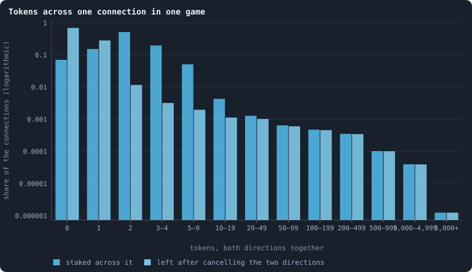
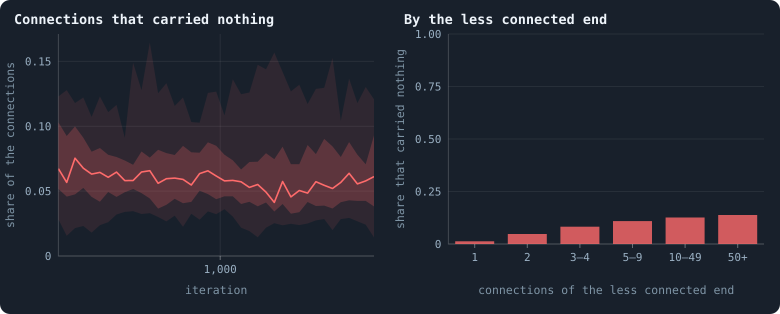
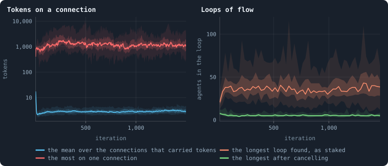

# What crosses a connection

In every game each agent stakes all its tokens on itself and its neighbours,
and whatever two agents stake on each other crosses the connection between
them. [Chapter 29](29-where-the-tokens-flow.md) followed the tokens through a
whole world. This chapter looks at the connections one at a time: how much
crosses each one, how much of that is cancelled by what comes back, how far
tokens travel in loops — the viewer's **lightning** — and which connections
carry nothing at all.

> [!question] Questions of this chapter
> - How many tokens cross a connection in a game, and how unevenly?
> - How much of it comes straight back the other way?
> - How long are the loops in which tokens go round?
> - Which connections carry nothing, and so are cut?

<!-- runs E10 -->
> [!info] The runs behind this chapter
> **30 runs.** Every condition below is run once for every seed (1 to 30), for 1,500 iterations — or until its world dies out. Every setting is that of the baseline **B1** (the algorithm exactly as a new run is offered it) unless the condition changes it.
>
> - **baseline** — changes nothing: B1 as it is; 100,000 tokens. Runs `B1-100000-s001` … `B1-100000-s030`.
>
> To make these runs again: `python3 gol_lab.py run E10`, or ▶ in the Book tab of a computer running `gol_server.py`. Each run writes its settings, seed and engine version beside its frames, in `GraphOfLifeRuns/<run>/meta.json` and `provenance.json`.

> [!info]- Every setting of these runs
> | setting | baseline | what it is |
> |---|---|---|
> | [`total_tokens`](../notes/settings.md#total_tokens) | 100,000 | The number of tokens in the world, *T*. It never changes during a run. |
> | [`n_nodes`](../notes/settings.md#n_nodes) | 0 | How many founders the world starts with. 0 means one founder per hundred tokens: *n* = ⌊*T* / 100⌋. |
> | [`k_neighbors`](../notes/settings.md#k_neighbors) | 0 | How many neighbours each founder starts with in the ring. 0 means *k* = max(⌊*n* / 100⌋, 5); an odd *k* is wired as *k* − 1. |
> | [`rewire_p`](../notes/settings.md#rewire_p) | 0.2 | In the starting ring, the probability that a connection is moved to a founder chosen at random (Watts–Strogatz). |
> | [`hidden_layers`](../notes/settings.md#hidden_layers) | 50, 45, 40, 35, 30 | The widths of the brain's hidden layers, in order from input to output. |
> | [`brain_kind`](../notes/settings.md#brain_kind) | float16 | How weights are stored: `float` (64-bit), `float16` (16-bit, computed in 64-bit) or `binary` (−1, 0, +1). |
> | [`brain_bits`](../notes/settings.md#brain_bits) | 16 | Only for binary brains: how many input rows encode one number. Unused by float and float16 brains. |
> | [`message_amount`](../notes/settings.md#message_amount) | 30 | How many numbers one message holds. Each agent sends one message to itself and one to each neighbour, every phase. |
> | [`random_input_amount`](../notes/settings.md#random_input_amount) | 5 | How many random numbers, drawn uniformly from −2 to 2, a brain reads per neighbour, every time it looks. |
> | [`exchange_messages`](../notes/settings.md#exchange_messages) | on | Whether agents send and read messages at all. |
> | [`message_prepass`](../notes/settings.md#message_prepass) | on | Whether every phase begins with an extra look in which agents only write messages, so the look that acts reads messages written this phase. |
> | [`allow_handover`](../notes/settings.md#allow_handover) | on | Whether a parent may move some of its own connections to its newborn child. |
> | [`allow_revolutions`](../notes/settings.md#allow_revolutions) | on | Whether a coalition of smaller stakers can take a node from its largest staker (see the note *How a coalition takes a node*). |
> | [`allow_gifting`](../notes/settings.md#allow_gifting) | off | Whether agents may give tokens to neighbours during reproduction. Off in every run of this book. |
> | [`random_decisions`](../notes/settings.md#random_decisions) | off | The control: every number a brain would produce is replaced by a random draw from the standard normal distribution. |
> | [`prune_after`](../notes/settings.md#prune_after) | blotto | After which phase connections that carried no tokens are cut: `blotto` (the game), `reproduction`, or `both`. |
> | [`inactive_window`](../notes/settings.md#inactive_window) | phase | How long a connection may go unused: `phase` means it must carry tokens in the phase being judged; `iteration` allows the two last phases. |
> | [`redistribution`](../notes/settings.md#redistribution) | uniform | How the tokens of removed agents are shared: `uniform` gives every survivor the same chance at each token; `by_tokens` weights by what a survivor holds. |
> | [`tokens_created_per_phase`](../notes/settings.md#tokens_created_per_phase) | 0 | Tokens added to the world at every cleanup. 0 keeps the supply fixed. |
> | [`mutate_on_replication`](../notes/settings.md#mutate_on_replication) | off | Whether a brain changes only when it is copied — into a newborn, or into a node its owner has just won — instead of also after every game, wherever it sits. |
> | [`incumbency`](../notes/settings.md#incumbency) | 1.0 | How many times over an agent's stake on its own node counts when the game decides who takes the node. 1 is the old rule. |
> | [`birth_links`](../notes/settings.md#birth_links) | 0 | How many of its parent's neighbours a newborn is joined to, drawn at random, besides its parent itself; 0 leaves every link to the brain's choice. |
> | [`mend_on_death`](../notes/settings.md#mend_on_death) | off | Whether the neighbours of an agent that dies are joined up where its death would leave them in separate pieces. |
> | [`prune_needs`](../notes/settings.md#prune_needs) | 0 | How many neighbours the two ends of an unused connection must share for it to be cut; 0 cuts every unused connection. |
> | [`valence`](../notes/settings.md#valence) | 0 | The most connections an agent's brain may choose to hold (0 = no limit). An agent at its limit cannot have a child. |
> | [`keep_home`](../notes/settings.md#keep_home) | 0.0 | The share of an agent's tokens — rounded up, never less than one — that stays on its own node whatever its brain says; a parent also keeps one. 0 is the old rule. |
> | [`max_age`](../notes/settings.md#max_age) | 0 | The age at which an agent dies (0 = never); its tokens are shared out like those of any other dead agent. |
> | [`min_child`](../notes/settings.md#min_child) | 1 | The fewest tokens a child can be born with; a parent that would give less has no child. |
> | [`mutation_probability`](../notes/settings.md#mutation_probability) | 0.2 | The probability that a brain changes when it is copied to a child, and again, for every brain, after every game. |
> | [`mutation_noise_std`](../notes/settings.md#mutation_noise_std) | 0.2 | How large a change to one weight is: a normal draw with standard deviation this times 1/√(fan-in) of its layer. |
> | [`mutation_sparsity`](../notes/settings.md#mutation_sparsity) | 0.1 | The share of a brain's numbers a change touches; also the probability, for each weight matrix and bias vector, of a rarer reset that redraws that share of it. |
> | [`extinction_threshold`](../notes/settings.md#extinction_threshold) | 20 | A run stops, as extinct, when an iteration ends (after its game) with this many agents or fewer. |
> | seeds | 1 to 30 | one run per seed |
> | iterations | 1,500 | how far each run goes, unless its world dies first |
>
> A value in **bold** differs from the baseline B1.
<!-- /runs -->

## Why ask

A connection lives exactly as long as tokens keep crossing it. In the
baseline, every connection that no token crossed in a game is cut at the end
of that game ([Every setting](../notes/settings.md), `prune_after` and
`inactive_window`; the viewer counts these as `prunedEdges`). So the flow on
the connections is not only how tokens move; it is what keeps the network
standing. A connection that carries nothing for one game is gone, and with
it, perhaps, the only path between two parts of a world.

> [!info] Added later: links that may not lapse
> [Chapter 48](48-a-world-that-cannot-break.md) changes this rule for the
> second baseline, B2: there an unused connection lapses only if its two ends
> share at least two neighbours
> ([`prune_needs`](../notes/settings.md#prune_needs)), so no lapse can cut a
> world in two.

The flow is also where anything like cooperation would first show: a pair of
agents that keep staking on each other keep their connection, and with it each
other's tokens within reach. [Lightning](../notes/lightning.md) — tokens going
round a loop and arriving back where they started — is the viewer's measure of
the most organised flow there can be.

## How much crosses a connection

Every 25 iterations from 500 on, take every connection at the start of the
game and add up what its two agents staked on each other in that game — both
directions together — and, separately, what is left when the smaller
direction is cancelled against the larger:

<!-- figure connections/per-connection -->

**Tokens across one connection in one game.** Every connection at the start of the games of every 25th iteration from 500 on, in the 30 worlds, pooled: how many tokens its two agents staked on each other in that game, both directions added (blue), and what is left when the smaller direction is cancelled against the larger (cyan; [Token flow](../notes/token-flow.md)). A connection in the first class carried nothing and is cut at the end of the game.

> [!example]- How to make this figure
> **Runs.** The 30 baseline runs `B1-100000-s001` … `B1-100000-s030`: the baseline B1 at 100,000 tokens, seeds 1 to 30, 1,500 iterations each (every setting is listed in [Chapter 9](09-thirty-worlds.md)). They are made with `python3 gol_lab.py run E10`.
>
> **Data.** From each run's frames every 25 iterations from 500 on, read by `book_chapters.connections.edge_flow`: the connections of frame `2·t` (the start of the game of t), `decisions.allocations` and the connections of frame `2·t + 1` (after it).
>
> 1. For every connection (a, b) of frame `2·t`: the tokens a staked on b and b on a, from `decisions.allocations` of frame `2·t + 1`.
> 2. Count the connections by the sum, and by the difference, in the classes shown.
>
> **To make it again:** `python3 book_figures.py connections`.
<!-- /figure -->

Most connections carry very little. Pooled over the thirty worlds, **52%**
carried exactly two tokens, 15% exactly one, 20% three or four and 5% five to
nine; fewer than one connection in a hundred carried ten tokens or more. But
the classes do not stop there: a few connections carry hundreds of tokens in
a game, and about one in a million carried five thousand or more. And **7%**
carried nothing at all.

The cyan bars show how much of this is an exchange. On **70%** of all
connections — two thirds of those that carried anything — the two directions
cancel exactly: as many tokens went each way. Almost all of the connections
that carried two tokens carried one each way. Where something is left, it is
mostly a single token: 28% of the connections moved one token net, and only
2% moved more. This is what [Chapter 38](38-do-agents-cooperate.md) will call
a **handshake**, seen here from the connections: two neighbours, each
splitting a few tokens evenly over a few candidates, put one token on each
other.

## Which connections carry nothing

A connection across which no token was staked in a game is cut at the end of
that game; one across which anything was staked is kept. Counted over every
connection of the sampled games, the rule holds without exception: 1,650,222
connections carried nothing and every one was cut, 29,186,620 carried
something and every one was kept (connections whose end died in the game
left out). Which connections are the empty ones?

<!-- figure connections/cut -->

**The connections a game cuts.** Left: at the start of the game of every 25th iteration from 500 on, the share of the connections across which no token was staked in that game — the ones the game cuts; the line is the median of the worlds at each iteration, the darker band holds the middle half of them (from the 25th to the 75th percentile) and the paler band nine in ten (5th to 95th). Right: the same share, pooled over the games and worlds, for connections sorted by the number of connections of their less connected end.

> [!example]- How to make this figure
> **Runs.** The 30 baseline runs `B1-100000-s001` … `B1-100000-s030`: the baseline B1 at 100,000 tokens, seeds 1 to 30, 1,500 iterations each (every setting is listed in [Chapter 9](09-thirty-worlds.md)). They are made with `python3 gol_lab.py run E10`.
>
> **Data.** From each run's frames every 25 iterations from 500 on, read by `book_chapters.connections.edge_flow`: the connections of frame `2·t` (the start of the game of t), `decisions.allocations` and the connections of frame `2·t + 1` (after it).
>
> 1. As above; a connection carried nothing if neither end staked a token on the other.
> 2. Sort the connections by the smaller of their two ends' degrees in frame `2·t`.
>
> **To make it again:** `python3 book_figures.py connections`.
<!-- /figure -->

In a settled game **6%** of the connections carry nothing (the worlds: 3% to
12%), and the share wanders with the world, higher in some stretches than in
others. By the less connected end it is not even: a connection whose less
connected end has a single connection — a leaf's only link — is empty in 1.3%
of games; one between two agents with ten connections or more, in 13% to 14%.
A leaf stakes on its only neighbour or keeps everything at home, and its
neighbour almost always stakes back on it; an agent with many connections
and few tokens cannot send a token across each, and if its neighbour does not
either, the connection is gone. Every connection costs a token a game, from
one side or the other — what [Chapter 36](36-how-a-world-breaks.md) will call
the price of a connection, paid here connection by connection.

The viewer counts the cut connections after every game as `prunedEdges`:
6.7% of all connections in the median world (5.3% at 10,000 tokens) — a
little more than the empty share at the start of a game, since connections
also die with their agents.

## The flow, in round figures

The viewer reports the flow on the connections in a few numbers after every
game:

<!-- figure connections/round-figures -->

**Flow on the connections, and the loops it makes.** After every game of the 30 worlds. Left: the viewer's `meanEdgeFlow` — the tokens staked across a connection, over the connections something crossed — and `maxEdgeFlow`, the most across one, on a logarithmic axis. Right, every 25 iterations: the longest closed loop of flow the greedy peel of [Lightning](../notes/lightning.md) found in the flow as staked (`lightningLongest`) and in what is left after cancelling (`netLightningLongest`). The line is the median of the worlds at each iteration, the darker band holds the middle half of them (from the 25th to the 75th percentile) and the paler band nine in ten (5th to 95th).

> [!example]- How to make this figure
> **Runs.** The 30 baseline runs `B1-100000-s001` … `B1-100000-s030`: the baseline B1 at 100,000 tokens, seeds 1 to 30, 1,500 iterations each (every setting is listed in [Chapter 9](09-thirty-worlds.md)). They are made with `python3 gol_lab.py run E10`.
>
> **Data.** From each run's `GraphOfLifeRuns/<run>/stats.jsonl`, which holds one row per recorded phase: `phase` 1 is the world just after reproduction, `phase` 2 just after the game, and every statistic is a field of the row (see [What a run records](../notes/frames-and-stats.md)).
>
> 1. Take the rows with `phase` = 2: `meanEdgeFlow`, `maxEdgeFlow`, `lightningLongest` and `netLightningLongest`.
> 2. Cut the 1,500 iterations into 600 stretches of 2.5 and take each world's mean in each stretch.
> 3. In each stretch, take the median, the 25th and 75th and the 5th and 95th percentiles of those means over the worlds that still have a value there (a world that died has none after its death).
>
> **To make it again:** `python3 book_figures.py connections`.
<!-- /figure -->

- **The typical connection.** Over the connections something crossed, the
  mean flow is **3.0** tokens a game (3.7 at 10,000 tokens).
- **The busiest connection.** The most that crossed one connection in a game
  is about **1,400** tokens in the median world — 1.4% of all tokens in the
  world, where the busiest connection of a world of 10,000 tokens carried 640,
  6.4% of its tokens. A larger world has busier single connections, but they
  carry a smaller part of the whole.
- **Loops of flow.** The longest closed loop the greedy search of
  [Lightning](../notes/lightning.md) finds in the flow as staked is **41**
  agents long in the median world (20 at 10,000 tokens). Most of the flow
  that goes round, though, goes round in loops of two — the equal exchanges
  above — and the greedy search, which hunts for long loops, places only 13%
  of the flow in the loops it finds
  ([Chapter 29](29-where-the-tokens-flow.md)). After cancelling each pair's
  two directions, no loop of two is left: the longest loop found is 5 or 6
  agents in the median world, and 0.3% of the net flow goes round. (At
  10,000 tokens the longest averages 2.2 over the games: a loop left after
  cancelling needs at least three agents, and in many games none was found
  at all.)

Loops that survive cancellation are tokens genuinely going round. A larger
world finds longer ones, if only because it has more flow to find them in.
But they carry almost nothing: the net flow of a game runs downhill, from
agents richer than their neighbourhood to agents poorer than it, and does
not circulate.

## What this means

- **A connection lives on a token a game.** Two connections in three carry
  one or two tokens, most of them one each way, and cancel exactly. The flow
  that keeps the network standing is a web of handshakes.
- **The rule that cuts is exact and local.** Every empty connection is cut,
  every connection that carried a token is kept. Which ones go empty depends
  on the agents at their ends: well-connected agents with few tokens cannot
  pay for all their connections, and leaves almost always can.
- **Big flows are rare.** A few connections carry hundreds or thousands of
  tokens in a game; only an agent holding that many can send them, and the
  rich are the well connected ([Chapter 34](34-how-properties-scale-together.md)).
- **No circulation.** Tokens do not go round: what is not exchanged moves
  downhill. For open-ended evolution this means the connections carry no
  economy of their own — nothing like a trade route along which one part of a
  world could feed another. A rule that made flows along loops pay, or that
  let a connection store what crosses it, would be a way to give them one.

> [!info] Added later: a yield on exchanges
> [Chapter 50](50-why-evolution-stops.md) pilots a rule of this kind: a yield
> on stakes that are returned across a connection. The yield went to whoever
> had the most partners, and it built stars rather than partnerships.

To make every figure of this chapter: `python3 book_figures.py connections`.

<!-- turns -->
---

← [Chapter 29 · Where the tokens flow](29-where-the-tokens-flow.md) · [Contents](../README.md) · [Chapter 31 · How agents have children](31-how-agents-have-children.md) →
<!-- /turns -->
