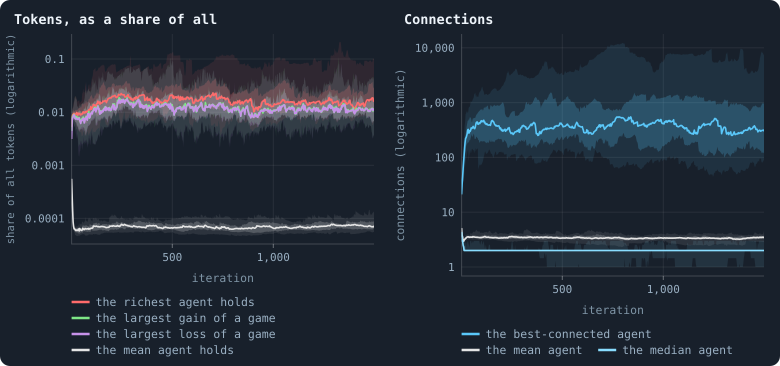
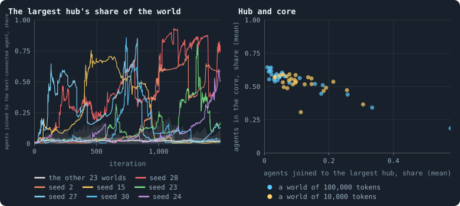
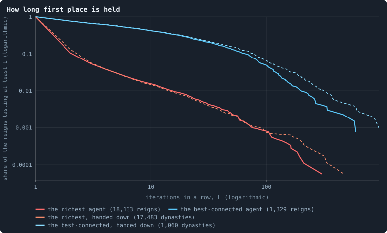
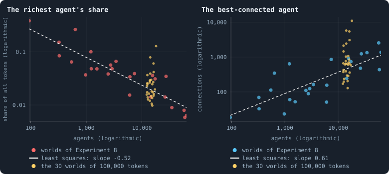

# The largest and the smallest

A typical agent of a settled world holds a few tokens and has two or three
connections. The viewer also reports the extremes: the richest agent and the
poorest, the best-connected and the least, the largest gain and the largest
loss of a game (`maxTokens`, `minTokens`, `maxDegree`, `minDegree`,
`medianDegree`, `maxTokenAdded`, `maxTokenLost`). This chapter asks what they
are, who holds them, for how long, and how they grow with the size of a
world.

> [!question] Questions of this chapter
> - How rich is the richest agent, and how well connected the best-connected?
> - Who comes first, and for how long?
> - Why is the largest gain of a game about as large as the largest loss?
> - Can one agent hold a whole world together?
> - How do the extremes grow when a world grows?

<!-- runs E10 -->
> [!info] The runs behind this chapter
> **30 runs.** Every condition below is run once for every seed (1 to 30), for 1,500 iterations — or until its world dies out. Every setting is that of the baseline **B1** (the algorithm exactly as a new run is offered it) unless the condition changes it.
>
> - **baseline** — changes nothing: B1 as it is; 100,000 tokens. Runs `B1-100000-s001` … `B1-100000-s030`.
>
> To make these runs again: `python3 gol_lab.py run E10`, or ▶ in the Book tab of a computer running `gol_server.py`. Each run writes its settings, seed and engine version beside its frames, in `GraphOfLifeRuns/<run>/meta.json` and `provenance.json`.

> [!info]- Every setting of these runs
> | setting | baseline | what it is |
> |---|---|---|
> | [`total_tokens`](../notes/settings.md#total_tokens) | 100,000 | The number of tokens in the world, *T*. It never changes during a run. |
> | [`n_nodes`](../notes/settings.md#n_nodes) | 0 | How many founders the world starts with. 0 means one founder per hundred tokens: *n* = ⌊*T* / 100⌋. |
> | [`k_neighbors`](../notes/settings.md#k_neighbors) | 0 | How many neighbours each founder starts with in the ring. 0 means *k* = max(⌊*n* / 100⌋, 5); an odd *k* is wired as *k* − 1. |
> | [`rewire_p`](../notes/settings.md#rewire_p) | 0.2 | In the starting ring, the probability that a connection is moved to a founder chosen at random (Watts–Strogatz). |
> | [`hidden_layers`](../notes/settings.md#hidden_layers) | 50, 45, 40, 35, 30 | The widths of the brain's hidden layers, in order from input to output. |
> | [`brain_kind`](../notes/settings.md#brain_kind) | float16 | How weights are stored: `float` (64-bit), `float16` (16-bit, computed in 64-bit) or `binary` (−1, 0, +1). |
> | [`brain_bits`](../notes/settings.md#brain_bits) | 16 | Only for binary brains: how many input rows encode one number. Unused by float and float16 brains. |
> | [`message_amount`](../notes/settings.md#message_amount) | 30 | How many numbers one message holds. Each agent sends one message to itself and one to each neighbour, every phase. |
> | [`random_input_amount`](../notes/settings.md#random_input_amount) | 5 | How many random numbers, drawn uniformly from −2 to 2, a brain reads per neighbour, every time it looks. |
> | [`exchange_messages`](../notes/settings.md#exchange_messages) | on | Whether agents send and read messages at all. |
> | [`message_prepass`](../notes/settings.md#message_prepass) | on | Whether every phase begins with an extra look in which agents only write messages, so the look that acts reads messages written this phase. |
> | [`allow_handover`](../notes/settings.md#allow_handover) | on | Whether a parent may move some of its own connections to its newborn child. |
> | [`allow_revolutions`](../notes/settings.md#allow_revolutions) | on | Whether a coalition of smaller stakers can take a node from its largest staker (see the note *How a coalition takes a node*). |
> | [`allow_gifting`](../notes/settings.md#allow_gifting) | off | Whether agents may give tokens to neighbours during reproduction. Off in every run of this book. |
> | [`random_decisions`](../notes/settings.md#random_decisions) | off | The control: every number a brain would produce is replaced by a random draw from the standard normal distribution. |
> | [`prune_after`](../notes/settings.md#prune_after) | blotto | After which phase connections that carried no tokens are cut: `blotto` (the game), `reproduction`, or `both`. |
> | [`inactive_window`](../notes/settings.md#inactive_window) | phase | How long a connection may go unused: `phase` means it must carry tokens in the phase being judged; `iteration` allows the two last phases. |
> | [`redistribution`](../notes/settings.md#redistribution) | uniform | How the tokens of removed agents are shared: `uniform` gives every survivor the same chance at each token; `by_tokens` weights by what a survivor holds; `poorest` raises the poorest to one common level first; `newborns` gives them to this iteration's children, `parents` to their parents, once per child (both `uniform` in an iteration without births). |
> | [`tokens_created_per_phase`](../notes/settings.md#tokens_created_per_phase) | 0 | Tokens added to the world at every cleanup. 0 keeps the supply fixed. |
> | [`mutate_on_replication`](../notes/settings.md#mutate_on_replication) | off | Whether a brain changes only when it is copied — into a newborn, or into a node its owner has just won — instead of also after every game, wherever it sits. |
> | [`incumbency`](../notes/settings.md#incumbency) | 1.0 | How many times over an agent's stake on its own node counts when the game decides who takes the node. 1 is the old rule. |
> | [`birth_links`](../notes/settings.md#birth_links) | 0 | How many of its parent's neighbours a newborn is joined to, drawn at random, besides its parent itself; 0 leaves every link to the brain's choice. |
> | [`mend_on_death`](../notes/settings.md#mend_on_death) | off | Whether the neighbours of an agent that dies are joined up where its death would leave them in separate pieces. |
> | [`prune_needs`](../notes/settings.md#prune_needs) | 0 | How many neighbours the two ends of an unused connection must share for it to be cut; 0 cuts every unused connection. |
> | [`valence`](../notes/settings.md#valence) | 0 | The most connections an agent's brain may choose to hold (0 = no limit). An agent at its limit cannot have a child. |
> | [`keep_home`](../notes/settings.md#keep_home) | 0.0 | The share of an agent's tokens — rounded up, never less than one — that stays on its own node whatever its brain says; a parent also keeps one. 0 is the old rule. |
> | [`max_age`](../notes/settings.md#max_age) | 0 | The age at which an agent dies (0 = never); its tokens are shared out like those of any other dead agent. |
> | [`min_child`](../notes/settings.md#min_child) | 1 | The fewest tokens a child can be born with; a parent that would give less has no child. |
> | [`mix_at_birth`](../notes/settings.md#mix_at_birth) | off | Whether a newborn's brain is its parent's mixed with a mate's — one of the parent's neighbours, drawn at random — each hidden unit whole from one or the other by an even chance, before it mutates; off, a newborn has a copy of its parent's brain. |
> | [`mutation_probability`](../notes/settings.md#mutation_probability) | 0.2 | The probability that a brain changes when it is copied to a child, and again, for every brain, after every game. |
> | [`mutation_noise_std`](../notes/settings.md#mutation_noise_std) | 0.2 | How large a change to one weight is: a normal draw with standard deviation this times 1/√(fan-in) of its layer. |
> | [`mutation_sparsity`](../notes/settings.md#mutation_sparsity) | 0.1 | The share of a brain's numbers a change touches; also the probability, for each weight matrix and bias vector, of a rarer reset that redraws that share of it. |
> | [`extinction_threshold`](../notes/settings.md#extinction_threshold) | 20 | A run stops, as extinct, when an iteration ends (after its game) with this many agents or fewer. |
> | seeds | 1 to 30 | one run per seed |
> | iterations | 1,500 | how far each run goes, unless its world dies first |
>
> A value in **bold** differs from the baseline B1.
<!-- /runs -->

## Why ask

Averages describe the typical agent; extremes describe the exceptions, and in
a world built on unequal parts the exceptions can carry the whole. A hub joined
to a tenth of the world is one agent, but the connections of a tenth of all
agents depend on what it does in every game. And extremes are where scale
shows first: in a larger world there is more room for one agent to become very
large — or the rules may hold every agent below some size, whatever the size
of the world. Which of the two happens is a question about the rules, and
[Chapter 32](32-power-laws-real-and-apparent.md) asked it of the whole
distribution; this chapter asks it of the top.

## The largest, over a world's life

After every game, the viewer reports the richest agent's tokens, the largest
gain and the largest loss of the game, and the connections of the
best-connected agent, beside the mean and the median:

<!-- figure extremes/over-time -->

**The largest, over a world's life.** After every game of the 30 worlds. Left: the tokens of the richest agent, the largest gain and the largest loss of one agent in that game, and the tokens of the mean agent, each as a share of all 100,000 tokens. Right: the connections of the best-connected agent, of the mean agent and of the median one. Both on logarithmic axes; the line is the median of the worlds at each iteration, the darker band holds the middle half of them (from the 25th to the 75th percentile) and the paler band nine in ten (5th to 95th).

> [!example]- How to make this figure
> **Runs.** The 30 baseline runs `B1-100000-s001` … `B1-100000-s030`: the baseline B1 at 100,000 tokens, seeds 1 to 30, 1,500 iterations each (every setting is listed in [Chapter 9](09-thirty-worlds.md)). They are made with `python3 gol_lab.py run E10`.
>
> **Data.** From each run's `GraphOfLifeRuns/<run>/stats.jsonl`, which holds one row per recorded phase: `phase` 1 is the world just after reproduction, `phase` 2 just after the game, and every statistic is a field of the row (see [What a run records](../notes/frames-and-stats.md)).
>
> 1. Take the rows with `phase` = 2: `maxTokens`, `maxTokenAdded`, `maxTokenLost` and `meanTokens`, divided by 100,000; `maxDegree`, `meanDegree` and `medianDegree`.
> 2. Cut the 1,500 iterations into 600 stretches of 2.5 and take each world's mean in each stretch.
> 3. In each stretch, take the median, the 25th and 75th and the 5th and 95th percentiles of those means over the worlds that still have a value there (a world that died has none after its death).
>
> **To make it again:** `python3 book_figures.py extremes`.
<!-- /figure -->

Over the settled life of the median world, the richest agent holds **2.1%**
of all tokens — some 2,100 tokens, where the mean agent holds 7 — and the
worlds range from 1.0% to 13%. The largest gain of a game is 1.4% of all
tokens, the largest loss 1.4%. The best-connected agent has **640**
connections in the median world (from 130 to 11,000 between worlds), where
the mean agent has 3.5 and the median agent 2. The poorest agent holds one
token, always — an agent that ends a phase with none is removed — and the
least connected has one connection.

## The largest gain is the largest loss

Why should the largest gain of a game be about as large as the largest loss?
Because in most games they are the two ends of one connection. In the median
world, the agent that gained most and the agent that lost most were
neighbours at the start of the game in **92%** of games: a pile of tokens
crossed from one to the other — one large transfer across a single
connection, which is both the largest gain and the largest loss of the
game.

## Stars

In most worlds the best-connected agent is joined to a few percent of the
world. In some it is joined to much more:

<!-- figure extremes/stars -->

**Worlds held together by one agent.** Left: after every game, the connections of the best-connected agent divided by the agents alive, in the worlds whose best-connected agent held, on average over iterations 500–1,499, a tenth of the world or more (one line each), and in the other worlds (the line is the median of the worlds at each iteration, the darker band holds the middle half of them (from the 25th to the 75th percentile) and the paler band nine in ten (5th to 95th)). Right: one dot per world, its mean over the settled life of that share and of the share of agents in the core ([Core, trees and leaves](../notes/core-trees-leaves.md)), for the worlds of 100,000 tokens (blue) and of 10,000 (yellow, over iterations 500–2,999).

> [!example]- How to make this figure
> **Runs.** The 30 baseline runs `B1-100000-s001` … `B1-100000-s030`: the baseline B1 at 100,000 tokens, seeds 1 to 30, 1,500 iterations each (every setting is listed in [Chapter 9](09-thirty-worlds.md)). They are made with `python3 gol_lab.py run E10`. The 26 surviving ones of the 30 baseline runs `B1-10000-s001` … `B1-10000-s030`: the baseline B1 at 10,000 tokens, seeds 1 to 30, 3,000 iterations each (every setting is listed in [Chapter 10](10-a-worlds-life.md)). They are made with `python3 gol_lab.py run E02`.
>
> **Data.** From each run's `GraphOfLifeRuns/<run>/stats.jsonl`, which holds one row per recorded phase: `phase` 1 is the world just after reproduction, `phase` 2 just after the game, and every statistic is a field of the row (see [What a run records](../notes/frames-and-stats.md)).
>
> 1. Take the rows with `phase` = 2: `maxDegree` / `nodes`, and `coreShare` (every 25 iterations).
> 2. Left: one line per star world; the band over the others as every band. Right: each world's means over its settled life.
>
> **To make it again:** `python3 book_figures.py extremes`.
<!-- /figure -->

Seven of the thirty worlds had, on average over their settled life, a
best-connected agent joined to a tenth of the world or more; in the world
with seed 28 it was joined to **58%** of all agents on average, for a
thousand iterations. Such a world is a **star**: one agent at the centre,
thousands of leaves around it. Its shape follows: across the thirty worlds,
the share of agents in the core falls as the share joined to the largest hub
rises, with a correlation of **−0.96** (right). At 10,000 tokens stars were
no rarer — ten of the 26 worlds had one by the same measure, the largest
joined to 31% of its world — but the core went with the hub far more loosely
(−0.54).

## How a star works

Look inside the largest star, in the world with seed 28, at the game of its
settled life in which its centre held the largest share of the world
(iteration 1,122). One agent is joined to **20,666** of the 25,958 agents
alive — four in five — and holds 20,286 tokens, a fifth of all there are.
Of its neighbours, 19,452 (94%) are leaves, joined to nothing else, holding
2.8 tokens each on average.

In the game, the centre stakes **exactly one token** on 98% of its
neighbours and nothing on its own node: it holds fewer tokens than it has
neighbours, and spreads them one by one. Its leaves stake 41% of their few
tokens on the centre's node and keep the rest at home
([Chapter 16](16-how-the-game-is-played.md)): two tokens at home outbid the
centre's single token and keep the leaf its node, and one ties it, which a
coin then settles ([How a coalition takes a node](../notes/revolution.md)).
So across nearly every one of the twenty thousand connections about one token
goes out and about one comes back, every game: the centre is a clearing
house, and its tokens are, almost to the token, the number of its
connections — the resting state of an even split
([Chapter 29](29-where-the-tokens-flow.md)) at its most extreme.

The centre's own node is won by a coalition of its neighbours in every game —
in all of the hundred games from iteration 1,122 on. Its own agent, spreading
its tokens one by one, puts a token or two on it at most, and often none, as
in the game above: on a node with twenty thousand stakers it is at best one
small staker among many. Each time, a winner's brain is copied in: the
centre carried 78 different genotypes in those hundred games. What persists
is not a brain but a place — the agent's connections, and the tokens that
flow through them.

## How a star is handed down

And the place is inherited. Every so often the agent at the centre has a
child and hands it nearly all its connections
([Chapter 31](31-how-agents-have-children.md)): at iteration 1,153 the centre
of seed 28 went from 18,913 connections to 219, and its child, of age 0,
took 18,865. Over the settled life, first place in that world changed hands
ten times, and eight times in ten the new centre was a newborn child of the
old one. A star outlives every agent that holds it, passed down a line of
parents and children like a crown: a **dynasty**.

Across all thirty worlds the best-connected agent changed 1,299 times over
the settled life, and 21% of the changes went to a child of the agent before,
16% to a newborn one. Count the dynasties — runs of first agents each the
child of the one before — and they last a median of 7 iterations, 7% of them
a hundred or more, the longest 942. The richest agent is passed on far less
often: 4% of its 18,103 changes went to a child.

## Who comes first, and for how long

<!-- figure extremes/reigns -->

**How long first place is held.** After every game from iteration 500 on, in the 30 worlds, which agent holds the most tokens and which the most connections. A reign is a stretch of consecutive iterations with the same agent first; for every L, the share of the reigns that lasted at least L iterations, pooled over the worlds. Dashed: the same for dynasties — a dynasty goes on while every new first agent is a child of the one before it, and ends when first place passes to anyone else — pooled over the worlds. A reign still going at the end of a run is counted as far as it went.

> [!example]- How to make this figure
> **Runs.** The 30 baseline runs `B1-100000-s001` … `B1-100000-s030`: the baseline B1 at 100,000 tokens, seeds 1 to 30, 1,500 iterations each (every setting is listed in [Chapter 9](09-thirty-worlds.md)). They are made with `python3 gol_lab.py run E10`.
>
> **Data.** From each run's frames, `GraphOfLifeRuns/<run>/frames/`, read with `gol_store.read_frame(run, index)`; frame `2·t` is iteration *t* after reproduction and frame `2·t + 1` after the game.
>
> 1. Read the frame after every game; the agent with the most `tokens`, and the one with the most connections in `edges` (`book_chapters.extremes.reigns`).
> 2. Cut each run's sequence of first agents into stretches of the same agent; count lengths.
>
> **To make it again:** `python3 book_figures.py extremes`.
<!-- /figure -->

The richest agent changes in three games out of five: of 18,133 reigns over
the settled life, 89% lasted a single iteration and only 1.5% ten or more;
the longest lasted 304. The best-connected holds on far longer: a median
reign of 6 iterations, 42% of reigns ten or more, 5% a hundred or more, the
longest 592. Wealth is a flicker — a pile that crosses a connection and
spreads out again ([Chapter 28](28-gains-and-losses.md)); connections last,
and first place in them lasts with them.

Who are they? The richest agent of the median world has 7 connections and is
133 iterations old; the best-connected holds 474 tokens and is 289 iterations
old. The two are the same agent in 19% of games in the median world — from
almost never to 91% of the time in a star, where the centre is both.

## The largest, by the size of a world

The worlds of Experiment 8, which
[Chapter 42](42-how-does-a-worlds-size-follow-its-tokens.md) describes — ten
sizes from 800 to 409,600 tokens, each double the one before, three seeds
each — say how the extremes grow with a world:

<!-- figure extremes/with-size -->

**The largest, by the size of a world.** For every world of Experiment 8 that lived to its end, from 800 to 409,600 tokens, its mean over iterations 300–599 of the number of agents (x), and of the richest agent's share of all tokens (left) or the best-connected agent's connections (right); and the same for the 30 worlds of 100,000 tokens over iterations 500–1,499 (yellow). Both axes logarithmic; grey: the straight line least squares fits through the worlds of Experiment 8.

> [!example]- How to make this figure
> **Runs.** The baseline worlds of Experiment 8, from 800 to 409,600 tokens, three seeds each, 600 iterations ([Chapter 42](42-how-does-a-worlds-size-follow-its-tokens.md); `python3 gol_lab.py run E08`); The 30 baseline runs `B1-100000-s001` … `B1-100000-s030`: the baseline B1 at 100,000 tokens, seeds 1 to 30, 1,500 iterations each (every setting is listed in [Chapter 9](09-thirty-worlds.md)). They are made with `python3 gol_lab.py run E10`.
>
> **Data.** From each run's `GraphOfLifeRuns/<run>/stats.jsonl`, which holds one row per recorded phase: `phase` 1 is the world just after reproduction, `phase` 2 just after the game, and every statistic is a field of the row (see [What a run records](../notes/frames-and-stats.md)).
>
> 1. Average `nodes`, `maxTokens` / total tokens and `maxDegree` over the rows with `phase` = 2 in the stretch.
> 2. Fit ln y = a + b·ln x by least squares.
>
> **To make it again:** `python3 book_figures.py extremes`.
<!-- /figure -->

The richest agent's share of all tokens **falls** with the number of agents
as about agents^−0.52, and its tokens rise only as about the square root of
the world's tokens. The best-connected agent's connections **rise** as about
agents^0.61. The thirty worlds of 100,000 tokens lie around both lines, with
their stars far above the second. So a world ten times larger has a richest
agent about three times as rich and a best-connected agent about four times
as connected — faster than the width of a world grows (×2: its diameter
grows about as agents^0.30,
[Chapter 42](42-how-does-a-worlds-size-follow-its-tokens.md)) and slower
than its agents (×11). Measured directly against the worlds of 10,000
tokens, the richest is 3.1 times as rich and the best-connected, stars
included, 7.7 times as connected
([Chapter 60](60-worlds-of-100000-tokens.md)). No agent becomes a fixed share
of the world as it grows; but there is more room at the top in a large world,
and the stars show what it can be used for.

## What this means

- **The top is a place.** The best-connected agent of a world sits on a node
  whose brain changes every game; what lasts is its connections, and they
  are handed from parent to newborn child. A star is the clearest case of
  what [Chapter 29](29-where-the-tokens-flow.md) called a hub: a place, not
  an individual.
- **Wealth flickers, connections last.** First place in tokens changes in
  three games out of five; first place in connections lasts tens to hundreds
  of iterations, in dynasties.
- **For open-ended evolution, a dynasty is the first thing in these worlds
  that is inherited and lasts.** It is not a brain — the centre's brain is
  replaced every game — but a position, passed from parent to child for
  hundreds of iterations. If brains could hold what they inherit, a dynasty
  would be the obvious unit of selection; as the rules stand, it carries
  nothing a brain did. A rule that let the centre's brain keep its node — an
  incumbent's advantage ([Chapter 39](39-questioning-the-mechanics.md)) — would
  turn the dynasty of a place into a dynasty of a line.

> [!info] Added later: incumbency tried
> Part V weighs an agent's stake on its own node more than anyone else's.
> Counted twice, it let one agent gather 57% of all tokens behind a home stake
> nobody could outbid; counted one and a half times, it is part of the second
> baseline, B2 ([Chapter 49](49-who-dies-and-why.md)). B2 also switches
> handover off, so a place can no longer be handed to a newborn child as it
> is here ([Chapter 48](48-a-world-that-cannot-break.md)).

To make every figure of this chapter: `python3 book_figures.py extremes`.

<!-- turns -->
---

← [Chapter 32 · Power laws, real and apparent](32-power-laws-real-and-apparent.md) · [Contents](../README.md) · [Chapter 34 · How properties scale together](34-how-properties-scale-together.md) →
<!-- /turns -->
