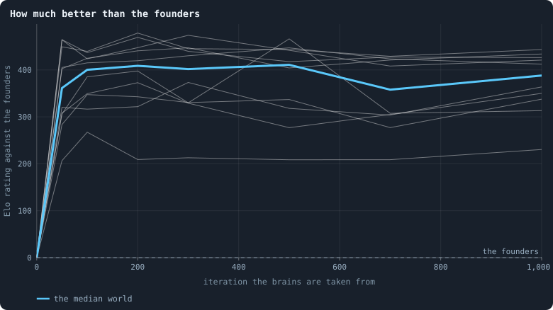
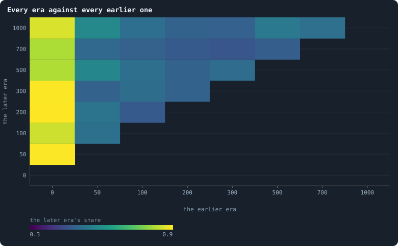

# How to tell a world that keeps evolving

> [!question] Questions of this chapter
> - What would open-ended evolution look like in a Graph of Life world —
>   which number would keep rising?
> - Why are most rising numbers no evidence at all, and what does a rising
>   number have to be held against?
> - How can a world that has stopped evolving be told from one that keeps
>   evolving but stays in place, as in a race where everybody runs?
> - What does it mean, in numbers, for a world's network to be resilient,
>   decentralised and neither a tree nor complete?
> - Does the baseline keep improving?

<!-- experiment E12 -->

## The goal of Part V

Parts II to IV watched the baseline and changed it one rule at a time. Part V
turns the question round: instead of asking what the rules do, it asks which
rules would make evolution **open-ended** — and builds them. The goal, as the
author put it when the part began:

- a **statistic that keeps rising** as the iterations go on. It may be any
  number that says evolution is still producing something — the size of what
  agents organise into, how long they live, how much of the token flow goes
  round in circles ([Lightning](../notes/lightning.md)), or something nobody
  has thought of yet. It may rise ever more slowly, as a logarithm does. With
  finite tokens it has a ceiling, because a finite world has finitely many
  things it can become; but the ceiling should move up with the tokens, so
  that a world many orders of magnitude larger would keep the number rising
  for that much longer.
- a **network that holds**: neither a tree nor complete; large, resilient
  and decentralised, close to three-dimensional, with few single points of
  failure — and all of this not imposed, but made by the rules as the world
  goes.
- **local rules**: an agent acts on itself and its neighbours. A rule may let
  an agent reach further — to look for a new partner, say — only at a price
  that limits how far, paid in tokens.

This chapter is about the first two: how to know when we are there. The rest
of the part builds.

## Numbers that rise and mean nothing

Many numbers rise in any world, evolving or not. Four kinds deserve a
warning, because each looks like the thing we want.

1. **Records.** The longest life ever lived, the largest family ever seen,
   the longest loop of tokens ever peeled: the largest value a fluctuating
   number has taken so far. A record keeps rising in a world that does not
   change at all, simply because the world keeps drawing; in a stationary
   process with ordinary tails it grows like the logarithm of time. A record
   that rises like a logarithm is exactly what a world standing still makes.
2. **Counts.** Genotypes ever made, mutations since the founders, iterations
   of a lineage: anything that only adds. They rise in a straight line at
   the rate things happen, whether anything is selected or not — the
   molecular clock of biology.
3. **The left wall.** A trait that cannot fall below a floor — a brain's
   number of units, a memory's length — and changes by small random steps
   drifts upwards on average, because every step down from the floor is
   refused and every step up is taken. The mean rises; nothing selected it.
   Gould's drunkard, who cannot fall through the wall he leans on, ends up
   in the gutter anyway.
4. **The first boom.** Everything a world does in its first hundred
   iterations is a world settling ([Chapter 11](11-the-first-hundred-iterations.md)):
   numbers climb because the founders were unlike what the world becomes, and
   stop.

So a rising number is evidence only against a **null** — the same number in
a world where nothing is selected. For a trait the null can be built into
the world: a **shadow** trait, inherited and changed exactly as the real one,
read by nothing. Whatever the real trait does beyond its shadow, selection
did ([Bedau and Packard](06-the-ideas-this-builds-on.md) built whole worlds
of shadows for this). For a world as a whole, the null is harder; that is
what the rest of this chapter is about.

## Playing against the past

A world whose statistics have settled may be **finished** — evolution found
what it could and stopped — or it may be **running in place**: every line
changing, each answering the others, none getting ahead, as the Red Queen
told Alice. Inside one moment the two look the same. Between moments they do
not: a world still improving produces brains that beat their own ancestors,
one running in place produces brains that only tie with them, or beat them
on one day and lose on the next.

So the brains of two moments are made to play each other — a **cross-time
tournament** (Cliff and Miller 1995; Stanley and Miikkulainen 2004 counted
how many times in a run a new champion beat every champion before it;
Miconi 2009 separates the kinds of progress such tournaments can show). Here
a contest goes like this:

1. Take the world as it stood at one archived moment — its network, its
   tokens, the ages of its agents. A run keeps such worlds when it is made
   with [`archive_every`](../notes/settings.md#archive_every).
2. Give every agent a brain drawn at random from the agents of one moment,
   era A, or of another, era B: a coin each. Clear the messages in flight,
   so neither side is primed.
3. Switch mutation off, so no brain can change and every copy of a brain
   keeps the era it came from, and let the world play twenty iterations
   under its own rules.
4. The **score** of B is the share of the agents carrying a B brain at the
   end. 0.5 is a tie; above it, B's brains spread at A's expense.

Every pair of eras plays twice, once in each era's world, so neither plays
only at home. And because a score is a share, it can be read as odds — the
chance that a B brain beats an A brain — and turned into one **rating** per
era that fits every contest at once (the model of Bradley and Terry, which
chess calls **Elo**). The founders are rated 0; an era rated +200 beats them
about three times in four, +400 ten times in eleven.

The rating against the founders rises in every world that learns anything
at all. The question is what it does after: a world still improving keeps
rating each era above the one before; a world that has stopped rates them
all alike, however far apart. Of the four warnings above, this answers the
last three — a tournament counts nothing, has no floor to lean on, and plays
the settled world against its own past rather than against its boom.

> [!info] Added later: a contest must last as long as what it judges
> Twenty iterations is long enough for most of a world of B1 to change hands,
> but not for an agent of B2 to live its life: there everyone dies at age 100.
> In B2's worlds the brains of iteration 2,000 tied with those of iteration 500
> in contests of 20 iterations (0.48), and beat them in contests of 100 (0.73,
> in all ten worlds; brains against themselves 0.48, the labels swapped 0.26).
> What evolution improved there pays off slowly, over a life, and a short
> contest cannot see it. The tournaments of this book were played with 20
> iterations until 2026-10-15; [Chapter 50](50-why-evolution-stops.md#would-we-notice-if-it-went-on)
> shows what longer ones find.
>
> For B1, this chapter's world, the longer contests agree with the short ones.
> In contests of 100 iterations, once in each era's world, the brains of
> iteration 1,000 held a median 0.49 of the world against those of 500 in this
> experiment's ten worlds, and 0.56 against those of 300. They scatter more than
> B2's: from 0.31 to 0.77 against 500, above 0.6 in three worlds and below 0.4
> in two. Eras played against themselves held 0.48 to 0.58. The verdict below
> stands: in B1 evolution stops within a few hundred iterations, whichever
> length of contest asks.

## The network that holds, in numbers

The second half of the goal is a property of the network, and every part of
it can be measured on a single frame. The **health bar** this part holds its
worlds to:

| what is asked | measured as | bar |
|---|---|---|
| one world | the pieces the cull leaves | always one |
| not a tree | share of agents in the [2-core](../notes/core-trees-leaves.md) — on a loop, or between loops | 0.8 or more |
| few single points of failure | the largest share of the agents one agent's loss would cut off (`worst_node_cut_share`) | 2% or less |
| | the same for one connection ([cut risk](../notes/cut-risk.md)) | 1% or less |
| decentralised | the share of the others the best-connected agent is joined to | 5% or less |
| neither a tree nor complete | connections per agent | 3 to 12 |
| about three-dimensional | the [dimension of ball growth](../notes/ball-dimension-and-curvature.md) | 2.3 to 4 |

The baseline does not pass it. In a pilot of the baseline at 5,000 tokens
(seed 1, iterations 200 to 999), 59% of the agents sat in the 2-core — the
rest hang in trees — one connection could cut off 8% of the world, the
best-connected agent was joined to 8% of the others, and there were 3.3
connections per agent. Its dimension, 2.7, was fine.

## A first reading: the baseline

The same pilot played its eras against each other: the brains of iterations
0 (the founders), 100, 200, … 600, two contests per pair.

- Against the founders, the brains of iteration 100 held 74% of a contested
  world, and those of iterations 200 to 600 held 77% to 90%: the world had
  learned something, and learned it fast.
- From iteration 200 on, every pair of eras scored between 45% and 59%, with
  a median of exactly 50%. As ratings against the founders: +283 at
  iteration 100, then +320 to +345 for every era from 200 to 600.

One world says the baseline learns what it learns in about two hundred
iterations and then stops. Experiment 12 asks ten.

## The thesis

<!-- thesis E12 -->
> [!quote] The thesis of Experiment 12, written down before any of its runs existed
> **The claim.** The baseline stops improving within a few hundred iterations. Played against the brains of their own world's iteration 300, the brains of iteration 1,000 hold between 45% and 55% of a contested world: no better and no worse. The brains of iteration 300 have learned something all the same: against the founders' brains they hold more than 60%.
>
> **Why it would be so.** A world whose statistics have settled may be finished, or may be running in place — every lineage changing, none getting ahead, as in a Red Queen race. Nothing measured inside one moment tells the two apart; playing the brains of two moments against each other does (Cliff and Miller 1995). A pilot of the same world (seed 1, 5,000 tokens, eras every 100 iterations to 600, two contests per pair): against the founders, the brains of iteration 100 held 74% and those of iterations 200 to 600 held 77–90%; every pair of eras from iteration 200 on scored between 45% and 59% (median 50%). As Elo ratings against the founders: +283 at iteration 100, then +320 to +345 to iteration 600.
>
> **It holds if:** Over the ten worlds, the median world's score of the brains of iteration 1,000 against those of iteration 300 — the mean of its two contests, one in each era's world — lies between 0.45 and 0.55, and the median world's score of the brains of iteration 300 against the founders' is above 0.6.
>
> **It fails if:** The median world's score of iteration 1,000 against iteration 300 is above 0.55: the baseline keeps improving. Or the score of iteration 300 against the founders is 0.6 or less: there was nothing to learn, or it was not learned.
<!-- /thesis -->

## The runs

<!-- runs E12 -->
> [!info] The runs behind this chapter
> **10 runs.** Every condition below is run once for every seed (1 to 10), for 1,000 iterations — or until its world dies out. Every setting is that of the baseline **B1** (the algorithm exactly as a new run is offered it) unless the condition changes it.
>
> - **baseline** — changes nothing: B1 as it is; 5,000 tokens. Runs `B1-5000-s001` … `B1-5000-s010`.
>
> To make these runs again: `python3 gol_lab.py run E12`, or ▶ in the Book tab of a computer running `gol_server.py`. Each run writes its settings, seed and engine version beside its frames, in `GraphOfLifeRuns/<run>/meta.json` and `provenance.json`.

> [!info]- Every setting of these runs
> | setting | baseline | what it is |
> |---|---|---|
> | [`total_tokens`](../notes/settings.md#total_tokens) | 5,000 | The number of tokens in the world, *T*. It never changes during a run. |
> | [`n_nodes`](../notes/settings.md#n_nodes) | 0 | How many founders the world starts with. 0 means one founder per hundred tokens: *n* = ⌊*T* / 100⌋. |
> | [`k_neighbors`](../notes/settings.md#k_neighbors) | 0 | How many neighbours each founder starts with in the ring. 0 means *k* = max(⌊*n* / 100⌋, 5); an odd *k* is wired as *k* − 1. |
> | [`rewire_p`](../notes/settings.md#rewire_p) | 0.2 | In the starting ring, the probability that a connection is moved to a founder chosen at random (Watts–Strogatz). |
> | [`hidden_layers`](../notes/settings.md#hidden_layers) | 50, 45, 40, 35, 30 | The widths of the brain's hidden layers, in order from input to output. |
> | [`brain_kind`](../notes/settings.md#brain_kind) | float16 | How weights are stored: `float` (64-bit), `float16` (16-bit, computed in 64-bit) or `binary` (−1, 0, +1). |
> | [`brain_bits`](../notes/settings.md#brain_bits) | 16 | Only for binary brains: how many input rows encode one number. Unused by float and float16 brains. |
> | [`message_amount`](../notes/settings.md#message_amount) | 30 | How many numbers one message holds. Each agent sends one message to itself and one to each neighbour, every phase. |
> | [`random_input_amount`](../notes/settings.md#random_input_amount) | 5 | How many random numbers, drawn uniformly from −2 to 2, a brain reads per neighbour, every time it looks. |
> | [`exchange_messages`](../notes/settings.md#exchange_messages) | on | Whether agents send and read messages at all. |
> | [`message_prepass`](../notes/settings.md#message_prepass) | on | Whether every phase begins with an extra look in which agents only write messages, so the look that acts reads messages written this phase. |
> | [`allow_handover`](../notes/settings.md#allow_handover) | on | Whether a parent may move some of its own connections to its newborn child. |
> | [`allow_revolutions`](../notes/settings.md#allow_revolutions) | on | Whether a coalition of smaller stakers can take a node from its largest staker (see the note *How a coalition takes a node*). |
> | [`allow_gifting`](../notes/settings.md#allow_gifting) | off | Whether agents may give tokens to neighbours during reproduction. Off in every run of this book. |
> | [`random_decisions`](../notes/settings.md#random_decisions) | off | The control: every number a brain would produce is replaced by a random draw from the standard normal distribution. |
> | [`prune_after`](../notes/settings.md#prune_after) | blotto | After which phase connections that carried no tokens are cut: `blotto` (the game), `reproduction`, or `both`. |
> | [`inactive_window`](../notes/settings.md#inactive_window) | phase | How long a connection may go unused: `phase` means it must carry tokens in the phase being judged; `iteration` allows the two last phases. |
> | [`redistribution`](../notes/settings.md#redistribution) | uniform | How the tokens of removed agents are shared: `uniform` gives every survivor the same chance at each token; `by_tokens` weights by what a survivor holds; `poorest` raises the poorest to one common level first; `newborns` gives them to this iteration's children, `parents` to their parents, once per child (both `uniform` in an iteration without births). |
> | [`tokens_created_per_phase`](../notes/settings.md#tokens_created_per_phase) | 0 | Tokens added to the world at every cleanup. 0 keeps the supply fixed. |
> | [`mutate_on_replication`](../notes/settings.md#mutate_on_replication) | off | Whether a brain changes only when it is copied — into a newborn, or into a node its owner has just won — instead of also after every game, wherever it sits. |
> | [`incumbency`](../notes/settings.md#incumbency) | 1.0 | How many times over an agent's stake on its own node counts when the game decides who takes the node. 1 is the old rule. |
> | [`birth_links`](../notes/settings.md#birth_links) | 0 | How many of its parent's neighbours a newborn is joined to, drawn at random, besides its parent itself; 0 leaves every link to the brain's choice. |
> | [`mend_on_death`](../notes/settings.md#mend_on_death) | off | Whether the neighbours of an agent that dies are joined up where its death would leave them in separate pieces. |
> | [`prune_needs`](../notes/settings.md#prune_needs) | 0 | How many neighbours the two ends of an unused connection must share for it to be cut; 0 cuts every unused connection. |
> | [`valence`](../notes/settings.md#valence) | 0 | The most connections an agent's brain may choose to hold (0 = no limit). An agent at its limit cannot have a child. |
> | [`keep_home`](../notes/settings.md#keep_home) | 0.0 | The share of an agent's tokens — rounded up, never less than one — that stays on its own node whatever its brain says; a parent also keeps one. 0 is the old rule. |
> | [`max_age`](../notes/settings.md#max_age) | 0 | The age at which an agent dies (0 = never); its tokens are shared out like those of any other dead agent. |
> | [`min_child`](../notes/settings.md#min_child) | 1 | The fewest tokens a child can be born with; a parent that would give less has no child. |
> | [`mutation_probability`](../notes/settings.md#mutation_probability) | 0.2 | The probability that a brain changes when it is copied to a child, and again, for every brain, after every game. |
> | [`mutation_noise_std`](../notes/settings.md#mutation_noise_std) | 0.2 | How large a change to one weight is: a normal draw with standard deviation this times 1/√(fan-in) of its layer. |
> | [`mutation_sparsity`](../notes/settings.md#mutation_sparsity) | 0.1 | The share of a brain's numbers a change touches; also the probability, for each weight matrix and bias vector, of a rarer reset that redraws that share of it. |
> | [`extinction_threshold`](../notes/settings.md#extinction_threshold) | 20 | A run stops, as extinct, when an iteration ends (after its game) with this many agents or fewer. |
> | seeds | 1 to 10 | one run per seed |
> | iterations | 1,000 | how far each run goes, unless its world dies first |
>
> A value in **bold** differs from the baseline B1.
<!-- /runs -->

## What the ten worlds did

Every pair of the eras 0, 50, 100, 200, 300, 500, 700 and 1,000 was played
twice in each of the ten worlds — once in each era's world — 560 contests in
all, each twenty iterations long.

<!-- figure yardstick/elo -->

**How much better than the founders.** Each grey line is one world; the blue line is the median of the ten at each era. A rating says how often an era's brains beat the founders': +200 is about three contests in four, +400 ten in eleven. The ratings are fitted to every contest between every pair of eras, so each point leans on the others.

> [!example]- How to make this figure
> **Runs.** The 10 runs of Experiment 12 — B1 at 5,000 tokens, seeds 1 to 10, 1,000 iterations, a whole world archived every 50 — `B1-5000-s001` … `-s010`. They are made with `python3 gol_lab.py run E12`; every setting is listed in the box under the thesis.
>
> **Data.** From each run's archive, `GraphOfLifeRuns/<run>/archive/world_<iteration>.npz`: the whole world as a checkpoint writes it, kept every 50 iterations.
>
> 1. For every pair of the eras 0, 50, 100, 200, 300, 500, 700, 1000 play two contests, one in each era's world: give every agent a brain drawn at random from one era or the other, a coin each, clear the messages, switch mutation off and run 20 iterations (`gol_tournament.contest`). The later era's score is the share of agents carrying one of its brains at the end.
> 2. Read every score *p* as odds, log(*p* / (1 − *p*)), after keeping it between 0.02 and 0.98, and find one rating per era — the founders' at 0 — that fits them best by least squares, the later era's rating minus the earlier's for each contest (`gol_tournament.ratings`). Multiply by 400 / ln 10 for Elo points.
> 3. Draw each world's ratings, and the median world at each era.
>
> **To make it again:** `python3 book_figures.py yardstick`.
<!-- /figure -->

**Every world learned, and learned fast.** By iteration 50 the brains of
every world beat their founders: a rating of +207 to +465, +361 in the median
world — the brains of iteration 50 hold about nine-tenths of a world contested
with the founders' (0.90 in the median world) — and by iteration 100 the
median world stood at +400. That is the first boom of
[Chapter 11](11-the-first-hundred-iterations.md), seen from the brains' side:
whatever the founders do that does not pay, the first few dozen games remove.

**And then nothing.** From iteration 50 to iteration 1,000 the median world's
rating stays between +358 and +411, and no world's line climbs: a straight
line fitted to each world's ratings from iteration 50 on falls by 0.8 points
per hundred iterations in the median world, and lies between −4 and +2 points
per hundred in every one. Played against the era just before it, every later
era tied — the median world's score of each era against the one before was
0.47 to 0.52 for every step from iteration 50 to iteration 1,000, against 0.90
for the step from the founders to iteration 50.

<!-- figure yardstick/pairs -->

**Every era against every earlier one.** Each square is one pair of eras: the share of a contested world the later era's brains held, in the median world. 0.5 is a tie. The left column is every era against the founders; in a world still improving the shares would grow the further a square is from the diagonal, in every column.

> [!example]- How to make this figure
> **Runs.** The 10 runs of Experiment 12 — B1 at 5,000 tokens, seeds 1 to 10, 1,000 iterations, a whole world archived every 50 — `B1-5000-s001` … `-s010`. They are made with `python3 gol_lab.py run E12`; every setting is listed in the box under the thesis.
>
> **Data.** From each run's archive, `GraphOfLifeRuns/<run>/archive/world_<iteration>.npz`: the whole world as a checkpoint writes it, kept every 50 iterations.
>
> 1. For every pair of the eras 0, 50, 100, 200, 300, 500, 700, 1000 play two contests, one in each era's world: give every agent a brain drawn at random from one era or the other, a coin each, clear the messages, switch mutation off and run 20 iterations (`gol_tournament.contest`). The later era's score is the share of agents carrying one of its brains at the end.
> 2. For each world and each pair, average its two contests.
> 3. Take the median over the ten worlds, and colour the pair's square by it.
>
> **To make it again:** `python3 book_figures.py yardstick`.
<!-- /figure -->

The same in every pair: whatever two eras from iteration 50 on are played
against each other, the median world's score lies between 0.46 and 0.58,
never far from a tie, and it does not grow as the eras move apart. A world
still improving would rate its iteration 1,000 well above its iteration 100;
these rate them the same.

## The verdict

The thesis asked for two things of the median world. Against the brains of
iteration 300, those of iteration 1,000 should hold between 0.45 and 0.55: they
held **0.483** (0.39 to 0.57 in the ten worlds; between 0.45 and 0.55 in
five, below in four, above in one). Against the founders, the brains of
iteration 300 should hold more than 0.6: they held **0.899** (0.77 to 0.97).
**The thesis holds** — and was, if anything, too generous to the baseline: it
learns what it learns in fifty to a hundred iterations, not a few hundred,
and then stops.

## Finished, or running in place?

A tie between two eras has two readings. The world may have **finished** —
found what it could, nothing left to find — or it may be **running in place**,
each era beating the one before at what the one before did, and losing to the
one before that, so that no era gets ahead of all of them.

The step scores already argue against the second: an era that answered its
predecessor would beat it, and the eras here tie with their predecessors too.
A **dominance tournament** asks the question directly (Stanley and
Miikkulainen, 2004). The founders are the first champion; each later era, in
order, becomes a champion if it beats *every* champion before it, each by a
margin — here a mean score above 0.55 (`gol_tournament.dominance`). A world
that keeps making better brains keeps crowning champions; a world running in
place, or finished, stops.

In every world the brains of iteration 50 beat the founders and became the
second champion. After that, seven worlds crowned one more, two worlds two
more, and one world none. That is just what chance crowns. A contest is
noisy — the two contests of a pair differ by enough that one contest's share
spreads by about 0.12 around the pair's true score, and the mean of two by
about 0.08 — and an era that is in truth no
better than the era 50 still beats every champion by more than 0.55 now and
then. In 20,000 tournaments simulated with that spread, every era after 50
exactly as good as the era 50 and the founders losing every contest, the
number of champions was 2 in 15% of them, 3 in 66%, 4 in 19% and 5 in 0.7%; the ten
worlds had 2 once, 3 seven times and 4 twice. Nothing in the ten worlds is
better than its iteration 50 by more than chance can make it look.

> [!example]- The null of the dominance tournament, to run yourself
> Read every E12 tournament, take the spread *σ* of one contest's share around
> its pair's mean from the difference of the pair's two contests (as the
> standard deviation of the differences divided by √2), then play 20,000
> tournaments with the same eras and two contests per pair: a later era's
> share against the founders 0.95, every other share 0.5 + *σ* times a
> standard normal draw, kept between 0 and 1; count the champions with
> `gol_tournament.dominance`. The script is `research/oee/champion_null.py`.

## What it means for Part V

The yardstick works: it separates the first boom, which every world has, from
what comes after, which the baseline does not have. Elo against the founders
alone would have shown a rise; the eras against each other show that the rise
was all in the first fifty iterations.

Why does the baseline stop so soon? Part II answered half of it: its brains
are nearly blind ([Chapter 19](19-what-the-brains-are-like.md)), so evolution
can only set constants, and a few constants are quickly set. Brains that see
are the obvious next step, and they are what
[Chapter 47](47-brains-that-see-and-worlds-that-break.md) tries — with
consequences for the world itself that have to be dealt with first. Whether
evolution then keeps going is the subject of
[Chapter 50](50-why-evolution-stops.md).

<!-- turns -->
---

← [Chapter 42 · How does a world's size follow its tokens?](42-how-does-a-worlds-size-follow-its-tokens.md) · [Contents](../README.md) · [Chapter 47 · Brains that see, and worlds that break](47-brains-that-see-and-worlds-that-break.md) →
<!-- /turns -->
