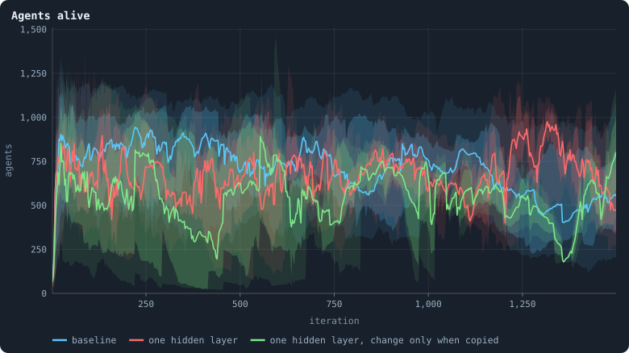
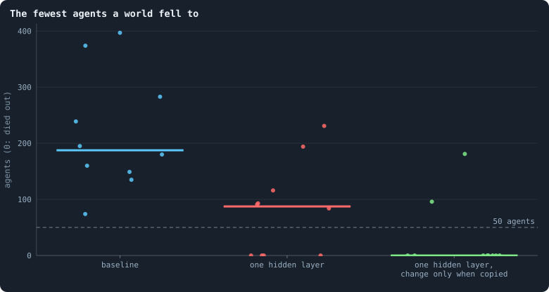
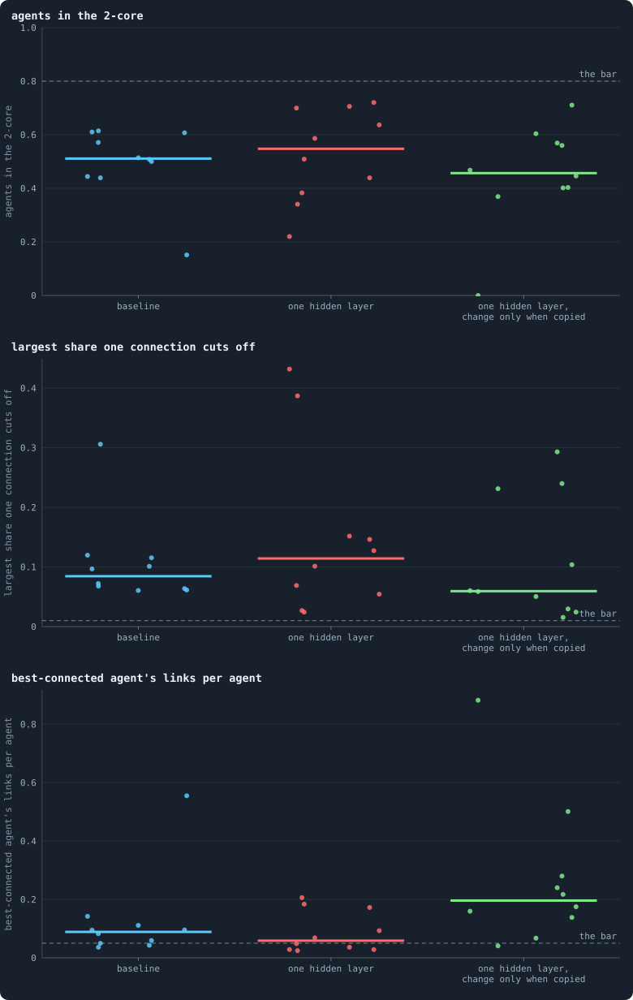
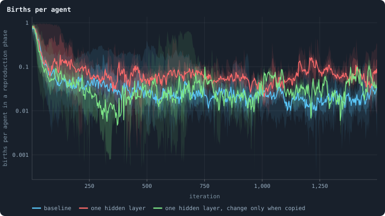
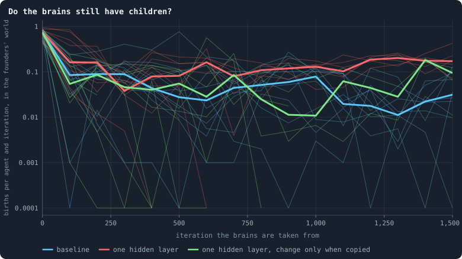

# Brains that see, and worlds that break

> [!question] Questions of this chapter
> - What happens to a world when its agents' decisions follow what they see?
> - Why does a world of seeing agents fall apart — what, exactly, breaks?
> - What does that teach about the rules a world needs before evolution can
>   build anything in it?

<!-- experiment E13 -->

## Why ask

The baseline's brains barely see. A change in what one of them sees reaches
what it does reduced about a thousandfold — a **gain** of 0.0015 in the
evolved worlds and 0.0006 in a founder ([Chapter 19](19-what-the-brains-are-like.md)).
Each of the brain's five hidden layers ends in a sigmoid that passes on about
a quarter of a change, and five quarters multiply to a thousandth
([How a signal fades through layers](../notes/vanishing-signal.md)). Whatever
evolution has done in the baseline, it has done to a brain that responds to
almost nothing; its decisions are near enough constants.

Open-ended evolution needs agents whose behaviour can depend on their world:
kin recognised, partners answered, threats met. The first step of Part V is
therefore to give the brains sight, and the cheapest way is to take layers
away. With one hidden layer of 16 units, a founder's gain is about 0.2 — some
three hundred times the baseline founders' 0.0006 — and with no hidden layer
at all it is about 1:

| hidden layers | founders' gain (median of 30 brains) |
|---|---|
| 50, 45, 40, 35, 30 (B1) | 0.0006 |
| 16, 16 | 0.04 |
| 16 | 0.2 |
| none | 1.0 |

A second change goes with it. In the baseline every brain may change after
every game, wherever it sits ([How a brain changes](../notes/mutation.md)):
an adaptation is worn away in the agent that carries it, generation or not.
[`mutate_on_replication`](../notes/settings.md#mutate_on_replication) makes a
brain change only where biology's do — when it is copied, into a child or
into a node its owner has won.

## What the pilots showed

Pilots of two seeds each, at 5,000 tokens for 1,500 iterations, compared the
baseline with brains of one hidden layer, with and without change only when
copied.

**The worlds broke.** The baseline's two worlds never fell below 74 and 397
agents. With one hidden layer, one world fell to a single agent at iteration
547 — which went on making children alone, most of whom it could not keep,
until a lucky one at iteration 1,100 started the world again — and the other
to 84. With one hidden layer and change only when copied, one world fell to 15
and dwindled to 25 by the end, the other to a single agent for good.

**What breaks is the network.** An agent whose stake follows what it sees
puts it where it matters — on one neighbour, or two — and a connection that
carries no tokens in a game is cut at its end ([Chapter 3](03-one-iteration.md)).
So the seeing worlds kept few connections: as few as 1.3 to 1.9 per agent in
the worlds that crashed, against 3.2 in the baseline, and only 27–39% of
their agents in the [2-core](../notes/core-trees-leaves.md), against 54–55%.
A network that is mostly trees is a network of bridges. When one of them is
cut, everything beyond it is no longer joined to the largest piece, and the
cull removes it whole: in one pilot world a single game cut off 1,195
agents — that iteration's newborns among them — and left 562.

**And what is left is ruled by a few.** The best-connected agent in a seeing
world was joined to 15–35% of the others — more than in the baseline's two
pilot worlds (9–12%), though the ten worlds below show that the baseline can
grow such hubs too (one of its worlds 55%; the stars of
[Chapter 33](33-the-largest-and-the-smallest.md)).

**Change only when copied made it worse, not better** — its two worlds were
the two that fell furthest. And a stricter variant of it, which changed a
brain only when it was copied into a newborn and never into a won node, shows
what heredity alone cannot do: in one of its worlds births stopped, so change
stopped, and the world froze into a single genotype, its agents ageing by one
every iteration, every node taken by its own kin each game. Longer lives, for
once, meant that nothing was happening.

## What the pilots suggested

The baseline holds together because its agents are blind. Their stakes are
spread evenly over every neighbour, every connection carries tokens, and the
network keeps its loops. Sight is the precondition of anything evolution
might build — and the first thing it does, the pilots suggested, is break
the world it lives in. Experiment 13 asks whether that holds in ten worlds,
and the results below say what, exactly, kills them.

## The thesis

<!-- thesis E13 -->
> [!quote] The thesis of Experiment 13, written down before any of its runs existed
> **The claim.** Brains that see break worlds. With one hidden layer of 16 instead of five, and every brain changed only when it is copied, at least six of ten worlds of 5,000 tokens fall below 50 agents — or die out — at some time after iteration 50 within 1,500 iterations; of the baseline's ten, at most two do.
>
> **Why it would be so.** One hidden layer passes about a fifth of a change in what a brain sees on to what it does (a gain of 0.2 for a founder, against 0.0006 through the baseline's five sigmoid layers: Chapter 19), so agents stake on one neighbour rather than evenly on all. Pilots of two seeds each, 5,000 tokens, 1,500 iterations: the baseline's worlds never fell below 74 and 397 agents; with one hidden layer, to 1 (and regrown from it) and 84; with one hidden layer and change only when copied, to 15 and 1. In the worlds that see, fewer agents sat in the 2-core (0.27 to 0.62, against 0.54 and 0.55) and the best-connected agent was joined to 15–35% of the others (9–12%).
>
> **It holds if:** At least 6 of the 10 worlds of the condition 'one hidden layer, change only when copied' have fewer than 50 agents after the game of some iteration from 50 on, or die out; and at most 2 of the baseline's 10 do.
>
> **It fails if:** Fewer than 6 of the 10 worlds that see fall below 50 agents: seeing does not break worlds. Or more than 2 of the baseline's do: worlds of 5,000 tokens break anyway, and seeing is not the reason.
<!-- /thesis -->

## The runs

<!-- runs E13 -->
> [!info] The runs behind this chapter
> **30 runs.** Every condition below is run once for every seed (1 to 10), for 1,500 iterations — or until its world dies out. Every setting is that of the baseline **B1** (the algorithm exactly as a new run is offered it) unless the condition changes it.
>
> - **baseline** — changes nothing: B1 as it is; 5,000 tokens. Runs `B1-5000-s001` … `B1-5000-s010`.
> - **one hidden layer** — changes `hidden_layers` = 16; 5,000 tokens. Runs `B1-5000-f7c30b-s001` … `B1-5000-f7c30b-s010`.
> - **one hidden layer, change only when copied** — changes `hidden_layers` = 16, `mutate_on_replication` = on; 5,000 tokens. Runs `B1-5000-4802b8-s001` … `B1-5000-4802b8-s010`.
>
> To make these runs again: `python3 gol_lab.py run E13`, or ▶ in the Book tab of a computer running `gol_server.py`. Each run writes its settings, seed and engine version beside its frames, in `GraphOfLifeRuns/<run>/meta.json` and `provenance.json`.

> [!info]- Every setting of these runs
> | setting | baseline | one hidden layer | one hidden layer, change only when copied | what it is |
> |---|---|---|---|---|
> | [`total_tokens`](../notes/settings.md#total_tokens) | 5,000 | 5,000 | 5,000 | The number of tokens in the world, *T*. It never changes during a run. |
> | [`n_nodes`](../notes/settings.md#n_nodes) | 0 | 0 | 0 | How many founders the world starts with. 0 means one founder per hundred tokens: *n* = ⌊*T* / 100⌋. |
> | [`k_neighbors`](../notes/settings.md#k_neighbors) | 0 | 0 | 0 | How many neighbours each founder starts with in the ring. 0 means *k* = max(⌊*n* / 100⌋, 5); an odd *k* is wired as *k* − 1. |
> | [`rewire_p`](../notes/settings.md#rewire_p) | 0.2 | 0.2 | 0.2 | In the starting ring, the probability that a connection is moved to a founder chosen at random (Watts–Strogatz). |
> | [`hidden_layers`](../notes/settings.md#hidden_layers) | 50, 45, 40, 35, 30 | **16** | **16** | The widths of the brain's hidden layers, in order from input to output. |
> | [`brain_kind`](../notes/settings.md#brain_kind) | float16 | float16 | float16 | How weights are stored: `float` (64-bit), `float16` (16-bit, computed in 64-bit) or `binary` (−1, 0, +1). |
> | [`brain_bits`](../notes/settings.md#brain_bits) | 16 | 16 | 16 | Only for binary brains: how many input rows encode one number. Unused by float and float16 brains. |
> | [`message_amount`](../notes/settings.md#message_amount) | 30 | 30 | 30 | How many numbers one message holds. Each agent sends one message to itself and one to each neighbour, every phase. |
> | [`random_input_amount`](../notes/settings.md#random_input_amount) | 5 | 5 | 5 | How many random numbers, drawn uniformly from −2 to 2, a brain reads per neighbour, every time it looks. |
> | [`exchange_messages`](../notes/settings.md#exchange_messages) | on | on | on | Whether agents send and read messages at all. |
> | [`message_prepass`](../notes/settings.md#message_prepass) | on | on | on | Whether every phase begins with an extra look in which agents only write messages, so the look that acts reads messages written this phase. |
> | [`allow_handover`](../notes/settings.md#allow_handover) | on | on | on | Whether a parent may move some of its own connections to its newborn child. |
> | [`allow_revolutions`](../notes/settings.md#allow_revolutions) | on | on | on | Whether a coalition of smaller stakers can take a node from its largest staker (see the note *How a coalition takes a node*). |
> | [`allow_gifting`](../notes/settings.md#allow_gifting) | off | off | off | Whether agents may give tokens to neighbours during reproduction. Off in every run of this book. |
> | [`random_decisions`](../notes/settings.md#random_decisions) | off | off | off | The control: every number a brain would produce is replaced by a random draw from the standard normal distribution. |
> | [`prune_after`](../notes/settings.md#prune_after) | blotto | blotto | blotto | After which phase connections that carried no tokens are cut: `blotto` (the game), `reproduction`, or `both`. |
> | [`inactive_window`](../notes/settings.md#inactive_window) | phase | phase | phase | How long a connection may go unused: `phase` means it must carry tokens in the phase being judged; `iteration` allows the two last phases. |
> | [`redistribution`](../notes/settings.md#redistribution) | uniform | uniform | uniform | How the tokens of removed agents are shared: `uniform` gives every survivor the same chance at each token; `by_tokens` weights by what a survivor holds; `poorest` raises the poorest to one common level first; `newborns` gives them to this iteration's children, `parents` to their parents, once per child (both `uniform` in an iteration without births). |
> | [`tokens_created_per_phase`](../notes/settings.md#tokens_created_per_phase) | 0 | 0 | 0 | Tokens added to the world at every cleanup. 0 keeps the supply fixed. |
> | [`mutate_on_replication`](../notes/settings.md#mutate_on_replication) | off | off | **on** | Whether a brain changes only when it is copied — into a newborn, or into a node its owner has just won — instead of also after every game, wherever it sits. |
> | [`incumbency`](../notes/settings.md#incumbency) | 1.0 | 1.0 | 1.0 | How many times over an agent's stake on its own node counts when the game decides who takes the node. 1 is the old rule. |
> | [`birth_links`](../notes/settings.md#birth_links) | 0 | 0 | 0 | How many of its parent's neighbours a newborn is joined to, drawn at random, besides its parent itself; 0 leaves every link to the brain's choice. |
> | [`mend_on_death`](../notes/settings.md#mend_on_death) | off | off | off | Whether the neighbours of an agent that dies are joined up where its death would leave them in separate pieces. |
> | [`prune_needs`](../notes/settings.md#prune_needs) | 0 | 0 | 0 | How many neighbours the two ends of an unused connection must share for it to be cut; 0 cuts every unused connection. |
> | [`valence`](../notes/settings.md#valence) | 0 | 0 | 0 | The most connections an agent's brain may choose to hold (0 = no limit). An agent at its limit cannot have a child. |
> | [`keep_home`](../notes/settings.md#keep_home) | 0.0 | 0.0 | 0.0 | The share of an agent's tokens — rounded up, never less than one — that stays on its own node whatever its brain says; a parent also keeps one. 0 is the old rule. |
> | [`max_age`](../notes/settings.md#max_age) | 0 | 0 | 0 | The age at which an agent dies (0 = never); its tokens are shared out like those of any other dead agent. |
> | [`min_child`](../notes/settings.md#min_child) | 1 | 1 | 1 | The fewest tokens a child can be born with; a parent that would give less has no child. |
> | [`mix_at_birth`](../notes/settings.md#mix_at_birth) | off | off | off | Whether a newborn's brain is its parent's mixed with a mate's — one of the parent's neighbours, drawn at random — each hidden unit whole from one or the other by an even chance, before it mutates; off, a newborn has a copy of its parent's brain. |
> | [`link_search`](../notes/settings.md#link_search) | off | off | off | Whether an agent may reach beyond its neighbours to propose a link: off; jump, a walk as many steps long as the tokens it spends in one iteration, with a link proposed where it ends; or walk, a scout that goes one step further in every iteration it pays for. A step costs one token, paid to the agent it enters, and never the last. |
> | [`link_steering`](../notes/settings.md#link_steering) | random | random | random | Which way each step of a search goes: to a neighbour drawn at random, or to the one the searcher would most like a link with (looking). |
> | [`link_consent`](../notes/settings.md#link_consent) | mutual | mutual | mutual | Who has to agree to a link a search proposes: both ends (mutual), or only the one who proposes (forced). Nobody at its valence gets a new link either way. |
> | [`mutation_probability`](../notes/settings.md#mutation_probability) | 0.2 | 0.2 | 0.2 | The probability that a brain changes when it is copied to a child, and again, for every brain, after every game. |
> | [`mutation_noise_std`](../notes/settings.md#mutation_noise_std) | 0.2 | 0.2 | 0.2 | How large a change to one weight is: a normal draw with standard deviation this times 1/√(fan-in) of its layer. |
> | [`mutation_sparsity`](../notes/settings.md#mutation_sparsity) | 0.1 | 0.1 | 0.1 | The share of a brain's numbers a change touches; also the probability, for each weight matrix and bias vector, of a rarer reset that redraws that share of it. |
> | [`extinction_threshold`](../notes/settings.md#extinction_threshold) | 20 | 20 | 20 | A run stops, as extinct, when an iteration ends (after its game) with this many agents or fewer. |
> | seeds | 1 to 10 | 1 to 10 | 1 to 10 | one run per seed |
> | iterations | 1,500 | 1,500 | 1,500 | how far each run goes, unless its world dies first |
>
> A value in **bold** differs from the baseline B1.
<!-- /runs -->

## What the thirty worlds did

<!-- figure seeing/agents -->

**Agents alive.** For each condition the median world at each iteration, with the middle half of the worlds (darker) and nine in ten (paler).

> [!example]- How to make this figure
> **Runs.** The 30 runs of Experiment 13 — at 5,000 tokens, seeds 1 to 10, 1,500 iterations — in three conditions: the baseline B1 (`B1-5000-s001` … `-s010`, shared with Experiment 12), its brains with one hidden layer of 16, and those brains changed only when copied. They are made with `python3 gol_lab.py run E13`.
>
> **Data.** From each run's `GraphOfLifeRuns/<run>/stats.jsonl`, which holds one row per recorded phase: `phase` 1 is the world just after reproduction, `phase` 2 just after the game, and every statistic is a field of the row (see [What a run records](../notes/frames-and-stats.md)).
>
> 1. Take `nodes` of the rows with `phase` = 2, one line per run.
> 2. For each condition, the median, quartiles and 5th and 95th percentiles of the runs at each iteration (`book_figures.band_series`).
>
> **To make it again:** `python3 book_figures.py seeing`.
<!-- /figure -->

Every baseline world lived its 1,500 iterations, and none ever fell below 74
agents after iteration 50 — the median world's lowest was 188. Brains that see
did not do so well. With one hidden layer, four of the ten worlds died out —
fell to 20 agents or fewer, where a run is stopped as extinct
([When a world ends](../notes/extinction.md)) — at iterations 219, 478, 534
and 619; the other six fell as low as 84 to 231. With one hidden layer and
change only when copied, eight of ten died out, at iterations 219, 292, 415,
454, 674, 820, 975 and 1,018; the two that lived fell to 96 and 181.

"Died out" here means fell to twenty agents, where the lab stops a run — a
rule that ends some worlds that would have lived
([Chapter 42](42-how-does-a-worlds-size-follow-its-tokens.md)). The pilot of
the world with one hidden layer and seed 1, run on without the rule, fell to a
single agent at iteration 547 and grew back from it.

<!-- figure seeing/lowest -->

**The fewest agents a world fell to.** One dot per world: its fewest agents after the game of any iteration from 50 on, 0 for a world that died out; the bar is the median world. The dashed line is the thesis's 50 agents.

> [!example]- How to make this figure
> **Runs.** The 30 runs of Experiment 13 — at 5,000 tokens, seeds 1 to 10, 1,500 iterations — in three conditions: the baseline B1 (`B1-5000-s001` … `-s010`, shared with Experiment 12), its brains with one hidden layer of 16, and those brains changed only when copied. They are made with `python3 gol_lab.py run E13`.
>
> **Data.** From each run's `GraphOfLifeRuns/<run>/stats.jsonl`, which holds one row per recorded phase: `phase` 1 is the world just after reproduction, `phase` 2 just after the game, and every statistic is a field of the row (see [What a run records](../notes/frames-and-stats.md)).
>
> 1. Take the smallest `nodes` of the rows with `phase` = 2 and `iteration` ≥ 50; a run that ended extinct counts 0.
> 2. Count the worlds below 50 in each condition.
>
> **To make it again:** `python3 book_figures.py seeing`.
<!-- /figure -->

## The verdict

The thesis asked for at least six of the ten worlds that see, with change only
when copied, to fall below 50 agents or die out, and for at most two of the
baseline's. Eight did, and none of the baseline's: **the thesis holds.** Brains
that see break worlds — and the second change, which the pilots had already
found harmful, doubles the toll of the first.

## What kills a world

The pilots blamed the network: seeing brains leave links unused, unused links
are cut, and a world of trees falls apart. The ten worlds of each condition
say that this is only half of it.

**Not one big cut.** The largest single cull of a world — the most agents ever
cut off at once — came in its first fifty iterations in seven of the
baseline's worlds, when 400 to 1,250 agents at a time were lost as the first
boom ended ([Chapter 11](11-the-first-hundred-iterations.md)). The seeing
worlds had such early culls too. But the worlds that died out did not die of
one of them: each shrank over a hundred iterations or more.

**The network kills every iteration — in every world.** By the health bar of
[Chapter 46](46-how-to-tell-a-world-that-keeps-evolving.md#the-network-that-holds-in-numbers),
no world of any condition holds. The baseline's median world had 51% of its
agents in the 2-core and a link whose loss cut off 8% of it; the seeing worlds
had 55% and 11%, and with change only when copied 46% and 6%, and there the
best-connected agent was joined to a fifth of the world in the median. These
networks are not clearly worse than the baseline's. What they share with it
is that agents are cut off all the time: in the median world, the cull
removed 1.9% of the agents in every iteration of the baseline from iteration
500 on — four times as many as starved (0.5%) — and 5.3% in the worlds with
one hidden layer.

<!-- figure seeing/health -->

**How the network holds.** One dot per world, at its median over iterations 200 to 1,500 while it lived; the bar is the median world and the dashed line the health bar of [Chapter 46](46-how-to-tell-a-world-that-keeps-evolving.md).

> [!example]- How to make this figure
> **Runs.** The 30 runs of Experiment 13 — at 5,000 tokens, seeds 1 to 10, 1,500 iterations — in three conditions: the baseline B1 (`B1-5000-s001` … `-s010`, shared with Experiment 12), its brains with one hidden layer of 16, and those brains changed only when copied. They are made with `python3 gol_lab.py run E13`.
>
> **Data.** From each run's `GraphOfLifeRuns/<run>/stats.jsonl`, which holds one row per recorded phase: `phase` 1 is the world just after reproduction, `phase` 2 just after the game, and every statistic is a field of the row (see [What a run records](../notes/frames-and-stats.md)).
>
> 1. Take `coreShare`, `cutRisk` and `maxDegree` / `nodes` of the rows with `phase` = 2 and 200 ≤ `iteration` ≤ 1,500, and each world's median of each.
>
> **To make it again:** `python3 book_figures.py seeing`.
<!-- /figure -->

**So births have to keep up.** A world whose agents are cut off and starve at a
few per cent per iteration lives only as long as it has as many children.
Seeing brains turn the population over faster: with one hidden layer the median
world had 6.4 births per hundred agents and iteration from 500 on, against the
baseline's 2.3, and lost agents correspondingly faster. A world shrinks
whenever its births fall short of its losses for a while, and a world that
shrinks to a few dozen agents is a few unlucky games from the end.

<!-- figure seeing/births -->

**Births per agent.** For each condition the median world at each iteration, with the middle half of the worlds (darker) and nine in ten (paler), on a logarithmic axis. A world that died out leaves the band when it does.

> [!example]- How to make this figure
> **Runs.** The 30 runs of Experiment 13 — at 5,000 tokens, seeds 1 to 10, 1,500 iterations — in three conditions: the baseline B1 (`B1-5000-s001` … `-s010`, shared with Experiment 12), its brains with one hidden layer of 16, and those brains changed only when copied. They are made with `python3 gol_lab.py run E13`.
>
> **Data.** From each run's `GraphOfLifeRuns/<run>/stats.jsonl`, which holds one row per recorded phase: `phase` 1 is the world just after reproduction, `phase` 2 just after the game, and every statistic is a field of the row (see [What a run records](../notes/frames-and-stats.md)).
>
> 1. Take `births` / `nodes_before` of the rows with `phase` = 1, one line per run.
> 2. For each condition, the median, quartiles and 5th and 95th percentiles of the runs at each iteration (`book_figures.band_series`).
>
> **To make it again:** `python3 book_figures.py seeing`.
<!-- /figure -->

**And seeing brains can stop having children.** In the baseline, whether an
agent has a child is close to a constant of its brain — the brains barely see
([Chapter 19](19-what-the-brains-are-like.md)). With one hidden layer it is a
decision that depends on what the agent sees, and evolution can change it a
great deal. To see what it did, every era's brains were put back into the same
world — their own run's founders' world, 50 agents with 100 tokens each — and
played ten iterations with mutation off. The founders' own brains had a child
in about three agent-iterations in four there (73–75% in the median world of
each condition). Later brains had far fewer: in the median baseline world 3
to 9 per hundred, and between 1 and 17 per hundred in the median seeing world.
But the seeing worlds spread far wider. In six of the twelve worlds that died
out, the last brains kept from them — rich, in an empty world — had no child
at all. Of the six worlds with one hidden layer that lived to the end, the
last brains had children at 7 to 43 per hundred agent-iterations — 17 in the
median, against 3 for the baseline's last brains (0 to 13).

<!-- figure seeing/children -->

**Do the brains still have children?** Every era's brains play the same world — the founders' world of their own run, 50 agents of 100 tokens on the starting ring — for 10 iterations with mutation off. Thin lines: one world each, its births per agent and iteration, the mean of 2 draws; thick lines: the median world of each condition at each era, over the worlds that still lived. No birth at all is drawn at 0.0001.

> [!example]- How to make this figure
> **Runs.** The 30 runs of Experiment 13 — at 5,000 tokens, seeds 1 to 10, 1,500 iterations — in three conditions: the baseline B1 (`B1-5000-s001` … `-s010`, shared with Experiment 12), its brains with one hidden layer of 16, and those brains changed only when copied. They are made with `python3 gol_lab.py run E13`.
>
> **Data.** From each run's archive, `GraphOfLifeRuns/<run>/archive/world_<iteration>.npz`, kept every 100 iterations (every 50 for the baseline, of which every 100th is used).
>
> 1. For every era *e* that is a multiple of 100: take the archived world of iteration 0, give every agent a brain drawn at random from the agents of era *e* (`gol_tournament.mixed` with both eras *e*), clear the messages, switch mutation off and run 10 iterations; count the births of the reproduction phases over the agents alive at the start of each iteration (`oee.children`). Draws 5, 6.
> 2. Draw each world's rate by era, and each condition's median.
>
> **To make it again:** `python3 book_figures.py seeing`.
<!-- /figure -->

A brain spreads mostly by winning nodes, not by having children — seventeen
times more in the baseline ([Chapter 39](39-questioning-the-mechanics.md#two-roads-of-inheritance))
— and tokens given to a child are tokens not staked. Whether that is why some worlds' brains gave up their
children — selected, as a lineage gains from keeping its tokens while the world
it lives in drains — or whether a decision that has become easy to change simply
drifted to zero in a world already small, these runs cannot say. Biologists
know both roads to extinction: selection that is good for each lineage and
fatal for the population is called **evolutionary suicide** (Gyllenberg and
Parvinen, 2001; Rankin and López-Sepulcre, 2005), and a small population whose
losses make it smaller still is caught in an **extinction vortex** (Gilpin and
Soulé, 1986).

## What it teaches

Sight breaks worlds — but not quite the way the pilots suggested. Every world
of 5,000 tokens, blind or seeing, loses two to five agents in every hundred to
the cull in every iteration, because its network is fragile: half its agents
hang in trees outside the 2-core, and the rest is held together by necks. The
baseline lives with that because its blind brains keep having children at a
steady rate. Brains that see make having children a real decision, one
evolution can take away, and a world whose children no longer replace its
losses dies.

Two things follow for the rules a world needs before anything can evolve in
it. Its network must stop killing — no agent should be lost because a link or
a neighbour vanished, which is what the rules of the
[next chapter](48-a-world-that-cannot-break.md) do. And its births must keep
up with its deaths whatever its brains decide — which depends on who dies, and
why: the subject of [Chapter 49](49-who-dies-and-why.md).

<!-- turns -->
---

← [Chapter 46 · How to tell a world that keeps evolving](46-how-to-tell-a-world-that-keeps-evolving.md) · [Contents](../README.md) · [Chapter 48 · A world that cannot break](48-a-world-that-cannot-break.md) →
<!-- /turns -->
