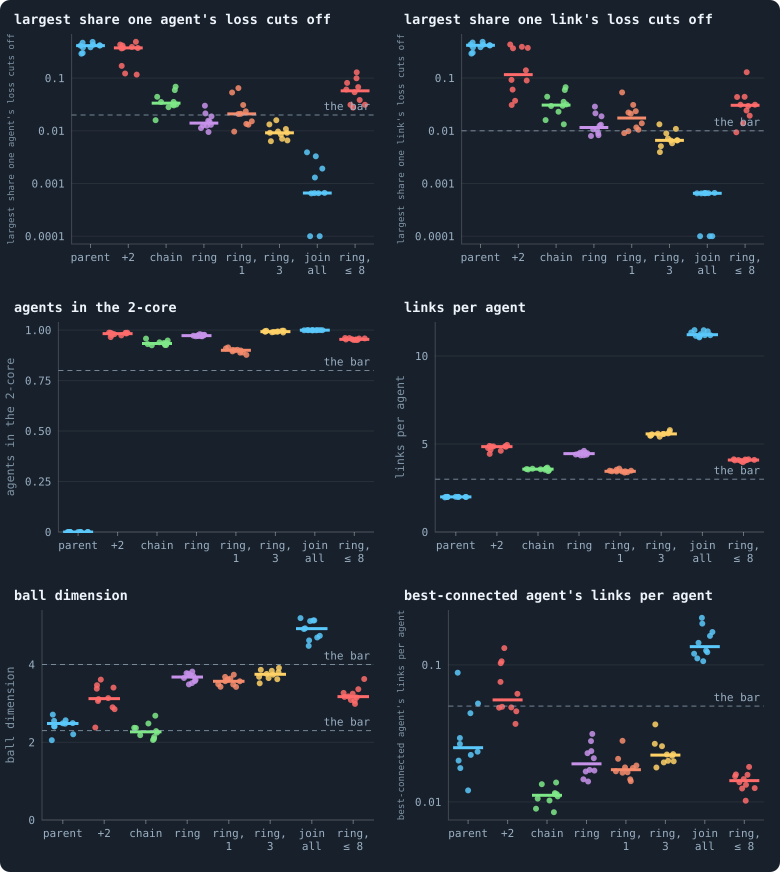
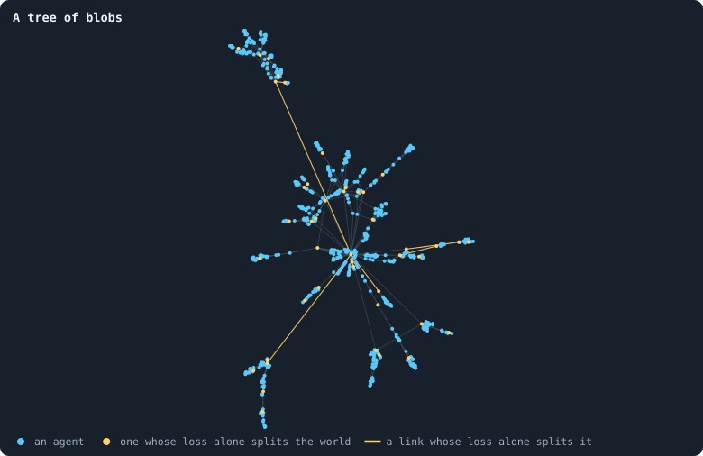
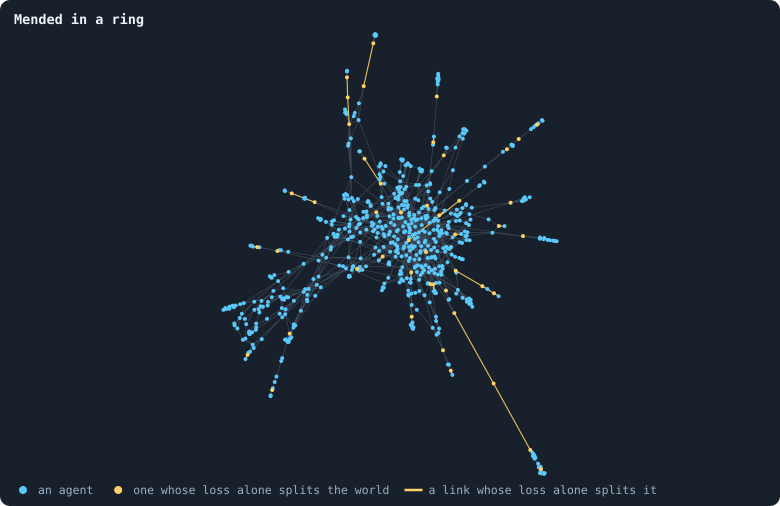
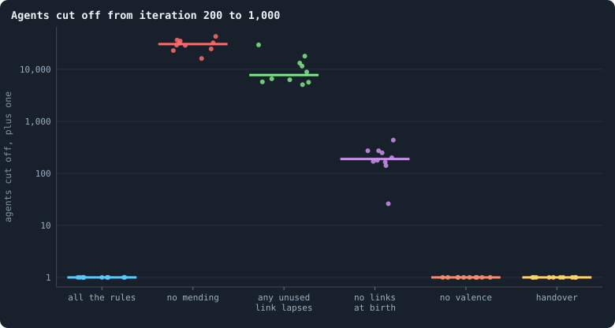
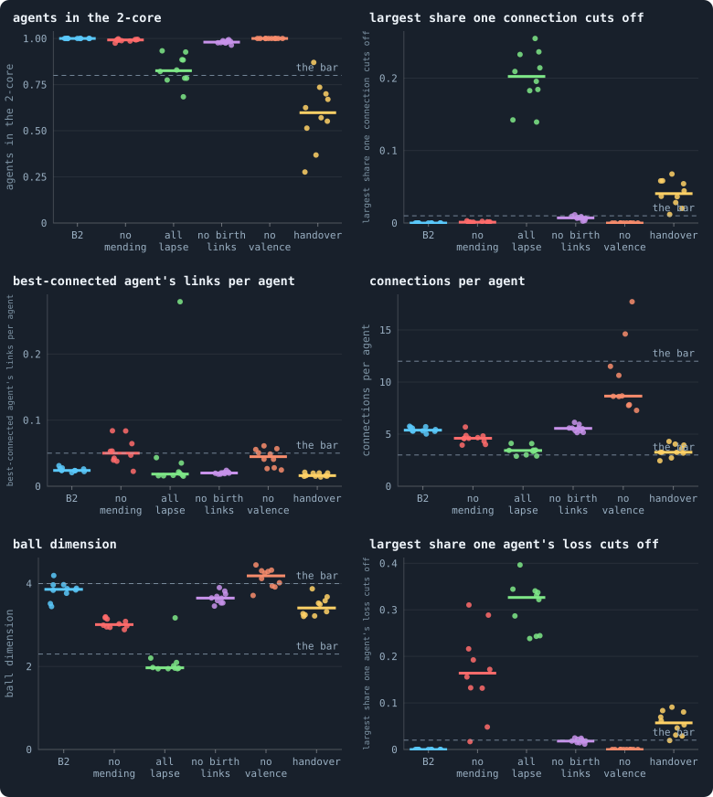
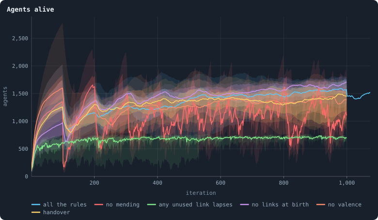

# A world that cannot break

> [!question] Questions of this chapter
> - What network do births and deaths make by themselves, with no brains at
>   all — and why is it fragile?
> - Which rules, each acting on one agent and its neighbours, make a network
>   with no single point of failure?
> - What does each rule do, and what does it cost?
> - Does a world under all these rules keep a network that holds, however its
>   agents play?

<!-- experiment E14 -->

## Why ask

[Chapter 47](47-brains-that-see-and-worlds-that-break.md) gave the brains
sight, and the worlds broke — not in one great cut, but by bleeding. Every
world of 5,000 tokens, blind or seeing, lost agents to the cull in every
iteration — 1.9 in a hundred without sight, 5.3 with it — and a seeing world
died when its births stopped keeping up. Nothing can evolve for long in a
world that bleeds like that, and a world that holds only while its brains
keep breeding is at the mercy of what evolution does to their breeding.

So before asking evolution to build anything, Part V builds the ground it
stands on: rules that keep the network whole *however the agents play*. The
target is the health bar of
[Chapter 46](46-how-to-tell-a-world-that-keeps-evolving.md#the-network-that-holds-in-numbers):
one piece, at least 80% of agents in the 2-core, no agent whose loss cuts off
more than 2% of the others and no connection whose loss cuts off more than
1%, no agent joined to more than 5% of the others, 3 to 12 connections per
agent, a ball dimension between 2.3 and 4. And every rule has to be **local**:
it may only look at an agent and its neighbours.

## Space alone

A world's network is made by three things: births add an agent and its links,
deaths take an agent and its links away, and the cull keeps only the largest
piece ([Chapter 3](03-one-iteration.md)). The brains decide who has a child,
who dies and which links are kept — but before asking what brains do to the
network, it pays to ask what the three forces do on their own.

So take the brains away. In the model of `research/oee/space.py` every agent,
every iteration, has a child with the same probability and then dies with the
same probability, 0.02; the probability of a child is set so that births
balance deaths at about 1,500 agents (and 0.05 higher while there are fewer,
so that the world fills quickly). The world starts as a ring of 50 agents and runs 300 iterations — six
lifetimes, so that nothing of the start is left. What the network looks like
then is what the rules of space make by themselves. A run takes six seconds;
each set of rules below was run with ten seeds.

<!-- figure unbreakable/space -->


**What the rules of space make, with no brains.** Each column is one set of rules, each dot one world of about 1,500 agents after 300 iterations, the bar the median of ten. *parent*: a newborn is joined to its parent alone; *+2*: also to two of the parent's neighbours, drawn at random; *chain*: also, when an agent dies, the groups of its former neighbours that are not linked to one another are joined in a chain; *ring*: joined in a ring — B2's rules; *ring, 1* and *ring, 3*: the ring, with one or three of the parent's neighbours instead of two; *join all*: every former neighbour of the dead joined in a chain, linked or not; *ring, ≤ 8*: B2's rules, and no child for an agent of 8 links or more nor a newborn's random link to one (mending still links past the cap). The dashed lines are the health bar of [Chapter 46](46-how-to-tell-a-world-that-keeps-evolving.md). Cut shares and the best-connected agent's share are drawn on logarithmic axes, a cut of nothing at 0.0001.

> [!example]- How to make this figure
> **Runs.** No runs: the worlds are made by the model itself, seeds 1 to 10 for every set of rules.
>
> **Data.** From the networks the model returns.
>
> 1. A world of no brains (`research/oee/space.py`): it starts as a ring of 50 agents, each joined to its 6 nearest (Watts–Strogatz, rewiring 0.2). Every iteration each agent has a child with probability 0.02 × 1,500 / *n*, plus 0.05 while there are fewer than 1,500 agents, and then dies with probability 0.02; after both, only the largest piece is kept. 300 iterations.
> 2. Measure the last network (`space.measure`): the largest share of the others one agent's loss would cut off from the largest piece (`GraphOfLifeSimple.worst_node_cut_share`), the same for one link (`cutRisk`), the 2-core, links per agent, the ball dimension, and the best-connected agent's links over the agents less one.
>
> **To make it again:** `python3 book_figures.py unbreakable`.
<!-- /figure -->

### A tree of blobs

In the simplest rule a newborn is joined to its parent and nothing else. Then
every birth adds one agent and one link, and a network that only ever gains an
agent with one link is a **tree**: no loops at all (the first column of the
figure: 2.0 links per agent, nobody in the 2-core). In a tree every agent with
two or more neighbours is a single point of failure, and random deaths hit
them all the time. One agent's loss could cut off 41% of the world (the
median of ten), and the cull, which throws away everything not in the largest
piece, kept these worlds at about 420 agents instead of 1,500.

The obvious repair is to close loops at birth: join the newborn also to two
of its parent's neighbours, drawn at random. Every birth then closes two
triangles. Locally the network is no longer a tree — 98% of agents are in
the 2-core, 85% in the 3-core — and yet one agent's loss could still cut off
37% of the world, one link's 12%.

The reason is that a birth can only close **small** loops. A newborn is joined
to agents at most two steps apart, so every loop it makes has length three.
Nothing in the model ever closes a *large* loop — a loop through distant
parts of the world — so at the large scale the network stays what it was: a
tree, whose nodes are now dense blobs instead of single agents. Blobs hang on
each other by **necks** of one or two agents, and a death in a neck cuts the
world.

<!-- figure unbreakable/blobs -->


**A tree of blobs.** A world of the model aiming at 600 agents (605 at the end): newborns joined to their parent and two of its neighbours, nothing mended. Of seeds 1 to 5, the world that ended largest. Agents and links whose loss alone would split the world are drawn in the second colour, the links wider; the worst of them cuts off 15.2% of the world.

> [!example]- How to make this figure
> **Runs.** No runs: the model's worlds, seeds 1 to 5.
>
> **Data.** From the network the model returns.
>
> 1. A world of no brains (`research/oee/space.py`): it starts as a ring of 50 agents, each joined to its 6 nearest (Watts–Strogatz, rewiring 0.2). Every iteration each agent has a child with probability 0.02 × 600 / *n*, plus 0.05 while there are fewer than 600 agents, and then dies with probability 0.02; after both, only the largest piece is kept. 300 iterations.
> 2. Keep the world that ended with the most agents.
> 3. Find the bridges and the cut vertices (`networkx.bridges`, `networkx.articulation_points`), lay the network out with `networkx.forceatlas2_layout(G, max_iter=300, seed=1)` and draw it.
>
> **To make it again:** `python3 book_figures.py unbreakable`.
<!-- /figure -->

### Mending a death

What cuts a world is a death. When agent *u* dies, two of its neighbours *x*
and *y* that were joined only through *u* are no longer joined at all —
unless something replaces *u*. **Mending** ([`mend_on_death`](../notes/settings.md#mend_on_death))
replaces it with a few new links, all between *u*'s former neighbours:

1. Group the former neighbours by the links among them: two neighbours are
   in one group if a path of direct links *among the former neighbours*
   joins them.
2. Join the groups, each through its member with the fewest links (the
   lowest id among equals): the first to the second, the second to the third,
   and so on — and, when there are three groups or more, the last back to the
   first, so the groups form a **ring**.

An example. Agent *u* dies with neighbours *a*, *b*, *c*, *d*, and of these
only *a* and *b* are linked to each other. The groups are {*a*, *b*}, {*c*}
and {*d*}. Mending adds three links — the less-linked of *a* and *b* to *c*,
*c* to *d*, and *d* back to whichever of *a* and *b* has fewer links by then
(each member is chosen afresh, so the first link may have tipped it). A chain
would have needed two; the ring's third makes sure that no new link is the
only one between two groups. Had *a*, *b*, *c*
and *d* all been linked in a cycle, there would be one group and nothing to
add: the death left no hole.

**A mended death never splits the world.** Take any two agents that were
joined before *u* died. If a path between them avoided *u*, it is still
there. If every path went through *u*, take one: it enters *u* from some
neighbour *x* and leaves to some neighbour *y*. After the mending, *x* and
*y* are joined — through their groups' links and the new ones — by a path
that uses only former neighbours of *u*. Splice it in where *u* was, and the
two agents are joined again. So connectivity is kept, and the cull never
fires because of a death: the only way left for a mended world to break is
through links being cut, which is the subject of the game section below.

In the figure, mending in a ring (the fourth column) brings the largest cut
by one agent from 37% to 1.4% and by one link from 12% to 1.2% — just above
the bar's 1% — with 4.5 links per agent, 97% of agents in the 2-core and a
ball dimension of 3.7. The world stays at its 1,500 agents, because the cull
has nothing left to do.

<!-- figure unbreakable/mended -->


**Mended in a ring.** A world of the model aiming at 600 agents (637 at the end): the same, and every death mended in a ring. Of seeds 1 to 5, the world that ended largest. Agents and links whose loss alone would split the world are drawn in the second colour, the links wider; the worst of them cuts off 2.8% of the world.

> [!example]- How to make this figure
> **Runs.** No runs: the model's worlds, seeds 1 to 5.
>
> **Data.** From the network the model returns.
>
> 1. A world of no brains (`research/oee/space.py`): it starts as a ring of 50 agents, each joined to its 6 nearest (Watts–Strogatz, rewiring 0.2). Every iteration each agent has a child with probability 0.02 × 600 / *n*, plus 0.05 while there are fewer than 600 agents, and then dies with probability 0.02; after both, only the largest piece is kept. 300 iterations.
> 2. Keep the world that ended with the most agents.
> 3. Find the bridges and the cut vertices (`networkx.bridges`, `networkx.articulation_points`), lay the network out with `networkx.forceatlas2_layout(G, max_iter=300, seed=1)` and draw it.
>
> **To make it again:** `python3 book_figures.py unbreakable`.
<!-- /figure -->

Mending in a **chain** — the same rule without the link back to the first
group — keeps the world in one piece just as well, by the same argument, but
the network it makes is different: its dimension falls to 2.3 and its
diameter doubles to 38 steps. Every death replaces a star (*u* and its
groups) with a path through the groups, and a world in which stars keep
turning into paths is stretched thin, towards a line. The ring replaces the
star with a cycle instead: every two groups are at most half the ring apart,
and no new link is the only one between two groups.

### Too much, and too little

Mending everything — joining *all* the former neighbours of the dead in a
chain, linked or not — removes the cuts entirely (0.07%), but at a price: an
agent that lives long collects a link from almost every death around it, and
the world contracts into hubs (the best-connected agent joined to 14% of the
others), 11 links per agent, a diameter of 6 and a dimension of 4.9. That is
not three-dimensional space; it is a crowd.

The number of the parent's neighbours a newborn is joined to,
[`birth_links`](../notes/settings.md#birth_links), sets how thick the blobs
are. With one, only 15% of agents are in the 3-core and the cuts are 2.1% and
1.7%; with three, the world passes every line of the health bar — 0.9% and
0.7%, 99% in the 2-core, 5.6 links per agent, dimension 3.7.

And a cap on links helps nothing here. When an agent with 8 links or more
may have no child and receives no newborn's random link (the last column;
mending still links past the cap), the cuts *grow*, to 5.7% and 3.0%. The
likely reason: births shift towards the thinly linked parts of the world —
where the cuts are. In this model there is nothing for a cap to stop: no
agent prefers anyone. It is the brains that will need it.

Each rule, then, answers one force: links at birth close small loops, the
ring mends what deaths cut, and only what deaths cut. What the model does not
contain is the game — and the game brings forces of its own.

## What the game adds

Put the brains back, and three things the model did not have start cutting
the network.

**Unused links lapse.** At the end of a game a link that carried no tokens is
cut ([Chapter 3](03-one-iteration.md)). A blind brain spreads its stake over
everyone and every link carries something; a seeing brain stakes on one
neighbour or two, and most of its links lapse. Every lapse that leaves a part
of the world hanging on nothing hands that part to the cull — the steady toll
that, in [Chapter 47](47-brains-that-see-and-worlds-that-break.md), every world
of 5,000 tokens paid, blind or seeing. The rule
[`prune_needs`](../notes/settings.md#prune_needs)
lets an unused link lapse only if its two ends share at least that many
neighbours. With 1, removing the link leaves a path of two steps between its
ends — so no lapse can cut the world — but in time the network can thin into
a *cactus*: triangles glued to each other at single agents, every one of
which is a cut vertex. With 2, a link may go only if two paths of two steps
remain, and a lapse can neither cut the world nor leave two agents hanging
on one agent between them. Links that carry tokens are never touched.

**Brains like some neighbours more.** When a brain chooses whom to link to,
it ranks its candidates by what it sees of them, and whatever it favours,
agents that already have many links are offered as candidates more often —
they are the neighbours of more agents. That is preferential attachment, and
it grows hubs ([Preferential attachment](../notes/preferential-attachment.md)):
in pilots where the brains chose a newborn's two extra links, the
best-connected agent was joined to 30% of the world. Two rules answer it. The newborn's
[`birth_links`](../notes/settings.md#birth_links) are drawn at random rather
than chosen, and [`valence`](../notes/settings.md#valence) = 8 caps the links a
brain may *choose*: an agent with 8 has no child and no chosen link is made to
it. A newborn's two random links and mending are exempt from the cap — the
first are the rule of space itself, the second only replaces links that were
lost.

**A parent can give its links away.** With
[`allow_handover`](../notes/settings.md#allow_handover) a parent moves some of
its links to its newborn, and a parent that hands over all but one hangs on
that one. Switched off.

**B2** is the second baseline of Part V: B1 with brains of one hidden layer of
16 that change only when copied (Chapter 47), shorter messages (8 numbers, no
extra look before acting), an agent's stake on its own node counting 1.5
times ([`incumbency`](../notes/settings.md#incumbency)), the rules of this
chapter — links at birth 2, mending in a ring, `prune_needs` 2, valence 8, no
handover — and the rules of [Chapter 49](49-who-dies-and-why.md) on who
dies: 30% of an agent's tokens kept at home, so that nobody stakes itself to
death; children of at least 10 tokens; and death at age 100. It keeps change
only when copied although Chapter 47 found it harmful: it is what heredity
means — a brain that is not copied stays itself — and the harm it did there
was the drain of worlds whose births fell short of the cull, which B2's other
rules remove. Every setting is listed in the box under the thesis.

In a first engine run of B2 (5,000 tokens, seed 1) every agent was in the
2-core and no single agent or link could cut anyone off, with 5.1 to 5.3
links per agent and a dimension of 3.1 to 3.7, through iteration 400.
Prototype worlds under the same rules of space, from 1,250 to 10,000 tokens
and two seeds each, held to iteration 800 — 99.7% of agents or more in the
2-core, the best-connected agent joined to 1–5% of the others, 4 to 5 links
per agent — but in the smaller of them one link's loss could at times cut off
2–3%, above the bar.

> [!example]- The model, to run yourself
> ```
> python3 research/oee/space.py --links 0
> python3 research/oee/space.py --links 2
> python3 research/oee/space.py --links 2 --mend
> python3 research/oee/space.py --links 2 --mend --ring
> python3 research/oee/space.py --links 3 --mend --ring
> python3 research/oee/space.py --links 2 --mend-all
> python3 research/oee/space.py --links 2 --mend --ring --cap 8
> ```
> Each prints the world at the end: agents, links per agent, the shares in
> the 2-core and 3-core, the largest share one agent's or one link's loss cuts
> off, the ball dimension, the diameter and the best-connected agent's share.
> `--seed`, `--target`, `--deaths` and `--steps` change the rest.

## The experiment

One world is a hint. Experiment 14 runs B2 ten times at 5,000 tokens for 1,000
iterations, and five more conditions that each take one rule away — or, for
handover, put one back — to see whether every rule is needed.

## The thesis

<!-- thesis E14 -->
> [!quote] The thesis of Experiment 14, written down before any of its runs existed
> **The claim.** Under all the rules of B2 every world keeps a network that holds: from iteration 200 to 1,000 every one of ten worlds of 5,000 tokens has all its agents in one piece in every frame, and its medians over those frames pass every line of the health bar of Chapter 49 — at least 80% of agents in the 2-core, no connection whose loss cuts off more than 1% of them, no agent joined to more than 5% of the others, 3 to 12 connections per agent, a ball dimension between 2.3 and 4. Each rule taken away on its own breaks some line of it in at least half of the worlds.
>
> **Why it would be so.** Births by themselves grow a tree of blobs, and random deaths cut its necks: in the space-only model of research/oee/space.py (1,500 agents, no brains) one agent's loss could cut off 40% of the world. A newborn joined to its parent and two of its neighbours, and deaths mended in a ring, bring that to 1.1–1.3% with a dimension of 3.4–3.6. Under the game, unused links lapsing cut what mending saves unless only redundant links may lapse; a brain's liking for well-connected neighbours makes hubs unless their number is capped; and a parent handing its links to its child leaves itself hanging. In the engine, B2's seed 1 at 5,000 tokens kept everyone in the 2-core with no single cut at all, 5.1–5.3 connections per agent and a dimension of 3.1–3.7 through iteration 400.
>
> **It holds if:** All ten B2 worlds: no agent cut off in any cull from iteration 200 on, and median coreShare ≥ 0.8, cutRisk ≤ 0.01, maxDegree/nodes ≤ 0.05, meanDegree in 3–12 and dimension in 2.3–4 over iterations 200 to 1,000. And for each of the five conditions that take one rule away, at least five of its ten worlds fail at least one of these.
>
> **It fails if:** A B2 world fails a line of the bar: the rules do not make a network that holds. Or a condition without one of the rules has fewer than five failing worlds: that rule is not needed.
<!-- /thesis -->

("Chapter 49" in the thesis is today's [Chapter 46](46-how-to-tell-a-world-that-keeps-evolving.md): the chapters were renumbered on 2026-10-14.)

## The runs

<!-- runs E14 -->
> [!info] The runs behind this chapter
> **60 runs.** Every condition below is run once for every seed (1 to 10), for 1,000 iterations — or until its world dies out. Every setting is that of the baseline **B2** (a world that cannot break) unless the condition changes it.
>
> - **all the rules** — changes nothing: B2 as it is; 5,000 tokens. Runs `B2-5000-s001` … `B2-5000-s010`.
> - **no mending** — changes `mend_on_death` = off; 5,000 tokens. Runs `B2-5000-d6b607-s001` … `B2-5000-d6b607-s010`.
> - **any unused link lapses** — changes `prune_needs` = 0; 5,000 tokens. Runs `B2-5000-71fc89-s001` … `B2-5000-71fc89-s010`.
> - **no links at birth** — changes `birth_links` = 0; 5,000 tokens. Runs `B2-5000-28aef0-s001` … `B2-5000-28aef0-s010`.
> - **no valence** — changes `valence` = 0; 5,000 tokens. Runs `B2-5000-5c8c75-s001` … `B2-5000-5c8c75-s010`.
> - **handover** — changes `allow_handover` = on; 5,000 tokens. Runs `B2-5000-894419-s001` … `B2-5000-894419-s010`.
>
> To make these runs again: `python3 gol_lab.py run E14`, or ▶ in the Book tab of a computer running `gol_server.py`. Each run writes its settings, seed and engine version beside its frames, in `GraphOfLifeRuns/<run>/meta.json` and `provenance.json`.

> [!info]- Every setting of these runs
> | setting | all the rules | no mending | any unused link lapses | no links at birth | no valence | handover | what it is |
> |---|---|---|---|---|---|---|---|
> | [`total_tokens`](../notes/settings.md#total_tokens) | 5,000 | 5,000 | 5,000 | 5,000 | 5,000 | 5,000 | The number of tokens in the world, *T*. It never changes during a run. |
> | [`n_nodes`](../notes/settings.md#n_nodes) | 0 | 0 | 0 | 0 | 0 | 0 | How many founders the world starts with. 0 means one founder per hundred tokens: *n* = ⌊*T* / 100⌋. |
> | [`k_neighbors`](../notes/settings.md#k_neighbors) | 0 | 0 | 0 | 0 | 0 | 0 | How many neighbours each founder starts with in the ring. 0 means *k* = max(⌊*n* / 100⌋, 5); an odd *k* is wired as *k* − 1. |
> | [`rewire_p`](../notes/settings.md#rewire_p) | 0.2 | 0.2 | 0.2 | 0.2 | 0.2 | 0.2 | In the starting ring, the probability that a connection is moved to a founder chosen at random (Watts–Strogatz). |
> | [`hidden_layers`](../notes/settings.md#hidden_layers) | 16 | 16 | 16 | 16 | 16 | 16 | The widths of the brain's hidden layers, in order from input to output. |
> | [`brain_kind`](../notes/settings.md#brain_kind) | float16 | float16 | float16 | float16 | float16 | float16 | How weights are stored: `float` (64-bit), `float16` (16-bit, computed in 64-bit) or `binary` (−1, 0, +1). |
> | [`brain_bits`](../notes/settings.md#brain_bits) | 16 | 16 | 16 | 16 | 16 | 16 | Only for binary brains: how many input rows encode one number. Unused by float and float16 brains. |
> | [`message_amount`](../notes/settings.md#message_amount) | 8 | 8 | 8 | 8 | 8 | 8 | How many numbers one message holds. Each agent sends one message to itself and one to each neighbour, every phase. |
> | [`random_input_amount`](../notes/settings.md#random_input_amount) | 5 | 5 | 5 | 5 | 5 | 5 | How many random numbers, drawn uniformly from −2 to 2, a brain reads per neighbour, every time it looks. |
> | [`exchange_messages`](../notes/settings.md#exchange_messages) | on | on | on | on | on | on | Whether agents send and read messages at all. |
> | [`message_prepass`](../notes/settings.md#message_prepass) | off | off | off | off | off | off | Whether every phase begins with an extra look in which agents only write messages, so the look that acts reads messages written this phase. |
> | [`allow_handover`](../notes/settings.md#allow_handover) | off | off | off | off | off | **on** | Whether a parent may move some of its own connections to its newborn child. |
> | [`allow_revolutions`](../notes/settings.md#allow_revolutions) | on | on | on | on | on | on | Whether a coalition of smaller stakers can take a node from its largest staker (see the note *How a coalition takes a node*). |
> | [`allow_gifting`](../notes/settings.md#allow_gifting) | off | off | off | off | off | off | Whether agents may give tokens to neighbours during reproduction. Off in every run of this book. |
> | [`random_decisions`](../notes/settings.md#random_decisions) | off | off | off | off | off | off | The control: every number a brain would produce is replaced by a random draw from the standard normal distribution. |
> | [`prune_after`](../notes/settings.md#prune_after) | blotto | blotto | blotto | blotto | blotto | blotto | After which phase connections that carried no tokens are cut: `blotto` (the game), `reproduction`, or `both`. |
> | [`inactive_window`](../notes/settings.md#inactive_window) | phase | phase | phase | phase | phase | phase | How long a connection may go unused: `phase` means it must carry tokens in the phase being judged; `iteration` allows the two last phases. |
> | [`redistribution`](../notes/settings.md#redistribution) | uniform | uniform | uniform | uniform | uniform | uniform | How the tokens of removed agents are shared: `uniform` gives every survivor the same chance at each token; `by_tokens` weights by what a survivor holds. |
> | [`tokens_created_per_phase`](../notes/settings.md#tokens_created_per_phase) | 0 | 0 | 0 | 0 | 0 | 0 | Tokens added to the world at every cleanup. 0 keeps the supply fixed. |
> | [`mutate_on_replication`](../notes/settings.md#mutate_on_replication) | on | on | on | on | on | on | Whether a brain changes only when it is copied — into a newborn, or into a node its owner has just won — instead of also after every game, wherever it sits. |
> | [`incumbency`](../notes/settings.md#incumbency) | 1.5 | 1.5 | 1.5 | 1.5 | 1.5 | 1.5 | How many times over an agent's stake on its own node counts when the game decides who takes the node. 1 is the old rule. |
> | [`birth_links`](../notes/settings.md#birth_links) | 2 | 2 | 2 | **0** | 2 | 2 | How many of its parent's neighbours a newborn is joined to, drawn at random, besides its parent itself; 0 leaves every link to the brain's choice. |
> | [`mend_on_death`](../notes/settings.md#mend_on_death) | on | **off** | on | on | on | on | Whether the neighbours of an agent that dies are joined up where its death would leave them in separate pieces. |
> | [`prune_needs`](../notes/settings.md#prune_needs) | 2 | 2 | **0** | 2 | 2 | 2 | How many neighbours the two ends of an unused connection must share for it to be cut; 0 cuts every unused connection. |
> | [`valence`](../notes/settings.md#valence) | 8 | 8 | 8 | 8 | **0** | 8 | The most connections an agent's brain may choose to hold (0 = no limit). An agent at its limit cannot have a child. |
> | [`keep_home`](../notes/settings.md#keep_home) | 0.3 | 0.3 | 0.3 | 0.3 | 0.3 | 0.3 | The share of an agent's tokens — rounded up, never less than one — that stays on its own node whatever its brain says; a parent also keeps one. 0 is the old rule. |
> | [`max_age`](../notes/settings.md#max_age) | 100 | 100 | 100 | 100 | 100 | 100 | The age at which an agent dies (0 = never); its tokens are shared out like those of any other dead agent. |
> | [`min_child`](../notes/settings.md#min_child) | 10 | 10 | 10 | 10 | 10 | 10 | The fewest tokens a child can be born with; a parent that would give less has no child. |
> | [`mutation_probability`](../notes/settings.md#mutation_probability) | 0.2 | 0.2 | 0.2 | 0.2 | 0.2 | 0.2 | The probability that a brain changes when it is copied to a child, and again, for every brain, after every game. |
> | [`mutation_noise_std`](../notes/settings.md#mutation_noise_std) | 0.2 | 0.2 | 0.2 | 0.2 | 0.2 | 0.2 | How large a change to one weight is: a normal draw with standard deviation this times 1/√(fan-in) of its layer. |
> | [`mutation_sparsity`](../notes/settings.md#mutation_sparsity) | 0.1 | 0.1 | 0.1 | 0.1 | 0.1 | 0.1 | The share of a brain's numbers a change touches; also the probability, for each weight matrix and bias vector, of a rarer reset that redraws that share of it. |
> | [`extinction_threshold`](../notes/settings.md#extinction_threshold) | 20 | 20 | 20 | 20 | 20 | 20 | A run stops, as extinct, when an iteration ends (after its game) with this many agents or fewer. |
> | seeds | 1 to 10 | 1 to 10 | 1 to 10 | 1 to 10 | 1 to 10 | 1 to 10 | one run per seed |
> | iterations | 1,000 | 1,000 | 1,000 | 1,000 | 1,000 | 1,000 | how far each run goes, unless its world dies first |
>
> A value in **bold** differs from the baseline B2.
<!-- /runs -->

## What the sixty worlds did

The most direct measure of a world that cannot break is how many of its
agents were cut off: lost not to age or hunger, but because the network they
belonged to came apart and the cull removed every piece but the largest.

<!-- figure unbreakable/lost -->


**Agents cut off from iteration 200 to 1,000.** One dot per world: every agent the cull removed because it was no longer joined to the largest piece, in either phase, from iteration 200 to 1,000 — plus one, so that a world that lost nobody sits at 1 on the logarithmic axis. The bar is the median world.

> [!example]- How to make this figure
> **Runs.** The 60 runs of Experiment 14 — B2 at 5,000 tokens, seeds 1 to 10, 1,000 iterations — in six conditions: all the rules of B2, and B2 with one of them taken away or changed. They are made with `python3 gol_lab.py run E14`.
>
> **Data.** From each run's `GraphOfLifeRuns/<run>/stats.jsonl`, which holds one row per recorded phase: `phase` 1 is the world just after reproduction, `phase` 2 just after the game, and every statistic is a field of the row (see [What a run records](../notes/frames-and-stats.md)).
>
> 1. Sum `orphaned` over the rows of both phases with 200 ≤ `iteration` ≤ 1,000.
> 2. Add one, and draw a dot per world.
>
> **To make it again:** `python3 book_figures.py unbreakable`.
<!-- /figure -->

**Under all of B2's rules, nobody.** In none of the ten worlds was a single
agent cut off between iteration 200 and iteration 1,000. Every agent sat in
the 2-core in every world, and in the median frame of every world no link
and no agent existed whose loss alone would have cut anything off — not a
single cut vertex among 800 to 1,800 agents. Read every tenth iteration, the
worst a single agent's loss could have done at any moment was to cut off 1.2%
of a world, below the bar's 2%. The best-connected agent was
joined to 2.1 to 3.1% of the others, an agent had 5.0 to 5.8 links in the
median frame of its world, and the ball dimension was 3.45 to 4.19, 3.86 in
the median world.

<!-- figure unbreakable/bar -->


**Each rule against the health bar.** One dot per world, at its median over iterations 200 to 1,000; the bar is the median world; dashed lines are the health bar of [Chapter 46](46-how-to-tell-a-world-that-keeps-evolving.md). *B2*: every rule; *no mending*: deaths not mended; *all lapse*: any unused link lapses; *no birth links*: a newborn joined to its parent alone; *no valence*: no cap on chosen links; *handover*: a parent may hand its links to its child.

> [!example]- How to make this figure
> **Runs.** The 60 runs of Experiment 14 — B2 at 5,000 tokens, seeds 1 to 10, 1,000 iterations — in six conditions: all the rules of B2, and B2 with one of them taken away or changed. They are made with `python3 gol_lab.py run E14`.
>
> **Data.** From each run's `GraphOfLifeRuns/<run>/stats.jsonl`, which holds one row per recorded phase: `phase` 1 is the world just after reproduction, `phase` 2 just after the game, and every statistic is a field of the row (see [What a run records](../notes/frames-and-stats.md)).
>
> 1. For every run take the rows with `phase` = 2 and 200 ≤ `iteration` ≤ 1,000, and the median of `coreShare`, `cutRisk`, `maxDegree` / `nodes`, `meanDegree` and `dimension`.
> 2. No run records the worst cut by one agent, so read it off the frames: every 10th iteration from 200 to 1,000, rebuild the network after the game and take `GraphOfLifeSimple.worst_node_cut_share` (`oee.node_cut`); its median.
> 3. A world holds if every median is inside the bar and `orphaned` is 0 in every row of either phase in the same iterations.
>
> **To make it again:** `python3 book_figures.py unbreakable`.
<!-- /figure -->

**And each rule taken away breaks something different.**

- **No mending.** Now every death by age can cut, and every iteration someone
  dies of age: the worlds lost 16,000 to 43,000 agents to the cull in 800
  iterations — worlds of 640 to 1,400 agents lost twenty to fifty of them in
  every iteration. Strikingly, no single *link* could cut off more than 0.3%:
  the worlds were knit at every link but hung together at agents. One
  agent's loss could cut off 16% of the world in the median frame of the
  median world (2% to 31%), and in every world there were moments when a
  single agent held half of it to the rest.
  Without the death that mending answers, links at birth alone only make the
  tree of blobs of the model.
- **Any unused link lapses.** The network thins towards a tree: a ball
  dimension of 2.0, one link's loss cutting off a fifth of the world, one
  agent's a third, 18% of agents outside the 2-core; 5,000 to 30,000 agents
  cut off, and one world died out at iteration 532.
- **No links at birth.** Mending keeps deaths from cutting, but a newborn
  joined only to its parent hangs on it: 25 to 434 agents were cut off, and
  one agent's loss could cut off 1.2 to 2.5% (above the bar's 2% in four
  worlds).
- **No valence.** Nobody was cut off, but the links ran away: 8.7 per agent
  in the median world and up to 17.7, the best-connected agent joined to up to
  6% of the others, and the dimension above 4 in seven worlds — the crowd the
  model made when it mended everything.
- **Handover.** Nobody was cut off — mending and the pruning rule still
  hold — but 40% of the agents hung in trees outside the 2-core in the median
  world, and one link's loss could cut off 4%.

<!-- figure unbreakable/agents -->


**Agents alive.** For each condition the median world at each iteration, with the middle half of the worlds (darker) and nine in ten (paler). A world that died out leaves the band when it does.

> [!example]- How to make this figure
> **Runs.** The 60 runs of Experiment 14 — B2 at 5,000 tokens, seeds 1 to 10, 1,000 iterations — in six conditions: all the rules of B2, and B2 with one of them taken away or changed. They are made with `python3 gol_lab.py run E14`.
>
> **Data.** From each run's `GraphOfLifeRuns/<run>/stats.jsonl`, which holds one row per recorded phase: `phase` 1 is the world just after reproduction, `phase` 2 just after the game, and every statistic is a field of the row (see [What a run records](../notes/frames-and-stats.md)).
>
> 1. Take `nodes` of the rows with `phase` = 2, one line per run.
> 2. For each condition, the median, quartiles and 5th and 95th percentiles of the runs at each iteration (`book_figures.band_series`).
>
> **To make it again:** `python3 book_figures.py unbreakable`.
<!-- /figure -->

## The verdict

The thesis asked two things. Every one of the ten B2 worlds should pass every
line of the health bar with nobody cut off; nine did, and the tenth (seed 5)
failed by one line: a median ball dimension of 4.19 against the bar's 4. And
each condition that takes a rule away should fail some line in at least five
of its ten worlds; every one did, in nine or ten. **Strictly, the thesis is
refuted** — by one world's dimension — while everything it was about held: no
B2 world lost an agent to a cut, and every rule turned out to be needed.

(The thesis's confirmation lists five lines of the bar; the sixth, the cut by
one agent, is not in the recorded statistics and was read off the frames
afterwards. B2 passed it everywhere.)

## What it teaches

Four local rules — a newborn joined to two of its parent's neighbours, a
death mended in a ring, an unused link lapsing only where its ends share two
neighbours, and a cap on the links a brain chooses — make a network with no
single point of failure at all, under brains that see, at every frame of every
world. Each answers one force: births close small loops, mending repairs what
deaths would cut, the pruning rule keeps the game from cutting, the cap keeps
the brains from piling links on a few agents.

What they do not do is hold the world close to three dimensions. B2's worlds
sit at 3.4 to 4.2, at the top of the bar, and the model shows why: every
mending adds links where a neighbourhood was, and a world that is mended
everywhere is drawn together. A world closer to three dimensions would need
fewer links at birth or sparser mending — and the model says what that costs:
with one link at birth, cuts of 2% instead of 1.4%. The next experiments keep
B2 as it is: a world in which no agent is ever lost to a cut, so that every
death that remains is a death of age, and every change in a population is
evolution's — [Chapter 49](49-who-dies-and-why.md) asks who dies, and why.

<!-- turns -->
---

← [Chapter 47 · Brains that see, and worlds that break](47-brains-that-see-and-worlds-that-break.md) · [Contents](../README.md) · [Chapter 49 · Who dies, and why](49-who-dies-and-why.md) →
<!-- /turns -->
