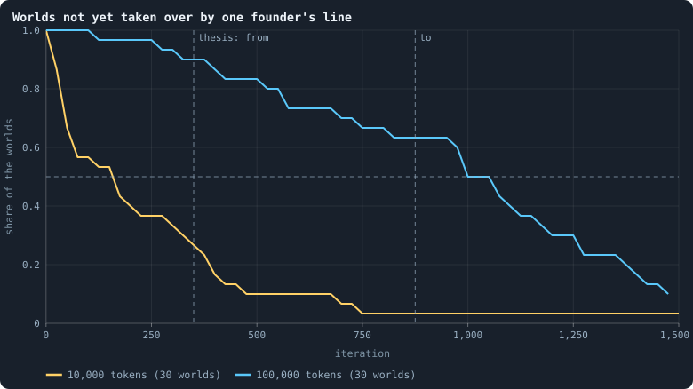
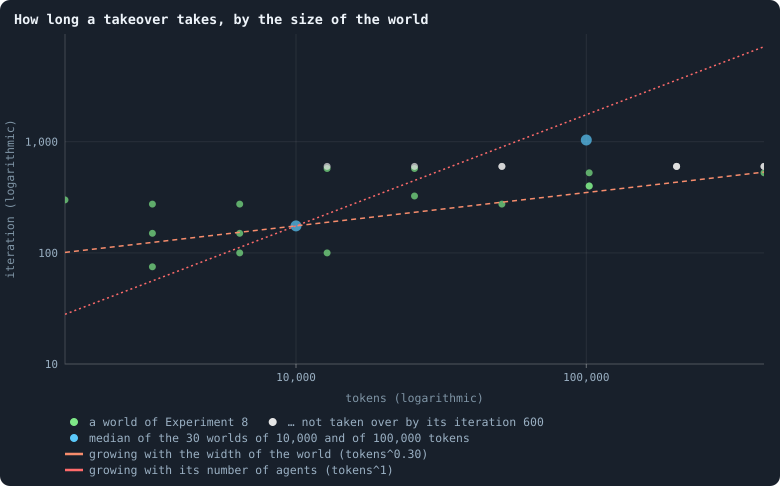
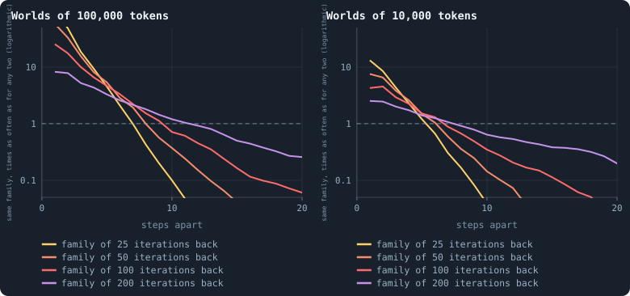
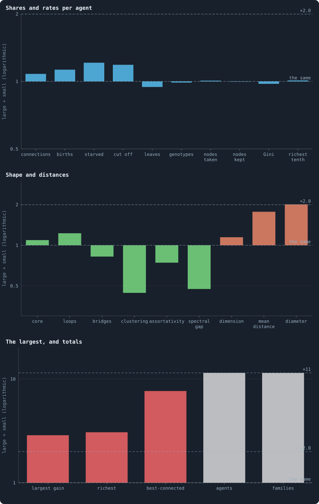

# Worlds of 100,000 tokens

> [!question] Questions of this chapter
> - How does a line take over a world ten times the size: ten times slower,
>   as chance would, about as fast, as a better brain in a well-mixed world
>   would, or at the pace of a front that has twice as far to go?
> - Is a world of 100,000 tokens ten copies of a world of 10,000, or does
>   anything appear only at size: longer-lived regions, coexisting lines,
>   structure that a small world has no room for?
> - Do the measures of space of Part II — dimension, correlation length,
>   the width of a world — read the same at ten times the size?

<!-- experiment E10 -->

## Why ask

When this experiment was planned, every finding of Parts II and III had
been made on worlds of 10,000 tokens, about 1,300 agents each. That is
small. A world of 1,300 agents is some 30 steps across
([Chapter 35](35-the-geometry-of-a-world.md)), and its structure fades
within three ([Chapter 23](23-like-next-to-like.md)): there is room for a
dozen regions side by side, no more. Questions about space, about scale,
and about whether different kinds of agents can live side by side need
worlds with more room.

[Chapter 42](42-how-does-a-worlds-size-follow-its-tokens.md) showed that a
bigger world is, on average, more of the same: agents, connections and
births all follow the tokens in proportion. It ran only three worlds of each
size, for 600 iterations. This experiment makes a **second set of baseline
worlds** — of B1 itself, not of the second baseline B2 of
[Chapter 51](51-a-world-that-cannot-break.md): thirty worlds of 100,000
tokens, ten times the first, each run for 1,500 iterations. Part VI builds
on it — Chapter 56 is to measure its dimensions at scale, and Chapter 57 to
look for properties without a scale (both planned, see
[the contents](../README.md)) — and it answers one question of its own: how
a line takes over a world.

**How a line takes over.** [Chapter 18](18-genotypes-and-lineages.md) found
that whole lines of descent take the worlds of 10,000 tokens over again and
again, about once every 350 iterations. Is that chance or merit? Three
answers give three different paces, and the size of the world tells them
apart:

1. **Chance.** If no line is better than another, all but one die out by
   chance in the end, in a time that grows in proportion to the number of
   agents: ten times the agents, ten times as long (the coalescent,
   [Chapter 6](06-the-ideas-this-builds-on.md)).
2. **Merit, in a well-mixed world.** A better line grows by a fixed factor
   every generation, and needs only a time that grows with the logarithm of
   the number of agents: ten times the agents, about a third longer.
3. **Merit, in space.** A better line spreads outwards from where it arose,
   as a front at a steady speed (Fisher 1937). The time grows with the width
   of the world.

A world is a space: it has a finite dimension
([Chapter 24](24-how-many-dimensions-does-a-world-have.md)), new connections
are only ever made inside a neighbourhood
([Chapter 22](22-how-the-network-grows.md)), and a node can only be taken by
a neighbour. Ten times the agents make a world only about twice as wide: its
diameter grows as agents^0.30 ([Chapter 42](42-how-does-a-worlds-size-follow-its-tokens.md)).
So the third answer predicts two to three times as long, the first ten, the
second barely longer.

[Chapter 19](19-what-the-brains-are-like.md) gives a reason to expect the
first answer: the brains are nearly blind and agree on every decision that
matters, which leaves little for one line to be better at. The worlds of
Chapter 42 point to the third: at 102,400 tokens, all three came from a
single founder by iterations 400, 400 and 525, where the median baseline
world needed 175.

## The thesis

<!-- thesis E10 -->
> [!quote] The thesis of Experiment 10, written down before any of its runs existed
> **The claim.** A line takes a world over the way a front crosses a country: at a steady pace, so that the time it needs grows with the world's width, not with its number of agents. A world of 100,000 tokens holds ten times the agents of the baseline but is only about twice as wide, so a line takes it over in two to five times as long as at 10,000 tokens — not ten times, as chance alone would need, and not about as fast, as a better brain spreading through a well-mixed world would.
>
> **Why it would be so.** Three paces are possible. If no line is better than another, all but one die out by chance, in a time that grows in proportion to the number of agents (the coalescent, Chapter 6). If a better line spreads through a well-mixed population, it grows by a fixed factor every generation, and the time grows only with the logarithm of the number of agents. If it spreads through space, it does so as a front at a steady speed (Fisher 1937), and the time grows with the width of the world. The worlds are spaces: they have a finite dimension (Chapter 23), their diameter grows as agents^0.30 (Chapter 38), and a node can only be taken by a neighbour (Chapter 3). At 10,000 tokens (Experiment 2) the living of the median world all came from a single founder by iteration 175, and of every world by 750. The worlds of Experiment 8 point to the front: at 102,400 tokens, all three worlds got there by iterations 400, 400 and 525.
>
> **It holds if:** Counting each world of 100,000 tokens that reaches iteration 1,500 by the first iteration at which all its living descend from a single founder — and a world that never gets there as later than all of them — the median lies between 350 and 875: two to five times the baseline's 175.
>
> **It fails if:** The median is below 350: a large world is taken over about as fast as a small one, as a better brain spreading through a well-mixed population would take it. Or it is above 875, or most worlds never get there by iteration 1,500: then the pace is set by the number of agents, as chance alone would set it.
<!-- /thesis -->

("Chapter 23" and "Chapter 38" in the thesis are today's [Chapter 24](24-how-many-dimensions-does-a-world-have.md) and [Chapter 42](42-how-does-a-worlds-size-follow-its-tokens.md).)

## Method

<!-- runs E10 -->
> [!info] The runs behind this chapter
> **30 runs.** Every condition below is run once for every seed (1 to 30), for 1,500 iterations — or until its world dies out. Every setting is that of the baseline **B1** (the algorithm exactly as a new run is offered it) unless the condition changes it.
>
> - **baseline** — changes nothing: B1 as it is; 100,000 tokens. Runs `B1-100000-s001` … `B1-100000-s030`.
>
> To make these runs again: `python3 gol_lab.py run E10`, or ▶ in the Book tab of a computer running `gol_server.py`. Each run writes its settings, seed and engine version beside its frames, in `GraphOfLifeRuns/<run>/meta.json` and `provenance.json`.

> [!info]- Every setting of these runs
> | setting | baseline | what it is |
> |---|---|---|
> | [`total_tokens`](../notes/settings.md#total_tokens) | 100,000 | The number of tokens in the world, *T*. It never changes during a run. |
> | [`n_nodes`](../notes/settings.md#n_nodes) | 0 | How many founders the world starts with. 0 means one founder per hundred tokens: *n* = ⌊*T* / 100⌋. |
> | [`k_neighbors`](../notes/settings.md#k_neighbors) | 0 | How many neighbours each founder starts with in the ring. 0 means *k* = max(⌊*n* / 100⌋, 5); an odd *k* is wired as *k* − 1. |
> | [`rewire_p`](../notes/settings.md#rewire_p) | 0.2 | In the starting ring, the probability that a connection is moved to a founder chosen at random (Watts–Strogatz). |
> | [`hidden_layers`](../notes/settings.md#hidden_layers) | 50, 45, 40, 35, 30 | The widths of the brain's hidden layers, in order from input to output. |
> | [`brain_kind`](../notes/settings.md#brain_kind) | float16 | How weights are stored: `float` (64-bit), `float16` (16-bit, computed in 64-bit) or `binary` (−1, 0, +1). |
> | [`brain_bits`](../notes/settings.md#brain_bits) | 16 | Only for binary brains: how many input rows encode one number. Unused by float and float16 brains. |
> | [`message_amount`](../notes/settings.md#message_amount) | 30 | How many numbers one message holds. Each agent sends one message to itself and one to each neighbour, every phase. |
> | [`random_input_amount`](../notes/settings.md#random_input_amount) | 5 | How many random numbers, drawn uniformly from −2 to 2, a brain reads per neighbour, every time it looks. |
> | [`exchange_messages`](../notes/settings.md#exchange_messages) | on | Whether agents send and read messages at all. |
> | [`message_prepass`](../notes/settings.md#message_prepass) | on | Whether every phase begins with an extra look in which agents only write messages, so the look that acts reads messages written this phase. |
> | [`allow_handover`](../notes/settings.md#allow_handover) | on | Whether a parent may move some of its own connections to its newborn child. |
> | [`allow_revolutions`](../notes/settings.md#allow_revolutions) | on | Whether a coalition of smaller stakers can take a node from its largest staker (see the note *How a coalition takes a node*). |
> | [`allow_gifting`](../notes/settings.md#allow_gifting) | off | Whether agents may give tokens to neighbours during reproduction. Off in every run of this book. |
> | [`random_decisions`](../notes/settings.md#random_decisions) | off | The control: every number a brain would produce is replaced by a random draw from the standard normal distribution. |
> | [`prune_after`](../notes/settings.md#prune_after) | blotto | After which phase connections that carried no tokens are cut: `blotto` (the game), `reproduction`, or `both`. |
> | [`inactive_window`](../notes/settings.md#inactive_window) | phase | How long a connection may go unused: `phase` means it must carry tokens in the phase being judged; `iteration` allows the two last phases. |
> | [`redistribution`](../notes/settings.md#redistribution) | uniform | How the tokens of removed agents are shared: `uniform` gives every survivor the same chance at each token; `by_tokens` weights by what a survivor holds. |
> | [`tokens_created_per_phase`](../notes/settings.md#tokens_created_per_phase) | 0 | Tokens added to the world at every cleanup. 0 keeps the supply fixed. |
> | [`mutate_on_replication`](../notes/settings.md#mutate_on_replication) | off | Whether a brain changes only when it is copied — into a newborn, or into a node its owner has just won — instead of also after every game, wherever it sits. |
> | [`incumbency`](../notes/settings.md#incumbency) | 1.0 | How many times over an agent's stake on its own node counts when the game decides who takes the node. 1 is the old rule. |
> | [`birth_links`](../notes/settings.md#birth_links) | 0 | How many of its parent's neighbours a newborn is joined to, drawn at random, besides its parent itself; 0 leaves every link to the brain's choice. |
> | [`mend_on_death`](../notes/settings.md#mend_on_death) | off | Whether the neighbours of an agent that dies are joined up where its death would leave them in separate pieces. |
> | [`prune_needs`](../notes/settings.md#prune_needs) | 0 | How many neighbours the two ends of an unused connection must share for it to be cut; 0 cuts every unused connection. |
> | [`valence`](../notes/settings.md#valence) | 0 | The most connections an agent's brain may choose to hold (0 = no limit). An agent at its limit cannot have a child. |
> | [`keep_home`](../notes/settings.md#keep_home) | 0.0 | The share of an agent's tokens — rounded up, never less than one — that stays on its own node whatever its brain says; a parent also keeps one. 0 is the old rule. |
> | [`max_age`](../notes/settings.md#max_age) | 0 | The age at which an agent dies (0 = never); its tokens are shared out like those of any other dead agent. |
> | [`min_child`](../notes/settings.md#min_child) | 1 | The fewest tokens a child can be born with; a parent that would give less has no child. |
> | [`mutation_probability`](../notes/settings.md#mutation_probability) | 0.2 | The probability that a brain changes when it is copied to a child, and again, for every brain, after every game. |
> | [`mutation_noise_std`](../notes/settings.md#mutation_noise_std) | 0.2 | How large a change to one weight is: a normal draw with standard deviation this times 1/√(fan-in) of its layer. |
> | [`mutation_sparsity`](../notes/settings.md#mutation_sparsity) | 0.1 | The share of a brain's numbers a change touches; also the probability, for each weight matrix and bias vector, of a rarer reset that redraws that share of it. |
> | [`extinction_threshold`](../notes/settings.md#extinction_threshold) | 20 | A run stops, as extinct, when an iteration ends (after its game) with this many agents or fewer. |
> | seeds | 1 to 30 | one run per seed |
> | iterations | 1,500 | how far each run goes, unless its world dies first |
>
> A value in **bold** differs from the baseline B1.
<!-- /runs -->

Thirty worlds of the baseline B1 at 100,000 tokens, seeds 1 to 30, for
1,500 iterations each. Nothing else changes. A world of 100,000 tokens
starts with 1,000 founders in a ring and settles at about 13,000 agents.

**What is measured.**

- **How lines take over.** After every 25th iteration, how far back all the
  living share one ancestor, and the first iteration at which they all
  descend from a single founder ([The common ancestor](../notes/common-ancestor.md)):
  the thesis. Against the baseline's 30 worlds over the same iterations, and
  against the time a front would need, from the worlds' diameters.
- **Everything Parts II and III measure**, over the settled life from
  iteration 500 to 1,499: agents, connections, births, deaths, inequality, genotypes and
  families, each per token or per agent and set beside the baseline.
- **Space**, in the frames of iterations 500, 1,000 and 1,499: the two
  rulers of [Chapter 24](24-how-many-dimensions-does-a-world-have.md), the
  correlation functions of [Chapter 23](23-like-next-to-like.md), the
  domains of lines — how far apart two agents can be that share an ancestor
  of 25, 50 and 100 iterations back — and the widths of the worlds.

**What it costs.** The lab estimates about 40 hours on four workers, 52 GB
of disk (frames and checkpoints) and up to 3.7 GB of memory per run. At
this size a world needs about 12 seconds per iteration, and a run about
five hours. Together with Experiment 9 (48 GB), it fits on the disk as it is now
(185 GB free on 9 October 2026), with room to spare.

## Results

All thirty worlds lived through their 1,500 iterations
([Chapter 10](10-a-worlds-life.md)), and settled at about 14,400 agents each.
They took 211 hours of computing — a world of this size needs about 17
seconds per iteration — and fill 58 GB. Being the largest set of worlds of
the book, they became the worlds Parts II and III are written from
([Chapter 9](09-thirty-worlds.md)); this chapter answers the questions of its
own.

### The thesis

<!-- figure takeover/not-yet -->

**Worlds not yet taken over by one founder's line.** For every iteration, the share of the worlds whose living, at the check after that iteration's game (every 25 iterations), still descend from more than one founder. Yellow: the 30 worlds of 10,000 tokens; blue: the 30 of 100,000. A world that died, or never got there, stays in the share. Where a line crosses one half is its median; the thesis of Experiment 10 expected the blue one to cross between the two grey lines.

> [!example]- How to make this figure
> **Runs.** The 30 baseline runs `B1-100000-s001` … `B1-100000-s030`: the baseline B1 at 100,000 tokens, seeds 1 to 30, 1,500 iterations each (every setting is listed in [Chapter 9](09-thirty-worlds.md)). They are made with `python3 gol_lab.py run E10`. The 30 baseline runs `B1-10000-s001` … `B1-10000-s030`: the baseline B1 at 10,000 tokens, seeds 1 to 30, 3,000 iterations each (every setting is listed in [Chapter 10](10-a-worlds-life.md)). They are made with `python3 gol_lab.py run E02`.
>
> **Data.** From the lineage analyses of Experiments 10 and 6 (`book/results/E10.json`, `book/results/E06.json`, `oneFounder` of every run).
>
> 1. For every run, the first check at which every living agent descends from one founder.
> 2. For every t, the share of runs whose first such check is later than t, or that have none.
>
> **To make it again:** `python3 book_figures.py takeover`.
<!-- /figure -->

27 of the 30 worlds came down to a single founder's line within their 1,500
iterations; the other three (seeds 13, 18 and 20) are counted as later than
all. The median world got there at iteration **1,037.5** — the fastest at
125, eight of the thirty by iteration 575, three quarters by 1,275. That is
5.9 times the 175 of the worlds of 10,000 tokens, and above the 875 the thesis
allowed: only 11 of the 30 worlds got there within it. The thesis is
**refuted**, on the side it gave to chance: a world ten times the size takes
far longer than a front crossing a world twice as wide would need.

But not all the way to chance either. If no line were better than another,
ten times the agents would take about ten times as long — a median of some
1,750 iterations — and most worlds would not have got there by iteration
1,500; 27 of 30 did. Between the two sizes the time grows as the number of
tokens to the power **0.77** (5.9 = 10^0.77): faster than the width of a
world, which grows as the power 0.30, and slower than its number of agents,
power 1. A takeover here is neither a front nor pure chance.

### Across sizes

<!-- figure takeover/sizes -->

**How long a takeover takes, by the size of the world.** For every world of Experiment 8 that lived to its end (green, or grey if all its living still came from more than one founder at its last check, at iteration 600, drawn there), and for the median of each set of 30 worlds (blue): the first iteration at which every living agent descends from a single founder. Both axes logarithmic. Dashed: what the two paces of the thesis predict, drawn through the median of the worlds of 10,000 tokens, 175 — a front, whose time grows with the width of the world (orange), and chance, whose time grows with the number of agents (red).

> [!example]- How to make this figure
> **Runs.** the baseline worlds of Experiment 8, three seeds at each of ten sizes from 800 to 409,600 tokens, 600 iterations each ([Chapter 42](42-how-does-a-worlds-size-follow-its-tokens.md); `python3 gol_lab.py run E08`); and the two sets of 30 worlds above.
>
> **Data.** From each run's frames, `GraphOfLifeRuns/<run>/frames/`, read with `gol_store.read_frame(run, index)`; frame `2·t` is iteration *t* after reproduction and frame `2·t + 1` after the game.
>
> 1. For the runs of Experiment 8, `gol_analysis.lineage` of every run (kept as the book measure `lineage`): its `ancestor.oneFounder`.
> 2. Plot it against the run's tokens; the two sets of 30 as in the figure above.
>
> **To make it again:** `python3 book_figures.py takeover`.
<!-- /figure -->

The worlds of [Chapter 42](42-how-does-a-worlds-size-follow-its-tokens.md)
ran for only 600 iterations, three at each size, and say less. Up to 6,400
tokens all came from one founder by iteration 300. From 12,800 tokens on, at
every size but one, at least one world did not by iteration 600, and of the
six worlds of 204,800 and 409,600 tokens only one did, at 525. Their three worlds of 102,400 tokens, on which
the thesis leaned, got there by iterations 400, 400 and 525 — three of the
fastest a world of that size does: of the thirty here, only six got there by
iteration 525, and three such in a row come up in fewer than one try in a
hundred (6/30 cubed is 0.008). They were not run by different rules: a run
of the first of them on the engine of this experiment reproduces its first
twenty frames exactly. Three worlds were too few to lean on; thirty show the
pace.

### Where the lines live

If lines spread as fronts, a line's members should sit together in a region
that widens as the line ages. Give every agent its **family at lag *k***:
the genotype alive *k* iterations earlier from which its own genotype
descends. Then ask, for two agents *r* steps apart, how much more often than
two agents drawn anywhere in the world they belong to the same family:

<!-- figure takeover/domains -->

**Do lines of descent hold regions?** An agent's family at lag k is the genotype alive k iterations earlier from which its own genotype descends. For pairs of agents r steps apart — from breadth-first searches out of 100 agents drawn at random, at five moments of each world's settled life — the share that belong to the same family, divided by the share among any two agents of the world, for four lags; each line is the median over the worlds. Left: the 30 worlds of 100,000 tokens; right: the 26 of 10,000. Above 1, neighbours are kin more often than chance; where a line falls to 1 is how far a family reaches.

> [!example]- How to make this figure
> **Runs.** The 30 baseline runs `B1-100000-s001` … `B1-100000-s030`: the baseline B1 at 100,000 tokens, seeds 1 to 30, 1,500 iterations each (every setting is listed in [Chapter 9](09-thirty-worlds.md)). They are made with `python3 gol_lab.py run E10`. The 26 surviving ones of the 30 baseline runs `B1-10000-s001` … `B1-10000-s030`: the baseline B1 at 10,000 tokens, seeds 1 to 30, 3,000 iterations each (every setting is listed in [Chapter 10](10-a-worlds-life.md)). They are made with `python3 gol_lab.py run E02`.
>
> **Data.** From each run's frames, `GraphOfLifeRuns/<run>/frames/`, read with `gol_store.read_frame(run, index)`; frame `2·t` is iteration *t* after reproduction and frame `2·t + 1` after the game.
>
> 1. At five moments t of each run (`book_chapters.space.moments`), read the frames from t − 200 to t and note every genotype's parent; for each lag k, climb from each living agent's genotype to one alive after the game of t − k.
> 2. Breadth-first searches out of 100 agents drawn at random (seed 51), to 30 steps; per r, the pairs and the pairs in one family; chance: Σ c(c − 1) / (n(n − 1)) over the families' counts c (`book_chapters.scale.domains`).
>
> **To make it again:** `python3 book_figures.py takeover`.
<!-- /figure -->

Lines do hold regions, and the regions widen with age. Two neighbours belong
to the same family of 25 iterations back 99 times as often as chance would
have them, in the median world; the excess falls with distance and is gone
at about **7 steps** — beyond that, two agents are kin no more often than any
two. For families of 50 iterations back it reaches 8 or 9 steps, of 100
iterations 10, of 200 iterations **12** (between 4 and 17 across the
worlds). A family is a patch of the world that grows as its line ages.

But it grows slowly. From 25 iterations to 200 the patch widens from 7 steps
to 12, 1.7 times over an eightfold time. A front moving at a fixed speed
would widen it eightfold. A random walk on a grid would widen it about
threefold (as the square root of time); on these worlds, where a walker is
slowed by dead ends and its distance grows only as about *t*^0.34
([Chapter 24](24-how-many-dimensions-does-a-world-have.md)), about twofold —
close to what is measured. The light cone of [Chapter 7](07-physical-inspiration.md)
allows a step per iteration; a line's region advances about a step every
thirty-five. In the worlds of 10,000 tokens the patches were smaller (6 to 8
steps for the same lags) and less marked (13 times chance at one step, for
25 iterations back), in worlds half as wide.

So a line spreads through a world as a random walk spreads through it, not
as a front: locally, as the rules require, but with no steady speed, slower
and slower as its patch grows. A rough estimate follows. If a patch widens
as *t*^0.34, reaching across a world of width *D* takes a time growing as
*D*^(1/0.34) ≈ *D*^2.9; and with the width growing as agents^0.30
([Chapter 42](42-how-does-a-worlds-size-follow-its-tokens.md)), as
agents^0.88. The takeovers measured above grow as tokens^0.77 — near that,
and between the front's 0.30 and chance's 1, where the thesis had found no
place to put them.

### A large world beside ten small ones

Is a world of 100,000 tokens ten worlds of 10,000 side by side? Every one of
the viewer's statistics can be set beside its value in the worlds of 10,000
tokens, over the same iterations:

<!-- figure takeover/ten-small -->

**One world of 100,000 tokens beside one of 10,000.** For each of 24 of the viewer's statistics, its mean over iterations 500–1,499 in each world that lived to the end; the median of the 30 worlds of 100,000 tokens divided by the median of the 26 worlds of 10,000 — over the same iterations, though the small worlds ran on to 2,999. On logarithmic axes, so that half as much and twice as much lie equally far from 1; each bar rises from 1 or falls from it. Blue: shares and rates per agent; green: the shape of the network; orange: its distances; red: its largest single things; grey: totals. The dashed guides: no change; ×2.0, the factor by which the width of a world grows (tokens^0.30, [Chapter 42](42-how-does-a-worlds-size-follow-its-tokens.md)); and ×11, the ratio of the agents.

> [!example]- How to make this figure
> **Runs.** The 30 baseline runs `B1-100000-s001` … `B1-100000-s030`: the baseline B1 at 100,000 tokens, seeds 1 to 30, 1,500 iterations each (every setting is listed in [Chapter 9](09-thirty-worlds.md)). They are made with `python3 gol_lab.py run E10`. The 26 surviving ones of the 30 baseline runs `B1-10000-s001` … `B1-10000-s030`: the baseline B1 at 10,000 tokens, seeds 1 to 30, 3,000 iterations each (every setting is listed in [Chapter 10](10-a-worlds-life.md)). They are made with `python3 gol_lab.py run E02`.
>
> **Data.** From each run's `GraphOfLifeRuns/<run>/stats.jsonl`, which holds one row per recorded phase: `phase` 1 is the world just after reproduction, `phase` 2 just after the game, and every statistic is a field of the row (see [What a run records](../notes/frames-and-stats.md)).
>
> 1. For every run and statistic, the mean over the rows of iterations 500 to 1,499 (`phase` 1 for births, 2 for the rest; a ratio such as `edges/nodes` is taken row by row).
> 2. The median over each set's runs; the large set's divided by the small set's.
>
> **To make it again:** `python3 book_figures.py takeover`.
<!-- /figure -->

Per agent, almost nothing changes. The Gini coefficient, the richest tenth's
share, the share of nodes taken by coalitions or kept by their own agent and
the genotypes per agent are within 3% of their values at 10,000 tokens; there
are 8% more connections per agent and 5% fewer leaves; births and deaths per
agent are 13 to 21% higher ([Chapter 13](13-how-ages-change.md) finds the
old dying more often too). A large world is made of the same kind of agents,
living the same kind of lives, a little faster.

Its shape is not the same. Clustering — the share of an agent's pairs of
neighbours that are joined — is **less than half** (0.039 against 0.088),
and the spectral gap, which says how fast a random walk forgets where it
began ([The spectral gap](../notes/spectral-gap.md)), is half too. The
large worlds have 23% more loops per agent, 18% fewer bridges, a 9% larger
core, and a ball dimension 15% higher. Their distances grow as the width of a
world does: the
mean distance between two agents is 1.8 times as long, the diameter 2.0 times
— the 10^0.30 = 2.0 of [Chapter 42](42-how-does-a-worlds-size-follow-its-tokens.md).
And the largest things are larger: the richest agent holds 3.1 times the
tokens, the largest gain of a game is 2.9 times as large, the best-connected
agent has 7.7 times the connections. Only the totals — agents, and families
of genotypes — grow with the tokens, eleven times.

So a large world is ten small ones in what its agents do and hold, but not in
how they are arranged: it is wider, more meshed, less clustered, and its
extremes are rarer and larger. Parts II and III say where each of these
matters.

## What this means

- **A line takes over a world ten times larger in about six times as long.**
  The time to a single founder grows as the tokens to the power 0.77 —
  between the width of a world (0.30) and its number of agents (1). The
  thesis expected a front and is refuted; chance alone is refuted too.
- **Lines live in patches that widen as a random walk would.** A family is
  a region of a world, a few steps across at first, a dozen after two
  hundred iterations. Its spread is local, as the rules require, but with no
  steady speed, and far slower than the fastest the rules allow.
- **Size changes the arrangement more than the agents.** Inequality, the
  nodes agents take and keep, and the genotypes per agent are the same at
  both sizes; births and deaths per agent run 13 to 21% faster in the large
  worlds; distances, clustering, loops and the extremes differ much more. A
  finding made at one size holds, per agent, roughly at the other — but a
  finding about shape has to be checked at both.
- **For open-ended evolution, a large world has room for lines to live side
  by side for most of a run.** At 10,000 tokens one founder's line held a
  world from iteration 175 on; here the median world was still shared by
  several until iteration 1,000. That is time and room for lines to differ —
  if anything in the brains could make them differ
  ([Chapter 19](19-what-the-brains-are-like.md)). Part VI builds on these
  worlds: Chapter 56 is to follow their dimension to larger sizes, and the
  long run of [Chapter 64](64-a-hundred-thousand-iterations.md) a single
  world of twice this size for a hundred thousand iterations.

To make every figure of this chapter: `python3 book_figures.py takeover`.

<!-- turns -->
---

← [Chapter 53 · Why evolution stops](53-why-evolution-stops.md) · [Contents](../README.md) · [Chapter 64 · A hundred thousand iterations](64-a-hundred-thousand-iterations.md) →
<!-- /turns -->
