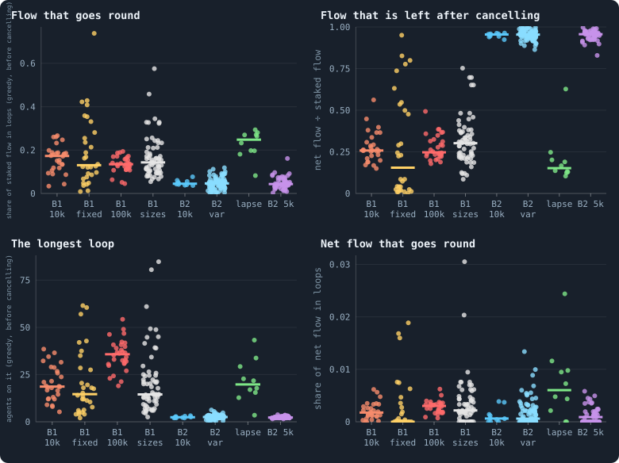
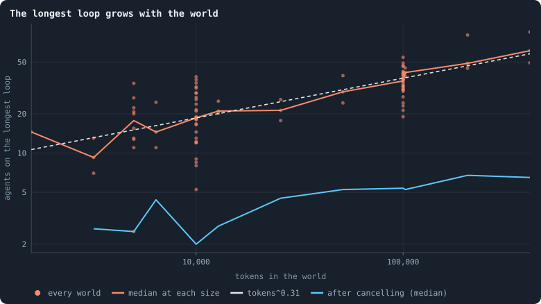
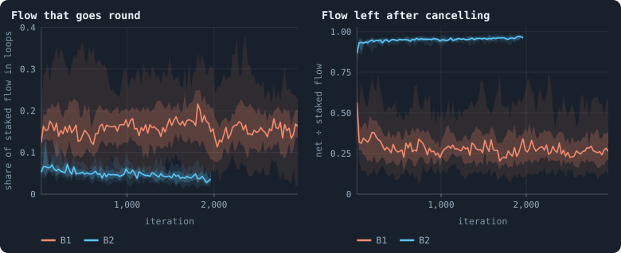
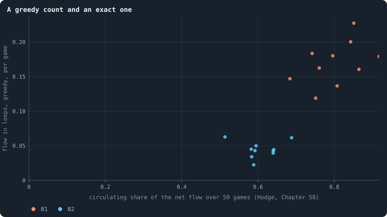

# Lightning in every world

> [!question] Questions of this chapter
> - When agents stake tokens on their neighbours, do the tokens go round in
>   closed loops, or do they run one way, from some agents to others?
> - Is that the same in every world the book has made: both rule sets, every
>   size, every setting an experiment changed?
> - How long are the loops, and do they grow with the world?
> - The loops are counted with a quick, greedy search, game by game. Does it
>   agree with the exact decomposition of [Chapter 58](58-gliders-and-who-helps-whom.md)?

## What a lightning is

In every game each agent splits its tokens over its own node and its
neighbours' nodes. A token staked on a neighbour's node is a token that
**flows** along that connection, from the agent to the neighbour. Draw an
arrow for every such token and a game becomes a network of arrows: the flow.

A **lightning** is what the viewer calls a closed loop in that flow: A stakes
on B, B on C, C back on A. A loop of L agents carries L tokens, one along each
of its arrows, and scores L², so that one long circuit counts for more than
many short ones. Ecologists measure the same thing in food webs as a *cycling
index*. The note [Lightning: tokens that go round](../notes/lightning.md)
explains the definition with a worked example. Why it matters:

- **Flow that goes round is flow that can keep going.** Tokens that run one
  way end up somewhere and stop; tokens that go round can circulate for ever.
  In physics a current that closes on itself (a vortex, a loop of current) is
  a different thing from one that runs downhill; in an economy, a cycle of
  trade is a different thing from a transfer. [Chapter 7](07-physical-inspiration.md)
  hoped for both kinds of flow to appear in these worlds.
- **Two agents that stake on each other already form a loop of length two.**
  A token from A to B and a token from B back to A *cancel*: nothing has
  moved, on balance. So every number below comes twice: for the flow as it was
  staked (*gross*), and for what is left after each pair's stakes on each
  other have cancelled (*net*).

Finding the largest set of loops in a flow is as hard as some of the hardest
problems in computing, so the engine (`gol_lightning.py`) does not try. It
peels loops off greedily — walk along arrows until an agent repeats, take the
loop, remove one token from each of its arrows, repeat — and reports what it
found. Every count is therefore a **lower bound**: there are at least this many
tokens on loops, perhaps more. A run records eight numbers, every 25th
iteration:

| statistic | what it is |
|---|---|
| `cyclingShare` | the share of the staked flow the greedy search put on loops |
| `lightningLongest` | the longest loop it found, in agents |
| `lightningScore` | the sum over its loops of the length squared (long loops count for more) |
| `netFlowShare` | the flow left after cancelling, as a share of the flow staked |
| `netCyclingShare` | the share of that net flow on loops |
| `netLightningLongest`, `netLightningScore` | the longest net loop, and the score of the net loops |
| `flowImbalance` | half the sum over agents of (flow in − flow out), over the total: how much of the flow *must* run one way, whatever the loops are |

[Chapter 29](29-where-the-tokens-flow.md) measured these in the thirty
baseline worlds; [Chapter 30](30-what-crosses-a-connection.md) looked at single
connections. This chapter measures them in **every world the book has made**,
using the table of every world (research/atlas/across.py; see
[Meta VI · Every world side by side](74-meta-6-every-world.md)).

## Every world

<!-- figure lightning/every_world -->

**Loops of flow in every world.** Each dot is one world, over iterations 900–999 (400–499 for a world that did not live to 1,000), a column per kind of world; the bar is the median. Top left: how much of what agents stake on their neighbours a greedy search can put on closed loops, before a token one way and a token back cancel. Top right: what is left once they cancel. Bottom: the longest loop found, and how much of the net flow goes round. B1 10k: the thirty B1 worlds of 10,000 tokens (Experiment 2); B1 fixed: the same with brains that never change (Experiment 7); B1 100k: B1 at 100,000 tokens (Experiment 10); B1 sizes: B1 at 800 to 409,600 tokens (Experiment 8) and at 5,000 with and without a hidden layer (Experiments 12 and 13); B2 10k: the ten B2 worlds of Experiment 16; B2 var: B2 with one rule or rate changed (Experiments 9, 15 and 16); B2 5k: B2 at 5,000 tokens, with all its rules or with one taken away (Experiment 14) — except lapse: the condition in which any unused link lapses; B1 pil. and B2 pil.: the pilot worlds that play the engine's game.

> [!example]- How to make this figure
> **Runs.** every simulation made so far, as `book/results/worlds.json` holds it (`python3 research/atlas/across.py lab`, `pilots`, `write`): a lab run's statistics are the means of its record over a stretch of iterations; a pilot's, of 20 games recorded from its checkpoint and summarised the same way.
>
> **Data.** From each world's `cyclingShare`, `netFlowShare`, `lightningLongest` and `netCyclingShare` (gol_lightning.py, on the heavy rows of a run's record).
>
> 1. Take each world's mean over iterations 900–999, or 400–499 if it has no later one.
> 2. Put it in the first group of the list in book_chapters/everyworld.py it belongs to.
> 3. Draw one dot per world; the bar is each group's median.
>
> **To make it again:** `python3 book_figures.py lightning`.
<!-- /figure -->

Three things stand out.

**The two rule sets are opposites.** In the B1 worlds a sixth of the staked
flow can be put on loops (median 0.17 at 10,000 tokens), and three quarters
of it cancels: the net flow is a quarter of the staked flow. In the B2 worlds
of [Part V](48-a-world-that-cannot-break.md), at every setting an experiment
changed, the loops hold about a twentieth (0.045), and almost nothing cancels:
the net flow is 95% of the flow. B1's flow is mostly agents staking on each
other; B2's is mostly agents staking on others who do not stake back.

**One rule of B2 decides it.** A single kind of B2 world flows like B1: the
condition of [Experiment 14](48-a-world-that-cannot-break.md) in which *any
unused link lapses* (`prune_needs = 0`), green in the figure. In B1 too a
connection that carries no tokens is cut after the game. B2 keeps a link alive
unless cutting it is safe for the network (`prune_needs = 2`), and so links no
longer have to be used. Where a link must carry tokens to survive, agents stake
on each other, and the flow goes round; where it need not, the flow runs one
way. Nothing in the brains changed: one of the rules that make B2's network
unbreakable also made its economy run one way. The pilot worlds say the same
independently: of all the B2 pilots, the three whose flow goes round
(0.21–0.28 of it on loops, a tenth left after cancelling) are exactly those in
which unused links lapse ([Chapter 54](54-the-switches-the-world-was-built-with.md)).

**Little goes round once the cancelling is done.** In every kind of world the
net flow on loops is a fraction of a percent (bottom right). Within one game,
nearly all of what goes round is two agents staking on each other. The longer
loops are there, but they carry little.

The B1 worlds whose brains never change (yellow) spread over the whole range:
some put 70% of their flow on loops, others almost nothing. Each of those
worlds is frozen in whatever play its founders had ([Chapter 41](41-do-the-brains-matter.md)),
and the founders differ.

## The longest loop grows with the world

<!-- figure lightning/size -->

**The longest loop grows with the world.** The longest loop the greedy search finds in a B1 world, against the world's size, both axes logarithmic: the median grows as the tokens to the power 0.31, so a world twice the size has loops 1.24 times as long. The blue line is the same after a token one way and a token back have cancelled.

> [!example]- How to make this figure
> **Runs.** The B1 worlds of Experiment 8 (800 to 409,600 tokens, three seeds each, over iterations 400–499), of Experiments 12 and 2 (5,000 and 10,000 tokens) and of Experiment 10 (100,000 tokens), over iterations 900–999.
>
> **Data.** From each world's mean `lightningLongest` and `netLightningLongest` in book/results/worlds.json.
>
> 1. Take each world's mean of the longest loop over its stretch.
> 2. Take the median at each size; fit a straight line to the logarithms.
>
> **To make it again:** `python3 book_figures.py lightning`.
<!-- /figure -->

The longest loop grows with the size of the world as the tokens to the power
0.31. That number is not new. The distances across these worlds grow as the
number of agents to the power 0.25–0.30 ([Chapter 42](42-how-does-a-worlds-size-follow-its-tokens.md)),
and agents are proportional to tokens. A dimension of about 3.3
([Chapter 24](24-how-many-dimensions-does-a-world-have.md)) means a world's
width grows as its size to the power 1/3.3 = 0.30. **So the longest loop is as
long as the world is wide**: the greedy search finds loops that go across the
world, and they lengthen exactly as the world widens. After cancelling (blue)
the longest loops are short — five or six agents in the largest worlds — and
grow more slowly.

## Through a world's life

<!-- figure lightning/life -->

**Through a world's life.** The two statistics through the life of thirty B1 worlds (Experiment 2) and ten B2 worlds (Experiment 16): the median at each recorded iteration, with the middle half of the worlds as a band.

> [!example]- How to make this figure
> **Runs.** The thirty B1 worlds of Experiment 2 and the ten B2 worlds of Experiment 16, 10,000 tokens each.
>
> **Data.** From `stats.jsonl`, the heavy rows (every 25th iteration).
>
> 1. Read each world's statistic at every heavy row.
> 2. Draw the median of the worlds and their middle half at each iteration.
>
> **To make it again:** `python3 book_figures.py lightning`.
<!-- /figure -->

In B1 the share of flow on loops is about the same from the first hundred
iterations to the last. In B2 it falls slowly, from 0.065 to 0.04, while the
flow left after cancelling rises towards all of it: as a B2 world ages, its
agents stake less on each other. Neither rule set builds more circulation as
it evolves.

## A greedy count and an exact one

The greedy count looks at one game at a time. [Chapter 58](58-gliders-and-who-helps-whom.md)
took the net flow of fifty games together and split it exactly, by the
Helmholtz–Hodge decomposition (the note [Flows that go round](../notes/circulation.md)),
into a part that runs downhill and a part that circulates.

<!-- figure lightning/exact -->

**A greedy count and an exact one.** Each dot is a world: across, the exact share of the flow over 50 games that circulates (the Helmholtz–Hodge decomposition of [Chapter 58](58-gliders-and-who-helps-whom.md)); up, the greedy loop count of a single game, averaged over the same thousand iterations.

> [!example]- How to make this figure
> **Runs.** The ten B2 worlds of Experiment 16 and the first ten B1 worlds of Experiment 2, iterations 1,000 to 2,000.
>
> **Data.** From `GraphOfLifeRuns/.pilots/circulation_20.json` (research/oee/checks/circulation.py) and each world's `cyclingShare`.
>
> 1. Take each world's circulating share, the median over its twenty windows of 50 games.
> 2. Take its mean greedy loop share over the same iterations.
> 3. Draw one against the other.
>
> **To make it again:** `python3 book_figures.py lightning`.
<!-- /figure -->

Across the twenty worlds the two agree on which worlds circulate more
(r = 0.88, carried by the difference between the rule sets). Within a rule set
they agree loosely in B1 (r = 0.46 over ten worlds) and not at all in B2
(0.01). And the exact count finds much more. Measured by its energy (the sum
of the squares of the flows, as in the note), 80% of B1's net flow over fifty
games circulates (median of ten worlds), and 59% of B2's, where one game's
greedy loops hold 17% and 4.5% of the tokens. Circulation in these worlds is
spread over time. A token goes from A to B in one game and from B to C in the
next; no single game closes the loop.

That is a warning about both numbers. Random flow on the same network would
circulate too: 59–60% in B1 and 50–53% in B2, by the two null models of
[Chapter 58](58-gliders-and-who-helps-whom.md). The real excess over chance is
about 0.2 in B1 and less than 0.1 in B2. B1's agents keep tokens going round
more than chance would; B2's barely do.

## What this says

- **Whether tokens go round is decided by one rule, not by the brains.** If a
  link must carry tokens to survive, agents stake on each other and the flow
  circulates (B1, and B2 with unused links lapsing); if links survive unused,
  the flow runs one way (B2).
- **The loops are as long as the world is wide**: the longest grows as the
  world's size to the power 0.31, the same power as its distances.
- **Within a game, almost all circulation is two agents staking on each
  other.** Over fifty games much more circulates, but in B2 hardly more than
  random flow would.
- **No world builds circulation as it evolves.** For open-ended evolution,
  this is one more thing that settles early and stays.

The pilot worlds that play the engine's game are in the figures too (each was
played on from its checkpoints and recorded as a lab run is): B2's pilots flow
as B2 does (0.046 on loops, 0.95 left after cancelling), B1's as B1 does (0.20,
0.26). Measures of
the same flow from other angles are in [Chapter 71](71-flow-modules.md), *Flow modules: the groups
tokens stay in* (who trades with whom, and for how long), and in
Chapter 75, *Meta VII · Where tokens go*, which gathers what the book knows
about flow.

**Related notes:** [Lightning](../notes/lightning.md) ·
[Token flow](../notes/token-flow.md) · [Flows that go round](../notes/circulation.md) ·
[Logarithmic axes](../notes/logarithmic-axes.md) ·
[Chapter 29 · Where the tokens flow](29-where-the-tokens-flow.md) ·
[Chapter 30 · What crosses a connection](30-what-crosses-a-connection.md) ·
[Chapter 58 · Gliders, and who helps whom](58-gliders-and-who-helps-whom.md)

<!-- turns -->
---

← [Chapter 71 · Flow modules: the groups tokens stay in](71-flow-modules.md) · [Contents](../README.md) · [Chapter 41 · Do the brains matter?](41-do-the-brains-matter.md) →
<!-- /turns -->
