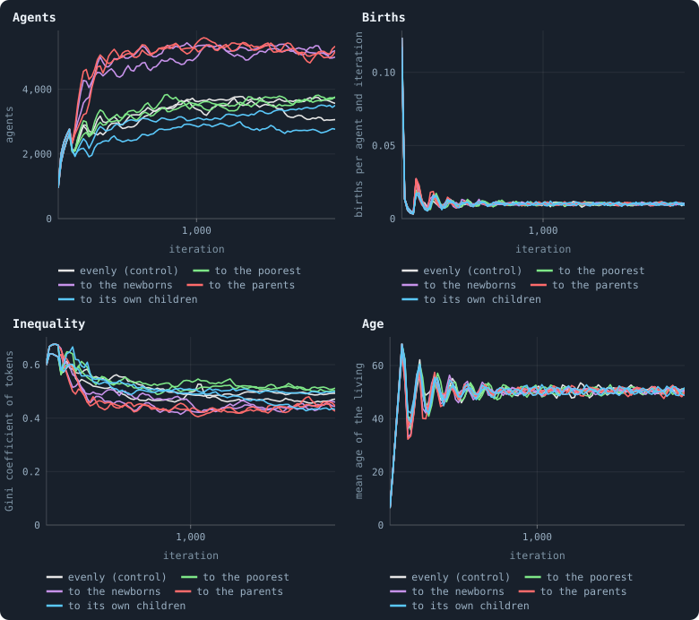
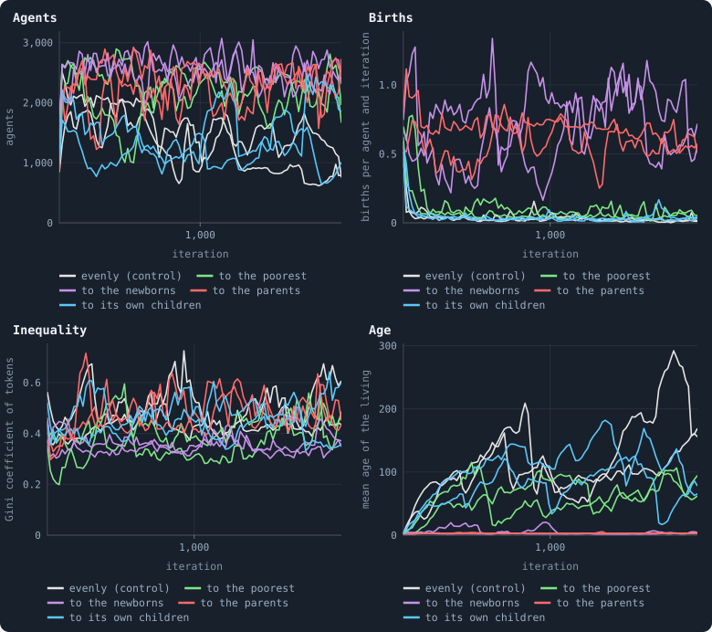
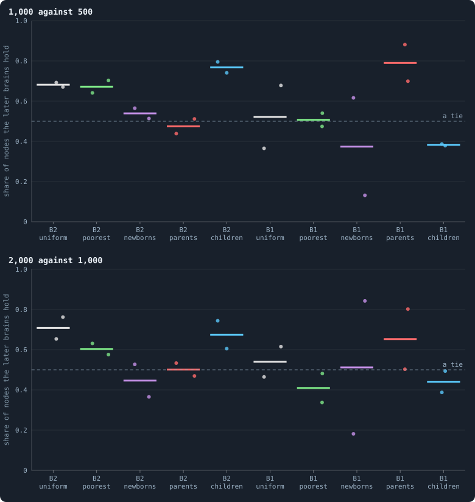

# Who inherits?

> [!question] Questions of this chapter
> - When an agent dies, its tokens go back to the world. Does it matter who
>   gets them?
> - What happens if the estate goes to the poorest, to the children just
>   born, or to the agents that have just had children?

When an agent dies — of age in B2, or in B1 when it loses its node or the
piece of the world it is on is cut off — its tokens do not vanish: the
cleanup pools them and shares them out among the survivors. Until now every
world of this book shared them out **evenly**: every survivor had the same
chance at every token ([`redistribution`](../notes/settings.md#redistribution)
= `uniform`). The author asked for other ways, and each has a reading of its
own:

- **to the poorest** — a safety net: the pool raises the poorest survivors to
  one common level, as far as it reaches, like water poured on an uneven
  floor;
- **to the newborns** — an inheritance for the young: the pool is shared
  evenly among the children born that iteration;
- **to the parents** — a reward for having children: the pool is shared among
  the agents that had a child that iteration, once per child.

None of them has a number of its own. In an iteration without a birth, the
last two share the pool out evenly, as before.

## The worlds

Each rule was played in pilot worlds of 10,000 tokens for 2,000 iterations,
two seeds each (batch R), on both of the book's baselines: B2, the world that
cannot break, with Experiment 16's settings, and B1, where worlds break and
cut-off pieces are culled. The controls are the same settings and seeds with
the estate shared evenly: for B2 the pilot worlds `P/B2-s1` and `-s2` (the
lab's Experiment 16 worlds again, game for game), for B1 the first 2,000
iterations of the long runs `L/B1-long-s1` and `-s2`.

## B2: bigger and poorer, or no change

<!-- figure inherit/life_B2 -->

**B2 worlds, by who inherits.** B2 worlds of 10,000 tokens, two seeds of each rule, through 2,000 iterations (means over blocks of 20 iterations). Grey: the estate shared evenly, the control; green: to the poorest; violet: to the children born that iteration; red: to their parents.

> [!example]- How to make this figure
> **Runs.** Pilot worlds of 10,000 tokens, two seeds each: B2's settings (as in Experiment 16) and B1's, with `redistribution` = `poorest`, `newborns` or `parents` (`GraphOfLifeRuns/.pilots/R/`); the controls are the same settings and seeds with the estate shared evenly, `P/B2-s1`, `-s2` and the first 2,000 iterations of `L/B1-long-s1`, `-s2`.
>
> **Data.** From each world's `series.jsonl`, one row per iteration.
>
> 1. Read agents, births, the Gini coefficient and mean age every iteration.
> 2. Average over blocks of 20 iterations and draw a line per world.
>
> **To make it again:** `python3 book_figures.py inherit`.
<!-- /figure -->

**To the poorest, nothing much changes.** The worlds hold 3,600 to 3,700
agents, as B2's do; four agents in five still hold three tokens or fewer, the
median agent one. The pool is small: in B2 the dead leave about seventy
tokens an iteration among 3,600 agents, and raising the poorest by that much
lifts a few of them by a token.

**To the newborns or to the parents, the worlds grow by half** — to 5,100 to
5,300 agents, all four of them — and grow poorer: nine agents in ten hold
three tokens or fewer. Both rules put the estate where a birth can follow
from it. A newborn starts with the 10 tokens its parent gave and its share of
the estate on top, so it can often afford a child of its own at once; a
parent's reward makes the next child sooner. Births pass on, the world fills
until hardly anyone can afford a child, and it fills to more agents than B2's
because the tokens that would have scattered evenly go to the very agents
that will breed.

## B1: younger, or a world of infants

<!-- figure inherit/life_B1 -->

**B1 worlds, by who inherits.** B1 worlds of 10,000 tokens, two seeds of each rule, through 2,000 iterations (means over blocks of 20 iterations). Grey: the estate shared evenly, the control; green: to the poorest; violet: to the children born that iteration; red: to their parents.

> [!example]- How to make this figure
> **Runs.** Pilot worlds of 10,000 tokens, two seeds each: B2's settings (as in Experiment 16) and B1's, with `redistribution` = `poorest`, `newborns` or `parents` (`GraphOfLifeRuns/.pilots/R/`); the controls are the same settings and seeds with the estate shared evenly, `P/B2-s1`, `-s2` and the first 2,000 iterations of `L/B1-long-s1`, `-s2`.
>
> **Data.** From each world's `series.jsonl`, one row per iteration.
>
> 1. Read agents, births, the Gini coefficient and mean age every iteration.
> 2. Average over blocks of 20 iterations and draw a line per world.
>
> **To make it again:** `python3 book_figures.py inherit`.
<!-- /figure -->

B1 is a different world: nobody dies of age, and an agent lives until it loses
its node or its piece is cut off. Its controls hold 800 to 1,400 agents with a
mean age of 120 to 210 iterations, and about two births per hundred agents an
iteration.

**To the poorest, B1's worlds grow larger and younger:** 2,100 to 2,300
agents, a mean age of 74 to 76, four to seven births per hundred agents an
iteration. The poorest are the agents about to starve; raised, they live on,
and the world holds more of them.

**To the newborns or the parents, B1 becomes a world of infants.** Fifty-five
to eighty-five agents in a hundred are born *every iteration*, and the living are
three iterations old on average. Where nothing caps a life, the estate that
pays for a birth sets off the next birth at once, and the newborns die
almost as fast as they come.

## Does evolution go on?

<!-- figure inherit/contests -->

**Does evolution go on?** Lifetime contests (T = 100 iterations): the brains of a later moment against those of an earlier one, half and half on the same world, once in each moment's world; the share of nodes the later brains hold at the end, averaged over the two. Above a half, the later brains are better. Each dot is a world.

> [!example]- How to make this figure
> **Runs.** Pilot worlds of 10,000 tokens, two seeds each: B2's settings (as in Experiment 16) and B1's, with `redistribution` = `poorest`, `newborns` or `parents` (`GraphOfLifeRuns/.pilots/R/`); the controls are the same settings and seeds with the estate shared evenly, `P/B2-s1`, `-s2` and the first 2,000 iterations of `L/B1-long-s1`, `-s2`.
>
> **Data.** From `GraphOfLifeRuns/.pilots/batch_R_T100.json` and `batch_P_T100.json` (`research/oee/checks/rejudge.py --T 100`).
>
> 1. Load both moments' checkpoints; give half the agents of one world the brains of each moment.
> 2. Play 100 iterations; count the nodes each side holds.
> 3. Do it again in the other moment's world and average.
>
> **To make it again:** `python3 book_figures.py inherit`.
<!-- /figure -->

Lifetime contests (T = 100, as in
[Chapter 50](50-why-evolution-stops.md#would-we-notice-if-it-went-on)): the
brains of a later moment against those of an earlier one, once in each
moment's world.

- **B2 with the estate to the poorest evolves as B2 does:** the brains of
  1,000 iterations take 64% and 70% of a contested world from those of 500,
  those of 2,000 take 63% and 58% from those of 1,000 (the control: 69% and
  67%, then 65% and 76%).
- **B2 with the estate to the newborns or to the parents stops evolving:** the
  later brains take 37% to 57% — no better, at both steps, in all four worlds.
- **B1's worlds tie or swing**, with the estate shared any way: from 13% to
  88% for one world and one step. B1 stops learning after its first hundred
  iterations ([Chapter 46](46-how-to-tell-a-world-that-keeps-evolving.md)),
  and a contest of a stopped world is a coin toss.

Why should evolution stop in B2 when the estate goes to the newborns or the
parents? One reading, not tested here: in those worlds what an agent's line
gets depends on when it was born — whose estate fell to it — as much as on
what its brain does, so the brains that spread are not the better ones.

## Healthy, and diverse?

Each world at iteration 2,000, read as
[Meta X](79-meta-10-healthy-and-rich.md) reads every world (16 October
2026):

| world | agents | marks of the health bar (of 7) | dimension | agents with 3 tokens or fewer | diversity score |
|---|---|---|---|---|---|
| B2, the control (lab, seeds 1, 2) | 3,546; 3,064 | 6; 6 | 4.54; 4.35 | 78%; 71% | 0.52; 0.48 |
| B2, to the poorest | 3,753; 3,728 | 6; 7 | 4.42; 3.95 | 80%; 82% | 0.44; 0.46 |
| B2, to the newborns | 5,179; 5,029 | 7; 7 | 3.90; 3.85 | 91%; 91% | 0.26; 0.28 |
| B2, to the parents | 5,317; 5,228 | 7; 7 | 3.40; 3.76 | 91%; 92% | 0.19; 0.21 |
| B1, to the poorest | 1,775; 1,726 | 3; 3 | 2.39; 3.28 | 71%; 52% | 0.38; 0.64 |
| B1, to the newborns | 2,631; 2,236 | 2; 4 | 2.00; 2.11 | 57%; 40% | 0.38; 0.20 |
| B1, to the parents | 2,761; 2,429 | 5; 5 | 3.31; 4.57 | 65%; 66% | 0.55; 0.55 |

The B2 worlds whose estate goes to the newborns or the parents meet every
mark, at a dimension well under 4 although they hold more than 5,000 agents —
and their agents are alike in tokens, links and ages: diversity scores of 0.19
to 0.28, against 0.48 and 0.52 for B2 itself, and nine in ten of them poor. A
healthy network is not a world that keeps evolving.

## What it teaches

- **Who inherits sets how many agents a world holds.** An estate that lands
  where a birth can follow from it — on the newborns, on the parents — fills a
  world to more agents than an even share does: B2's worlds by half, B1's to a
  world of infants. The safety net does little in B2, whose dead are poor, and
  keeps B1's poorest alive.
- **More agents is not more life.** The bigger worlds are poorer, more alike,
  and in B2 they stop evolving. None of the three rules brings a world nearer
  to the author's picture than the even share does.
- **With mixing, too.** Batch M combines each rule with brains mixed at birth
  ([Chapter 80](80-mixed-at-birth-ten-long-worlds.md)), to see whether one of
  them holds a mixed world's drifting size. The estates to the newborns and to
  the parents fill those worlds as well — past 5,000 agents in the first seeds
  played.

**Related notes:** [Every setting](../notes/settings.md#redistribution) ·
[Chapter 49 · Who dies, and why](49-who-dies-and-why.md) ·
[Chapter 80 · Mixed at birth: ten long worlds](80-mixed-at-birth-ten-long-worlds.md) ·
[Meta X · Healthy and rich](79-meta-10-healthy-and-rich.md) ·
[Chapter 50 · Why evolution stops](50-why-evolution-stops.md)

<!-- turns -->
---

← [Chapter 58 · Gliders, and who helps whom](58-gliders-and-who-helps-whom.md) · [Contents](../README.md) · [Chapter 78 · Brains mixed at birth, units that cost, an eye for raids on kin](78-mixed-brains-costly-units.md) →
<!-- /turns -->
