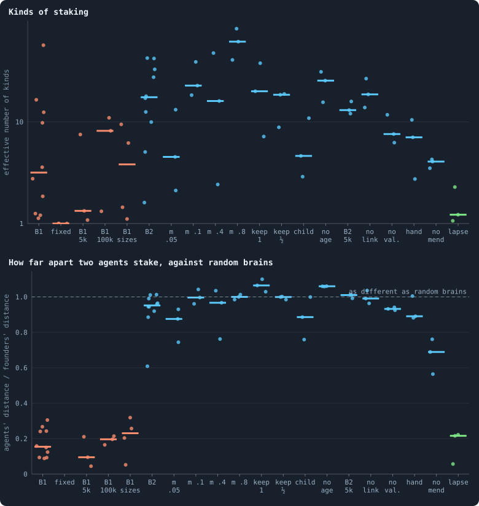
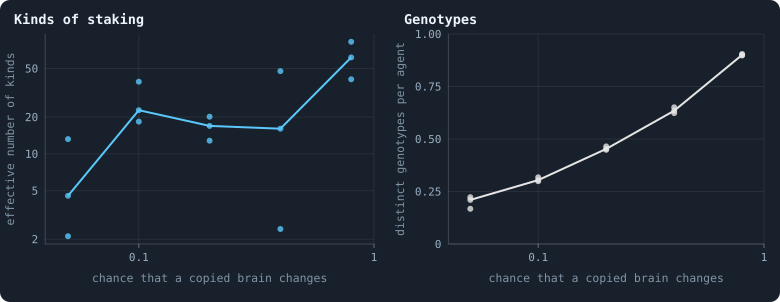
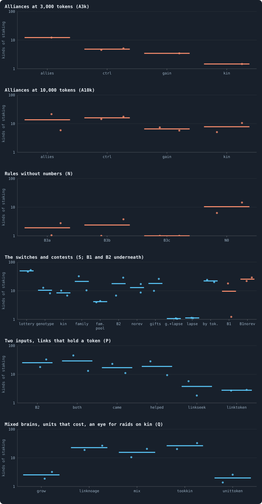

# Meta IX · How alike the agents are

> [!question] Questions of this chapter
> - How many kinds of agent does a world hold — counted by name, by the numbers
>   in their brains, or by what they do?
> - What makes the agents of a world alike, and what keeps them apart?
> - Does the variety last, or is it churn?
> - What would it take for many kinds to evolve, and to stay?

Open-ended evolution needs variety: many kinds alive at once, and new kinds
that keep appearing ([Chapter 1](01-what-this-book-is-about.md)). Several
chapters of this book have counted the variety of a world, each in its own
way. This chapter puts them side by side, adds one measure taken in every
kind of world the book has made, and asks what it says about open-ended
evolution.

## Three ways to count

A world's agents can be told apart by three things, and each gives a
different count.

| what is counted | how | B1 (10,000 tokens) | B2 (10,000 tokens) | chapters |
|---|---|---|---|---|
| **names** | genotypes: a brain gets a new one at every change | 0.65 per agent | 0.46 per agent | [18](18-genotypes-and-lineages.md), [27](27-how-even-is-a-world.md) |
| **numbers** | how far apart two brains' weights are | two agents of one world as far apart as two random brains | — | [19](19-what-the-brains-are-like.md) |
| **behaviour** | kinds of agent that act measurably differently in the same situations, counted by their carriers | 3.2 kinds of staking, 9 over every decision | 17.5 kinds of staking, 54 over every decision | [70](70-how-different-are-the-agents.md) |

The counts fall by orders of magnitude from the first to the last. A B1
world of 1,500 agents holds about a thousand genotypes and a handful of kinds
of behaviour; a B2 world of 3,400 agents about 1,600 genotypes and a few
dozen kinds. Most of what makes two genotypes two changes nothing they do.

## What the chapters found

| finding | chapter |
|---|---|
| A genotype lasts a couple of iterations; what lasts long enough for selection to act on is a line, a family that can take a world over in a few hundred iterations. | [18](18-genotypes-and-lineages.md), [60](60-worlds-of-100000-tokens.md) |
| B1 keeps five genotypes for every eight agents, in every world and at every size: a balance of making and copying, which moves with the rate of change and nothing else. | [27](27-how-even-is-a-world.md), [52](52-how-fast-should-brains-change.md) |
| Two brains of one B1 world are as far apart in their numbers as two brains drawn at random: nearly all of a brain is neutral, free to drift because nothing depends on it. | [19](19-what-the-brains-are-like.md) |
| Selection set B1's constants alike in every world: no children, the stake spread, every token revolutionary. | [16](16-how-the-game-is-played.md), [19](19-what-the-brains-are-like.md) |
| Without evolution, worlds started from random brains end in very different places; with it, they all end alike. | [41](41-do-the-brains-matter.md) |
| In the same situation, B1's agents act nearly alike — seven times more alike than random brains — and its largest kind of staking is the even split the rules make of scores at or below zero. | [70](70-how-different-are-the-agents.md) |
| B2's agents differ as widely as random brains, but steadily: nine pairs in ten stake measurably differently. They share one habit, all in, and differ in when and on whom. | [70](70-how-different-are-the-agents.md) |
| Where agents differ, they differ in how they answer a place, hardly ever in a fixed leaning — and much of the place reaches them through the rules: a single token kept at home, an even split over the neighbours. | [70](70-how-different-are-the-agents.md) |
| The groups tokens stay in are the network's regions; only B2's agents keep a partner longer than chance, for a few games. | [71](71-flow-modules.md) |

## Why B1's agents are alike and B2's are not

B1 and B2 differ in many rules at once (the note [Every setting](../notes/settings.md)
lists them), so the difference has more than one candidate cause:

- **Brains.** B1's brains have five hidden layers and pass on a thousandth of
  a change in what they see ([Chapter 19](19-what-the-brains-are-like.md));
  B2's have one, and see ([Chapter 47](47-brains-that-see-and-worlds-that-break.md)).
  A blind brain can differ from another only in its constants.
- **How the stake is made.** B1's brains spread their stake, and a spread
  stake changes little when the scores change; B2's go all in, and an all-in
  stake goes to whichever candidate scores highest, so that a small difference
  between two brains flips the choice.
- **How brains change.** B1 changes every brain after every game; B2 only
  when a brain is copied, so a brain keeps its quirks for as long as it lives.
- **How links lapse.** In B1 every link not used in a game lapses; in B2 only
  one whose two ends have at least two neighbours in common, so that they stay
  joined twice over ([Every setting](../notes/settings.md#prune_needs)).

The measures of every kind of world below separate them: the last is enough
on its own.

## In every kind of world

The measures of [Chapter 70](70-how-different-are-the-agents.md) were taken
again in three seeds of every condition the lab has run, at the end of each
run (58 worlds), and in both seeds of every pilot condition (69).

<!-- figure how_alike/lab -->

**How alike the agents are, in every lab condition.** Each dot is a world. Top: how many kinds of staking its agents fall into, counted by the agents in each (an effective number; logarithmic axis). Bottom: how far apart two agents' stakes are in the same situation and with the same random inputs, divided by how far apart two fresh founder brains are in the same situations: 1 means as different as brains drawn at random, less means more alike. Orange: B1 and its variants; blue: B2 and its variants; green: B2 with lapsing links. B2 without random inputs is left out of both: without noise every difference counts, and its kinds cannot be compared. B1: B1 at 10,000 tokens (Experiment 2); fixed: brains that never change (Experiment 7); B1 5k, B1 100k, B1 sizes: B1 at 5,000 (Experiment 12), 100,000 (Experiment 10) and 3,200 to 204,800 tokens (Experiment 8). B2: B2 at 10,000 tokens (Experiment 16); m .05 to m .8: the chance that a copied brain changes, 0.05 to 0.8 (B2's own is 0.2; Experiment 9); keep 1, keep ½: the last token kept, half the tokens kept; child: children of any size; no age: no old age (Experiment 15); B2 5k: B2 at 5,000 tokens, and with one of its rules taken away — no link: no links at birth, no val.: no valence, hand: handover allowed, no mend: no mending, lapse: any unused link lapses (Experiment 14).

> [!example]- How to make this figure
> **Runs.** Three seeds of every condition of the lab's experiments at the end of their runs (Experiments 7 to 16; B2 itself from Experiment 16 at 2,000 iterations and B1 from Experiment 2 at 3,000), and both seeds of every pilot condition at its checkpoint of 1,000 or 2,000 iterations.
>
> **Data.** From `GraphOfLifeRuns/.pilots/diversity/across_lab.json`, `B1.json`, `B2.json` (`research/oee/checks/diversity.py`).
>
> 1. Load the world and play one game, so its messages are fresh (`research/oee/checks/diversity.py`).
> 2. Take what 200 living agents read, and draw their random input rows 8 times, the same draws for every brain.
> 3. Put the brains of 400 agents drawn at random, and 400 fresh founder brains, into every situation and draw, and turn their outputs into decisions by the engine's rules.
> 4. Count the kinds of staking as in [Chapter 70](70-how-different-are-the-agents.md); divide the agents' total variation by the founders'.
>
> **To make it again:** `python3 book_figures.py how_alike`.
<!-- /figure -->

**B2's agents stay as different as random brains in nearly every variant.**
Brains that change more or less often, the last token or half the tokens kept
at home, children of any size, half the tokens, no links at birth, no cap on
links, handover: in each, two agents stake as differently as two fresh founder
brains in the same situations (0.88 to 1.07 times as far apart). Only without
mending are they somewhat more alike (0.69). (Without old age they are as
different too, 1.06, but there it says nothing: most of the agents are the
founders themselves, who never die — [Meta X](79-meta-10-healthy-and-rich.md).)
What moves is how many kinds there are, and the rate at which brains change
moves it most.

<!-- figure how_alike/mutation -->

**The more brains change, the more kinds.** B2's worlds of Experiment 9 at 1,500 iterations, at five chances that a brain changes when it is copied (B2's own is 0.2). Each dot is a world; the line joins the medians. Left: kinds of staking, counted by their carriers; right: distinct genotypes per agent.

> [!example]- How to make this figure
> **Runs.** Three seeds of each of Experiment 9's five mutation rates, at iteration 1,500.
>
> **Data.** From `GraphOfLifeRuns/.pilots/diversity/across_lab.json` and `B2_1500.json` (`research/oee/checks/diversity.py`).
>
> 1. Load the world and play one game, so its messages are fresh (`research/oee/checks/diversity.py`).
> 2. Take what 200 living agents read, and draw their random input rows 8 times, the same draws for every brain.
> 3. Put the brains of 400 agents drawn at random, and 400 fresh founder brains, into every situation and draw, and turn their outputs into decisions by the engine's rules.
>
> **To make it again:** `python3 book_figures.py how_alike`.
<!-- /figure -->

At a chance of 0.05 that a copied brain changes, B2's agents fall into about
4.5 kinds of staking; at 0.8, into about 60, while the genotypes per agent go
from 0.21 to 0.90. The kinds do not rise evenly with the rate — three worlds
per rate are few, and the count of a world swings with its seed — but the ends
are an order of magnitude apart.

**One rule makes B2's agents as alike as B1's: every unused link lapses.**
With B1's rule for links and everything else B2's, the agents fall into one or
two kinds of staking — in six of the seven worlds nine agents in ten are of
the largest kind — and two of them stake a fifth as differently as two random
brains or less (0.22 in the lab's worlds; 0.12 and 0.13 in the pilots with and
without gifts): as alike as the agents of B1 and its variants (0.10 to 0.26).
And in six of these seven worlds the agents do what B1's do: they spread their
stake over their candidates, in 95 to 100% of cases, where B2's agents spread
in at most 4%. A link that no stake crosses
lapses, so an agent that goes all in on one neighbour keeps its other links
only where they stake on it; spreading keeps them all. The brains and the way
brains change are B2's in these worlds, so neither is needed for the likeness:
the rule for links is enough, through the stake it selects.

Rules that make something cost make the agents more alike too, though not
nearly as much: links that hold a token (0.66 and 0.72 of random brains'
distance), brains that grow (0.67), and brains whose every unit holds a token
(0.47).

<!-- figure how_alike/pilots -->

**Kinds of staking in the pilot worlds.** Each dot is a pilot world at its checkpoint of 1,000 iterations (batches A, N and S) or 2,000 (batches P and Q), the bar the median; orange: B1's rules underneath, blue: B2's. The chapters that ran each batch say what its conditions change. Batch S: lottery, genotype, kin, family, fam. pool — contests by lottery, sides pooled by genotype, an eye for kin, an eye for a family tag, sides pooled by family (all without revolutions); B2, norev, gifts, g.+lapse, lapse, by tok. — B2 itself, without revolutions, with gifts, with gifts and every unused link lapsing, with every unused link lapsing, estates shared by wealth; B1, B1norev — B1, and B1 without revolutions.

> [!example]- How to make this figure
> **Runs.** Both seeds of every pilot condition that has a checkpoint there.
>
> **Data.** From `GraphOfLifeRuns/.pilots/diversity/across_pilots.json` (`research/oee/checks/diversity.py`).
>
> 1. Load the world and play one game, so its messages are fresh (`research/oee/checks/diversity.py`).
> 2. Take what 200 living agents read, and draw their random input rows 8 times, the same draws for every brain.
> 3. Put the brains of 400 agents drawn at random, and 400 fresh founder brains, into every situation and draw, and turn their outputs into decisions by the engine's rules.
>
> **To make it again:** `python3 book_figures.py how_alike`.
<!-- /figure -->

## Does the variety last?

Variety at one moment is not open-ended evolution. A world that keeps making
new kinds while losing old ones holds as many kinds at every moment, and no
more. What the book has measured over time:

- **Names churn fastest.** A genotype lasts a couple of iterations
  ([Chapter 18](18-genotypes-and-lineages.md)).
- **B2's kinds of behaviour turn over in hundreds of iterations.** Of the kinds
  a sample can find, two thirds are gone 500 iterations later and new ones
  have taken their place; a core of about a quarter lasts 5,000 iterations
  ([Chapter 70](70-how-different-are-the-agents.md)).
- **B1's few kinds last.** Of the agents of one moment, 0.82 have a kind still
  found 5,000 iterations later, against 0.90 for the same moment sampled twice,
  and one of the two long worlds settled on a single kind of staking for good.
- **Better brains do keep coming in B2** — the brains of 2,000 iterations beat
  those of 500 over an agent's lifetime
  ([Chapter 50](50-why-evolution-stops.md#would-we-notice-if-it-went-on)) —
  but more and more slowly, towards a plateau from about 5,000 iterations on.

So B2's variety is renewed, and some of the renewal is improvement. What is
missing is accumulation: new kinds replace old ones instead of joining them.

## What it would take

For many kinds to live side by side and keep accumulating, a kind needs a
reason to stay — somewhere it does better than the others, so that a new kind
is added to the old ones rather than taking their place. The book's evidence
points to four directions, none of them needing a tuned number:

1. **Places that differ in what pays.** B2's kinds already sit at different
   degrees in the network ([Chapter 70](70-how-different-are-the-agents.md)).
   Whether that is a niche or a family living together is the next experiment
   to run: move a kind to another place and see whether it does worse there.
2. **Payoffs that depend on how common a kind is**, so that a rare kind has an
   edge. Nothing in the game does this now; alliances, where a convention pays
   most when shared, did the opposite and made one kind win
   ([Chapter 56](56-alliances.md)).
3. **Heredity of whole parts.** Brains mixed at birth from a parent and a mate
   gave, in one of two worlds, some of the largest steps of evolution of any
   pilot ([Chapter 78](78-mixed-brains-costly-units.md)): a unit that works can
   spread without the rest of the brain it arose in.
4. **Groups that hold together**, which none of these worlds makes beyond the
   regions of its network ([Chapter 71](71-flow-modules.md),
   [Meta VIII](76-meta-8-who-helps-whom.md)).

And one thing to avoid: a rule that leaves a single way of acting as the way
to keep going. Lapsing links do that to the stake — spread it or lose your
links — and the kinds of staking collapse to one or two (above). A rule that
open-ended evolution can use leaves more than one way to live.

And one measure to take before any of them: play each kind against the kinds
that replaced it. If new kinds beat old ones, the turnover is selection; if
they only differ, it is drift, and variety without direction.

**Related notes:** [Effective numbers](../notes/effective-number.md) ·
[Where, who and chance](../notes/variance-split.md) ·
[Brain diversity](../notes/brain-diversity.md) ·
[Genotypes and the family tree](../notes/genotype.md) ·
[Chapter 18 · Genotypes and lineages](18-genotypes-and-lineages.md) ·
[Chapter 19 · What the brains are like](19-what-the-brains-are-like.md) ·
[Chapter 41 · Do the brains matter?](41-do-the-brains-matter.md) ·
[Chapter 70 · How different are the agents?](70-how-different-are-the-agents.md)

<!-- turns -->
---

← [Chapter 76 · Meta VIII · Who helps whom](76-meta-8-who-helps-whom.md) · [Contents](../README.md) · [Chapter 79 · Meta X · Healthy and rich](79-meta-10-healthy-and-rich.md) →
<!-- /turns -->
