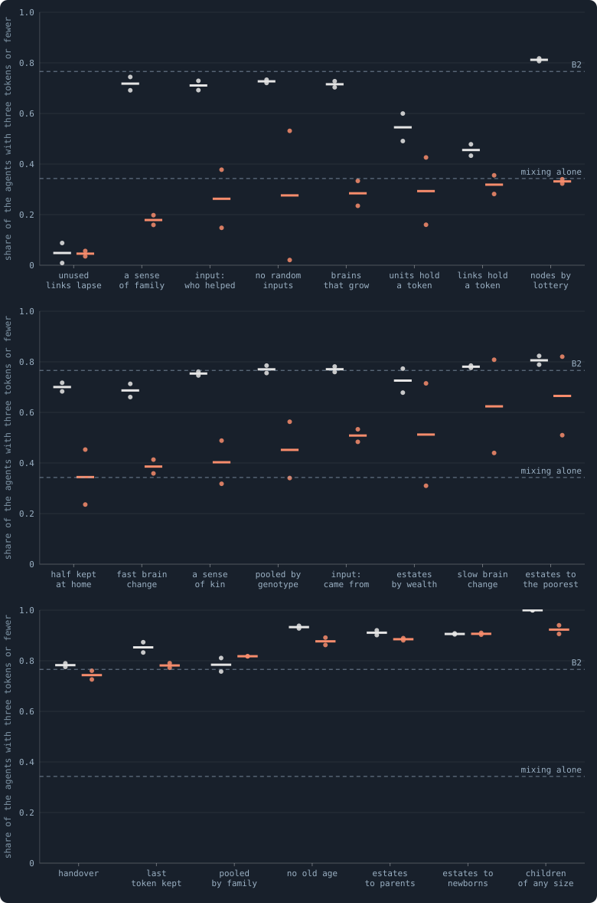
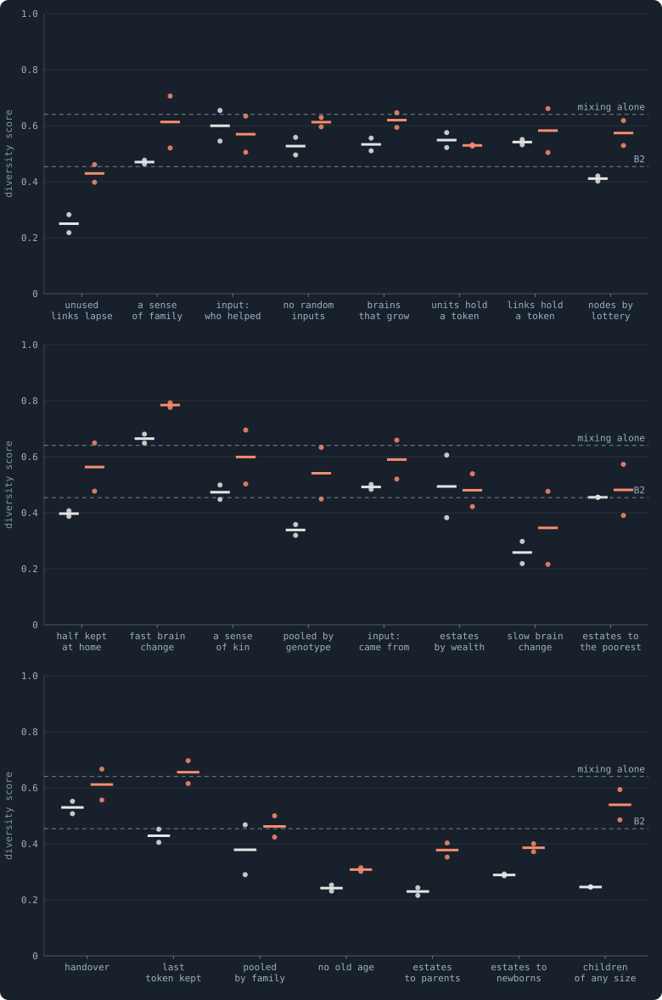
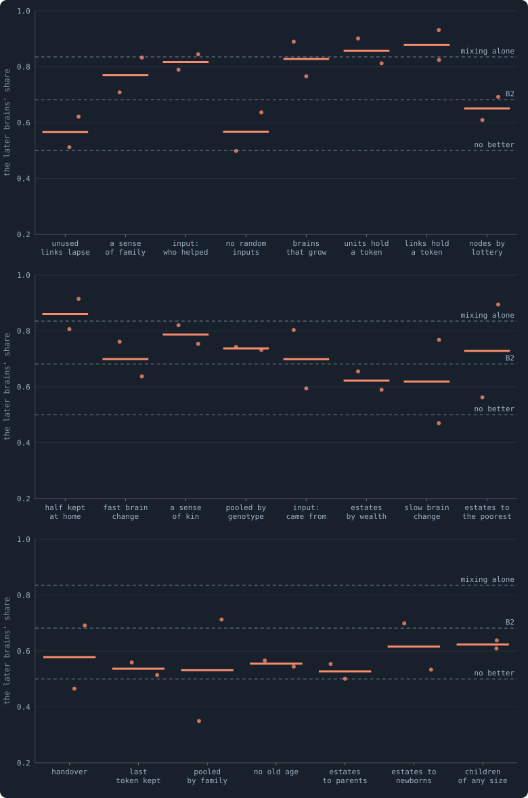

# Brains mixed at birth, with every other rule

> [!question] Questions of this chapter
> - Mixing brains at birth made B2's worlds smaller, richer and more diverse.
>   Does it still, whatever else the rules say?
> - Which rules cancel it, which make it stronger — and why those?

Of every rule the book has tried, mixing a newborn's brain from its parent's
and a neighbour's came closest to the author's picture of a world that might
keep evolving ([Meta X](79-meta-10-healthy-and-rich.md)), and
[Chapter 80](80-mixed-at-birth-ten-long-worlds.md) found out why it makes a
world rich: agents put off having children, so the world never fills up to
the point where hardly anyone can afford one. The author asked for mixing to
be tested together with the other rules. This chapter does that, for 23 of
them at once.

## The worlds

Batch Y: B2 at 10,000 tokens with brains mixed at birth and one other rule,
seeds 1 and 2, 1,000 iterations, as pilot worlds. Each world is the fourth
corner of a two-by-two whose other three already existed:

| corner | the worlds |
|---|---|
| B2 | the lab's Experiment 16 worlds, seeds 1 and 2 |
| B2 with mixing | the lab's Experiment 17 worlds, seeds 1 and 2 |
| B2 with the other rule | the batch or lab experiment that made it: batches P, Q, R, S, T and W, Experiments 9, 15 and 16 |
| B2 with both | batch Y |

The other rules are every switch of the book's pilots and lab experiments
with B2 — who inherits the estate, links that hold a token, inputs that say
who helped or where an agent came from, handover, no random inputs, no old
age, children of any size, how much is kept at home, brains that grow or
whose units hold a token, slower or faster change of brains, unused links
that lapse — and the five other ways of deciding a node that batch S tried.
Every corner is read at iteration 1,000, the same moment in each, as Meta X
reads every world (`research/atlas/at.py`).

## Riches

<!-- figure mixcombos/riches -->

**Agents holding three tokens or fewer.** Each grey dot is a world of B2 with one other rule, each orange dot the same rule with brains mixed at birth as well (batch Y), seeds 1 and 2, read at iteration 1,000; the short bars are the means. The dashed lines are B2 itself and B2 with mixing alone, the means of the same seeds. The rules are in the order of the orange means.

> [!example]- How to make this figure
> **Runs.** Batch Y's 46 pilot worlds (B2 at 10,000 tokens, brains mixed at birth and one other rule, seeds 1 and 2, `GraphOfLifeRuns/.pilots/Y/`) and their controls: the same rule alone, from the batch or lab experiment that made it, and the lab's B2 and mixed worlds of the same seeds (Experiments 16 and 17).
>
> **Data.** From Each world's checkpoint at iteration 1,000, or the lab's whole world kept then (`research/atlas/at.py --at 1000`, `GraphOfLifeRuns/.pilots/atlas/at1000.json`).
>
> 1. Read each world as `research/atlas/profile.py` reads every world.
> 2. Rank its four spreads among Meta X's worlds; the diversity score is the mean.
>
> **To make it again:** `python3 book_figures.py mixcombos`.
<!-- /figure -->

**With sixteen of the rules, mixing keeps its riches** — the orange dots sit
far below the grey ones, near or below B2 with mixing alone. With some it does
more than alone: with a sense of family, 18% of the agents hold three tokens or
fewer; with an input saying who helped, 26%; without random inputs, 28% (one
world at 2%); with brains that grow, 28%; with units that hold a token, 30%.
Mixing alone: 34%. With three of the sixteen — estates by wealth, estates to
the poorest, a slower change of brains — one seed of the two stayed nearly as
poor as without mixing.

**Seven rules cancel it**: the estate of the dead to the newborns or to the
parents, children of any size, no old age, handover, only the last token kept
at home, and stakes pooled by family. Their worlds are as poor with mixing as
without, 73% to 94% of the agents at three tokens or fewer.

Chapter 80 says why most of them. Mixing makes a world rich by making its
agents slow to have children; three of these rules pay for a birth or make it
cheap — an estate that lands on the newborns or on their parents, a child for
any number of tokens — and the world fills up again. Without old age nobody
needs replacing at all, and the world fills with the old. Why handover, the
last token kept and stakes pooled by family cancel mixing too, this batch does
not show.

## How much the agents differ

<!-- figure mixcombos/diversity -->

**How much the agents differ.** Each grey dot is a world of B2 with one other rule, each orange dot the same rule with brains mixed at birth as well (batch Y), seeds 1 and 2, read at iteration 1,000; the short bars are the means. The dashed lines are B2 itself and B2 with mixing alone, the means of the same seeds. The rules are in the order of the orange means.

> [!example]- How to make this figure
> **Runs.** Batch Y's 46 pilot worlds (B2 at 10,000 tokens, brains mixed at birth and one other rule, seeds 1 and 2, `GraphOfLifeRuns/.pilots/Y/`) and their controls: the same rule alone, from the batch or lab experiment that made it, and the lab's B2 and mixed worlds of the same seeds (Experiments 16 and 17).
>
> **Data.** From Each world's checkpoint at iteration 1,000, or the lab's whole world kept then (`research/atlas/at.py --at 1000`, `GraphOfLifeRuns/.pilots/atlas/at1000.json`).
>
> 1. Read each world as `research/atlas/profile.py` reads every world.
> 2. Rank its four spreads among Meta X's worlds; the diversity score is the mean.
>
> **To make it again:** `python3 book_figures.py mixcombos`.
<!-- /figure -->

Mixing raises the diversity score with nearly every rule — even with most of
those that cancel its riches: with children of any size from 0.25 to 0.54,
with only the last token kept from 0.43 to 0.65. Part of that is built in.
The score counts genotypes, and every mixed birth makes a new set of weights,
so a mixed world always has more genotypes per agent. But tokens, links and
ages spread wider too where the world is rich.

The most diverse worlds of the batch are mixing with a faster change of brains
(0.77 and 0.79, more than all but a few worlds built on B2's rules), with a
sense of kin or family (0.69, 0.70), with an input saying where an agent came from
(0.66), and mixing alone (0.70, 0.58).

## Healthy?

Nearly every world meets six or seven marks of the health bar, as B2's and the
mixed worlds do. The exceptions are the rules that broke the network before
mixing came: with every unused link lapsing, four or five marks; with handover,
three.

The marks hide a risk that Chapter 80 found and
[Chapter 81](81-five-mixed-worlds-fifty-thousand-iterations.md) saw end in
death: a mixed world's size drifts. Several of the richest combinations are
small at 1,000 iterations — 270 agents with a sense of family, 291 without
random inputs, 325 with units that hold a token, 366 with brains that grow — and
small mixed worlds are the ones that die out.

## Does evolution go on?

<!-- figure mixcombos/evolution -->

**Do the brains of 1,000 beat those of 500?** Each dot is a world of batch Y: the share of a contested world its brains of iteration 1,000 hold after 100 iterations against those of 500, the mean of two contests, one in each era's world; the bars are the medians, the rules in the order of the figures above. The dashed lines are the medians of B2's ten lab worlds and of the ten mixed worlds of Experiment 17, played the same way.

> [!example]- How to make this figure
> **Runs.** Batch Y's 46 pilot worlds (`GraphOfLifeRuns/.pilots/Y/`); B2: Experiment 16's ten runs; mixing alone: Experiment 17's ten runs.
>
> **Data.** From `GraphOfLifeRuns/.pilots/batch_TUV_T100.json`, `long_steps.json` and `e17_T100.json` (`research/oee/checks/rejudge.py`).
>
> 1. Seat the brains of the two eras on alternate agents of each era's world and play 100 iterations.
> 2. Count the agents the later era's brains hold, as a share of all.
>
> **To make it again:** `python3 book_figures.py mixcombos`.
<!-- /figure -->

With almost every rule, yes. In 42 of the 46 worlds the brains of iteration
1,000 took more than half of a contested world from those of 500, over an
agent's lifetime (the median world 69%, where B2's take 68% and those of
mixing alone 84%). The steps are largest with links that hold a token (93%),
half kept at home (91%), units that hold a token (90%), the estate to the
poorest and brains that grow (89% each). The four worlds whose later brains
were no better came from stakes pooled by family (35%), handover and a slower
change of brains (47% each), and no random inputs (50%): two of them rules
that cancel mixing's riches, the other two worlds that stayed poorer than
mixing leaves most worlds (81% and 53% of their agents at three tokens or
fewer). Mixing does not stop evolution, whatever else the rules say; it speeds
it most where the agents stay rich.

## What it teaches

- **Mixing's riches are robust, but not to rules that pay for births.** With
  sixteen rules of twenty-three the worlds stay rich; of the seven that cancel
  it, four bring children back — by paying for them, by making them cheap, or
  by taking away the deaths they replace.
- **Evolution goes on with nearly every combination**, fastest where the
  agents stay rich.
- **The richest combinations are also the smallest.** Riches are size where
  the tokens are fixed (Chapter 80), and a small mixed world is a fragile one.
  None of these combinations was played long enough to say whether it holds
  its size; Experiment 18's five worlds of mixing alone did not.
- **Candidates.** By riches and diversity together, mixing with a faster
  change of brains, with a sense of kin or of family, with an input saying who
  helped or where an agent came from, and with nodes decided by lottery are
  the batch's closest worlds to the author's picture; those that meet every
  mark join the candidates of Meta X (`research/oee/candidates.md`).

**Related notes:** [Chapter 80 · Mixed at birth: ten long worlds](80-mixed-at-birth-ten-long-worlds.md) ·
[Chapter 81 · Five mixed worlds, fifty thousand iterations](81-five-mixed-worlds-fifty-thousand-iterations.md) ·
[Chapter 78 · Brains mixed at birth, units that cost, an eye for raids on kin](78-mixed-brains-costly-units.md) ·
[Chapter 73 · Who inherits?](73-who-inherits.md) ·
[Meta X · Healthy and rich](79-meta-10-healthy-and-rich.md) ·
[Every setting](../notes/settings.md#mix_at_birth)

<!-- turns -->
---

← [Chapter 83 · Links to strangers](83-links-to-strangers.md) · [Contents](../README.md) · [Chapter 85 · Mixed at birth, with parents as mates](85-mixed-at-birth-with-parents-as-mates.md) →
<!-- /turns -->
