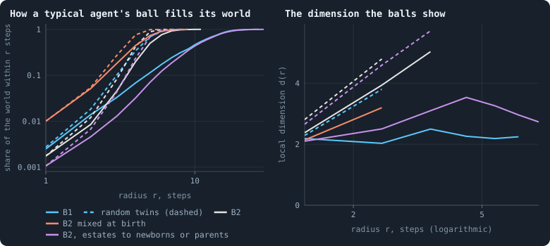
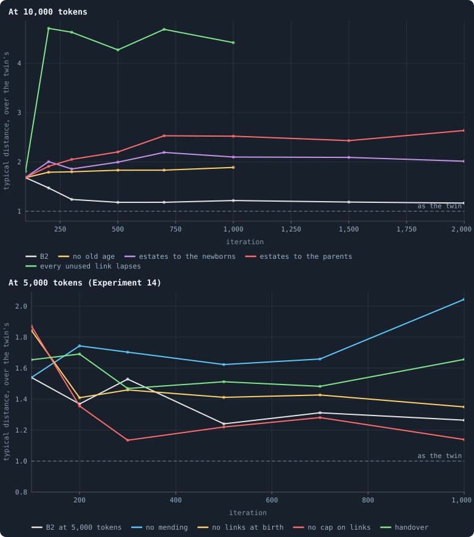
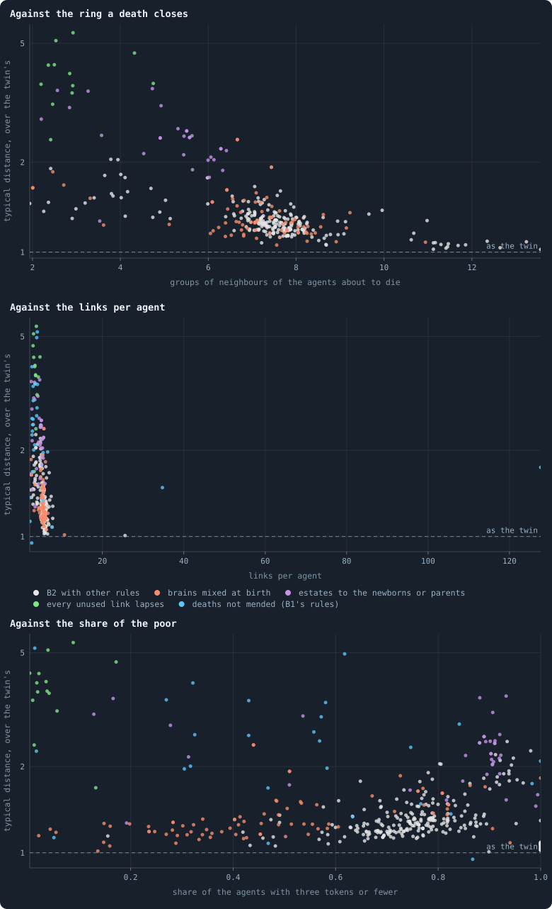

# What folds a world

> [!question] Questions of this chapter
> - [Chapter 24](24-how-many-dimensions-does-a-world-have.md) found B1's
>   worlds to be spaces, with a dimension of their own. Are B2's worlds, and
>   the others the book has made since, spaces too?
> - When does a world become a space, and when does it lose it?
> - Which rules decide it?

One aim of this book is a world that makes its own space: a network in which
every agent has neighbours, the neighbours have neighbours, and the whole is
a space of a few dimensions — three, if it can be
([Chapter 7](07-physical-inspiration.md)). Chapter 24 measured B1's worlds
with two rulers and found them spaces: the number of agents within *r* steps
of a typical agent grows as a power of *r*, about *r*² to *r*³, and a
**random twin** of each world — exactly the same number of links at every
agent, wired at random — does not: its balls grow by a factor every step,
the mark of a small world, which has no dimension at all. B2, the world that
cannot break ([Chapter 48](48-a-world-that-cannot-break.md)), has been the
baseline of everything since. Its network has only been read through one
number on the health bar, a dimension by ball growth over radii 1 to 5 —
and that number rose with a world's size
([Meta XI](84-meta-11-what-holds-a-worlds-size.md)), as a small world's would.

This chapter reads B2's worlds and the others with Chapter 24's full rulers
(`research/atlas/space.py`), and adds one number that sums a world up: its
**typical distance** — the steps within which a typical agent's ball holds
half the world — over its twin's. A small world is about as near as its
twin, a ratio of 1; a space is wider, because its distances grow as a power
of its size, the twin's only as the logarithm.

## B1 and B2 side by side

<!-- figure spaces/balls -->

**B1 and B2 side by side.** Left: the share of its world a typical agent's ball holds within r steps (the geometric mean over 40 agents drawn at random), the median of each kind of world, on logarithmic axes; dashed, the same for the worlds' random twins, which have exactly the links of their world at every agent, wired at random. Right: the local dimension the balls show, d(r) = ln(N(r+1)/N(r)) / ln((r+1)/r), until a ball holds a quarter of the world, the median of each kind; dashed, the twins.

> [!example]- How to make this figure
> **Runs.** B1: the 26 worlds of 10,000 tokens of Experiment 2 that lived to the end, after their last game; B2: Experiment 16's ten worlds at iteration 2,000; mixed at birth: Experiment 17's worlds at 10,000; the estates to the newborns or the parents: batch R's B2 worlds (`R/B2-newborns-s1`, `-s2`, `R/B2-parents-s1`, `-s2`) at 2,000.
>
> **Data.** From each world's whole world kept then (`research/atlas/space.py`, `GraphOfLifeRuns/.pilots/atlas/space.json`).
>
> 1. Build the network of the world's largest piece; make its random twin.
> 2. From 40 agents drawn at random, a breadth-first search; N(r) the geometric mean of the number within r steps.
> 3. Read the share N(r)/n and the local dimension d(r).
>
> **To make it again:** `python3 book_figures.py spaces`.
<!-- /figure -->

- **B1 is a space**, as Chapter 24 found: its local dimension holds between
  2.0 and 2.5 from radius 1 to 6, and a typical agent needs 10.5 steps to
  reach half of its world, where its twin needs 4.5 — a typical distance of
  2.3 times the twin's.
- **B2 is nearly a small world.** Its local dimension climbs — 2.4, 3.9, 5.0
  — until, four steps out, a typical agent's ball already holds a quarter of
  the world's 3,400 agents. It needs 5.0 steps to reach half the world, its
  twin 4.2: a typical distance of 1.18. Each step multiplies its ball by
  four to six, its twin's by five to seven.
- **Brains mixed at birth do not change that**: Experiment 17's worlds read
  1.21, at 630 agents.
- **But B2 with the estate of the dead going to the newborns or to the
  parents** ([Chapter 73](73-who-inherits.md)) **is a space, and one of about
  three dimensions.** Its local dimension rises to 3.1 at radius 3, 3.5 at 4
  to 5, and falls back to 2.7 by radius 7; a typical agent needs 11.2 steps
  to reach half of its 5,200 agents, its twin 4.7 — a typical distance of
  2.4, as wide as B1. Its twin's dimension climbs past 5.7 within four steps.

## A world through its life

Every one of these worlds starts the same way: the first hundred iterations
of a B2 world are the same whatever its rule for estates or for age, for
until the first agents reach a hundred, nobody dies. How does a world become
what it is?

<!-- figure spaces/life -->

**A world through its life.** The typical distance of a world — the steps within which a typical agent's ball holds half of it — over the same for its random twin, at moments of its life; the median of two or three seeds of each kind. About 1: a small world, as near as its twin. Above: a space, wider than its twin. Above, worlds of 10,000 tokens: B2 itself (Experiment 16), without old age, with the estate of the dead to the newborns or to the parents (batch R), and with every unused link lapsing (batch S). Below, worlds of 5,000 tokens from Experiment 14, each without one of B2's rules, or with handover.

> [!example]- How to make this figure
> **Runs.** Experiment 16's B2 worlds and their sister experiment without old age (`B2-10000-s001` … `s003`, `B2-10000-3ec24f-s001` … `s003`), batch R's and batch S's pilot worlds, and Experiment 14's worlds at 5,000 tokens (`B2-5000-…-s001` … `s003`).
>
> **Data.** From the whole worlds kept every 100 iterations (`research/atlas/space.py --life`, `GraphOfLifeRuns/.pilots/atlas/space_life.json`).
>
> 1. Measure each world as in the figure above, at each moment.
> 2. Divide the radius at which its typical ball holds half the world by its twin's.
>
> **To make it again:** `python3 book_figures.py spaces`.
<!-- /figure -->

- **Every B2 world starts as a space**: at iteration 100 its typical
  distance is 1.68 times its twin's. Birth makes space — a newborn is joined
  to its parent and to two of the parent's neighbours, next to where it was
  born.
- **B2 folds when its agents start to die of age.** From iteration 100 on,
  the first generation dies, and by iteration 300 the typical distance has
  fallen to 1.24; it stays near 1.2 for as long as the world is played.
- **Without old age, nothing folds**: the world keeps the space it was born
  with, 1.8 to 1.9.
- **With the estate to the newborns or to the parents, the dying build
  space instead**: the typical distance rises to 2.0 to 2.2 with the estate
  to the newborns, and to 2.4 to 2.6 with the estate to the parents.
- **With every unused link lapsing, the world opens wide**: 4.3 to 4.7 times
  its twin's distance from iteration 200 on.

The lower panel holds the worlds of Experiment 14, at 5,000 tokens, each
without one of B2's rules ([Chapter 48](48-a-world-that-cannot-break.md)).
B2 itself folds there too, from 1.54 to about 1.25. Without links at birth
it folds a little less (1.35 to 1.45), without the cap on links a little
more (1.13 to 1.28), and with handover it holds at about 1.5. **Without
mending, it does not fold**: 1.6 to 1.7 through iteration 700, and 2.0 at
1,000.

Mending is the rule that joins up the neighbours of an agent that dies: they
close in a ring round the gap, as the edge of a hole closes
([`mend_on_death`](../notes/settings.md#mend_on_death)). Each death joins
agents that were two steps apart through the dead one; a world in which
everyone dies at a hundred does so for every agent, generation after
generation. One reading, consistent with everything above: **death with
mending folds a world, and birth unfolds it.** Without old age nobody dies,
and nothing folds; without mending a death leaves a hole, and the world
keeps its room; and where every unused link lapses, the links mending makes
are cut again as soon as nobody stakes on them.

What the estates to the newborns and the parents change, that lets their
worlds unfold although they mend as B2 does, is not settled here, but two
differences point one way:

- **Who breeds.** With an estate in hand, a newborn has its first child
  within a few iterations: at a birth, the median parent is two or three
  iterations old, against 18 and 28 in B2, and agents under 30 have nearly
  as many living children as the old (0.74 to 0.78 each, against 0.30 to
  0.38 in B2). The world grows as chains of short generations.
- **Who dies.** In B2 an agent gathers links all its life, from its children
  and from its neighbours' children: at 90 or older it holds 8.1 to 8.4
  links, in 7.6 to 7.8 groups of neighbours not linked to one another, and
  its death closes a ring of about eight links among them. Where the estate
  goes to births, the old hold about six links in 5.4 groups.

The estate to an agent's own children, which reaches heirs of every age,
changes neither — parents are 26 iterations old at a birth, as in B2 — and
its worlds fold as B2's do, to 1.18 and 1.19. The neighbours of the
unfolded worlds are also more alike in age (a correlation of birth times
across links of +0.8, against +0.45 in B2), and their links per agent a
little fewer (4.7 to 4.9, against 5.4 to 5.7). Which of these is the cause,
the worlds so far cannot say.

## Every world at iteration 1,000

<!-- figure spaces/every -->

**Every world at iteration 1,000.** Each dot is a world of the book read at iteration 1,000 — the pilot batches and the lab's B2 families at 10,000 tokens — its typical distance over its random twin's (logarithmic). Top, for the worlds whose agents die of age and are mended round: against the number of groups the neighbours of its agents within ten iterations of their death fall into — groups linked to one another directly, which mending joins in a ring. Middle: against its links per agent; bottom: against the share of its agents holding three tokens or fewer. Colours: what stands out in its rules.

> [!example]- How to make this figure
> **Runs.** Every world of `GraphOfLifeRuns/.pilots/atlas/at1000.json` (`research/atlas/at.py`): the pilot batches K, M, P, Q, R, S, T, U, W, X and Y, and the lab's B2 families of Experiments 15 to 17.
>
> **Data.** From each world's whole world kept at iteration 1,000 (`research/atlas/space.py --at 1000`, `GraphOfLifeRuns/.pilots/atlas/space_at1000.json`).
>
> 1. Measure each world and its twin as above.
> 2. Split the neighbours of each agent within ten iterations of its death into groups linked directly (`research/atlas/rings.py`).
> 3. Set its typical distance over the twin's against the mean number of groups, its links per agent and its share of poor agents.
>
> **To make it again:** `python3 book_figures.py spaces`.
<!-- /figure -->

Read at iteration 1,000, 352 worlds — every pilot batch and the lab's B2
families at 10,000 tokens — fall into two groups:

- **Folded**: the 222 worlds of B2 with other rules (a median typical
  distance of 1.26 times the twin's) and the 77 with brains mixed at birth
  (1.26).
- **Spaces**: the 28 worlds whose estate goes to the newborns or the parents
  (2.42), the 12 in which every unused link lapses (3.94), and the 13 on B1's
  rules (2.33).

Across them all, the typical distance goes with fewer links per agent (a
rank correlation of −0.58) and hardly at all with how poor the agents are
(+0.15), how many they are (+0.09) or how many tokens each holds (−0.10).
Being a space is not a matter of poverty or size.

**The ring a death closes tells it best.** In the 319 worlds whose agents
die of age and are mended round, count, for every agent within ten
iterations of its death, the groups its neighbours fall into — the groups
mending will join in a ring (`research/atlas/rings.py`). The more groups,
the more folded the world (a rank correlation of −0.70):

| groups of neighbours of the agents about to die | worlds | typical distance, over the twin's (median) |
|---|---|---|
| fewer than 5 | 45 | 2.04 |
| 5 to 6 | 14 | 2.27 |
| 6 to 7 | 53 | 1.34 |
| 7 to 9 | 185 | 1.24 |
| 9 or more | 22 | 1.08 |

The most folded worlds are those whose children may be of any size: there
the parents are 60 iterations old at a birth (a median), and the dying hold
12 to 14 links in as many groups. Where the old breed, they gather links till
they die, and every death closes a wide ring.

## What it teaches

- **B2 is not a space.** Its worlds are nearly small worlds — a typical agent
  is about as near to everyone as in a random network with the same links —
  which is why the health bar's dimension rose with their size and failed
  the large ones (Meta XI): a small world has no dimension to find, and the
  number read off its first few steps grows with the room it has.
- **Space is made and unmade by life and death.** Birth makes it, and every
  B2 world starts as one; death with mending folds it, once the first
  generation dies — the more, the larger the ring each death closes, and the
  rings are largest where the old do the breeding. Worlds without old age,
  without mending, or whose unused links lapse keep their room.
- **The three-dimensional worlds are the poor ones.** B2 with the estate to
  the newborns or the parents is a space of about three dimensions — the aim
  of [Part VI](60-worlds-of-100000-tokens.md) — but nine in ten of its
  agents hold three tokens or fewer, its agents are alike, and its evolution
  stops ([Chapter 73](73-who-inherits.md)). A world that is a
  three-dimensional space and rich, and that keeps evolving, is still to be
  found.
- **Open**: whether a large B2 world folds the same way (a B2 world of
  100,000 tokens is being played), and a test of the ring itself — a world
  that mends a death with fewer links, or whose young must do the
  breeding.

**Related notes:** [Chapter 24 · How many dimensions does a world have?](24-how-many-dimensions-does-a-world-have.md) ·
[Chapter 7 · Physical inspiration](07-physical-inspiration.md) ·
[Chapter 48 · A world that cannot break](48-a-world-that-cannot-break.md) ·
[Chapter 73 · Who inherits?](73-who-inherits.md) ·
[Meta XI · What holds a world's size](84-meta-11-what-holds-a-worlds-size.md) ·
[Meta X · Healthy and rich](79-meta-10-healthy-and-rich.md) ·
[Chapter 80 · Mixed at birth: ten long worlds](80-mixed-at-birth-ten-long-worlds.md#the-marks-a-world-misses) ·
[Every setting](../notes/settings.md#mend_on_death)

<!-- turns -->
---

← [Chapter 60 · Worlds of 100,000 tokens](60-worlds-of-100000-tokens.md) · [Contents](../README.md) · [Chapter 69 · A hundred thousand iterations](69-a-hundred-thousand-iterations.md) →
<!-- /turns -->
