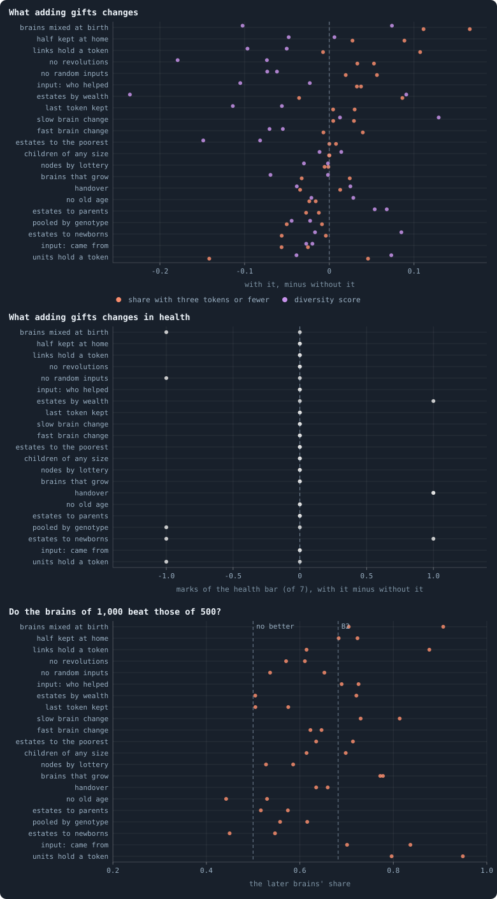

# Gifts, with every other rule

> [!question] Questions of this chapter
> - With gifts, an agent may hand tokens to its neighbours. What do gifts do
>   to a world, whatever its other rules?
> - Are gifts given much, to whom, and do they come back?

With [`allow_gifting`](../notes/settings.md#allow_gifting) an agent may, in
the reproduction phase, hand some of what its child left it to its
neighbours; with it here, as in batch S, unused links are cut after
reproduction once unused for an iteration, so that a gift can keep a link
alive ([Chapter 54](54-the-switches-the-world-was-built-with.md)). (These are
gifts an agent chooses to make — not the failed stakes that
[Chapter 58](58-gliders-and-who-helps-whom.md) calls gifts, which end up with
a node's holder.) In B2 alone, Chapter 54 found gifts changing nothing the
network shows, and the author asked for gifts combined with every other
mechanism (16 October 2026): batch T plays B2 with gifts together with each
of 21 other rules — and B1 with gifts, with revolutions and without — two
seeds each, 1,000 iterations, every world the fourth corner of a two-by-two
whose other corners are B2, B2 with gifts alone, and B2 with the other rule
alone.

## How much is given

In nine worlds of seed 1 the games were recorded over 200 iterations from
iteration 1,000 (`research/oee/checks/gifts.py`). **Gifts are small.** In a
game, 0.12% to 0.35% of the world's tokens change hands as gifts, given by
0.16% to 0.52% of the agents — except where the estate of the dead goes to
the newborns or the parents, where 1.2% and 1.6% of the tokens are given, by
1.1% and 1.6% of the agents. A gift is 1.2 to 2.2 tokens on average. Gifts run downhill,
64% to 87% of them from the richer of the two agents to the poorer; they go to
an agent of the giver's own genotype no more often than to anyone else (10%
to 35% of gift tokens, against 11% to 34% by chance); and they come back less
often than chance would have them (3% to 41% of gifts answered within ten
games, against 10% to 65%). Two thirds to nine tenths of gift tokens go
along links that carried no stake in the game before — links a gift may be
keeping alive.

## What gifts change

<!-- figure giftcombos/changes -->

**Each rule, with gifts and without.** Each row is one other rule. First: what adding gifts to a world of B2 with that rule changes (batch T), at iteration 1,000 — in orange, the share of the agents holding three tokens or fewer; in violet, the diversity score; a dot for each seed, 1 and 2. Then: what it changes in the marks of the health bar the world meets. Last: the share of a contested world the brains of 1,000 of the world with both rules hold after 100 iterations against those of 500, the mean of two contests, a dot for each seed; the dashed line marked B2 is the median of the lab's ten B2 worlds, played the same way.

> [!example]- How to make this figure
> **Runs.** Batch T's pilot worlds (B2 at 10,000 tokens, gifts and one other rule, seeds 1 and 2, `GraphOfLifeRuns/.pilots/T/`) and their controls: the same rule alone, from the batch or lab experiment that made it.
>
> **Data.** From each world's checkpoint at iteration 1,000 (`research/atlas/at.py --at 1000`, `GraphOfLifeRuns/.pilots/atlas/at1000.json`) and the contests in `GraphOfLifeRuns/.pilots/batch_TUV_T100.json` and `rejudge_T100.json`.
>
> 1. Read each world as `research/atlas/profile.py` reads every world.
> 2. Subtract the world with the rule alone from the world with both, seed by seed.
> 3. Seat the brains of the two eras on alternate agents of each era's world, play 100 iterations, and count the agents the later brains hold.
>
> **To make it again:** `python3 book_figures.py giftcombos`.
<!-- /figure -->

**For most rules, nothing much.** Over the 21 rules and two seeds, the median
change is +0.002 in the share of agents holding three tokens or fewer, −0.03
in the diversity score, no mark of the health bar, and about a hundred agents
more.

**With brains mixed at birth, gifts cost riches**: 11 and 17 more of every
hundred agents hold three tokens or fewer, and the worlds hold 710 and 540
agents more. A gift from a rich agent to a poor one is a little of what makes
a mixed world rich spread back out.

**Diversity falls a little with several rules** — most with the estate to the
poorest (by 0.08 and 0.15), no revolutions (0.18 and 0.07) and the last token
kept (0.11 and 0.06). And gifts add a mark where they meet handover, in both
seeds: a gift keeps alive some of the links handover thins.

**On B1, gifts fill a world without revolutions.** B1 without revolutions is
already a world of mayflies ([Chapter 54](54-the-switches-the-world-was-built-with.md));
with gifts as well it held 4,500 and 5,900 agents at iteration 1,000 instead
of 2,200 and 1,800, and 90% and 94% of them held three tokens or fewer,
instead of 43% and 32%. With revolutions, gifts went one way in one seed and
the other way in the other.

**Evolution goes on, but the speed gifts gave B2 does not carry over.** In B2
alone, gifts made the brains of 1,000 beat those of 500 more clearly than in
B2 itself (0.87 and 0.83 of a contested world, against 0.69 and 0.67). With
another rule as well, the later brains take more than half in 40 of the 42
worlds, but with a median of 0.64 — as in B2 (0.68), not as with gifts alone.
Fastest with units that hold a token (0.95 and 0.80) and with mixing (0.91 and
0.70); slowest with no old age (0.44 and 0.53) and with the estate to the
newborns (0.55 and 0.45). On B1, the later brains took 0.64 and 0.46 with
gifts and revolutions, and 0.89 and 0.08 with gifts and no revolutions.

## What it teaches

- **Gifts are a detail in B2's kind of world**: they move a few thousandths
  of the tokens a game, mostly to the poorer, and change little whatever else
  the rules are — as revolutions do ([Chapter 88](88-revolutions-with-every-other-rule.md)),
  and unlike handover ([Chapter 89](89-handover-with-every-other-rule.md)).
- **What gifts did to evolution alone, they do not do in company**: their
  speed-up of B2's evolution vanishes among the other rules.
- **Where births are cheap, gifts feed them**: with the estate paying for
  births they are given seven to nine times as much as in the median world,
  and in B1 without revolutions they fill the world with the poor.

**Related notes:** [Every setting](../notes/settings.md#allow_gifting) ·
[Chapter 54 · The switches the world was built with](54-the-switches-the-world-was-built-with.md) ·
[Chapter 58 · Gliders, and who helps whom](58-gliders-and-who-helps-whom.md) ·
[Chapter 82 · Brains mixed at birth, with every other rule](82-mixing-with-every-other-rule.md) ·
[Chapter 86 · Eight switches at once](86-eight-switches-at-once.md) ·
[Chapter 88 · Revolutions, with every other rule](88-revolutions-with-every-other-rule.md) ·
[Chapter 89 · Handover, with every other rule](89-handover-with-every-other-rule.md)

<!-- turns -->
---

← [Chapter 89 · Handover, with every other rule](89-handover-with-every-other-rule.md) · [Contents](../README.md) · [Chapter 98 · The search's best world, in new seeds](98-the-searchs-best-world-in-new-seeds.md) →
<!-- /turns -->
