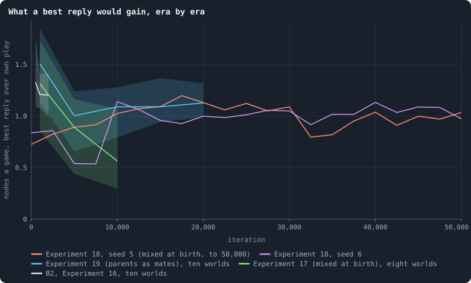
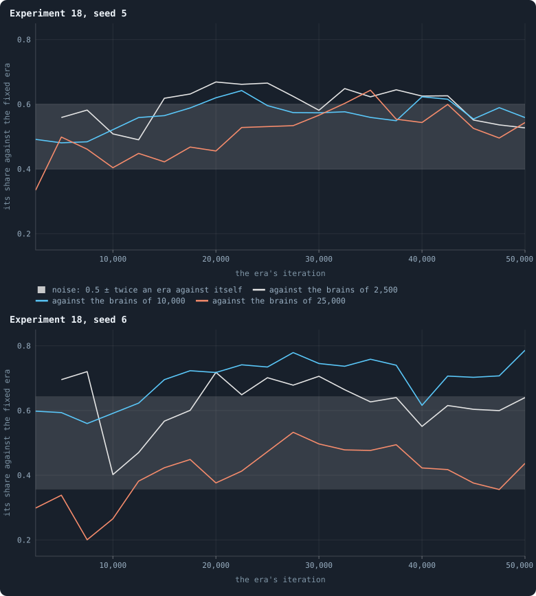
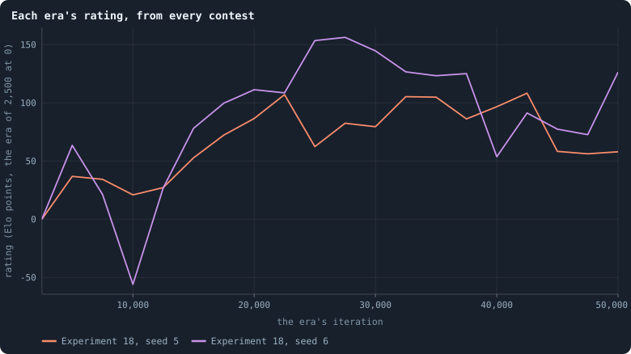

# Every era against three

> [!question] Questions of this chapter
> - In the longest worlds the book has, do later brains still get better at
>   the end, or had evolution stopped climbing?
> - Do later brains lose again to early ones, as they would if evolution
>   went round in circles?

<!-- experiment E28 -->

## Why ask

Every long world the book has played says the same thing in its contests:
later brains beat earlier ones, by less and less. In Experiment 18's two
longest worlds, brains mixed at birth and played to 50,000 iterations
([Chapter 81](81-five-mixed-worlds-fifty-thousand-iterations.md)), the
brains of 25,000 beat those of 10,000, and those of 50,000 then scored
0.54 and 0.42 against those of 25,000.

Contests between neighbours in time cannot tell three different stories
apart:
- **a plateau**, where evolution has stopped;
- **a slow climb**, where each step gains a little and many little steps add
  up;
- **a circle**, where each step beats the one before and loses to one long
  gone.

Rock, paper and scissors each beat the one before, for ever, and get
nowhere ([What would count as open-ended evolution](../notes/open-ended-test.md)).

Playing every era against the same few fixed eras tells the three apart:
- **On a plateau**, the scores against a fixed era stop rising.
- **On a slow climb**, they keep rising, however little each step gained.
- **In a circle**, they rise and fall again as the eras go round.

This experiment plays every 2,500th era of the two worlds against three
fixed ones: 2,500, 10,000 and 25,000.

## How much room is left

One thing can be measured before any contest: how far each era's play is
from an equilibrium. At an equilibrium no agent could do better by playing
differently while the rest keep their play. So the distance is how much an
agent *would* gain by its best reply to the others, its **exploitability**
([Chapter 50](50-why-evolution-stops.md)). A population that evolution
drives towards a top becomes less exploitable era after era.

<!-- figure eras/room -->

**What a best reply would gain, era by era.** Each line is a family of long worlds: for a sample of up to 300 agents of each world holding three tokens or more, the nodes it would hold after one game by its best reply to the others' play, less what its own play holds, averaged. A shaded band, where a family has several worlds, runs from its lowest world to its highest; the line is the median. A population at an equilibrium would score 0.

> [!example]- How to make this figure
> **Runs.** The lab's long worlds: Experiment 18's two worlds played to 50,000 iterations (`B2-10000-4af4a3-s005`, `-s006`, every 2,500), Experiment 19's ten to 20,000 (`B2-10000-bcc1bc-s001` … `-s010`), Experiment 17's to 10,000 (`B2-10000-4af4a3-s001` … `-s010` but the two above) and Experiment 16's B2 worlds to 2,000 (`B2-10000-s001` … `-s010`), at the iterations their archives keep.
>
> **Data.** From the worlds the archives keep.
>
> 1. Load the world at the iteration and play one game, so its messages are fresh.
> 2. Draw the random inputs 8 times and turn every brain's outputs into stakes as the engine does: the others' play, as 8 draws.
> 3. For up to 300 agents with three tokens or more, score its own play and the best of a set of replies (everything home; the cheapest way to keep its node and take the cheapest neighbours; taking without defending) by the nodes it holds after the game, averaged over the 8 draws (`python3 research/oee/checks/exploitability.py RUN:ITERATION … --draws 8 --sample 300`).
> 4. The gain is the best reply's score less the own play's, averaged over the agents.
>
> **To make it again:** `python3 book_figures.py eras`.
<!-- /figure -->

**No long world closes in on an equilibrium.**
- **A best reply gains about a node a game.** At every era of every long
  world, an agent's best reply to the rest would hold about one node more
  after a game than its own play does: 1.0 to 1.1 in Experiment 19's ten
  worlds from 5,000 to 20,000 iterations, and about 1 in both of
  Experiment 18's worlds from 10,000 to 50,000.
- **The room does not shrink with time.** It is no smaller at 50,000 than
  at 10,000.
- **Where it was smaller, the world was.** Experiment 17's worlds fell from
  1.3 to 0.6 between 1,000 and 10,000 as they shrank, to a median of 620
  agents. Experiment 18's world of seed 6 read 0.5 at 5,000 and 7,500, when
  it held 300 to 400 agents. A small world has less to take.

So evolution in these worlds is not approaching a top that would leave
nothing to gain. Better play lies a single step away from every agent, at
every era. Whether later brains still find any of it is the contests'
question.

The best reply here is the best of a few simple replies (everything home,
or the cheapest way to hold one's node and take the cheapest neighbours).
It is scored over eight draws of the others' play, so it does not need to
know which draw comes. The true best reply can only gain more.

## The thesis

<!-- thesis E28 -->
> [!quote] The thesis of Experiment 28, written down before any of its runs existed
> **The claim.** Evolution in Experiment 18's two longest worlds had stopped climbing by iteration 25,000. Against the brains of 25,000, the brains of the ten eras after it (27,500 to 50,000) do no better than a contest's own noise: their median score lies within the band an era scores against itself. Against the brains of 2,500, every era from 5,000 on still wins, beyond that band.
>
> **Why it would be so.** The two worlds' own contests (Chapter 81), 100 iterations each on both eras' worlds with two coins: in seed 5 the brains of 25,000 scored a median of 0.56 against those of 10,000, and those of 50,000 scored 0.54 against those of 25,000; in seed 6, 0.72 and then 0.42. Later brains beat earlier ones by less and less in every long world the book has played (Chapter 92; Experiment 19, 0.78 falling to 0.55). If the game these brains play still had room within their reach, the eras after 25,000 would pull ahead of 25,000 as the eras before it pulled ahead of 2,500.
>
> **It holds if:** In both worlds the median score of the eras 27,500 to 50,000 against 25,000 (each era's score the mean of its two contests) lies within the noise band, 0.5 plus or minus twice the standard deviation of the world's twelve contests of an era against itself (2,500, 10,000 and 25,000, four coins each); and every era from 5,000 to 50,000 scores above that band against 2,500.
>
> **It fails if:** In either world the median score of the eras 27,500 to 50,000 against 25,000 lies above the band (evolution was still climbing) or below it (it went back), or some era from 5,000 on fails to score above the band against 2,500.
<!-- /thesis -->

## The trials

Each contest is the book's lifetime contest
([Chapter 46](46-how-to-tell-a-world-that-keeps-evolving.md)):
- The world of one era is given brains drawn by coin from two eras.
- Every mutation is off, so no brain changes and every copy keeps its era.
- The world plays 100 iterations, and the later era's share of the agents
  is its score.

Every pair is played twice, once on each era's world. Each fixed era also
plays against itself four times. A score that differs from 0.5 by less than
those self-contests do is noise.

<!-- runs E28 -->
> [!info] The trials behind this chapter
> **240 trials**, contests: the world of one era, its agents given brains drawn by coin from two eras, every mutation off, and the later era's share of the agents counted at the end; each plays 100 iterations, from a world another run kept in its archive.
>
> - **against 2,500** — 76 trials: worlds `B2-10000-4af4a3-s005`, `B2-10000-4af4a3-s006`; eras 2,500 to 50,000, every 2,500; coins 17.
> - **against 10,000** — 72 trials: worlds `B2-10000-4af4a3-s005`, `B2-10000-4af4a3-s006`; eras 5,000 to 50,000, every 2,500; coins 17.
> - **against 25,000** — 68 trials: worlds `B2-10000-4af4a3-s005`, `B2-10000-4af4a3-s006`; eras 5,000, 7,500, 12,500, 15,000, 17,500, 20,000, 22,500, 25,000, 27,500, 30,000, 32,500, 35,000, 37,500, 40,000, 42,500, 45,000, 47,500, 50,000; coins 17.
> - **each against itself** — 24 trials: worlds `B2-10000-4af4a3-s005`, `B2-10000-4af4a3-s006`; eras 2,500, 10,000, 25,000; coins 17, 18, 19, 20.
>
> To play these trials again: `python3 gol_lab.py run E28`, or ▶ in the Book tab of a computer running `gol_server.py`. Each writes its settings and engine beside its result, in `GraphOfLifeRuns/<trial>/meta.json` and `result.json`.
<!-- /runs -->

## What the contests said

<!-- figure eras/scores -->

**Every era against three fixed eras.** Each line is one fixed era: the share every other era's brains held against its brains, the mean of two contests of 100 iterations, one on each era's world. The grey band is 0.5 plus or minus twice the spread of the fixed eras played against themselves: a score inside it could be noise.

> [!example]- How to make this figure
> **Runs.** Experiment 28's 240 contests (`python3 gol_lab.py run E28`): every 2,500th era of Experiment 18's two worlds played to 50,000 iterations (`B2-10000-4af4a3-s005`, `-s006`) against the eras of 2,500, 10,000 and 25,000, each pair once on each era's world (coin 17), and each of those three eras against itself four times (coins 17 to 20).
>
> **Data.** From each trial's `result.json`.
>
> 1. For each pair of eras, the later era's share of the agents after 100 iterations, the mean of its two contests; an earlier era's score against a later one is 1 less that.
> 2. The band: the standard deviation of the twelve contests of an era against itself, twice on either side of 0.5.
>
> **To make it again:** `python3 book_figures.py eras`.
<!-- /figure -->

**Climbing stopped by about 25,000, in both worlds.** Against the brains of
25,000, the ten eras after it scored a median of 0.55 in seed 5 and 0.46 in
seed 6. Both lie inside their world's noise band, 0.40 to 0.60 and 0.36 to
0.64. Later brains did not pull ahead of the brains of 25,000 as those had
pulled ahead of the brains of 2,500.

<!-- figure eras/ratings -->

**Each era's rating, from every contest.** One rating per era and world, fitted to every contest of that world by least squares on the log-odds of the scores (Bradley–Terry): +100 means the era's brains beat the brains of 2,500 about 64 times in a hundred.

> [!example]- How to make this figure
> **Runs.** Experiment 28's 240 contests (`python3 gol_lab.py run E28`): every 2,500th era of Experiment 18's two worlds played to 50,000 iterations (`B2-10000-4af4a3-s005`, `-s006`) against the eras of 2,500, 10,000 and 25,000, each pair once on each era's world (coin 17), and each of those three eras against itself four times (coins 17 to 20).
>
> **Data.** From each trial's `result.json`.
>
> 1. For each pair of eras, the mean share of the later era over its two contests.
> 2. Fit one rating per era so that the log-odds of every score is the difference of the two ratings, the era of 2,500 at 0 (`gol_tournament.ratings`); shown in Elo points.
>
> **To make it again:** `python3 book_figures.py eras`.
<!-- /figure -->

The ratings, fitted to every contest of a world, say the same.
- **Seed 5** rose from 0 at 2,500 to about +105 Elo points at 22,500. From
  30,000 to 50,000 it wandered between +55 and +110.
- **Seed 6** rose to +155 at 25,000 and 27,500, then wandered between +55
  and +145.

Neither world's brains of 50,000 are better than its best brains of 20,000
to 30,000.

**Not every era beat the brains of 2,500.**
- **Seed 5:** 11 of the 19 eras from 5,000 on scored above the noise band
  against them. The eras of 5,000 to 12,500 did not (0.49 to 0.58), nor did
  30,000 (0.58), nor the last three (0.53 to 0.55).
- **Seed 6:** 8 of 19. Its world shrank to 273 and 394 agents around
  iterations 5,000 to 7,500. The brains that came out of that, at 10,000,
  scored 0.40 against the brains of 2,500, worse than their ancestors.
  Evolution there went back before it went on.

**Seed 5 went round; seed 6 went back.**
- **Seed 5 went round.** The eras after 25,000 beat the brains of 25,000
  (0.55), and those had beaten the brains of 2,500 (0.67). Chained, the two
  predict how the later eras should do against 2,500. They did worse in all
  ten eras, by 0.12 on average. They gained against the play of 25,000 and
  lost part of what that play had over the old one: a step round a circle,
  not up a ladder.
- **Seed 6 went back.** Its eras after 25,000 lost a little to the brains of
  25,000 (0.46) and won less against 2,500 (a median of 0.64, against 0.70
  for the brains of 25,000). There the chain holds, 0.02 off.

**The noise is wide.** Each fixed era played against itself spread its
scores with a standard deviation of 0.05 in seed 5 and 0.07 in seed 6, so
the band is 0.10 and 0.14 either side of 0.5. An era's score here is the
mean of two contests, and a contest of 100 iterations is short. The next
contests will play each pair with more coins.

## The verdict

**The thesis fails.** Its first part holds: in both worlds the eras after
25,000 do no better than noise against the brains of 25,000. Its second
part does not: not every era from 5,000 on beats the brains of 2,500 beyond
the noise. In seed 5, 8 of 19 failed; in seed 6, 11 of 19.

What the contests show is more than a plateau. Evolution climbed for about
20,000 to 25,000 iterations. Then it stopped climbing and wandered: back a
little in one world, round a circle in the other.

## What it teaches

- **A plateau that is not a top.** The ratings stop rising by 25,000, yet a
  best reply would still gain about a node a game at every era. Better play
  is there and is not found, which is what a valley between the play
  evolution has and better play would do
  ([Chapter 51](51-strategies-written-by-hand.md),
  [Chapter 94](94-what-a-brain-can-compute.md)).
- **A chain of contests hides circles.** Contests between neighbours in time
  ([Chapter 81](81-five-mixed-worlds-fifty-thousand-iterations.md)) said
  later brains win by less and less. Fixed eras show that later brains can
  win against their parents and still lose ground against their ancestors.
  The test of open-ended evolution asks for wins against the best mix of
  all the past for that reason
  ([What would count as open-ended evolution](../notes/open-ended-test.md)).
- **What comes next.** A world that is to keep climbing needs a way across
  the valley: a crowd for a new strategy to start from
  ([Chapter 96](96-how-large-a-crowd-a-raider-needs.md)), or a rule that
  makes the better play reachable in small steps.

<!-- turns -->
---

← [Chapter 94 · What a brain can compute](94-what-a-brain-can-compute.md) · [Contents](../README.md) · [Chapter 96 · How large a crowd a raider needs](96-how-large-a-crowd-a-raider-needs.md) →
<!-- /turns -->
