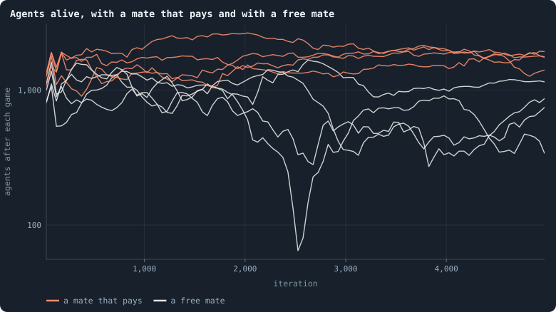

# A mate that pays its share

> [!question] Questions of this chapter
> - When brains are mixed at birth, does a mate that pays for the child hold
>   a world's size steadier?
> - Does the lab play the pilots stopped on 18 October as they went?

<!-- experiment E22 -->

## Why ask

Brains mixed at birth make worlds rich and diverse and then let them drift:
- their size wanders;
- many shrink to a few hundred agents;
- some die out
  ([Chapter 81](five-mixed-worlds-fifty-thousand-iterations.md)).

[Meta XI](what-holds-a-worlds-size.md) traced it to the price of
a child. A world's size is set by how eagerly its agents breed, and in a
mixed world being a mate is free. An agent that never breeds still spreads
half its brain through other agents' children.

Meta XI proposed two ways to end the free ride:
- **Mates only among the parents.** In
  [Experiment 19](mixed-at-birth-with-parents-as-mates.md) every world
  lived and held about 2,000 agents.
- **A mate that pays its share**, the rule this chapter tests. The mate
  gives the child as many tokens as the parent does, as far as it can and
  never its last. A child that two pay for is cheaper to each, which pushes
  the other way.

The second was played in four pilot worlds (batch MPay). They were stopped
at iterations 1,000 and 1,500 when the computer was restarted on 18 October
2026. The lab now plays the prototype's rules itself, so it starts them
again from the beginning, and the first two should be the pilots' worlds
again, game for game.

## The thesis

<!-- thesis E22 -->
> [!quote] The thesis of Experiment 22, written down before any of its runs existed
> **The claim.** A mate that pays its share holds a mixed world's size more steadily. In four worlds of B2 with brains mixed at birth, where the mate pays the child as many tokens as the parent gives, as far as it can and never its last, the spread of the logarithm of the number of agents from iteration 500 to 5,000 is smaller than in Experiment 17's world of the same seed, where the mate pays nothing, in at least three of the four, and no world falls to 20 agents. And the lab plays the two pilots of this rule that were stopped on 18 October 2026 as they went, game for game, as far as they got.
>
> **Why it would be so.** A mixed world's size drifts, because being a mate is free: an agent that never breeds still spreads half its brain through other agents' children, and how eagerly agents breed sets a world's size (Meta XI). A mate that pays ends the free ride, though a child that two pay for is cheaper to each, which pushes the other way. Meta XI proposed it and nothing tested it: its pilots (batch MPay) were stopped at iterations 1,000 and 1,500 when the computer was restarted. Mates among the parents only, the other way to end the free ride, held four pilot worlds steadier than Experiment 17's and kept all ten worlds of Experiment 19 alive.
>
> **It holds if:** In at least three of the four seeds the standard deviation of the logarithm of the agents after each game, from 500 to 5,000, is below that of Experiment 17's world of the same seed; no world falls to 20 agents or fewer; and the worlds of seeds 1 and 2 match the pilots' agents and links after every game to 1,000 and 1,500.
>
> **It fails if:** Two or fewer are steadier than their Experiment 17 world, a world falls to 20 agents or fewer, or a world differs from its pilot.
<!-- /thesis -->

## The runs

<!-- runs E22 -->
> [!info] The runs behind this chapter
> **4 runs.** Every condition below is run once for every seed (1 to 4), for 5,000 iterations — or until its world dies out. Every setting is that of the baseline **B2** (a world that cannot break) unless the condition changes it.
>
> - **mixed at birth, the mate pays** — changes `mix_at_birth` = on, `extinction_threshold` = 0, `proto` = mate_pays; 10,000 tokens. Runs `B2-10000-8ff8c5-s001` … `B2-10000-8ff8c5-s004`.
>
> To make these runs again: `python3 gol_lab.py run E22`, or ▶ in the Book tab of a computer running `gol_server.py`. Each run writes its settings, seed and engine version beside its frames, in `GraphOfLifeRuns/<run>/meta.json` and `provenance.json`.
>
> Runs that ask for the pilots' rules are played by the research prototype, frozen beside the engine (`gol_pilot.py`): they keep no frames, but one row of the world's statistics every iteration (`series.jsonl`) and a whole world at every checkpoint.

> [!info]- Every setting of these runs
> | setting | mixed at birth, the mate pays | what it is |
> |---|---|---|
> | [`total_tokens`](settings.md#total_tokens) | 10,000 | The number of tokens in the world, *T*. It never changes during a run. |
> | [`n_nodes`](settings.md#n_nodes) | 0 | How many founders the world starts with. 0 means one founder per hundred tokens: *n* = ⌊*T* / 100⌋. |
> | [`k_neighbors`](settings.md#k_neighbors) | 0 | How many neighbours each founder starts with in the ring. 0 means *k* = max(⌊*n* / 100⌋, 5); an odd *k* is wired as *k* − 1. |
> | [`rewire_p`](settings.md#rewire_p) | 0.2 | In the starting ring, the probability that a connection is moved to a founder chosen at random (Watts–Strogatz). |
> | [`hidden_layers`](settings.md#hidden_layers) | 16 | The widths of the brain's hidden layers, in order from input to output. |
> | [`brain_kind`](settings.md#brain_kind) | float16 | How weights are stored: `float` (64-bit), `float16` (16-bit, computed in 64-bit) or `binary` (−1, 0, +1). |
> | [`brain_bits`](settings.md#brain_bits) | 16 | Only for binary brains: how many input rows encode one number. Unused by float and float16 brains. |
> | [`message_amount`](settings.md#message_amount) | 8 | How many numbers one message holds. Each agent sends one message to itself and one to each neighbour, every phase. |
> | [`random_input_amount`](settings.md#random_input_amount) | 5 | How many random numbers, drawn uniformly from −2 to 2, a brain reads per neighbour, every time it looks. |
> | [`exchange_messages`](settings.md#exchange_messages) | on | Whether agents send and read messages at all. |
> | [`message_prepass`](settings.md#message_prepass) | off | Whether every phase begins with an extra look in which agents only write messages, so the look that acts reads messages written this phase. |
> | [`allow_handover`](settings.md#allow_handover) | off | Whether a parent may move some of its own connections to its newborn child. |
> | [`allow_revolutions`](settings.md#allow_revolutions) | on | Whether a coalition of smaller stakers can take a node from its largest staker (see the note *How a coalition takes a node*). |
> | [`allow_gifting`](settings.md#allow_gifting) | off | Whether agents may give tokens to neighbours during reproduction. Off in every run of this book. |
> | [`random_decisions`](settings.md#random_decisions) | off | The control: every number a brain would produce is replaced by a random draw from the standard normal distribution. |
> | [`prune_after`](settings.md#prune_after) | blotto | After which phase connections that carried no tokens are cut: `blotto` (the game), `reproduction`, or `both`. |
> | [`inactive_window`](settings.md#inactive_window) | phase | How long a connection may go unused: `phase` means it must carry tokens in the phase being judged; `iteration` allows the two last phases. |
> | [`redistribution`](settings.md#redistribution) | uniform | How the tokens of removed agents are shared: `uniform` gives every survivor the same chance at each token; `by_tokens` weights by what a survivor holds; `poorest` raises the poorest to one common level first; `newborns` gives them to this iteration's children, `parents` to their parents, once per child (both `uniform` in an iteration without births); `children` leaves each dead agent's estate to its own living children (`uniform` where there are none). |
> | [`tokens_created_per_phase`](settings.md#tokens_created_per_phase) | 0 | Tokens added to the world at every cleanup. 0 keeps the supply fixed. |
> | [`mutate_on_replication`](settings.md#mutate_on_replication) | on | Whether a brain changes only when it is copied — into a newborn, or into a node its owner has just won — instead of also after every game, wherever it sits. |
> | [`incumbency`](settings.md#incumbency) | 1.5 | How many times over an agent's stake on its own node counts when the game decides who takes the node. 1 is the old rule. |
> | [`birth_links`](settings.md#birth_links) | 2 | How many of its parent's neighbours a newborn is joined to, drawn at random, besides its parent itself; 0 leaves every link to the brain's choice. |
> | [`mend_on_death`](settings.md#mend_on_death) | on | Whether the neighbours of an agent that dies are joined up where its death would leave them in separate pieces. |
> | [`prune_needs`](settings.md#prune_needs) | 2 | How many neighbours the two ends of an unused connection must share for it to be cut; 0 cuts every unused connection. |
> | [`valence`](settings.md#valence) | 8 | The most connections an agent's brain may choose to hold (0 = no limit). An agent at its limit cannot have a child. |
> | [`keep_home`](settings.md#keep_home) | 0.3 | The share of an agent's tokens — rounded up, never less than one — that stays on its own node whatever its brain says; a parent also keeps one. 0 is the old rule. |
> | [`max_age`](settings.md#max_age) | 100 | The age at which an agent dies (0 = never); its tokens are shared out like those of any other dead agent. |
> | [`buy_life`](settings.md#buy_life) | off | Whether an agent that has reached max_age may live on by paying one token an iteration into the estate of the dead — never its last, so one with a single token left dies. Needs max_age. |
> | [`min_child`](settings.md#min_child) | 10 | The fewest tokens a child can be born with; a parent that would give less has no child. |
> | [`child_floor`](settings.md#child_floor) | fixed | The least a child may start with: min_child alone (fixed), or also the median holding of its parent's neighbours (neighbours), so that a world grows only as rich as it is. |
> | [`mix_at_birth`](settings.md#mix_at_birth) | **on** | Whether a newborn's brain is its parent's mixed with a mate's — one of the parent's neighbours, drawn at random — each hidden unit whole from one or the other by an even chance, before it mutates; off, a newborn has a copy of its parent's brain. |
> | [`mix_mates`](settings.md#mix_mates) | any | Under mix_at_birth, who may be the mate: any neighbour of the parent, or only parents — a neighbour with a living child of its own (with none, the newborn's brain is a copy). |
> | [`self_message`](settings.md#self_message) | own | What an agent writes to itself, which each neighbour reads: what its own column says (own), or the largest, number by number, of what it writes to anyone (largest), so that news one column marks reaches every neighbour. |
> | [`link_search`](settings.md#link_search) | off | Whether an agent may reach beyond its neighbours to propose a link: off; jump, a walk as many steps long as the tokens it spends in one iteration, with a link proposed where it ends; walk, a scout that goes one step further in every iteration it pays for; or reach, a jump whose steps are free, as many as the tokens it holds would pay for. A paid step costs one token, paid to the agent it enters, and never the last. |
> | [`link_steering`](settings.md#link_steering) | random | Which way each step of a search goes: to a neighbour drawn at random, or to the one the searcher would most like a link with (looking). |
> | [`link_consent`](settings.md#link_consent) | mutual | Who has to agree to a link a search proposes: both ends (mutual), or only the one who proposes (forced). Nobody at its valence gets a new link either way. |
> | [`proto`](settings.md#proto) | **mate_pays** | Rules first played in the pilots' prototype, by name: came_from and helped_by (an input row each), contest = lottery, pool by genotype or family, kin_sense, tag_rate, mate_pays, grow, unit_token, link_token. Empty in every run but those that ask for one; only the prototype's world plays them (see the settings note). |
> | [`mutation_probability`](settings.md#mutation_probability) | 0.2 | The probability that a brain changes when it is copied to a child, and again, for every brain, after every game. |
> | [`mutation_noise_std`](settings.md#mutation_noise_std) | 0.2 | How large a change to one weight is: a normal draw with standard deviation this times 1/√(fan-in) of its layer. |
> | [`mutation_sparsity`](settings.md#mutation_sparsity) | 0.1 | The share of a brain's numbers a change touches; also the probability, for each weight matrix and bias vector, of a rarer reset that redraws that share of it. |
> | [`extinction_threshold`](settings.md#extinction_threshold) | **0** | A run stops, as extinct, when an iteration ends (after its game) with this many agents or fewer. |
> | seeds | 1 to 4 | one run per seed |
> | iterations | 5,000 | how far each run goes, unless its world dies first |
>
> A value in **bold** differs from the baseline B2.
<!-- /runs -->

## What the worlds did

**The lab plays the stopped pilots as they went.** The worlds of seeds 1
and 2 matched the pilots' agents and links after every game, as far as the
pilots had gone: 1,311 and 1,719 iterations.

<!-- figure matepays/sizes -->

**Agents alive, with a mate that pays and with a free mate.** Each line is one world, its agents after each game in means over 50 iterations, on a logarithmic axis. Orange: brains mixed at birth with a mate that pays the child as much as the parent (seeds 1 to 4); grey: Experiment 17's worlds of the same seeds, whose mates pay nothing.

> [!example]- How to make this figure
> **Runs.** Experiment 22's four runs (`python3 gol_lab.py run E22`): B2 at 10,000 tokens with brains mixed at birth and the pilots' rule `mate_pays`, seeds 1 to 4, to 5,000 iterations, played by the research prototype in the lab (`B2-10000-8ff8c5-s001` … `-s004`); against Experiment 17's runs of the same seeds (`B2-10000-4af4a3-s001` … `-s004`), mixing with a mate that pays nothing.
>
> **Data.** From the pilots' `series.jsonl` and the lab runs' `stats.jsonl`.
>
> 1. Read the agents after each game: a pilot's row of each iteration, a lab run's row of phase 2.
> 2. Average over stretches of 50 iterations.
>
> **To make it again:** `python3 book_figures.py matepays`.
<!-- /figure -->

**A mate that pays holds a mixed world's size.** From iteration 500 to
5,000:

| seed | spread of the logarithm of the agents, paying mate | free mate | fewest agents, paying mate | free mate |
|---|---|---|---|---|
| 1 | 0.12 | 0.19 | 1,685 | 648 |
| 2 | 0.09 | 0.34 | 1,414 | 245 |
| 3 | 0.16 | 0.63 | 1,127 | 40 |
| 4 | 0.12 | 0.47 | 1,012 | 316 |

Every world with a paying mate was steadier than Experiment 17's world of
the same seed, and none came near dying out. Their medians were 1,394 to
2,048 agents, where the free mates' worlds wandered between 40 and 1,700
around medians of 586 to 1,051.

**Healthy and diverse, but folded.** At 5,000 iterations, read as every
world is read:
- **Marks:** six or seven of the health bar.
- **Diversity:** scores of 0.52 to 0.64 against B2's median at 5,000 of
  0.49.
- **Width:** 1.16 to 1.28 times their twins. These are folded small worlds,
  as Experiment 19's are.
- **Evenness:** Ginis of 0.43 to 0.48, about as even as B2's least even
  world (0.46).

## The verdict

**The thesis holds.**
- All four worlds were steadier than their Experiment 17 world.
- None fell to 20 agents.
- The lab's worlds of seeds 1 and 2 are the stopped pilots, game for game.

## What it teaches

- **A mate that pays is the second rule that steadies a mixed world**,
  beside mates among the parents
  ([Experiment 19](mixed-at-birth-with-parents-as-mates.md)). Meta XI
  traced the drift of a mixed world's size to a free ride: a mate passes
  half its brain into a child it pays nothing for. Both ways of ending the
  free ride steady the world. The free ride was the cause.
- **A child that two pay for is cheaper to each, and the world fills
  more.** The paying mates' worlds held more agents than the free mates'
  worlds of the same seeds. So paying for a child raises how many
  children there are; it does not lower it.
- **Steady is not yet a space.** Like Experiment 19's, these worlds are
  folded. Room is the one thing the steadiest mixed worlds still lack
  ([Chapter 100](room-for-the-steadiest-world.md)).

<!-- turns -->
---

← [Mixed at birth, with parents as mates](mixed-at-birth-with-parents-as-mates.md) · [Looking for a healthy, rich world](../README.md#looking-for-a-healthy-rich-world) · [The candidates, played on](the-candidates-played-on.md) →
<!-- /turns -->
