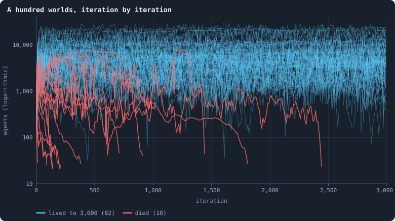

# A screen of random worlds

> [!question] Questions of this page
> - Is there a combination of the notebook's rules that makes a [healthy world](measuring-health.md#the-definition-in-force-health-of-9-november-2026 "A world scored high by health as the author defined it on 9 November 2026: six criteria from fifteen measures, each against round 3's living worlds. Since 11 November health only filters."): a
>   resilient, decentralised network of about three [dimensions](measuring-space.md#three-ways-to-measure-a-networks-dimension "How fast the number of agents within a distance grows with the distance: as its square in a plane, its cube in space."), whose [agents](the-world.md#agents-and-tokens "One member of a world: it lives on a node of the network, holds tokens and has a brain that takes all its decisions.")
>   differ in almost everything?
> - Which rules make a world unhealthy wherever they appear, so that they can
>   be set aside?

## In short

Instead of changing B2 one rule at a time, the screen draws worlds with every
setting at random, as biologists screen random mutants. Round 1 (Experiment 38)
drew fifty worlds from an older list of settings, and found no healthy world
among them and one interesting one. Round 2 (Experiment 39) was withdrawn
unplayed. Round 3 draws a hundred worlds from the author's settings (Experiment
40), to be looked at as if no world had been seen before. Sixteen of them make
way for eight worlds played twice, their stakes placed a [token](the-world.md#agents-and-tokens "The one thing of value in a world: every agent holds a whole number of them, and their total never changes.") at a time
(Experiments 41 and 42). Of the hundred, 82 lived through their 3,000
iterations and 18 died, in four ways. The pages of round 3 read the living:
which are healthy, what each setting does, and which are candidates for
[open-ended evolution](measuring-evolution.md#what-would-count-as-open-ended-evolution "Evolution that keeps producing new things without end, not only up to a plateau.").

## Why draw worlds at random

Picture a machine with thirty knobs and switches. You want it to make one
particular thing. But each time you turn a single knob, one fault goes away
and another appears. You could go on turning one knob at a time. Or you could
set all thirty at random, many times over, and learn which positions never
make anything good.

That is where the notebook's search for a healthy world stood in October
2026. Every healthy-looking world so far had been found by changing one rule
of B2 at a time, and each paid for one quality with another:
- the [estates](measuring-lives.md#the-estate-of-the-dead "The tokens a dead agent leaves, and who gets them.") of the dead make spaces of paupers;
- mixed [brains](the-brain.md "The neural network each agent decides with: inputs about itself and its neighbours, outputs that become its decisions.") make rich worlds that fold;
- worlds without mending can be cut
  ([Room for the steadiest world](building-b2-and-the-search-for-a-healthy-rich-world.md#room-for-the-steadiest-world)
  and
  [Births as rich as the neighbours](building-b2-and-the-search-for-a-healthy-rich-world.md#births-as-rich-as-the-neighbours)).

The settings decide what grows, and one at a time is slow. The screen draws
30 settings, which take 92 values between them. Those combine into some 25
million million different worlds: far too many to try one by one.

So this page follows the author's plan of 22 October 2026: a **screen**, as
biologists screen many random mutants for a trait instead of changing one
gene at a time. A round is fifty worlds whose settings are all drawn at
random, each judged for health. After each round, every value that came only
with dead or dull worlds is set aside. The next fifty are drawn from the
values left. Rounds go on until some combination of settings makes a healthy
world. Only then are strategies tested in it: hand-written ones, and the
growth of groups ([Strategies written by hand](strategies-written-by-hand.md)).

## How a world's settings are drawn

Each world is dealt its settings like a hand of cards. For every setting the
sampler, `gol_screen.py`, draws afresh, by a rule that depends only on the kind
of setting. It starts from B1's rules and changes what the draw says. An on/off
rule is on in some of the worlds, and a choice takes each of its options
equally often. A number keeps its default or takes one of a few levels. A
setting that can matter only beside another is drawn only there, so two draws
never make one world under two names. Rounds 1 and 2 used the first sampler,
and round 3 the second, with the author's choices ([Round 3: the author's
settings](#round-3-the-authors-settings)). The box of each round's worlds lists
every world's settings: round 3's under [How this was made](#how-this-was-made),
rounds 1 and 2's in the Archive
([How this was made](rounds-1-and-2-of-the-screen.md#how-this-was-made)).

## Round 1

Round 1 (Experiment 38), planned on 22 October 2026, drew fifty worlds of B1's
rules, changed as the first sampler drew 30 settings. They had 20,000 tokens
and played 2,000 iterations, with two worlds of B2 beside them. Each world was
judged at iteration 2,000 by six criteria: alive, decentralised, resilient,
almost three-dimensional, diverse and not too even ([The criteria of rounds 1
and 2](rounds-1-and-2-of-the-screen.md#the-criteria-of-rounds-1-and-2)). The thesis asked
for one healthy world in fifty, and there was none, so it is refuted. Of the
fifty, 24 died out, and one, world 22, was interesting: it missed only one
criterion, being folded. The worlds met the two walls the notebook knew: mended
worlds are whole but folded, and the worlds that stay spaces break or are poor.
The rule for setting values aside would have rested on that one world, so the
author set nothing aside. Its thesis, its runs and the criteria it was judged
by are in the Archive
([Rounds 1 and 2 of the screen](rounds-1-and-2-of-the-screen.md#round-1)).

## Round 2

Round 2 (Experiment 39), round 1's plan again with a new round [seed](rules-in-detail.md#seeds-and-the-random-stream "The number that fixes every random choice of a run: the same settings and the same seed make the same world."), was
withdrawn unplayed on 24 October 2026, when the author went through every
setting and criterion again. Its plan and thesis are in the Archive
([Round 2](rounds-1-and-2-of-the-screen.md#round-2)).

## Round 3: the author's settings

<!-- experiment E40 -->

On 24 October 2026 the author went through every setting a run can take, one
after the other, and decided how random worlds should use each
(`research/screen/walkthrough.md`). The rules get simpler, and the brains
decide more:

- **Brains** have three to five hidden layers of 16, 32 or 50 units, on tanh,
  which lets a change through deep brains
  ([`hidden_activation`](settings.md#hidden_activation)).
- **Nothing a brain could learn is given by rule.** There is no home
  advantage, nothing kept at home, no smallest child above one token, no
  links given at birth and no old age. Every link no stake crossed lapses
  after the game.
- **Links cost.** Every link may hold a token
  ([`link_token`](settings.md#link_token)), and each brain may pay to keep its
  links ([`link_upkeep`](settings.md#link_upkeep)), each in some of the
  worlds. The cap on links ([`valence`](settings.md#valence)) is off in three
  worlds of four.
- **New games and estates** are drawn too: the lottery
  ([`contest`](settings.md#contest)), and an estate that flows to the nearest
  of the living ([`redistribution`](settings.md#redistribution)).
- **Mixing at birth** comes in one world of three, always with parents as
  mates, and in half of those worlds the mate pays.

A hundred worlds are drawn (sampler 2, round seed 3). Each has 30,000 tokens
and plays 3,000 iterations, with [founders](rules-in-detail.md#the-starting-ring "One of the agents a world starts with, each holding the same tokens, on a ring with a few shortcuts.") of 50, 100 or 200 tokens each. No
reference worlds are played beside them, and no world is stopped for being
slow. Every [frame](runs-and-records.md#what-a-run-records "A whole world as a run records it after one phase: every agent, its tokens and connections.") is kept, and the whole world every 250 iterations.

### Looked at as if for the first time

The round makes no prediction. In the author's words: "we just look at them,
as we have not seen any simulation before. But we use already established
analysis methods to analyse them and search for things we want to see."
Every measure is then an average over iterations 100 to 3,000, not a reading
at one moment, with the looser lines the author set. What makes a world
interesting is decided together once the round has run.

<!-- thesis E40 -->
> [!quote] The thesis of Experiment 40, written down before any of its runs existed
> **The claim.** This round makes no prediction. A hundred worlds are drawn from the settings the author chose on 24 October 2026, setting by setting (research/screen/walkthrough.md), and looked at as if no world had been seen before.
>
> **Why it would be so.** The author: "No control simulations. 100 simulations. We just look at them, as we have not seen any simulation before. But we use already established analysis methods to analyse them and search for things we want to see." What makes a world interesting is to be defined together with the author once the round has run.
>
> **It holds if:** Nothing confirms a survey. Every world is read by the notebook's measures, each averaged over iterations 100 to 3,000, and the round is judged with the author afterwards.
>
> **It fails if:** Nothing refutes one either: if no world turns out interesting, the page says so, with what each world missed.
<!-- /thesis -->

On 28 October 2026, sixteen of the hundred worlds that had not yet been
played were given up, drawn at random among them, to make room for sixteen
more played with the original [engine](runs-and-records.md#the-lab-the-engine-and-pilots "The program that runs an experiment's plan as runs, each on a frozen copy of the engine, the code that plays a world.")'s game
([Round 3, a token at a time](#round-3-a-token-at-a-time)). The other 84 keep
their numbers, seeds and names, and the round is still a hundred worlds.

A round this size needs roughly 80 to 100 GB of disk, more than this computer
has free. The lab starts a world only when there is room for it, so some
worlds may wait until older runs move to the external drive. How long the
round takes, the lab's panel shows once its first worlds run.

## Round 3, a token at a time

<!-- experiment E41 -->

<!-- experiment E42 -->

The original engine, before it was simplified, placed the stakes of the
[game](one-iteration.md#phase-2-the-game) one token at a time. In rounds, each
agent placed one token and then looked again at the game as it stood: who had
staked what on each [neighbour](the-world.md#the-network "An agent joined to another by a connection.") so far, who led there and by how much, and what
was still to come. The simplified engine let every agent place all its tokens
at once, before anyone had placed anything, and the original's way was lost.
On 28 October 2026 it came back
([`allocation`](settings.md#allocation)), at the author's request, in its two
orders:
- **Weakest first.** Every agent with a token left places one in each
  round, so the poorest are done first and the richest places its last
  tokens alone, having seen everyone else's.
- **Strongest first.** Only the agents with the most tokens left place one,
  so the richest starts alone, and everyone places a last token in the last
  round.

Eight worlds are drawn from the author's settings of round 3 (sampler 2,
round seed 4), and each is played twice: weakest first (Experiment 41) and
strongest first (Experiment 42), with the same seed. The two worlds of a pair
start alike and differ in nothing but the order of the stakes. They take the
places of the sixteen worlds round 3 gave up, so the round is still a hundred
worlds, and they are read by the same measures.

<!-- thesis E41 -->
> [!quote] The thesis of Experiment 41, written down before any of its runs existed
> **The claim.** This round makes no prediction. Eight worlds are drawn from the author's settings of round 3 (sampler 2, a round seed of their own) and played with the game's stakes placed a token at a time, weakest first, as the original engine placed them. The same eight worlds, with the same seeds, are played strongest first in Experiment 42, so each pair differs in nothing but the order in which the agents place their tokens.
>
> **Why it would be so.** The author (2026-10-28): the original engine placed the stakes one token at a time, with each agent looking again at the game as it stood before each token, and that rule had been lost when the engine was simplified. Round 3 gives up sixteen of its worlds that had not been played, and these sixteen take their place, every other setting drawn as the author decided on 24 October 2026.
>
> **It holds if:** Nothing confirms a survey. Each world is read by the measures of round 3, and each pair is compared, setting for setting the same but for the allocation.
>
> **It fails if:** Nothing refutes one either: if the order of the stakes changes nothing, the pairs say so.
<!-- /thesis -->

<!-- thesis E42 -->
> [!quote] The thesis of Experiment 42, written down before any of its runs existed
> **The claim.** This round makes no prediction. Eight worlds are drawn from the author's settings of round 3 (sampler 2, a round seed of their own) and played with the game's stakes placed a token at a time, strongest first, as the original engine placed them. The same eight worlds, with the same seeds, are played weakest first in Experiment 41, so each pair differs in nothing but the order in which the agents place their tokens.
>
> **Why it would be so.** The author (2026-10-28): the original engine placed the stakes one token at a time, with each agent looking again at the game as it stood before each token, and that rule had been lost when the engine was simplified. Round 3 gives up sixteen of its worlds that had not been played, and these sixteen take their place, every other setting drawn as the author decided on 24 October 2026.
>
> **It holds if:** Nothing confirms a survey. Each world is read by the measures of round 3, and each pair is compared, setting for setting the same but for the allocation.
>
> **It fails if:** Nothing refutes one either: if the order of the stakes changes nothing, the pairs say so.
<!-- /thesis -->

A game played a token at a time takes as many rounds as its richest agent has
tokens, and every token is a look of its own, so these worlds take about two
to three times as long to play as the others.

## What round 3 found

All hundred worlds of round 3 had been played by 3 November 2026: Experiment
40's 84, and the eight draws played a token at a time, twice each. The author
then asked (7 November 2026) for three things, each now on a page of its own:
an order of the worlds from the most healthy to the least, by a definition of
health they can check
([Which worlds are healthy? Three orders](which-worlds-are-healthy.md));
what each drawn setting does to a world
([How the drawn settings shape a world](how-the-drawn-settings-shape-a-world.md));
and every world that lived read as a candidate world for open-ended evolution
([Candidates for open-ended evolution](candidates-for-open-ended-evolution.md)).
In the author's words, "there is no baseline": no world of round 3 is measured
against B1 or B2 ([What a baseline is](b1-and-b2.md#what-a-baseline-is)). Round 1, drawn
from an older list of settings, is left out of all three (the author, 8
November 2026).

<!-- figure roundthree/fates -->

**A hundred worlds, iteration by iteration.** Each line is a world of round 3: its number of agents after every 10th game. Blue: the 82 worlds that lived through their 3,000 iterations; red: the 18 that fell to 20 agents and died. Every world started with 150, 300 or 600 founders and 30,000 tokens.

> [!example]- How to make this figure
> **Runs.** every world of round 3: Experiment 40's 84 worlds, and the eight draws of Experiments 41 and 42 played a token at a time, weakest first and strongest first (30,000 tokens, 3,000 iterations)
>
> **Data.** From the screen's readings of every world, `GraphOfLifeRuns/.pilots/screen/worlds/<run>.json`, whose series holds each iteration's number of agents from the run's `stats.jsonl` (research/screen/measures.py), and the judge's `research/screen/E40.json` for how each world ended.
>
> 1. Read each world's agents per iteration; keep every 10th.
> 2. Draw the living in blue, the dead in red, on a logarithmic scale.
>
> **To make it again:** `python3 book_figures.py roundthree`.
<!-- /figure -->

**82 worlds lived** through their 3,000 iterations and **18 died**. The deaths
are of four kinds:
- **A cap of two links.** All six worlds drawn with
  [`valence`](settings.md#valence) 2 died, within 214 iterations. An agent
  may then hold at most two links, so the network can only be chains and
  rings, and an agent that holds two cannot have a child: such a world cannot
  renew itself.
- **Booms that bust.** Five worlds grew three- to eightfold in their first
  150 iterations, to between 760 and 4,659 agents, and died before iteration
  400.
- **Kingdoms that wither.** Three worlds lived for 719 to 2,442 iterations as
  a few hundred agents (a [median](statistics.md#many-worlds-at-once-the-median-bands-the-settled-life-and-the-spread "The middle value: half of the numbers lie below it and half above.") of 264 to 514) ruled by one: the richest agent
  held a median of 9% to 41% of all the tokens, the [Gini](measuring-tokens.md#the-gini-coefficient-and-the-lorenz-curve "How unequally tokens are held: 0 if every agent holds as many, near 1 if one holds nearly all.") was 0.79 to 0.87, and
  the world shrank until it died.
- **Crashes.** Four large worlds, of 3,855 to 8,217 agents at their peaks,
  fell all at once or swung until they did. The world of seed 4006, played
  weakest first, held 8,061 agents at iteration 1,200; in the 50 iterations
  from 1,290 to 1,340 it fell from 7,134 to 801, and it died at 1,444.

<!-- table roundthree/died -->
| world | died at iteration | most agents it had |
|---|---|---|
| [s3074](run:B1-30000-165142-s3074) | 12 | 295 |
| [s3027](run:B1-30000-be02ce-s3027) | 26 | 293 |
| [s3017](run:B1-30000-44f693-s3017) | 94 | 593 |
| [s3036](run:B1-30000-1d8c54-s3036) | 115 | 1,561 |
| [s3031](run:B1-30000-caf1c5-s3031) | 142 | 705 |
| [s4001 w](run:B1-30000-1da684-s4001) | 144 | 3,168 |
| [s3081](run:B1-30000-378f0a-s3081) | 167 | 283 |
| [s3010](run:B1-30000-30d3da-s3010) | 202 | 593 |
| [s3079](run:B1-30000-afe35f-s3079) | 210 | 2,662 |
| [s3015](run:B1-30000-f05b17-s3015) | 214 | 144 |
| [s4005 w](run:B1-30000-a6c23a-s4005) | 230 | 5,158 |
| [s4001 s](run:B1-30000-ec8a95-s4001) | 387 | 4,132 |
| [s3086](run:B1-30000-1393f4-s3086) | 719 | 2,305 |
| [s3009](run:B1-30000-f1b401-s3009) | 920 | 6,927 |
| [s3096](run:B1-30000-76ca8e-s3096) | 1,030 | 3,743 |
| [s4006 w](run:B1-30000-673ef1-s4006) | 1,445 | 8,061 |
| [s3100](run:B1-30000-13bb83-s3100) | 1,815 | 2,160 |
| [s3069](run:B1-30000-033fbf-s3069) | 2,442 | 3,302 |
<!-- /table -->

Every world's name in these tables opens it in the viewer.

## Where to go next

- [Which worlds are healthy? Three orders](which-worlds-are-healthy.md):
  every world drawn at random, from the most healthy to the least.
- [How the drawn settings shape a world](how-the-drawn-settings-shape-a-world.md):
  what each drawn setting does, and what could be set aside.
- [Candidates for open-ended evolution](candidates-for-open-ended-evolution.md):
  the worlds that lived, read for heredity, selection and change.
- [What makes a world interesting](rounds-1-and-2-of-the-screen.md#what-makes-a-world-interesting): the
  six criteria, B2's lines and the rule for setting a value aside, in full.
- [Room and riches for the steadiest world](building-b2-and-the-search-for-a-healthy-rich-world.md#room-and-riches-for-the-steadiest-world):
  the search one rule at a time that this screen takes over, and what each
  rule cost.
- [Healthy and rich](building-b2-and-the-search-for-a-healthy-rich-world.md#healthy-and-rich): the author's picture of a world
  that might keep evolving, and every world scored against it.
- [Strategies written by hand](strategies-written-by-hand.md): what will be
  tried in a healthy world, once one is found.

## How this was made

Every value is drawn from a hash of the sampler's version, the round's seed,
the world's number and the setting's name, not from one random stream. So
adding worlds to a round, or drawing a refused combination again, changes no
other world. A world's settings are kept as what differs from B1
([What a baseline is](b1-and-b2.md#what-a-baseline-is)), which is why every row
of the tables of settings below lists the brain's hidden layers.

The 25 million million worlds are counted from the sampler's list in
`gol_screen.py`. The count multiplies every setting's number of values, and
counts a setting that can matter only beside another only where it can.

### The worlds of round 3

<!-- runs E40 -->
> [!info]- The worlds behind this page
> **84 worlds**, each with its settings drawn at random (sampler 2, round seed 3): B1's rules, changed as the draw says, at 30,000 tokens, played for 3,000 iterations — or until the world dies out.
>
> - **How a setting is drawn:** an on/off switch is on in half the worlds, and a choice among several options takes each equally often, but mixing at birth is on in one world of three; a number keeps its default in three worlds of four, and otherwise takes one of a few levels; the size of a message and the number of noise inputs are 0 in one world of ten; every brain's hidden units are tanh, in three to five layers of 16, 32 or 50 units; a world has one founder per 50, 100 or 200 tokens (`gol_screen.py`).
> - **Only where it can matter:** a search's steering and consent only with a search, messages before the game and the pooled self-message only with messages, coalitions only in the largest-stake game, the mate a parent and paying only with mixing, and where upkeep goes only with upkeep.
> - **Given up unplayed:** 16 of the 100 worlds drawn, worlds 2, 3, 11, 25, 29, 34, 35, 39, 48, 53, 60, 68, 73, 75, 88, 97; every other world keeps its number, seed and name.
>
> To make these worlds again: `python3 gol_lab.py run E40`, or ▶ in the Research Notebook tab of a computer running `gol_server.py`. Each run writes its settings, seed and engine version beside its frames, in `GraphOfLifeRuns/<run>/meta.json` and `provenance.json`.

> [!info]- Every world's settings
> | world | seed | run | what differs from B1 |
> |---|---|---|---|
> | 1 | 3001 | `B1-30000-68cda7-s3001` | [`hidden_activation`](settings.md#hidden_activation) = tanh, [`hidden_layers`](settings.md#hidden_layers) = 32, 32, 32, 32, 32, [`link_upkeep`](settings.md#link_upkeep) = paid_or_used, [`mate_pays`](settings.md#mate_pays) = on, [`message_amount`](settings.md#message_amount) = 4, [`message_prepass`](settings.md#message_prepass) = off, [`mix_at_birth`](settings.md#mix_at_birth) = on, [`mix_mates`](settings.md#mix_mates) = parents, [`mutate_on_replication`](settings.md#mutate_on_replication) = on, [`n_nodes`](settings.md#n_nodes) = 150, [`random_input_amount`](settings.md#random_input_amount) = 0, [`redistribution`](settings.md#redistribution) = poorest, [`self_message`](settings.md#self_message) = largest |
> | 4 | 3004 | `B1-30000-7d5208-s3004` | [`allow_gifting`](settings.md#allow_gifting) = on, [`allow_handover`](settings.md#allow_handover) = off, [`allow_revolutions`](settings.md#allow_revolutions) = off, [`contest`](settings.md#contest) = lottery, [`hidden_activation`](settings.md#hidden_activation) = tanh, [`hidden_layers`](settings.md#hidden_layers) = 16, 16, 16, 16, [`link_token`](settings.md#link_token) = on, [`mend_on_death`](settings.md#mend_on_death) = on, [`message_prepass`](settings.md#message_prepass) = off, [`mutate_on_replication`](settings.md#mutate_on_replication) = on, [`mutation_probability`](settings.md#mutation_probability) = 0.1, [`n_nodes`](settings.md#n_nodes) = 150 |
> | 5 | 3005 | `B1-30000-c18a1f-s3005` | [`allow_revolutions`](settings.md#allow_revolutions) = off, [`contest`](settings.md#contest) = lottery, [`hidden_activation`](settings.md#hidden_activation) = tanh, [`hidden_layers`](settings.md#hidden_layers) = 16, 16, 16, [`link_token`](settings.md#link_token) = on, [`mend_on_death`](settings.md#mend_on_death) = on, [`message_amount`](settings.md#message_amount) = 4, [`mix_at_birth`](settings.md#mix_at_birth) = on, [`mix_mates`](settings.md#mix_mates) = parents, [`random_input_amount`](settings.md#random_input_amount) = 2, [`redistribution`](settings.md#redistribution) = newborns, [`self_message`](settings.md#self_message) = largest |
> | 6 | 3006 | `B1-30000-023c0a-s3006` | [`allow_gifting`](settings.md#allow_gifting) = on, [`allow_revolutions`](settings.md#allow_revolutions) = off, [`contest`](settings.md#contest) = lottery, [`hidden_activation`](settings.md#hidden_activation) = tanh, [`hidden_layers`](settings.md#hidden_layers) = 16, 16, 16, 16, 16, [`link_consent`](settings.md#link_consent) = forced, [`link_search`](settings.md#link_search) = walk, [`link_steering`](settings.md#link_steering) = looking, [`link_token`](settings.md#link_token) = on, [`link_upkeep`](settings.md#link_upkeep) = paid_or_used, [`mend_on_death`](settings.md#mend_on_death) = on, [`message_prepass`](settings.md#message_prepass) = off, [`mutate_on_replication`](settings.md#mutate_on_replication) = on, [`mutation_sparsity`](settings.md#mutation_sparsity) = 0.3, [`random_input_amount`](settings.md#random_input_amount) = 10, [`redistribution`](settings.md#redistribution) = poorest, [`upkeep_to`](settings.md#upkeep_to) = estate |
> | 7 | 3007 | `B1-30000-8119cd-s3007` | [`allow_gifting`](settings.md#allow_gifting) = on, [`allow_revolutions`](settings.md#allow_revolutions) = off, [`contest`](settings.md#contest) = lottery, [`hidden_activation`](settings.md#hidden_activation) = tanh, [`hidden_layers`](settings.md#hidden_layers) = 16, 16, 16, 16, [`link_upkeep`](settings.md#link_upkeep) = paid_only, [`mate_pays`](settings.md#mate_pays) = on, [`mend_on_death`](settings.md#mend_on_death) = on, [`message_amount`](settings.md#message_amount) = 4, [`mix_at_birth`](settings.md#mix_at_birth) = on, [`mix_mates`](settings.md#mix_mates) = parents, [`mutation_noise_std`](settings.md#mutation_noise_std) = 0.4, [`random_input_amount`](settings.md#random_input_amount) = 10, [`redistribution`](settings.md#redistribution) = local, [`upkeep_to`](settings.md#upkeep_to) = estate, [`valence`](settings.md#valence) = 8 |
> | 8 | 3008 | `B1-30000-e19f2d-s3008` | [`allow_gifting`](settings.md#allow_gifting) = on, [`allow_handover`](settings.md#allow_handover) = off, [`hidden_activation`](settings.md#hidden_activation) = tanh, [`hidden_layers`](settings.md#hidden_layers) = 32, 32, 32, 32, 32, [`link_consent`](settings.md#link_consent) = forced, [`link_search`](settings.md#link_search) = jump, [`link_token`](settings.md#link_token) = on, [`mend_on_death`](settings.md#mend_on_death) = on, [`message_prepass`](settings.md#message_prepass) = off, [`mutate_on_replication`](settings.md#mutate_on_replication) = on, [`mutation_probability`](settings.md#mutation_probability) = 0.1, [`n_nodes`](settings.md#n_nodes) = 600, [`random_input_amount`](settings.md#random_input_amount) = 2, [`redistribution`](settings.md#redistribution) = newborns, [`valence`](settings.md#valence) = 16 |
> | 9 | 3009 | `B1-30000-f1b401-s3009` | [`allow_revolutions`](settings.md#allow_revolutions) = off, [`hidden_activation`](settings.md#hidden_activation) = tanh, [`hidden_layers`](settings.md#hidden_layers) = 32, 32, 32, 32, 32, [`link_consent`](settings.md#link_consent) = forced, [`link_search`](settings.md#link_search) = walk, [`message_amount`](settings.md#message_amount) = 4, [`mix_at_birth`](settings.md#mix_at_birth) = on, [`mix_mates`](settings.md#mix_mates) = parents, [`mutation_noise_std`](settings.md#mutation_noise_std) = 0.4, [`mutation_sparsity`](settings.md#mutation_sparsity) = 0.05, [`n_nodes`](settings.md#n_nodes) = 150 |
> | 10 | 3010 | `B1-30000-30d3da-s3010` | [`allow_revolutions`](settings.md#allow_revolutions) = off, [`contest`](settings.md#contest) = lottery, [`hidden_activation`](settings.md#hidden_activation) = tanh, [`hidden_layers`](settings.md#hidden_layers) = 50, 50, 50, 50, 50, [`link_search`](settings.md#link_search) = walk, [`link_steering`](settings.md#link_steering) = looking, [`message_amount`](settings.md#message_amount) = 0, [`message_prepass`](settings.md#message_prepass) = off, [`mix_at_birth`](settings.md#mix_at_birth) = on, [`mix_mates`](settings.md#mix_mates) = parents, [`n_nodes`](settings.md#n_nodes) = 600, [`random_input_amount`](settings.md#random_input_amount) = 2, [`redistribution`](settings.md#redistribution) = children, [`valence`](settings.md#valence) = 2 |
> | 12 | 3012 | `B1-30000-02fa53-s3012` | [`allow_gifting`](settings.md#allow_gifting) = on, [`allow_handover`](settings.md#allow_handover) = off, [`allow_revolutions`](settings.md#allow_revolutions) = off, [`contest`](settings.md#contest) = lottery, [`hidden_activation`](settings.md#hidden_activation) = tanh, [`hidden_layers`](settings.md#hidden_layers) = 32, 32, 32, 32, [`link_consent`](settings.md#link_consent) = forced, [`link_search`](settings.md#link_search) = reach, [`link_steering`](settings.md#link_steering) = looking, [`link_token`](settings.md#link_token) = on, [`link_upkeep`](settings.md#link_upkeep) = paid_only, [`mend_on_death`](settings.md#mend_on_death) = on, [`message_amount`](settings.md#message_amount) = 8, [`mix_at_birth`](settings.md#mix_at_birth) = on, [`mix_mates`](settings.md#mix_mates) = parents, [`n_nodes`](settings.md#n_nodes) = 150, [`random_input_amount`](settings.md#random_input_amount) = 2, [`redistribution`](settings.md#redistribution) = children, [`self_message`](settings.md#self_message) = largest, [`valence`](settings.md#valence) = 4 |
> | 13 | 3013 | `B1-30000-7f7cd5-s3013` | [`allow_handover`](settings.md#allow_handover) = off, [`allow_revolutions`](settings.md#allow_revolutions) = off, [`contest`](settings.md#contest) = lottery, [`hidden_activation`](settings.md#hidden_activation) = tanh, [`hidden_layers`](settings.md#hidden_layers) = 50, 50, 50, [`link_consent`](settings.md#link_consent) = forced, [`link_search`](settings.md#link_search) = jump, [`link_upkeep`](settings.md#link_upkeep) = paid_only, [`message_amount`](settings.md#message_amount) = 4, [`mutation_probability`](settings.md#mutation_probability) = 0.4, [`random_input_amount`](settings.md#random_input_amount) = 2, [`self_message`](settings.md#self_message) = largest, [`valence`](settings.md#valence) = 8 |
> | 14 | 3014 | `B1-30000-7d129f-s3014` | [`allow_revolutions`](settings.md#allow_revolutions) = off, [`contest`](settings.md#contest) = lottery, [`hidden_activation`](settings.md#hidden_activation) = tanh, [`hidden_layers`](settings.md#hidden_layers) = 50, 50, 50, 50, 50, [`link_consent`](settings.md#link_consent) = forced, [`link_search`](settings.md#link_search) = walk, [`link_steering`](settings.md#link_steering) = looking, [`link_upkeep`](settings.md#link_upkeep) = paid_only, [`message_amount`](settings.md#message_amount) = 16, [`message_prepass`](settings.md#message_prepass) = off, [`mutate_on_replication`](settings.md#mutate_on_replication) = on, [`mutation_sparsity`](settings.md#mutation_sparsity) = 0.3, [`random_input_amount`](settings.md#random_input_amount) = 10, [`redistribution`](settings.md#redistribution) = children, [`upkeep_to`](settings.md#upkeep_to) = estate |
> | 15 | 3015 | `B1-30000-f05b17-s3015` | [`allow_handover`](settings.md#allow_handover) = off, [`allow_revolutions`](settings.md#allow_revolutions) = off, [`contest`](settings.md#contest) = lottery, [`hidden_activation`](settings.md#hidden_activation) = tanh, [`hidden_layers`](settings.md#hidden_layers) = 32, 32, 32, [`link_search`](settings.md#link_search) = reach, [`link_steering`](settings.md#link_steering) = looking, [`link_token`](settings.md#link_token) = on, [`link_upkeep`](settings.md#link_upkeep) = paid_or_used, [`mend_on_death`](settings.md#mend_on_death) = on, [`message_prepass`](settings.md#message_prepass) = off, [`mutate_on_replication`](settings.md#mutate_on_replication) = on, [`mutation_sparsity`](settings.md#mutation_sparsity) = 0.3, [`n_nodes`](settings.md#n_nodes) = 150, [`random_input_amount`](settings.md#random_input_amount) = 10, [`redistribution`](settings.md#redistribution) = local, [`self_message`](settings.md#self_message) = largest, [`valence`](settings.md#valence) = 2 |
> | 16 | 3016 | `B1-30000-b23381-s3016` | [`allow_handover`](settings.md#allow_handover) = off, [`allow_revolutions`](settings.md#allow_revolutions) = off, [`hidden_activation`](settings.md#hidden_activation) = tanh, [`hidden_layers`](settings.md#hidden_layers) = 16, 16, 16, 16, 16, [`link_search`](settings.md#link_search) = reach, [`link_upkeep`](settings.md#link_upkeep) = paid_or_used, [`mend_on_death`](settings.md#mend_on_death) = on, [`message_prepass`](settings.md#message_prepass) = off, [`mutate_on_replication`](settings.md#mutate_on_replication) = on, [`mutation_noise_std`](settings.md#mutation_noise_std) = 0.1, [`n_nodes`](settings.md#n_nodes) = 150, [`random_input_amount`](settings.md#random_input_amount) = 0, [`redistribution`](settings.md#redistribution) = children, [`upkeep_to`](settings.md#upkeep_to) = estate |
> | 17 | 3017 | `B1-30000-44f693-s3017` | [`allow_handover`](settings.md#allow_handover) = off, [`hidden_activation`](settings.md#hidden_activation) = tanh, [`hidden_layers`](settings.md#hidden_layers) = 32, 32, 32, 32, 32, [`link_search`](settings.md#link_search) = jump, [`link_upkeep`](settings.md#link_upkeep) = paid_only, [`mend_on_death`](settings.md#mend_on_death) = on, [`n_nodes`](settings.md#n_nodes) = 600, [`redistribution`](settings.md#redistribution) = parents, [`self_message`](settings.md#self_message) = largest, [`upkeep_to`](settings.md#upkeep_to) = estate, [`valence`](settings.md#valence) = 2 |
> | 18 | 3018 | `B1-30000-af1e28-s3018` | [`allow_gifting`](settings.md#allow_gifting) = on, [`allow_revolutions`](settings.md#allow_revolutions) = off, [`contest`](settings.md#contest) = lottery, [`hidden_activation`](settings.md#hidden_activation) = tanh, [`hidden_layers`](settings.md#hidden_layers) = 50, 50, 50, 50, 50, [`link_search`](settings.md#link_search) = reach, [`link_token`](settings.md#link_token) = on, [`mate_pays`](settings.md#mate_pays) = on, [`mend_on_death`](settings.md#mend_on_death) = on, [`mix_at_birth`](settings.md#mix_at_birth) = on, [`mix_mates`](settings.md#mix_mates) = parents, [`mutation_noise_std`](settings.md#mutation_noise_std) = 0.4, [`mutation_probability`](settings.md#mutation_probability) = 0.8, [`redistribution`](settings.md#redistribution) = children, [`valence`](settings.md#valence) = 8 |
> | 19 | 3019 | `B1-30000-b1209a-s3019` | [`allow_revolutions`](settings.md#allow_revolutions) = off, [`contest`](settings.md#contest) = lottery, [`hidden_activation`](settings.md#hidden_activation) = tanh, [`hidden_layers`](settings.md#hidden_layers) = 32, 32, 32, 32, 32, [`link_search`](settings.md#link_search) = reach, [`link_steering`](settings.md#link_steering) = looking, [`link_token`](settings.md#link_token) = on, [`link_upkeep`](settings.md#link_upkeep) = paid_or_used, [`mend_on_death`](settings.md#mend_on_death) = on, [`mutate_on_replication`](settings.md#mutate_on_replication) = on, [`random_input_amount`](settings.md#random_input_amount) = 10, [`redistribution`](settings.md#redistribution) = children, [`self_message`](settings.md#self_message) = largest |
> | 20 | 3020 | `B1-30000-511930-s3020` | [`allow_gifting`](settings.md#allow_gifting) = on, [`allow_handover`](settings.md#allow_handover) = off, [`hidden_activation`](settings.md#hidden_activation) = tanh, [`hidden_layers`](settings.md#hidden_layers) = 50, 50, 50, [`link_token`](settings.md#link_token) = on, [`link_upkeep`](settings.md#link_upkeep) = paid_only, [`mend_on_death`](settings.md#mend_on_death) = on, [`message_amount`](settings.md#message_amount) = 8, [`message_prepass`](settings.md#message_prepass) = off, [`mutate_on_replication`](settings.md#mutate_on_replication) = on, [`redistribution`](settings.md#redistribution) = poorest |
> | 21 | 3021 | `B1-30000-4aff7d-s3021` | [`allow_revolutions`](settings.md#allow_revolutions) = off, [`hidden_activation`](settings.md#hidden_activation) = tanh, [`hidden_layers`](settings.md#hidden_layers) = 50, 50, 50, 50, 50, [`link_consent`](settings.md#link_consent) = forced, [`link_search`](settings.md#link_search) = reach, [`link_steering`](settings.md#link_steering) = looking, [`link_token`](settings.md#link_token) = on, [`link_upkeep`](settings.md#link_upkeep) = paid_only, [`message_amount`](settings.md#message_amount) = 16, [`n_nodes`](settings.md#n_nodes) = 600, [`redistribution`](settings.md#redistribution) = newborns, [`self_message`](settings.md#self_message) = largest |
> | 22 | 3022 | `B1-30000-298337-s3022` | [`allow_handover`](settings.md#allow_handover) = off, [`allow_revolutions`](settings.md#allow_revolutions) = off, [`contest`](settings.md#contest) = lottery, [`hidden_activation`](settings.md#hidden_activation) = tanh, [`hidden_layers`](settings.md#hidden_layers) = 16, 16, 16, [`link_search`](settings.md#link_search) = walk, [`link_steering`](settings.md#link_steering) = looking, [`mend_on_death`](settings.md#mend_on_death) = on, [`message_amount`](settings.md#message_amount) = 8, [`message_prepass`](settings.md#message_prepass) = off, [`mutation_noise_std`](settings.md#mutation_noise_std) = 0.1, [`mutation_probability`](settings.md#mutation_probability) = 0.8, [`n_nodes`](settings.md#n_nodes) = 150 |
> | 23 | 3023 | `B1-30000-b0f6e3-s3023` | [`allow_gifting`](settings.md#allow_gifting) = on, [`allow_handover`](settings.md#allow_handover) = off, [`allow_revolutions`](settings.md#allow_revolutions) = off, [`hidden_activation`](settings.md#hidden_activation) = tanh, [`hidden_layers`](settings.md#hidden_layers) = 16, 16, 16, [`link_token`](settings.md#link_token) = on, [`link_upkeep`](settings.md#link_upkeep) = paid_only, [`mend_on_death`](settings.md#mend_on_death) = on, [`message_amount`](settings.md#message_amount) = 4, [`random_input_amount`](settings.md#random_input_amount) = 10, [`redistribution`](settings.md#redistribution) = parents |
> | 24 | 3024 | `B1-30000-f05874-s3024` | [`allow_gifting`](settings.md#allow_gifting) = on, [`hidden_activation`](settings.md#hidden_activation) = tanh, [`hidden_layers`](settings.md#hidden_layers) = 50, 50, 50, 50, 50, [`link_token`](settings.md#link_token) = on, [`link_upkeep`](settings.md#link_upkeep) = paid_or_used, [`mend_on_death`](settings.md#mend_on_death) = on, [`message_amount`](settings.md#message_amount) = 16, [`message_prepass`](settings.md#message_prepass) = off, [`mutation_noise_std`](settings.md#mutation_noise_std) = 0.1, [`n_nodes`](settings.md#n_nodes) = 600, [`random_input_amount`](settings.md#random_input_amount) = 2, [`redistribution`](settings.md#redistribution) = poorest |
> | 26 | 3026 | `B1-30000-d6955f-s3026` | [`allow_revolutions`](settings.md#allow_revolutions) = off, [`hidden_activation`](settings.md#hidden_activation) = tanh, [`hidden_layers`](settings.md#hidden_layers) = 50, 50, 50, [`mend_on_death`](settings.md#mend_on_death) = on, [`message_amount`](settings.md#message_amount) = 16, [`mutate_on_replication`](settings.md#mutate_on_replication) = on, [`mutation_noise_std`](settings.md#mutation_noise_std) = 0.4, [`n_nodes`](settings.md#n_nodes) = 150, [`random_input_amount`](settings.md#random_input_amount) = 0, [`redistribution`](settings.md#redistribution) = newborns, [`valence`](settings.md#valence) = 16 |
> | 27 | 3027 | `B1-30000-be02ce-s3027` | [`allow_handover`](settings.md#allow_handover) = off, [`allow_revolutions`](settings.md#allow_revolutions) = off, [`hidden_activation`](settings.md#hidden_activation) = tanh, [`hidden_layers`](settings.md#hidden_layers) = 16, 16, 16, 16, [`link_consent`](settings.md#link_consent) = forced, [`link_search`](settings.md#link_search) = jump, [`mutation_noise_std`](settings.md#mutation_noise_std) = 0.4, [`random_input_amount`](settings.md#random_input_amount) = 2, [`redistribution`](settings.md#redistribution) = poorest, [`self_message`](settings.md#self_message) = largest, [`valence`](settings.md#valence) = 2 |
> | 28 | 3028 | `B1-30000-2eef58-s3028` | [`allow_gifting`](settings.md#allow_gifting) = on, [`hidden_activation`](settings.md#hidden_activation) = tanh, [`hidden_layers`](settings.md#hidden_layers) = 32, 32, 32, [`link_consent`](settings.md#link_consent) = forced, [`link_search`](settings.md#link_search) = jump, [`link_steering`](settings.md#link_steering) = looking, [`link_token`](settings.md#link_token) = on, [`link_upkeep`](settings.md#link_upkeep) = paid_only, [`mutate_on_replication`](settings.md#mutate_on_replication) = on, [`mutation_probability`](settings.md#mutation_probability) = 0.1, [`n_nodes`](settings.md#n_nodes) = 600, [`self_message`](settings.md#self_message) = largest, [`upkeep_to`](settings.md#upkeep_to) = estate |
> | 30 | 3030 | `B1-30000-90fc91-s3030` | [`allow_handover`](settings.md#allow_handover) = off, [`allow_revolutions`](settings.md#allow_revolutions) = off, [`contest`](settings.md#contest) = lottery, [`hidden_activation`](settings.md#hidden_activation) = tanh, [`hidden_layers`](settings.md#hidden_layers) = 16, 16, 16, 16, 16, [`link_upkeep`](settings.md#link_upkeep) = paid_only, [`mend_on_death`](settings.md#mend_on_death) = on, [`mutate_on_replication`](settings.md#mutate_on_replication) = on, [`random_input_amount`](settings.md#random_input_amount) = 10, [`redistribution`](settings.md#redistribution) = poorest, [`upkeep_to`](settings.md#upkeep_to) = estate |
> | 31 | 3031 | `B1-30000-caf1c5-s3031` | [`allow_handover`](settings.md#allow_handover) = off, [`hidden_activation`](settings.md#hidden_activation) = tanh, [`hidden_layers`](settings.md#hidden_layers) = 50, 50, 50, 50, 50, [`link_consent`](settings.md#link_consent) = forced, [`link_search`](settings.md#link_search) = reach, [`link_token`](settings.md#link_token) = on, [`message_amount`](settings.md#message_amount) = 4, [`message_prepass`](settings.md#message_prepass) = off, [`n_nodes`](settings.md#n_nodes) = 150, [`random_input_amount`](settings.md#random_input_amount) = 2, [`redistribution`](settings.md#redistribution) = local, [`self_message`](settings.md#self_message) = largest, [`valence`](settings.md#valence) = 16 |
> | 32 | 3032 | `B1-30000-22865f-s3032` | [`allow_gifting`](settings.md#allow_gifting) = on, [`allow_revolutions`](settings.md#allow_revolutions) = off, [`contest`](settings.md#contest) = lottery, [`hidden_activation`](settings.md#hidden_activation) = tanh, [`hidden_layers`](settings.md#hidden_layers) = 50, 50, 50, 50, [`link_search`](settings.md#link_search) = reach, [`link_steering`](settings.md#link_steering) = looking, [`mend_on_death`](settings.md#mend_on_death) = on, [`message_amount`](settings.md#message_amount) = 8, [`mutation_probability`](settings.md#mutation_probability) = 0.4, [`random_input_amount`](settings.md#random_input_amount) = 2, [`redistribution`](settings.md#redistribution) = poorest |
> | 33 | 3033 | `B1-30000-631e49-s3033` | [`hidden_activation`](settings.md#hidden_activation) = tanh, [`hidden_layers`](settings.md#hidden_layers) = 50, 50, 50, 50, 50, [`link_consent`](settings.md#link_consent) = forced, [`link_search`](settings.md#link_search) = walk, [`link_steering`](settings.md#link_steering) = looking, [`link_token`](settings.md#link_token) = on, [`link_upkeep`](settings.md#link_upkeep) = paid_or_used, [`mend_on_death`](settings.md#mend_on_death) = on, [`message_amount`](settings.md#message_amount) = 0, [`message_prepass`](settings.md#message_prepass) = off, [`mutate_on_replication`](settings.md#mutate_on_replication) = on, [`mutation_probability`](settings.md#mutation_probability) = 0.8, [`redistribution`](settings.md#redistribution) = children, [`upkeep_to`](settings.md#upkeep_to) = estate |
> | 36 | 3036 | `B1-30000-1d8c54-s3036` | [`allow_revolutions`](settings.md#allow_revolutions) = off, [`contest`](settings.md#contest) = lottery, [`hidden_activation`](settings.md#hidden_activation) = tanh, [`hidden_layers`](settings.md#hidden_layers) = 16, 16, 16, 16, [`link_consent`](settings.md#link_consent) = forced, [`link_search`](settings.md#link_search) = walk, [`link_token`](settings.md#link_token) = on, [`link_upkeep`](settings.md#link_upkeep) = paid_or_used, [`mutate_on_replication`](settings.md#mutate_on_replication) = on, [`n_nodes`](settings.md#n_nodes) = 150, [`random_input_amount`](settings.md#random_input_amount) = 2, [`redistribution`](settings.md#redistribution) = local, [`self_message`](settings.md#self_message) = largest, [`upkeep_to`](settings.md#upkeep_to) = estate, [`valence`](settings.md#valence) = 4 |
> | 37 | 3037 | `B1-30000-845393-s3037` | [`allow_gifting`](settings.md#allow_gifting) = on, [`allow_handover`](settings.md#allow_handover) = off, [`allow_revolutions`](settings.md#allow_revolutions) = off, [`hidden_activation`](settings.md#hidden_activation) = tanh, [`hidden_layers`](settings.md#hidden_layers) = 16, 16, 16, [`link_upkeep`](settings.md#link_upkeep) = paid_or_used, [`message_amount`](settings.md#message_amount) = 4, [`mix_at_birth`](settings.md#mix_at_birth) = on, [`mix_mates`](settings.md#mix_mates) = parents, [`mutation_noise_std`](settings.md#mutation_noise_std) = 0.1, [`mutation_probability`](settings.md#mutation_probability) = 0.1, [`n_nodes`](settings.md#n_nodes) = 600, [`random_input_amount`](settings.md#random_input_amount) = 0, [`redistribution`](settings.md#redistribution) = poorest, [`self_message`](settings.md#self_message) = largest, [`valence`](settings.md#valence) = 4 |
> | 38 | 3038 | `B1-30000-1ad8a9-s3038` | [`allow_revolutions`](settings.md#allow_revolutions) = off, [`hidden_activation`](settings.md#hidden_activation) = tanh, [`hidden_layers`](settings.md#hidden_layers) = 16, 16, 16, 16, [`link_search`](settings.md#link_search) = jump, [`link_steering`](settings.md#link_steering) = looking, [`link_upkeep`](settings.md#link_upkeep) = paid_or_used, [`message_amount`](settings.md#message_amount) = 4, [`message_prepass`](settings.md#message_prepass) = off, [`mix_at_birth`](settings.md#mix_at_birth) = on, [`mix_mates`](settings.md#mix_mates) = parents, [`mutate_on_replication`](settings.md#mutate_on_replication) = on, [`n_nodes`](settings.md#n_nodes) = 600, [`redistribution`](settings.md#redistribution) = parents, [`upkeep_to`](settings.md#upkeep_to) = estate, [`valence`](settings.md#valence) = 4 |
> | 40 | 3040 | `B1-30000-36d076-s3040` | [`allow_gifting`](settings.md#allow_gifting) = on, [`allow_handover`](settings.md#allow_handover) = off, [`allow_revolutions`](settings.md#allow_revolutions) = off, [`contest`](settings.md#contest) = lottery, [`hidden_activation`](settings.md#hidden_activation) = tanh, [`hidden_layers`](settings.md#hidden_layers) = 16, 16, 16, 16, 16, [`link_consent`](settings.md#link_consent) = forced, [`link_search`](settings.md#link_search) = walk, [`link_token`](settings.md#link_token) = on, [`link_upkeep`](settings.md#link_upkeep) = paid_only, [`mend_on_death`](settings.md#mend_on_death) = on, [`n_nodes`](settings.md#n_nodes) = 600, [`random_input_amount`](settings.md#random_input_amount) = 2, [`redistribution`](settings.md#redistribution) = poorest |
> | 41 | 3041 | `B1-30000-965f1e-s3041` | [`allow_gifting`](settings.md#allow_gifting) = on, [`allow_handover`](settings.md#allow_handover) = off, [`allow_revolutions`](settings.md#allow_revolutions) = off, [`contest`](settings.md#contest) = lottery, [`hidden_activation`](settings.md#hidden_activation) = tanh, [`hidden_layers`](settings.md#hidden_layers) = 16, 16, 16, [`link_consent`](settings.md#link_consent) = forced, [`link_search`](settings.md#link_search) = jump, [`link_steering`](settings.md#link_steering) = looking, [`link_token`](settings.md#link_token) = on, [`mate_pays`](settings.md#mate_pays) = on, [`mend_on_death`](settings.md#mend_on_death) = on, [`message_amount`](settings.md#message_amount) = 16, [`mix_at_birth`](settings.md#mix_at_birth) = on, [`mix_mates`](settings.md#mix_mates) = parents, [`mutation_sparsity`](settings.md#mutation_sparsity) = 0.05, [`n_nodes`](settings.md#n_nodes) = 150, [`random_input_amount`](settings.md#random_input_amount) = 2, [`redistribution`](settings.md#redistribution) = parents, [`valence`](settings.md#valence) = 4 |
> | 42 | 3042 | `B1-30000-b82ad0-s3042` | [`allow_gifting`](settings.md#allow_gifting) = on, [`allow_revolutions`](settings.md#allow_revolutions) = off, [`contest`](settings.md#contest) = lottery, [`hidden_activation`](settings.md#hidden_activation) = tanh, [`hidden_layers`](settings.md#hidden_layers) = 50, 50, 50, 50, 50, [`link_consent`](settings.md#link_consent) = forced, [`link_search`](settings.md#link_search) = jump, [`link_steering`](settings.md#link_steering) = looking, [`link_upkeep`](settings.md#link_upkeep) = paid_or_used, [`mate_pays`](settings.md#mate_pays) = on, [`mend_on_death`](settings.md#mend_on_death) = on, [`message_amount`](settings.md#message_amount) = 16, [`message_prepass`](settings.md#message_prepass) = off, [`mix_at_birth`](settings.md#mix_at_birth) = on, [`mix_mates`](settings.md#mix_mates) = parents, [`mutation_noise_std`](settings.md#mutation_noise_std) = 0.4, [`n_nodes`](settings.md#n_nodes) = 150 |
> | 43 | 3043 | `B1-30000-02ed17-s3043` | [`allow_gifting`](settings.md#allow_gifting) = on, [`allow_revolutions`](settings.md#allow_revolutions) = off, [`contest`](settings.md#contest) = lottery, [`hidden_activation`](settings.md#hidden_activation) = tanh, [`hidden_layers`](settings.md#hidden_layers) = 32, 32, 32, 32, [`link_search`](settings.md#link_search) = reach, [`link_token`](settings.md#link_token) = on, [`link_upkeep`](settings.md#link_upkeep) = paid_or_used, [`message_amount`](settings.md#message_amount) = 8, [`mutation_sparsity`](settings.md#mutation_sparsity) = 0.05, [`n_nodes`](settings.md#n_nodes) = 150, [`random_input_amount`](settings.md#random_input_amount) = 10, [`redistribution`](settings.md#redistribution) = poorest, [`self_message`](settings.md#self_message) = largest |
> | 44 | 3044 | `B1-30000-63827e-s3044` | [`allow_gifting`](settings.md#allow_gifting) = on, [`allow_handover`](settings.md#allow_handover) = off, [`allow_revolutions`](settings.md#allow_revolutions) = off, [`contest`](settings.md#contest) = lottery, [`hidden_activation`](settings.md#hidden_activation) = tanh, [`hidden_layers`](settings.md#hidden_layers) = 16, 16, 16, 16, [`link_search`](settings.md#link_search) = jump, [`link_steering`](settings.md#link_steering) = looking, [`mate_pays`](settings.md#mate_pays) = on, [`mend_on_death`](settings.md#mend_on_death) = on, [`mix_at_birth`](settings.md#mix_at_birth) = on, [`mix_mates`](settings.md#mix_mates) = parents, [`mutation_probability`](settings.md#mutation_probability) = 0.8, [`mutation_sparsity`](settings.md#mutation_sparsity) = 0.3, [`n_nodes`](settings.md#n_nodes) = 600, [`random_input_amount`](settings.md#random_input_amount) = 10, [`redistribution`](settings.md#redistribution) = poorest, [`self_message`](settings.md#self_message) = largest |
> | 45 | 3045 | `B1-30000-f6d23f-s3045` | [`allow_gifting`](settings.md#allow_gifting) = on, [`hidden_activation`](settings.md#hidden_activation) = tanh, [`hidden_layers`](settings.md#hidden_layers) = 16, 16, 16, 16, 16, [`link_search`](settings.md#link_search) = walk, [`link_token`](settings.md#link_token) = on, [`link_upkeep`](settings.md#link_upkeep) = paid_only, [`mend_on_death`](settings.md#mend_on_death) = on, [`message_amount`](settings.md#message_amount) = 4, [`message_prepass`](settings.md#message_prepass) = off, [`n_nodes`](settings.md#n_nodes) = 600, [`random_input_amount`](settings.md#random_input_amount) = 10, [`redistribution`](settings.md#redistribution) = parents |
> | 46 | 3046 | `B1-30000-27bd64-s3046` | [`allow_gifting`](settings.md#allow_gifting) = on, [`allow_handover`](settings.md#allow_handover) = off, [`allow_revolutions`](settings.md#allow_revolutions) = off, [`contest`](settings.md#contest) = lottery, [`hidden_activation`](settings.md#hidden_activation) = tanh, [`hidden_layers`](settings.md#hidden_layers) = 50, 50, 50, 50, [`link_consent`](settings.md#link_consent) = forced, [`link_search`](settings.md#link_search) = walk, [`link_token`](settings.md#link_token) = on, [`link_upkeep`](settings.md#link_upkeep) = paid_only, [`mend_on_death`](settings.md#mend_on_death) = on, [`message_amount`](settings.md#message_amount) = 8, [`n_nodes`](settings.md#n_nodes) = 600, [`random_input_amount`](settings.md#random_input_amount) = 0, [`redistribution`](settings.md#redistribution) = children, [`self_message`](settings.md#self_message) = largest |
> | 47 | 3047 | `B1-30000-10c9f1-s3047` | [`allow_gifting`](settings.md#allow_gifting) = on, [`allow_revolutions`](settings.md#allow_revolutions) = off, [`contest`](settings.md#contest) = lottery, [`hidden_activation`](settings.md#hidden_activation) = tanh, [`hidden_layers`](settings.md#hidden_layers) = 50, 50, 50, 50, 50, [`link_search`](settings.md#link_search) = jump, [`mutation_sparsity`](settings.md#mutation_sparsity) = 0.05, [`n_nodes`](settings.md#n_nodes) = 150, [`random_input_amount`](settings.md#random_input_amount) = 10, [`redistribution`](settings.md#redistribution) = local |
> | 49 | 3049 | `B1-30000-c51eb8-s3049` | [`allow_gifting`](settings.md#allow_gifting) = on, [`allow_revolutions`](settings.md#allow_revolutions) = off, [`contest`](settings.md#contest) = lottery, [`hidden_activation`](settings.md#hidden_activation) = tanh, [`hidden_layers`](settings.md#hidden_layers) = 50, 50, 50, [`link_consent`](settings.md#link_consent) = forced, [`link_search`](settings.md#link_search) = reach, [`mend_on_death`](settings.md#mend_on_death) = on, [`message_amount`](settings.md#message_amount) = 4, [`message_prepass`](settings.md#message_prepass) = off, [`n_nodes`](settings.md#n_nodes) = 150, [`random_input_amount`](settings.md#random_input_amount) = 2, [`redistribution`](settings.md#redistribution) = local |
> | 50 | 3050 | `B1-30000-ebe08c-s3050` | [`allow_gifting`](settings.md#allow_gifting) = on, [`allow_revolutions`](settings.md#allow_revolutions) = off, [`hidden_activation`](settings.md#hidden_activation) = tanh, [`hidden_layers`](settings.md#hidden_layers) = 50, 50, 50, [`link_search`](settings.md#link_search) = reach, [`link_steering`](settings.md#link_steering) = looking, [`mate_pays`](settings.md#mate_pays) = on, [`message_amount`](settings.md#message_amount) = 8, [`message_prepass`](settings.md#message_prepass) = off, [`mix_at_birth`](settings.md#mix_at_birth) = on, [`mix_mates`](settings.md#mix_mates) = parents, [`mutate_on_replication`](settings.md#mutate_on_replication) = on, [`n_nodes`](settings.md#n_nodes) = 150, [`redistribution`](settings.md#redistribution) = poorest |
> | 51 | 3051 | `B1-30000-b5a76a-s3051` | [`allow_gifting`](settings.md#allow_gifting) = on, [`allow_handover`](settings.md#allow_handover) = off, [`hidden_activation`](settings.md#hidden_activation) = tanh, [`hidden_layers`](settings.md#hidden_layers) = 50, 50, 50, [`link_consent`](settings.md#link_consent) = forced, [`link_search`](settings.md#link_search) = walk, [`link_steering`](settings.md#link_steering) = looking, [`link_token`](settings.md#link_token) = on, [`link_upkeep`](settings.md#link_upkeep) = paid_or_used, [`message_amount`](settings.md#message_amount) = 8, [`mutate_on_replication`](settings.md#mutate_on_replication) = on, [`n_nodes`](settings.md#n_nodes) = 600, [`redistribution`](settings.md#redistribution) = children, [`upkeep_to`](settings.md#upkeep_to) = estate, [`valence`](settings.md#valence) = 16 |
> | 52 | 3052 | `B1-30000-0d058a-s3052` | [`allow_gifting`](settings.md#allow_gifting) = on, [`allow_revolutions`](settings.md#allow_revolutions) = off, [`contest`](settings.md#contest) = lottery, [`hidden_activation`](settings.md#hidden_activation) = tanh, [`hidden_layers`](settings.md#hidden_layers) = 32, 32, 32, [`link_consent`](settings.md#link_consent) = forced, [`link_search`](settings.md#link_search) = jump, [`n_nodes`](settings.md#n_nodes) = 600, [`random_input_amount`](settings.md#random_input_amount) = 10, [`redistribution`](settings.md#redistribution) = poorest |
> | 54 | 3054 | `B1-30000-d9254e-s3054` | [`allow_handover`](settings.md#allow_handover) = off, [`allow_revolutions`](settings.md#allow_revolutions) = off, [`contest`](settings.md#contest) = lottery, [`hidden_activation`](settings.md#hidden_activation) = tanh, [`hidden_layers`](settings.md#hidden_layers) = 50, 50, 50, [`link_search`](settings.md#link_search) = walk, [`link_steering`](settings.md#link_steering) = looking, [`link_token`](settings.md#link_token) = on, [`link_upkeep`](settings.md#link_upkeep) = paid_or_used, [`mend_on_death`](settings.md#mend_on_death) = on, [`message_amount`](settings.md#message_amount) = 8, [`mutate_on_replication`](settings.md#mutate_on_replication) = on, [`random_input_amount`](settings.md#random_input_amount) = 2, [`redistribution`](settings.md#redistribution) = parents |
> | 55 | 3055 | `B1-30000-cca771-s3055` | [`hidden_activation`](settings.md#hidden_activation) = tanh, [`hidden_layers`](settings.md#hidden_layers) = 50, 50, 50, 50, 50, [`link_token`](settings.md#link_token) = on, [`mend_on_death`](settings.md#mend_on_death) = on, [`message_amount`](settings.md#message_amount) = 4, [`mutation_probability`](settings.md#mutation_probability) = 0.8, [`random_input_amount`](settings.md#random_input_amount) = 2, [`redistribution`](settings.md#redistribution) = parents |
> | 56 | 3056 | `B1-30000-43985b-s3056` | [`allow_gifting`](settings.md#allow_gifting) = on, [`allow_revolutions`](settings.md#allow_revolutions) = off, [`contest`](settings.md#contest) = lottery, [`hidden_activation`](settings.md#hidden_activation) = tanh, [`hidden_layers`](settings.md#hidden_layers) = 16, 16, 16, 16, 16, [`link_search`](settings.md#link_search) = reach, [`link_steering`](settings.md#link_steering) = looking, [`mate_pays`](settings.md#mate_pays) = on, [`mend_on_death`](settings.md#mend_on_death) = on, [`message_prepass`](settings.md#message_prepass) = off, [`mix_at_birth`](settings.md#mix_at_birth) = on, [`mix_mates`](settings.md#mix_mates) = parents, [`mutation_noise_std`](settings.md#mutation_noise_std) = 0.1, [`n_nodes`](settings.md#n_nodes) = 150, [`random_input_amount`](settings.md#random_input_amount) = 10, [`redistribution`](settings.md#redistribution) = children, [`valence`](settings.md#valence) = 4 |
> | 57 | 3057 | `B1-30000-38aee9-s3057` | [`allow_handover`](settings.md#allow_handover) = off, [`allow_revolutions`](settings.md#allow_revolutions) = off, [`contest`](settings.md#contest) = lottery, [`hidden_activation`](settings.md#hidden_activation) = tanh, [`hidden_layers`](settings.md#hidden_layers) = 16, 16, 16, [`link_search`](settings.md#link_search) = reach, [`message_amount`](settings.md#message_amount) = 8, [`mix_at_birth`](settings.md#mix_at_birth) = on, [`mix_mates`](settings.md#mix_mates) = parents, [`mutation_noise_std`](settings.md#mutation_noise_std) = 0.1, [`mutation_sparsity`](settings.md#mutation_sparsity) = 0.3, [`n_nodes`](settings.md#n_nodes) = 150, [`random_input_amount`](settings.md#random_input_amount) = 2, [`redistribution`](settings.md#redistribution) = newborns |
> | 58 | 3058 | `B1-30000-4108dd-s3058` | [`allow_handover`](settings.md#allow_handover) = off, [`hidden_activation`](settings.md#hidden_activation) = tanh, [`hidden_layers`](settings.md#hidden_layers) = 50, 50, 50, 50, 50, [`link_consent`](settings.md#link_consent) = forced, [`link_search`](settings.md#link_search) = walk, [`link_token`](settings.md#link_token) = on, [`mend_on_death`](settings.md#mend_on_death) = on, [`message_amount`](settings.md#message_amount) = 4, [`message_prepass`](settings.md#message_prepass) = off, [`mutate_on_replication`](settings.md#mutate_on_replication) = on, [`n_nodes`](settings.md#n_nodes) = 600, [`random_input_amount`](settings.md#random_input_amount) = 2, [`redistribution`](settings.md#redistribution) = children |
> | 59 | 3059 | `B1-30000-2ec87a-s3059` | [`allow_gifting`](settings.md#allow_gifting) = on, [`allow_revolutions`](settings.md#allow_revolutions) = off, [`contest`](settings.md#contest) = lottery, [`hidden_activation`](settings.md#hidden_activation) = tanh, [`hidden_layers`](settings.md#hidden_layers) = 16, 16, 16, 16, [`link_token`](settings.md#link_token) = on, [`mend_on_death`](settings.md#mend_on_death) = on, [`message_amount`](settings.md#message_amount) = 16, [`message_prepass`](settings.md#message_prepass) = off, [`mix_at_birth`](settings.md#mix_at_birth) = on, [`mix_mates`](settings.md#mix_mates) = parents, [`mutation_noise_std`](settings.md#mutation_noise_std) = 0.4, [`random_input_amount`](settings.md#random_input_amount) = 0, [`redistribution`](settings.md#redistribution) = poorest |
> | 61 | 3061 | `B1-30000-00e3c8-s3061` | [`allow_gifting`](settings.md#allow_gifting) = on, [`allow_handover`](settings.md#allow_handover) = off, [`hidden_activation`](settings.md#hidden_activation) = tanh, [`hidden_layers`](settings.md#hidden_layers) = 32, 32, 32, 32, [`link_consent`](settings.md#link_consent) = forced, [`link_search`](settings.md#link_search) = reach, [`mate_pays`](settings.md#mate_pays) = on, [`message_amount`](settings.md#message_amount) = 0, [`message_prepass`](settings.md#message_prepass) = off, [`mix_at_birth`](settings.md#mix_at_birth) = on, [`mix_mates`](settings.md#mix_mates) = parents, [`mutation_sparsity`](settings.md#mutation_sparsity) = 0.3, [`random_input_amount`](settings.md#random_input_amount) = 10, [`redistribution`](settings.md#redistribution) = newborns |
> | 62 | 3062 | `B1-30000-def151-s3062` | [`hidden_activation`](settings.md#hidden_activation) = tanh, [`hidden_layers`](settings.md#hidden_layers) = 32, 32, 32, 32, 32, [`link_search`](settings.md#link_search) = jump, [`link_steering`](settings.md#link_steering) = looking, [`link_upkeep`](settings.md#link_upkeep) = paid_or_used, [`mutation_sparsity`](settings.md#mutation_sparsity) = 0.3, [`n_nodes`](settings.md#n_nodes) = 150, [`redistribution`](settings.md#redistribution) = local, [`upkeep_to`](settings.md#upkeep_to) = estate |
> | 63 | 3063 | `B1-30000-924e70-s3063` | [`allow_revolutions`](settings.md#allow_revolutions) = off, [`contest`](settings.md#contest) = lottery, [`hidden_activation`](settings.md#hidden_activation) = tanh, [`hidden_layers`](settings.md#hidden_layers) = 32, 32, 32, 32, [`link_search`](settings.md#link_search) = reach, [`link_steering`](settings.md#link_steering) = looking, [`link_upkeep`](settings.md#link_upkeep) = paid_only, [`message_amount`](settings.md#message_amount) = 16, [`mutation_probability`](settings.md#mutation_probability) = 0.4, [`n_nodes`](settings.md#n_nodes) = 150, [`random_input_amount`](settings.md#random_input_amount) = 2, [`redistribution`](settings.md#redistribution) = poorest |
> | 64 | 3064 | `B1-30000-a6a7ec-s3064` | [`allow_revolutions`](settings.md#allow_revolutions) = off, [`contest`](settings.md#contest) = lottery, [`hidden_activation`](settings.md#hidden_activation) = tanh, [`hidden_layers`](settings.md#hidden_layers) = 32, 32, 32, 32, 32, [`link_consent`](settings.md#link_consent) = forced, [`link_search`](settings.md#link_search) = reach, [`mend_on_death`](settings.md#mend_on_death) = on, [`message_prepass`](settings.md#message_prepass) = off, [`mutation_noise_std`](settings.md#mutation_noise_std) = 0.4, [`n_nodes`](settings.md#n_nodes) = 150, [`redistribution`](settings.md#redistribution) = local |
> | 65 | 3065 | `B1-30000-ba3afe-s3065` | [`allow_revolutions`](settings.md#allow_revolutions) = off, [`contest`](settings.md#contest) = lottery, [`hidden_activation`](settings.md#hidden_activation) = tanh, [`hidden_layers`](settings.md#hidden_layers) = 50, 50, 50, [`link_consent`](settings.md#link_consent) = forced, [`link_search`](settings.md#link_search) = reach, [`link_steering`](settings.md#link_steering) = looking, [`link_token`](settings.md#link_token) = on, [`link_upkeep`](settings.md#link_upkeep) = paid_or_used, [`message_amount`](settings.md#message_amount) = 16, [`mix_at_birth`](settings.md#mix_at_birth) = on, [`mix_mates`](settings.md#mix_mates) = parents, [`mutate_on_replication`](settings.md#mutate_on_replication) = on, [`random_input_amount`](settings.md#random_input_amount) = 10, [`redistribution`](settings.md#redistribution) = local, [`self_message`](settings.md#self_message) = largest, [`upkeep_to`](settings.md#upkeep_to) = estate |
> | 66 | 3066 | `B1-30000-dfd51b-s3066` | [`allow_revolutions`](settings.md#allow_revolutions) = off, [`contest`](settings.md#contest) = lottery, [`hidden_activation`](settings.md#hidden_activation) = tanh, [`hidden_layers`](settings.md#hidden_layers) = 32, 32, 32, 32, [`link_consent`](settings.md#link_consent) = forced, [`link_search`](settings.md#link_search) = reach, [`link_upkeep`](settings.md#link_upkeep) = paid_only, [`mend_on_death`](settings.md#mend_on_death) = on, [`message_amount`](settings.md#message_amount) = 4, [`redistribution`](settings.md#redistribution) = newborns, [`self_message`](settings.md#self_message) = largest |
> | 67 | 3067 | `B1-30000-4bee8e-s3067` | [`allow_gifting`](settings.md#allow_gifting) = on, [`allow_handover`](settings.md#allow_handover) = off, [`hidden_activation`](settings.md#hidden_activation) = tanh, [`hidden_layers`](settings.md#hidden_layers) = 50, 50, 50, [`link_search`](settings.md#link_search) = reach, [`link_upkeep`](settings.md#link_upkeep) = paid_only, [`message_amount`](settings.md#message_amount) = 16, [`mutate_on_replication`](settings.md#mutate_on_replication) = on, [`n_nodes`](settings.md#n_nodes) = 150, [`redistribution`](settings.md#redistribution) = newborns, [`self_message`](settings.md#self_message) = largest, [`upkeep_to`](settings.md#upkeep_to) = estate |
> | 69 | 3069 | `B1-30000-033fbf-s3069` | [`allow_handover`](settings.md#allow_handover) = off, [`allow_revolutions`](settings.md#allow_revolutions) = off, [`hidden_activation`](settings.md#hidden_activation) = tanh, [`hidden_layers`](settings.md#hidden_layers) = 50, 50, 50, 50, 50, [`link_search`](settings.md#link_search) = reach, [`link_steering`](settings.md#link_steering) = looking, [`link_upkeep`](settings.md#link_upkeep) = paid_or_used, [`message_amount`](settings.md#message_amount) = 4, [`mix_at_birth`](settings.md#mix_at_birth) = on, [`mix_mates`](settings.md#mix_mates) = parents, [`mutate_on_replication`](settings.md#mutate_on_replication) = on, [`random_input_amount`](settings.md#random_input_amount) = 10, [`redistribution`](settings.md#redistribution) = children, [`self_message`](settings.md#self_message) = largest |
> | 70 | 3070 | `B1-30000-a4d3a0-s3070` | [`allow_gifting`](settings.md#allow_gifting) = on, [`allow_handover`](settings.md#allow_handover) = off, [`allow_revolutions`](settings.md#allow_revolutions) = off, [`hidden_activation`](settings.md#hidden_activation) = tanh, [`hidden_layers`](settings.md#hidden_layers) = 50, 50, 50, 50, [`link_consent`](settings.md#link_consent) = forced, [`link_search`](settings.md#link_search) = jump, [`link_upkeep`](settings.md#link_upkeep) = paid_or_used, [`mend_on_death`](settings.md#mend_on_death) = on, [`message_amount`](settings.md#message_amount) = 4, [`mutation_noise_std`](settings.md#mutation_noise_std) = 0.4, [`n_nodes`](settings.md#n_nodes) = 600, [`random_input_amount`](settings.md#random_input_amount) = 0, [`redistribution`](settings.md#redistribution) = parents, [`upkeep_to`](settings.md#upkeep_to) = estate, [`valence`](settings.md#valence) = 4 |
> | 71 | 3071 | `B1-30000-605c0d-s3071` | [`allow_handover`](settings.md#allow_handover) = off, [`allow_revolutions`](settings.md#allow_revolutions) = off, [`contest`](settings.md#contest) = lottery, [`hidden_activation`](settings.md#hidden_activation) = tanh, [`hidden_layers`](settings.md#hidden_layers) = 32, 32, 32, [`link_consent`](settings.md#link_consent) = forced, [`link_search`](settings.md#link_search) = jump, [`link_steering`](settings.md#link_steering) = looking, [`message_amount`](settings.md#message_amount) = 4, [`mutate_on_replication`](settings.md#mutate_on_replication) = on, [`n_nodes`](settings.md#n_nodes) = 150, [`random_input_amount`](settings.md#random_input_amount) = 2, [`redistribution`](settings.md#redistribution) = poorest, [`self_message`](settings.md#self_message) = largest |
> | 72 | 3072 | `B1-30000-f05562-s3072` | [`allow_revolutions`](settings.md#allow_revolutions) = off, [`contest`](settings.md#contest) = lottery, [`hidden_activation`](settings.md#hidden_activation) = tanh, [`hidden_layers`](settings.md#hidden_layers) = 50, 50, 50, [`link_upkeep`](settings.md#link_upkeep) = paid_only, [`message_amount`](settings.md#message_amount) = 0, [`message_prepass`](settings.md#message_prepass) = off, [`mix_at_birth`](settings.md#mix_at_birth) = on, [`mix_mates`](settings.md#mix_mates) = parents, [`mutate_on_replication`](settings.md#mutate_on_replication) = on, [`random_input_amount`](settings.md#random_input_amount) = 2, [`redistribution`](settings.md#redistribution) = poorest |
> | 74 | 3074 | `B1-30000-165142-s3074` | [`hidden_activation`](settings.md#hidden_activation) = tanh, [`hidden_layers`](settings.md#hidden_layers) = 16, 16, 16, 16, 16, [`link_search`](settings.md#link_search) = reach, [`link_upkeep`](settings.md#link_upkeep) = paid_only, [`mend_on_death`](settings.md#mend_on_death) = on, [`message_amount`](settings.md#message_amount) = 4, [`message_prepass`](settings.md#message_prepass) = off, [`mutate_on_replication`](settings.md#mutate_on_replication) = on, [`mutation_noise_std`](settings.md#mutation_noise_std) = 0.4, [`redistribution`](settings.md#redistribution) = poorest, [`valence`](settings.md#valence) = 2 |
> | 76 | 3076 | `B1-30000-66c764-s3076` | [`allow_gifting`](settings.md#allow_gifting) = on, [`allow_revolutions`](settings.md#allow_revolutions) = off, [`hidden_activation`](settings.md#hidden_activation) = tanh, [`hidden_layers`](settings.md#hidden_layers) = 16, 16, 16, [`link_token`](settings.md#link_token) = on, [`message_amount`](settings.md#message_amount) = 16, [`message_prepass`](settings.md#message_prepass) = off, [`mix_at_birth`](settings.md#mix_at_birth) = on, [`mix_mates`](settings.md#mix_mates) = parents, [`random_input_amount`](settings.md#random_input_amount) = 0, [`redistribution`](settings.md#redistribution) = poorest |
> | 77 | 3077 | `B1-30000-d6eabf-s3077` | [`allow_gifting`](settings.md#allow_gifting) = on, [`allow_handover`](settings.md#allow_handover) = off, [`allow_revolutions`](settings.md#allow_revolutions) = off, [`hidden_activation`](settings.md#hidden_activation) = tanh, [`hidden_layers`](settings.md#hidden_layers) = 16, 16, 16, [`link_upkeep`](settings.md#link_upkeep) = paid_or_used, [`mend_on_death`](settings.md#mend_on_death) = on, [`message_amount`](settings.md#message_amount) = 8, [`message_prepass`](settings.md#message_prepass) = off, [`mutation_noise_std`](settings.md#mutation_noise_std) = 0.1, [`mutation_probability`](settings.md#mutation_probability) = 0.8, [`mutation_sparsity`](settings.md#mutation_sparsity) = 0.3, [`n_nodes`](settings.md#n_nodes) = 150, [`random_input_amount`](settings.md#random_input_amount) = 2, [`redistribution`](settings.md#redistribution) = poorest, [`upkeep_to`](settings.md#upkeep_to) = estate |
> | 78 | 3078 | `B1-30000-dd27b6-s3078` | [`allow_gifting`](settings.md#allow_gifting) = on, [`allow_handover`](settings.md#allow_handover) = off, [`allow_revolutions`](settings.md#allow_revolutions) = off, [`hidden_activation`](settings.md#hidden_activation) = tanh, [`hidden_layers`](settings.md#hidden_layers) = 50, 50, 50, 50, 50, [`link_consent`](settings.md#link_consent) = forced, [`link_search`](settings.md#link_search) = walk, [`link_steering`](settings.md#link_steering) = looking, [`link_token`](settings.md#link_token) = on, [`message_amount`](settings.md#message_amount) = 4, [`mutate_on_replication`](settings.md#mutate_on_replication) = on, [`mutation_noise_std`](settings.md#mutation_noise_std) = 0.1, [`mutation_sparsity`](settings.md#mutation_sparsity) = 0.05, [`random_input_amount`](settings.md#random_input_amount) = 10, [`redistribution`](settings.md#redistribution) = parents, [`self_message`](settings.md#self_message) = largest |
> | 79 | 3079 | `B1-30000-afe35f-s3079` | [`allow_gifting`](settings.md#allow_gifting) = on, [`hidden_activation`](settings.md#hidden_activation) = tanh, [`hidden_layers`](settings.md#hidden_layers) = 16, 16, 16, 16, [`link_search`](settings.md#link_search) = walk, [`link_steering`](settings.md#link_steering) = looking, [`link_token`](settings.md#link_token) = on, [`link_upkeep`](settings.md#link_upkeep) = paid_only, [`mend_on_death`](settings.md#mend_on_death) = on, [`message_amount`](settings.md#message_amount) = 4, [`mutate_on_replication`](settings.md#mutate_on_replication) = on, [`n_nodes`](settings.md#n_nodes) = 600, [`random_input_amount`](settings.md#random_input_amount) = 10, [`redistribution`](settings.md#redistribution) = local |
> | 80 | 3080 | `B1-30000-625bc7-s3080` | [`allow_gifting`](settings.md#allow_gifting) = on, [`hidden_activation`](settings.md#hidden_activation) = tanh, [`hidden_layers`](settings.md#hidden_layers) = 16, 16, 16, 16, 16, [`link_search`](settings.md#link_search) = jump, [`link_token`](settings.md#link_token) = on, [`mend_on_death`](settings.md#mend_on_death) = on, [`message_amount`](settings.md#message_amount) = 4, [`mutation_noise_std`](settings.md#mutation_noise_std) = 0.4, [`mutation_probability`](settings.md#mutation_probability) = 0.4, [`random_input_amount`](settings.md#random_input_amount) = 0, [`redistribution`](settings.md#redistribution) = children, [`valence`](settings.md#valence) = 16 |
> | 81 | 3081 | `B1-30000-378f0a-s3081` | [`allow_gifting`](settings.md#allow_gifting) = on, [`allow_revolutions`](settings.md#allow_revolutions) = off, [`contest`](settings.md#contest) = lottery, [`hidden_activation`](settings.md#hidden_activation) = tanh, [`hidden_layers`](settings.md#hidden_layers) = 32, 32, 32, 32, [`link_token`](settings.md#link_token) = on, [`mate_pays`](settings.md#mate_pays) = on, [`message_amount`](settings.md#message_amount) = 8, [`mix_at_birth`](settings.md#mix_at_birth) = on, [`mix_mates`](settings.md#mix_mates) = parents, [`random_input_amount`](settings.md#random_input_amount) = 0, [`redistribution`](settings.md#redistribution) = parents, [`valence`](settings.md#valence) = 2 |
> | 82 | 3082 | `B1-30000-1141ea-s3082` | [`allow_handover`](settings.md#allow_handover) = off, [`allow_revolutions`](settings.md#allow_revolutions) = off, [`contest`](settings.md#contest) = lottery, [`hidden_activation`](settings.md#hidden_activation) = tanh, [`hidden_layers`](settings.md#hidden_layers) = 50, 50, 50, 50, 50, [`link_token`](settings.md#link_token) = on, [`link_upkeep`](settings.md#link_upkeep) = paid_only, [`mend_on_death`](settings.md#mend_on_death) = on, [`message_amount`](settings.md#message_amount) = 4, [`message_prepass`](settings.md#message_prepass) = off, [`mutate_on_replication`](settings.md#mutate_on_replication) = on, [`mutation_sparsity`](settings.md#mutation_sparsity) = 0.05, [`random_input_amount`](settings.md#random_input_amount) = 0, [`redistribution`](settings.md#redistribution) = children, [`upkeep_to`](settings.md#upkeep_to) = estate |
> | 83 | 3083 | `B1-30000-0d7e0c-s3083` | [`allow_gifting`](settings.md#allow_gifting) = on, [`allow_revolutions`](settings.md#allow_revolutions) = off, [`contest`](settings.md#contest) = lottery, [`hidden_activation`](settings.md#hidden_activation) = tanh, [`hidden_layers`](settings.md#hidden_layers) = 50, 50, 50, [`link_token`](settings.md#link_token) = on, [`link_upkeep`](settings.md#link_upkeep) = paid_or_used, [`mate_pays`](settings.md#mate_pays) = on, [`mend_on_death`](settings.md#mend_on_death) = on, [`message_amount`](settings.md#message_amount) = 16, [`mix_at_birth`](settings.md#mix_at_birth) = on, [`mix_mates`](settings.md#mix_mates) = parents, [`mutate_on_replication`](settings.md#mutate_on_replication) = on, [`mutation_probability`](settings.md#mutation_probability) = 0.4, [`n_nodes`](settings.md#n_nodes) = 150, [`random_input_amount`](settings.md#random_input_amount) = 2, [`redistribution`](settings.md#redistribution) = children, [`upkeep_to`](settings.md#upkeep_to) = estate, [`valence`](settings.md#valence) = 4 |
> | 84 | 3084 | `B1-30000-ad76aa-s3084` | [`allow_gifting`](settings.md#allow_gifting) = on, [`allow_handover`](settings.md#allow_handover) = off, [`hidden_activation`](settings.md#hidden_activation) = tanh, [`hidden_layers`](settings.md#hidden_layers) = 16, 16, 16, 16, 16, [`link_upkeep`](settings.md#link_upkeep) = paid_or_used, [`mend_on_death`](settings.md#mend_on_death) = on, [`message_amount`](settings.md#message_amount) = 16, [`mutation_noise_std`](settings.md#mutation_noise_std) = 0.1, [`n_nodes`](settings.md#n_nodes) = 600, [`redistribution`](settings.md#redistribution) = poorest |
> | 85 | 3085 | `B1-30000-801b34-s3085` | [`allow_revolutions`](settings.md#allow_revolutions) = off, [`hidden_activation`](settings.md#hidden_activation) = tanh, [`hidden_layers`](settings.md#hidden_layers) = 16, 16, 16, 16, 16, [`link_search`](settings.md#link_search) = walk, [`link_steering`](settings.md#link_steering) = looking, [`link_token`](settings.md#link_token) = on, [`link_upkeep`](settings.md#link_upkeep) = paid_or_used, [`message_amount`](settings.md#message_amount) = 4, [`message_prepass`](settings.md#message_prepass) = off, [`mutate_on_replication`](settings.md#mutate_on_replication) = on, [`mutation_noise_std`](settings.md#mutation_noise_std) = 0.4, [`mutation_probability`](settings.md#mutation_probability) = 0.8, [`redistribution`](settings.md#redistribution) = poorest, [`upkeep_to`](settings.md#upkeep_to) = estate |
> | 86 | 3086 | `B1-30000-1393f4-s3086` | [`allow_revolutions`](settings.md#allow_revolutions) = off, [`hidden_activation`](settings.md#hidden_activation) = tanh, [`hidden_layers`](settings.md#hidden_layers) = 50, 50, 50, [`link_search`](settings.md#link_search) = reach, [`link_token`](settings.md#link_token) = on, [`link_upkeep`](settings.md#link_upkeep) = paid_or_used, [`mend_on_death`](settings.md#mend_on_death) = on, [`message_amount`](settings.md#message_amount) = 4, [`message_prepass`](settings.md#message_prepass) = off, [`mutate_on_replication`](settings.md#mutate_on_replication) = on, [`n_nodes`](settings.md#n_nodes) = 150, [`random_input_amount`](settings.md#random_input_amount) = 2, [`upkeep_to`](settings.md#upkeep_to) = estate |
> | 87 | 3087 | `B1-30000-363694-s3087` | [`allow_revolutions`](settings.md#allow_revolutions) = off, [`contest`](settings.md#contest) = lottery, [`hidden_activation`](settings.md#hidden_activation) = tanh, [`hidden_layers`](settings.md#hidden_layers) = 16, 16, 16, 16, 16, [`link_consent`](settings.md#link_consent) = forced, [`link_search`](settings.md#link_search) = jump, [`link_steering`](settings.md#link_steering) = looking, [`link_upkeep`](settings.md#link_upkeep) = paid_or_used, [`message_amount`](settings.md#message_amount) = 8, [`message_prepass`](settings.md#message_prepass) = off, [`random_input_amount`](settings.md#random_input_amount) = 10, [`redistribution`](settings.md#redistribution) = parents, [`self_message`](settings.md#self_message) = largest, [`upkeep_to`](settings.md#upkeep_to) = estate |
> | 89 | 3089 | `B1-30000-77ad6a-s3089` | [`allow_handover`](settings.md#allow_handover) = off, [`allow_revolutions`](settings.md#allow_revolutions) = off, [`contest`](settings.md#contest) = lottery, [`hidden_activation`](settings.md#hidden_activation) = tanh, [`hidden_layers`](settings.md#hidden_layers) = 50, 50, 50, 50, 50, [`link_search`](settings.md#link_search) = walk, [`link_steering`](settings.md#link_steering) = looking, [`link_token`](settings.md#link_token) = on, [`link_upkeep`](settings.md#link_upkeep) = paid_only, [`mend_on_death`](settings.md#mend_on_death) = on, [`message_amount`](settings.md#message_amount) = 4, [`mutate_on_replication`](settings.md#mutate_on_replication) = on, [`mutation_noise_std`](settings.md#mutation_noise_std) = 0.4, [`n_nodes`](settings.md#n_nodes) = 150, [`redistribution`](settings.md#redistribution) = poorest, [`upkeep_to`](settings.md#upkeep_to) = estate, [`valence`](settings.md#valence) = 8 |
> | 90 | 3090 | `B1-30000-05ba40-s3090` | [`allow_handover`](settings.md#allow_handover) = off, [`allow_revolutions`](settings.md#allow_revolutions) = off, [`contest`](settings.md#contest) = lottery, [`hidden_activation`](settings.md#hidden_activation) = tanh, [`hidden_layers`](settings.md#hidden_layers) = 16, 16, 16, [`link_consent`](settings.md#link_consent) = forced, [`link_search`](settings.md#link_search) = reach, [`link_token`](settings.md#link_token) = on, [`link_upkeep`](settings.md#link_upkeep) = paid_or_used, [`mend_on_death`](settings.md#mend_on_death) = on, [`message_amount`](settings.md#message_amount) = 16, [`message_prepass`](settings.md#message_prepass) = off, [`mix_at_birth`](settings.md#mix_at_birth) = on, [`mix_mates`](settings.md#mix_mates) = parents, [`random_input_amount`](settings.md#random_input_amount) = 10, [`redistribution`](settings.md#redistribution) = local |
> | 91 | 3091 | `B1-30000-42d88d-s3091` | [`allow_gifting`](settings.md#allow_gifting) = on, [`allow_revolutions`](settings.md#allow_revolutions) = off, [`hidden_activation`](settings.md#hidden_activation) = tanh, [`hidden_layers`](settings.md#hidden_layers) = 50, 50, 50, 50, [`link_search`](settings.md#link_search) = jump, [`message_amount`](settings.md#message_amount) = 8, [`message_prepass`](settings.md#message_prepass) = off, [`mix_at_birth`](settings.md#mix_at_birth) = on, [`mix_mates`](settings.md#mix_mates) = parents, [`mutation_sparsity`](settings.md#mutation_sparsity) = 0.3, [`n_nodes`](settings.md#n_nodes) = 600, [`redistribution`](settings.md#redistribution) = newborns, [`self_message`](settings.md#self_message) = largest |
> | 92 | 3092 | `B1-30000-7fc03f-s3092` | [`allow_handover`](settings.md#allow_handover) = off, [`allow_revolutions`](settings.md#allow_revolutions) = off, [`contest`](settings.md#contest) = lottery, [`hidden_activation`](settings.md#hidden_activation) = tanh, [`hidden_layers`](settings.md#hidden_layers) = 16, 16, 16, [`link_consent`](settings.md#link_consent) = forced, [`link_search`](settings.md#link_search) = reach, [`link_steering`](settings.md#link_steering) = looking, [`link_upkeep`](settings.md#link_upkeep) = paid_or_used, [`n_nodes`](settings.md#n_nodes) = 600, [`redistribution`](settings.md#redistribution) = local, [`self_message`](settings.md#self_message) = largest, [`upkeep_to`](settings.md#upkeep_to) = estate |
> | 93 | 3093 | `B1-30000-26a341-s3093` | [`allow_gifting`](settings.md#allow_gifting) = on, [`allow_revolutions`](settings.md#allow_revolutions) = off, [`contest`](settings.md#contest) = lottery, [`hidden_activation`](settings.md#hidden_activation) = tanh, [`hidden_layers`](settings.md#hidden_layers) = 32, 32, 32, 32, 32, [`link_search`](settings.md#link_search) = jump, [`link_steering`](settings.md#link_steering) = looking, [`mend_on_death`](settings.md#mend_on_death) = on, [`message_amount`](settings.md#message_amount) = 8, [`mutate_on_replication`](settings.md#mutate_on_replication) = on, [`n_nodes`](settings.md#n_nodes) = 600, [`random_input_amount`](settings.md#random_input_amount) = 10, [`redistribution`](settings.md#redistribution) = local, [`self_message`](settings.md#self_message) = largest, [`valence`](settings.md#valence) = 8 |
> | 94 | 3094 | `B1-30000-4ac946-s3094` | [`allow_gifting`](settings.md#allow_gifting) = on, [`allow_handover`](settings.md#allow_handover) = off, [`allow_revolutions`](settings.md#allow_revolutions) = off, [`contest`](settings.md#contest) = lottery, [`hidden_activation`](settings.md#hidden_activation) = tanh, [`hidden_layers`](settings.md#hidden_layers) = 50, 50, 50, [`link_search`](settings.md#link_search) = jump, [`link_steering`](settings.md#link_steering) = looking, [`link_upkeep`](settings.md#link_upkeep) = paid_only, [`mend_on_death`](settings.md#mend_on_death) = on, [`message_amount`](settings.md#message_amount) = 8, [`mutation_noise_std`](settings.md#mutation_noise_std) = 0.1, [`mutation_sparsity`](settings.md#mutation_sparsity) = 0.05, [`random_input_amount`](settings.md#random_input_amount) = 2, [`redistribution`](settings.md#redistribution) = poorest, [`self_message`](settings.md#self_message) = largest, [`upkeep_to`](settings.md#upkeep_to) = estate |
> | 95 | 3095 | `B1-30000-3e5856-s3095` | [`allow_revolutions`](settings.md#allow_revolutions) = off, [`hidden_activation`](settings.md#hidden_activation) = tanh, [`hidden_layers`](settings.md#hidden_layers) = 32, 32, 32, [`link_search`](settings.md#link_search) = walk, [`link_upkeep`](settings.md#link_upkeep) = paid_only, [`mend_on_death`](settings.md#mend_on_death) = on, [`message_amount`](settings.md#message_amount) = 8, [`message_prepass`](settings.md#message_prepass) = off, [`mutate_on_replication`](settings.md#mutate_on_replication) = on, [`mutation_noise_std`](settings.md#mutation_noise_std) = 0.1, [`mutation_sparsity`](settings.md#mutation_sparsity) = 0.3, [`n_nodes`](settings.md#n_nodes) = 150, [`random_input_amount`](settings.md#random_input_amount) = 2, [`redistribution`](settings.md#redistribution) = newborns, [`self_message`](settings.md#self_message) = largest |
> | 96 | 3096 | `B1-30000-76ca8e-s3096` | [`allow_handover`](settings.md#allow_handover) = off, [`hidden_activation`](settings.md#hidden_activation) = tanh, [`hidden_layers`](settings.md#hidden_layers) = 50, 50, 50, 50, [`link_search`](settings.md#link_search) = walk, [`link_token`](settings.md#link_token) = on, [`link_upkeep`](settings.md#link_upkeep) = paid_only, [`mend_on_death`](settings.md#mend_on_death) = on, [`message_amount`](settings.md#message_amount) = 16, [`mix_at_birth`](settings.md#mix_at_birth) = on, [`mix_mates`](settings.md#mix_mates) = parents, [`random_input_amount`](settings.md#random_input_amount) = 0, [`redistribution`](settings.md#redistribution) = children, [`self_message`](settings.md#self_message) = largest |
> | 98 | 3098 | `B1-30000-794ae8-s3098` | [`allow_gifting`](settings.md#allow_gifting) = on, [`hidden_activation`](settings.md#hidden_activation) = tanh, [`hidden_layers`](settings.md#hidden_layers) = 16, 16, 16, 16, [`link_consent`](settings.md#link_consent) = forced, [`link_search`](settings.md#link_search) = walk, [`link_token`](settings.md#link_token) = on, [`message_amount`](settings.md#message_amount) = 16, [`message_prepass`](settings.md#message_prepass) = off, [`mutation_noise_std`](settings.md#mutation_noise_std) = 0.1, [`mutation_probability`](settings.md#mutation_probability) = 0.4, [`n_nodes`](settings.md#n_nodes) = 150, [`random_input_amount`](settings.md#random_input_amount) = 10, [`redistribution`](settings.md#redistribution) = poorest, [`self_message`](settings.md#self_message) = largest, [`valence`](settings.md#valence) = 16 |
> | 99 | 3099 | `B1-30000-1ab8a0-s3099` | [`hidden_activation`](settings.md#hidden_activation) = tanh, [`hidden_layers`](settings.md#hidden_layers) = 32, 32, 32, 32, 32, [`link_search`](settings.md#link_search) = jump, [`link_upkeep`](settings.md#link_upkeep) = paid_only, [`mutate_on_replication`](settings.md#mutate_on_replication) = on, [`mutation_probability`](settings.md#mutation_probability) = 0.1, [`n_nodes`](settings.md#n_nodes) = 150, [`random_input_amount`](settings.md#random_input_amount) = 2, [`redistribution`](settings.md#redistribution) = poorest, [`self_message`](settings.md#self_message) = largest, [`upkeep_to`](settings.md#upkeep_to) = estate |
> | 100 | 3100 | `B1-30000-13bb83-s3100` | [`allow_handover`](settings.md#allow_handover) = off, [`hidden_activation`](settings.md#hidden_activation) = tanh, [`hidden_layers`](settings.md#hidden_layers) = 32, 32, 32, 32, 32, [`link_consent`](settings.md#link_consent) = forced, [`link_search`](settings.md#link_search) = walk, [`link_token`](settings.md#link_token) = on, [`link_upkeep`](settings.md#link_upkeep) = paid_or_used, [`mend_on_death`](settings.md#mend_on_death) = on, [`message_amount`](settings.md#message_amount) = 16, [`message_prepass`](settings.md#message_prepass) = off, [`mix_at_birth`](settings.md#mix_at_birth) = on, [`mix_mates`](settings.md#mix_mates) = parents, [`mutate_on_replication`](settings.md#mutate_on_replication) = on, [`mutation_sparsity`](settings.md#mutation_sparsity) = 0.05, [`random_input_amount`](settings.md#random_input_amount) = 2, [`redistribution`](settings.md#redistribution) = poorest |
<!-- /runs -->
### The worlds of round 3, a token at a time

<!-- runs E41 -->
> [!info]- The worlds behind this page
> **8 worlds**, each with its settings drawn at random (sampler 2, round seed 4): B1's rules, changed as the draw says, at 30,000 tokens, played for 3,000 iterations — or until the world dies out.
>
> - **How a setting is drawn:** an on/off switch is on in half the worlds, and a choice among several options takes each equally often, but mixing at birth is on in one world of three; a number keeps its default in three worlds of four, and otherwise takes one of a few levels; the size of a message and the number of noise inputs are 0 in one world of ten; every brain's hidden units are tanh, in three to five layers of 16, 32 or 50 units; a world has one founder per 50, 100 or 200 tokens (`gol_screen.py`).
> - **Only where it can matter:** a search's steering and consent only with a search, messages before the game and the pooled self-message only with messages, coalitions only in the largest-stake game, the mate a parent and paying only with mixing, and where upkeep goes only with upkeep.
> - **The same in every world:** `allocation` = weakest_first.
>
> To make these worlds again: `python3 gol_lab.py run E41`, or ▶ in the Research Notebook tab of a computer running `gol_server.py`. Each run writes its settings, seed and engine version beside its frames, in `GraphOfLifeRuns/<run>/meta.json` and `provenance.json`.

> [!info]- Every world's settings
> | world | seed | run | what differs from B1 |
> |---|---|---|---|
> | 1 | 4001 | `B1-30000-1da684-s4001` | [`allocation`](settings.md#allocation) = weakest_first, [`allow_gifting`](settings.md#allow_gifting) = on, [`allow_handover`](settings.md#allow_handover) = off, [`allow_revolutions`](settings.md#allow_revolutions) = off, [`hidden_activation`](settings.md#hidden_activation) = tanh, [`hidden_layers`](settings.md#hidden_layers) = 16, 16, 16, 16, 16, [`link_search`](settings.md#link_search) = reach, [`link_steering`](settings.md#link_steering) = looking, [`mend_on_death`](settings.md#mend_on_death) = on, [`mutate_on_replication`](settings.md#mutate_on_replication) = on, [`mutation_noise_std`](settings.md#mutation_noise_std) = 0.1, [`mutation_sparsity`](settings.md#mutation_sparsity) = 0.05, [`redistribution`](settings.md#redistribution) = children, [`self_message`](settings.md#self_message) = largest |
> | 2 | 4002 | `B1-30000-5379e2-s4002` | [`allocation`](settings.md#allocation) = weakest_first, [`allow_gifting`](settings.md#allow_gifting) = on, [`allow_handover`](settings.md#allow_handover) = off, [`allow_revolutions`](settings.md#allow_revolutions) = off, [`contest`](settings.md#contest) = lottery, [`hidden_activation`](settings.md#hidden_activation) = tanh, [`hidden_layers`](settings.md#hidden_layers) = 50, 50, 50, [`link_consent`](settings.md#link_consent) = forced, [`link_search`](settings.md#link_search) = reach, [`mate_pays`](settings.md#mate_pays) = on, [`message_amount`](settings.md#message_amount) = 16, [`mix_at_birth`](settings.md#mix_at_birth) = on, [`mix_mates`](settings.md#mix_mates) = parents, [`mutate_on_replication`](settings.md#mutate_on_replication) = on, [`mutation_probability`](settings.md#mutation_probability) = 0.4, [`n_nodes`](settings.md#n_nodes) = 150, [`random_input_amount`](settings.md#random_input_amount) = 0, [`redistribution`](settings.md#redistribution) = parents, [`self_message`](settings.md#self_message) = largest |
> | 3 | 4003 | `B1-30000-9efb1d-s4003` | [`allocation`](settings.md#allocation) = weakest_first, [`allow_gifting`](settings.md#allow_gifting) = on, [`allow_revolutions`](settings.md#allow_revolutions) = off, [`contest`](settings.md#contest) = lottery, [`hidden_activation`](settings.md#hidden_activation) = tanh, [`hidden_layers`](settings.md#hidden_layers) = 32, 32, 32, [`link_upkeep`](settings.md#link_upkeep) = paid_or_used, [`mutate_on_replication`](settings.md#mutate_on_replication) = on, [`mutation_sparsity`](settings.md#mutation_sparsity) = 0.3, [`n_nodes`](settings.md#n_nodes) = 600, [`random_input_amount`](settings.md#random_input_amount) = 2, [`redistribution`](settings.md#redistribution) = parents, [`self_message`](settings.md#self_message) = largest, [`valence`](settings.md#valence) = 16 |
> | 4 | 4004 | `B1-30000-17ac6e-s4004` | [`allocation`](settings.md#allocation) = weakest_first, [`allow_revolutions`](settings.md#allow_revolutions) = off, [`contest`](settings.md#contest) = lottery, [`hidden_activation`](settings.md#hidden_activation) = tanh, [`hidden_layers`](settings.md#hidden_layers) = 16, 16, 16, 16, [`link_search`](settings.md#link_search) = walk, [`link_steering`](settings.md#link_steering) = looking, [`link_token`](settings.md#link_token) = on, [`mate_pays`](settings.md#mate_pays) = on, [`message_amount`](settings.md#message_amount) = 8, [`mix_at_birth`](settings.md#mix_at_birth) = on, [`mix_mates`](settings.md#mix_mates) = parents, [`mutation_sparsity`](settings.md#mutation_sparsity) = 0.3, [`n_nodes`](settings.md#n_nodes) = 600, [`random_input_amount`](settings.md#random_input_amount) = 2, [`redistribution`](settings.md#redistribution) = newborns |
> | 5 | 4005 | `B1-30000-a6c23a-s4005` | [`allocation`](settings.md#allocation) = weakest_first, [`allow_gifting`](settings.md#allow_gifting) = on, [`allow_handover`](settings.md#allow_handover) = off, [`allow_revolutions`](settings.md#allow_revolutions) = off, [`contest`](settings.md#contest) = lottery, [`hidden_activation`](settings.md#hidden_activation) = tanh, [`hidden_layers`](settings.md#hidden_layers) = 16, 16, 16, 16, 16, [`link_search`](settings.md#link_search) = reach, [`link_steering`](settings.md#link_steering) = looking, [`link_token`](settings.md#link_token) = on, [`mend_on_death`](settings.md#mend_on_death) = on, [`message_amount`](settings.md#message_amount) = 8, [`mutate_on_replication`](settings.md#mutate_on_replication) = on, [`mutation_noise_std`](settings.md#mutation_noise_std) = 0.4, [`mutation_sparsity`](settings.md#mutation_sparsity) = 0.3, [`n_nodes`](settings.md#n_nodes) = 600, [`random_input_amount`](settings.md#random_input_amount) = 2, [`redistribution`](settings.md#redistribution) = poorest |
> | 6 | 4006 | `B1-30000-673ef1-s4006` | [`allocation`](settings.md#allocation) = weakest_first, [`allow_gifting`](settings.md#allow_gifting) = on, [`hidden_activation`](settings.md#hidden_activation) = tanh, [`hidden_layers`](settings.md#hidden_layers) = 16, 16, 16, [`link_token`](settings.md#link_token) = on, [`link_upkeep`](settings.md#link_upkeep) = paid_or_used, [`mend_on_death`](settings.md#mend_on_death) = on, [`message_amount`](settings.md#message_amount) = 16, [`message_prepass`](settings.md#message_prepass) = off, [`mutate_on_replication`](settings.md#mutate_on_replication) = on, [`mutation_noise_std`](settings.md#mutation_noise_std) = 0.1, [`mutation_probability`](settings.md#mutation_probability) = 0.1, [`n_nodes`](settings.md#n_nodes) = 600, [`random_input_amount`](settings.md#random_input_amount) = 10, [`redistribution`](settings.md#redistribution) = poorest, [`upkeep_to`](settings.md#upkeep_to) = estate |
> | 7 | 4007 | `B1-30000-04d3eb-s4007` | [`allocation`](settings.md#allocation) = weakest_first, [`allow_revolutions`](settings.md#allow_revolutions) = off, [`contest`](settings.md#contest) = lottery, [`hidden_activation`](settings.md#hidden_activation) = tanh, [`hidden_layers`](settings.md#hidden_layers) = 32, 32, 32, 32, 32, [`link_consent`](settings.md#link_consent) = forced, [`link_search`](settings.md#link_search) = walk, [`link_steering`](settings.md#link_steering) = looking, [`message_amount`](settings.md#message_amount) = 8, [`mutate_on_replication`](settings.md#mutate_on_replication) = on, [`mutation_probability`](settings.md#mutation_probability) = 0.4, [`n_nodes`](settings.md#n_nodes) = 600, [`redistribution`](settings.md#redistribution) = poorest, [`self_message`](settings.md#self_message) = largest |
> | 8 | 4008 | `B1-30000-1cfaa4-s4008` | [`allocation`](settings.md#allocation) = weakest_first, [`allow_gifting`](settings.md#allow_gifting) = on, [`allow_handover`](settings.md#allow_handover) = off, [`allow_revolutions`](settings.md#allow_revolutions) = off, [`contest`](settings.md#contest) = lottery, [`hidden_activation`](settings.md#hidden_activation) = tanh, [`hidden_layers`](settings.md#hidden_layers) = 32, 32, 32, 32, 32, [`message_amount`](settings.md#message_amount) = 4, [`message_prepass`](settings.md#message_prepass) = off, [`mutation_noise_std`](settings.md#mutation_noise_std) = 0.4, [`random_input_amount`](settings.md#random_input_amount) = 0, [`redistribution`](settings.md#redistribution) = parents |
<!-- /runs -->

<!-- runs E42 -->
> [!info]- The worlds behind this page
> **8 worlds**: the worlds of Experiment 41 above, drawn alike (sampler 2, round seed 4) and played alike, but with `allocation` = strongest_first in every world. Runs, world by world: `B1-30000-ec8a95-s4001`, `B1-30000-192733-s4002`, `B1-30000-fffc7d-s4003`, `B1-30000-2bac4d-s4004`, `B1-30000-6f6c09-s4005`, `B1-30000-8526cf-s4006`, `B1-30000-a8a2d2-s4007`, `B1-30000-645972-s4008`.
>
> To make these worlds again: `python3 gol_lab.py run E42`, or ▶ in the Research Notebook tab of a computer running `gol_server.py`.
<!-- /runs -->

## How our view changed

- **11 November 2026.** Round 1 is condensed to a paragraph and round 2 to a
  sentence, each with its plan's thesis and its runs; the page leads with round
  3, the round the notebook reads. What round 1 found in full, with its tables,
  the criteria it was judged by and the rule for setting values aside, is in
  the notebook's history (git show
  9ec755d:book/pages/a-screen-of-random-worlds.md), and its criteria are in
  Measuring health.
- **12 November 2026.** Rounds 1 and 2 keep their paragraphs here. Their
  theses, runs and the entries of this list about them moved to the Archive
  ([Rounds 1 and 2 of the screen](rounds-1-and-2-of-the-screen.md)).

<!-- turns -->
---

[Round 3 of the random screen](../README.md#round-3-of-the-random-screen) · [Which worlds are healthy? Three orders](which-worlds-are-healthy.md) →

> [!info]- Pages that link here (17)
> [How this notebook is written](how-this-notebook-is-written.md) · [Which worlds are healthy? Three orders](which-worlds-are-healthy.md) · [How the drawn settings shape a world](how-the-drawn-settings-shape-a-world.md) · [Candidates for open-ended evolution](candidates-for-open-ended-evolution.md) · [B1 and B2: the two baselines](b1-and-b2.md) · [Measuring lives: births, deaths, ages and estates](measuring-lives.md) · [What keeps wealth spread?](what-keeps-wealth-spread.md) · [Particles: patterns that outlast what carries them](particles.md) · [How big should a brain be?](how-big-should-a-brain-be.md) · [What a brain can compute](what-a-brain-can-compute.md) · [Measuring health: criteria, the health bar and diversity](measuring-health.md) · [How runs are made, recorded and costed](runs-and-records.md) · [Every simulation: what was run, and what was measured](every-simulation.md) · [Building B2, and the search for a healthy, rich world](building-b2-and-the-search-for-a-healthy-rich-world.md) · [Rounds 1 and 2 of the screen, and the criteria they were judged by](rounds-1-and-2-of-the-screen.md) · [Space at scale (side study)](space-at-scale.md) · [Measures, atlases and assembly (side studies)](measures-atlases-and-assembly.md)
<!-- /turns -->
