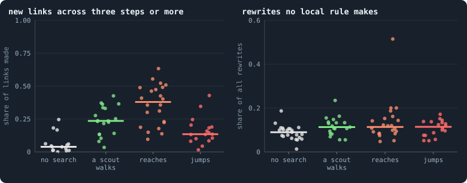
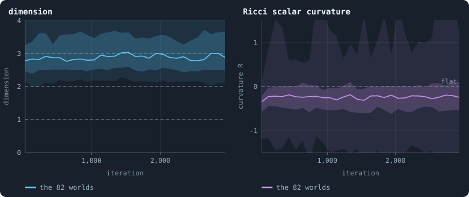
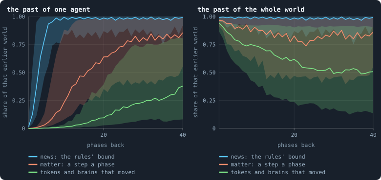
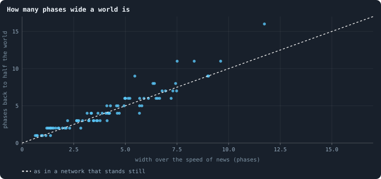
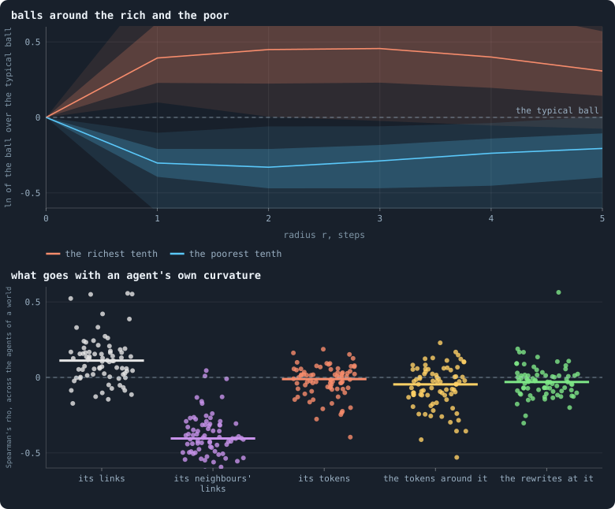

# A world as a Wolfram model: rewrites, light cones and curvature

> [!question] Questions of this page
> - Read as one of Wolfram's models of physics, what are a world's space, its
>   rule and its time?
> - Are a world's rewrites local, as the rules of those models are?
> - How far can a cause travel in a phase, and how many such steps wide is a
>   world?
> - Do the rich or the busy parts of a world bend its space?
> - Which of the project's tools have nothing to measure in a world, and why?

## In short

Wolfram's models of physics are networks rewritten again and again by one
simple rule. His project reads space, time and gravity off them with a few
tools: dimension and curvature from how balls grow, the causal graph and its
light cones, and how activity curves space. This page reads the 82
worlds of round 3 that lived with the same tools, rebuilt on their recorded
[frames](runs-and-records.md#what-a-run-records "A whole world as a run records it after one phase: every agent, its tokens and connections."). A world is such a network, rewritten in every phase by births, deaths
and links made and lost; but its [brains](the-brain.md "The neural network each agent decides with: inputs about itself and its neighbours, outputs that become its decisions.") choose the rewrites, on one clock, and
its rule evolves. Its rewrites are mostly local, and the cull, 47% of
all deaths, is the one large exception. Its links last about an [iteration](one-iteration.md "One step of a world's time: a phase of reproduction, then a phase of the game."), yet
its space holds: about 2.9 dimensions, curved a little below zero. News
fills half of an [agent](the-world.md#agents-and-tokens "One member of a world: it lives on a node of the network, holds tokens and has a brain that takes all its decisions.")'s past light cone 4 phases back, matter only
15: a world is only a few light-phases wide. Its riches bend its
space only through the links they hold. Causal invariance, the multiway system
and particles have nothing to measure in the record of one history.

## Wolfram's models in one page

In 2020 Stephen Wolfram and his colleagues proposed that the universe might
be a network, rewritten again and again by one simple rule (Wolfram 2020).
The network is a *hypergraph*: abstract elements, and relations that each
join two or more of them. The rule says what to replace with what. A rule
such as

$$
\{\{x, y\}, \{x, z\}\} \to \{\{x, z\}, \{x, w\}, \{y, w\}, \{z, w\}\}
$$

finds two relations that share an element, *x*, and puts four in their
place, with a new element *w*. Each use of the rule is an **event**. There is
nothing else: no space for the network to sit in, and no clock. Space is the
network, and time is the events, one after another.

The Wolfram Physics Project reads physics off such a network with a handful
of tools:

- **Dimension, from balls.** Count the elements within *r* steps of one. In
  *d* dimensions the count grows like *r*^*d*
  ([Dimension and curvature from ball growth](measuring-space.md#dimension-and-curvature-from-ball-growth)).
- **Curvature, from balls.** On a curved space, balls grow a little more
  slowly than *r*^*d* (on a sphere) or a little faster (on a saddle). The
  first correction is set by the Ricci scalar *R*:

  $$
  V(r) \approx c\, r^d \left(1 - \frac{R\, r^2}{6 (d + 2)}\right) .
  $$
- **The causal graph.** One event depends on another if it uses a relation
  the other made. The causal graph has the events as its points and these
  dependencies as its links, and it says what can affect what. The events
  that could have had an effect on an event make its **past light cone**;
  the events it can affect, its future one.
- **Causal invariance.** If the causal graph comes out the same whatever
  order the events are made in, observers who order them differently agree
  on what happens, and special relativity follows in the large
  ([Clocks, cones and relativity](physical-inspiration.md#clocks-cones-and-relativity)).
- **Energy and gravity.** Energy is read as the flow of causal links through
  a slice of the causal graph: how much is happening there. Where more
  happens, space curves, and in the large the network obeys Einstein's
  equations of gravity (Gorard 2020b).
- **The multiway system.** Follow every order of the events at once, and the
  histories branch, and merge again where two orders lead to the same
  network. The project finds quantum mechanics in this graph of histories,
  and in the *branchial graph* that joins the histories of one moment
  (Gorard 2020a).
- **Particles.** Small tangles of the network that last while everything
  around them is rewritten.

The project's own software runs these tools on rules of hypergraphs. A world
of the Graph of Life is not such a rule, so this page builds the tools again,
in Python, on the frames the worlds recorded. It reads the 82 worlds of round
3 that lived ([A screen of random worlds](a-screen-of-random-worlds.md)), and
no world was run for it.

## A world, read as a Wolfram model

A world is a network rewritten in every phase. Its relations are its links,
each joining two agents. Its rewrites, in Wolfram's notation, with a letter
for each agent:

| What happens | As a rewrite | Could a local rule make it? |
|---|---|---|
| A child *c* is born, joined to its parent *p* and to *p*'s [neighbour](the-world.md#the-network "An agent joined to another by a connection.") *n* | {{*p*, *n*}} → {{*p*, *n*}, {*p*, *c*}, {*c*, *n*}} | yes |
| A link that no [token](the-world.md#agents-and-tokens "The one thing of value in a world: every agent holds a whole number of them, and their total never changes.") crossed in the [game](one-iteration.md#phase-2-the-game "The second phase of an iteration: every agent stakes all its tokens on its own node and its neighbours', and every node goes to someone.") lapses | {{*a*, *b*}} → {} | yes |
| A link closes a triangle: a search one step out, or a death mended | {{*a*, *x*}, {*x*, *b*}} → {{*a*, *x*}, {*x*, *b*}, {*a*, *b*}} | yes |
| A link to an agent three or more steps away: a search that reaches or jumps, a scout that walks | a path from *a* to *b* → the path and {*a*, *b*} | only a rule as long as the path |
| An agent starves, and its links go | {{*d*, *a*}, {*d*, *b*}} → {} | yes |
| A death is mended: the dead agent's neighbours are joined in a ring | {{*d*, *a*}, {*d*, *b*}, {*d*, *c*}} → {{*a*, *b*}, {*b*, *c*}, {*c*, *a*}} | yes |
| A piece cut off from the largest is culled | every relation of the piece → {} | no: which piece is largest depends on the whole world |
| A node is won in the game | the network stays as it was; the node's brain is replaced | yes, but a Wolfram model has no brains to replace |

Two things set a world apart from a Wolfram model.

- **Who chooses.** In a Wolfram model every place where the rule fits can be
  rewritten, in any order, and the multiway system follows every order. In a
  world the agents' brains, and the world's one random stream, choose which
  rewrites happen. All of a phase's rewrites happen together, on one clock
  for the whole world. A run is one path through the multiway system of its
  rewrites: the path its brains choose.
- **The rule changes.** The brains evolve, so what is rewritten where changes
  as a world lives. A Wolfram model's rule never changes.

So the tools that need many orders of events, or one fixed rule, have little
to say here ([What does not carry over](#what-does-not-carry-over)). The others
can be used on the record of the one path a world took.

## How much a world rewrites itself

A world rewrites itself through and through. In the [median](statistics.md#many-worlds-at-once-the-median-bands-the-settled-life-and-the-spread "The middle value: half of the numbers lie below it and half above.") world of round
3, for every agent alive at the start of an iteration, 0.43 children are
born in it and 0.44 agents die, nearly half of them in the cull. Each agent
makes 1.5 new links an iteration, nearly all of them its
children's, and 1.4 links are cut, 0.6 of them because no token crossed
them in the game. The world holds only 1.8 links for each agent, so a link
lasts about 1.2 iterations and an agent about 2.3. In a
Wolfram model, too, one step of updating rewrites much of the network at once.

## Are the rewrites local?

A rule of a Wolfram model is local by its nature: it finds a small pattern of
relations and rewrites that pattern alone. Which of a world's rewrites could
such a rule make?

- **Births.** 99% of a newborn's links go to its parent or to the
  parent's neighbours, in the median world: rewrites of the parent's own neighbourhood.
- **Links between agents already there.** In worlds that never search,
  96% of them close a triangle: they are deaths mended. Where a scout walks or a
  search reaches, 24% and 38% of them span three steps or
  more in the median world, and where a search jumps, 13%. An agent
  drawn at random lies three steps or more away 99.7% of the time, so even
  searching agents link mostly near.
- **Deaths.** The cull, which no local rule can make, takes 47% of the
  dead in the median world: 36% where deaths are mended, and
  62% where they are not.

In all, 11% of the median world's rewrites are ones that no rule acting
within two steps could make, and most of them are the cull's.

<!-- figure wolfram/locality -->

**How local a world's rewrites are.** Each dot is one of the 82 worlds of round 3 that lived, read at every 100th iteration from 100 on, in both phases; the short bar is the median of a column. The columns are how the world's agents look for new links (`link_search`): not at all, a scout that walks, a search that reaches as far as its tokens pay, a search that jumps. Left: of the links made between two agents that were there before the phase, the share whose ends were three steps apart or more just before it. A link between agents two steps apart closes a triangle, the most local link a rewriting rule can make. An agent drawn at random lies three steps away or more in 99.7% of draws, in the median world. Right: the share of all of a phase's rewrites (a birth, a death, a link made, a link that lapses) that no rule acting within two steps could make: a link made across three steps or more, a newborn's link to an agent beyond its parent's neighbours, and a death in the cull.

> [!example]- How to make this figure
> **Runs.** the 82 worlds of round 3 of the screen of random worlds that lived to the end of their 3,000 iterations (Experiments 40, 41 and 42: 30,000 tokens, every setting drawn at random; the worlds of `research/screen/evolution.json`)
>
> **Data.** From each world's readings in `research/atlas/wolfram.json`, made by `python3 research/atlas/wolfram.py` from the world's frames (`GraphOfLifeRuns/<run>/frames/`) and statistics (`stats.jsonl`).
>
> 1. At every 100th iteration from 100 to 2,900, read the frames just before the reproduction phase, after it and after the game, and build each one's network from `edges`.
> 2. A phase's rewrites: agents in the later frame and not the earlier are born, the other way round dead; the cleanup's `starved`, `orphaned` (culled) and `aged` say how they died. Links in one frame's `edges` and not the other's are made or cut.
> 3. For a link made between two agents of the earlier frame, the number of steps between them in the earlier frame's network (8 for eight or more, or in another piece). For a newborn's link, the steps between its other end and the newborn's parent (`parent_ids`).
> 4. Sum over the phases read; the shares are of those sums.
>
> **To make it again:** `python3 book_figures.py wolfram`.
<!-- /figure -->

The cull is the one large break with Wolfram's kind of rule. Whether a piece
lives depends on whether it is the largest, and no agent can see that from
where it stands. The [share-out](measuring-lives.md#the-estate-of-the-dead "The tokens a dead agent leaves, and who gets them.") is the second global rule; it moves tokens, not
links, so it is not counted here, and it comes back in
[Past light cones](#past-light-cones).
[Local rules only](local-rules-only.md) plans to make both local.

## Space through a life

Wolfram reads a space's dimension and its curvature from how balls grow, and
so does the Graph of Life viewer, on every 25th iteration of every run
([Dimension and curvature from ball growth](measuring-space.md#dimension-and-curvature-from-ball-growth)).
Read that way, round 3's worlds are spaces of about 2.9 dimensions from their
start to their end, with a curvature a little below zero: −0.23 in the median
world from iteration 500 on. Over their first five steps, their balls grow a
little faster than flat space allows, as in a network with some branching.
Only 16% of the worlds settle at a positive curvature.

<!-- figure wolfram/space -->

**Space and its curvature through a life, as Wolfram reads them.** The 82 worlds of round 3 that lived, read after every 25th game and averaged over stretches of 100 iterations. Left: the viewer's `dimension`, from how the shells around about 24 agents grow out to five steps (1 a line, 2 a sheet, 3 a solid). Right: its `ricciCurvature`, the same fit's correction that grows with the square of the radius (positive where balls grow more slowly than flat space allows, negative where they grow faster). The line is the median of the worlds at each iteration, the darker band holds the middle half of them (from the 25th to the 75th percentile) and the paler band nine in ten (5th to 95th).

> [!example]- How to make this figure
> **Runs.** As for the figure *How local a world's rewrites are* above.
>
> **Data.** From each run's `GraphOfLifeRuns/<run>/stats.jsonl`, the rows after the game (`phase` 2) that hold `dimension` and `ricciCurvature` (every 25th iteration), gathered by `research/atlas/wolfram.py` into `research/atlas/wolfram.json`.
>
> 1. One line of 120 points per world, one every 25 iterations; the mean of each four, a stretch of 100 iterations.
> 2. At each point the median of the worlds, the middle half and nine in ten.
>
> **To make it again:** `python3 book_figures.py wolfram`.
<!-- /figure -->

The dimension hardly moves in 3,000 iterations, although the network is made
new every iteration or two. What lasts is the shape, not the links, as a river
keeps its course while its water flows on. Five steps are few, and both
readings are indices for comparing worlds, not exact geometry
([A caution](measuring-space.md#a-caution)).

## Past light cones

In a Wolfram model, the speed of light is how far one event's effects can
reach in one step of the causal graph. In a world, news travels at most four
steps a phase, three in worlds without the look that only talks: a brain sees
two steps away, a [message](rules-in-detail.md#messages "Numbers an agent writes to itself and to each neighbour every phase, which their brains read.") carries what it saw a step further, and an agent
acts on its neighbours
([How far does a difference travel?](how-far-does-a-difference-travel.md)).
Matter is slower. A token moves at most a step a phase, as a stake or a gift,
and a child is born next to its parent.

So the records give each world's causal graph at the level of agents and
phases: what an agent is after a phase depends on the agents within reach of
it when the phase began. This page follows the graph backwards. An agent's
**past light cone**, *k* phases back, is every agent of that earlier world
that could have had an effect on it by now. Going back, a cone is never cut
short. Going forward it would be, whenever the cull removed the agents it had
reached. Three cones are read:

- **news**, as far as the rules let it go;
- **matter**, a step a phase;
- **the tokens and brains that did move**, from the recorded stakes, nodes
  won, gifts, children and mates' shares.

The global rules are left out, so these are the cones a world would have if
its cull, its share-out and its random stream were local.

<!-- figure wolfram/cones -->

**Past light cones.** The 82 worlds of round 3 that lived. An agent's past cone, k phases back, is every agent of that earlier world that could have had an effect on it by then. Blue: news, as far as the rules let it travel in a phase (four steps, three in worlds without the look that only talks); orange: matter, a step a phase, as a stake, a gift or a child moves; green: the tokens and brains that did move, read from the decisions (stakes, nodes won, gifts, children and a mate's share). The global rules, the cull, the share-out and the one random stream, are left out, though each reaches the whole world at once. Left: the median of 32 agents drawn at random in each world, after the games of iterations 1,000, 2,000 and 2,900 (the median of the three moments). Right: the past cone of everyone alive at that moment together. The line is the median of the worlds at each phase back, and the band holds the middle half of them (from the 25th to the 75th percentile).

> [!example]- How to make this figure
> **Runs and data.** As for the figure *How local a world's rewrites are* above.
>
> 1. After the game of iteration 1,000, 2,000 and 2,900, draw 32 agents (seeded by the run's seed).
> 2. Go back a phase at a time. An agent of the later frame that was in the earlier one marks itself there; a newborn marks its parent. News: every agent within four steps of a marked agent, three without `message_prepass` (three and two of a newborn's parent), in the earlier frame's network, joins the cone. Matter: within one step (none from a newborn's parent). Flow: the senders of the phase's stakes, nodes won, gifts, children and mates' shares to a member join it.
> 3. Each cone's size over the earlier frame's agents, for 40 phases (20 iterations); the median over the 32 agents, then over the three moments.
> 4. The whole world's cone starts from every agent alive at the moment.
>
> **To make it again:** `python3 book_figures.py wolfram`.
<!-- /figure -->

- **News** fills an agent's past fast: half the world 4 phases back
  in the median world, and 99% of it eight phases back, four iterations.
- **Matter** is about 4 times slower: half the world 15
  phases back.
- **The tokens and brains that moved** use only a part of what matter could:
  38% of the world 40 phases back. A stake goes to one or a few of an
  agent's neighbours, not to all of them.
- **The whole world's past** (right) shows what the cull does. Everyone alive
  now, together, has a news past that holds 99% of the world 20
  iterations before. The tokens and brains that moved reach back to only
  51% of it. The rest of that world passed nothing to anyone alive now
  a step at a time. Its tokens reached the present, if at all, only through the
  share-out, which in most worlds deals the estates of the culled out across
  the whole world.

<!-- figure wolfram/crossing -->

**How many phases wide a world is.** Each dot is one of the 82 worlds of round 3 that lived. Across: the steps within which a typical agent's ball holds half the world (from 40 agents drawn at random), over the steps news can go in a phase by the rules (four, or three without the look that only talks): how many phases a world would be wide if its network stood still. Up: the phases back until the median agent's past news cone held half the world, as measured through the world's own changing network. Both are the medians of the three moments of the figure above.

> [!example]- How to make this figure
> **Runs and data.** As for the figure *How local a world's rewrites are* above.
>
> 1. The width: the typical ball (the geometric mean over 40 agents) out of the frame after the game of iteration 1,000, 2,000 and 2,900; the radius at which it first holds half the world, between whole steps by the logarithm of the ball (`research/atlas/space.half_reach`).
> 2. Over the speed of news: 4 steps a phase, or 3 without `message_prepass`.
> 3. Measured: the first phase back at which the median agent's past news cone held half the world.
> 4. The median of the three moments, for each.
>
> **To make it again:** `python3 book_figures.py wolfram`.
<!-- /figure -->

How many phases wide is a world? For a network that stood still, it would
be its width in steps over the speed of news: 4.1 phases in the median
world. Measured through the world's own changing network, the past cone of
the median agent holds half the world 4 phases back, and the two agree
within a phase in 85% of the worlds. The churn of the links neither
speeds news up nor slows it down much: a world is about as many phases wide as
its width over four.

That is very little. For a network to look like spacetime in Wolfram's sense,
its cones must stay small beside it for many steps. Light crosses the
observable universe in about 10⁶¹ Planck times, the shortest time physics can
name. News crosses half a world of round 3 in about two iterations. Its space
is real, about 2.9 dimensions by its balls, but it is only a few
light-phases wide.

## Does matter bend space?

In Wolfram's models, space curves where more is happening: in the large,
this is Einstein's gravity (Gorard 2020b). A world has two candidates for what
is happening at an agent: its tokens, the one thing a world keeps constant,
and the rewrites at it, how often its links change, it has a child, or its
node is taken. Each agent's own curvature can be read from its own ball, as
the world's is: the term that grows with *r*² in the growth of its ball out to
five steps.

<!-- figure wolfram/matter -->

**Does matter bend a world's space?** The 78 worlds of round 3 that lived and whose typical ball needs more than three steps to hold half of them, in their network after the last game (its largest piece). Left: around the tenth of the agents with the most tokens (orange) and the tenth with the fewest (blue), how many agents lie within r steps, against the typical ball of the world (the geometric mean over all its agents), as the natural logarithm of the ratio: 0.1 is about 10% more. The line is the median of the worlds at each radius, the darker band holds the middle half of them (from the 25th to the 75th percentile) and the paler band nine in ten (5th to 95th). Right: each dot is one world; across its agents, the rank correlation of an agent's own curvature (the r² term of the growth of its ball out to five steps, its dimension held at the world's) with its links and with its neighbours' links (their mean); and, with both held equal (a partial correlation), with its tokens, with the tokens around it (the mean over it and its neighbours) and with how much was rewritten at it in the last 20 iterations (links made or cut, children, its node taken). Positive: more of it, more positive curvature, a ball that grows more slowly.

> [!example]- How to make this figure
> **Runs and data.** As for the figure *How local a world's rewrites are* above.
>
> 1. Read the last frame, after the game of iteration 2,999, and keep the largest piece of its network.
> 2. Every agent's ball V(r), r = 0 to 5, by spreading from all agents at once.
> 3. The world's dimension d from ln V(r) = a + d ln r − R r² / (6 (d + 2)) fitted to the typical ball (Wolfram 2020); each agent's own R from the same with d held at the world's. Its ranks do not depend on d.
> 4. Rewrites at an agent: over the last 40 phases, the links made or cut at it, the children it had and the times its node took another brain, per phase.
> 5. Spearman's rho across the agents; a partial rho correlates the residuals of both ranks after a plane in the ranks of the agent's links and of its neighbours' mean links.
>
> **To make it again:** `python3 book_figures.py wolfram`.
<!-- /figure -->

- Around the [richest tenth](measuring-tokens.md#the-richest-tenths-share "The share of all tokens held by the richest tenth of the agents.") of a world's agents, balls hold about half as many
  agents again as the typical ball, from one step out to four (48% to
  58% more), and around the poorest tenth about a quarter fewer
  (21% to 28%). The rich hold more links: 5.6 on average,
  against 2.0 for the poorest and 3.4 for all.
- Across a world's agents, an agent's own curvature rises a little with its
  links (rho 0.11 in the median world) and falls clearly with its
  neighbours' links (−0.40). Beside well-linked agents the second shell
  is large, and the ball grows fast. The tokens around an agent go the same way
  (−0.17), because rich neighbours are well-linked ones (0.47).
- With an agent's own links and its neighbours' links held equal, its tokens
  (−0.01), the tokens around it (−0.05) and the rewrites at it
  (−0.03) say almost nothing more about its curvature.
- Across worlds, a world's curvature hardly follows how much it rewrites (rho
  0.20) or how many links its agents hold (0.12).

So matter bends a world's space only through the links it holds, and so does
activity. Wolfram's gravity, a curvature set by how much happens, has no
counterpart here beyond that.

## What does not carry over

- **Causal invariance.** A world has one clock. In every phase all agents
  look, speak and act together, and every chance is drawn from one random
  stream in a fixed order. The records hold one order of the rewrites and no
  other to compare it with. And with one stream, another order would be
  another history from its first draw on. A test needs agents that keep
  random numbers of their own ([Local rules only](local-rules-only.md)), one
  kept world played on with a phase's rewrites made in other orders, and the
  causal graphs compared: a new experiment for the [lab](runs-and-records.md#the-lab-the-engine-and-pilots "The program that runs an experiment's plan as runs, each on a frozen copy of the engine, the code that plays a world."), not a reading of the
  records.
- **The multiway system and the branchial graph.** A run is one history,
  and these tools need all of them. The nearest thing the notebook plans is
  the twin worlds of [How far does a difference travel?](how-far-does-a-difference-travel.md):
  two branches of one world that differ by a single token, followed until
  they part.
- **Energy as the flow of causal links.** In a Wolfram model energy is how
  many causal links cross a slice of the causal graph. Here the nearest
  readings are how much is rewritten at an agent, and the tokens, the one
  thing a world keeps constant. [Does matter bend space?](#does-matter-bend-space)
  reads both, and neither bends space beyond the links.
- **Particles.** [Particles](particles.md) looked for patterns that outlast
  what carries them, in twelve worlds with three detectors, and found none
  beyond the network's own regions, except the crystal of a world that froze.
- **One rule.** The project's results hold for a rule that never changes. A
  world's brains evolve, and what they rewrite changes with them.

## What we learned

- **A world is a rewriting system with one clock.** Every phase rewrites its
  network by births, deaths and links made and lost, as a Wolfram model's
  hypergraph is rewritten by its rule. But a world's brains choose the
  rewrites, all at once, and its rule evolves.
- **Its rewrites are mostly local.** Newborns link to their parents and their
  parents' neighbours, and searching agents link mostly near themselves. The
  cull is the exception: 47% of the deaths, and most of the
  11% of rewrites that no local rule could make.
- **Its space holds while its links do not.** About 2.9 dimensions and a
  curvature a little below zero, from start to end, on a network whose links
  last about an iteration.
- **It is only a few light-phases wide.** News fills half of an agent's past
  4 phases back, matter only 15; the tokens and brains
  that do move reach 38% of the world in 40 phases. And about half of
  the world of 20 iterations before passed no token or brain to the present a
  step at a time; its tokens came, if at all, through the share-out.
- **Matter bends space only through links.** Curvature goes with an agent's
  links and its neighbours'; its tokens and the rewrites at it add nothing
  once those are held equal.
- **For the physics aim:** to look like a spacetime, a world would have to be
  many light-phases wide: far more agents, or news that travels fewer steps a
  phase, and a cull made local. The rewrites, cones and curvature of this page
  are ready to read such worlds.

## Where to go next

- [How far does a difference travel?](how-far-does-a-difference-travel.md):
  the plan that would measure a world's light cone itself, by twin worlds
  that differ by one token, once its random numbers are local.
- [Local rules only](local-rules-only.md): the plan to make the cull, the
  share-out and the one random stream local, the first step towards a world
  with a light cone at all.
- [Is a world a space?](how-many-dimensions-does-a-world-have.md): dimension
  in depth, by two rulers and at every scale.
- [Particles: patterns that outlast what carries them](particles.md): the
  search for the project's last tool, in twelve worlds.
- [Physical inspiration](physical-inspiration.md): the physics aim, and where
  the analogy stops.

## How this was made

The page reads the 82 worlds of round 3 that lived to the end of their 3,000
iterations (Experiments 40, 41 and 42, at 30,000 tokens; the worlds of
`research/screen/evolution.json`). Every one of them recorded every phase.
No world was run for this page.

`research/atlas/wolfram.py` reads each world once, in half a minute to two
minutes, and keeps its readings in
`GraphOfLifeRuns/.pilots/atlas/wolfram/<run>.json`:

- **the rewrites**: at every 100th iteration from 100 to 2,900, the frames
  just before the reproduction phase, after it and after the game. Agents in
  one frame and not the other are born or dead, links in one frame's `edges`
  and not the other's are made or cut, and the [cleanup](one-iteration.md#cleanup "The end of every phase: only the largest connected piece of the network lives on, and the tokens of the dead are shared out.") says how the dead
  died. A link made between two agents of the earlier frame is placed by the
  steps between them in the earlier frame's network; a newborn's link by the
  steps between its other end and the newborn's parent. In s3094, links of
  three steps or more were made by the thousand in a phase, most of them by
  deaths mended one after another in the game's cleanup; there, at most 256 a
  phase were placed exactly, and the rest in proportion to them.
- **the space**: the viewer's `dimension` and `ricciCurvature`, from the
  run's `stats.jsonl`.
- **the cones**: after the games of iterations 1,000, 2,000 and 2,900, 32
  agents drawn with a generator seeded by the run's [seed](rules-in-detail.md#seeds-and-the-random-stream "The number that fixes every random choice of a run: the same settings and the same seed make the same world.") and the iteration,
  and everyone alive together, followed back 40 phases as
  [Past light cones](#past-light-cones) says. The width is the radius at which
  the typical ball, the geometric mean over 40 agents, first holds half the
  world, between whole steps by the logarithm of the ball.
- **the curvature**: the network after the last game, its largest piece,
  every agent's ball out to five steps, and the rewrites at every agent over
  the last 40 phases. A world whose typical ball holds half of it within three
  steps has too few radii for a fit. Four have: the [star](measuring-networks.md#stars-and-hubs "An agent joined to far more agents than most; a star is a world held together by a single hub.") s3020; s3094, with
  about 25 links an agent; and s3016 and s3084, which ended with fewer than
  1,000 agents.

`python3 research/atlas/wolfram.py --gather` keeps what the figures need, the
cones as the median over their agents, in `research/atlas/wolfram.json`. The
figures and the numbers this page quotes are made again by
`python3 book_figures.py wolfram` (`book_chapters/wolfram.py`) and kept in
`book/results/wolfram.json`. Like the rest of the notebook's code, it uses
numpy and networkx only: Wolfram's own software, which runs on rules of
hypergraphs, was not used.

## References

- Gorard, J. (2020a). Some quantum mechanical properties of the Wolfram
  model. *Complex Systems* 29(2), 537–598.
- Gorard, J. (2020b). Some relativistic and gravitational properties of the
  Wolfram model. *Complex Systems* 29(2), 599–654.
- Wolfram, S. (2020). A class of models with the potential to represent
  fundamental physics. *Complex Systems* 29(2), 107–536.

<!-- turns -->
---

← [Particles: patterns that outlast what carries them](particles.md) · [Space and dimension](../README.md#space-and-dimension)

**Also about:** [Methods and statistics](../README.md#methods-and-statistics).

> [!info]- Pages that link here (1)
> [Glossary](glossary.md)
<!-- /turns -->
