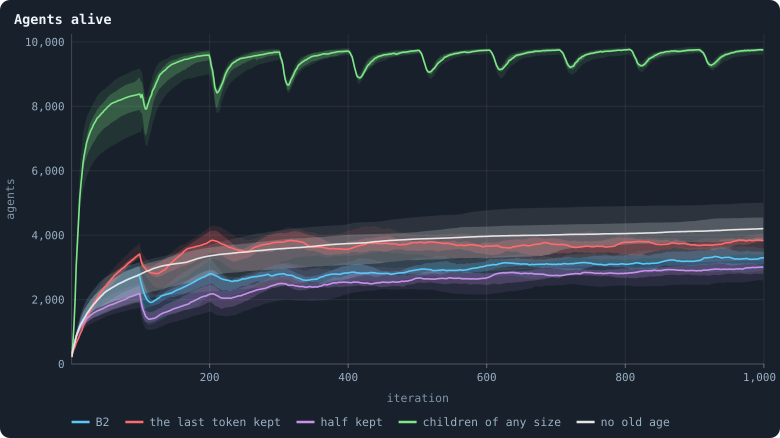
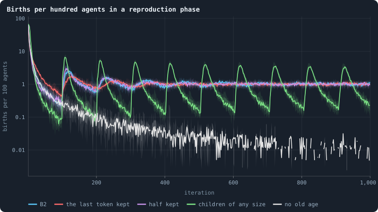
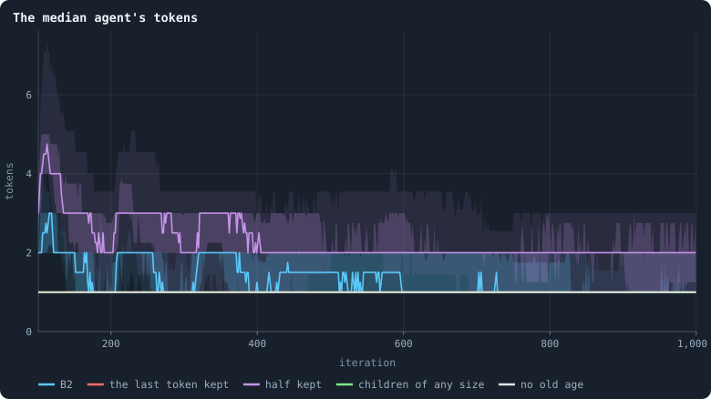
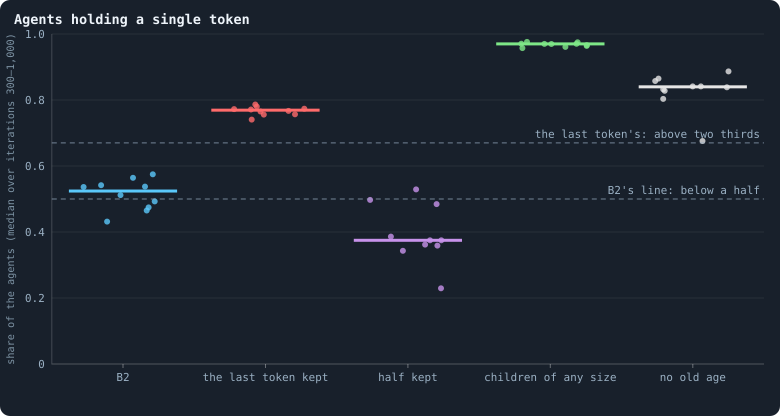
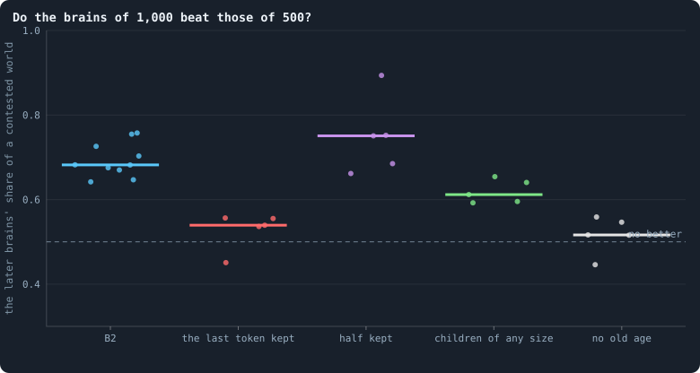

# Building B2: a world that cannot break

> [!question] Questions of this page
> - What happens to a world when its [agents](the-world.md#agents-and-tokens "One member of a world: it lives on a node of the network, holds tokens and has a brain that takes all its decisions.")' decisions follow what they see,
>   and what, exactly, kills it?
> - What network do births and deaths make by themselves, with no [brains](the-brain.md "The neural network each agent decides with: inputs about itself and its neighbours, outputs that become its decisions.") at
>   all, and why is it fragile?
> - Which rules, each acting on one agent and its [neighbours](the-world.md#the-network "An agent joined to another by a connection."), make a network
>   with no single point of failure, however the agents play? What does each
>   rule cost?
> - Which deaths does a world need, and why should every agent die of age?
> - What does protecting an agent's last [token](the-world.md#agents-and-tokens "The one thing of value in a world: every agent holds a whole number of them, and their total never changes.") do to who is left to play?

## In short

B2, the notebook's second [baseline](b1-and-b2.md), was built in three steps,
each tested by an experiment. First, brains that see broke their worlds: not
in one great cut, but by a steady bleeding of cut-off agents that births did
not always replace (Experiment 13). Then four local rules made a network with
no single point of failure: not one agent of ten B2 worlds was cut off from
iteration 200 to 1,000 (Experiment 14). Last, rules of death keep a share of
every agent's tokens at home, give every child at least ten tokens, and end
every life at age 100 (Experiment 15). The price is poverty and a folded
space. About half of B2's agents hold a single token, and its network is
nearly a small world, where everyone is a few steps from everyone.

## Brains that see, and worlds that break

<!-- experiment E13 -->

Imagine nudging what a brain sees, and watching how far its decisions move. In
B1, the first baseline, they hardly move at all. A change in what a brain sees
reaches what it does about a thousand times smaller. How much of a change gets
through is the brain's **gain**: 0.0015 in the evolved worlds, and 0.0006 in a
[founder](starting-ring.md "One of the agents a world starts with, each holding the same tokens, on a ring with a few shortcuts.") ([What the brains are like](what-the-brains-are-like.md)).

The reason is the depth of B1's brain. What it sees passes through five hidden
layers of units before it decides. Each layer ends in a sigmoid, an S-shaped
function whose slope is at most a quarter. So each layer passes on about a
quarter of a change, and five quarters multiply to a thousandth ([How a signal
fades through layers](vanishing-signal.md)). Whatever evolution has done in
B1, it has done to a brain that responds to almost nothing. Its decisions are
near enough constants.

[Open-ended evolution](open-ended-test.md "Evolution that keeps producing new things without end, not only up to a plateau.") needs agents whose behaviour depends on their world: kin
recognised, partners answered, threats met. So the first step towards it is to
give the brains sight, and the cheapest way is to take layers away. With one
hidden layer of 16 units, a founder's gain is about 0.2, some three hundred
times a B1 founder's 0.0006. With no hidden layer at all, it is about 1:

| hidden layers | founders' gain ([median](median-and-quantiles.md "The middle value: half of the numbers lie below it and half above.") of 30 brains) |
|---|---|
| 50, 45, 40, 35, 30 (B1) | 0.0006 |
| 16, 16 | 0.04 |
| 16 | 0.2 |
| none | 1.0 |

A second change goes with it. In B1 every brain may change after every game,
wherever it sits ([How a brain changes](mutation.md)). So an adaptation is
worn away in the very agent that carries it, generation or not. The setting
[`mutate_on_replication`](settings.md#mutate_on_replication) makes a brain
change only where biology's do: when it is copied, into a child or into a node
its owner has won.

### What the pilots showed

[Pilots](pilot-worlds.md "A world made by hand to see whether an idea is worth an experiment, without a thesis or many seeds.") of two [seeds](random-numbers.md "The number that fixes every random choice of a run: the same settings and the same seed make the same world.") each, at 5,000 tokens for 1,500 iterations, compared B1
with brains of one hidden layer, with and without change only when copied.

**The worlds broke.** B1's two worlds never fell below 74 and 397 agents.
With one hidden layer, one world fell to a single agent at iteration 547.
That agent went on making children alone, most of whom it could not keep,
until a lucky one at iteration 1,100 started the world again. The other world
fell to 84. With one hidden layer and change only when copied, one world fell
to 15 agents and dwindled to 25 by the end. The other fell to a single agent
for good.

**The pilots blamed the network.** An agent whose stake follows what it sees
puts it where it matters: on one neighbour, or two. And a [connection](the-world.md#the-network "A link between two agents of the network: they are neighbours, and can stake on each other's nodes.") that
carries no tokens in a game is cut at the game's end ([One iteration, step by
step](one-iteration.md)). So the seeing worlds kept few connections. The
worlds that crashed had as few as 1.3 to 1.9 per agent, against 3.2 in B1.
Only 27–39% of their agents were in the [2-core](core-trees-leaves.md "What is left of a network when agents with one connection or none are peeled away again and again: the agents on loops or between them."), the agents on [loops](loops.md "A path through the network that comes back to where it started without using a connection twice.") or between
them, against 54–55%.

A network that is mostly trees is a network of [bridges](bridges.md "A connection that lies on no loop: cut it and the network falls into two pieces."). When one of them is
cut, everything beyond it is no longer joined to the largest piece. Then the
cull, which keeps only the largest piece after each phase ([the
cleanup](one-iteration.md#cleanup)), removes it whole. In one pilot world a
single game cut off 1,195 agents, that iteration's newborns among them, and
left 562.

**And what was left was ruled by a few.** In a seeing world, the
best-connected agent was joined to 15–35% of the others: more than in B1's two
pilot worlds (9–12%). But B1 can grow such [hubs](stars-and-hubs.md "An agent joined to far more agents than most; a star is a world held together by a single hub.") too. In one of the ten B1
worlds of the experiment below, the best-connected agent was joined to 55% of
the others (the stars of [The largest and the
smallest](the-largest-and-the-smallest.md)).

**Change only when copied made it worse, not better.** Its two worlds were the
two that fell furthest. A stricter variant changed a brain only when it was
copied into a newborn, never into a won node, and it shows what heredity alone
cannot do. In one of its worlds births stopped, so change stopped, and the
world froze into a single [genotype](genotype.md "The identity of a brain: a number that a brain keeps until it changes, and that records whose copy it was."). Its agents aged by one every iteration,
and every node was taken by its own kin each game. Longer lives, for once,
meant that nothing was happening.

The pilots suggested a simple story. B1 holds together because its agents are
blind: they spread their stakes evenly over every neighbour, so every
connection carries tokens, and the network keeps its loops. Sight is the
precondition of anything evolution might build, and the first thing it does is
break the world it lives in. So we expected brains that see to break most of
ten worlds, and B1's blind brains hardly any. Experiment 13 tested this, and
asked what, exactly, kills a world.

<!-- thesis E13 -->
> [!quote] The thesis of Experiment 13, written down before any of its runs existed
> **The claim.** Brains that see break worlds. With one hidden layer of 16 instead of five, and every brain changed only when it is copied, at least six of ten worlds of 5,000 tokens fall below 50 agents — or die out — at some time after iteration 50 within 1,500 iterations; of the baseline's ten, at most two do.
>
> **Why it would be so.** One hidden layer passes about a fifth of a change in what a brain sees on to what it does (a gain of 0.2 for a founder, against 0.0006 through the baseline's five sigmoid layers: Chapter [19](what-the-brains-are-like.md)), so agents stake on one neighbour rather than evenly on all. Pilots of two seeds each, 5,000 tokens, 1,500 iterations: the baseline's worlds never fell below 74 and 397 agents; with one hidden layer, to 1 (and regrown from it) and 84; with one hidden layer and change only when copied, to 15 and 1. In the worlds that see, fewer agents sat in the 2-core (0.27 to 0.62, against 0.54 and 0.55) and the best-connected agent was joined to 15–35% of the others (9–12%).
>
> **It holds if:** At least 6 of the 10 worlds of the condition 'one hidden layer, change only when copied' have fewer than 50 agents after the game of some iteration from 50 on, or die out; and at most 2 of the baseline's 10 do.
>
> **It fails if:** Fewer than 6 of the 10 worlds that see fall below 50 agents: seeing does not break worlds. Or more than 2 of the baseline's do: worlds of 5,000 tokens break anyway, and seeing is not the reason.
>
> *Written while the notebook still numbered its chapters: each number is a link to the page it meant that day.*
<!-- /thesis -->

### What the thirty worlds did

<!-- figure seeing/agents -->


**Agents alive.** For each condition the median world at each iteration, with the middle half of the worlds (darker) and nine in ten (paler).

> [!example]- How to make this figure
> **Runs.** The 30 runs of Experiment 13 — at 5,000 tokens, seeds 1 to 10, 1,500 iterations — in three conditions: the baseline B1 (`B1-5000-s001` … `-s010`, shared with Experiment 12), its brains with one hidden layer of 16, and those brains changed only when copied. They are made with `python3 gol_lab.py run E13`.
>
> **Data.** From each run's `GraphOfLifeRuns/<run>/stats.jsonl`, which holds one row per recorded phase: `phase` 1 is the world just after reproduction, `phase` 2 just after the game, and every statistic is a field of the row (see [What a run records](frames-and-stats.md)).
>
> 1. Take `nodes` of the rows with `phase` = 2, one line per run.
> 2. For each condition, the median, quartiles and 5th and 95th percentiles of the runs at each iteration (`book_figures.band_series`).
>
> **To make it again:** `python3 book_figures.py seeing`.
<!-- /figure -->

Every B1 world lived its 1,500 iterations. None ever fell below 74 agents
after iteration 50, and the median world's lowest was 188. Brains that see did
not do so well. With one hidden layer, four of the ten worlds died out, at
iterations 219, 478, 534 and 619; the other six fell as low as 84 to 231. With
one hidden layer and change only when copied, eight of ten died out, at
iterations 219, 292, 415, 454, 674, 820, 975 and 1,018. The two that lived
fell to 96 and 181.

"Died out" here means fell to 20 agents or fewer, where the [lab](the-lab.md "The program that runs an experiment's plan as runs, each on a frozen copy of the engine, the code that plays a world.") stops a run as
extinct ([When a world ends](extinction.md)). That rule ends some worlds that
would have lived ([How does a world's size follow its
tokens?](how-does-a-worlds-size-follow-its-tokens.md)). The pilot world with
one hidden layer that fell to a single agent at iteration 547 was seed 1, run
on without the rule, and it grew back.

<!-- figure seeing/lowest -->


**The fewest agents a world fell to.** One dot per world: its fewest agents after the game of any iteration from 50 on, 0 for a world that died out; the bar is the median world. The dashed line is the thesis's 50 agents.

> [!example]- How to make this figure
> **Runs.** The 30 runs of Experiment 13 — at 5,000 tokens, seeds 1 to 10, 1,500 iterations — in three conditions: the baseline B1 (`B1-5000-s001` … `-s010`, shared with Experiment 12), its brains with one hidden layer of 16, and those brains changed only when copied. They are made with `python3 gol_lab.py run E13`.
>
> **Data.** From each run's `GraphOfLifeRuns/<run>/stats.jsonl`, which holds one row per recorded phase: `phase` 1 is the world just after reproduction, `phase` 2 just after the game, and every statistic is a field of the row (see [What a run records](frames-and-stats.md)).
>
> 1. Take the smallest `nodes` of the rows with `phase` = 2 and `iteration` ≥ 50; a run that ended extinct counts 0.
> 2. Count the worlds below 50 in each condition.
>
> **To make it again:** `python3 book_figures.py seeing`.
<!-- /figure -->

### Verdict: the thesis holds

The thesis asked that at least six of the ten seeing worlds with change only
when copied fall below 50 agents or die out, and at most two of B1's. Eight
did, and none of B1's: **the thesis holds.** Brains that see break worlds. And
the second change, which the pilots had already found harmful, doubles the
toll of the first.

### What kills a world

The pilots blamed the network: seeing brains leave links unused, unused links
are cut, and a world of trees falls apart. The ten worlds of each condition
say that this is only half of it.

**Not one big cut.** A world's largest single cull, the most agents ever cut
off at once, came in its first fifty iterations in seven of B1's worlds. Then
400 to 1,250 agents at a time were lost, as the first boom ended ([The first
hundred iterations](a-worlds-life.md#the-first-hundred-iterations)). The seeing worlds had
such early culls too. But the worlds that died out did not die of one of them:
each shrank over a hundred iterations or more.

**The network kills in every iteration, in every world.** No world of any
condition passes the [health bar](health-bar.md "The seven marks a world's network must meet to count as healthy: one piece, mostly on loops, no fatal cut, no hub, three to twelve links per agent, a dimension of 2.3 to 4.") of [How to tell a world that keeps
evolving](how-to-tell-a-world-that-keeps-evolving.md#the-network-that-holds-in-numbers).
B1's median world had 51% of its agents in the 2-core, and a link whose loss
cut off 8% of it. The seeing worlds had 55% and 11%. With change only when
copied they had 46% and 6%, and there the best-connected agent was joined to a
fifth of the world in the median.

These networks are not clearly worse than B1's. What they share with it is
that agents are cut off all the time. From iteration 500 on, the cull removed
1.9% of the agents in every iteration of B1's median world, four times as many
as starved (0.5%). In the median world with one hidden layer it removed 5.3%.

<!-- figure seeing/health -->


**How the network holds.** One dot per world, at its median over iterations 200 to 1,500 while it lived; the bar is the median world and the dashed line the health bar of [How to tell a world that keeps evolving](how-to-tell-a-world-that-keeps-evolving.md).

> [!example]- How to make this figure
> **Runs.** The 30 runs of Experiment 13 — at 5,000 tokens, seeds 1 to 10, 1,500 iterations — in three conditions: the baseline B1 (`B1-5000-s001` … `-s010`, shared with Experiment 12), its brains with one hidden layer of 16, and those brains changed only when copied. They are made with `python3 gol_lab.py run E13`.
>
> **Data.** From each run's `GraphOfLifeRuns/<run>/stats.jsonl`, which holds one row per recorded phase: `phase` 1 is the world just after reproduction, `phase` 2 just after the game, and every statistic is a field of the row (see [What a run records](frames-and-stats.md)).
>
> 1. Take `coreShare`, `cutRisk` and `maxDegree` / `nodes` of the rows with `phase` = 2 and 200 ≤ `iteration` ≤ 1,500, and each world's median of each.
>
> **To make it again:** `python3 book_figures.py seeing`.
<!-- /figure -->

**So births have to keep up.** A world whose agents are cut off and starve at
a few per cent per iteration lives only as long as it has as many children.
Seeing brains turn the population over faster. From iteration 500 on, the
median world with one hidden layer had 6.4 births per hundred agents and
iteration, against B1's 2.3, and it lost agents correspondingly faster. A
world shrinks whenever its births fall short of its losses for a while. And a
world that shrinks to a few dozen agents is a few unlucky games from the end.

<!-- figure seeing/births -->


**Births per agent.** For each condition the median world at each iteration, with the middle half of the worlds (darker) and nine in ten (paler), on a logarithmic axis. A world that died out leaves the band when it does.

> [!example]- How to make this figure
> **Runs.** The 30 runs of Experiment 13 — at 5,000 tokens, seeds 1 to 10, 1,500 iterations — in three conditions: the baseline B1 (`B1-5000-s001` … `-s010`, shared with Experiment 12), its brains with one hidden layer of 16, and those brains changed only when copied. They are made with `python3 gol_lab.py run E13`.
>
> **Data.** From each run's `GraphOfLifeRuns/<run>/stats.jsonl`, which holds one row per recorded phase: `phase` 1 is the world just after reproduction, `phase` 2 just after the game, and every statistic is a field of the row (see [What a run records](frames-and-stats.md)).
>
> 1. Take `births` / `nodes_before` of the rows with `phase` = 1, one line per run.
> 2. For each condition, the median, quartiles and 5th and 95th percentiles of the runs at each iteration (`book_figures.band_series`).
>
> **To make it again:** `python3 book_figures.py seeing`.
<!-- /figure -->

**And seeing brains can stop having children.** In B1, whether an agent has a
child is close to a constant of its brain, because the brains barely see. With
one hidden layer it is a decision that depends on what the agent sees, and
evolution can change it a great deal. To see what it did, every [era](eras-and-contests.md "Brains of a world at two moments, its eras, played against each other: do the later ones win?")'s brains
were put back into the same world: their own run's founders' world, 50 agents
with 100 tokens each. There they played ten iterations with mutation off.

The founders' own brains had a child in about three agent-iterations in four
(73–75% in the median world of each condition). An agent-iteration is one
agent living through one iteration. Later brains had far fewer: 3 to 9 per
hundred in the median B1 world, and between 1 and 17 per hundred in the median
seeing world. But the seeing worlds spread far wider. In six of the twelve
worlds that died out, the last brains kept from them had no child at all,
though they were rich, in an empty world. The six worlds with one hidden layer
that lived to the end went the other way. Their last brains had children at 7
to 43 per hundred agent-iterations, 17 in the median, against 3 for B1's last
brains (0 to 13).

<!-- figure seeing/children -->


**Do the brains still have children?** Every era's brains play the same world — the founders' world of their own run, 50 agents of 100 tokens on the starting ring — for 10 iterations with mutation off. Thin lines: one world each, its births per agent and iteration, the mean of 2 draws; thick lines: the median world of each condition at each era, over the worlds that still lived. No birth at all is drawn at 0.0001.

> [!example]- How to make this figure
> **Runs.** The 30 runs of Experiment 13 — at 5,000 tokens, seeds 1 to 10, 1,500 iterations — in three conditions: the baseline B1 (`B1-5000-s001` … `-s010`, shared with Experiment 12), its brains with one hidden layer of 16, and those brains changed only when copied. They are made with `python3 gol_lab.py run E13`.
>
> **Data.** From each run's archive, `GraphOfLifeRuns/<run>/archive/world_<iteration>.npz`, kept every 100 iterations (every 50 for the baseline, of which every 100th is used).
>
> 1. For every era *e* that is a multiple of 100: take the archived world of iteration 0, give every agent a brain drawn at random from the agents of era *e* (`gol_tournament.mixed` with both eras *e*), clear the messages, switch mutation off and run 10 iterations; count the births of the reproduction phases over the agents alive at the start of each iteration (`oee.children`). Draws 5, 6.
> 2. Draw each world's rate by era, and each condition's median.
>
> **To make it again:** `python3 book_figures.py seeing`.
<!-- /figure -->

Why would brains give up their children? A brain spreads mostly by winning
nodes, not by having children: seventeen times more in B1 ([Questioning the
mechanics](questioning-the-mechanics.md#two-roads-of-inheritance)). And tokens
given to a child are tokens not staked. So giving up children may have been
selected, because a [lineage](families.md "A line of descent: the agents whose genotypes go back to one ancestor.") gains from keeping its tokens while the world it
lives in drains. Or a decision that had become easy to change may simply have
drifted to zero, in a world already small. These runs cannot say which.

Biologists know both roads to extinction. Selection that is good for each
lineage and fatal for the population is called **evolutionary suicide**
(Gyllenberg and Parvinen, 2001; Rankin and López-Sepulcre, 2005). A small
population whose losses make it smaller still is caught in an **extinction
vortex** (Gilpin and Soulé, 1986).

### What sight teaches

Sight breaks worlds, but not quite the way the pilots suggested. Every world
of 5,000 tokens, blind or seeing, loses two to five agents in every hundred to
the cull in every iteration. Its network is fragile: half its agents hang in
trees outside the 2-core, and the rest is held together by narrow necks. B1
lives with that because its blind brains keep having children at a steady
rate. Brains that see make having children a real decision, one that evolution
can take away. And a world whose children no longer replace its losses dies.

Two things follow for the rules a world needs before anything can evolve in
it. Its network must stop killing: no agent should be lost because a link or a
neighbour vanished. That is what the rules of [the next
section](#a-world-that-cannot-break) do. And its births must keep up with its
deaths, whatever its brains decide. That depends on who dies, and why, the
subject of [the last section](#who-dies-and-why).

## A world that cannot break

<!-- experiment E14 -->

The seeing worlds bled: agents were cut off in every iteration, and a world
lived only while its births kept up. Nothing can evolve for long in a world
like that. A world that holds only while its brains keep breeding is at the
mercy of what evolution does to their breeding.

So before asking evolution to build anything, this section builds the ground
it stands on: rules that keep the network whole *however the agents play*. The
target is the health bar of [How to tell a world that keeps
evolving](how-to-tell-a-world-that-keeps-evolving.md#the-network-that-holds-in-numbers),
seven marks that a healthy network meets:

- one piece;
- at least 80% of agents in the 2-core;
- no agent whose loss cuts off more than 2% of the others;
- no connection whose loss cuts off more than 1%;
- no agent joined to more than 5% of the others;
- 3 to 12 connections per agent;
- a [ball dimension](ball-dimension-and-curvature.md "How fast the number of agents within a distance grows with the distance: as its square in a plane, its cube in space.") between 2.3 and 4.

And every rule has to be **local**: it may only look at an agent and its
neighbours.

### Space alone

A world's network is made by three forces. Births add an agent and its links.
Deaths take an agent and its links away. And the cull keeps only the largest
piece. The brains decide who has a child, who dies and which links are kept.
But before asking what brains do to the network, it pays to ask what the three
forces do on their own.

So take the brains away. In the model of `research/oee/space.py`, every agent
has a child in each iteration with a probability that is the same for all, and
then dies with probability 0.02. The probability of a child is set so that
births balance deaths at about 1,500 agents. While there are fewer, it is 0.05
higher, so that the world fills quickly. The world starts as a ring of 50
agents and runs 300 iterations. An agent lives 50 iterations on average, so
that is six [lifetimes](age-and-lifetime.md "How many iterations an agent lives, from its birth to its death."), and nothing of the start is left. What the network
looks like then is what the rules of space make by themselves. A run takes six
seconds, and each set of rules below was run with ten seeds.

<!-- figure unbreakable/space -->


**What the rules of space make, with no brains.** Each column is one set of rules, each dot one world of about 1,500 agents after 300 iterations, the bar the median of ten. *parent*: a newborn is joined to its parent alone; *+2*: also to two of the parent's neighbours, drawn at random; *chain*: also, when an agent dies, the groups of its former neighbours that are not linked to one another are joined in a chain; *ring*: joined in a ring — B2's rules; *ring, 1* and *ring, 3*: the ring, with one or three of the parent's neighbours instead of two; *join all*: every former neighbour of the dead joined in a chain, linked or not; *ring, ≤ 8*: B2's rules, and no child for an agent of 8 links or more nor a newborn's random link to one (mending still links past the cap). The dashed lines are the health bar of [How to tell a world that keeps evolving](how-to-tell-a-world-that-keeps-evolving.md). Cut shares and the best-connected agent's share are drawn on logarithmic axes, a cut of nothing at 0.0001.

> [!example]- How to make this figure
> **Runs.** No runs: the worlds are made by the model itself, seeds 1 to 10 for every set of rules.
>
> **Data.** From the networks the model returns.
>
> 1. A world of no brains (`research/oee/space.py`): it starts as a ring of 50 agents, each joined to its 6 nearest (Watts–Strogatz, rewiring 0.2). Every iteration each agent has a child with probability 0.02 × 1,500 / *n*, plus 0.05 while there are fewer than 1,500 agents, and then dies with probability 0.02; after both, only the largest piece is kept. 300 iterations.
> 2. Measure the last network (`space.measure`): the largest share of the others one agent's loss would cut off from the largest piece (`GraphOfLifeSimple.worst_node_cut_share`), the same for one link (`cutRisk`), the 2-core, links per agent, the ball dimension, and the best-connected agent's links over the agents less one.
>
> **To make it again:** `python3 book_figures.py unbreakable`.
<!-- /figure -->

### A tree of blobs

In the simplest rule, a newborn is joined to its parent and nothing else. Then
every birth adds one agent and one link. A network that only ever gains an
agent with one link is a **tree**: it has no loops at all. The first column of
the figure shows it: 2.0 links per agent, and nobody in the 2-core. In a tree,
every agent with two or more neighbours is a single point of failure, and
random deaths hit them all the time. One agent's loss could cut off 41% of the
world (the median of ten). The cull, which throws away everything not in the
largest piece, kept these worlds at about 420 agents instead of 1,500.

The obvious repair is to close loops at birth: join the newborn also to two of
its parent's neighbours, drawn at random. Every birth then closes two
triangles. Locally, the network is no longer a tree: 98% of agents are in the
2-core, and 85% in the 3-core. (The 3-core is what is left when agents with
fewer than three links are peeled away, again and again.) And yet one agent's
loss could still cut off 37% of the world, and one link's 12%.

The reason is that a birth can only close **small** loops. A newborn is joined
to agents at most two steps apart, so every loop it makes has length three.
Nothing in the model ever closes a *large* loop, one through distant parts of
the world. So at the large scale the network stays what it was: a tree, whose
nodes are now dense blobs instead of single agents. Blobs hang on each other
by **necks** of one or two agents, and a death in a neck cuts the world.

<!-- figure unbreakable/blobs -->


**A tree of blobs.** A world of the model aiming at 600 agents (605 at the end): newborns joined to their parent and two of its neighbours, nothing mended. Of seeds 1 to 5, the world that ended largest. Agents and links whose loss alone would split the world are drawn in the second colour, the links wider; the worst of them cuts off 15.2% of the world.

> [!example]- How to make this figure
> **Runs.** No runs: the model's worlds, seeds 1 to 5.
>
> **Data.** From the network the model returns.
>
> 1. A world of no brains (`research/oee/space.py`): it starts as a ring of 50 agents, each joined to its 6 nearest (Watts–Strogatz, rewiring 0.2). Every iteration each agent has a child with probability 0.02 × 600 / *n*, plus 0.05 while there are fewer than 600 agents, and then dies with probability 0.02; after both, only the largest piece is kept. 300 iterations.
> 2. Keep the world that ended with the most agents.
> 3. Find the bridges and the cut vertices (`networkx.bridges`, `networkx.articulation_points`), lay the network out with `networkx.forceatlas2_layout(G, max_iter=300, seed=1)` and draw it.
>
> **To make it again:** `python3 book_figures.py unbreakable`.
<!-- /figure -->

### Mending a death

What cuts a world is a death. When agent *u* dies, two of its neighbours *x*
and *y* that were joined only through *u* are no longer joined at all, unless
something replaces *u*. **Mending**
([`mend_on_death`](settings.md#mend_on_death)) replaces it with a few new
links, all between *u*'s former neighbours:

1. Group the former neighbours by the links among them: two neighbours are in
   one group if a path of direct links *among the former neighbours* joins
   them.
2. Join the groups, each through its member with the fewest links (the lowest
   id among equals): the first to the second, the second to the third, and so
   on. When there are three groups or more, join the last back to the first,
   so that the groups form a **ring**.

An example. Agent *u* dies with neighbours *a*, *b*, *c* and *d*, and of these
only *a* and *b* are linked to each other. The groups are {*a*, *b*}, {*c*}
and {*d*}. Mending adds three links: the less-linked of *a* and *b* to *c*,
*c* to *d*, and *d* back to whichever of *a* and *b* has fewer links by then.
(Each member is chosen afresh, so the first link may have tipped it.) A chain
would have needed two links; the ring's third makes sure that no new link is
the only one between two groups. Had *a*, *b*, *c* and *d* all been linked in
a cycle, there would be one group and nothing to add: the death left no hole.

**A mended death never splits the world.** Take any two agents that were
joined before *u* died. If a path between them avoided *u*, it is still there.
If every path went through *u*, take one: it enters *u* from some neighbour
*x* and leaves to some neighbour *y*. After the mending, *x* and *y* are
joined by a path that uses only former neighbours of *u*, through their
groups' links and the new ones. Splice it in where *u* was, and the two agents
are joined again. So connectivity is kept, and the cull never fires because of
a death. The only way left for a mended world to break is through links being
cut, which is the subject of [What the game adds](#what-the-game-adds) below.

In the figure, mending in a ring (the fourth column) brings the largest cut by
one agent from 37% to 1.4%. The largest cut by one link falls from 12% to
1.2%, just above the bar's 1%. The world has 4.5 links per agent, 97% of its
agents in the 2-core, and a ball dimension of 3.7. It stays at its 1,500
agents, because the cull has nothing left to do.

<!-- figure unbreakable/mended -->


**Mended in a ring.** A world of the model aiming at 600 agents (637 at the end): the same, and every death mended in a ring. Of seeds 1 to 5, the world that ended largest. Agents and links whose loss alone would split the world are drawn in the second colour, the links wider; the worst of them cuts off 2.8% of the world.

> [!example]- How to make this figure
> **Runs.** No runs: the model's worlds, seeds 1 to 5.
>
> **Data.** From the network the model returns.
>
> 1. A world of no brains (`research/oee/space.py`): it starts as a ring of 50 agents, each joined to its 6 nearest (Watts–Strogatz, rewiring 0.2). Every iteration each agent has a child with probability 0.02 × 600 / *n*, plus 0.05 while there are fewer than 600 agents, and then dies with probability 0.02; after both, only the largest piece is kept. 300 iterations.
> 2. Keep the world that ended with the most agents.
> 3. Find the bridges and the cut vertices (`networkx.bridges`, `networkx.articulation_points`), lay the network out with `networkx.forceatlas2_layout(G, max_iter=300, seed=1)` and draw it.
>
> **To make it again:** `python3 book_figures.py unbreakable`.
<!-- /figure -->

Mending in a **chain**, the same rule without the link back to the first
group, keeps the world in one piece just as well, by the same argument. But
the network it makes is different: its dimension falls to 2.3, and its
[diameter](radius-and-diameter.md "The longest of the shortest paths between two agents of a world.") doubles to 38 steps. Every death replaces a star (*u* at the centre,
its groups around it) with a path through the groups. A world in which stars
keep turning into paths is stretched thin, towards a line. The ring replaces
the star with a cycle instead: every two groups are at most half the ring
apart, and no new link is the only one between two groups.

### Too much, and too little

Mending everything, joining *all* the former neighbours of the dead in a
chain, linked or not, removes the cuts entirely (0.07%). But it has a price.
An agent that lives long collects a link from almost every death around it,
and the world contracts into hubs: the best-connected agent is joined to 14%
of the others. There are 11 links per agent, a diameter of 6 and a dimension
of 4.9. That is not three-dimensional space; it is a crowd.

The number of the parent's neighbours a newborn is joined to,
[`birth_links`](settings.md#birth_links), sets how thick the blobs are. With
one, only 15% of agents are in the 3-core, and the cuts are 2.1% and 1.7%.
With three, the world passes every mark of the health bar: cuts of 0.9% and
0.7%, 99% in the 2-core, 5.6 links per agent, dimension 3.7.

And a cap on links helps nothing here. In the last column, an agent with 8
links or more may have no child and receives no newborn's random link (mending
still links past the cap). Then the cuts *grow*, to 5.7% and 3.0%. The likely
reason: births shift towards the thinly linked parts of the world, where the
cuts are. In this model there is nothing for a cap to stop, because no agent
prefers anyone. It is the brains that will need it.

Each rule, then, answers one force: links at birth close small loops, and the
ring mends what deaths cut, and only what deaths cut. What the model does not
contain is the game, and the game brings forces of its own.

> [!example]- The model, to run yourself
> ```
> python3 research/oee/space.py --links 0
> python3 research/oee/space.py --links 2
> python3 research/oee/space.py --links 2 --mend
> python3 research/oee/space.py --links 2 --mend --ring
> python3 research/oee/space.py --links 3 --mend --ring
> python3 research/oee/space.py --links 2 --mend-all
> python3 research/oee/space.py --links 2 --mend --ring --cap 8
> ```
> Each prints the world at the end: agents, links per agent, the shares in
> the 2-core and 3-core, the largest share one agent's or one link's loss cuts
> off, the ball dimension, the diameter and the best-connected agent's share.
> `--seed`, `--target`, `--deaths` and `--steps` change the rest.

### What the game adds

Put the brains back, and three things the model did not have start cutting the
network.

**Unused links lapse.** At the end of a game, a link that carried no tokens is
cut. A blind brain spreads its stake over everyone, so every link carries
something. A seeing brain stakes on one neighbour or two, and most of its
links lapse. Every lapse that leaves a part of the world hanging on nothing
hands that part to the cull. That is the steady toll that every world of 5,000
tokens paid in [Experiment 13](#what-kills-a-world), blind or seeing.

The rule [`prune_needs`](settings.md#prune_needs) lets an unused link lapse
only if its two ends share at least that many neighbours. With 1, removing the
link leaves a path of two steps between its ends, so no lapse can cut the
world. But in time the network can thin into a *cactus*: triangles glued to
each other at single agents. Every one of those agents is a cut vertex, an
agent whose loss alone splits the world. With 2, a link may go only if two
paths of two steps remain. Then a lapse can neither cut the world nor leave
two agents hanging on one agent between them. Links that carry tokens are
never touched.

**Brains like some neighbours more.** When a brain chooses whom to link to, it
ranks its candidates by what it sees of them. Whatever it favours, agents that
already have many links are offered as candidates more often, because they are
the neighbours of more agents. That is preferential attachment, and it grows
hubs ([Preferential attachment](preferential-attachment.md)). In pilots where
the brains chose a newborn's two extra links, the best-connected agent was
joined to 30% of the world.

Two rules answer it. The newborn's [`birth_links`](settings.md#birth_links)
are drawn at random rather than chosen. And [`valence`](settings.md#valence) =
8 caps the links a brain may *choose*: an agent with 8 has no child, and no
chosen link is made to it. A newborn's two random links and mending are exempt
from the cap. The first are the rule of space itself; the second only replaces
links that were lost.

**A parent can give its links away.** With
[`allow_handover`](settings.md#allow_handover), a parent moves some of its
links to its newborn, and a parent that hands over all but one hangs on that
one. B2 switches it off.

### B2, rule by rule

**B2** is the second baseline, built for open-ended evolution. It is B1 with
these changes:

- brains of one hidden layer of 16 units, which change only when copied
  ([above](#brains-that-see-and-worlds-that-break));
- shorter [messages](messages.md "Numbers an agent writes to itself and to each neighbour every phase, which their brains read."): 8 numbers, and no extra look before acting;
- an agent's stake on its own node counting 1.5 times
  ([`incumbency`](settings.md#incumbency));
- the rules of space of this section: links at birth 2, mending in a ring,
  `prune_needs` 2, valence 8, no handover;
- the rules of death of [Who dies, and why](#who-dies-and-why), below: 30% of
  an agent's tokens kept at home, so that nobody stakes itself to death;
  children of at least 10 tokens; and death at age 100.

B2 keeps change only when copied, although Experiment 13 found it harmful. It
is what heredity means: a brain that is not copied stays itself. And the harm
it did there was the drain of worlds whose births fell short of the cull,
which B2's other rules remove. [How this was made](#how-this-was-made) lists
every setting.

A first engine run of B2 (5,000 tokens, seed 1) held through iteration 400.
Every agent was in the 2-core, no single agent or link could cut anyone off,
and the world had 5.1 to 5.3 links per agent and a dimension of 3.1 to 3.7.
Prototype worlds under the same rules of space, from 1,250 to 10,000 tokens
and two seeds each, held to iteration 800. They had 99.7% of agents or more in
the 2-core, the best-connected agent joined to 1–5% of the others, and 4 to 5
links per agent. But in the smaller of them, one link's loss could at times
cut off 2–3%, above the bar.

One world is a hint. Experiment 14 runs B2 ten times at 5,000 tokens for 1,000
iterations. Five more conditions each take one rule away (or, for handover,
put one back), to see whether every rule is needed. We expected every B2 world
to pass the whole health bar, with nobody cut off. And we expected each
condition without one of the rules to fail some mark in most of its worlds.

<!-- thesis E14 -->
> [!quote] The thesis of Experiment 14, written down before any of its runs existed
> **The claim.** Under all the rules of B2 every world keeps a network that holds: from iteration 200 to 1,000 every one of ten worlds of 5,000 tokens has all its agents in one piece in every frame, and its medians over those frames pass every line of the health bar of Chapter [49](how-to-tell-a-world-that-keeps-evolving.md) — at least 80% of agents in the 2-core, no connection whose loss cuts off more than 1% of them, no agent joined to more than 5% of the others, 3 to 12 connections per agent, a ball dimension between 2.3 and 4. Each rule taken away on its own breaks some line of it in at least half of the worlds.
>
> **Why it would be so.** Births by themselves grow a tree of blobs, and random deaths cut its necks: in the space-only model of research/oee/space.py (1,500 agents, no brains) one agent's loss could cut off 40% of the world. A newborn joined to its parent and two of its neighbours, and deaths mended in a ring, bring that to 1.1–1.3% with a dimension of 3.4–3.6. Under the game, unused links lapsing cut what mending saves unless only redundant links may lapse; a brain's liking for well-connected neighbours makes hubs unless their number is capped; and a parent handing its links to its child leaves itself hanging. In the engine, B2's seed 1 at 5,000 tokens kept everyone in the 2-core with no single cut at all, 5.1–5.3 connections per agent and a dimension of 3.1–3.7 through iteration 400.
>
> **It holds if:** All ten B2 worlds: no agent cut off in any cull from iteration 200 on, and median coreShare ≥ 0.8, cutRisk ≤ 0.01, maxDegree/nodes ≤ 0.05, meanDegree in 3–12 and dimension in 2.3–4 over iterations 200 to 1,000. And for each of the five conditions that take one rule away, at least five of its ten worlds fail at least one of these.
>
> **It fails if:** A B2 world fails a line of the bar: the rules do not make a network that holds. Or a condition without one of the rules has fewer than five failing worlds: that rule is not needed.
>
> *Written while the notebook still numbered its chapters: each number is a link to the page it meant that day.*
<!-- /thesis -->

### Nobody cut off

The most direct measure of a world that cannot break is how many of its agents
were cut off. Such agents die not of age or hunger, but because their network
came apart and the cull removed every piece but the largest.

<!-- figure unbreakable/lost -->


**Agents cut off from iteration 200 to 1,000.** One dot per world: every agent the cull removed because it was no longer joined to the largest piece, in either phase, from iteration 200 to 1,000 — plus one, so that a world that lost nobody sits at 1 on the logarithmic axis. The bar is the median world.

> [!example]- How to make this figure
> **Runs.** The 60 runs of Experiment 14 — B2 at 5,000 tokens, seeds 1 to 10, 1,000 iterations — in six conditions: all the rules of B2, and B2 with one of them taken away or changed. They are made with `python3 gol_lab.py run E14`.
>
> **Data.** From each run's `GraphOfLifeRuns/<run>/stats.jsonl`, which holds one row per recorded phase: `phase` 1 is the world just after reproduction, `phase` 2 just after the game, and every statistic is a field of the row (see [What a run records](frames-and-stats.md)).
>
> 1. Sum `orphaned` over the rows of both phases with 200 ≤ `iteration` ≤ 1,000.
> 2. Add one, and draw a dot per world.
>
> **To make it again:** `python3 book_figures.py unbreakable`.
<!-- /figure -->

**Under all of B2's rules, nobody.** In none of the ten worlds was a single
agent cut off between iteration 200 and iteration 1,000. Every agent sat in
the 2-core in every world. In the median frame of every world, no link and no
agent existed whose loss alone would have cut anything off: not a single cut
vertex among 800 to 1,800 agents. Read every tenth iteration, the worst a
single agent's loss could have done at any moment was to cut off 1.2% of a
world, below the bar's 2%. The best-connected agent was joined to 2.1 to 3.1%
of the others. An agent had 5.0 to 5.8 links in the median frame of its world,
and the ball dimension was 3.45 to 4.19, 3.86 in the median world.

<!-- figure unbreakable/bar -->


**Each rule against the health bar.** One dot per world, at its median over iterations 200 to 1,000; the bar is the median world; dashed lines are the health bar of [How to tell a world that keeps evolving](how-to-tell-a-world-that-keeps-evolving.md). *B2*: every rule; *no mending*: deaths not mended; *all lapse*: any unused link lapses; *no birth links*: a newborn joined to its parent alone; *no valence*: no cap on chosen links; *handover*: a parent may hand its links to its child.

> [!example]- How to make this figure
> **Runs.** The 60 runs of Experiment 14 — B2 at 5,000 tokens, seeds 1 to 10, 1,000 iterations — in six conditions: all the rules of B2, and B2 with one of them taken away or changed. They are made with `python3 gol_lab.py run E14`.
>
> **Data.** From each run's `GraphOfLifeRuns/<run>/stats.jsonl`, which holds one row per recorded phase: `phase` 1 is the world just after reproduction, `phase` 2 just after the game, and every statistic is a field of the row (see [What a run records](frames-and-stats.md)).
>
> 1. For every run take the rows with `phase` = 2 and 200 ≤ `iteration` ≤ 1,000, and the median of `coreShare`, `cutRisk`, `maxDegree` / `nodes`, `meanDegree` and `dimension`.
> 2. No run records the worst cut by one agent, so read it off the frames: every 10th iteration from 200 to 1,000, rebuild the network after the game and take `GraphOfLifeSimple.worst_node_cut_share` (`oee.node_cut`); its median.
> 3. A world holds if every median is inside the bar and `orphaned` is 0 in every row of either phase in the same iterations.
>
> **To make it again:** `python3 book_figures.py unbreakable`.
<!-- /figure -->

### Each rule taken away breaks something

Each condition broke something different.

- **No mending.** Now every death by age can cut, and every iteration someone
  dies of age. The worlds lost 16,000 to 43,000 agents to the cull in 800
  iterations: worlds of 640 to 1,400 agents lost twenty to fifty of them in
  every iteration. Strikingly, no single *link* could cut off more than 0.3%:
  the worlds were knit at every link, but hung together at agents. One agent's
  loss could cut off 16% of the world in the median frame of the median world
  (2% to 31%). In every world there were moments when a single agent held half
  of it to the rest. Without the deaths that mending answers, links at birth
  alone only make the model's tree of blobs.
- **Any unused link lapses.** The network thins towards a tree: a ball
  dimension of 2.0, one link's loss cutting off a fifth of the world, one
  agent's a third, and 18% of agents outside the 2-core. Between 5,000 and
  30,000 agents were cut off, and one world died out at iteration 532.
- **No links at birth.** Mending keeps deaths from cutting, but a newborn
  joined only to its parent hangs on it. Between 25 and 434 agents were cut
  off, and one agent's loss could cut off 1.2 to 2.5% (above the bar's 2% in
  four worlds).
- **No valence.** Nobody was cut off, but the links ran away: 8.7 per agent in
  the median world, and up to 17.7. The best-connected agent was joined to up
  to 6% of the others, and the dimension was above 4 in seven worlds. It is
  the crowd the model made when it mended everything.
- **Handover.** Nobody was cut off, because mending and the pruning rule still
  hold. But 40% of the agents hung in trees outside the 2-core in the median
  world, and one link's loss could cut off 4%.

<!-- figure unbreakable/agents -->


**Agents alive.** For each condition the median world at each iteration, with the middle half of the worlds (darker) and nine in ten (paler). A world that died out leaves the band when it does.

> [!example]- How to make this figure
> **Runs.** The 60 runs of Experiment 14 — B2 at 5,000 tokens, seeds 1 to 10, 1,000 iterations — in six conditions: all the rules of B2, and B2 with one of them taken away or changed. They are made with `python3 gol_lab.py run E14`.
>
> **Data.** From each run's `GraphOfLifeRuns/<run>/stats.jsonl`, which holds one row per recorded phase: `phase` 1 is the world just after reproduction, `phase` 2 just after the game, and every statistic is a field of the row (see [What a run records](frames-and-stats.md)).
>
> 1. Take `nodes` of the rows with `phase` = 2, one line per run.
> 2. For each condition, the median, quartiles and 5th and 95th percentiles of the runs at each iteration (`book_figures.band_series`).
>
> **To make it again:** `python3 book_figures.py unbreakable`.
<!-- /figure -->

### Verdict: refuted by one world's dimension

The thesis asked two things. First, every one of the ten B2 worlds should
pass every mark of the health bar, with nobody cut off. Nine did; the tenth
(seed 5) failed by one mark, with a median ball dimension of 4.19 against the
bar's 4. Second, each condition that takes a rule away should fail some mark
in at least five of its ten worlds. Every one did, in nine or ten.
**Strictly, the thesis is refuted**, by one world's dimension. Everything it
was about held: no B2 world lost an agent to a cut, and every rule turned out
to be needed.

The thesis's test lists five marks of the bar. The sixth, the cut by one
agent, is not in the recorded statistics, so it was read off the frames
afterwards. B2 passed it everywhere.

### What the four rules do, and what they do not

Four local rules make a network with no single point of failure at all, under
brains that see, at every frame of every world. Each answers one force:

- a newborn joined to two of its parent's neighbours: births close small
  loops;
- a death mended in a ring: mending repairs what deaths would cut;
- an unused link that lapses only where its ends share two neighbours: the
  game cannot cut;
- a cap on the links a brain chooses: the brains cannot pile links on a few
  agents.

What they do not make is a space of three dimensions. By the health bar's
measure, B2's worlds sit at 3.4 to 4.2, at the top of the bar. The model shows
why: every mending adds links where a neighbourhood was, and a world that is
mended everywhere is drawn together. [What folds a
world](what-folds-a-world.md) later read B2's worlds with fuller rulers. They
are not spaces at all, but nearly small worlds: a typical agent is about as
near to everyone as in a random network with the same links. Deaths mended in
a ring fold a world once its first generation dies. And the dimension the bar
reads off the first few steps grows with the room a world has.

A world closer to three dimensions would need fewer links at birth, or sparser
mending. The model says what fewer links cost: with one link at birth, cuts of
2% instead of 1.4%. And in the model without brains, the sparsest mending that
keeps a world whole stretches it into a line ([What folds a
world](what-folds-a-world.md)). That mending joins only the pieces a death
would split the world into. A world that is a space of three dimensions, and
that no single loss can cut, has to sit between the two.

The next experiments keep B2 as it is: a world in which no agent is ever lost
to a cut. So every death that remains is a death of age, and every change in a
population is evolution's. Which deaths a world needs is the subject of the
next section.

## Who dies, and why

<!-- experiment E15 -->

Under B2's rules of space, nobody is cut off. What is left is the other way to
die: starving, by staking one's last token away. And there is a question that
B1 never had to ask: which deaths does a world *need*?

Deaths matter twice. They make room: a world of fixed tokens has new agents
only where old ones have gone. And they are where selection can act on whole
agents, rather than on the brains they carry. But a death can also carry no
information at all: an agent that dies because a link lapsed somewhere, or
because it was born with one token and spent it. Such deaths only add noise.
This section asks what each rule of death does, using the pilots that led to
B2, and then tests it with Experiment 15.

### Ways to die

In B1 an agent dies in one of four ways ([Births and the four ways to
die](births-and-deaths.md)). It **starves**, holding no tokens, or it is **cut
off** from the largest piece, after either of the two phases. B2 adds a fifth:
it dies of **age**, when it has lived [`max_age`](settings.md#max_age)
iterations. Winning a node does not kill anyone. It replaces the node's brain;
the agent, its age and its links stay. ([Questioning the
mechanics](questioning-the-mechanics.md#two-roads-of-inheritance) calls agents
bodies, and brains what moves between them.)

### Children as missiles

The first pilots of the rules of space joined every newborn to its parent and
two of its neighbours, and mended every death. The worlds never split, and
still they shrank: 30 to 60% of their agents starved in a single game. The
starving were children. Of these, 46% were born that very iteration, and 83%
at most two iterations before. They held one or two tokens, which they staked
in full on a neighbour.

A parent that gives a child one token and lets it stake everything spends the
child as a **missile**. If the stake wins the neighbour's node, the node goes
to the child's brain, which is the parent's lineage. If it loses, the lineage
has lost a token. It is a cheap attack, and evolution found it.

Mending made it worse. Every starved child's neighbours were joined up, so
[degrees](degree.md "The number of an agent's connections: how many neighbours it has.") climbed to 11–14 links. Every agent's stake was split over more
neighbours, and more of them starved. Letting a newborn keep everything at
home in its first game only delayed the missile by a game.

Two rules remove the missile. A child must be worth having:
[`min_child`](settings.md#min_child) = 10 gives no child to a parent who would
give it fewer than ten tokens. And an agent must not be able to stake itself
to death.

### The last token

The simplest way to stop agents starving is to keep their last token at home,
whatever the brain says. In a pilot with that rule nobody starved. But at
iteration 1,500, three agents in four held exactly one token (75%, and 8% held
two), against 1% in B1's blind world. The game was played by a fifth of the
world.

The reason is that the rule makes an all-in attack free. An agent that cannot
lose its last token can stake everything else on one neighbour and lose
nothing that matters to it. Seeing brains do exactly that, and the agents they
attack are left with the token they could not lose. Such **zombies** cannot
have children, and still each takes a place.

Without the rule, the same worlds starved: both pilot seeds were down to a
single agent holding all 5,000 tokens by iteration 300.

### A share kept at home

The middle way is to keep a *share* at home.
[`keep_home`](settings.md#keep_home) = *f* keeps ⌈*f t*⌉ of an agent's *t*
tokens on its own node, rounded up and never fewer than one, and lets its
brain stake the rest. With *f* = 0.3, an agent with 10 tokens stakes at most
7, one with 3 tokens at most 2, and one with a single token nothing. Nobody
starves, because nobody can stake its last token. And an all-in attack is no
longer free, because nearly a third of what an agent has stays where it can
defend it. In pilots with *f* = 0.3, 35 to 61% of the agents held one token:
fewer than with the last token kept, but still many.

A parent keeps at least one token too, so a birth can never starve it.

### Holding one's place

A brain dies too, when the node it sits on is won. In B1 that happens to 40 to
90% of the nodes in every game. A brain lasts a game or two wherever it is,
and an agent's body outlives a long series of brains ([Questioning the
mechanics](questioning-the-mechanics.md#two-roads-of-inheritance)). [What the
measurements say about open-ended
evolution](what-the-baseline-world-is.md#what-stands-in-the-way)
counts this among the obstacles: conquest erases, and nothing can be held.

[`incumbency`](settings.md#incumbency) weighs an agent's stake on its own node
more than anyone else's. With *h* = 2, an attacker must stake more than twice
what the defender stakes at home. In pilots with brains that see, conquest
fell to 15–25% of the nodes in a game, and births came back as the way brains
spread.

But the worlds found an exploit. One agent gathered 57% of all the tokens and
staked all of them at home, where nobody could outbid them. It had child after
child, while everyone else held a single token: a **queen**. With *h* = 1.5,
as in B2, and a share kept at home, no queen formed in the pilots: the [Gini
coefficient](gini-coefficient.md "How unequally tokens are held: 0 if every agent holds as many, near 1 if one holds nearly all.") of tokens stayed near 0.5. Conquest settled between a few and
about ten per cent of the nodes a game.

### Old age

With a share kept at home and the rules of space above, nothing kills an agent
any more. It cannot starve, it cannot be cut off, and winning its node changes
only its brain. An agent that cannot die holds its place forever. And in a
world of fixed tokens, a world without deaths has no room for births.

So in B2 every agent dies when it reaches age 100
([`max_age`](settings.md#max_age)). Its tokens are shared out like any [estate](estate.md "The tokens a dead agent leaves, and who gets them."),
and its neighbourhood is mended. That makes a world's demography simple. Every
agent lives exactly 100 iterations, so a world keeps its size only if one
agent in a hundred has a child in every iteration. In the ten B2 worlds of
Experiment 14, from iteration 200 to 1,000, births ran at 1.00 to 1.05 per
hundred agents and iteration. Not one agent starved or was cut off. The
population settles where enough agents are rich enough to give a child ten
tokens.

Old age also answers what [Experiment 13](#what-kills-a-world) left open.
There, seeing brains could give up having children, and a world whose births
fell short of its losses drained slowly. Under old age, a line that stops
having children loses a body every time one of its agents turns 100. It keeps
its place only by winning nodes from lines that still breed.

### The rules of death in B2

| rule | B2 | what it removes |
|---|---|---|
| [`incumbency`](settings.md#incumbency) | 1.5 | a brain lost in almost every game |
| [`keep_home`](settings.md#keep_home) | 0.3 | starving; the free all-in attack |
| [`min_child`](settings.md#min_child) | 10 | children spent as missiles |
| [`max_age`](settings.md#max_age) | 100 | agents that hold a place forever; a world without births |

Experiment 15 runs B2 at 10,000 tokens for 1,000 iterations, with ten seeds.
It changes one rule of death at a time:

- only the last token kept (`keep_home` 0.01, which keeps one token for anyone
  with up to a hundred);
- nothing kept;
- half kept;
- children of any size;
- no old age.

The pilots suggested that what an agent keeps at home decides who is left to
play. So we expected fewer than half of B2's agents to hold a single token,
and more than two in three when only the last token is kept. Worlds that keep
nothing, we expected, would starve.

<!-- thesis E15 -->
> [!quote] The thesis of Experiment 15, written down before any of its runs existed
> **The claim.** How agents die decides who is left to play. In B2, with at least 30% of an agent's tokens kept at home, fewer than half the agents hold a single token after iteration 300; with only the last token kept, more than two in three do; with nothing kept, worlds starve: at least half fall below 100 agents within 1,000 iterations.
>
> **Why it would be so.** An agent that cannot lose its last token can stake everything else on one neighbour at no risk to itself, and brains that see do: in a pilot with only the last token kept, 75% of the agents held exactly one token at iteration 1,500, against 1% in the baseline's blind world. Kept to 30% of its tokens, an agent's stake stays spread: 35–61% at one token in pilots. With nothing kept, agents stake themselves to death and worlds starved to a single agent within 300 iterations in both pilot seeds.
>
> **It holds if:** Median over iterations 300 to 1,000 of the share of agents holding one token (from the frames): below 0.5 in at least 7 of the 10 B2 worlds, above 0.67 in at least 7 of the 10 worlds with keep_home 0.01; and at least 5 of the 10 worlds with keep_home 0 have fewer than 100 agents after some game.
>
> **It fails if:** Any of the three fails: the share at one token does not follow what is kept at home, or worlds without it do not starve.
<!-- /thesis -->

### What each rule of death did

The ten worlds that kept nothing at home did not last. Every one died out
within 26 to 47 iterations, its agents staking their last tokens away, as in
the pilots. The other fifty lived their 1,000 iterations.

<!-- figure whodies/agents -->


**Agents alive.** Each band is ten worlds: the line their median, the shade the middle half and nine in ten. The worlds that kept nothing at home died out within 50 iterations and are not drawn.

> [!example]- How to make this figure
> **Runs.** The 60 runs of Experiment 15 — B2 at 10,000 tokens, seeds 1 to 10, 1,000 iterations — in six conditions: B2, and B2 with one rule of death changed. The ten worlds with nothing kept died out within 50 iterations and are not drawn. They are made with `python3 gol_lab.py run E15`.
>
> **Data.** From each run's `GraphOfLifeRuns/<run>/stats.jsonl`, one row per recorded phase (see [What a run records](frames-and-stats.md)).
>
> 1. Read `nodes` from the rows of phase 2, for iterations 0 to 1,000.
> 2. At each iteration, the median of the ten worlds, the middle half and nine in ten.
>
> **To make it again:** `python3 book_figures.py whodies`.
<!-- /figure -->

<!-- figure whodies/births -->


**Births per hundred agents in a reproduction phase.** Each band is ten worlds: the line their median, the shade the middle half and nine in ten. The worlds that kept nothing at home died out within 50 iterations and are not drawn. A logarithmic axis: births fall a hundredfold without old age.

> [!example]- How to make this figure
> **Runs.** The 60 runs of Experiment 15 — B2 at 10,000 tokens, seeds 1 to 10, 1,000 iterations — in six conditions: B2, and B2 with one rule of death changed. The ten worlds with nothing kept died out within 50 iterations and are not drawn. They are made with `python3 gol_lab.py run E15`.
>
> **Data.** From each run's `GraphOfLifeRuns/<run>/stats.jsonl`, one row per recorded phase (see [What a run records](frames-and-stats.md)).
>
> 1. Read `births` from the rows of phase 1, divided by the agents that faced the phase (`nodes_before`), times 100, for iterations 0 to 1,000.
> 2. At each iteration, the median of the ten worlds, the middle half and nine in ten.
>
> **To make it again:** `python3 book_figures.py whodies`.
<!-- /figure -->

The births tell the rules apart most plainly. Wherever agents die at 100, a
world settles where one agent in a hundred has a child in every iteration,
whatever is kept at home. That is what a life of 100 iterations needs to keep
a world's size. Without old age, births fall to about one in ten thousand by
iteration 1,000, because the founders hold every place and nobody has room for
a child. With children of any size, births come in waves a hundred iterations
apart. A world fills at once with one-token children; they grow old together,
die in the same iteration, and are replaced at once.

<!-- figure whodies/median -->


**The median agent's tokens.** Each band is ten worlds: the line their median, the shade the middle half and nine in ten. The worlds that kept nothing at home died out within 50 iterations and are not drawn. From iteration 100, once the founders' first riches are spent.

> [!example]- How to make this figure
> **Runs.** The 60 runs of Experiment 15 — B2 at 10,000 tokens, seeds 1 to 10, 1,000 iterations — in six conditions: B2, and B2 with one rule of death changed. The ten worlds with nothing kept died out within 50 iterations and are not drawn. They are made with `python3 gol_lab.py run E15`.
>
> **Data.** From each run's `GraphOfLifeRuns/<run>/stats.jsonl`, one row per recorded phase (see [What a run records](frames-and-stats.md)).
>
> 1. Read `medianTokens` from the rows of phase 2, for iterations 100 to 1,000.
> 2. At each iteration, the median of the ten worlds, the middle half and nine in ten.
>
> **To make it again:** `python3 book_figures.py whodies`.
<!-- /figure -->

| rule of death | agents | at a single token | the median agent's tokens | Gini | births per 100 agents an iteration | brains of 1,000 against 500 |
|---|---|---|---|---|---|---|
| B2: 30% kept at home, children of at least ten tokens, death at 100 | 3,030 | 52% | 1.2 | 0.52 | 1.02 | 0.68 |
| the last token kept | 3,688 | 77% | 1.0 | 0.57 | 1.00 | 0.54 |
| half kept | 2,688 | 37% | 2.3 | 0.48 | 1.01 | 0.75 |
| children of any size | 9,543 | 97% | 1.0 | 0.04 | 1.04 | 0.61 |
| no old age | 3,939 | 84% | 1.0 | 0.58 | 0.03 | 0.52 |

Each number is a median over the ten worlds of one number per world, read over
iterations 300 to 1,000. That number is the world's mean, or, for the share at
a single token, its median game, as the thesis asked. The last column is the
share of a contested world that the brains of iteration 1,000 hold against
those of 500 over an agent's lifetime ([below](#does-evolution-go-on)); for
every rule but B2 it comes from five of the ten worlds. Keeping nothing is
left out: those worlds were gone.

<!-- figure whodies/one_token -->


**Agents holding a single token.** Each dot is a world: the share of its agents holding exactly one token after each game, its median over iterations 300 to 1,000; the bar is the median world. The thesis asked B2's worlds to stay below a half and the worlds keeping only the last token to rise above two thirds, seven times in ten each.

> [!example]- How to make this figure
> **Runs.** The 60 runs of Experiment 15 — B2 at 10,000 tokens, seeds 1 to 10, 1,000 iterations — in six conditions: B2, and B2 with one rule of death changed. The ten worlds with nothing kept died out within 50 iterations and are not drawn. They are made with `python3 gol_lab.py run E15`.
>
> **Data.** From each run's game frames, `GraphOfLifeRuns/<run>/frames/` (`research/oee/checks/e15_thesis.py`).
>
> 1. For every iteration from 300 to 1,000, read the frame after the game (frame 2t + 1) and count the agents holding exactly one token, as a share of all.
> 2. Take each world's median over those 701 games.
>
> **To make it again:** `python3 book_figures.py whodies`.
<!-- /figure -->

### Verdict: refuted by B2's own worlds

The thesis asked three things of the share of agents holding a single token,
in each world's median game from iteration 300 to 1,000:

- below a half in at least seven of B2's ten worlds: four were;
- above two thirds in at least seven of the ten worlds keeping only the last
  token: all ten were;
- at least five of the ten worlds keeping nothing below 100 agents after some
  game: all ten died out.

**Strictly, the thesis is refuted**, by B2's own worlds. They keep about half
their agents at a single token, not fewer than half: 43% to 57%, and only four
of ten below the line. Everything else it said held. Keeping only the last
token left more than two agents in three at one token in every world (74% to
79%), and every world that kept nothing died out.

And the order it predicted holds across the rules: the more an agent keeps at
home, the fewer agents hold a single token. That share is 37% with half kept,
52% in B2, and 77% with only the last token. The two rules the thesis did not
name push the other way: 84% without old age, and 97% with children of any
size.

### Does evolution go on?

What is left to play also decides how much evolution there is. Played a
lifetime long, the brains of iteration 1,000 beat those of 500 in B2's worlds
(0.68, ten worlds), and more clearly where half is kept at home (0.75, five
worlds). They beat them less with children of any size (0.61), and hardly at
all where only the last token is kept (0.54) or nobody dies of age (0.52).

<!-- figure whodies/evolution -->


**Do the brains of 1,000 beat those of 500?** Each dot is a world: the share of a world its brains of iteration 1,000 hold after 100 iterations against those of iteration 500, the mean of two contests, one in each era's world; the bar is the median world. B2 from its ten worlds, each other rule from five.

> [!example]- How to make this figure
> **Runs.** The 60 runs of Experiment 15 — B2 at 10,000 tokens, seeds 1 to 10, 1,000 iterations — in six conditions: B2, and B2 with one rule of death changed. The ten worlds with nothing kept died out within 50 iterations and are not drawn. They are made with `python3 gol_lab.py run E15`.
>
> **Data.** From each run's archive, `GraphOfLifeRuns/<run>/archive/` (`GraphOfLifeRuns/.pilots/lab_rejudge_T100.json`, `long_steps.json`).
>
> 1. Seat the brains of iteration 500 and of iteration 1,000 on alternate agents of each era's world and play it on for 100 iterations, the length of an agent's life (`research/oee/checks/rejudge.py`).
> 2. Count the agents the later era's brains hold at the end, as a share of all.
>
> **To make it again:** `python3 book_figures.py whodies`.
<!-- /figure -->

B2's own choices hold up. But keeping half at home did better on both counts
that matter here: richer agents, and evolution that goes on. So it was the
first rule of death to try with the rules that came closest in [Healthy and
rich](healthy-and-rich.md), such as brains mixed at birth ([Mixed at birth:
ten long worlds](mixed-at-birth-ten-long-worlds.md)). With mixing, it later
held pilot worlds steady at about two thousand agents, six in ten of them poor
([What holds a world's size](what-holds-a-worlds-size.md)).

## What we learned

- **Brains that see break worlds.** With one hidden layer and change only when
  copied, eight of ten worlds of 5,000 tokens died out; none of B1's did.
- **Worlds bleed; they do not snap.** Every world of 5,000 tokens, blind or
  seeing, loses agents to the cull in every iteration, and lives only while
  its births keep up. Seeing brains can stop having children.
- **Births alone grow a tree of blobs, and a death mended in a ring never
  splits a world.** Under four local rules, no agent of ten B2 worlds was cut
  off. Each rule taken away broke something.
- **What is kept at home decides who is left to play.** The more an agent
  keeps, the fewer agents hold a single token, and the more evolution goes on.
  With nothing kept, no world lived 50 iterations. A world of paupers is a
  world where little happens: the author's reading of B2 ([Healthy and
  rich](healthy-and-rich.md)), seen here in the contests.
- **Every agent has to die, and a child has to be worth having.** Without old
  age the founders keep their places, births stop, and so does evolution,
  while the network stays as healthy as any (the frozen worlds of [Healthy and
  rich](healthy-and-rich.md)). With children of any size, a world fills with
  9,543 agents, nearly all of one token (a Gini of 0.04: all equally poor),
  born and dying in cohorts, and evolution is weaker than in B2.
- **B2 pays in riches and in room.** About half its agents hold a single
  token, and its network is nearly a small world, not a space of three
  dimensions.

## Where to go next

- [B1 and B2: the two baselines](b1-and-b2.md): B2's settings beside B1's, in
  one table.
- [Why evolution stops](why-evolution-stops.md): the question B2 was built
  for. Does evolution keep going in a world that cannot break?
- [What folds a world](what-folds-a-world.md): why deaths mended in a ring
  fold B2 into nearly a small world, and what keeps a world a space.
- [Healthy and rich](healthy-and-rich.md): B2 is healthy but poor; which
  worlds come closest to being both.

## How this was made

### The runs of Experiment 13

<!-- runs E13 -->
> [!info]- The runs behind this page
> **30 runs.** Every condition below is run once for every seed (1 to 10), for 1,500 iterations — or until its world dies out. Every setting is that of the baseline **B1** (the algorithm exactly as a new run is offered it) unless the condition changes it.
>
> - **baseline** — changes nothing: B1 as it is; 5,000 tokens. Runs `B1-5000-s001` … `B1-5000-s010`.
> - **one hidden layer** — changes `hidden_layers` = 16; 5,000 tokens. Runs `B1-5000-f7c30b-s001` … `B1-5000-f7c30b-s010`.
> - **one hidden layer, change only when copied** — changes `hidden_layers` = 16, `mutate_on_replication` = on; 5,000 tokens. Runs `B1-5000-4802b8-s001` … `B1-5000-4802b8-s010`.
>
> To make these runs again: `python3 gol_lab.py run E13`, or ▶ in the Research Notebook tab of a computer running `gol_server.py`. Each run writes its settings, seed and engine version beside its frames, in `GraphOfLifeRuns/<run>/meta.json` and `provenance.json`.

> [!info]- Every setting of these runs
> | setting | baseline | one hidden layer | one hidden layer, change only when copied | what it is |
> |---|---|---|---|---|
> | [`total_tokens`](settings.md#total_tokens) | 5,000 | 5,000 | 5,000 | The number of tokens in the world, *T*. It never changes during a run. |
> | [`n_nodes`](settings.md#n_nodes) | 0 | 0 | 0 | How many founders the world starts with. 0 means one founder per hundred tokens: *n* = ⌊*T* / 100⌋. |
> | [`k_neighbors`](settings.md#k_neighbors) | 0 | 0 | 0 | How many neighbours each founder starts with in the ring. 0 means *k* = max(⌊*n* / 100⌋, 5); an odd *k* is wired as *k* − 1. |
> | [`rewire_p`](settings.md#rewire_p) | 0.2 | 0.2 | 0.2 | In the starting ring, the probability that a connection is moved to a founder chosen at random (Watts–Strogatz). |
> | [`hidden_layers`](settings.md#hidden_layers) | 50, 45, 40, 35, 30 | **16** | **16** | The widths of the brain's hidden layers, in order from input to output. |
> | [`brain_kind`](settings.md#brain_kind) | float16 | float16 | float16 | How weights are stored: `float` (64-bit), `float16` (16-bit, computed in 64-bit) or `binary` (−1, 0, +1). |
> | [`brain_bits`](settings.md#brain_bits) | 16 | 16 | 16 | Only for binary brains: how many input rows encode one number. Unused by float and float16 brains. |
> | [`message_amount`](settings.md#message_amount) | 30 | 30 | 30 | How many numbers one message holds. Each agent sends one message to itself and one to each neighbour, every phase. |
> | [`random_input_amount`](settings.md#random_input_amount) | 5 | 5 | 5 | How many random numbers, drawn uniformly from −2 to 2, a brain reads per neighbour, every time it looks. |
> | [`exchange_messages`](settings.md#exchange_messages) | on | on | on | Whether agents send and read messages at all. |
> | [`message_prepass`](settings.md#message_prepass) | on | on | on | Whether every phase begins with an extra look in which agents only write messages, so the look that acts reads messages written this phase. |
> | [`allow_handover`](settings.md#allow_handover) | on | on | on | Whether a parent may move some of its own connections to its newborn child. |
> | [`allow_revolutions`](settings.md#allow_revolutions) | on | on | on | Whether a coalition of smaller stakers can take a node from its largest staker (see the note *How a coalition takes a node*). |
> | [`allow_gifting`](settings.md#allow_gifting) | off | off | off | Whether agents may give tokens to neighbours during reproduction. Off in both baselines; on in a few pilots, in Experiment 24 and in half the worlds of the screen. |
> | [`random_decisions`](settings.md#random_decisions) | off | off | off | The control: every number a brain would produce is replaced by a random draw from the standard normal distribution. |
> | [`prune_after`](settings.md#prune_after) | blotto | blotto | blotto | After which phase connections that carried no tokens are cut: `blotto` (the game), `reproduction`, or `both`. |
> | [`inactive_window`](settings.md#inactive_window) | phase | phase | phase | How long a connection may go unused: `phase` means it must carry tokens in the phase being judged; `iteration` allows the two last phases. |
> | [`redistribution`](settings.md#redistribution) | uniform | uniform | uniform | How the tokens of removed agents are shared: `uniform` gives every survivor the same chance at each token; `by_tokens` weights by what a survivor holds; `poorest` raises the poorest to one common level first; `newborns` gives them to this iteration's children, `parents` to their parents, once per child (both `uniform` in an iteration without births); `children` leaves each dead agent's estate to its own living children (`uniform` where there are none). |
> | [`tokens_created_per_phase`](settings.md#tokens_created_per_phase) | 0 | 0 | 0 | Tokens added to the world at every cleanup. 0 keeps the supply fixed. |
> | [`mutate_on_replication`](settings.md#mutate_on_replication) | off | off | **on** | Whether a brain changes only when it is copied — into a newborn, or into a node its owner has just won — instead of also after every game, wherever it sits. |
> | [`incumbency`](settings.md#incumbency) | 1.0 | 1.0 | 1.0 | How many times over an agent's stake on its own node counts when the game decides who takes the node. 1 is the old rule. |
> | [`birth_links`](settings.md#birth_links) | 0 | 0 | 0 | How many of its parent's neighbours a newborn is joined to, drawn at random, besides its parent itself; 0 leaves every link to the brain's choice. |
> | [`mend_on_death`](settings.md#mend_on_death) | off | off | off | Whether the neighbours of an agent that dies are joined up where its death would leave them in separate pieces. |
> | [`prune_needs`](settings.md#prune_needs) | 0 | 0 | 0 | How many neighbours the two ends of an unused connection must share for it to be cut; 0 cuts every unused connection. |
> | [`valence`](settings.md#valence) | 0 | 0 | 0 | The most connections an agent's brain may choose to hold (0 = no limit). An agent at its limit cannot have a child. |
> | [`keep_home`](settings.md#keep_home) | 0.0 | 0.0 | 0.0 | The share of an agent's tokens — rounded up, never less than one — that stays on its own node whatever its brain says; a parent also keeps one. 0 is the old rule. |
> | [`max_age`](settings.md#max_age) | 0 | 0 | 0 | The age at which an agent dies (0 = never); its tokens are shared out like those of any other dead agent. |
> | [`buy_life`](settings.md#buy_life) | off | off | off | Whether an agent that has reached max_age may live on by paying one token an iteration into the estate of the dead — never its last, so one with a single token left dies. Needs max_age. |
> | [`min_child`](settings.md#min_child) | 1 | 1 | 1 | The fewest tokens a child can be born with; a parent that would give less has no child. |
> | [`child_floor`](settings.md#child_floor) | fixed | fixed | fixed | The least a child may start with: min_child alone (fixed), or also the median holding of its parent's neighbours (neighbours), so that a world grows only as rich as it is. |
> | [`mix_at_birth`](settings.md#mix_at_birth) | off | off | off | Whether a newborn's brain is its parent's mixed with a mate's — one of the parent's neighbours, drawn at random — each hidden unit whole from one or the other by an even chance, before it mutates; off, a newborn has a copy of its parent's brain. |
> | [`mix_mates`](settings.md#mix_mates) | any | any | any | Under mix_at_birth, who may be the mate: any neighbour of the parent, or only parents — a neighbour with a living child of its own (with none, the newborn's brain is a copy). |
> | [`self_message`](settings.md#self_message) | own | own | own | What an agent writes to itself, which each neighbour reads: what its own column says (own), or the largest, number by number, of what it writes to anyone (largest), so that news one column marks reaches every neighbour. |
> | [`link_search`](settings.md#link_search) | off | off | off | Whether an agent may reach beyond its neighbours to propose a link: off; jump, a walk as many steps long as the tokens it spends in one iteration, with a link proposed where it ends; walk, a scout that goes one step further in every iteration it pays for; or reach, a jump whose steps are free, as many as the tokens it holds would pay for. A paid step costs one token, paid to the agent it enters, and never the last. |
> | [`link_steering`](settings.md#link_steering) | random | random | random | Which way each step of a search goes: to a neighbour drawn at random, or to the one the searcher would most like a link with (looking). |
> | [`link_consent`](settings.md#link_consent) | mutual | mutual | mutual | Who has to agree to a link a search proposes: both ends (mutual), or only the one who proposes (forced). Nobody at its valence gets a new link either way. |
> | [`proto`](settings.md#proto) | none | none | none | Rules first played in the pilots' prototype, by name: came_from and helped_by (an input row each), contest = lottery, pool by genotype or family, kin_sense, tag_rate, mate_pays, grow, unit_token, link_token. Empty in every run but those that ask for one; only the prototype's world plays them (see the settings note). |
> | [`mutation_probability`](settings.md#mutation_probability) | 0.2 | 0.2 | 0.2 | The probability that a brain changes when it is copied to a child, and again, for every brain, after every game. |
> | [`mutation_noise_std`](settings.md#mutation_noise_std) | 0.2 | 0.2 | 0.2 | How large a change to one weight is: a normal draw with standard deviation this times 1/√(fan-in) of its layer. |
> | [`mutation_sparsity`](settings.md#mutation_sparsity) | 0.1 | 0.1 | 0.1 | The share of a brain's numbers a change touches; also the probability, for each weight matrix and bias vector, of a rarer reset that redraws that share of it. |
> | [`extinction_threshold`](settings.md#extinction_threshold) | 20 | 20 | 20 | A run stops, as extinct, when an iteration ends (after its game) with this many agents or fewer. |
> | seeds | 1 to 10 | 1 to 10 | 1 to 10 | one run per seed |
> | iterations | 1,500 | 1,500 | 1,500 | how far each run goes, unless its world dies first |
>
> A value in **bold** differs from the baseline B1.
<!-- /runs -->

### The runs of Experiment 14

<!-- runs E14 -->
> [!info]- The runs behind this page
> **60 runs.** Every condition below is run once for every seed (1 to 10), for 1,000 iterations — or until its world dies out. Every setting is that of the baseline **B2** (a world that cannot break) unless the condition changes it.
>
> - **all the rules** — changes nothing: B2 as it is; 5,000 tokens. Runs `B2-5000-s001` … `B2-5000-s010`.
> - **no mending** — changes `mend_on_death` = off; 5,000 tokens. Runs `B2-5000-d6b607-s001` … `B2-5000-d6b607-s010`.
> - **any unused link lapses** — changes `prune_needs` = 0; 5,000 tokens. Runs `B2-5000-71fc89-s001` … `B2-5000-71fc89-s010`.
> - **no links at birth** — changes `birth_links` = 0; 5,000 tokens. Runs `B2-5000-28aef0-s001` … `B2-5000-28aef0-s010`.
> - **no valence** — changes `valence` = 0; 5,000 tokens. Runs `B2-5000-5c8c75-s001` … `B2-5000-5c8c75-s010`.
> - **handover** — changes `allow_handover` = on; 5,000 tokens. Runs `B2-5000-894419-s001` … `B2-5000-894419-s010`.
>
> To make these runs again: `python3 gol_lab.py run E14`, or ▶ in the Research Notebook tab of a computer running `gol_server.py`. Each run writes its settings, seed and engine version beside its frames, in `GraphOfLifeRuns/<run>/meta.json` and `provenance.json`.

> [!info]- Every setting of these runs
> | setting | all the rules | no mending | any unused link lapses | no links at birth | no valence | handover | what it is |
> |---|---|---|---|---|---|---|---|
> | [`total_tokens`](settings.md#total_tokens) | 5,000 | 5,000 | 5,000 | 5,000 | 5,000 | 5,000 | The number of tokens in the world, *T*. It never changes during a run. |
> | [`n_nodes`](settings.md#n_nodes) | 0 | 0 | 0 | 0 | 0 | 0 | How many founders the world starts with. 0 means one founder per hundred tokens: *n* = ⌊*T* / 100⌋. |
> | [`k_neighbors`](settings.md#k_neighbors) | 0 | 0 | 0 | 0 | 0 | 0 | How many neighbours each founder starts with in the ring. 0 means *k* = max(⌊*n* / 100⌋, 5); an odd *k* is wired as *k* − 1. |
> | [`rewire_p`](settings.md#rewire_p) | 0.2 | 0.2 | 0.2 | 0.2 | 0.2 | 0.2 | In the starting ring, the probability that a connection is moved to a founder chosen at random (Watts–Strogatz). |
> | [`hidden_layers`](settings.md#hidden_layers) | 16 | 16 | 16 | 16 | 16 | 16 | The widths of the brain's hidden layers, in order from input to output. |
> | [`brain_kind`](settings.md#brain_kind) | float16 | float16 | float16 | float16 | float16 | float16 | How weights are stored: `float` (64-bit), `float16` (16-bit, computed in 64-bit) or `binary` (−1, 0, +1). |
> | [`brain_bits`](settings.md#brain_bits) | 16 | 16 | 16 | 16 | 16 | 16 | Only for binary brains: how many input rows encode one number. Unused by float and float16 brains. |
> | [`message_amount`](settings.md#message_amount) | 8 | 8 | 8 | 8 | 8 | 8 | How many numbers one message holds. Each agent sends one message to itself and one to each neighbour, every phase. |
> | [`random_input_amount`](settings.md#random_input_amount) | 5 | 5 | 5 | 5 | 5 | 5 | How many random numbers, drawn uniformly from −2 to 2, a brain reads per neighbour, every time it looks. |
> | [`exchange_messages`](settings.md#exchange_messages) | on | on | on | on | on | on | Whether agents send and read messages at all. |
> | [`message_prepass`](settings.md#message_prepass) | off | off | off | off | off | off | Whether every phase begins with an extra look in which agents only write messages, so the look that acts reads messages written this phase. |
> | [`allow_handover`](settings.md#allow_handover) | off | off | off | off | off | **on** | Whether a parent may move some of its own connections to its newborn child. |
> | [`allow_revolutions`](settings.md#allow_revolutions) | on | on | on | on | on | on | Whether a coalition of smaller stakers can take a node from its largest staker (see the note *How a coalition takes a node*). |
> | [`allow_gifting`](settings.md#allow_gifting) | off | off | off | off | off | off | Whether agents may give tokens to neighbours during reproduction. Off in both baselines; on in a few pilots, in Experiment 24 and in half the worlds of the screen. |
> | [`random_decisions`](settings.md#random_decisions) | off | off | off | off | off | off | The control: every number a brain would produce is replaced by a random draw from the standard normal distribution. |
> | [`prune_after`](settings.md#prune_after) | blotto | blotto | blotto | blotto | blotto | blotto | After which phase connections that carried no tokens are cut: `blotto` (the game), `reproduction`, or `both`. |
> | [`inactive_window`](settings.md#inactive_window) | phase | phase | phase | phase | phase | phase | How long a connection may go unused: `phase` means it must carry tokens in the phase being judged; `iteration` allows the two last phases. |
> | [`redistribution`](settings.md#redistribution) | uniform | uniform | uniform | uniform | uniform | uniform | How the tokens of removed agents are shared: `uniform` gives every survivor the same chance at each token; `by_tokens` weights by what a survivor holds; `poorest` raises the poorest to one common level first; `newborns` gives them to this iteration's children, `parents` to their parents, once per child (both `uniform` in an iteration without births); `children` leaves each dead agent's estate to its own living children (`uniform` where there are none). |
> | [`tokens_created_per_phase`](settings.md#tokens_created_per_phase) | 0 | 0 | 0 | 0 | 0 | 0 | Tokens added to the world at every cleanup. 0 keeps the supply fixed. |
> | [`mutate_on_replication`](settings.md#mutate_on_replication) | on | on | on | on | on | on | Whether a brain changes only when it is copied — into a newborn, or into a node its owner has just won — instead of also after every game, wherever it sits. |
> | [`incumbency`](settings.md#incumbency) | 1.5 | 1.5 | 1.5 | 1.5 | 1.5 | 1.5 | How many times over an agent's stake on its own node counts when the game decides who takes the node. 1 is the old rule. |
> | [`birth_links`](settings.md#birth_links) | 2 | 2 | 2 | **0** | 2 | 2 | How many of its parent's neighbours a newborn is joined to, drawn at random, besides its parent itself; 0 leaves every link to the brain's choice. |
> | [`mend_on_death`](settings.md#mend_on_death) | on | **off** | on | on | on | on | Whether the neighbours of an agent that dies are joined up where its death would leave them in separate pieces. |
> | [`prune_needs`](settings.md#prune_needs) | 2 | 2 | **0** | 2 | 2 | 2 | How many neighbours the two ends of an unused connection must share for it to be cut; 0 cuts every unused connection. |
> | [`valence`](settings.md#valence) | 8 | 8 | 8 | 8 | **0** | 8 | The most connections an agent's brain may choose to hold (0 = no limit). An agent at its limit cannot have a child. |
> | [`keep_home`](settings.md#keep_home) | 0.3 | 0.3 | 0.3 | 0.3 | 0.3 | 0.3 | The share of an agent's tokens — rounded up, never less than one — that stays on its own node whatever its brain says; a parent also keeps one. 0 is the old rule. |
> | [`max_age`](settings.md#max_age) | 100 | 100 | 100 | 100 | 100 | 100 | The age at which an agent dies (0 = never); its tokens are shared out like those of any other dead agent. |
> | [`buy_life`](settings.md#buy_life) | off | off | off | off | off | off | Whether an agent that has reached max_age may live on by paying one token an iteration into the estate of the dead — never its last, so one with a single token left dies. Needs max_age. |
> | [`min_child`](settings.md#min_child) | 10 | 10 | 10 | 10 | 10 | 10 | The fewest tokens a child can be born with; a parent that would give less has no child. |
> | [`child_floor`](settings.md#child_floor) | fixed | fixed | fixed | fixed | fixed | fixed | The least a child may start with: min_child alone (fixed), or also the median holding of its parent's neighbours (neighbours), so that a world grows only as rich as it is. |
> | [`mix_at_birth`](settings.md#mix_at_birth) | off | off | off | off | off | off | Whether a newborn's brain is its parent's mixed with a mate's — one of the parent's neighbours, drawn at random — each hidden unit whole from one or the other by an even chance, before it mutates; off, a newborn has a copy of its parent's brain. |
> | [`mix_mates`](settings.md#mix_mates) | any | any | any | any | any | any | Under mix_at_birth, who may be the mate: any neighbour of the parent, or only parents — a neighbour with a living child of its own (with none, the newborn's brain is a copy). |
> | [`self_message`](settings.md#self_message) | own | own | own | own | own | own | What an agent writes to itself, which each neighbour reads: what its own column says (own), or the largest, number by number, of what it writes to anyone (largest), so that news one column marks reaches every neighbour. |
> | [`link_search`](settings.md#link_search) | off | off | off | off | off | off | Whether an agent may reach beyond its neighbours to propose a link: off; jump, a walk as many steps long as the tokens it spends in one iteration, with a link proposed where it ends; walk, a scout that goes one step further in every iteration it pays for; or reach, a jump whose steps are free, as many as the tokens it holds would pay for. A paid step costs one token, paid to the agent it enters, and never the last. |
> | [`link_steering`](settings.md#link_steering) | random | random | random | random | random | random | Which way each step of a search goes: to a neighbour drawn at random, or to the one the searcher would most like a link with (looking). |
> | [`link_consent`](settings.md#link_consent) | mutual | mutual | mutual | mutual | mutual | mutual | Who has to agree to a link a search proposes: both ends (mutual), or only the one who proposes (forced). Nobody at its valence gets a new link either way. |
> | [`proto`](settings.md#proto) | none | none | none | none | none | none | Rules first played in the pilots' prototype, by name: came_from and helped_by (an input row each), contest = lottery, pool by genotype or family, kin_sense, tag_rate, mate_pays, grow, unit_token, link_token. Empty in every run but those that ask for one; only the prototype's world plays them (see the settings note). |
> | [`mutation_probability`](settings.md#mutation_probability) | 0.2 | 0.2 | 0.2 | 0.2 | 0.2 | 0.2 | The probability that a brain changes when it is copied to a child, and again, for every brain, after every game. |
> | [`mutation_noise_std`](settings.md#mutation_noise_std) | 0.2 | 0.2 | 0.2 | 0.2 | 0.2 | 0.2 | How large a change to one weight is: a normal draw with standard deviation this times 1/√(fan-in) of its layer. |
> | [`mutation_sparsity`](settings.md#mutation_sparsity) | 0.1 | 0.1 | 0.1 | 0.1 | 0.1 | 0.1 | The share of a brain's numbers a change touches; also the probability, for each weight matrix and bias vector, of a rarer reset that redraws that share of it. |
> | [`extinction_threshold`](settings.md#extinction_threshold) | 20 | 20 | 20 | 20 | 20 | 20 | A run stops, as extinct, when an iteration ends (after its game) with this many agents or fewer. |
> | seeds | 1 to 10 | 1 to 10 | 1 to 10 | 1 to 10 | 1 to 10 | 1 to 10 | one run per seed |
> | iterations | 1,000 | 1,000 | 1,000 | 1,000 | 1,000 | 1,000 | how far each run goes, unless its world dies first |
>
> A value in **bold** differs from the baseline B2.
<!-- /runs -->

### The runs of Experiment 15

<!-- runs E15 -->
> [!info]- The runs behind this page
> **60 runs.** Every condition below is run once for every seed (1 to 10), for 1,000 iterations — or until its world dies out. Every setting is that of the baseline **B2** (a world that cannot break) unless the condition changes it.
>
> - **B2** — changes nothing: B2 as it is; 10,000 tokens. Runs `B2-10000-s001` … `B2-10000-s010`.
> - **the last token kept** — changes `keep_home` = 0.01; 10,000 tokens. Runs `B2-10000-054b50-s001` … `B2-10000-054b50-s010`.
> - **nothing kept** — changes `keep_home` = 0.0; 10,000 tokens. Runs `B2-10000-575a1d-s001` … `B2-10000-575a1d-s010`.
> - **half kept** — changes `keep_home` = 0.5; 10,000 tokens. Runs `B2-10000-df2615-s001` … `B2-10000-df2615-s010`.
> - **children of any size** — changes `min_child` = 1; 10,000 tokens. Runs `B2-10000-185eb7-s001` … `B2-10000-185eb7-s010`.
> - **no old age** — changes `max_age` = 0; 10,000 tokens. Runs `B2-10000-3ec24f-s001` … `B2-10000-3ec24f-s010`.
>
> To make these runs again: `python3 gol_lab.py run E15`, or ▶ in the Research Notebook tab of a computer running `gol_server.py`. Each run writes its settings, seed and engine version beside its frames, in `GraphOfLifeRuns/<run>/meta.json` and `provenance.json`.

> [!info]- Every setting of these runs
> | setting | B2 | the last token kept | nothing kept | half kept | children of any size | no old age | what it is |
> |---|---|---|---|---|---|---|---|
> | [`total_tokens`](settings.md#total_tokens) | 10,000 | 10,000 | 10,000 | 10,000 | 10,000 | 10,000 | The number of tokens in the world, *T*. It never changes during a run. |
> | [`n_nodes`](settings.md#n_nodes) | 0 | 0 | 0 | 0 | 0 | 0 | How many founders the world starts with. 0 means one founder per hundred tokens: *n* = ⌊*T* / 100⌋. |
> | [`k_neighbors`](settings.md#k_neighbors) | 0 | 0 | 0 | 0 | 0 | 0 | How many neighbours each founder starts with in the ring. 0 means *k* = max(⌊*n* / 100⌋, 5); an odd *k* is wired as *k* − 1. |
> | [`rewire_p`](settings.md#rewire_p) | 0.2 | 0.2 | 0.2 | 0.2 | 0.2 | 0.2 | In the starting ring, the probability that a connection is moved to a founder chosen at random (Watts–Strogatz). |
> | [`hidden_layers`](settings.md#hidden_layers) | 16 | 16 | 16 | 16 | 16 | 16 | The widths of the brain's hidden layers, in order from input to output. |
> | [`brain_kind`](settings.md#brain_kind) | float16 | float16 | float16 | float16 | float16 | float16 | How weights are stored: `float` (64-bit), `float16` (16-bit, computed in 64-bit) or `binary` (−1, 0, +1). |
> | [`brain_bits`](settings.md#brain_bits) | 16 | 16 | 16 | 16 | 16 | 16 | Only for binary brains: how many input rows encode one number. Unused by float and float16 brains. |
> | [`message_amount`](settings.md#message_amount) | 8 | 8 | 8 | 8 | 8 | 8 | How many numbers one message holds. Each agent sends one message to itself and one to each neighbour, every phase. |
> | [`random_input_amount`](settings.md#random_input_amount) | 5 | 5 | 5 | 5 | 5 | 5 | How many random numbers, drawn uniformly from −2 to 2, a brain reads per neighbour, every time it looks. |
> | [`exchange_messages`](settings.md#exchange_messages) | on | on | on | on | on | on | Whether agents send and read messages at all. |
> | [`message_prepass`](settings.md#message_prepass) | off | off | off | off | off | off | Whether every phase begins with an extra look in which agents only write messages, so the look that acts reads messages written this phase. |
> | [`allow_handover`](settings.md#allow_handover) | off | off | off | off | off | off | Whether a parent may move some of its own connections to its newborn child. |
> | [`allow_revolutions`](settings.md#allow_revolutions) | on | on | on | on | on | on | Whether a coalition of smaller stakers can take a node from its largest staker (see the note *How a coalition takes a node*). |
> | [`allow_gifting`](settings.md#allow_gifting) | off | off | off | off | off | off | Whether agents may give tokens to neighbours during reproduction. Off in both baselines; on in a few pilots, in Experiment 24 and in half the worlds of the screen. |
> | [`random_decisions`](settings.md#random_decisions) | off | off | off | off | off | off | The control: every number a brain would produce is replaced by a random draw from the standard normal distribution. |
> | [`prune_after`](settings.md#prune_after) | blotto | blotto | blotto | blotto | blotto | blotto | After which phase connections that carried no tokens are cut: `blotto` (the game), `reproduction`, or `both`. |
> | [`inactive_window`](settings.md#inactive_window) | phase | phase | phase | phase | phase | phase | How long a connection may go unused: `phase` means it must carry tokens in the phase being judged; `iteration` allows the two last phases. |
> | [`redistribution`](settings.md#redistribution) | uniform | uniform | uniform | uniform | uniform | uniform | How the tokens of removed agents are shared: `uniform` gives every survivor the same chance at each token; `by_tokens` weights by what a survivor holds; `poorest` raises the poorest to one common level first; `newborns` gives them to this iteration's children, `parents` to their parents, once per child (both `uniform` in an iteration without births); `children` leaves each dead agent's estate to its own living children (`uniform` where there are none). |
> | [`tokens_created_per_phase`](settings.md#tokens_created_per_phase) | 0 | 0 | 0 | 0 | 0 | 0 | Tokens added to the world at every cleanup. 0 keeps the supply fixed. |
> | [`mutate_on_replication`](settings.md#mutate_on_replication) | on | on | on | on | on | on | Whether a brain changes only when it is copied — into a newborn, or into a node its owner has just won — instead of also after every game, wherever it sits. |
> | [`incumbency`](settings.md#incumbency) | 1.5 | 1.5 | 1.5 | 1.5 | 1.5 | 1.5 | How many times over an agent's stake on its own node counts when the game decides who takes the node. 1 is the old rule. |
> | [`birth_links`](settings.md#birth_links) | 2 | 2 | 2 | 2 | 2 | 2 | How many of its parent's neighbours a newborn is joined to, drawn at random, besides its parent itself; 0 leaves every link to the brain's choice. |
> | [`mend_on_death`](settings.md#mend_on_death) | on | on | on | on | on | on | Whether the neighbours of an agent that dies are joined up where its death would leave them in separate pieces. |
> | [`prune_needs`](settings.md#prune_needs) | 2 | 2 | 2 | 2 | 2 | 2 | How many neighbours the two ends of an unused connection must share for it to be cut; 0 cuts every unused connection. |
> | [`valence`](settings.md#valence) | 8 | 8 | 8 | 8 | 8 | 8 | The most connections an agent's brain may choose to hold (0 = no limit). An agent at its limit cannot have a child. |
> | [`keep_home`](settings.md#keep_home) | 0.3 | **0.01** | **0.0** | **0.5** | 0.3 | 0.3 | The share of an agent's tokens — rounded up, never less than one — that stays on its own node whatever its brain says; a parent also keeps one. 0 is the old rule. |
> | [`max_age`](settings.md#max_age) | 100 | 100 | 100 | 100 | 100 | **0** | The age at which an agent dies (0 = never); its tokens are shared out like those of any other dead agent. |
> | [`buy_life`](settings.md#buy_life) | off | off | off | off | off | off | Whether an agent that has reached max_age may live on by paying one token an iteration into the estate of the dead — never its last, so one with a single token left dies. Needs max_age. |
> | [`min_child`](settings.md#min_child) | 10 | 10 | 10 | 10 | **1** | 10 | The fewest tokens a child can be born with; a parent that would give less has no child. |
> | [`child_floor`](settings.md#child_floor) | fixed | fixed | fixed | fixed | fixed | fixed | The least a child may start with: min_child alone (fixed), or also the median holding of its parent's neighbours (neighbours), so that a world grows only as rich as it is. |
> | [`mix_at_birth`](settings.md#mix_at_birth) | off | off | off | off | off | off | Whether a newborn's brain is its parent's mixed with a mate's — one of the parent's neighbours, drawn at random — each hidden unit whole from one or the other by an even chance, before it mutates; off, a newborn has a copy of its parent's brain. |
> | [`mix_mates`](settings.md#mix_mates) | any | any | any | any | any | any | Under mix_at_birth, who may be the mate: any neighbour of the parent, or only parents — a neighbour with a living child of its own (with none, the newborn's brain is a copy). |
> | [`self_message`](settings.md#self_message) | own | own | own | own | own | own | What an agent writes to itself, which each neighbour reads: what its own column says (own), or the largest, number by number, of what it writes to anyone (largest), so that news one column marks reaches every neighbour. |
> | [`link_search`](settings.md#link_search) | off | off | off | off | off | off | Whether an agent may reach beyond its neighbours to propose a link: off; jump, a walk as many steps long as the tokens it spends in one iteration, with a link proposed where it ends; walk, a scout that goes one step further in every iteration it pays for; or reach, a jump whose steps are free, as many as the tokens it holds would pay for. A paid step costs one token, paid to the agent it enters, and never the last. |
> | [`link_steering`](settings.md#link_steering) | random | random | random | random | random | random | Which way each step of a search goes: to a neighbour drawn at random, or to the one the searcher would most like a link with (looking). |
> | [`link_consent`](settings.md#link_consent) | mutual | mutual | mutual | mutual | mutual | mutual | Who has to agree to a link a search proposes: both ends (mutual), or only the one who proposes (forced). Nobody at its valence gets a new link either way. |
> | [`proto`](settings.md#proto) | none | none | none | none | none | none | Rules first played in the pilots' prototype, by name: came_from and helped_by (an input row each), contest = lottery, pool by genotype or family, kin_sense, tag_rate, mate_pays, grow, unit_token, link_token. Empty in every run but those that ask for one; only the prototype's world plays them (see the settings note). |
> | [`mutation_probability`](settings.md#mutation_probability) | 0.2 | 0.2 | 0.2 | 0.2 | 0.2 | 0.2 | The probability that a brain changes when it is copied to a child, and again, for every brain, after every game. |
> | [`mutation_noise_std`](settings.md#mutation_noise_std) | 0.2 | 0.2 | 0.2 | 0.2 | 0.2 | 0.2 | How large a change to one weight is: a normal draw with standard deviation this times 1/√(fan-in) of its layer. |
> | [`mutation_sparsity`](settings.md#mutation_sparsity) | 0.1 | 0.1 | 0.1 | 0.1 | 0.1 | 0.1 | The share of a brain's numbers a change touches; also the probability, for each weight matrix and bias vector, of a rarer reset that redraws that share of it. |
> | [`extinction_threshold`](settings.md#extinction_threshold) | 20 | 20 | 20 | 20 | 20 | 20 | A run stops, as extinct, when an iteration ends (after its game) with this many agents or fewer. |
> | seeds | 1 to 10 | 1 to 10 | 1 to 10 | 1 to 10 | 1 to 10 | 1 to 10 | one run per seed |
> | iterations | 1,000 | 1,000 | 1,000 | 1,000 | 1,000 | 1,000 | how far each run goes, unless its world dies first |
>
> A value in **bold** differs from the baseline B2.
<!-- /runs -->

## How our view changed

- **14 October 2026.** From 12 October, after its pilots, this page said that
  sight breaks a world through its network. Unused links are cut, the network
  thins into trees, and one game can cut off a thousand agents at once. The
  thirty worlds of Experiment 13 showed that this is only half of it. No world
  died of one great cut. Every world, blind or seeing, loses agents to the
  cull in every iteration, and a seeing world dies when its births stop
  keeping up ([What kills a world](#what-kills-a-world)).
- **14 October 2026.** From 12 October, this page said that B1's even-handed
  stakes never grow hubs as large as the seeing worlds' (9–12% of the others,
  against 15–35%). The ten B1 worlds of Experiment 13 showed that they can: in
  one, the best-connected agent was joined to 55% of the others ([The largest
  and the smallest](the-largest-and-the-smallest.md)).
- **17 October 2026.** From 14 October, this page read B2's ball dimension,
  3.4 to 4.2, as the dimension of its space: near four, at the top of the bar.
  [What folds a world](what-folds-a-world.md) found that B2's worlds are not
  spaces at all, but nearly small worlds, folded by deaths mended in a ring.
  The dimension the bar reads off their first few steps grows with a world's
  size. It also found that sparser mending is no simple cure: in the model,
  the sparsest mending that keeps a world whole makes a line.

<!-- turns -->
---

← [How much does the seed decide?](how-much-does-the-seed-decide.md) · [The baselines B1 and B2](../README.md#the-baselines-b1-and-b2)

**Also about:** [The shape and health of the network](../README.md#the-shape-and-health-of-the-network), [Changing the rules](../README.md#changing-the-rules), [Agents' lives: births, deaths, ages](../README.md#agents-lives-births-deaths-ages).

> [!info]- Pages that link here (38)
> [What this notebook is about](what-this-notebook-is-about.md) · [Questioning the mechanics](questioning-the-mechanics.md) · [Every setting](settings.md) · [When a world ends](extinction.md) · [B1 and B2: the two baselines](b1-and-b2.md) · [What B1 is, and what stood in its way](what-the-baseline-world-is.md) · [How agents have children](how-agents-have-children.md) · [The estate of the dead](estate.md) · [The largest and the smallest](the-largest-and-the-smallest.md) · [Where the tokens flow](where-the-tokens-flow.md) · [What crosses a connection](what-crosses-a-connection.md) · [Lightning in every world](lightning-in-every-world.md) · [Power laws, real and apparent](power-laws-real-and-apparent.md) · [How a world breaks](how-a-world-breaks.md) · [Stars and hubs](stars-and-hubs.md) · [Physical inspiration](physical-inspiration.md) · [How many dimensions does a world have?](how-many-dimensions-does-a-world-have.md) · [What folds a world](what-folds-a-world.md) · [Worlds of many sizes](how-does-a-worlds-size-follow-its-tokens.md) · [How alike the agents are](how-alike-the-agents-are.md) · [What the brains are like](what-the-brains-are-like.md) · [What agents say to each other](what-agents-say-to-each-other.md) · [Eras and contests: does a world keep getting better?](eras-and-contests.md) · [How to tell a world that keeps evolving](how-to-tell-a-world-that-keeps-evolving.md) · [Why evolution stops](why-evolution-stops.md) · [How fast should brains change?](how-fast-should-brains-change.md) · [A hundred thousand iterations](a-hundred-thousand-iterations.md) · [Do agents cooperate?](do-agents-cooperate.md) · [Alliances](alliances.md) · [The switches the world was built with](the-switches-the-world-was-built-with.md) · [Rules without numbers](rules-without-numbers.md) · [Who inherits?](who-inherits.md) · [Handover, with every other rule](handover-with-every-other-rule.md) · [Healthy and rich](healthy-and-rich.md) · [The health bar](health-bar.md) · [Brains mixed at birth, in long worlds](mixed-at-birth-ten-long-worlds.md) · [The lab, the engine and pilots](the-lab.md) · [Every simulation: what was run, and what was measured](every-simulation.md)
<!-- /turns -->
