# The life of a B1 world

> [!question] Questions of this page
> - What are the thirty worlds that the study of the baseline B1 reads, and
>   what does one of them look like?
> - What does a world do over its 1,500 iterations? Does it grow to some size
>   and stay there, or does it keep changing?
> - Is "the" baseline world even a thing — do thirty worlds do the same?
> - Do worlds die, and how close do they come?
> - How do a thousand founders, each with a random brain and a hundred tokens,
>   become a world of more than ten thousand agents, and how do most of them
>   die?
> - Whose descendants are the agents of a settled world?

## In short

The first baseline, B1, is studied through thirty worlds that differ only in
their seed, each run for 1,500 iterations. In its youth a world booms from
1,000 founders to well over ten thousand agents, then crashes as its network
breaks apart. Most of its founders' lines die out within a few iterations,
and in most worlds every agent ends up descending from a single founder.
After the youth the typical world hardly changes, at about 14,000 agents,
while every single world wanders by up to half its size. No world died,
though one lost nine tenths of itself in ten games and grew again. Births
kept slowing down until about iteration 500, so Experiment 2's prediction of
a short youth and a steady middle age was refuted.

## Thirty worlds

A single world shows what can happen, not what usually happens: chance takes
part in every step. So the study of the baseline runs one kind of world, the
first baseline B1 ([B1 and B2: the two baselines](b1-and-b2.md)), thirty
times. The thirty worlds share every rule and every [setting](settings.md "One number or switch of a run's rules, fixed before it starts."). They differ only
in their seed, the number that fixes every random choice of a run
([Seeds and the random stream](random-numbers.md)). What all thirty do, the
rules do; where they differ, chance decides.

Each world holds 100,000 tokens, the one thing of value in a world, whose
total never changes ([The world: tokens, agents and a network](the-world.md)).
It starts as a thousand founders of a hundred tokens each, on a ring with a
few shortcuts ([The starting ring](starting-ring.md)). The seeds are 1 to 30,
and each world runs for 1,500 iterations. Together the thirty runs are
Experiment 10 ([Worlds of 100,000 tokens](how-does-a-worlds-size-follow-its-tokens.md#worlds-of-100000-tokens)). The
pages summed up in [What the baseline world is](what-the-baseline-world-is.md),
and the measurements summed up in
[What the measurements say about open-ended evolution](what-the-baseline-world-is.md#what-the-measurements-say-about-open-ended-evolution),
all read these same thirty runs.

An iteration is one step of a world's time. In it, an agent may first give
some of its tokens to a child, who appears on a new node next to it. Then
comes the game. Every agent stakes all its tokens on its own node and its
neighbours' nodes, and each node goes to whoever staked most on it, or to a
[coalition](revolution.md "A node taken by stakers who each marked part of their stake revolutionary and together staked more than the largest single stake.") of smaller stakers. Agents left without tokens die, and so does
every piece of the network cut off from the largest
([One iteration, step by step](one-iteration.md)).

Nothing was thrown away. Every frame was kept, with every decision, and every
statistic was recorded for every frame. The statistics that walk the whole
network — bridges, the core, [clustering](degree.md#clustering "How often an agent's neighbours are also each other's neighbours."), distances, the flow's loops — were
recorded every 25 iterations ([What a run records](frames-and-stats.md)).

### Two sizes of world

The study was first written from smaller worlds: thirty of 10,000 tokens,
about 1,300 agents each (Experiment 2). The worlds of 100,000 tokens hold
about 14,000 agents each. They are big enough for space, for scale and for
rare events to show, so the study now reads them. Where the two sizes differ,
the pages give both, and this one does too. Four of the thirty smaller worlds
died, for example, while all thirty large ones lived to the end
([No world died — but one came close](#no-world-died--but-one-came-close)).

The worlds of 10,000 tokens still have two jobs. The pages on how the
simulation works teach with them. And they are the baseline that the
experiments which change one setting compare against.

### A first look

What does such a world look like? Here is one after 1,500 iterations. Every
agent is a dot and every connection a line, and the dots are placed so that
joined agents lie near each other. A world of 15,000 agents drawn whole is a
tangle, so the picture holds a piece of it: every agent within a few steps of
the world's oldest agent.

<!-- figure shape/world-end -->
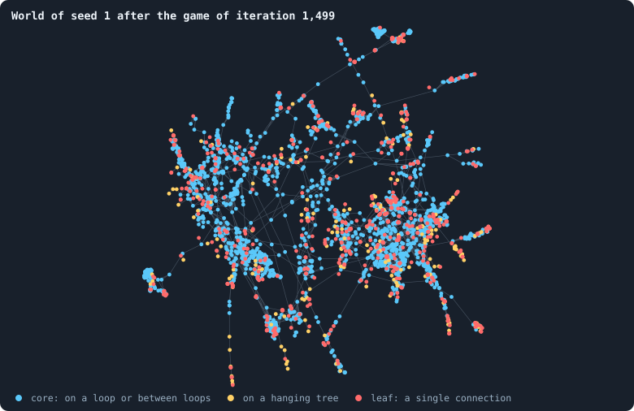

**World of seed 1 after the game of iteration 1,499.** The world with seed 1 after the game of iteration 1,499, the 2,495 of its 14,870 agents within 25 steps of agent 660,973, the oldest, 806 iterations old — a piece, since a world this large is a tangle when drawn whole: every agent drawn is a dot, every connection between two of them a line. Blue: agents in the core, which is what is left when agents with one connection or none are removed again and again until none remains ([Core, trees and leaves](bridges.md#core-trees-and-leaves)); yellow: the rest of the hanging trees; red: leaves, agents with a single connection. Where a dot is drawn means nothing in itself: a layout (networkx's ForceAtlas2, seed 1) pulls joined agents together and pushes the rest apart.

> [!example]- How to make this figure
> **Runs.** `B1-100000-s001`.
>
> **Data.** From each run's frames, `GraphOfLifeRuns/<run>/frames/`, read with `gol_store.read_frame(run, index)`; frame `2·t` is iteration *t* after reproduction and frame `2·t + 1` after the game.
>
> 1. Read frame `2999` (iteration 1,499, after the game): `ids` and `edges`.
> 2. Peel: remove every agent with one connection or none, again and again, until none is left; the agents never removed are the core. Leaves are agents with exactly one connection.
> 3. In a world of more than 2,500 agents, keep the agents within r steps of the oldest agent, for the largest r that keeps at most 2,500 (`book_chapters.society.shown`).
> 4. Lay the graph out with `networkx.forceatlas2_layout(G, max_iter=200, seed=1)`.
>
> **To make it again:** `python3 book_figures.py shape`.
<!-- /figure -->

The thousand founders on their ring have become a network of dense clusters
joined by thin paths, with many agents that hang on by a single connection.
[What shape does the network take?](what-shape-does-the-network-take.md) takes
this shape apart, and [The core of a world](what-shape-does-the-network-take.md#the-core-of-a-world) its core.

Any of the thirty worlds can be opened in the **Viewer** of the Graph of Life
app, which replays a run frame by frame.

### The questions of the baseline's study

Each page of the study asks the thirty worlds one question. The first two
are answered on this page.

- [A world's life](#a-worlds-life), below — What does a world do over 1,500
  iterations? Does it settle?
- [The first hundred iterations](#the-first-hundred-iterations), below — What
  happens in its first hundred iterations?
- [Births, deaths and ages](births-deaths-and-ages.md) — How often are agents
  born and how do they die? How old do they get?
- [How ages change over a world's life](births-deaths-and-ages.md#how-ages-change-over-a-worlds-life) — How do ages and
  lifespans change over a world's life?
- [How much does the seed decide?](how-much-does-the-seed-decide.md) — How
  much of what a world does is decided by its seed?
- [Where do the tokens go?](where-do-the-tokens-go.md) — Where do the tokens
  go — how unequal does a world become?
- [How the game is played](how-the-game-is-played.md) — How is the game
  played: where do agents stake, who wins the nodes?
- [What shape does the network take?](what-shape-does-the-network-take.md) —
  What shape does the network take?
- [Genotypes and lineages](genotypes-and-lineages.md) — How long do genotypes
  last, and do lineages take over?
- [What the brains are like](what-the-brains-are-like.md) and
  [What agents say to each other](what-agents-say-to-each-other.md) — What
  are the brains like, and what do agents say to each other?
- [Do the rich stay rich?](where-do-the-tokens-go.md#do-the-rich-stay-rich) — Do the rich stay rich?
- [How the network grows](how-agents-have-children.md#how-the-network-grows) — How does the network
  grow?
- [Like next to like](like-next-to-like.md) — Are neighbours alike?
- [How many dimensions does a world have?](how-many-dimensions-does-a-world-have.md)
  and [The core of a world](what-shape-does-the-network-take.md#the-core-of-a-world) — How many [dimensions](ball-dimension-and-curvature.md "How fast the number of agents within a distance grows with the distance: as its square in a plane, its cube in space.")
  does a world have, and its core?
- [What the baseline world is](what-the-baseline-world-is.md) — What the
  baseline world is, in sum.

Five of these pages were planned as experiments, Experiments 2 to 6:
[A world's life](#a-worlds-life),
[How much does the seed decide?](how-much-does-the-seed-decide.md),
[Where do the tokens go?](where-do-the-tokens-go.md),
[What shape does the network take?](what-shape-does-the-network-take.md) and
[Genotypes and lineages](genotypes-and-lineages.md). Each wrote down a thesis
before the runs of 10,000 tokens. Each quotes it, says whether it held there,
and tests it again on the worlds of 100,000 tokens. The other pages only ask.

## A world's life

What does a world do over its 1,500 iterations? Picture settlers landing on
an island with a fixed store of food. While food is plenty they have many
children, and their number grows fast. Then food runs short, and the
population levels off at what the island can feed. From then on, every
newcomer eats what someone else no longer has.

A world's tokens are such a store. Their number never changes, and every
agent needs at least one. A founder holds a hundred tokens and can afford
many children, so a world should grow fast at first. Then every birth has to
be paid for with tokens someone else loses. So we expected a world to grow
quickly to some size and then keep it, with births and deaths in balance: a
short youth, then a long, steady middle age. Before the thirty worlds of
10,000 tokens were run, Experiment 2 wrote this down as its thesis:

<!-- thesis E02 -->
> [!quote] The thesis of Experiment 2, written down before any of its runs existed
> **The claim.** A world has a short youth and a long, steady middle age. From its hundred founders it grows within the first hundred iterations to a population it then keeps, rising and falling around the same level, for the rest of its three thousand iterations. Births, deaths and connections settle the same way.
>
> **Why it would be so.** The token supply is fixed, and every agent needs at least one token, so the population has a ceiling it reaches quickly: a founder holds a hundred tokens and can afford many children. After that, every birth has to be paid for with tokens someone else loses, and starvation, pruning and conquest remove agents as fast as they arrive.
>
> **It holds if:** Across the thirty runs, the median population over iterations 100 to 200 is within 20% of its median over iterations 2,800 to 3,000, and the same holds for connections and births. No run dies out.
>
> **It fails if:** The population still trends up or down after iteration 200 by more than 20%, or swings between very different levels for long stretches, or some runs die out. Then a world has more than one phase of life, and the chapters after this one must say which phase they describe.
<!-- /thesis -->

The thesis was tested on those thirty small worlds, and again on the thirty
large ones of 100,000 tokens. Here is what the large worlds did, with the
small ones beside them wherever they differ.

### One world at a time

Here are six of the thirty worlds, seeds 1 to 6, each drawn alone and all on
the same scale. Each line is the number of agents alive after every game.

<!-- figure life/worlds -->
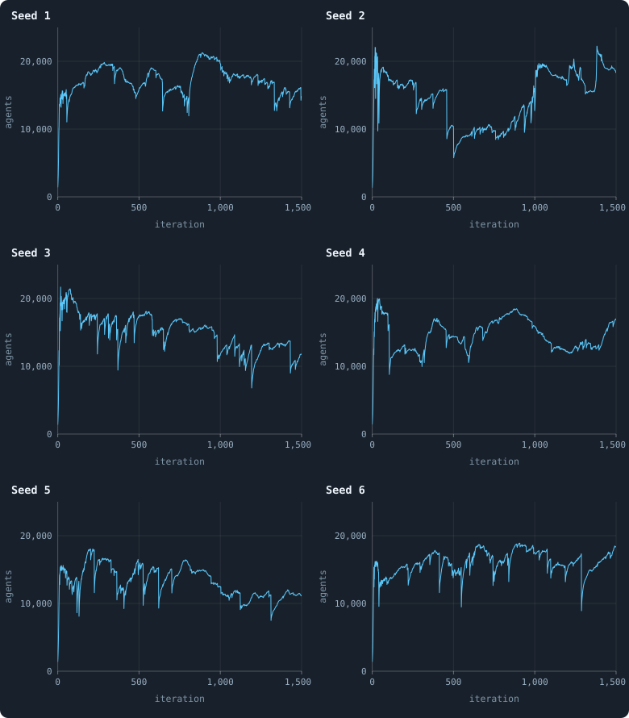

**Six worlds, one at a time.** The number of agents alive after every game in the worlds with seeds 1 to 6, each in a chart of its own and all on the same scale (0 to 25,000 agents, iterations 0 to 1,500). Each line has one point per iteration.

> [!example]- How to make this figure
> **Runs.** `B1-100000-s001` … `B1-100000-s006`, six of the 30 baseline runs (their settings are listed in [Thirty worlds](a-worlds-life.md#thirty-worlds)).
>
> **Data.** From each run's `GraphOfLifeRuns/<run>/stats.jsonl`, which holds one row per recorded phase: `phase` 1 is the world just after reproduction, `phase` 2 just after the game, and every statistic is a field of the row (see [What a run records](frames-and-stats.md)).
>
> 1. Take the rows with `phase` = 2.
> 2. Plot `nodes` against `iteration`, one point per iteration, joined.
>
> **To make it again:** `python3 book_figures.py life`.
<!-- /figure -->

Three things are visible in every one of them:

- **A youth.** Within the first twenty or so iterations, the 1,000 founders
  become well over ten thousand agents. The line jumps up and down before it
  settles into a calmer motion.
  [The first hundred iterations](#the-first-hundred-iterations) zooms in on
  this.
- **No fixed level.** After the youth, no world stays at one size. Each
  drifts, over hundreds of iterations, between roughly 10,000 and 20,000
  agents, and the six worlds drift differently.
- **Calm stretches and sudden falls.** In most stretches a world's size
  changes by a few hundred agents from one iteration to the next. Now and
  then it drops by thousands within a few games.

### All thirty together

To see all thirty at once, draw them as a band
([Bands: many worlds in one figure](median-and-quantiles.md#bands-many-worlds-in-one-figure)). The line is the typical world
at each moment, the median of the thirty; the shading shows how far the
others spread around it.

<!-- figure life/agents -->
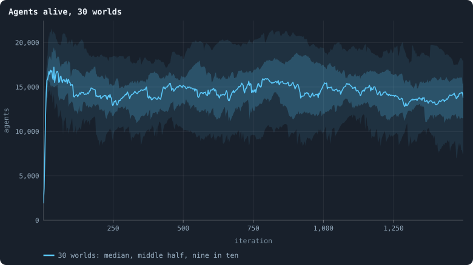

**Agents alive, 30 worlds.** The line is the median of the worlds at each iteration, the darker band holds the middle half of them (from the 25th to the 75th percentile) and the paler band nine in ten (5th to 95th). All 30 live to the end.

> [!example]- How to make this figure
> **Runs.** The 30 baseline runs `B1-100000-s001` … `B1-100000-s030`: the baseline B1 at 100,000 tokens, seeds 1 to 30, 1,500 iterations each (every setting is listed in [Thirty worlds](a-worlds-life.md#thirty-worlds)). They are made with `python3 gol_lab.py run E10`.
>
> **Data.** From each run's `GraphOfLifeRuns/<run>/stats.jsonl`, which holds one row per recorded phase: `phase` 1 is the world just after reproduction, `phase` 2 just after the game, and every statistic is a field of the row (see [What a run records](frames-and-stats.md)).
>
> 1. Take every run's rows with `phase` = 2 and the statistic `nodes`.
> 2. Cut the 1,500 iterations into 600 stretches of 2.5 and take each world's mean in each stretch.
> 3. In each stretch, take the median, the 25th and 75th and the 5th and 95th percentiles of those means over the worlds that still have a value there (a world that died has none after its death).
>
> **To make it again:** `python3 book_figures.py life`.
<!-- /figure -->

The band shows something the single worlds do not. Every world wanders, yet
the **typical** world hardly changes after its youth. From iteration 100 to
the end, the median of the thirty worlds stays between about 13,300 and
15,500 agents nine tenths of the time. That is within 7% of its middle. The
worlds of 10,000 tokens stayed within 15% of theirs (1,070 to 1,450 agents).

Ten times the tokens hold eleven times the agents: 0.14 agents per token,
where the smaller worlds held 0.13. That is a little more than the strict
proportion that
[How does a world's size follow its tokens?](how-does-a-worlds-size-follow-its-tokens.md)
found over a shorter life. And the typical large world holds stiller.

### Each world, early and late

How far does a single world move? Measure each world twice: by its mean
number of agents over iterations 100 to 200, early in its settled life, and
over iterations 1,300 to 1,499, at its end. Then join the two:

<!-- figure life/early-late -->
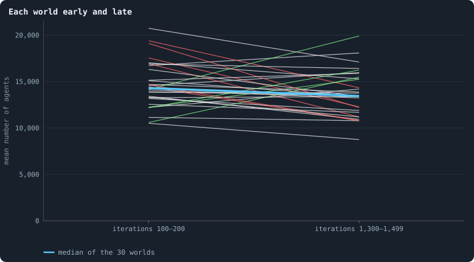

**Each world early and late.** One line per world, from its mean number of agents over iterations 100–200 (left) to its mean over iterations 1,300–1,499 (right). Green: the late mean is more than 1.2 times the early one; red: less than 0.8 times; grey: in between. The thick blue line joins the medians of the 30 worlds.

> [!example]- How to make this figure
> **Runs.** The 30 baseline runs `B1-100000-s001` … `B1-100000-s030`: the baseline B1 at 100,000 tokens, seeds 1 to 30, 1,500 iterations each (every setting is listed in [Thirty worlds](a-worlds-life.md#thirty-worlds)). They are made with `python3 gol_lab.py run E10`.
>
> **Data.** From each run's `GraphOfLifeRuns/<run>/stats.jsonl`, which holds one row per recorded phase: `phase` 1 is the world just after reproduction, `phase` 2 just after the game, and every statistic is a field of the row (see [What a run records](frames-and-stats.md)).
>
> 1. For each run that reached iteration 1,500, take the rows with `phase` = 2.
> 2. Average `nodes` over the rows with 100 ≤ `iteration` ≤ 200, and again over 1,300 ≤ `iteration` ≤ 1,499.
> 3. Draw one line from the first mean to the second; colour it by their ratio.
> 4. Join the two medians over the 30 runs.
>
> **To make it again:** `python3 book_figures.py life`.
<!-- /figure -->

The median hardly moves: 14,300 agents early, 13,440 late. And single worlds
move less than they did at 10,000 tokens. Of the 30 lines, 20 stay within a
fifth of where they began; 4 end more than a fifth higher, and 6 more than a
fifth lower. The most extreme worlds ended with 0.64 and 1.46 times their
early size. Over a run twice as long, the worlds of 10,000 tokens had ended
between 0.38 and 4.6 times theirs, and only 8 of 26 within a fifth.

Some of the difference is the shorter run: a wander has less time to go far.
Some is size: the same number of games moves a large world by a smaller share
of itself. **A typical world exists, and at this size a single world stays
closer to it** — but not close.
[How much does the seed decide?](how-much-does-the-seed-decide.md) measures
the wandering, and asks how much of it the seed decides.

### Connections

<!-- figure life/connections -->
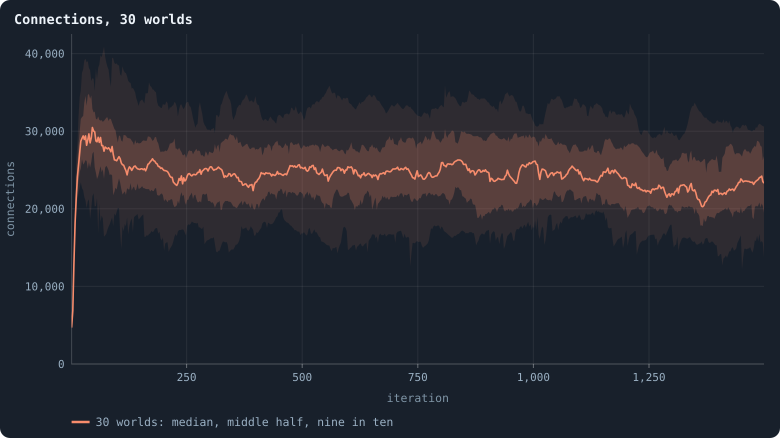

**Connections, 30 worlds.** The number of connections after every game. The line is the median of the worlds at each iteration, the darker band holds the middle half of them (from the 25th to the 75th percentile) and the paler band nine in ten (5th to 95th).

> [!example]- How to make this figure
> **Runs.** The 30 baseline runs `B1-100000-s001` … `B1-100000-s030`: the baseline B1 at 100,000 tokens, seeds 1 to 30, 1,500 iterations each (every setting is listed in [Thirty worlds](a-worlds-life.md#thirty-worlds)). They are made with `python3 gol_lab.py run E10`.
>
> **Data.** From each run's `GraphOfLifeRuns/<run>/stats.jsonl`, which holds one row per recorded phase: `phase` 1 is the world just after reproduction, `phase` 2 just after the game, and every statistic is a field of the row (see [What a run records](frames-and-stats.md)).
>
> 1. Take every run's rows with `phase` = 2 and the statistic `edges`.
> 2. Cut the 1,500 iterations into 600 stretches of 2.5 and take each world's mean in each stretch.
> 3. In each stretch, take the median, the 25th and 75th and the 5th and 95th percentiles of those means over the worlds that still have a value there (a world that died has none after its death).
>
> **To make it again:** `python3 book_figures.py life`.
<!-- /figure -->

The number of connections follows the number of agents, at about 1.7
connections per agent. A connection has two ends, so an agent has about 3.5
connections on average: its mean [degree](degree.md "The number of an agent's connections: how many neighbours it has."). Every agent is joined to three or
four others ([What shape does the network take?](what-shape-does-the-network-take.md)).
The median number of connections was 24,730 over iterations 100 to 200, and
22,570 over the last two hundred: 9% fewer. The worlds of 10,000 tokens had
6% more late than early.

### Births and deaths slow down

The population holds, but its turnover does not. Over iterations 100 to 200
the median world had 656 births per iteration; over its last two hundred
iterations, 470, which is 28% fewer. Deaths fell with them. Agents that
starved in the game, because nobody, not even themselves, staked a token on
their node, fell from 141 per iteration to 93. Agents cut off in the game, on
a piece of the network apart from the largest, fell from 411 to 283. Fewer
births and fewer deaths, around a population of about the same size, mean
that the living get older.

But the slowing is over early. From iteration 500 on, the median world has
between 3.3 and 3.6 births per hundred agents in every stretch of 250
iterations. The ages of the living stop changing too
([How ages change over a world's life](births-deaths-and-ages.md#how-ages-change-over-a-worlds-life)). So most of the
28% fell before iteration 500. At 10,000 tokens the slowing went on far
longer. There, births per hundred agents kept falling until about iteration
1,250, and the number of births fell by 41% from iterations 100–200 to
2,800–2,999.

### No world died — but one came close

None of the thirty worlds died: every one lived through its 1,500 iterations.
(A world counts as dead when an iteration ends with 20 agents or fewer;
[When a world ends](extinction.md) says why.) At 10,000 tokens four of thirty
had died out, one in its fourth iteration and three after long declines. A
world that small can lose its last agents to a few bad games. A world of
15,000 agents has more to lose.

It can still lose most of it. The world with seed 28 held 17,800 agents at
iteration 1,394. In the game of iteration 1,395 it lost 2,390 of them to a
single cut: the network broke in one place, and the piece beyond the break
died. Then, game after game, it lost another large piece: 901 agents, 1,730,
4,060, 2,868, 1,344, 960. Before most of these games, the worst single cut of
the network threatened a seventh to a third of the world
([Cut risk](bridges.md#cut-risk)), against a hundredth or two on an ordinary day.
Births fell from 499 per iteration to 26.

Ten games after the first cut, 2,137 agents were left. At iteration 1,416 one
more cut took the world to 1,405 agents, the smallest any of the thirty
worlds was after its youth. Then it grew again, to 7,400 by the end. No
other world fell that low: the next-smallest low of any world was 5,070.
[How a world breaks](how-a-world-breaks.md) takes such breakdowns apart.

### Was the thesis right?

On the worlds of 10,000 tokens the thesis was **refuted**. Two of its tests
passed. The median number of agents was 1,367 over iterations 100–200, among
the 29 worlds alive then, and 1,236 over 2,800–2,999, among the 26 alive
then: 10% fewer. The median number of connections was 2,037 and 2,161: 6%
more. Both stayed within the 20% the thesis allowed. Two tests failed: births
fell by 41%, and four worlds of thirty died out, where the thesis allowed
none. And what the thesis did not test failed too: single worlds wandered far
from where they began.

On the worlds of 100,000 tokens, with the late stretch moved to their last
200 iterations (1,300–1,499), the thesis is refuted again, but on one count
only. Agents (6% fewer late than early) and connections (9% fewer) stay within
20%, and no world died out. Births still fall too much: by 28%. Single worlds
wander less, but still by up to half their size.

So a world has more than one phase of life:

- a **youth** of about a hundred iterations;
- a long **middle**, in which the *typical* world holds still while every
  *single* world wanders, and turnover slows — for a few hundred iterations
  in a large world, for over a thousand in a small one;
- and, for a small world, a **decline** that can end in death.

A large world is safer from dying, not from falling: it can lose nine tenths
of itself in ten games and live.

## The first hundred iterations

Every world begins with a youth unlike the rest of its life
([One world at a time](#one-world-at-a-time)). This section looks at it
closely: how a thousand founders become more than ten thousand agents, how
most of them die, and how the founders' lines narrow down. The youth of the
worlds of 100,000 tokens is that of the worlds of 10,000 tokens ten times
over, and a little faster. Where the two differ, the text says so.

### A boom and a crash

<!-- figure youth/boom -->
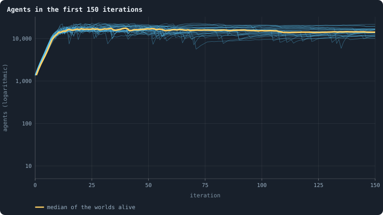

**Agents in the first 150 iterations.** Each thin blue line is one of the 30 worlds: the number of agents alive after every game. The yellow line is their median. The axis is logarithmic, so equal heights are equal factors: the step from 100 to 1,000 is as tall as the one from 1,000 to 10,000.

> [!example]- How to make this figure
> **Runs.** The 30 baseline runs `B1-100000-s001` … `B1-100000-s030`: the baseline B1 at 100,000 tokens, seeds 1 to 30, 1,500 iterations each (every setting is listed in [Thirty worlds](a-worlds-life.md#thirty-worlds)). They are made with `python3 gol_lab.py run E10`.
>
> **Data.** From each run's `GraphOfLifeRuns/<run>/stats.jsonl`, which holds one row per recorded phase: `phase` 1 is the world just after reproduction, `phase` 2 just after the game, and every statistic is a field of the row (see [What a run records](frames-and-stats.md)).
>
> 1. Take every run's rows with `phase` = 2 and 0 ≤ `iteration` ≤ 150.
> 2. Draw `nodes` against `iteration` for each run.
> 3. At each iteration, take the median of `nodes` over the runs that have a row there.
>
> **To make it again:** `python3 book_figures.py youth`.
<!-- /figure -->

At the start every founder holds a hundred tokens, and has a brain nobody
has selected. In the first reproduction phase most of them give a large part
of their tokens to a child: a median of half ([The brain](the-brain.md)). The
children give in turn. The median world grows from 1,000 founders to 1,370
agents after the first game (that of iteration 0), 4,050 after the game of
iteration 5, 12,480 after that of iteration 10 and 16,200 after that of
iteration 20. The median of the thirty worlds peaks at about 17,400 agents
around iteration 39, falls back, and is near 15,000 at iteration 100.

The axis is logarithmic: equal heights are equal factors
([Logarithmic axes and power laws](correlation.md#logarithmic-axes-and-power-laws)). On it, steady
growth by a constant factor per iteration is a straight line, and the first
ten or so iterations are close to one. The population doubles about every
three iterations. That is a little faster than in the worlds of 10,000
tokens, which doubled about every three and a half. They had only grown
sevenfold by iteration 10, where these grew ninefold. Then the lines break,
and many fall steeply for a few iterations: the boom ends in a crash.

### Where the agents come from, and where they go

<!-- figure youth/flows -->
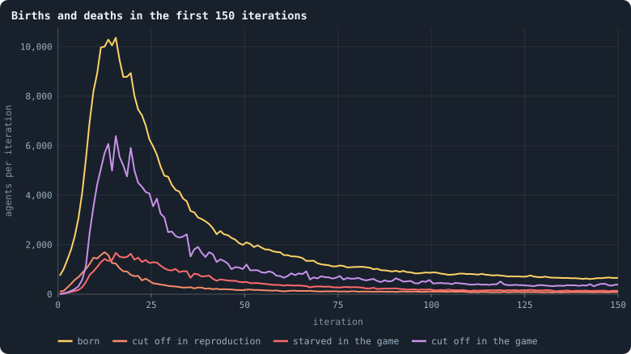

**Births and deaths in the first 150 iterations.** For each iteration, the median over the worlds of: the children born in the reproduction phase (yellow); the agents removed by the cleanup of that phase because they were joined to no one or to a piece smaller than the largest (orange — mostly newborns joined to no one); the agents removed by the cleanup of the game because nobody, not even themselves, staked a token on their node (red); and those removed in the game's cleanup because they were cut off (violet).

> [!example]- How to make this figure
> **Runs.** The 30 baseline runs `B1-100000-s001` … `B1-100000-s030`: the baseline B1 at 100,000 tokens, seeds 1 to 30, 1,500 iterations each (every setting is listed in [Thirty worlds](a-worlds-life.md#thirty-worlds)). They are made with `python3 gol_lab.py run E10`.
>
> **Data.** From each run's `GraphOfLifeRuns/<run>/stats.jsonl`, which holds one row per recorded phase: `phase` 1 is the world just after reproduction, `phase` 2 just after the game, and every statistic is a field of the row (see [What a run records](frames-and-stats.md)).
>
> 1. For iterations 0 to 150, take `births` and `orphaned` from the rows with `phase` = 1, and `starved` and `orphaned` from the rows with `phase` = 2.
> 2. At each iteration, take the median of each over the runs that have a row there.
>
> **To make it again:** `python3 book_figures.py youth`.
<!-- /figure -->

Births peak at a median of 10,360 in the reproduction phase of iteration 15.
Deaths follow. Agents cut off in the game peak at 6,390 per iteration in the
same iteration, and starvation at 1,670. So the crash is mostly the network
breaking apart: at the peak, nearly four agents are cut off for every one
that starves (five at 10,000 tokens).

Why does the network break so easily in the boom? A newborn is joined to
those of its parent's candidates — the parent itself and its neighbours —
that the parent's brain picks
([One iteration, step by step](one-iteration.md)). Every one of those
connections is cut at the end of the game unless tokens cross it. In the
boom, most agents hold a few tokens, and many new connections carry nothing.
Whole branches of the network lose their link to the largest piece, and are
removed with everyone on them.

<!-- figure youth/children-share -->
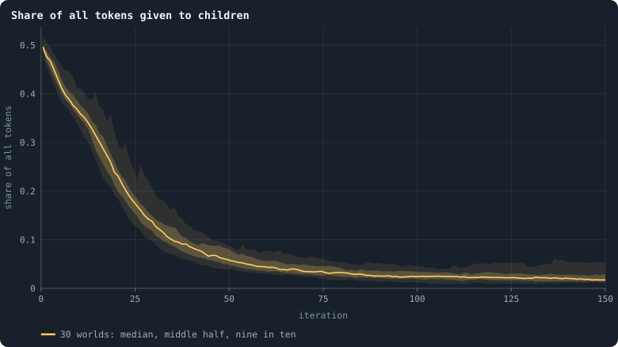

**Share of all tokens given to children.** In each reproduction phase, the tokens all parents together gave their children, as a share of all 100,000 tokens. The line is the median of the worlds at each iteration, the darker band holds the middle half of them (from the 25th to the 75th percentile) and the paler band nine in ten (5th to 95th), here at every single iteration.

> [!example]- How to make this figure
> **Runs.** The 30 baseline runs `B1-100000-s001` … `B1-100000-s030`: the baseline B1 at 100,000 tokens, seeds 1 to 30, 1,500 iterations each (every setting is listed in [Thirty worlds](a-worlds-life.md#thirty-worlds)). They are made with `python3 gol_lab.py run E10`.
>
> **Data.** From each run's `GraphOfLifeRuns/<run>/stats.jsonl`, which holds one row per recorded phase: `phase` 1 is the world just after reproduction, `phase` 2 just after the game, and every statistic is a field of the row (see [What a run records](frames-and-stats.md)).
>
> 1. Take the rows with `phase` = 1 and 0 ≤ `iteration` ≤ 150, and the statistic `reproTokenShare` — the sum of `invested` over the births of that phase, divided by the 100,000 tokens.
> 2. At each iteration take the median, quartiles and 5th and 95th percentiles over the runs.
>
> **To make it again:** `python3 book_figures.py youth`.
<!-- /figure -->

Giving so much to children does not last. In the first reproduction phase,
parents together gave 50% of all tokens to their children; at iteration 10,
37%; at iteration 20, 24%; at iteration 50, 6%; at iteration 100, 2%. That
is almost exactly as in the worlds of 10,000 tokens.

Two things lower it. First, far fewer agents have a child at all: about 74
births for every hundred agents in each of the first ten iterations, about
3.5 in a settled world ([Births, deaths and ages](births-deaths-and-ages.md)).
Second, parents give smaller shares ([The brain](the-brain.md)).

Part of the first is plain rounding. A parent gives ⌊*f* · τ⌋ tokens: the
share *f* its brain picks, times the τ tokens it holds, rounded down. So an
agent holding 3 tokens that would give a fifth gives ⌊0.6⌋ = 0, and has no
child. The founders held 100 tokens each; the median agent of a settled
world holds about 4.5 ([Where do the tokens go?](where-do-the-tokens-go.md)).

### A bottleneck of lines

<!-- figure youth/families -->
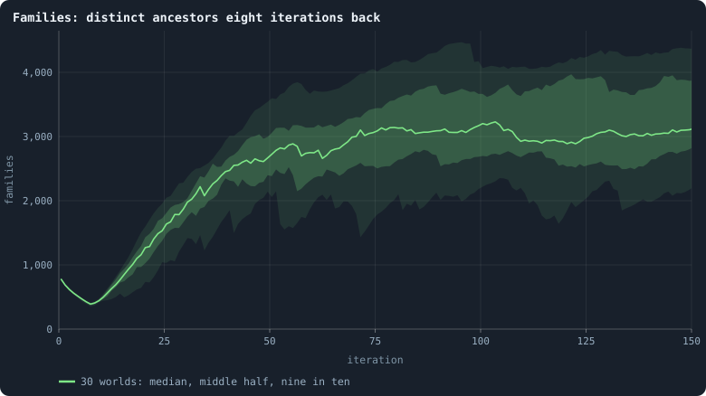

**Families: distinct ancestors eight iterations back.** After every game, how many different genotypes of eight iterations earlier the living descend from (before iteration 8: how many founders). The line is the median of the worlds at each iteration, the darker band holds the middle half of them (from the 25th to the 75th percentile) and the paler band nine in ten (5th to 95th), at every iteration.

> [!example]- How to make this figure
> **Runs.** The 30 baseline runs `B1-100000-s001` … `B1-100000-s030`: the baseline B1 at 100,000 tokens, seeds 1 to 30, 1,500 iterations each (every setting is listed in [Thirty worlds](a-worlds-life.md#thirty-worlds)). They are made with `python3 gol_lab.py run E10`.
>
> **Data.** From each run's `GraphOfLifeRuns/<run>/stats.jsonl`, which holds one row per recorded phase: `phase` 1 is the world just after reproduction, `phase` 2 just after the game, and every statistic is a field of the row (see [What a run records](frames-and-stats.md)).
>
> 1. Take the rows with `phase` = 2 and 0 ≤ `iteration` ≤ 150, and the statistic `cladesInWindow` ([Families](genotype.md#families): for every living agent, follow its genotype's parents back to the newest one born at or before iteration t − 8, or to a founder's; count the distinct ones).
> 2. At each iteration take the median, quartiles and 5th and 95th percentiles over the runs.
>
> **To make it again:** `python3 book_figures.py youth`.
<!-- /figure -->

Every brain has a genotype: an identity that a copy keeps and a change
replaces ([Genotypes and the family tree](genotype.md)). The number of
**families** counts the different genotypes of eight iterations earlier that
the living descend from ([Families](genotype.md#families)). Before iteration 8,
"eight iterations earlier" is before the world began. So there it counts how
many of the 1,000 founders still have descendants.

The count falls fast. In the median world, around iteration 8, the living
descend from about 390 of the founders. Later the count rises again, because
by then there are many more genotypes to descend from.

The bottleneck is narrower in a small world. The worlds of 10,000 tokens kept
about 19 of their 100 founders, a fifth, where these keep two fifths. A
larger world has more places where a line can hold out for a while.

Why do lines die so fast? In the game, a node that is won takes on the
**winner's brain**. A founder whose node is won, and whose children's nodes
are won, has no descendants left, even though its node still exists.

Following the strongest founders' lines in one world shows how one of them
takes over:

<!-- figure youth/founder-lines -->
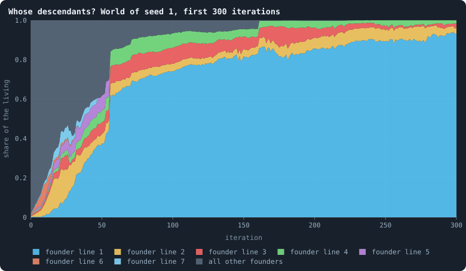

**Whose descendants? World of seed 1, first 300 iterations.** After every game, the share of the living agents that descend from each of the 1,000 founders, stacked. Each coloured layer is the line of one founder; the seven founders whose lines ever held the most are drawn in colour, the other 993 together in grey (most of them with no descendants alive at all). Where a layer reaches the full height, everyone alive descends from that founder.

> [!example]- How to make this figure
> **Runs.** `B1-100000-s001`, one of the 30 baseline runs.
>
> **Data.** From each run's frames, `GraphOfLifeRuns/<run>/frames/`, read with `gol_store.read_frame(run, index)`; frame `2·t` is iteration *t* after reproduction and frame `2·t + 1` after the game.
>
> 1. Read every frame in order and remember each genotype's parent genotype (`brain_ids`, `parent_brain_ids`).
> 2. After each game up to iteration 300, follow every living agent's genotype back to its founder and count the agents per founder; divide by the number of agents.
> 3. Stack the shares, the founders with the largest share ever at the bottom.
>
> **To make it again:** `python3 book_figures.py youth`.
<!-- /figure -->

In the world with seed 1, no founder's descendants hold more than 8% of the
world at iteration 10. Then one line pulls ahead. It holds 38% at iteration
50, 74% at iteration 100, 86% at iteration 200 and 93% at iteration 300, with
three other lines still alive beside it. In the smaller world of the same
seed, one line held 52% after ten iterations, and every agent descended from
one founder soon after iteration 300. This one got there at iteration 825.

### One founder for everyone

How soon does every agent of a world descend from one founder? Every 25
iterations, the family tree of genotypes was climbed from the living
([The common ancestor of the living](genotype.md#the-common-ancestor-of-the-living) explains how). The
first check at which every living agent descends from one and the same
founder was noted:

<!-- figure youth/one-founder -->
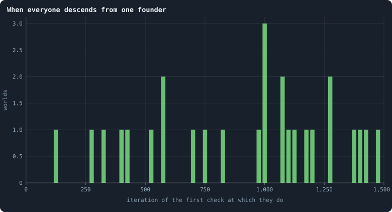

**When everyone descends from one founder.** For each world, the first of the checks — made every 25 iterations — at which every living agent descends from one and the same founder. 27 of the 30 worlds got there; the world with seed 13 never did; the world with seed 18 never did; the world with seed 20 never did.

> [!example]- How to make this figure
> **Runs.** The 30 baseline runs `B1-100000-s001` … `B1-100000-s030`: the baseline B1 at 100,000 tokens, seeds 1 to 30, 1,500 iterations each (every setting is listed in [Thirty worlds](a-worlds-life.md#thirty-worlds)). They are made with `python3 gol_lab.py run E10`.
>
> **Data.** From the runs' frames, through the lineage analysis of Experiment 10 (`python3 gol_lab.py analyse E10`), whose results file `book/results/E10.json` holds every run's `oneFounder`.
>
> 1. Read every frame of a run in order and remember, for every genotype (brain id), the genotype it was copied from (`parent_brain_ids`).
> 2. After the game of every 25th iteration, follow every living agent's genotype back through its parents to a founder's genotype (one with no parent).
> 3. The first iteration at which they all lead to the same founder is the world's value.
> 4. Count the worlds at each value.
>
> **To make it again:** `python3 book_figures.py youth`.
<!-- /figure -->

Of the thirty worlds, 27 got there within their 1,500 iterations. The
fastest did by iteration 125, a quarter by iteration 575, half of the 27 by
iteration 1,000, and the slowest at 1,475. Three worlds, those with seeds 13,
18 and 20, still descended from more than one founder at their last check.

Not one world got there within its first hundred iterations. Of the thirty
smaller worlds, 13 did, and half had done so by iteration 175. **A world ten
times the size takes about six times as long to come down to a single
founder.** [Worlds of 100,000 tokens](how-does-a-worlds-size-follow-its-tokens.md#worlds-of-100000-tokens) reads in
that pace that a line spreads through a world as a random walk spreads, not
as a front.

By then the other 999 founders' lines are gone. A line ends when the last
agent carrying one of its brains either dies, or has its node won by an
agent of another line, whose brain then replaces its own.

### What the youth means

The youth of a world is a boom, a crash and a bottleneck, at either size.
Its numbers are unlike anything later in a world's life: about 74 births per
hundred agents in each of the first ten iterations, some twenty times the
settled rate, and families falling from a thousand to about four hundred.
That is why the rest of the notebook measures settled worlds from iteration
500 on ([The settled life of a world](median-and-quantiles.md#the-settled-life-of-a-world)).

A large world comes through its bottleneck with more lines, and keeps them
longer: three of thirty had not come down to one founder after 1,500
iterations. Once a world has, every agent in it is, in its brain, a
descendant of one founder. Whatever diversity of brains a world later holds,
it has made since.

The youth is also when the brains learn.
[How to tell a world that keeps evolving](how-to-tell-a-world-that-keeps-evolving.md)
played the brains of a world at different moments, its [eras](eras-and-contests.md "Brains of a world at two moments, its eras, played against each other: do the later ones win?"), against each
other, in ten worlds of 5,000 tokens (Experiment 12). By iteration 50 the
brains of every world beat their founders': in the median world they hold
nine tenths of a world contested with them. Every later era ties with the one
before it. Whatever the brains of a world learn, they learn in its youth.

## What we learned

- **The youth is unlike the rest of a world's life.** Within twenty
  iterations a world booms to well over ten thousand agents. Then its network
  breaks apart, and most of its founders' lines die. Whatever the brains
  learn, they learn then.
- **A typical world exists; single worlds wander around it.** After the
  youth, the median of thirty worlds of 100,000 tokens stays within 7% of its
  middle. A single world ends anywhere from about two thirds to one and a half
  times its early size. Where a world stands at iteration 1,500 is a moment in
  a wander; its mean over a long stretch says more
  ([How much does the seed decide?](how-much-does-the-seed-decide.md)).
- **Turnover settles late.** Births and deaths slow down until about
  iteration 500 in a large world, and until about 1,250 in a small one.
  Whatever depends on them, such as the ages of the living, settles only
  then. So the notebook measures a settled world from iteration 500 on.
- **Size protects a world from dying, not from falling.** None of the thirty
  large worlds died, where four of thirty small ones did. But one large world
  lost nine tenths of itself in ten games.
- **In the end, one founder for everyone.** In 27 of the 30 worlds every
  agent came to descend from a single founder; a world ten times the size
  takes about six times as long. Whatever diversity of brains a settled world
  holds, it has made since.
- **Experiment 2's thesis was refuted at both sizes.** Births fell by 28%
  (41% in the small worlds), and four small worlds died. A world has more
  than one phase of life.

## Where to go next

- [How much does the seed decide?](how-much-does-the-seed-decide.md): how far
  single worlds wander, and how much of it their seed decides.
- [Births, deaths and ages](births-deaths-and-ages.md): who is born and who
  dies in a settled world, and how old agents get.
- [The settled life of a world](median-and-quantiles.md#the-settled-life-of-a-world): why the notebook measures a
  world from iteration 500 on.
- [What the baseline world is](what-the-baseline-world-is.md): the whole study
  of the baseline, in sum.

## How this was made

Every figure of this page reads the thirty runs of Experiment 10, listed
below. To make them again you need a computer with Python 3, numpy and
networkx, and a copy of this repository. Then `python3 gol_lab.py run E10`
makes the runs into the folder `GraphOfLifeRuns/`. A run of 1,500 iterations
at this size takes about seven hours on one core. The thirty took 211 hours
of computing in all, done in a little over two days on four processor cores,
and they fill 58 GB. The thirty worlds of 10,000 tokens take an eighth of the
computing in all, and show most of the same things.

From the runs, `python3 book_figures.py life` draws the figures of
[A world's life](#a-worlds-life), `python3 book_figures.py youth` those of
[The first hundred iterations](#the-first-hundred-iterations), and
`python3 book_figures.py shape` the first look at a world, together with the
figures of [What shape does the network take?](what-shape-does-the-network-take.md).
`python3 book_figures.py` alone redraws the figures of every page. Each
figure says, folded beneath it, which of the runs it reads and how.

A few figures on other pages set worlds of different sizes side by side: in
[How ages change over a world's life](births-deaths-and-ages.md#how-ages-change-over-a-worlds-life),
[How many dimensions does a world have?](how-many-dimensions-does-a-world-have.md),
[The core of a world](what-shape-does-the-network-take.md#the-core-of-a-world) and
[The largest and the smallest](the-largest-and-the-smallest.md). They also
read the thirty worlds of 10,000 tokens (`python3 gol_lab.py run E02`), or
the worlds of every size of
[How does a world's size follow its tokens?](how-does-a-worlds-size-follow-its-tokens.md)
(`python3 gol_lab.py run E08`).

### The runs of Experiment 10

<!-- runs E10 -->
> [!info]- The runs behind this page
> **30 runs.** Every condition below is run once for every seed (1 to 30), for 1,500 iterations — or until its world dies out. Every setting is that of the baseline **B1** (the algorithm exactly as a new run is offered it) unless the condition changes it.
>
> - **baseline** — changes nothing: B1 as it is; 100,000 tokens. Runs `B1-100000-s001` … `B1-100000-s030`.
>
> To make these runs again: `python3 gol_lab.py run E10`, or ▶ in the Research Notebook tab of a computer running `gol_server.py`. Each run writes its settings, seed and engine version beside its frames, in `GraphOfLifeRuns/<run>/meta.json` and `provenance.json`.

> [!info]- Every setting of these runs
> | setting | baseline | what it is |
> |---|---|---|
> | [`total_tokens`](settings.md#total_tokens) | 100,000 | The number of tokens in the world, *T*. It never changes during a run. |
> | [`n_nodes`](settings.md#n_nodes) | 0 | How many founders the world starts with. 0 means one founder per hundred tokens: *n* = ⌊*T* / 100⌋. |
> | [`k_neighbors`](settings.md#k_neighbors) | 0 | How many neighbours each founder starts with in the ring. 0 means *k* = max(⌊*n* / 100⌋, 5); an odd *k* is wired as *k* − 1. |
> | [`rewire_p`](settings.md#rewire_p) | 0.2 | In the starting ring, the probability that a connection is moved to a founder chosen at random (Watts–Strogatz). |
> | [`hidden_layers`](settings.md#hidden_layers) | 50, 45, 40, 35, 30 | The widths of the brain's hidden layers, in order from input to output. |
> | [`brain_kind`](settings.md#brain_kind) | float16 | How weights are stored: `float` (64-bit), `float16` (16-bit, computed in 64-bit) or `binary` (−1, 0, +1). |
> | [`brain_bits`](settings.md#brain_bits) | 16 | Only for binary brains: how many input rows encode one number. Unused by float and float16 brains. |
> | [`message_amount`](settings.md#message_amount) | 30 | How many numbers one message holds. Each agent sends one message to itself and one to each neighbour, every phase. |
> | [`random_input_amount`](settings.md#random_input_amount) | 5 | How many random numbers, drawn uniformly from −2 to 2, a brain reads per neighbour, every time it looks. |
> | [`exchange_messages`](settings.md#exchange_messages) | on | Whether agents send and read messages at all. |
> | [`message_prepass`](settings.md#message_prepass) | on | Whether every phase begins with an extra look in which agents only write messages, so the look that acts reads messages written this phase. |
> | [`allow_handover`](settings.md#allow_handover) | on | Whether a parent may move some of its own connections to its newborn child. |
> | [`allow_revolutions`](settings.md#allow_revolutions) | on | Whether a coalition of smaller stakers can take a node from its largest staker (see the note *How a coalition takes a node*). |
> | [`allow_gifting`](settings.md#allow_gifting) | off | Whether agents may give tokens to neighbours during reproduction. Off in both baselines; on in a few pilots, in Experiment 24 and in half the worlds of the screen. |
> | [`random_decisions`](settings.md#random_decisions) | off | The control: every number a brain would produce is replaced by a random draw from the standard normal distribution. |
> | [`prune_after`](settings.md#prune_after) | blotto | After which phase connections that carried no tokens are cut: `blotto` (the game), `reproduction`, or `both`. |
> | [`inactive_window`](settings.md#inactive_window) | phase | How long a connection may go unused: `phase` means it must carry tokens in the phase being judged; `iteration` allows the two last phases. |
> | [`redistribution`](settings.md#redistribution) | uniform | How the tokens of removed agents are shared: `uniform` gives every survivor the same chance at each token; `by_tokens` weights by what a survivor holds; `poorest` raises the poorest to one common level first; `newborns` gives them to this iteration's children, `parents` to their parents, once per child (both `uniform` in an iteration without births); `children` leaves each dead agent's estate to its own living children (`uniform` where there are none). |
> | [`tokens_created_per_phase`](settings.md#tokens_created_per_phase) | 0 | Tokens added to the world at every cleanup. 0 keeps the supply fixed. |
> | [`mutate_on_replication`](settings.md#mutate_on_replication) | off | Whether a brain changes only when it is copied — into a newborn, or into a node its owner has just won — instead of also after every game, wherever it sits. |
> | [`incumbency`](settings.md#incumbency) | 1.0 | How many times over an agent's stake on its own node counts when the game decides who takes the node. 1 is the old rule. |
> | [`birth_links`](settings.md#birth_links) | 0 | How many of its parent's neighbours a newborn is joined to, drawn at random, besides its parent itself; 0 leaves every link to the brain's choice. |
> | [`mend_on_death`](settings.md#mend_on_death) | off | Whether the neighbours of an agent that dies are joined up where its death would leave them in separate pieces. |
> | [`prune_needs`](settings.md#prune_needs) | 0 | How many neighbours the two ends of an unused connection must share for it to be cut; 0 cuts every unused connection. |
> | [`valence`](settings.md#valence) | 0 | The most connections an agent's brain may choose to hold (0 = no limit). An agent at its limit cannot have a child. |
> | [`keep_home`](settings.md#keep_home) | 0.0 | The share of an agent's tokens — rounded up, never less than one — that stays on its own node whatever its brain says; a parent also keeps one. 0 is the old rule. |
> | [`max_age`](settings.md#max_age) | 0 | The age at which an agent dies (0 = never); its tokens are shared out like those of any other dead agent. |
> | [`buy_life`](settings.md#buy_life) | off | Whether an agent that has reached max_age may live on by paying one token an iteration into the estate of the dead — never its last, so one with a single token left dies. Needs max_age. |
> | [`min_child`](settings.md#min_child) | 1 | The fewest tokens a child can be born with; a parent that would give less has no child. |
> | [`child_floor`](settings.md#child_floor) | fixed | The least a child may start with: min_child alone (fixed), or also the median holding of its parent's neighbours (neighbours), so that a world grows only as rich as it is. |
> | [`mix_at_birth`](settings.md#mix_at_birth) | off | Whether a newborn's brain is its parent's mixed with a mate's — one of the parent's neighbours, drawn at random — each hidden unit whole from one or the other by an even chance, before it mutates; off, a newborn has a copy of its parent's brain. |
> | [`mix_mates`](settings.md#mix_mates) | any | Under mix_at_birth, who may be the mate: any neighbour of the parent, or only parents — a neighbour with a living child of its own (with none, the newborn's brain is a copy). |
> | [`self_message`](settings.md#self_message) | own | What an agent writes to itself, which each neighbour reads: what its own column says (own), or the largest, number by number, of what it writes to anyone (largest), so that news one column marks reaches every neighbour. |
> | [`link_search`](settings.md#link_search) | off | Whether an agent may reach beyond its neighbours to propose a link: off; jump, a walk as many steps long as the tokens it spends in one iteration, with a link proposed where it ends; walk, a scout that goes one step further in every iteration it pays for; or reach, a jump whose steps are free, as many as the tokens it holds would pay for. A paid step costs one token, paid to the agent it enters, and never the last. |
> | [`link_steering`](settings.md#link_steering) | random | Which way each step of a search goes: to a neighbour drawn at random, or to the one the searcher would most like a link with (looking). |
> | [`link_consent`](settings.md#link_consent) | mutual | Who has to agree to a link a search proposes: both ends (mutual), or only the one who proposes (forced). Nobody at its valence gets a new link either way. |
> | [`proto`](settings.md#proto) | none | Rules first played in the pilots' prototype, by name: came_from and helped_by (an input row each), contest = lottery, pool by genotype or family, kin_sense, tag_rate, mate_pays, grow, unit_token, link_token. Empty in every run but those that ask for one; only the prototype's world plays them (see the settings note). |
> | [`mutation_probability`](settings.md#mutation_probability) | 0.2 | The probability that a brain changes when it is copied to a child, and again, for every brain, after every game. |
> | [`mutation_noise_std`](settings.md#mutation_noise_std) | 0.2 | How large a change to one weight is: a normal draw with standard deviation this times 1/√(fan-in) of its layer. |
> | [`mutation_sparsity`](settings.md#mutation_sparsity) | 0.1 | The share of a brain's numbers a change touches; also the probability, for each weight matrix and bias vector, of a rarer reset that redraws that share of it. |
> | [`extinction_threshold`](settings.md#extinction_threshold) | 20 | A run stops, as extinct, when an iteration ends (after its game) with this many agents or fewer. |
> | seeds | 1 to 30 | one run per seed |
> | iterations | 1,500 | how far each run goes, unless its world dies first |
>
> A value in **bold** differs from the baseline B1.
<!-- /runs -->

### The runs of Experiment 2

The thirty worlds of 10,000 tokens, on which the thesis of Experiment 2 was
first tested:

<!-- runs E02 -->
> [!info]- The runs behind this page
> **30 runs.** Every condition below is run once for every seed (1 to 30), for 3,000 iterations — or until its world dies out. Every setting is that of the baseline **B1** (the algorithm exactly as a new run is offered it) unless the condition changes it.
>
> - **baseline** — changes nothing: B1 as it is; 10,000 tokens. Runs `B1-10000-s001` … `B1-10000-s030`.
>
> To make these runs again: `python3 gol_lab.py run E02`, or ▶ in the Research Notebook tab of a computer running `gol_server.py`. Each run writes its settings, seed and engine version beside its frames, in `GraphOfLifeRuns/<run>/meta.json` and `provenance.json`.

> [!info]- Every setting of these runs
> | setting | baseline | what it is |
> |---|---|---|
> | [`total_tokens`](settings.md#total_tokens) | 10,000 | The number of tokens in the world, *T*. It never changes during a run. |
> | [`n_nodes`](settings.md#n_nodes) | 0 | How many founders the world starts with. 0 means one founder per hundred tokens: *n* = ⌊*T* / 100⌋. |
> | [`k_neighbors`](settings.md#k_neighbors) | 0 | How many neighbours each founder starts with in the ring. 0 means *k* = max(⌊*n* / 100⌋, 5); an odd *k* is wired as *k* − 1. |
> | [`rewire_p`](settings.md#rewire_p) | 0.2 | In the starting ring, the probability that a connection is moved to a founder chosen at random (Watts–Strogatz). |
> | [`hidden_layers`](settings.md#hidden_layers) | 50, 45, 40, 35, 30 | The widths of the brain's hidden layers, in order from input to output. |
> | [`brain_kind`](settings.md#brain_kind) | float16 | How weights are stored: `float` (64-bit), `float16` (16-bit, computed in 64-bit) or `binary` (−1, 0, +1). |
> | [`brain_bits`](settings.md#brain_bits) | 16 | Only for binary brains: how many input rows encode one number. Unused by float and float16 brains. |
> | [`message_amount`](settings.md#message_amount) | 30 | How many numbers one message holds. Each agent sends one message to itself and one to each neighbour, every phase. |
> | [`random_input_amount`](settings.md#random_input_amount) | 5 | How many random numbers, drawn uniformly from −2 to 2, a brain reads per neighbour, every time it looks. |
> | [`exchange_messages`](settings.md#exchange_messages) | on | Whether agents send and read messages at all. |
> | [`message_prepass`](settings.md#message_prepass) | on | Whether every phase begins with an extra look in which agents only write messages, so the look that acts reads messages written this phase. |
> | [`allow_handover`](settings.md#allow_handover) | on | Whether a parent may move some of its own connections to its newborn child. |
> | [`allow_revolutions`](settings.md#allow_revolutions) | on | Whether a coalition of smaller stakers can take a node from its largest staker (see the note *How a coalition takes a node*). |
> | [`allow_gifting`](settings.md#allow_gifting) | off | Whether agents may give tokens to neighbours during reproduction. Off in both baselines; on in a few pilots, in Experiment 24 and in half the worlds of the screen. |
> | [`random_decisions`](settings.md#random_decisions) | off | The control: every number a brain would produce is replaced by a random draw from the standard normal distribution. |
> | [`prune_after`](settings.md#prune_after) | blotto | After which phase connections that carried no tokens are cut: `blotto` (the game), `reproduction`, or `both`. |
> | [`inactive_window`](settings.md#inactive_window) | phase | How long a connection may go unused: `phase` means it must carry tokens in the phase being judged; `iteration` allows the two last phases. |
> | [`redistribution`](settings.md#redistribution) | uniform | How the tokens of removed agents are shared: `uniform` gives every survivor the same chance at each token; `by_tokens` weights by what a survivor holds; `poorest` raises the poorest to one common level first; `newborns` gives them to this iteration's children, `parents` to their parents, once per child (both `uniform` in an iteration without births); `children` leaves each dead agent's estate to its own living children (`uniform` where there are none). |
> | [`tokens_created_per_phase`](settings.md#tokens_created_per_phase) | 0 | Tokens added to the world at every cleanup. 0 keeps the supply fixed. |
> | [`mutate_on_replication`](settings.md#mutate_on_replication) | off | Whether a brain changes only when it is copied — into a newborn, or into a node its owner has just won — instead of also after every game, wherever it sits. |
> | [`incumbency`](settings.md#incumbency) | 1.0 | How many times over an agent's stake on its own node counts when the game decides who takes the node. 1 is the old rule. |
> | [`birth_links`](settings.md#birth_links) | 0 | How many of its parent's neighbours a newborn is joined to, drawn at random, besides its parent itself; 0 leaves every link to the brain's choice. |
> | [`mend_on_death`](settings.md#mend_on_death) | off | Whether the neighbours of an agent that dies are joined up where its death would leave them in separate pieces. |
> | [`prune_needs`](settings.md#prune_needs) | 0 | How many neighbours the two ends of an unused connection must share for it to be cut; 0 cuts every unused connection. |
> | [`valence`](settings.md#valence) | 0 | The most connections an agent's brain may choose to hold (0 = no limit). An agent at its limit cannot have a child. |
> | [`keep_home`](settings.md#keep_home) | 0.0 | The share of an agent's tokens — rounded up, never less than one — that stays on its own node whatever its brain says; a parent also keeps one. 0 is the old rule. |
> | [`max_age`](settings.md#max_age) | 0 | The age at which an agent dies (0 = never); its tokens are shared out like those of any other dead agent. |
> | [`buy_life`](settings.md#buy_life) | off | Whether an agent that has reached max_age may live on by paying one token an iteration into the estate of the dead — never its last, so one with a single token left dies. Needs max_age. |
> | [`min_child`](settings.md#min_child) | 1 | The fewest tokens a child can be born with; a parent that would give less has no child. |
> | [`child_floor`](settings.md#child_floor) | fixed | The least a child may start with: min_child alone (fixed), or also the median holding of its parent's neighbours (neighbours), so that a world grows only as rich as it is. |
> | [`mix_at_birth`](settings.md#mix_at_birth) | off | Whether a newborn's brain is its parent's mixed with a mate's — one of the parent's neighbours, drawn at random — each hidden unit whole from one or the other by an even chance, before it mutates; off, a newborn has a copy of its parent's brain. |
> | [`mix_mates`](settings.md#mix_mates) | any | Under mix_at_birth, who may be the mate: any neighbour of the parent, or only parents — a neighbour with a living child of its own (with none, the newborn's brain is a copy). |
> | [`self_message`](settings.md#self_message) | own | What an agent writes to itself, which each neighbour reads: what its own column says (own), or the largest, number by number, of what it writes to anyone (largest), so that news one column marks reaches every neighbour. |
> | [`link_search`](settings.md#link_search) | off | Whether an agent may reach beyond its neighbours to propose a link: off; jump, a walk as many steps long as the tokens it spends in one iteration, with a link proposed where it ends; walk, a scout that goes one step further in every iteration it pays for; or reach, a jump whose steps are free, as many as the tokens it holds would pay for. A paid step costs one token, paid to the agent it enters, and never the last. |
> | [`link_steering`](settings.md#link_steering) | random | Which way each step of a search goes: to a neighbour drawn at random, or to the one the searcher would most like a link with (looking). |
> | [`link_consent`](settings.md#link_consent) | mutual | Who has to agree to a link a search proposes: both ends (mutual), or only the one who proposes (forced). Nobody at its valence gets a new link either way. |
> | [`proto`](settings.md#proto) | none | Rules first played in the pilots' prototype, by name: came_from and helped_by (an input row each), contest = lottery, pool by genotype or family, kin_sense, tag_rate, mate_pays, grow, unit_token, link_token. Empty in every run but those that ask for one; only the prototype's world plays them (see the settings note). |
> | [`mutation_probability`](settings.md#mutation_probability) | 0.2 | The probability that a brain changes when it is copied to a child, and again, for every brain, after every game. |
> | [`mutation_noise_std`](settings.md#mutation_noise_std) | 0.2 | How large a change to one weight is: a normal draw with standard deviation this times 1/√(fan-in) of its layer. |
> | [`mutation_sparsity`](settings.md#mutation_sparsity) | 0.1 | The share of a brain's numbers a change touches; also the probability, for each weight matrix and bias vector, of a rarer reset that redraws that share of it. |
> | [`extinction_threshold`](settings.md#extinction_threshold) | 20 | A run stops, as extinct, when an iteration ends (after its game) with this many agents or fewer. |
> | seeds | 1 to 30 | one run per seed |
> | iterations | 3,000 | how far each run goes, unless its world dies first |
>
> A value in **bold** differs from the baseline B1.
<!-- /runs -->

## How our view changed

- **8 October 2026.** [The first hundred iterations](#the-first-hundred-iterations)
  was first written from the thirty worlds of 10,000 tokens. It said that
  within a few hundred iterations every world descends from a single one of
  its hundred founders. It also said that a newborn is joined to its parent
  and to some of its parent's neighbours. [A world's life](#a-worlds-life)
  said that some worlds decline, and die.
- **11 October 2026.** Both were rewritten from the thirty worlds of 100,000
  tokens, and two of those claims turned out to depend on a world's size. No
  large world came down to a single founder within its first hundred
  iterations; the typical one took about six times as long, and three never
  did in 1,500 iterations. And no large world died, though one lost nine tenths of
  itself in ten games.
- **14 October 2026.** The rule for a newborn's links was corrected: the
  parent's brain decides, for itself and for each of its neighbours, whether
  the child is joined to it ([One iteration, step by step](one-iteration.md)).
  So a child can be joined to no one, and the cleanup then removes it at once.

<!-- turns -->
---

← [What B1 is, and what stood in its way](what-the-baseline-world-is.md) · [The baselines B1 and B2](../README.md#the-baselines-b1-and-b2) · [How much does the seed decide?](how-much-does-the-seed-decide.md) →

**Also about:** [Agents' lives: births, deaths, ages](../README.md#agents-lives-births-deaths-ages).

> [!info]- Pages that link here (44)
> [What this notebook is about](what-this-notebook-is-about.md) · [The ideas this builds on](the-ideas-this-builds-on.md) · [One iteration, step by step](one-iteration.md) · [The brain](the-brain.md) · [Questioning the mechanics](questioning-the-mechanics.md) · [The starting ring](starting-ring.md) · [When a world ends](extinction.md) · [B1 and B2: the two baselines](b1-and-b2.md) · [What B1 is, and what stood in its way](what-the-baseline-world-is.md) · [How much does the seed decide?](how-much-does-the-seed-decide.md) · [Building B2: a world that cannot break](a-world-that-cannot-break.md) · [Births, deaths and ages](births-deaths-and-ages.md) · [How births build the network](how-agents-have-children.md) · [Births and the four ways to die](births-and-deaths.md) · [How unequal is a world, and who stays rich](where-do-the-tokens-go.md) · [Gains and losses: who gains, who loses, and the share-out](gains-and-losses.md) · [The largest and the smallest](the-largest-and-the-smallest.md) · [Measuring inequality: the Gini coefficient, the richest tenth, entropy and mobility](gini-coefficient.md) · [How the game is played: what agents stake, and who wins the nodes](how-the-game-is-played.md) · [The even split](even-split.md) · [Where tokens flow](where-the-tokens-flow.md) · [The shape of the network](what-shape-does-the-network-take.md) · [Power laws, real and apparent](power-laws-real-and-apparent.md) · [How properties scale together](how-properties-scale-together.md) · [How a world breaks](how-a-world-breaks.md) · [Physical inspiration](physical-inspiration.md) · [Like next to like: how alike agents are at a distance](like-next-to-like.md) · [Is a world a space? Dimension, and what folds it](how-many-dimensions-does-a-world-have.md) · [Worlds of many sizes](how-does-a-worlds-size-follow-its-tokens.md) · [Genotypes and lineages](genotypes-and-lineages.md) · [What the brains are like](what-the-brains-are-like.md) · [What agents say to each other](what-agents-say-to-each-other.md) · [Do the brains matter?](do-the-brains-matter.md) · [Genotypes, families and the common ancestor](genotype.md) · [Does evolution keep going?](how-to-tell-a-world-that-keeps-evolving.md) · [A hundred thousand iterations](a-hundred-thousand-iterations.md) · [Do agents cooperate? Help, kin and partners](do-agents-cooperate.md) · [How worlds are measured](how-worlds-are-measured.md) · [One world, many colours](one-world-many-colours.md) · [What a simulation costs](what-a-simulation-costs.md) · [Every simulation: what was run, and what was measured](every-simulation.md) · [Many worlds at once: the median, bands, the settled life and the spread](median-and-quantiles.md) · [Two numbers together: correlation, a fitted line and logarithmic axes](correlation.md) · [Muller plots](muller-plot.md)
<!-- /turns -->
