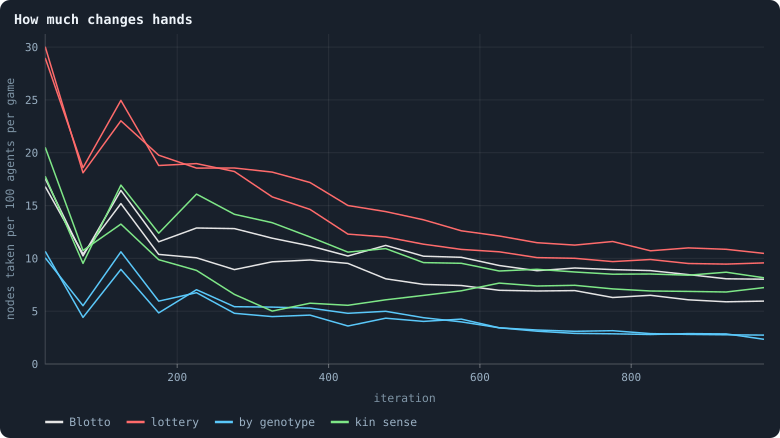
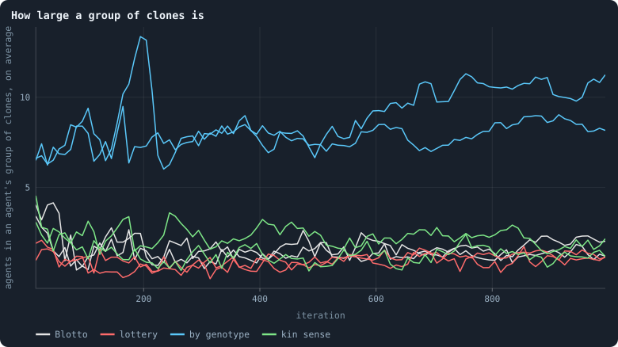
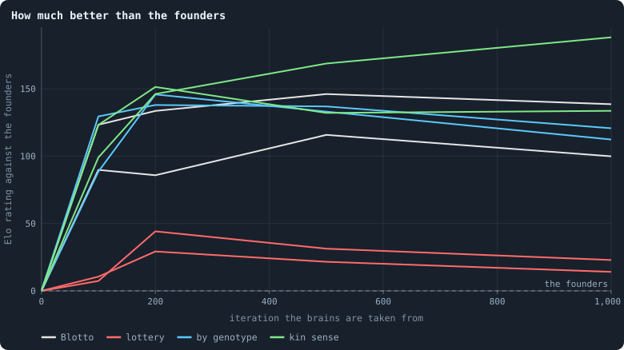
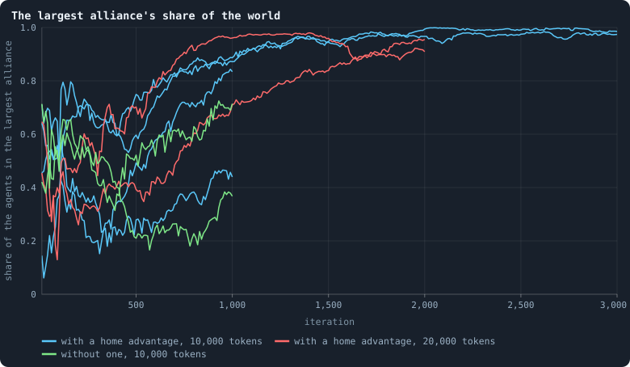
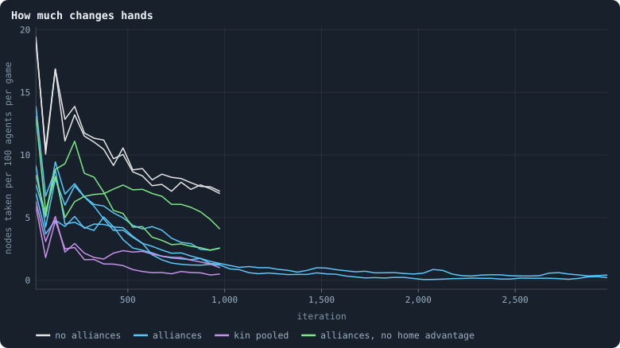
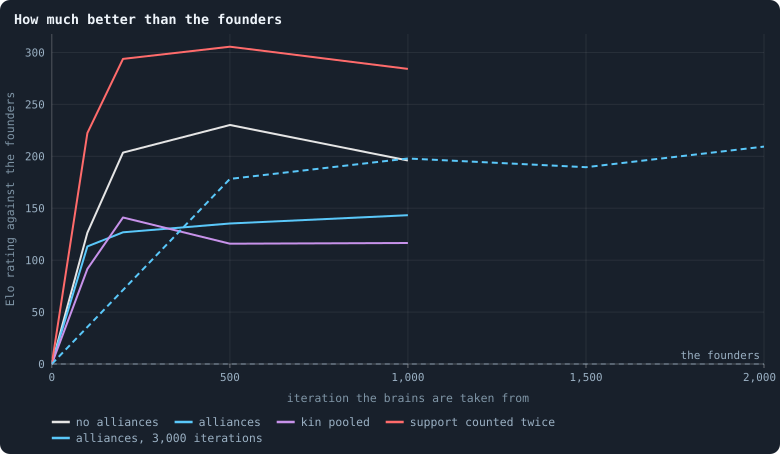

# Other contests: a lottery, and alliances

> [!question] Questions of this page
> - In Graph of Life a [node](the-world.md#agents-and-tokens "One member of a world: it lives on a node of the network, holds tokens and has a brain that takes all its decisions.") goes to whoever stakes most on it. Would
>   evolution go on in a world whose contest is different?
> - What changes when chance decides who takes a node, so that being
>   unpredictable is worth nothing?
> - What changes when agents with the same [brain](the-brain.md "The neural network each agent decides with: inputs about itself and its neighbours, outputs that become its decisions."), or of one family, count
>   their stakes as one?
> - Can cooperation pay in a [game](one-iteration.md#phase-2-the-game "The second phase of an iteration: every agent stakes all its tokens on its own node and its neighbours', and every node goes to someone.") in which [tokens](the-world.md#agents-and-tokens "The one thing of value in a world: every agent holds a whole number of them, and their total never changes.") are only ever moved, never
>   made? What is an alliance here?
> - What do alliances do to a world over thousands of [iterations](one-iteration.md "One step of a world's time: a phase of reproduction, then a phase of the game."), and does a
>   world of allies keep evolving?

## In short

In the game of Graph of Life, a node goes to whoever stakes most on it. This
page changes that contest in [pilot worlds](pilot-worlds.md), two [seeds](random-numbers.md "The number that fixes every random choice of a run: the same settings and the same seed make the same world.") each,
and asks whether evolution then goes on. Under a **lottery**, where a node goes
to a staker drawn in proportion to the stakes, the brains have almost nothing
to learn. Of all the contests tried, it is the only one under which they stop
improving even when judged over a whole life. Letting clones, or families,
count their stakes as one builds bodies and brings peace, but finds no better
play. **Alliances**, which two [neighbours](the-world.md#the-network "An agent joined to another by a connection.") choose together, are taken up at
once: one alliance spreads until it holds nearly the whole world, and the
fighting ends. Its brains keep improving slowly, as they do without alliances,
but one habit spreading once is not [open-ended evolution](open-ended-test.md "Evolution that keeps producing new things without end, not only up to a plateau.").

## Another game

Why does evolution slow down in the worlds of [B2](b1-and-b2.md "The second baseline: B1 with the rules that keep its network from breaking and its agents from staking or breeding themselves to death.")? An early answer blamed the
contest for nodes
([Why evolution stops](how-to-tell-a-world-that-keeps-evolving.md#why-evolution-stops)).
A node goes to whoever stakes most on it. That makes the agents' game a
**Colonel Blotto** game, *Blotto* for short. It is the old puzzle of two
colonels who divide their soldiers between battlefields, where each field goes
to whoever sends more. In such a game no division is best, so the best play is
to be unpredictable. Evolution, the answer went, finds that in a few hundred
iterations, through the random inputs every brain reads. Then nothing better is
left to select.

If that is the reason, a different contest should change the outcome. Two
changes are worth making first. Neither adds a number to the rules, which is a
rule of its own in this notebook
([Rules without numbers](rules-without-numbers.md)).

### A lottery

**A contest without a mixed answer.** Let chance decide, instead of the
largest stake. In a **lottery contest** every staked token is a ticket. The
node goes to one of its stakers, drawn at random, with a chance in proportion
to what it staked, as the game weighs it. An owner's own stake still counts
one and a half times, as in B2.

This is Tullock's contest (1980), the economist's model of rent seeking and
lobbying. Its best play is a plain amount, not a gamble. Two contestants who
value a prize equally each stake a quarter of its value. Neither gains by
staking otherwise, nor by surprising the other.

So the lottery tests the answer above. If evolution stops under Blotto because
the answer is to roll dice, then under a lottery the brains should stop using
their random inputs. If evolution still stops, the reason is more general than
Blotto: any contest whose best play can be found will be found.

### Stakes counted by genotype

**A contest that lets a [lineage](families.md "A line of descent: the agents whose genotypes go back to one ancestor.") act as one.** Let stakes count by
**[genotype](genotype.md "The identity of a brain: a number that a brain keeps until it changes, and that records whose copy it was.")**, the identity of a brain. Every stake on a node made by agents
with exactly the same brain counts as one side's. The side with the largest
total takes the node, and the owner keeps it if its own genotype wins. Each
agent also sees, for every [candidate](one-iteration.md#phase-1-reproduction "An agent itself and each of its neighbours, the ones its brain looks at when it decides."), whether it carries the same brain.

Why would that matter? Under B2 a brain is copied whole into a newborn or into
a won node, and changes with probability 0.2 when it is. So a lineage lives as
a patch of identical agents, with mutants at its edges. With stakes pooled by
genotype, such a patch is one body. A stake on a clone's node defends it, and
the clones' stakes on a stranger's node are added together.

This is the rule the factories of
[Strategies written by hand](strategies-written-by-hand.md) would need. A
factory is a team written by hand, whose inner members pass their tokens on to
the members at its frontier. In the [engine](the-lab.md "The program that runs an experiment's plan as runs, each on a frozen copy of the engine, the code that plays a world.") as it is, a stake on a teammate's
node counts against the teammate. Pooling by genotype is also the narrowest
kind of kin pooling, which [Alliances](#alliances) tries within two [mutations](mutation.md "A random change to a brain, made with a set probability when it is copied, and in B1 also after every game: a changed brain is a new genotype.").
Here there is no alliance to agree on, and no threshold of relatedness to
choose.

**A sense, and no pooling.** A third pilot keeps only the input row, *same
brain as mine*. An agent can tell its clones, and nothing in the rules makes
it matter. This is the free version of the raiders' password in Strategies
written by hand. There, a team written by hand knew its own by a fixed
signature in its [messages](messages.md "Numbers an agent writes to itself and to each neighbour every phase, which their brains read.").

### The contest worlds

Like every world on this page, these are pilots, with two seeds per kind where
an experiment would have ten. So they show a lead and not a law
([Pilot worlds](pilot-worlds.md)). They run in the engine's own code
(`--proto engine=true`), which plays the engine's phases unchanged. Every
world is B2 at 10,000 tokens, played for 1,000 iterations. Each condition has two
seeds, and a whole world is kept every 100 iterations. [Revolutions](revolution.md "A node taken by stakers who each marked part of their stake revolutionary and together staked more than the largest single stake.") are off in
all of them. A revolution is itself a rule about who takes a node, and would
mix with the rule under test.

The control is B2 without revolutions, from the pilots of
[The switches the world was built with](the-switches-the-world-was-built-with.md):
the plain contest, Blotto. Beside it ran:

- **lottery** (`contest=lottery`): the node goes to a staker drawn with a
  chance in proportion to its weighed stake;
- **by genotype** (`pool=genotype`): stakes pooled by genotype, and one more
  input row per candidate, *same brain as mine*;
- **kin sense** (`kin_sense=true`): the input row alone, with no pooling.

Two more pairs of worlds, with families, came later
([A password and a crowd, for free](#a-password-and-a-crowd-for-free)).

### What the contests did

<!-- figure games/fighting -->

**How much changes hands.** One line per world, means over 50 iterations.

> [!example]- How to make this figure
> **Runs.** Pilot worlds of `research/oee/pilots/run.py` in the engine's own code, kept in `GraphOfLifeRuns/.pilots/S`, two seeds each, at 10,000 tokens for 1,000 iterations with a whole world every 100: B2 without revolutions (`--set hidden_layers=16 message_amount=8 message_prepass=false allow_handover=false mutate_on_replication=true incumbency=1.5 birth_links=2 mend_on_death=true prune_needs=2 valence=8 keep_home=0.3 max_age=100 min_child=10 allow_revolutions=false --proto engine=true`, worlds `S1-norev`), the same with a lottery contest (`contest=lottery`, `G1-lottery`), with stakes pooled by genotype (`pool=genotype`, `G2-genotype`), with only the sense of which neighbours carry one's own brain (`kin_sense=true`, `G3-kinsense`), and with family tags (`tag_rate=0.05`) sensed (`kin_sense=true`, `G4-familysense`) or pooled (`pool=family`, `G5-familypool`).
>
> **Data.** From each world's `series.jsonl`.
>
> 1. Count the nodes whose winner was not their owner in each game, per 100 agents.
>
> **To make it again:** `python3 book_figures.py games`.
<!-- /figure -->

<!-- figure games/groups -->

**How large a group of clones is.** One line per world, every 10th iteration: the agents of an agent's connected group of neighbours with the same brain, averaged over agents.

> [!example]- How to make this figure
> **Runs.** Pilot worlds of `research/oee/pilots/run.py` in the engine's own code, kept in `GraphOfLifeRuns/.pilots/S`, two seeds each, at 10,000 tokens for 1,000 iterations with a whole world every 100: B2 without revolutions (`--set hidden_layers=16 message_amount=8 message_prepass=false allow_handover=false mutate_on_replication=true incumbency=1.5 birth_links=2 mend_on_death=true prune_needs=2 valence=8 keep_home=0.3 max_age=100 min_child=10 allow_revolutions=false --proto engine=true`, worlds `S1-norev`), the same with a lottery contest (`contest=lottery`, `G1-lottery`), with stakes pooled by genotype (`pool=genotype`, `G2-genotype`), with only the sense of which neighbours carry one's own brain (`kin_sense=true`, `G3-kinsense`), and with family tags (`tag_rate=0.05`) sensed (`kin_sense=true`, `G4-familysense`) or pooled (`pool=family`, `G5-familypool`).
>
> **Data.** From each world's `series.jsonl`.
>
> 1. Every 10th iteration, join neighbours with the same brain and take the size of each agent's group, averaged over agents (`organisation`, `cloneMean`).
>
> **To make it again:** `python3 book_figures.py games`.
<!-- /figure -->

<!-- figure games/elo -->

**How much better than the founders.** One line per world, its eras played against each other, four contests per pair.

> [!example]- How to make this figure
> **Runs.** Pilot worlds of `research/oee/pilots/run.py` in the engine's own code, kept in `GraphOfLifeRuns/.pilots/S`, two seeds each, at 10,000 tokens for 1,000 iterations with a whole world every 100: B2 without revolutions (`--set hidden_layers=16 message_amount=8 message_prepass=false allow_handover=false mutate_on_replication=true incumbency=1.5 birth_links=2 mend_on_death=true prune_needs=2 valence=8 keep_home=0.3 max_age=100 min_child=10 allow_revolutions=false --proto engine=true`, worlds `S1-norev`), the same with a lottery contest (`contest=lottery`, `G1-lottery`), with stakes pooled by genotype (`pool=genotype`, `G2-genotype`), with only the sense of which neighbours carry one's own brain (`kin_sense=true`, `G3-kinsense`), and with family tags (`tag_rate=0.05`) sensed (`kin_sense=true`, `G4-familysense`) or pooled (`pool=family`, `G5-familypool`).
>
> **Data.** From each world's checkpoints, `ckpt_<iteration>.npz`.
>
> 1. For every pair of the eras 0, 100, 200, 500 and 1,000 play four contests, two in each era's world: every agent gets a brain drawn at random from one era or the other, mutation is switched off, and 20 iterations are played under the world's own rules (`research/oee/pilots/tourney.py --T 20 --reps 2`).
> 2. Fit one rating per era (Bradley–Terry, `research/oee/pilots/elo.py`), the founders at 0.
>
> **To make it again:** `python3 book_figures.py games`.
<!-- /figure -->

The last figure plays each world's [eras](eras-and-contests.md "Brains of a world at two moments, its eras, played against each other: do the later ones win?"), its brains at different moments,
against each other. In each contest every agent gets a brain from one era or
the other, by the toss of a coin, and 20 iterations are played. Each era gets
a rating in Elo points, with the [founders](starting-ring.md "One of the agents a world starts with, each holding the same tokens, on a ring with a few shortcuts.") at 0. A **step score** is an era's
share of the world against the era just before it; one half is a tie.

**The lottery leaves almost nothing to learn.** Under a lottery, the brains of
iteration 1,000 rated +23 and +14 against the founders, against +139 and +100
under Blotto. Each era tied with the one before it almost from the start, with
step scores of 0.47 to 0.56. Every staked token is a ticket, so where it is
staked matters less. More nodes changed hands: 10 and 12 per hundred agents a
game, against 9 and 7 under Blotto. The worlds held more agents, about 4,300
against 3,250 to 3,600, and more genotypes, about 2,000 against 1,450 to
1,700.

**And the dice stayed.** Redrawing the random inputs of brains evolved under
the lottery changed 48 to 67% of their divisions of stakes. Under Blotto it was
59%, in the same world without revolutions. Randomising is worthless under a
lottery, and the brains roll the dice all the same. So the lottery confirms one
half of the answer above and refutes the other. Evolution stops under a lottery
too, sooner and lower. But it is not because brains learn to roll dice: they
roll them anyway.

**Pooling by genotype builds bodies, and peace.** Counting stakes by genotype
cut the fighting to about a third: 3.2 nodes per hundred agents a game, against
9.0 and 6.7 under Blotto. It made groups of clones two to three times larger.
A group of clones is a connected patch of neighbours with the same brain. At
the end an agent's group of clones held 8 and 11 agents on average, and the
largest 39 and 57, against 3 under Blotto. In one world the groups kept
growing, from 7.8 agents at iterations 300 to 400 to 10.6 at 900 to 1,000. In
the other they barely grew, from 7.7 to 8.1.

The ratings stopped where Blotto's did: +146 and +138 by iteration 200, and
+112 and +121 at 1,000. Iteration 1,000 scored 0.49 against 500 in both
worlds.

A contest of coins cannot see a body of clones, since it deals brains out one
agent at a time. The **turf** contest can
([Pilot worlds](pilot-worlds.md#tournaments-between-its-eras)): the era whose
world it is keeps its clones in place. On turf, in contests of 50 iterations,
the brains of iteration 1,000 held 0.35 and 0.40 of the world against those of
iteration 500. In the same contest without pooling they held 0.45 and 0.37.
The bodies grew larger, but not better.

**A sense of one's clones made no groups.** With the kin sense alone, groups of
clones stayed at 3, as under Blotto. In one world the brains improved slowly to
the end, the only steady climb among these contests. Its steps were 0.70, 0.57,
0.54 and 0.53. Its brains of iteration 1,000 held 0.67 against those of
iteration 100, against 0.54 and 0.55 under Blotto. In the other world they
stopped as under Blotto, with steps of 0.69, 0.55, 0.48 and 0.50.

The brains made little use of the sense. Flipping which neighbours are clones
changed 12 to 16% of their divisions of stakes. It changed more of the
founders' divisions (26%).

### A password and a crowd, for free

The raiders of Strategies written by hand needed a password and a crowd that
knew it. A sense of one's clones gives the password. But clones seldom sit
together, so it brings no crowd. The last pilots give both.

Every brain carries a **family tag**. A copy keeps its parent's tag. A brain
that mutates takes a new tag with probability 0.05 (`tag_rate`), so one copy in
a hundred starts a new family. That probability is a parameter of mutation, the
kind of number the author's rule allows. A family is then every genotype
descended from one tag. It is far larger than a group of clones, and far
smaller than a founder's whole line. Two more pairs of worlds ran:

- **family sense** (`kin_sense=true`, `tag_rate=0.05`): one input row per
  candidate, *same family as mine*, and nothing else;
- **pooled by family** (`pool=family`, `tag_rate=0.05`): stakes counted by
  family, as by genotype above, and the same input row.

With the sense alone, families held 30 to 39 agents on average. After
iteration 500 the largest held 3 to 12% of the world. The fighting stayed as
under Blotto, 8 nodes per hundred agents a game.

Pooled by family, families grew to 150 and 490 agents on average, and the
fighting fell to 1.3 to 1.6. In one world a single family held 57% of the
agents at iteration 410. Then it broke up into families of its own as its tags
mutated: 12% at 710, and about 30% at the end. Families rise and fall there
like empires, which is more movement than one alliance holding the world
([One alliance takes the world](#one-alliance-takes-the-world)).

But the brains improved no more than elsewhere. In contests of 20 iterations,
iteration 1,000 against 500 scored 0.47 and 0.54 with the family sense, and
0.43 and 0.52 pooled by family. The steps after iteration 200 were 0.43 to
0.54. A password and a crowd for free were not enough. The raiders also had
their play written for them, and that is the part evolution would still have
to find.

A slower rate of change makes larger groups of clones too, eight agents strong
when one copy in twenty changes. It finds no better play either
([How fast should brains change?](how-fast-should-brains-change.md)).

### Networks that hold

Every one of these worlds kept a network that holds. The loss of no single
agent or link would cut it, and agents had five or six links on average. Their
[ball dimension](ball-dimension-and-curvature.md "How fast the number of agents within a distance grows with the distance: as its square in a plane, its cube in space.")
was 4.1 to 4.4 in eleven of the twelve worlds, a little above the [health bar](health-bar.md "The seven marks a world's network must meet to count as healthy: one piece, mostly on loops, no fatal cut, no hub, three to twelve links per agent, a dimension of 2.3 to 4.")'s
4, as in B2. The twelfth, a world with the family sense, read 3.8, inside the
bar.

### A lifetime long

The tournaments above played contests of 20 iterations, and the turf contests
50. In B2's worlds such contests miss what pays off over an agent's life of
100 iterations. In plain B2, contests of 100 iterations found the brains of
iteration 2,000 beating those of 500, with 0.73 of the world. Contests of 20
had them tied
([Would we notice if it went on?](how-to-tell-a-world-that-keeps-evolving.md#would-we-notice-if-it-went-on)).

So these contests were played again, 100 iterations each, once in each era's
world (`research/oee/checks/rejudge.py`, seed 17). Here are the brains of
iteration 1,000 against those of 500, in the two seeds:

| contest | iteration 1,000 against 500, in contests of 100 iterations |
|---|---|
| Blotto, the control | 0.76, 0.61 |
| by genotype | 0.59, 0.65 |
| kin sense | 0.72, 0.80 |
| family sense | 0.62, 0.67 |
| pooled by family | 0.46, 0.78 |
| lottery | 0.47, 0.56 |

Eras played against themselves held 0.44 to 0.58: that is what a tie looks
like. Under every contest but the lottery, evolution went on between
iterations 500 and 1,000 in at least one world of two. It went on in both
worlds under Blotto and under three of the others. The lottery is the one
contest under which it stopped: a ticket's chance does not pay more for a
better brain.

## Alliances

The lottery takes something away from the game. Alliances add something. A
game that does not run out of answers is one whose payoffs depend on what the
others have become. The richest of those are games in which agents can do
better *together*. Then whom to trust, whom to join and how to coordinate are
questions whose answers change as the population changes.

But cooperation needs a **surplus**. In this world tokens are never made:
every token an agent gives away is a token it no longer has. The pilots of
[Why evolution stops](how-to-tell-a-world-that-keeps-evolving.md#why-evolution-stops)
tried two kinds of help, and both were gifts without a return. Support counted
for less than a stake at home. The yield on returned stakes went to whoever had
most partners. Evolution gave both up.

There is one place where the game itself makes a surplus. It is the rule that
makes the game a Blotto game: **a node goes to whoever stakes most on it.**
That rule is *convex*: stakes are worth more together than apart. Two stakes of
30 each lose against one of 40, but together, as 60, they win. A group whose
stakes counted together could take nodes that none of its members could take
alone, and hold nodes none could hold alone. Alliances give the agents a way
to reach that surplus.

### What an alliance is

The alliance pilots add one decision and one thing to see
(`research/oee/pilots/proto.py`, `allies=true`). They run in the pilots'
prototype, a copy of the engine with hooks for new rules.

**The decision.** In every game, an agent says of each neighbour whether it
wants it as an ally. Its brain has two more output rows per candidate, and the
answer is *yes* when the first is larger than the second. Two neighbours that
both say yes are **allied** for that game. Nobody can be made an ally against
its will. An alliance lasts one game; it is renewed, or not, in the next.

**The contest.** The stakes on a node are counted by **side**. The owner and
every bidder allied with it are one side. The other bidders are grouped by
being allied with each other. Two bidders allied with each other, or joined
through a chain of bidders who are, are one side. The side with the largest
total takes the node. If that is the owner's side, the owner keeps it;
otherwise the largest bidder of the winning side takes it. The owner's own
stake still counts one and a half times, as in B2.

The tokens go where they always went, to the node they were staked on. So a
stake on an ally's node is a gift, but one that defends.

**What an agent sees.** One more input row per candidate: was it my ally in
the last game?

Revolutions are off in these worlds, and sides replace them. A revolution was
the one way smaller stakers could count together; an alliance is a way to do
it by choice.

Two other ways to cooperate ran beside it, as controls:

- **Kin pooled** (`kin_pool=2`): sides are made by descent instead of by
  choice. Two bidders are on one side if their brains are within two mutations
  of each other in the family tree. Nobody decides anything.
- **Support counted twice** (`support=true`, `support_gain=2`): a stake on a
  neighbour can be marked, in part, as support. Support adds to the owner's
  defence and counts twice, which makes it a better use of a token than a
  stake at home.

### The alliance worlds

These, too, are pilots, two seeds per kind. Every world runs under B2's rules,
as the pilots' prototype states them:

- a newborn is joined to its parent and two of its parent's neighbours;
- a death is mended, and only redundant links lapse;
- an agent's brain may choose at most 8 links, its valence;
- a child starts with at least 10 tokens;
- 30% of every agent's tokens stay at home;
- every agent dies at age 100;
- a brain mutates only when it is copied;
- an agent's own stake counts one and a half times.

Brains have one hidden layer of 16 units, and a memory of the last game's
stakes. Revolutions are off. The worlds:

- at 10,000 tokens for 1,000 iterations: no alliances, alliances, kin pooled,
  and support counted twice;
- alliances at 10,000 tokens for 3,000 iterations, and at 20,000 tokens for
  2,000;
- alliances without the home advantage, an agent's own stake counting once
  (incumbency 1), at 10,000 tokens for 1,000 iterations.

### One alliance takes the world

<!-- figure allies/bloc -->

**The largest alliance's share of the world.** One line per world. An alliance is a group of agents joined by connections between allies: two neighbours that both chose, in the last game, to be allied.

> [!example]- How to make this figure
> **Runs.** Pilot worlds of `research/oee/pilots/run.py`, two seeds each, kept in `GraphOfLifeRuns/.pilots`: at 10,000 tokens for 1,000 iterations without alliances (`A10k/ctrl-s1`, `-s2`), with them (`A10k/allies-s1`, `-s2`), with kin pooled (`A10k/kin-s1`, `-s2`) and with support counted twice (`A10k/gain-s1`, `-s2`); with alliances for 3,000 iterations (`AL/allies10k-s3`, `-s4`), at 20,000 tokens for 2,000 (`AL/allies20k-s1`, `-s2`), and without the home advantage, incumbency 1, for 1,000 (`N/N0-s1`, `-s2`). Every one under B2's rules as the pilots' prototype states them (`research/oee/pilots/proto.py`: mor=all incumbency=1.5 birth_links=2 repair=true safe_prune=2 max_age=100 valence=8 valence_mode=optional min_child=10 keep_frac=0.3), with one hidden layer of 16, messages of 8 numbers and no pre-pass, revolutions off, and a memory of the last game's stakes (memory=true).
>
> **Data.** From each world's `series.jsonl`.
>
> 1. Every 10th iteration, join every two neighbours that were allied in the game just played (`ProtoWorld.same_side`) and find the largest connected group (`research/oee/pilots/run.py`, `organisation`, `sideLargest`).
> 2. Divide by the agents.
>
> **To make it again:** `python3 book_figures.py allies`.
<!-- /figure -->

The founders have random brains, so each wants about half of its neighbours as
allies. A quarter to two fifths of all [connections](the-world.md#the-network "A link between two agents of the network: they are neighbours, and can stake on each other's nodes.") are alliances in the first
game. That is enough to join much of a world into one alliance by chance
alone. At iteration 60, the largest alliance held between 16 and 62% of the
agents.

That first alliance is an accident. In some worlds it broke up as evolution
sorted the founders' brains. In the two shorter worlds of 10,000 tokens, the
share of neighbours wanted as allies fell to a quarter or a third by iteration
300. The largest alliance shrank to 20 and 32% of the world. In other worlds
it grew from the start.

Then, in every world with the home advantage, one alliance grew. By iteration
1,000, the share of neighbours wanted as allies rose to between 0.42 and 0.87
in the worlds of 10,000 tokens. In those of 20,000 it rose to 0.67 and 0.95.
In the long world of seed 3 it reached 0.99 by iteration 2,000. The largest
alliance grew with it, to 83 and 44% of the world at iteration 1,000 in the
two shorter worlds. In the two long ones it held 87 and 89% at 1,000, and 99
and 97% at 2,000. In the end almost every connection is an alliance: 98% of
them at iteration 2,000 in the long world of seed 3.

How the time an alliance takes to fill a world grows with the world, two seeds
cannot say. In the worlds of 20,000 tokens, the largest alliance first held
half the agents at iteration 720 in one. In the other it did so at 120, after
the founders' accidental alliance had broken up.

**The alliance spreads as a habit, not as a family.** One might expect one
lineage to take the world, allying only with its own. It is not so. In the
long world of seed 3 at iteration 3,000, the alliance held 99% of the agents.
The largest group of near relatives held 2%: agents joined to neighbours whose
brains are within four mutations of their own. A world whose agents nearly all
say yes to every neighbour is one alliance, whatever their ancestry. The habit
spreads because an agent that says yes is defended by every neighbour that
says yes too, and stands with them when they attack.

<!-- figure allies/fighting -->

**How much changes hands.** One line per world, each a mean over 50 iterations.

> [!example]- How to make this figure
> **Runs.** Pilot worlds of `research/oee/pilots/run.py`, two seeds each, kept in `GraphOfLifeRuns/.pilots`: at 10,000 tokens for 1,000 iterations without alliances (`A10k/ctrl-s1`, `-s2`), with them (`A10k/allies-s1`, `-s2`), with kin pooled (`A10k/kin-s1`, `-s2`) and with support counted twice (`A10k/gain-s1`, `-s2`); with alliances for 3,000 iterations (`AL/allies10k-s3`, `-s4`), at 20,000 tokens for 2,000 (`AL/allies20k-s1`, `-s2`), and without the home advantage, incumbency 1, for 1,000 (`N/N0-s1`, `-s2`). Every one under B2's rules as the pilots' prototype states them (`research/oee/pilots/proto.py`: mor=all incumbency=1.5 birth_links=2 repair=true safe_prune=2 max_age=100 valence=8 valence_mode=optional min_child=10 keep_frac=0.3), with one hidden layer of 16, messages of 8 numbers and no pre-pass, revolutions off, and a memory of the last game's stakes (memory=true).
>
> **Data.** From each world's `series.jsonl`.
>
> 1. Count the nodes whose winner was not their owner in each game (`conquests`), per 100 agents, and average over consecutive stretches of 50 iterations.
>
> **To make it again:** `python3 book_figures.py allies`.
<!-- /figure -->

**With the alliance, the fighting ends.** Without alliances, 7.6 to 8.0 nodes
in a hundred changed hands in every game from iteration 500 to 1,000. With them
it was 2.2 and 3.4. In the two long worlds it was 1.8 to 1.9, falling to 0.2
and 0.4 in their last 500 iterations. Allies cannot take each other's nodes,
and a world that is one alliance has nobody left to fight.

Kin pooling brought peace sooner, and without any decision: 1.8 and 0.6 nodes
in a hundred from iteration 500. Its sides were small, though, 2 to 14% of the
world, because kinship within two mutations reaches only so far.

**Support counted twice was given up anyway.** In the first game the founders
marked about 2,700 tokens as support. By iteration 100 it was 81 in one world
and 175 in the other. In the first world it stayed near 16 to the end. In the
second it came back for a while, to nearly 2,000 tokens a game at iteration
500. Then it was given up again, to 114 at 1,000. Doubling a gift does not
make it pay if whoever receives it owes nothing back. An alliance differs from
support in exactly that: both ends have chosen, and each defends the other.

### Without the home advantage

An agent's own stake counts one and a half times in B2, a number chosen by hand
([Who dies, and why](a-world-that-cannot-break.md#who-dies-and-why)). Do
alliances need it? Not to form. In two worlds where an agent's own stake counts
once, the largest alliance held 37 and 71% of the world at iteration 1,000. The
two worlds of the same length with the home advantage held 83 and 44%. Two
seeds of each cannot tell those apart.

What the home advantage may change is how much fighting goes on inside and
around an alliance. Without it, 6.0 and 3.1 nodes per hundred agents changed
hands in a game from iteration 500, against 2.2 and 3.4 with it. One world of
the two says that clearly, and the other does not.

### The network of a world of allies

The network holds. In the last 500 iterations of every world of alliances,
every agent was in the [2-core](core-trees-leaves.md "What is left of a network when agents with one connection or none are peeled away again and again: the agents on loops or between them."): on a [loop](loops.md "A path through the network that comes back to where it started without using a connection twice."), or between loops. In the [median](median-and-quantiles.md "The middle value: half of the numbers lie below it and half above.")
[frame](frames-and-stats.md "A whole world as a run records it after one phase: every agent, its tokens and connections."), no agent or connection could cut off anyone at all. No agent was linked
to more than 2% of the others, and an agent had about five connections (4.9 to
5.5). The worlds failed the health bar only on its last line. Their ball
dimension was 4.1 to 4.8, a little above the bar's 4, and highest in the worlds
of 20,000 tokens.

### Does a world of allies keep evolving?

What should one expect? Peace ends selection by conquest. A world that is one
alliance copies brains almost only by birth. Births balance deaths, which in
these worlds come from the age limit. Every agent dies at 100, so in every
iteration one agent in a hundred dies, and one is born. Whatever selection
remains is on how an agent breeds.

<!-- figure allies/elo -->

**How much better than the founders.** One world of each kind, seed 1 (seed 3 for the long one), its eras played against each other two contests per pair in each era's world.

> [!example]- How to make this figure
> **Runs.** Pilot worlds of `research/oee/pilots/run.py`, two seeds each, kept in `GraphOfLifeRuns/.pilots`: at 10,000 tokens for 1,000 iterations without alliances (`A10k/ctrl-s1`, `-s2`), with them (`A10k/allies-s1`, `-s2`), with kin pooled (`A10k/kin-s1`, `-s2`) and with support counted twice (`A10k/gain-s1`, `-s2`); with alliances for 3,000 iterations (`AL/allies10k-s3`, `-s4`), at 20,000 tokens for 2,000 (`AL/allies20k-s1`, `-s2`), and without the home advantage, incumbency 1, for 1,000 (`N/N0-s1`, `-s2`). Every one under B2's rules as the pilots' prototype states them (`research/oee/pilots/proto.py`: mor=all incumbency=1.5 birth_links=2 repair=true safe_prune=2 max_age=100 valence=8 valence_mode=optional min_child=10 keep_frac=0.3), with one hidden layer of 16, messages of 8 numbers and no pre-pass, revolutions off, and a memory of the last game's stakes (memory=true).
>
> **Data.** From each world's checkpoints, `ckpt_<iteration>.npz`, every 100 iterations.
>
> 1. For every pair of eras play four contests, two in each era's world: every agent gets a brain drawn from one era or the other, a coin each, mutation is switched off, and 20 iterations are played (`research/oee/pilots/tourney.py --T 20 --reps 2`).
> 2. Fit one rating per era to the later era's shares (Bradley–Terry, `research/oee/pilots/elo.py`), the founders at 0, in Elo points.
>
> **To make it again:** `python3 book_figures.py allies`.
<!-- /figure -->

The tournaments of
[Playing against the past](how-to-tell-a-world-that-keeps-evolving.md#playing-against-the-past)
were played in one world of each kind, with contests of 20 iterations:

| world | rating of the eras against the founders | step scores, each era against the one before |
|---|---|---|
| no alliances | +126, +204, +230, +196 (100, 200, 500, 1,000) | 0.72, 0.62, 0.56, 0.48 |
| alliances | +113, +127, +135, +143 | 0.69, 0.53, 0.51, 0.52 |
| kin pooled | +92, +141, +116, +117 | 0.69, 0.56, 0.48, 0.49 |
| support counted twice | +222, +294, +306, +284 | 0.86, 0.66, 0.56, 0.49 |
| alliances, 3,000 iterations | +178, +198, +190, +209 (500, 1,000, 1,500, 2,000) | 0.74, 0.53, 0.52, 0.52 |

The world of alliances is the only one whose step scores stayed a little above
one half to the end. They were 0.51 to 0.53, and 0.53, 0.52 and 0.52 for the
last three steps of the long one. Its brains of iteration 1,000 held 0.57 of a
mixed world against those of iteration 100. That is a slow creep. Its ratings
moved by about 10 points per 500 iterations, less than a tournament of this
size can tell from nothing.

A contest of coins has a weakness here. It gives every agent a brain from one
era or the other at random. So every alliance of the contested world is cut
through the middle, and whatever an era's brains know about standing together
is tested against strangers. A **territorial** contest is fairer to alliances.
Each era gets a contiguous half of the world, the half nearest an agent drawn
at random (`tourney.py --layout halves`), and 50 iterations are played. In the
world of alliances, the brains of iteration 1,000 held 0.41 against those of
500; in the control they held 0.42.

A **turf** contest goes one step further. The era whose world it is keeps its
own brains where they are, so its alliances stand as they stood. On turf, the
brains of iteration 1,000 held 0.39 against those of iteration 500 in the
world of alliances, and 0.42 in the control. In contests of 50 iterations the
later brains lost every way they were played. Whatever they had become, it did
not make them better at war within half a life, alone or together.

**A [lifetime](age-and-lifetime.md "How many iterations an agent lives, from its birth to its death.") long, they win.** Contests of 20 or 50 iterations are shorter than
a life of 100, and miss what pays off over a life
([A lifetime long](#a-lifetime-long)). So these contests, too, were played
again for 100 iterations, once in each era's world
(`research/oee/checks/rejudge.py`, seed 17). In every world, the brains of
iteration 1,000 held more than half of the world against those of 500:

- 0.62 and 0.59 with alliances, and 0.70 and 0.62 without;
- 0.80 and 0.59 with kin pooled;
- 0.69 and 0.97 with support counted twice.

In both long worlds of alliances, the brains of 3,000 beat those of 1,000
(0.69 and 0.88). In one of them they beat those of 2,000 as well (0.69); in the
other the two tied (0.52). The same eras played against themselves held 0.44
to 0.56. So a world of allies does go on evolving, as far as 3,000 iterations
in one world of two. The alliance spreads once, and the brains inside it keep
improving, as the brains of a world without alliances do.

## What we learned

- **The lottery stops evolution; the other contests do not.** Under a lottery,
  a ticket's chance does not pay more for a better brain. The brains learn
  almost nothing, and even contests a lifetime long see no gain from iteration
  500 to 1,000. Pooling stakes by genotype or by family, and a sense of clones
  or of family, leave evolution where Blotto leaves it. It goes on slowly, a
  lifetime long.
- **The mixed strategy was not the reason.** Where dice are worthless, the
  brains keep them. Whatever slows evolution in these worlds, it is not that
  the brains have found the one unbeatable way to play.
- **Bodies are not organisms.** Pooling makes clones fight as one, and the
  clones gather into bodies two to three times larger, which keep growing
  slowly in one world. But a body of clones whose members do not divide the
  work among themselves is only a crowd. The factory is what an organism would
  be: the frontier fights, the inside feeds it. Under pooling the inside's
  tokens already defend the frontier, yet no better play evolved than under
  Blotto.
- **A password and a crowd given for free are not enough.** Given the password
  as a sense of clones, evolving brains find no crowd to use it with. One copy
  in five is a new genotype, so clones seldom sit together. Given families
  large enough to be a crowd, they still do not find the raiders' play. What
  evolution cannot find is not the parts but the play itself.
- **Cooperation is possible, and it pays.** Alliances are the first rule added
  for open-ended evolution that evolution took up rather than gave up. The
  surplus they reach is real: pooled stakes win contests that single stakes
  lose. And with the alliance, the fighting ends.
- **A rising number is not open-ended evolution.** The largest alliance's share
  rises for a thousand iterations and more. Its ceiling is the world, so a
  larger world has further to go. On paper that is the statistic the search
  for open-ended evolution has been looking for. But it is one convention, *say
  yes to your neighbours*, spreading until it holds everywhere, as a single
  advantageous mutation would. When it has spread, nothing new follows. The
  population found the obvious way to survive, as the author of the simulation
  put it. That is not the same as an open-ended process.
- **Open.** What would keep cooperation *contested*? Candidates are a way to
  cheat an alliance that pays for a while, a cost to being in one, or a limit
  to its reach. Then alliances would compete with each other instead of
  merging into one. And what is left of an alliance in a world whose rules
  have no hand-chosen numbers at all
  ([Rules without numbers](rules-without-numbers.md))?

## Where to go next

- [Does evolution keep going?](how-to-tell-a-world-that-keeps-evolving.md): the
  yardstick these contests are judged by, and why evolution in B2 slows.
- [Strategies written by hand](strategies-written-by-hand.md): the raider, the
  factory and the password that this page tried to give evolution for free.
- [Rules without numbers](rules-without-numbers.md): what is left of an
  alliance when the rules have no hand-chosen numbers.
- [Who helps whom](who-helps-whom.md): every way the agents were given to
  cooperate, side by side.

## How this was made

Every world on this page is a pilot, made with `research/oee/pilots/run.py` and
kept in `GraphOfLifeRuns/.pilots` ([Pilot worlds](pilot-worlds.md)). No
experiment of the lab stands behind it, so the page has no box of runs. Every
figure says, folded beneath it, which worlds it reads and how. To draw the
figures again, run `python3 book_figures.py games` for the first half of the
page, and `python3 book_figures.py allies` for the second. The command lines
that made the worlds are in `research/oee/pilots/LOG.md`.

### The pilots of the contests

- **The worlds**: in `GraphOfLifeRuns/.pilots/S`, seeds 1 and 2, in the
  engine's own code (`--proto engine=true`): `S1-norev` (Blotto, the control),
  `G1-lottery`, `G2-genotype`, `G3-kinsense`, `G4-familysense` and
  `G5-familypool`.
- **Coin tournaments**: `research/oee/pilots/tourney.py --T 20 --reps 2`, on
  the eras 0, 100, 200, 500 and 1,000.
- **Turf contests**: the same with `--layout turf`, in contests of 50
  iterations.
- **Contests a lifetime long**: `research/oee/checks/rejudge.py`, 100
  iterations, once in each era's world, seed 17.
- **The probes** of what the brains use, such as their random inputs:
  `research/oee/pilots/sense.py`.

### The pilots of the alliances

- **The worlds**: in the pilots' prototype (`research/oee/pilots/proto.py`),
  two seeds each. In `GraphOfLifeRuns/.pilots/A10k`, at 10,000 tokens for
  1,000 iterations: `ctrl`, `allies` (`allies=true`), `kin` (`kin_pool=2`) and
  `gain` (`support=true support_gain=2`). In `AL`: `allies10k-s3` and `-s4`
  for 3,000 iterations, and `allies20k-s1` and `-s2` for 2,000. In `N`:
  `N0-s1` and `-s2`, without the home advantage.
- **Coin tournaments**: `tourney.py --T 20 --reps 2`.
- **Territorial and turf contests**: `--layout halves` and `--layout turf`, in
  contests of 50 iterations.
- **Contests a lifetime long**: `rejudge.py`, as for the contests.

## How our view changed

- **15 October 2026.** As first written that morning, the contests half of
  this page said that another contest moves where evolution stops, not
  whether it does. A lottery stopped it almost where it starts. Pooling by
  genotype, a sense of clones and, later that day, families stopped it where
  Blotto does. Its tournaments played contests of 20 iterations, too short for
  what pays off over a life of 100
  ([Would we notice if it went on?](how-to-tell-a-world-that-keeps-evolving.md#would-we-notice-if-it-went-on)).
  That night the contests were played again a lifetime long. Under every
  contest but the lottery, evolution went on between iterations 500 and 1,000,
  in at least one world of two ([A lifetime long](#a-lifetime-long)).
- **15 October 2026.** As first written that morning, the alliances half said
  that a world of allies creeps upward by less than a tournament can tell from
  nothing. Its later brains lost the contests of 50 iterations, which it read
  as not being better at war. And it said that the selection left under peace
  did little. Those contests lasted 20 and 50 iterations. That night, contests
  a lifetime long found the brains of iteration 1,000 beating those of 500 in
  every alliance pilot. In both long worlds, those of 3,000 beat those of 1,000
  ([Does a world of allies keep evolving?](#does-a-world-of-allies-keep-evolving)).
- **23 October 2026.** The alliances half said that the share of neighbours
  wanted as allies rose to between 0.42 and 0.85 by iteration 1,000. In the six
  worlds with the home advantage it rose to between 0.42 and 0.95
  (`book/results/allies.json`, `wish`). It reached 0.87 in the second long
  world, and 0.67 and 0.95 at 20,000 tokens.
- **23 October 2026.** The contests half said that every one of its worlds had
  a ball dimension of 4.1 to 4.4. That was written before the family pilots
  ran. One of them, with the family sense, reads 3.8
  (`book/results/games.json`, `health`), inside the health bar.
- **23 October 2026.** Small slips, checked against the pilots' records:
  - In the genotype world whose clone groups barely grew, they grew from 7.7
    agents at iterations 300 to 400, not from 7.1 (`cloneMean`,
    `G2-genotype-s1`).
  - The turf contest with pooling was said to have been played in one world
    so far. Both seeds had been played on 15 October. The second gives 0.40
    with pooling, and 0.37 without.
  - Four scores were rounded the wrong way (`book/results/allies.json` and
    `games.json`). Kin pooled's last step is 0.49, not 0.50. The last three
    steps of the long alliance world are 0.53, 0.52 and 0.52, not 0.52 each.
    With the family sense, iteration 1,000 against 500 scored 0.47, not 0.48.
    In the territorial contest the control held 0.42, not 0.41 like the world
    of alliances.

<!-- turns -->
---

← [Do agents cooperate?](do-agents-cooperate.md) · [Groups and cooperation](../README.md#groups-and-cooperation) · [Gliders, and who helps whom](gliders-and-who-helps-whom.md) →

**Also about:** [Changing the rules](../README.md#changing-the-rules).

> [!info]- Pages that link here (15)
> [Every setting](settings.md) · [What B1 is, and what stood in its way](what-the-baseline-world-is.md) · [Flow modules: the groups tokens stay in](flow-modules.md) · [How alike the agents are](how-alike-the-agents-are.md) · [What agents say to each other](what-agents-say-to-each-other.md) · [Does evolution keep going?](how-to-tell-a-world-that-keeps-evolving.md) · [Strategies written by hand](strategies-written-by-hand.md) · [What a brain can compute](what-a-brain-can-compute.md) · [Who helps whom](who-helps-whom.md) · [Gliders, and who helps whom](gliders-and-who-helps-whom.md) · [Help](help.md) · [Rules without numbers](rules-without-numbers.md) · [Healthy and rich](healthy-and-rich.md) · [Every simulation: what was run, and what was measured](every-simulation.md) · [Pilot worlds](pilot-worlds.md)
<!-- /turns -->
