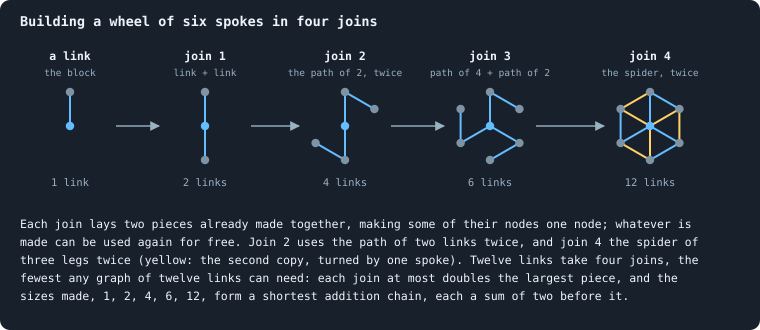
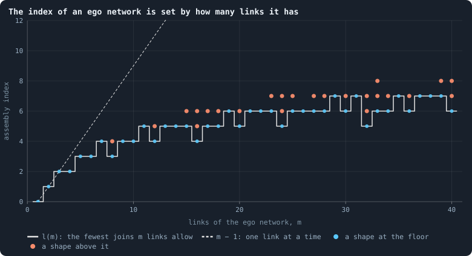
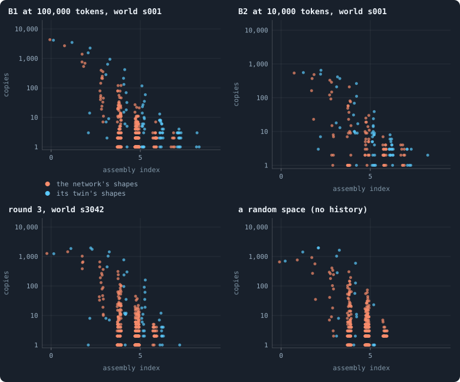
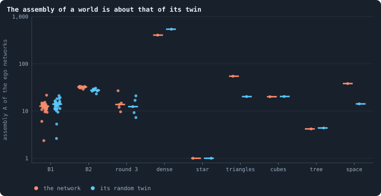
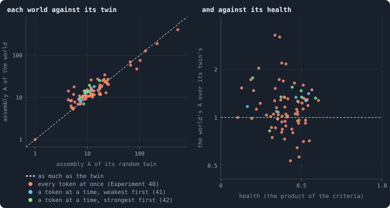
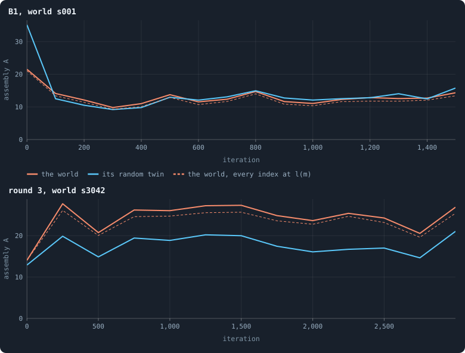
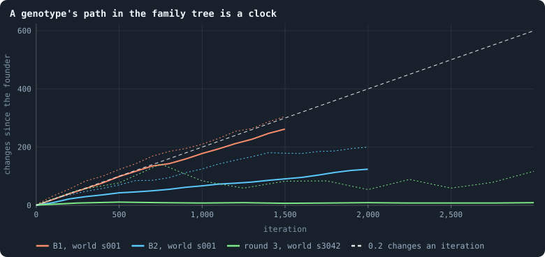

# Assembly theory: how many steps to make a thing, and how many copies

> [!question] Questions of this page
> - What does assembly theory measure, and how is its index computed for a
>   network?
> - How many steps does it take to build an [agent](the-world.md#agents-and-tokens "One member of a world: it lives on a node of the network, holds tokens and has a brain that takes all its decisions.")'s neighbourhood, and how
>   many agents share each neighbourhood's shape?
> - Do the worlds of Graph of Life hold more assembly than chance gives a
>   network with the same numbers of links, and would that mean selection?
> - Over every world of round 3, does a world's assembly follow its health,
>   or its settings?
> - What can assembly theory tell here, and what can it not?

## In short

Assembly theory measures a thing by the fewest joins that build it from
basic parts, reusing whatever was built before (its **assembly index**), and
a collection by how many copies it holds of things that take many joins (its
**assembly**, A). We computed the index exactly for the neighbourhoods of the
agents, each agent with its [neighbours](the-world.md#the-network "An agent joined to another by a connection.") and the links among them, in 47 worlds:
the thirty of [B1](b1-and-b2.md "The first baseline: the algorithm exactly as a new run is offered it.") at 100,000 [tokens](the-world.md#agents-and-tokens "The one thing of value in a world: every agent holds a whole number of them, and their total never changes."), the ten of [B2](b1-and-b2.md "The second baseline: B1 with the rules that keep its network from breaking and its agents from staking or breeding themselves to death.") and seven of round 3. Each
was set beside its random twin, the same degrees wired at random, and four
networks with no history at all. The index turned out to be set by the
number of links: 98.8% of the neighbourhoods whose index could be found take
exactly the fewest joins their links allow. The worlds hold about as much assembly as their
twins: in the [median](statistics.md#many-worlds-at-once-the-median-bands-the-settled-life-and-the-spread "The middle value: half of the numbers lie below it and half above.") world of B1, A = 12.6 against its twin's 14.0; in B2,
32.4 against 27.5; in round 3's healthiest, 13.8 against 12.4. A random
space, made by chance and distance alone, beats its twin by far more (38.1
against 14.2), and a triangular lattice, built by one rule in one go, has
the most of all (54.6). Over all 82 worlds of round 3 that lived to the end,
a world's assembly over its twin's does not follow its health; it is highest
where a cap on links makes many agents close the same few triangles. So assembly theory finds no sign of selection in
these networks, and it has nothing to say about the [brains](the-brain.md "The neural network each agent decides with: inputs about itself and its neighbours, outputs that become its decisions."), the things
selection acts on here: their recorded family tree is a chain of changes
without reuse, which ticks like a clock.

## Building with reusable parts

Picture a box of LEGO bricks and a model to build. You may click two things
together at a time, and anything you have built once can be copied for free,
as a factory that has made one wall can make another. Then a row of eight
bricks takes three clicks, not seven: two bricks make a pair; the pair and a
copy of it make a row of four; the row and a copy of it make eight. A model
that repeats itself is quick to build. A model in which nothing repeats
takes one click for every brick but the first.

**Assembly theory** turns this into a measure (Marshall and others 2021;
Sharma and others 2023). It asks two things of every object in a collection:
how many steps it takes to build at the least, and how many copies of it
there are. A single complicated object could be an accident. Many copies of
a complicated object, its authors argue, could not: something must be making
them, a living cell, a factory, a process with a memory of how to build the
thing. On molecules they read this as a sign of life (Marshall and others
2021).

The same idea works for strings of letters. With the letters as blocks and
a join that writes two strings one after the other, ABABABAB takes three
joins: A and B make AB, AB and AB make ABAB, ABAB and ABAB make ABABABAB.
Eight different letters take seven.

## The assembly index

An object is built from **basic blocks** by **joins**. A join takes two
objects already made, a block or anything built earlier, and puts them
together into a new one. Whatever is made goes into the **pool** and can be
used again, as often as needed, at no cost. The **assembly index** *a* of an
object is the fewest joins after which it is in the pool (Marshall and others
2022).

For a molecule the block is a bond, and "two bonds are joined by
superimposing an atom from each" (Marshall and others 2021). For a network it
is a link, two nodes and the [connection](the-world.md#the-network "A link between two agents of the network: they are neighbours, and can stake on each other's nodes.") between them, and a join lays two
pieces side by side and makes some of their nodes one node (Seet and others
2025, Definition 3.2). Links are never merged, so a piece made of two pieces
has as many links as the two together.

Three facts make the index computable for small networks:

- **Only pieces of the object matter.** A join never removes a link, so every
  piece on a shortest pathway is a connected part of the object itself.
- **A pathway is a set of pieces.** Each piece of two links or more splits
  into two parts that are single links or pieces of the set; each costs one
  join, however often it is used. The index is the size of the smallest such
  set that holds the object.
- **The sizes form an addition chain.** Each piece has as many links as its
  two parts together, so the sizes on a pathway, from 1 up to the object's
  *m* links, are an **addition chain**: numbers from 1 in which each is the
  sum of two before it (the same one twice allowed). So *a* is at least l(*m*),
  the length of the shortest addition chain to *m*, and at most *m* − 1, one
  link at a time.

The shortest addition chains are an old puzzle of number theory. Doubling
gives l(8) = 3 (1, 2, 4, 8), but l(7) = 4 (1, 2, 3, 4, 7, or 1, 2, 4, 6, 7):
no chain of three steps reaches 7. In general l(*m*) lies between log₂ *m*
and twice that.

For stars, paths and cycles the floor l(*m*) is the index itself. Every
connected part of a star of *m* links is a star joined at its centre, every
part of a path is a path joined end to end, and a cycle is two paths joined at
both ends; so a pathway is an addition chain, and the shortest one will do.
A star of seven links takes four joins, as the number 7 does.

A wheel of six spokes, the ego network of every agent of a triangular
lattice, has twelve links and index 4. The picture builds it: a link and a
link make a path of two, two of those a path of four, a path of four and a
path of two a spider of three legs, and two spiders, one turned by a spoke,
the wheel. The sizes 1, 2, 4, 6, 12 are a shortest addition chain to 12, so
no graph of twelve links can be built in fewer joins.

## Copy number and assembly

The **copy number** *n* of an object is how many identical copies of it a
collection holds. The **assembly** of the collection weighs each kind of
object by e to the power of its index, and counts its copies beyond the
first (Sharma and others 2023, equation 1):

$$
A = \sum_{i=1}^{N} e^{a_i} \, \frac{n_i - 1}{N_T},
$$

where the sum runs over the *N* kinds of object, *a_i* and *n_i* are the
index and copies of kind *i*, and *N_T* is the number of objects in all.

- **Why n − 1.** One copy proves nothing: anything can happen once. Only the
  second and later copies count as signs of a process that makes them.
- **Why e^a.** The number of objects that can be built grows faster than
  exponentially with the index, so the chance that joining at random makes
  the same object twice falls at least as fast. The authors weigh each kind
  by e^a, the growth they derive for a pool that grows step by step (Sharma
  and others 2023). A copy of an object of index 10 counts e⁵ ≈ 150 times as
  much as a copy of one of index 5.
- **Why divide by N_T.** So that collections of different sizes can be
  compared.

The theory's claim is that high assembly, many copies of objects of high
index, needs selection. Marshall and others (2021) measured the index of
molecules by mass spectrometry and found values above about 15 only in
samples from living things; by their model, molecules of index 15 to 20
would form by chance about once in 10²³.

An example. A triangular lattice of 10,000 agents has one kind of ego
network, the wheel of index 4, in 10,000 copies:
A = e⁴ · 9,999 / 10,000 ≈ 54.6. A random tree of 10,000 nodes has only
stars, 15 of them of different sizes, most of them small: A = 4.2.

## Ego networks as molecules

Assembly theory's home ground is the molecule, a graph of atoms and bonds.
The nearest thing in a world of Graph of Life is an agent's **ego network**:
the agent, its neighbours and the links among them, the network as that agent
sees it. A leaf's ego network is a single link (index 0). An agent with three
neighbours that know none of each other has a star of three links (index 2);
if two of them are linked, the star has a triangle in it, four links, and
index 2 again. Agents whose ego networks are isomorphic, the same shape
whatever the names of the agents in them, are copies of one object.

Two things set ego networks apart from molecules. The atoms of a molecule
are of different elements, and its bonds of different kinds; here every node
and every link is alike, so far more pieces repeat and the index is lower.
And molecules float apart, while ego networks overlap: an agent is in the ego
networks of all its neighbours. A collection of ego networks is a way of
reading one network, not a soup of separate things. One overlap is complete:
two agents linked to each other and to all the same others, often a parent
and the child it linked to all its neighbours, have one and the same ego
network, the same agents and the same links. It is one object, and is counted
once, not as two copies.

### How the index was found

For each world, every agent's ego network is sorted into its shape by a
canonical form, the same for two graphs exactly when they are isomorphic
(made as nauty makes one, by refining and choosing, with nodes that are twins
tried once). Then each shape's index is found by a search from the shape
down: it chooses a way to split the largest piece still needed into two
connected parts, adds the parts to the pieces needed, and goes on, allowing
first l(*m*) joins, then one more, until a pathway fits. Splits that cannot
fit are passed over by their sizes and by their parts' degrees before the
parts are given forms, and every split and every set of pieces found not to
fit is remembered for the next shape.

The search is exact. It gives the index of every star, path and cycle up to
16 links, of K4 and K5, and of the wheel; and for all 108 connected graphs of
up to seven nodes and seven links, the same index as a search through every
possible pool. But its cost grows fast with the links, as the index's does in
general: for strings, finding it is NP-complete (Kempes and others 2025). So
every shape of up to 16 links gets the exact index, and a larger shape gets it
when two or more agents share it (only then does it count in A) and the
search ends within a fixed amount of work; otherwise the shape keeps its
bounds. A star of any size has its index l(*d*).

### Nulls and controls

A number means little without what chance would give. Each world is set
beside its [random twin](measuring-space.md#the-random-twin-is-a-world-a-space):
the same agents, each with as many links, wired at random. The twin keeps
every agent's degree and nothing else, so what a world has and its twin lacks
was built by the world's rules.

Four networks with no history at all are read the same way, each of about
10,000 agents, from seed 23:

- a **triangular lattice** on a torus: every ego network the same wheel;
- a **cubic lattice** in three dimensions on a torus: every ego network a star
  of six links;
- a **random tree**, grown one node at a time, each joined to an earlier node
  drawn at random: only stars;
- a **random space**: points thrown into a cube that wraps round on itself,
  joined when they are close enough to have four neighbours on average. Its
  neighbours know each other, as in any space, and nothing but chance and
  distance made them.

### The worlds

A handful of worlds read with care, each after its last [game](one-iteration.md#phase-2-the-game "The second phase of an iteration: every agent stakes all its tokens on its own node and its neighbours', and every node goes to someone."):

- **B1 at 100,000 tokens**, all thirty worlds of Experiment 10 after
  [iteration](one-iteration.md "One step of a world's time: a phase of reproduction, then a phase of the game.") 1,499, with 13,600 ego networks in the median world
  ([Worlds of many sizes](b1-the-network-size-and-scaling.md#worlds-of-many-sizes)).
- **B2 at 10,000 tokens**, the ten worlds of B2 in Experiment 16 after
  iteration 1,999, with 3,400 in the median world
  ([Does evolution keep going?](how-to-tell-a-world-that-keeps-evolving.md)).
- **Round 3**, after iteration 2,999: its five healthiest worlds by the
  product ([Which worlds are healthy?](which-worlds-are-healthy.md)): s3042,
  s4006 played strongest first, s3018, s3080 and s3057; its densest, s3094,
  with 24.6 links an agent at its end; and its star, s3020, one hub joined to
  every other agent.
- **Every world of round 3**, read the same way: the 84 worlds of
  Experiment 40 and the 16 of Experiments 41 and 42, of which 82 lived to
  the end ([Every world of round 3](#every-world-of-round-3)).

Two worlds are also read through their lives: B1's world s001 every 100
iterations, and round 3's s3042 every 250.

## The index is set by the number of links

The first thing the search shows is how little room the index has. Every
connected graph of up to seven nodes and seven links, all 108 of them, takes
exactly l(*m*) joins, the fewest its links allow: no small graph is hard to
build. The ego networks of the worlds are the same.

<!-- figure assembly/floor -->

**The index of an ego network is set by how many links it has.** Every shape of ego network whose index is known exactly, in all the worlds read, their twins and the four networks with no history: a dot for each pair of links and index that occurs (up to 40 links). The grey steps are l(m), the shortest addition chain of the number of links: no shape can be built in fewer joins, since each join at most adds two sizes already made. The dashed line is m − 1, a link at a time, the most any shape needs. Blue: shapes whose index is exactly l(m), the floor; orange: shapes above it. Of 16,577 shapes counted (a shape found in two networks counts twice), 1,657 lie above the floor; they are the ego networks of 12,040 of 999,082 agents.

> [!example]- How to make this figure
> **Runs.** The thirty worlds of B1 at 100,000 tokens (Experiment 10, `B1-100000-s001` … `-s030`) after the game of iteration 1,499; the ten worlds of B2 at 10,000 tokens (Experiment 16, `B2-10000-s001` … `-s010`) after the game of iteration 1,999; and seven worlds of round 3 of the screen, 30,000 tokens each, after the game of iteration 2,999: the five healthiest by the product (`B1-30000-b82ad0-s3042`, `B1-30000-8526cf-s4006` played strongest first, `B1-30000-af1e28-s3018`, `B1-30000-625bc7-s3080`, `B1-30000-38aee9-s3057`), the densest (`B1-30000-4ac946-s3094`) and the star (`B1-30000-511930-s3020`); and four networks built from seed 23 with no history (see the figure of the worlds).
>
> **Data.** From each run's last frame, `GraphOfLifeRuns/<run>/frames/`, read with `book_data.frame_at(run, t, 2)` (the agents and their connections after the game); the shapes are kept in `GraphOfLifeRuns/.book/<run>.assembly.json`.
>
> 1. For every agent, its ego network: its links to its neighbours, and the links among those neighbours (`book_assembly.ego_links`).
> 2. Sort the ego networks into shapes, one for each class of isomorphic graphs (`book_assembly.Shapes`: a canonical form, as nauty makes one, with twins skipped; above 16 links a Weisfeiler–Lehman hash first). A shape's copy number is how many agents have it.
> 3. Each shape's assembly index (`book_assembly.Assembler`): the fewest joins that build it from single links, reusing anything built, found by a search from the shape down, deepening from the addition-chain bound l(m) of its m links. Exact for every shape of at most 16 links; for a larger shape that two or more agents share, exact when the search ends within 20,000 units of work, and otherwise an interval; for a larger star, l(d).
> 4. The twin: the same agents with as many links each, wired at random (`book_graph.degree_preserving`, seed 23), read the same way.
> 5. Mark each pair (links, index) that some shape with an exact index has: blue if the index is l(links), orange if it is more.
>
> **To make it again:** `python3 book_figures.py assembly`.
<!-- /figure -->

**Almost every ego network takes the fewest joins its links allow.** Over
every network read, the 47 worlds, their twins and the four networks with no
history, 1,657 of the 16,577 shapes counted lie above the floor, and they are
the ego networks of 12,040 of 999,082 agents: 98.8% sit on it. In the median
world of B1, 99.0% do (their twins: 99.6%), in B2 96.4% (98.6%), and in
round 3's healthiest 98.8% (99.8%). No shape lies more than two joins above
the floor. Only the densest world differs: there 74.5% of the shapes whose
index could be found sit on the floor, and its twin's 81.9%.

So in these networks the assembly index of a neighbourhood is, to within a
join, a function of how many links it has: its degree, plus the links among
its neighbours. Small graphs whose nodes and links are all alike are full of
repeated pieces, and the doubling that reuse allows finds them. The index
does not tell a star with a triangle in it from a path of the same length,
nor a neighbourhood that evolution shaped from one that chance did.

## Copies against the index

Assembly theory draws its evidence as copies against index: a shape far to
the right and high up, many copies of something hard to make, is what it
reads as selection. In every world read, the dots fall from left to right as
they do in the twin. A single link, the ego network of a leaf, has thousands
of copies; stars of three or four links hundreds; shapes of index 5 or 6 a
few, and most of them one. Of the shapes that two agents share and whose
index is known, none is above 9 in any world, and none shared by ten agents
is above 6.

The difference between a world and its twin is in the middle of the
picture. The twin, with hardly a triangle, piles all agents of one degree on
one star. The world spreads them over many shapes, stars with one triangle,
two, a fan, and so has many more shapes: 804 in the median world of B1
against 121 in its twin, and 352 against 37 in round 3's healthiest.

<!-- figure assembly/copies -->

**Copies fall with the index, in the worlds as in their twins.** Assembly theory's own picture: one dot for every shape of ego network, at its assembly index (across) and its copy number, the agents whose ego network has that shape (up, on a logarithmic scale). Orange: the network's shapes, a world's or the random space's; blue: its random twin's, the same agents with as many links each, wired at random. The dots are spread a little sideways at random so that they do not hide each other; only shapes whose index is known exactly are drawn. Assembly theory reads many copies of a shape of high index as the mark of selection; a shape with one copy adds nothing to the assembly A.

> [!example]- How to make this figure
> **Runs.** `B1-100000-s001`, `B2-10000-s001` and `B1-30000-b82ad0-s3042` after their last games (iterations 1,499, 1,999 and 2,999), and a random space of 10,000 points (seed 23).
>
> **Data.** From each run's last frame, `GraphOfLifeRuns/<run>/frames/`, read with `book_data.frame_at(run, t, 2)` (the agents and their connections after the game); the shapes are kept in `GraphOfLifeRuns/.book/<run>.assembly.json`.
>
> 1. For every agent, its ego network: its links to its neighbours, and the links among those neighbours (`book_assembly.ego_links`).
> 2. Sort the ego networks into shapes, one for each class of isomorphic graphs (`book_assembly.Shapes`: a canonical form, as nauty makes one, with twins skipped; above 16 links a Weisfeiler–Lehman hash first). A shape's copy number is how many agents have it.
> 3. Each shape's assembly index (`book_assembly.Assembler`): the fewest joins that build it from single links, reusing anything built, found by a search from the shape down, deepening from the addition-chain bound l(m) of its m links. Exact for every shape of at most 16 links; for a larger shape that two or more agents share, exact when the search ends within 20,000 units of work, and otherwise an interval; for a larger star, l(d).
> 4. The twin: the same agents with as many links each, wired at random (`book_graph.degree_preserving`, seed 23), read the same way.
> 5. One dot per shape: its index and its copies.
>
> **To make it again:** `python3 book_figures.py assembly`.
<!-- /figure -->

## The assembly of the worlds

Put together in A, the copies and the indices give each world a single
number. The worlds of B1 hold a little less assembly than their twins: a
median of 12.6 against 14.0, and less in 24 of the 30 worlds. The worlds of
B2 hold a little more, 32.4 against 27.5, in all ten; the five healthiest of
round 3 a median of 13.8 against 12.4, more in four of them. The densest world
of round 3 has 405 at the least (its twin 540), for its neighbourhoods are
large and many of them alike in degree. The star has A = 1.00, as has its
twin: every one of its 8,118 leaves has the same ego network, a single link,
of index 0, and the hub's star of 8,118 links has only one copy.

<!-- figure assembly/worlds -->

**The assembly of a world is about that of its twin.** The assembly A = Σ e^{a_i} (n_i − 1) / N_T of each network's ego networks, a_i the index of shape i, n_i its copies and N_T the agents with at least one link. Orange: the network; blue: its random twin. A dot per world; the bars are the medians. B1: the thirty worlds at 100,000 tokens; B2: the ten at 10,000; round 3: its five healthiest worlds; dense: its densest world, s3094; star: its world held together by one hub. The last four are built with no history, from seed 23. Triangles: a triangular lattice on a torus, 10,000 nodes; cubes: a cubic lattice on a three-dimensional torus, 10,648 nodes; tree: a random tree of 10,000 nodes; space: a random space, 10,000 points in a cube that wraps round, joined when close enough for 4 links each on average. Where a shared shape's index is only bounded, A is drawn at its lower bound.

> [!example]- How to make this figure
> **Runs.** The thirty worlds of B1 at 100,000 tokens (Experiment 10, `B1-100000-s001` … `-s030`) after the game of iteration 1,499; the ten worlds of B2 at 10,000 tokens (Experiment 16, `B2-10000-s001` … `-s010`) after the game of iteration 1,999; and seven worlds of round 3 of the screen, 30,000 tokens each, after the game of iteration 2,999: the five healthiest by the product (`B1-30000-b82ad0-s3042`, `B1-30000-8526cf-s4006` played strongest first, `B1-30000-af1e28-s3018`, `B1-30000-625bc7-s3080`, `B1-30000-38aee9-s3057`), the densest (`B1-30000-4ac946-s3094`) and the star (`B1-30000-511930-s3020`).
>
> **Data.** From each run's last frame, `GraphOfLifeRuns/<run>/frames/`, read with `book_data.frame_at(run, t, 2)` (the agents and their connections after the game); the shapes are kept in `GraphOfLifeRuns/.book/<run>.assembly.json`.
>
> 1. For every agent, its ego network: its links to its neighbours, and the links among those neighbours (`book_assembly.ego_links`).
> 2. Sort the ego networks into shapes, one for each class of isomorphic graphs (`book_assembly.Shapes`: a canonical form, as nauty makes one, with twins skipped; above 16 links a Weisfeiler–Lehman hash first). A shape's copy number is how many agents have it.
> 3. Each shape's assembly index (`book_assembly.Assembler`): the fewest joins that build it from single links, reusing anything built, found by a search from the shape down, deepening from the addition-chain bound l(m) of its m links. Exact for every shape of at most 16 links; for a larger shape that two or more agents share, exact when the search ends within 20,000 units of work, and otherwise an interval; for a larger star, l(d).
> 4. The twin: the same agents with as many links each, wired at random (`book_graph.degree_preserving`, seed 23), read the same way.
> 5. A = Σ e^{a_i} (n_i − 1) / N_T over the shapes.
> 6. The networks with no history are made by `book_chapters/assembly.py` (`triangular_lattice`, `cubic_lattice`, `random_tree`, `random_space`) and read the same way.
>
> **To make it again:** `python3 book_figures.py assembly`.
<!-- /figure -->

<!-- table assembly/worlds -->
| networks (the median world) | links of an ego network | assembly index | index at the floor l(m) | agents whose shape another shares | assembly A, at least |
|---|---|---|---|---|---|
| B1, 30 worlds | 4.70 / 3.66 | 1.58 / 1.47 | 99.0% / 99.6% | 96% / 99% | 12.6 / 14.0 |
| B2, 10 worlds | 5.91 / 5.64 | 2.68 / 2.57 | 96.4% / 98.6% | 99% / 99% | 32.4 / 27.5 |
| round 3, 5 healthiest | 5.15 / 3.59 | 2.03 / 1.72 | 98.8% / 99.8% | 96% / 100% | 13.8 / 12.4 |
| round 3, dense (s3094) | 27.88 / 25.55 | 5.60 / 5.66 | 74.5% / 81.9% | 84% / 97% | 404.9 / 540.0 |
| round 3, star (s3020) | 2.00 / 1.67 | 0.00 / 0.00 | 100.0% / 100.0% | 100% / 100% | 1.0 / 1.0 |
| triangular lattice | 12.00 / 6.00 | 4.00 / 3.00 | 100.0% / 100.0% | 100% / 100% | 54.6 / 20.2 |
| cubic lattice | 6.00 / 6.01 | 3.00 / 3.01 | 100.0% / 100.0% | 100% / 100% | 20.1 / 20.3 |
| random tree | 2.00 / 2.06 | 0.82 / 0.87 | 100.0% / 100.0% | 100% / 100% | 4.2 / 4.4 |
| random space | 7.91 / 4.10 | 2.98 / 2.18 | 99.0% / 100.0% | 94% / 100% | 38.1 / 14.2 |
<!-- /table -->

In the table each cell gives the world first and its twin second, for the
median world of each kind, and the four networks with no history below.

**A world's assembly is about its twin's, and the excess is small beside
what chance and order give.** The ratio of a world's A to its twin's is 0.92
in the median world of B1, 1.16 in B2 and 1.28 in round 3's healthiest. The
random space, which nothing selected, beats its twin by 2.7 times, and the
triangular lattice, built in one go by one rule, by 2.7 times too, with the
highest A of all, 54.6. The cubic lattice, whose agents' neighbourhoods are
stars of six, matches its twin (20.1 against 20.3), for its twin's are
nearly all stars of six as well. What raises A above the twin is the links
among neighbours: B2's and round 3's ego networks have more of them than
their twins' (5.9 links against 5.6 in B2, 5.1 against 3.6 in round 3), and
each more link can raise the index. B1's have more too (4.7 against 3.7), but spread over so many
shapes that fewer agents share each.

Two cautions. First, A is given at its least. In 15 of the 45 worlds of B1,
B2 and round 3's healthiest, 2 to 14 agents share dense neighbourhoods of
more than 16 links, up to 101, whose index the search could not settle; in
the densest world 1,652 agents do. Such a shape counts at its floor, l(*m*),
5 to 9 here. If its index were 15, one more copy would add
e¹⁵ / 13,600 ≈ 240 to A, more than everything else in a B1 world together. These dense shared neighbourhoods are the one place where
the theory's signal, many copies of something hard to make, could hide in
these worlds, and the search cannot reach them. Second, two agents linked to
each other and to all the same others have one ego network, counted once: a
median of 164 agents in a B1 world, 6 in B2 and 62 in round 3's healthiest.
In world s001 of B1, 149 of its 198 are a parent and the child it linked to
all its neighbours: birth copies a neighbourhood whole.

## Every world of round 3

The worlds above are seven of round 3's hundred, chosen for their health or
their shape. Here are all of them: the 84 worlds of Experiment 40, every
setting drawn at random
([Round 3: the author's settings](a-screen-of-random-worlds.md#round-3-the-authors-settings)),
and the 16 of Experiments 41 and 42, which play eight of the draws again with
the stakes placed a token at a time, the weakest first or the strongest
([Round 3, a token at a time](a-screen-of-random-worlds.md#round-3-a-token-at-a-time)).
82 of them lived to the end of their 3,000 iterations and are read after their
last game. The other 18 died out before it, between iterations 12 and 2,442,
and left no network to read.

<!-- figure assembly/round3 -->

**Every world of round 3 holds about as much assembly as its twin, however healthy.** One dot for each of the 82 worlds of round 3 that lived to the end of their 3,000 iterations, read after the game of iteration 2,999. Orange: Experiment 40, every setting drawn at random and every token staked at once; blue and green: the eight draws of Experiments 41 and 42, staking a token at a time, the weakest stakes placed first or the strongest. Left: the assembly A of a world's ego networks (up) against its random twin's (across), both on logarithmic axes; on the dashed line a world holds exactly as much as its twin. Right: the world's A over its twin's against its health, the product of its six criteria's scores (Which worlds are healthy?); on the dashed line the two are equal. Where a shared shape's index is only bounded, A is taken at its lower bound.

> [!example]- How to make this figure
> **Runs.** every world of round 3 of the screen that lived to the end: 70 of Experiment 40's 84 and 12 of the 16 of Experiments 41 and 42 (30,000 tokens, 3,000 iterations), after the game of iteration 2,999
>
> **Data.** From each run's last frame, `GraphOfLifeRuns/<run>/frames/`, read with `book_data.frame_at(run, t, 2)` (the agents and their connections after the game); the shapes are kept in `GraphOfLifeRuns/.book/<run>.assembly.json`; each world's health from `research/screen/health.json` (`health.product`).
>
> 1. For every agent, its ego network: its links to its neighbours, and the links among those neighbours (`book_assembly.ego_links`).
> 2. Sort the ego networks into shapes, one for each class of isomorphic graphs (`book_assembly.Shapes`: a canonical form, as nauty makes one, with twins skipped; above 16 links a Weisfeiler–Lehman hash first). A shape's copy number is how many agents have it.
> 3. Each shape's assembly index (`book_assembly.Assembler`): the fewest joins that build it from single links, reusing anything built, found by a search from the shape down, deepening from the addition-chain bound l(m) of its m links. Exact for every shape of at most 16 links; for a larger shape that two or more agents share, exact when the search ends within 20,000 units of work, and otherwise an interval; for a larger star, l(d).
> 4. The twin: the same agents with as many links each, wired at random (`book_graph.degree_preserving`, seed 23), read the same way.
> 5. A = Σ e^{a_i} (n_i − 1) / N_T over the shapes, for the world and for its twin.
> 6. Left: the world's A against its twin's. Right: their ratio against the world's health.
>
> **To make it again:** `python3 book_figures.py assembly`.
<!-- /figure -->

**Most worlds hold a little more assembly than their twins, and how much
more does not follow their health.** 57 of the 82 hold more than their twins:
the median world 1.13 times as much, the middle half from 0.96 to 1.34 times.
Their neighbourhoods are as cheap to build as everywhere else: in the median
world 99.1% of the agents whose shape has a known index sit on the floor
l(*m*), and no shape that two agents share, of those whose index is known,
takes more than 9 joins. Set
against health, the ratio does not follow it. Its rank [correlation](statistics.md#two-numbers-together-correlation-a-fitted-line-and-logarithmic-axes "Whether two quantities go up and down together, from −1 to 1.") with the
product of the six criteria is −0.05, with their sum −0.20 and with the worst
of them 0.09; shuffling the worlds gives one as strong by chance 66, 8 and 43
times in a hundred. The healthiest world, s3042, holds 1.28 times its twin's
assembly; the five that hold the most over their twins, 2.0 to 3.3 times,
have a health of 0.23 to 0.40, against its 0.61.

**A cap on links raises it.** The 70 worlds of Experiment 40 that lived are
each a draw of its own, so each setting can be tested on them as
[How the drawn settings shape a world](how-the-drawn-settings-shape-a-world.md)
tests every other outcome: the worlds' ratios shuffled 20,000 times among the
setting's values, with a false discovery rate over all the settings. Two stand
out. Worlds with a cap of four links an agent
([`valence`](settings.md#valence) 4) hold a median 1.73 times their twins'
assembly and those with a cap of eight 1.53, against 1.04 with no cap and 0.98
with a cap of sixteen (false discovery rate 0.001). Worlds that mix a
newborn's brain with a neighbour's ([`mix_at_birth`](settings.md#mix_at_birth))
hold 1.29 times, against 1.01 (0.005). No other setting comes near (0.42 and
more). Four of the five worlds with the most over their twins have a cap of
four or eight.

The cap's part shows in the shapes. Under a cap of four, many agents hold
exactly four links, and their neighbours are often linked to each other: in
world s3012, 327 agents have a star of four with three more links among its
neighbours (in one of two shapes), seven links that take four joins. The twin's agents of degree four
mostly have a bare star of four, which takes two. A copy counts by e to the
power of its index, so each of the world's copies weighs e⁴ against e², seven
times as much. The twin keeps the degrees the cap allows, but not the triangles
the agents close within them. Why mixing brains raises the ratio the page does
not know: mixing does not change how a newborn is linked, which the parent's
brain chooses, so it can only act through what the mixed brains decide.

**The densest worlds hold less than their twins.** Of the nine worlds with
more than six links an agent on average over their runs, eight hold less
assembly than their twins. Their
neighbourhoods are large, and each closes a different number of triangles, so
their agents spread over many shapes and share few: in s3016, 52% of the agents
share their shape with another, against 79% in its twin. In three of them the
deficit is partly the search's: s3030, s3066 and s3094 have 240, 278 and 1,652
agents sharing large neighbourhoods whose index it could not settle, counted at
their floor.

**The worlds that stake a token at a time hold a little more, but they are
too few to say why.** All five of Experiment 41's worlds that lived, and six of
Experiment 42's seven, hold more than their twins, a median 1.27 and 1.34
times, against 1.07 in Experiment 40. But they are eight draws, two with
brains mixed and one with a cap of sixteen. The four with neither still hold
1.17 to 1.77 times their twins', where Experiment 40's 40 worlds with neither
sit at theirs (a median of 1.00, 21 of 40 above). That could be the staking,
or the eight draws. Of the five draws that lived both ways, four hold more
when the strongest stakes go first and one less (s4004), which five pairs
cannot tell from chance.

## Through a world's life

If selection built up the shapes of a world, its assembly should grow as the
world evolves. It does not. B1's world s001 starts from its founders' ring
with A = 21.5, for the ring gives most founders the same neighbourhood; by
iteration 100 it has fallen to 14.1, and from then on it wanders between 9.8
and 14.7 to the end, crossing its twin's, which wanders between 9.2 and 15.8,
again and again. Round 3's world s3042 climbs from 14.1 to 27.7 in its first
250 iterations, as its network forms, and then wanders between 20.6 and 27.4;
its twin follows it a third lower all the way, from 14.6 to 21.0. Neither
world builds up assembly over its 1,500 or 3,000 iterations, and the dashed
line, every index set to its floor, shows that what moves A is how many links
the neighbourhoods have and how many agents share a shape, not how they are
built.

<!-- figure assembly/life -->

**Through a world's life, its assembly follows its twin's.** The assembly A of the ego networks after the game of every 100th iteration of a B1 world (top) and every 250th of round 3's healthiest world (bottom), from the founders' ring at iteration 0 to the end. Orange: the world; blue: its random twin, made again at each moment from the world's degrees then; dashed: the world's A with every shape's index set to the floor l(m) of its number of links.

> [!example]- How to make this figure
> **Runs.** `B1-100000-s001` and `B1-30000-b82ad0-s3042`.
>
> **Data.** From each run's frames, read with `book_data.frame_at(run, t, 2)`; kept in `GraphOfLifeRuns/.book/<run>.assembly-life.json`.
>
> 1. For every agent, its ego network: its links to its neighbours, and the links among those neighbours (`book_assembly.ego_links`).
> 2. Sort the ego networks into shapes, one for each class of isomorphic graphs (`book_assembly.Shapes`: a canonical form, as nauty makes one, with twins skipped; above 16 links a Weisfeiler–Lehman hash first). A shape's copy number is how many agents have it.
> 3. Each shape's assembly index (`book_assembly.Assembler`): the fewest joins that build it from single links, reusing anything built, found by a search from the shape down, deepening from the addition-chain bound l(m) of its m links. Exact for every shape of at most 16 links; for a larger shape that two or more agents share, exact when the search ends within 20,000 units of work, and otherwise an interval; for a larger star, l(d).
> 4. The twin: the same agents with as many links each, wired at random (`book_graph.degree_preserving`, seed 23), read the same way.
> 5. A at each moment read, for the world and for its twin made then.
>
> **To make it again:** `python3 book_figures.py assembly`.
<!-- /figure -->

## Brains as assembled objects

Selection in Graph of Life acts on brains, not on neighbourhoods. Could a
brain be read as an assembled object? A brain is made from its parent's by a
change ([How a brain changes](rules-in-detail.md#how-a-brain-changes)), and
the family tree records each genotype's parent
([Genotypes and the family tree](measuring-evolution.md#genotypes-and-the-family-tree)).
So the tree holds a pathway for every genotype: its founder, then one change
after another. Its length, the genotype's **depth**, would be its index, and
the agents carrying the genotype its copies.

It is a poor index, for three reasons.

- **Nothing is reused.** Reuse means joining two things already made. With
  one recorded parent, the pathway is a chain of single changes in which
  nothing is used twice. Worlds that mix a newborn's brain from two parents
  (`mix_at_birth`, as round 3's s3042 does) do join two brains, but the tree
  keeps only one of them.
- **It is a clock.** Every line changes at the rate the rules offer, whatever
  its brains do. In B1, where every brain is offered a change after every
  game, the living genotypes of world s001 were a median of 262 changes
  from their founders at iteration 1,499: 0.17 an iteration, near the
  0.2 the rule offers. In B2, where a brain is offered a change only when it
  is copied, world s001's were 124 deep at iteration 1,999, 0.06
  an iteration: the depth counts copies, a fifth of them. A world with the
  same births and deaths and every parent drawn at random, the shadow world of
  [Did evolution happen?](did-evolution-happen.md#3--a-shadow-world-of-pure-luck),
  would show the same depths in B1, for its lines would be offered changes
  just as often.
- **A brain has no parts to count.** A change adds noise to a tenth of a
  brain's weights. Nobody can say whether a shorter pathway leads to the same
  weights, for weights are numbers, not parts.

<!-- figure assembly/brains -->

**A genotype's path in the family tree is a clock.** The depth of a genotype: how many changes its line has had since its founder, the length of the only pathway the family tree records. Solid: the median over the living agents' genotypes; dotted: the deepest. B1 offers every brain a change after every game and every newborn's brain one at birth, each taken with probability 0.2; B2 offers one only when a brain is copied, to a newborn or to a node won; round 3's world s3042 mixes a newborn's brain from two parents, of which the tree keeps one, and 1,846,124 of its genotypes have a parent that never appears in a frame, so its tree is cut into short pieces and its depths say little. The grey dashed line is 0.2 changes an iteration.

> [!example]- How to make this figure
> **Runs.** `B1-100000-s001`, `B2-10000-s001` and `B1-30000-b82ad0-s3042`.
>
> **Data.** From every frame of each run, in order (`brain_ids`, `parent_brain_ids`); kept in `GraphOfLifeRuns/.book/<run>.genotype-depth.json`.
>
> 1. Give each genotype, the first time it is seen, the depth of its parent plus one (a founder's: 0; a parent never seen counts as a founder).
> 2. After the games of every 100th iteration (250th in round 3) and the last, the median and the largest depth of the genotypes the living carry.
>
> **To make it again:** `python3 book_figures.py assembly`.
<!-- /figure -->

Read as assembly theory would read it, the genotypes give absurd numbers. In
B1's world s001, 55% of the agents carry a genotype that at least one
other agent carries, and the deepest of those genotypes is 304 changes
deep, so A = Σ e^depth (n − 1) / N_T is about 10^128, and that one
genotype makes 59% of it. In B2's world s001, A is about
10^83. Such a number says only how old the oldest line with two
carriers is. Whether some lines spread because of what their brains do is
what the shadow world and the contests of
[Measuring evolution](measuring-evolution.md#eras-contests-and-invasions-does-a-world-keep-getting-better)
ask, and assembly theory adds nothing to them here.

## What assembly theory can and cannot tell here

Assembly theory has been argued over since its first papers, and three of
the arguments meet what this page found.

**The index is close to a measure of compression.** Uthamacumaran and others
(2024) and Abrahão and others (2024) argue that building an object with
reused pieces is what compression programs such as LZ do, that the index is
a weak form of algorithmic complexity, and that it classifies molecules no
better than simpler codes. Kempes and others (2025) answer that the index is
formally different: for strings, finding it is NP-complete, which no measure
computed in polynomial time can match exactly. In networks whose nodes and
links are all alike the argument hardly matters, for there is almost nothing
left to compress: 98.8% of the agents' ego networks take exactly the
fewest joins their links allow. The index of an ego network is its size, read
through an addition chain. Molecules escape this because their atoms and
bonds are of many kinds, so fewer of their pieces repeat.

**Copies need not mean selection.** Minerals made with no life at all reach
indices of 15 and more (Hazen and others 2024), and Jaeger (2024) argues
that the theory detects the constraints of a world of rules rather than
evolution as such. Here the triangular lattice makes the point plainly: a
rule applied once, with no history and no selection, gives it the highest
assembly of every network read. Assembly theory's authors would answer that
the lattice's rule is its memory, and that its wheel has a low index, 4, so
only its copies are many. That is so, and it is the case of every network
here: of the shapes that two agents share and whose index is known, none has
an index above 9, far below the 15 at which the theory begins to speak of
life in molecules.

**The theory measures copies of objects, not their origin.** A high A says
that something makes the same thing again and again. In Graph of Life that
something is the rules that link a newborn to its parent and some of the
parent's neighbours, and that cut and mend links, everywhere at once. The
agents that share a shape are seldom near each other. In world s001 of B1,
of the 97,528 pairs of agents sharing a shape of 6 to 16 links, 99.4% are
more than two steps apart, and so are 64 of the 68 pairs sharing a larger
one; 70 of all those pairs are a parent and its child. In round 3's s3042 it
is 99.6% of 308,099 pairs, and 87 of 99. The same small motifs are made all
over a world, as a crystal makes its cell; only where a child is linked to
its parent and all the parent's neighbours does birth copy a neighbourhood
whole, and then the two share one ego network, counted once. And
where the twin, with no rules at all beyond the degrees, has as much
assembly, the rules have added nothing that the theory can see.

So in these worlds assembly theory gives a census of neighbourhood shapes
and how often each recurs, a fair summary of how varied a network is close
up. What it cannot give is a sign of selection: the shapes it counts are not
what selection acts on here, and the brains, which are, are not made of
reusable parts.

## What we learned

- **For small graphs whose nodes and links are all alike, the assembly index
  is set by the number of links.** All 108 connected graphs of up to seven
  links take the fewest joins their links allow, l(*m*), the shortest addition
  chain; so do 98.8% of the agents' neighbourhoods in every network read, and
  none is more than two joins above it.
- **The worlds hold about as much assembly as random networks with their
  degrees.** The world's A over its twin's is 0.92 in the median B1 world,
  1.16 in B2 and 1.28 in round 3's healthiest; a random space made by chance
  and distance alone reaches 2.7, and a lattice built by one rule has the
  most assembly of all.
- **Over every world of round 3, assembly does not follow health.** 57 of
  the 82 that lived hold more than their twins, a median of 1.13 times, and
  the ratio has no rank correlation with health worth the name. What raises
  it is a cap on links: under a cap of four, many agents close the same few
  triangles within their four links, and hold 1.73 times their twins'
  assembly. The densest worlds hold less than their twins, their agents
  spread over too many shapes.
- **Assembly does not build up as a world evolves.** Through 1,500 iterations
  of a B1 world and 3,000 of round 3's healthiest, A wanders with its twin's.
- **Copies come from rules, not from selection.** Agents that share a
  neighbourhood's shape are almost always far apart (99% of the pairs in
  world s001 of B1 and in s3042); the same small motifs are made all over a
  world, and birth copies a parent's neighbourhood whole.
- **A genotype's recorded pathway is no assembly index.** It is a chain of
  changes without reuse, its length grows like a clock (0.17 changes an
  iteration in B1), and the A it gives, about 10¹²⁸ in a B1 world, only says
  how old the deepest shared line is.
- **What assembly theory adds here** is a census of neighbourhood shapes and
  of how often each recurs. It is no test of selection in these worlds; the
  dense neighbourhoods that two agents share are the one place it could still
  see something, and they are beyond the exact search.

## Where to go next

- [Measuring evolution](measuring-evolution.md#assembly-index-and-assembly):
  the index and the assembly in a few lines, beside the other measures of
  evolution.
- [Did evolution happen?](did-evolution-happen.md): fourteen tests of
  evolution by selection; complexity is one sign in the MODES toolbox, and
  this page shows what one measure of it gives.
- [Measuring a network](measuring-networks.md#clustering): clustering, the
  triangles that make an ego network bigger than a star.
- [Particles](particles.md): patterns that outlast what carries them, another
  way to ask whether a world makes things that last.

## How this was made

The author asked on 9 November 2026 for assembly theory to be researched and
tried on the [baseline](b1-and-b2.md "The stated rules an experiment starts from and changes one thing of: B1 or B2.") and other worlds. This page was written the same day,
from worlds already played: no world was played for it.

- **The worlds.** Each world was read from the [frame](runs-and-records.md#what-a-run-records "A whole world as a run records it after one phase: every agent, its tokens and connections.") of its last game
  (`book_data.frame_at`). For every agent `book_chapters/assembly.py` builds
  its ego network, sorts the ego networks into shapes, and finds each shape's
  index; then it does the same for the world's random twin
  (`book_graph.degree_preserving`, seed 23). What it finds is kept beside the
  run, in `GraphOfLifeRuns/.book/<run>.assembly.json`. The two lives are read
  the same way at every 100th or 250th iteration (`.assembly-life.json`), and
  the genotypes' depths from every frame in order (`.genotype-depth.json`).
- **The networks with no history** are built again each time from seed 23:
  a triangular lattice of 100 by 100 and a cubic lattice of 22 by 22 by 22,
  both wrapping round; a random tree of 10,000 nodes; and 10,000 points in a
  unit cube that wraps round, joined within the radius that gives four links
  each on average.
- **The index.** `book_assembly.py` holds the canonical form, the search and
  its checks. `self_check()` tests the canonical form against networkx's
  isomorphism test on random graphs, the splits that skip twins against
  every subset, the known indices of stars, paths and cycles up to 16 links,
  of K4, K5 and the wheel of six spokes, and random graphs of up to six links
  against a search through every pool; `tests/test_book.py` runs it. All 108
  connected graphs of up to seven nodes and seven links were checked against
  the search through every pool once, outside the tests.
- **Choices of the analysis**, made before the results and not tuned to them:
  the exact index for every shape of up to 16 links, which covers about 97% of
  B1's agents; for a larger shape that two or more agents share, up to 40
  links, 20,000 units of work (a step of the search is one unit, a part given
  its form two, and 64 subsets of links tried one), once for the exact search
  and once for each step of the search for a shorter pathway; four links on
  average in the random space, about the 3.5 to 4.6 of the worlds read; and
  10,000 agents for each network with no history.
- **Every world of round 3.** On 10 November 2026 the author asked for all
  of round 3 to be read, the author's settings and the worlds staking a token
  at a time ("please analyze them all"). The 82 worlds that lived were read as
  the seven before; their health is from `research/screen/health.json`, and
  their settings and the [permutation test](statistics.md#permutation-tests "Whether a difference could be chance, found by shuffling which world belongs to which condition.") with its false discovery rate are
  research/screen/effects.py's, run on the 70 of Experiment 40 alone, as
  [How the drawn settings shape a world](how-the-drawn-settings-shape-a-world.md)
  runs it, since Experiments 41 and 42 play eight draws twice.
- **What it cost.** Reading the thirty worlds of B1 took about 15 minutes of
  one core, the ten of B2 one, the seven of round 3 about 40, nearly all for
  the densest world; the two lives 14 minutes, the depths 10, and the networks
  with no history 5. The other 75 worlds of round 3 took 31 minutes, 23 of
  them for three: s3066, s3030 and s3077, whose large shared neighbourhoods
  the search worked on longest.

`python3 book_figures.py assembly` draws the figures again from what is kept,
and makes what is not.

## References

- Abrahão, F. S., Hernández-Orozco, S., Kiani, N. A., Tegnér, J. and Zenil, H.
  (2024). Assembly theory is an approximation to algorithmic complexity based
  on LZ compression that does not explain selection or evolution. *PLOS
  Complex Systems* 1, e0000014.
- Hazen, R. M., Burns, P. C., Cleaves, H. J., Downs, R. T., Krivovichev, S. V.
  and Wong, M. L. (2024). Molecular assembly indices of mineral
  heteropolyanions: some abiotic molecules are as complex as large
  biomolecules. *Journal of the Royal Society Interface* 21, 20230632.
- Jaeger, J. (2024). Assembly theory: what it does and what it does not do.
  *Journal of Molecular Evolution* 92, 87–92.
- Kempes, C. P., Lachmann, M., Iannaccone, A., Fricke, G. M., Chowdhury, M.
  R., Walker, S. I. and Cronin, L. (2025). Assembly theory and its
  relationship with computational complexity. *npj Complexity* 2, 27.
- Marshall, S. M., Mathis, C., Carrick, E. and others (2021). Identifying
  molecules as biosignatures with assembly theory and mass spectrometry.
  *Nature Communications* 12, 3033.
- Marshall, S. M., Moore, D. G., Murray, A. R. G., Walker, S. I. and Cronin,
  L. (2022). Formalising the pathways to life using assembly spaces.
  *Entropy* 24, 884.
- Seet, I., Patarroyo, K. Y., Siebert, G., Walker, S. I. and Cronin, L.
  (2025). Rapid exploration of the assembly chemical space of molecular
  graphs. *Journal of Chemical Information and Modeling* 65, 13203–13214.
- Sharma, A., Czégel, D., Lachmann, M., Kempes, C. P., Walker, S. I. and
  Cronin, L. (2023). Assembly theory explains and quantifies selection and
  evolution. *Nature* 622, 321–328.
- Uthamacumaran, A., Abrahão, F. S., Kiani, N. A. and Zenil, H. (2024). On
  the salient limitations of the methods of assembly theory and their
  classification of molecular biosignatures. *npj Systems Biology and
  Applications* 10, 82.
