# B1: brains, lineages and messages

> [!question] Questions of this page
> - How long does a genotype last? How long does an [agent](the-world.md#agents-and-tokens "One member of a world: it lives on a node of the network, holds tokens and has a brain that takes all its decisions.")?
> - Does an agent say different things to different [neighbours](the-world.md#the-network "An agent joined to another by a connection.")?
> - How many kinds of agent does a world hold — counted by name, by the numbers in their brains, or by what they do?
> - Put two agents in exactly the same place, with the same random inputs: do they do the same thing?

## In short

The brains of [B1](b1-and-b2.md "The first baseline: the algorithm exactly as a new run is offered it.")'s worlds, and how alike the agents of B1, [B2](b1-and-b2.md "The second baseline: B1 with the rules that keep its network from breaking and its agents from staking or breeding themselves to death.") and the pilots
are, as measured in October 2026. Three findings still bear on the notebook's
question. What lasts long enough to be selected is a line of descent, not a
genotype, and lines take whole worlds over. But once a world has settled, the
lines that win do not carry brains that play better. Messages are names, not
news: all agents of one genotype write the same one. And most of what makes two
brains two changes nothing they do. B1's agents act nearly alike; B2's differ
as widely as random brains, but their kinds replace one another instead of
piling up.

It gathers what were 4 pages of their own, one section each:

- [Genotypes and lineages](#genotypes-and-lineages): A genotype names one exact brain, and in B1 brains change so often that a genotype lasts about two [iterations](one-iteration.md "One step of a world's time: a phase of reproduction, then a phase of the game.").
- [What agents say to each other](#what-agents-say-to-each-other): Each agent writes a message of 30 numbers to itself and to each neighbour, and nothing but the brains gives the numbers a meaning.
- [How alike the agents are](#how-alike-the-agents-are): Evolution can only choose among differences.
- [How different are the agents?](#how-different-are-the-agents): We put the brains of a world's agents into the same situations, with the same random numbers, and compare what they do.

## Genotypes and lineages

A genotype names one exact brain, and in B1 brains change so often that a
genotype lasts about two iterations. A world holds about five genotypes for
every eight agents, and the most common one usually holds only about 1% of
it. Yet lines of descent take whole worlds over, about every 350 iterations
at 10,000 [tokens](the-world.md#agents-and-tokens "The one thing of value in a world: every agent holds a whole number of them, and their total never changes.") and about once a run at 100,000. So Experiment 6's thesis,
that no brain wins for long, is refuted: what lasts long enough for
selection is the line, not the genotype. But once a world has settled, the
lines that take it over do not carry brains that play better.

### What lasts long enough to be selected?

Evolution needs something that lasts long enough to be selected. What lasts,
in a Graph of Life world?

Think of a song passed on by ear. Each singer may change a note, and every
changed version is a new version. Any one version is soon gone: sung a few
times, then changed again. But a family of versions, all those that come from
one, can spread through a whole town.

A brain is such a song. It is copied into a child, and into every node its
agent wins in a [game](one-iteration.md#phase-2-the-game "The second phase of an iteration: every agent stakes all its tokens on its own node and its neighbours', and every node goes to someone."). It changes with probability 0.2 at every birth and
after every game ([How a brain changes](rules-in-detail.md#how-a-brain-changes)). Every change gives the
brain a new number, its **genotype**, and every genotype remembers the one it
came from. So the genotypes of a world form one family tree
([Genotypes and the family tree](measuring-evolution.md#genotypes-families-and-the-common-ancestor)).

A genotype is one version of the song. A **line** of descent, or lineage, is
a family of versions: one genotype together with every genotype descended
from it. This page asks how long genotypes last, how much of a world one of
them can hold, and whether lines take whole worlds over.

The worlds are the thirty of 100,000 tokens of
[Thirty worlds](b1-lives-and-wealth.md#thirty-worlds), about 14,400 agents each.
This page was first written from thirty worlds of 10,000 tokens, and gives
their numbers beside.

### What was expected

Experiment 6 asked who wins, and for how long. Its thesis was written down
before the runs of 10,000 tokens. It needed no runs of its own: it read the
thirty of Experiment 2.

We expected nobody to win for long. Every brain has one chance in five of
changing after every game, and again when it is copied to a child. A node
that is conquered takes on its conqueror's brain. So a genotype should be
renamed long before it could spread far. Pilots run earlier had found a
typical genotype lasting a single iteration, and fewer than one in ten
lasting more than five.

So we expected hundreds of genotypes at any moment, and no genotype holding
more than a small part of the world. And we expected the living to descend
from many different ancestors. The test counts those ancestors as
**families**: the different genotypes of eight iterations earlier that the
living descend from ([Families](measuring-evolution.md#families)). Here is the thesis, as it was
written down:

<!-- thesis E06 -->
> [!quote] The thesis of Experiment 6, written down before any of its runs existed
> **The claim.** No brain wins for long. At any moment the population carries hundreds of different genotypes, the living descend from many different ancestors of eight iterations before, and the most common genotype holds only a small part of the world — none takes over.
>
> **Why it would be so.** Every brain has one chance in five of changing at the end of every game and again when it is copied to a child, and a conquered node takes on its conqueror's brain. A genotype is therefore renamed long before it could spread far: at this rate of change, earlier pilots found a typical genotype lasting a single iteration, and fewer than one in ten lasting more than five.
>
> **It holds if:** From iteration 100 on, the median number of distinct genotypes across the thirty runs is above a fifth of the population, the number of families stays above ten, and no single genotype ever holds more than a tenth of the agents in more than one run in ten.
>
> **It fails if:** One lineage takes over: the families fall to a handful, or a single genotype holds a large share of the world for hundreds of iterations. Then selection has something to work on even at this rate of change, which would change what [Part II](../README.md#does-evolution-keep-going) has to fix first.
>
> *Written while the notebook still numbered its chapters: each number is a link to the page it meant that day.*
<!-- /thesis -->

### Genotypes come and go

How long does one version of the song last? Follow every genotype from the
first game after which some agent carries it to the last. Follow every agent
from its birth to the last game it is alive after.

<!-- figure lineage/lives -->
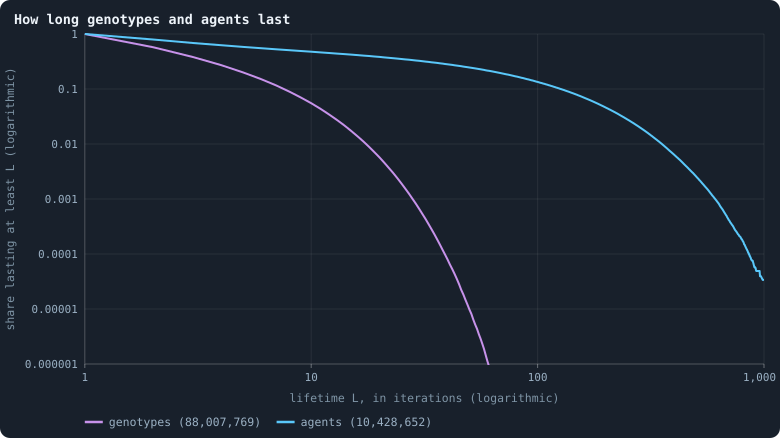

**How long genotypes and agents last.** Of all genotypes that appeared, and all agents born, at iteration 500 or later in the 30 worlds, the share that lasted at least L iterations. A genotype lasts from the first game after which some agent carries it to the last; an agent from its birth to the last game it is alive after. Lives still going at the end are counted as far as they went (Kaplan–Meier).

> [!example]- How to make this figure
> **Runs.** The 30 baseline runs `B1-100000-s001` … `B1-100000-s030`: the baseline B1 at 100,000 tokens, seeds 1 to 30, 1,500 iterations each (every setting is listed in [Thirty worlds](b1-lives-and-wealth.md#thirty-worlds)). They are made with `python3 gol_lab.py run E10`.
>
> **Data.** From each run's frames, `GraphOfLifeRuns/<run>/frames/`, read with `gol_store.read_frame(run, index)`; frame `2·t` is iteration *t* after reproduction and frame `2·t + 1` after the game.
>
> 1. Read every frame with `phase` = 2; for every genotype (brain id in `brain_ids`) and every agent (id in `ids`) note the first and last iteration it appears.
> 2. Keep those first seen at iteration 500 or later; one still present in the last frame is censored.
> 3. Kaplan–Meier as in [Births, deaths and ages](b1-lives-and-wealth.md#births-deaths-and-ages).
>
> **To make it again:** `python3 book_figures.py lineage`.
<!-- /figure -->

The two curves are [survival curves](measuring-lives.md#survival-curves-kaplanmeier) on logarithmic axes.
They follow every genotype and every agent that appeared from iteration 500
on in the thirty worlds, if it was there after a game. Each curve gives the
share that lasted at least *L* iterations.

- **Genotypes** (violet) are short-lived. More than half, 57%, last at least
  2 iterations; 20% last at least 5, and 6% at least 10. Only one in a
  hundred thousand reaches 50, and none reached 100, exactly as at 10,000
  tokens. The median genotype lasts two iterations.
- **Agents** (blue) last far longer: 48% at least 10 iterations, 13% at least
  100. These are the agents that lived through their first game, as in
  [Births, deaths and ages](b1-lives-and-wealth.md#how-long-agents-live).
  Nearly a third of all newborns do not.

Why the difference? An agent keeps its node, its id and its age when its
brain changes, and when a conqueror's brain replaces its own. A genotype ends
when the last agent carrying it mutates, dies, or has its node won by another
genotype. One brain in five changes after every game, and half of all nodes
change hands in every game
([How the game is played](b1-the-game-and-its-flows.md#how-the-game-is-played-what-agents-stake-and-who-wins-the-nodes)). So a genotype has
little time.

In its settled life, from iteration 500 on, a world holds about one genotype
for every 1.6 agents. That is five genotypes for every eight agents: a world
of some 14,400 agents holds about 9,000 different genotypes at once. The
measure is the number of distinct genotypes divided by the number of agents
(`distinctBrains/nodes`), averaged over iterations 500 to 1,499. It is 0.63
in the median world, between 0.61 and 0.66 across the thirty, and 0.63 at
10,000 tokens too.

### But some genotypes get big

<!-- figure lineage/top-share -->
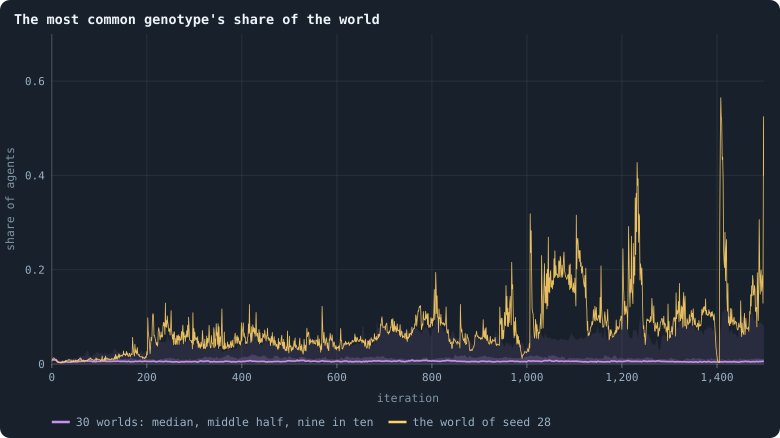

**The most common genotype's share of the world.** After every game, the share of the living that carry the most common genotype. The line is the median of the worlds at each iteration, the darker band holds the middle half of them (from the 25th to the 75th percentile) and the paler band nine in ten (5th to 95th). The yellow line is the single world with seed 28.

> [!example]- How to make this figure
> **Runs and data.** As for the figure *How long genotypes and agents last* above.
>
> 1. After every game, count the agents per genotype in `brain_ids`; the largest count divided by the number of agents.
> 2. Cut the 1,500 iterations into 600 stretches of 2.5 and take each world's mean in each stretch.
> 3. In each stretch, take the median, the 25th and 75th and the 5th and 95th percentiles of those means over the worlds that still have a value there (a world that died has none after its death).
>
> **To make it again:** `python3 book_figures.py lineage`.
<!-- /figure -->

Most of the time the most common genotype holds a tiny part of the world.
After iteration 100 its median share is 0.6% (1.6% at 10,000 tokens). In a
world of some 14,400 agents, that is fewer than a hundred of them.

But not always. After iteration 100, a single genotype held more than a
tenth of the world at some moment in 10 of the 30 worlds. One held more than
a fifth in 7, more than a third in 2, and more than half in one. That one
held 56% of all agents at iteration 1,408, in the world with seed 28 (the
yellow line). This world is a [star](measuring-networks.md#stars-and-hubs "An agent joined to far more agents than most; a star is a world held together by a single hub."), held together by a single hub, and
[The largest and the smallest](b1-lives-and-wealth.md#the-largest-and-the-smallest) looks inside
it. Its collapse had just left it some 2,100 agents
([No world died — but one came close](b1-lives-and-wealth.md#no-world-died--but-one-came-close)).
At 10,000 tokens large shares were more common: a tenth in 21 of 26 worlds,
a fifth in 17.

No genotype lasts long. So a long stretch of one large share is several
genotypes in turn, each changed from the one before: a **line** spreading.

### Lines take over

To see a line, follow the family tree backwards. Start from every agent
alive now, and climb from its genotype to that genotype's parent, and on.
Where two agents share an ancestor, their branches meet. If the living all
descend from one founder, all their branches meet, sooner or later, in one
genotype. The newest genotype in which they all meet is the
[common ancestor](measuring-evolution.md#the-common-ancestor-of-the-living) of the living. How many iterations
back it lived is its **depth**.

Watch that depth over time, and it tells a story. While no line takes over,
the common ancestor stays the same genotype and simply grows older: the depth
rises by one iteration per iteration. When one branch of the family tree
outlives all the others, the common ancestor jumps forward to a younger
genotype, and the depth drops. Every drop is a moment when one line has
replaced all the others: a **sweep**.

<!-- figure lineage/ancestor -->
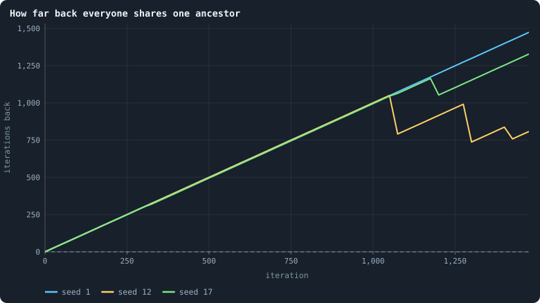

**How far back everyone shares one ancestor.** Every 25 iterations, for three worlds (seeds 1, 12 and 17, one colour each): how many iterations earlier the newest genotype lived from which every living agent descends ([The common ancestor](measuring-evolution.md#the-common-ancestor-of-the-living)). While a line rises by 25 every 25 iterations, that ancestor stays the same and simply grows older; each drop is a moment when it moves forward to a younger genotype, because all the other branches of the family tree have died out. Before the first drop the living descend from more than one founder, and the line is drawn at the age of the world.

> [!example]- How to make this figure
> **Runs.** `B1-100000-s001`, `-s012` and `-s017`.
>
> **Data.** From each run's frames, `GraphOfLifeRuns/<run>/frames/`, read with `gol_store.read_frame(run, index)`; frame `2·t` is iteration *t* after reproduction and frame `2·t + 1` after the game.
>
> 1. Read every frame in order; remember each genotype's parent and the iteration it first appeared.
> 2. Every 25 iterations, after the game, count the agents per living genotype and climb the family tree from them, newest genotype first, adding each genotype's count to its parent's ([The common ancestor](measuring-evolution.md#the-common-ancestor-of-the-living)).
> 3. The first genotype reached that carries all agents is their newest common ancestor; plot the iterations since it first appeared.
>
> **To make it again:** `python3 book_figures.py lineage`.
<!-- /figure -->

Each curve is one world. While its living still descend from more than one
founder, they have no common ancestor. The curve is then drawn at the age of
the world. The first drop is the moment everyone alive descends from one
founder ([One founder for everyone](b1-lives-and-wealth.md#one-founder-for-everyone)).
In the median world it came at iteration 1,000, among the 27 that got there;
three never did.
[Worlds of 100,000 tokens](b1-the-network-size-and-scaling.md#worlds-of-100000-tokens)
counts it, and finds it 5.9 times as late as in the worlds of 10,000 tokens.
After that the curve rises steadily again, one iteration per iteration. It
drops whenever one branch of the family tree has outlived all the others.

From iteration 500 on, everyone alive shared one ancestor that had lived a
median of 946 iterations earlier. For many worlds that is the start of the
world itself, since their living did not yet all descend from one founder.
Nine in ten of the living shared one from 745 iterations earlier, and half of
them one from 468. (At 10,000 tokens: 730, 590 and 300.)

What does a takeover look like while it happens? Take every genotype alive
at one moment, and let each start a **family**: itself and every genotype
descended from it. It is the same idea as in [Families](measuring-evolution.md#families), with
the moment held fixed instead of eight iterations back. Then follow the
share of the living in each family over the following iterations, stacked
one on top of the other ([Muller plots](measuring-evolution.md#muller-plots)):

<!-- figure lineage/families-12 -->
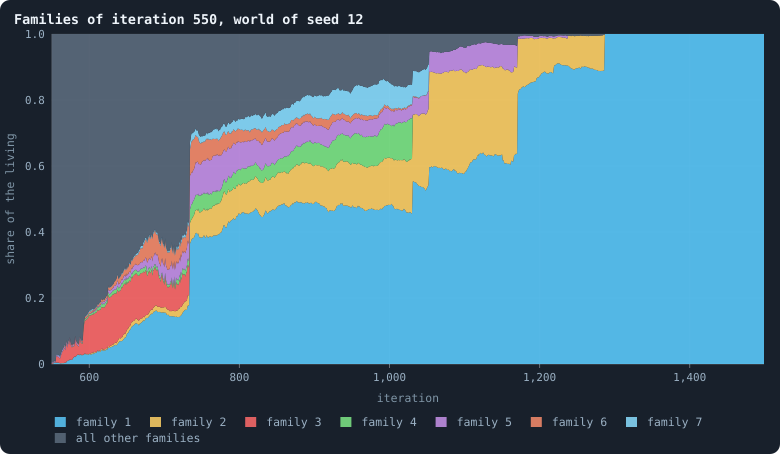

**Families of iteration 550, world of seed 12.** Every genotype alive after the game of iteration 550 founds a family: itself and every genotype descended from it. After every later game, the share of the living in each family, stacked; the seven families that ever held the largest share in colour, all others together in grey.

> [!example]- How to make this figure
> **Runs.** `B1-100000-s012`.
>
> **Data.** From each run's frames, `GraphOfLifeRuns/<run>/frames/`, read with `gol_store.read_frame(run, index)`; frame `2·t` is iteration *t* after reproduction and frame `2·t + 1` after the game.
>
> 1. Note the genotypes alive after the game of iteration 550.
> 2. After every later game, follow each living agent's genotype up its parents until one of those is reached; count the agents per family and divide by the number of agents.
> 3. Stack the shares, the families with the largest share ever at the bottom.
>
> **To make it again:** `python3 book_figures.py lineage`.
<!-- /figure -->

In the world with seed 12, from iteration 550, one family takes the world.
The descendants of a single genotype of iteration 550 pass half of the world
at iteration 1,031, and hold all of it from iteration 1,287. That family is
not one brain. Once it fills the world, every genotype of the world belongs
to it: 0.63 for each of some 11,800 agents, thousands at once. Each is a
changed copy of the one it came from. Together they replaced every other line
of the world in about 740 iterations. (At 10,000 tokens, in the world with
the same seed, a family went from nothing to all in about 270.)

<!-- figure lineage/families-1 -->
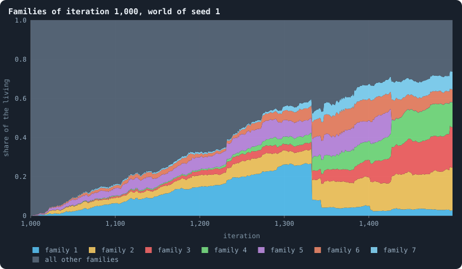

**Families of iteration 1,000, world of seed 1.** Every genotype alive after the game of iteration 1,000 founds a family: itself and every genotype descended from it. After every later game, the share of the living in each family, stacked; the seven families that ever held the largest share in colour, all others together in grey.

> [!example]- How to make this figure
> **Runs.** `B1-100000-s001`.
>
> **Data.** From each run's frames, `GraphOfLifeRuns/<run>/frames/`, read with `gol_store.read_frame(run, index)`; frame `2·t` is iteration *t* after reproduction and frame `2·t + 1` after the game.
>
> 1. Note the genotypes alive after the game of iteration 1,000.
> 2. After every later game, follow each living agent's genotype up its parents until one of those is reached; count the agents per family and divide by the number of agents.
> 3. Stack the shares, the families with the largest share ever at the bottom.
>
> **To make it again:** `python3 book_figures.py lineage`.
<!-- /figure -->

In the world with seed 1, from iteration 1,000, nothing like it happens in
500 iterations. The largest family peaks at 27% of the world and ends at 3%,
with many others beside it.

How often does one branch replace all the others? Count the drops of each
world:

<!-- figure lineage/moves -->
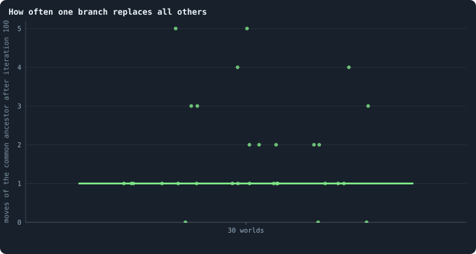

**How often one branch replaces all others.** One dot per world: how many times, between iteration 100 and the end, the newest common ancestor of all the living moved forward to a younger genotype (one of the drops in the figure above). The bar is the median.

> [!example]- How to make this figure
> **Runs.** The 30 baseline runs `B1-100000-s001` … `B1-100000-s030`: the baseline B1 at 100,000 tokens, seeds 1 to 30, 1,500 iterations each (every setting is listed in [Thirty worlds](b1-lives-and-wealth.md#thirty-worlds)). They are made with `python3 gol_lab.py run E10`.
>
> **Data.** From the lineage analysis of Experiment 10 (`python3 gol_lab.py analyse E10`), in `book/results/E10.json` (`ancestor.moves` of every run).
>
> 1. Take the common-ancestor depth every 25 iterations as above.
> 2. Count the checks after iteration 100 at which the depth is smaller than the previous depth plus 25.
>
> **To make it again:** `python3 book_figures.py lineage`.
<!-- /figure -->

After iteration 100, the common ancestor moved forward a median of once per
world, between 0 and 5 times. For most worlds that once is the moment they
first come down to a single founder. At 10,000 tokens it moved a median of 8
times, about once every 350 iterations. In a world ten times larger, a line
needs about as long to take it over as the whole run lasts. Why so much
longer?
[How a line takes over](b1-the-network-size-and-scaling.md#how-a-line-takes-over)
asks that question, and [Selection, or chance?](#selection-or-chance) below
gives its answer.

### Was the thesis right?

No. At both sizes the thesis is **refuted**, and on the same clause. Far
more than one world in ten had a single genotype holding more than a tenth
of it.

**At 10,000 tokens** its first part holds. There are always hundreds of
genotypes, about one for every 1.6 agents, and each lasts a couple of
iterations. The number of families of eight iterations stays in the
hundreds: a median of 315 from iteration 100 on. That is because a spreading
line branches into many genotypes within eight iterations. The families fell
to ten or fewer in only two worlds, briefly, in the booms and crashes of
their early life. But single genotypes do hold large shares of the world for
a while. A single genotype held more than a tenth of the world in 21 of the
26 worlds. The thesis allowed at most one world in ten. And, more
importantly, whole lines take the world over again and again.

**At 100,000 tokens**, checked the same way from iteration 100 on, the
thesis is refuted again on the same clause. There are 0.63 genotypes per
agent. The families of eight iterations number a median of 3,300 per world.
In no world did they ever fall to ten: the lowest, 47, came in one world's
worst stretch. But a single genotype held more than a tenth of the world in
10 of the 30 worlds. Lines take the world over here too: 27 of 30 came from a
single founder by iteration 1,500. But they do so slowly, about once a run.

### Selection, or chance?

A line that takes a world over looks like a winner. It need not be better
than the others. In any population that reproduces, all lines but one die out
sooner or later by chance alone. Family names die out that way in a village
where nobody is better than anybody. Followed backwards, the lines of the
living merge, two by two, until all meet in one ancestor: the
[coalescent](the-ideas-this-builds-on.md). So a sweep is not, by itself,
evidence of selection. The question is whether lines take over here *faster
than chance would make them*, because some brains do better.

To tell, we need a world in which no brain is better than another.
[Do the brains matter?](do-the-brains-matter.md) built worlds whose brains
never change. Once one founder's line fills such a world, every agent
carries the same brain, and which branch spreads is pure chance. How often
chance swept them depended on how often their agents were born and died.
Where no one was born any more, the common ancestor hardly moved: a median of
0 moves. Where about one child was born for every agent in every iteration,
chance swept the whole world about every thirty iterations. That is a median
of 94 moves, against 8 in the [baseline](b1-and-b2.md "The stated rules an experiment starts from: B1 or B2. Drawn worlds are stored as changes from B1, but judged against each other.") worlds of the same size. None of these
worlds is born and dies as the baseline does, so they could not settle the
question.

The brains themselves could.
[How to tell a world that keeps evolving](how-to-tell-a-world-that-keeps-evolving.md)
played the brains of different eras of ten worlds of 5,000 tokens against
each other. By iteration 50 the brains already beat their founders', by 361
Elo points in the median world. In a world shared between the two, they ended
up with nine tenths of it. After that, every era ties with the one before it.
Against the brains of iteration 300, those of iteration 1,000 held 0.483 of a
shared world: a tie. So the lines that take a settled world over do not carry
brains that play better.
[What the brains are like](what-the-brains-are-like.md) says why there is
little to be better at. The brains are nearly blind, and agree on every
decision that matters.

The pace of a takeover tells a little more.
[How a line takes over](b1-the-network-size-and-scaling.md#how-a-line-takes-over)
sets out three paces for a world ten times larger. Chance alone would need
ten times as long. A better brain in a well-mixed world, where every agent
could meet every other, would need barely longer. A better line spreading
outwards as a front, the way a fire crosses a field, would need two to three
times as long. The worlds of 100,000 tokens took 5.9 times as long to come
down to one founder.

Ten times the tokens, 5.9 times the time: since 10^0.77 = 5.9, the time
grows as the tokens to the power 0.77. A front's time would grow as the
width of the world: the tokens to the power 0.30. Chance's would grow as the
number of agents: the power 1. The measured pace lies between the two. It
fits a line that spreads as a random walker wanders: its patch of the world
widens more and more slowly
([Where the lines live](b1-the-network-size-and-scaling.md#where-the-lines-live)).

### What we learned (genotypes and lineages)
- **A genotype is a name that changes fast.** The median genotype lasts two
  iterations. A settled world holds five genotypes for every eight agents,
  at both sizes. The most common one usually holds a tiny part of it: a
  median of 0.6% at 100,000 tokens, 1.6% at 10,000.
- **The unit of evolution here is the line, not the genotype.** A genotype
  lasts a couple of iterations, far too short for selection to act on it. A
  line that takes over the world lasts hundreds. The first step of the
  ladder in [What this notebook is about](what-this-notebook-is-about.md)
  asks for lineages that last long enough for selection to act. Only lines
  can meet it.
- **Lines take worlds over, more slowly in larger worlds.** One line
  replaced all the others about every 350 iterations at 10,000 tokens, and
  about once a run at 100,000.
- **In a settled world, the winners are not better.** The lines that take it
  over carry no brains that play better, and they spread as a random walk
  does, not as a front.

### How this was made (genotypes and lineages)
Every figure of this page says, folded beneath it, which runs it reads and
how. The command `python3 book_figures.py lineage` draws them all, and
writes the numbers it measures to `book/results/lineage.json`.

The worlds are the thirty B1 worlds of 100,000 tokens of Experiment 10. The
numbers given for worlds of 10,000 tokens come from the lineage analysis of
Experiment 6, which read the thirty runs of Experiment 2. They are in
`book/results/E06.json`, made with `python3 gol_lab.py analyse E06`, and
count the 26 of those worlds that lived to the end of their 3,000
iterations.

#### The runs of Experiment 10

<!-- runs E10 -->
> [!info]- The runs behind this page
> **30 runs.** Every condition below is run once for every seed (1 to 30), for 1,500 iterations — or until its world dies out. Every setting is that of the baseline **B1** (the algorithm exactly as a new run is offered it) unless the condition changes it ([At a glance](settings.md#at-a-glance)).
>
> - **baseline** — changes nothing: B1 as it is; 100,000 tokens. Runs `B1-100000-s001` … `B1-100000-s030`.
>
> To make these runs again: `python3 gol_lab.py run E10`, or ▶ in the Research Notebook tab of a computer running `gol_server.py`. Each run writes its settings, seed and engine version beside its frames, in `GraphOfLifeRuns/<run>/meta.json` and `provenance.json`.
<!-- /runs -->

#### The runs of Experiment 6

<!-- runs E06 -->
> [!info]- The runs behind this page
> These are the runs of Experiment 2; nothing new was run for this page.
>
> **30 runs.** Every condition below is run once for every seed (1 to 30), for 3,000 iterations — or until its world dies out. Every setting is that of the baseline **B1** (the algorithm exactly as a new run is offered it) unless the condition changes it ([At a glance](settings.md#at-a-glance)).
>
> - **baseline** — changes nothing: B1 as it is; 10,000 tokens. Runs `B1-10000-s001` … `B1-10000-s030`.
>
> To make these runs again: `python3 gol_lab.py run E02`, or ▶ in the Research Notebook tab of a computer running `gol_server.py`. Each run writes its settings, seed and engine version beside its frames, in `GraphOfLifeRuns/<run>/meta.json` and `provenance.json`.
<!-- /runs -->

## What agents say to each other

Each agent writes a message of 30 numbers to itself and to each neighbour, and
nothing but the brains gives the numbers a meaning. At the end of thirty B1
worlds, two messages of one agent differ by 0.0005, while those of two agents
differ by 0.60. So a message tells its reader one thing, who wrote it: it is a
name, and all agents of one genotype write the same one. Kin could recognise
each other by it with a single comparison, but B1's nearly blind brains cannot
make it.

### Notes in a code nobody wrote

Picture neighbours who pass each other notes written in numbers, in a code
that nobody ever wrote down. Every agent writes a note of 30 numbers to itself
and to each of its neighbours, in every phase. It reads the notes written to
it ([Messages](rules-in-detail.md#messages)). Nothing in the rules reads them except the
brains, and nothing gives the numbers a meaning. If a message says anything,
evolution made it say it.

A free channel between neighbours is the classic setting for the evolution of
signals. It has been studied from Lewis's account of signalling conventions
(Lewis 1969) to the evolution of meaning in populations of simple agents
(Skyrms 2010). So what do the agents of Graph of Life say?

### How the messages are read

As in [What the brains are like](what-the-brains-are-like.md), each of the
thirty worlds is rebuilt exactly as its last game left it. Every agent looks
at its [candidates](one-iteration.md#phase-1-reproduction "An agent itself and each of its neighbours, the ones its brain looks at when it decides."): itself and each of its neighbours. Its brain writes a
message to each of them, 30 outputs squeezed by tanh into the range from −1
to 1. (tanh is a function that maps any number into that range.)

That gives between 32,000 and 79,000 messages per world. There is one for
every [connection](the-world.md#the-network "A link between two agents of the network: they are neighbours, and can stake on each other's nodes.") in each direction, and one from every agent to itself. As a
control, a fresh founder's brain writes from exactly the same inputs. It shows
what the architecture does before any selection.

The worlds are the thirty B1 worlds of 100,000 tokens of
[Thirty worlds](b1-lives-and-wealth.md#thirty-worlds). This page was first written
from thirty worlds of 10,000 tokens; where those differ, both are given.

### A name, not news

Picture someone who sends the same postcard to everyone they know. The card
says nothing about its reader, and nothing about the world. It tells each
reader only one thing: who sent it. Do the agents write such postcards?

<!-- figure talk/names -->
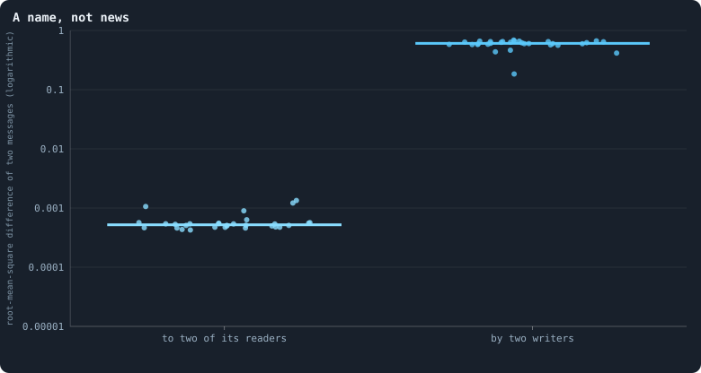

**A name, not news.** For every agent of a world at its end, the message its brain writes to each of its candidates (the 30 message outputs, squashed by tanh into −1 to 1). Left: how different the messages one agent writes to two of its readers are; right: how different the messages of two agents are. One dot per world, each the median over its agents.

> [!example]- How to make this figure
> **Runs.** The 30 baseline worlds that lived to the end.
>
> **Data.** From the final checkpoint of each run, `GraphOfLifeRuns/<run>/checkpoint.npz`, read with `gol_store.load_checkpoint(run, config)`: the world after its last iteration, every living agent's brain and every message in flight.
>
> 1. For every agent, its inputs as the engine builds them and tanh of output rows 15–44 of its brain: one message per candidate.
> 2. Left: the root-mean-square difference between its messages to its first two candidates; right: between its first message and the previous agent's (`book_chapters.inner.message_stats`).
>
> **To make it again:** `python3 book_figures.py talk`.
<!-- /figure -->

Measure the difference of two messages as the root mean square of the
differences of their 30 numbers: their typical difference. Two messages
written by **one** agent to two of its readers differ by **0.0005**. Two
messages written by **two** agents differ by **0.60** (0.55 at 10,000 tokens).

So an agent says the same thing to everyone: to itself, to a rich neighbour
and to a poor one, to kin and to strangers. A message tells its reader one
thing, *who wrote it*. It is a name.

This follows from [What the brains are like](what-the-brains-are-like.md). A
brain's outputs move by a thousandth of a change in its inputs. So the message
it writes to one candidate is nearly the message it writes to the next. A
founder's brain is no different (0.0002 against 0.60). The architecture makes
messages names before any selection.

### What a name says

If a message is a name, whose name is it? And does it carry anything else? The
figure answers three questions, one per panel.

<!-- figure talk/what -->
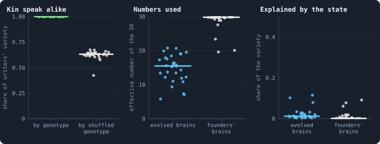

**What the messages carry.** One dot per world. Left: of how much the agents' messages differ from one agent to the next, the share that lies between genotypes — 1 if agents of one genotype write exactly alike — against the same share with the genotypes shuffled among the agents (the median of 50 shuffles). Middle: the effective number of independent numbers the messages use, of their 30 (the participation ratio of the eigenvalues of their covariance). Right: the share of the messages' variety that a straight-line fit on the writer's and reader's tokens and connections (their logarithms) and whether the message is to itself accounts for. Blue: the agents' own brains; grey: a fresh founder's brain — weights drawn as for the founders of a world, normal with standard deviation 1/√(fan-in), biases 0 — given exactly the same inputs.

> [!example]- How to make this figure
> **Runs and data.** As for the figure *A name, not news* above.
>
> 1. As in the figure above, every message an agent's brain writes to each candidate.
> 2. Kin: each writer's mean message; between-genotype sum of squares of those means over their total; the null shuffles the genotypes among writers.
> 3. Numbers used: (Σλ)² / Σλ² of the covariance eigenvalues λ of the 30 components.
> 4. Explained: least squares of all 30 components on [1, ln(1+τ_writer), ln(1+k_writer), ln(1+τ_reader), ln(1+k_reader), self]; 1 − residual sum of squares / total.
>
> **To make it again:** `python3 book_figures.py talk`.
<!-- /figure -->

**Kin speak alike.** Take the mean message of every writer. How much of the
variety between writers lies between genotypes, and how much among writers of
one genotype? In every world, **all of it** (1.00) lies between genotypes. Two
agents of one genotype write the same message, but for a thousandth or so.

With the genotypes shuffled among the writers, the share is 0.63. That much
would lie "between genotypes" by chance, since most genotypes are carried by a
single agent ([Genotypes and lineages](b1-brains-lineages-and-messages.md#genotypes-and-lineages)). That kin
speak alike is no wonder. One genotype is one brain, and a brain that hardly
sees writes the same thing wherever it is. A message is the name **of a
genotype**.

**Few numbers are used.** Picture every message as a point, with its 30
numbers as coordinates. If the points spread along only a few directions, the
messages use only a few numbers' worth of freedom. In the median world, the
messages vary along only **15** independent directions (6 to 21). They are
counted as a participation ratio
([How many directions a cloud of points uses](measures-of-the-archived-studies.md#how-many-directions-a-cloud-of-points-uses)).
Founders' brains, independent of each other, use 30, all of them.

Why so few? A world's genotypes descend from a few lines
([Genotypes and lineages](b1-brains-lineages-and-messages.md#genotypes-and-lineages)). The messages of one
line differ only where the line's changes moved them. So a world speaks a few
dialects, each spoken by a line. The worlds of 10,000 tokens used fewer
directions, 8.8 in the median world. In a world ten times larger, more lines
live side by side, for longer
([Worlds of 100,000 tokens](b1-the-network-size-and-scaling.md#worlds-of-100000-tokens)),
and so do more dialects.

**Nearly nothing about the world.** What could a message be about? The
writer's tokens and connections, the reader's, and whether the message is to
oneself. Fit the messages to these with a straight line, taking tokens and
connections as logarithms. The fit accounts for **1.2%** of their variety
(0.2% to 12%; founders' brains, 0.2%). At 10,000 tokens it was 3.5%, and one
world reached 40%. Here none comes close: what an agent says has almost
nothing to do with its situation.

### The numbers themselves

What values do the 30 numbers of a message take?

<!-- figure talk/values -->
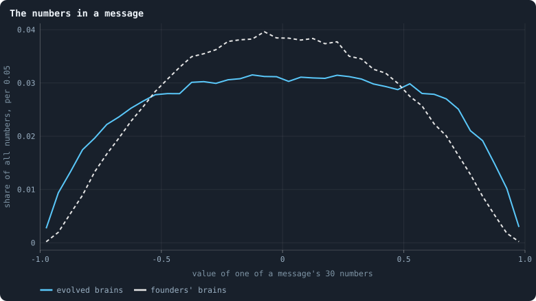

**The numbers in a message.** Every one of the 30 numbers of every message written at the end of the 30 worlds, in bins 0.05 wide: by the agents' own brains (blue) and by a fresh founder's brain — weights drawn as for the founders of a world, normal with standard deviation 1/√(fan-in), biases 0 — given exactly the same inputs (grey, dashed).

> [!example]- How to make this figure
> **Runs and data.** As for the figure *A name, not news* above.
>
> 1. As above; count the numbers in 40 bins from −1 to 1 and divide by all numbers.
>
> **To make it again:** `python3 book_figures.py talk`.
<!-- /figure -->

Founders' messages pile up around 0, in a bell. Evolved messages are spread
almost evenly from −0.7 to +0.7, with more numbers near the ends: 2.5% lie
beyond ±0.9, against 0.4% for founders.

Larger weights would do this. And mutation alone leaves the weights of an
evolved brain larger than a founder's
([What a brain listens to](what-the-brains-are-like.md#what-a-brain-listens-to)).
So nothing here needs selection to explain it. Nor are the evolved values more
informative for being spread wider. They are still the same for every reader.

### Could kin recognise each other?

[Do agents cooperate?](cooperation-help-and-gliders.md#do-agents-cooperate-help-kin-and-partners) found that kin live side by
side: a tenth of an agent's neighbours carry its own genotype. Yet kin are
staked on exactly like strangers. A brain cannot see genotypes. It could tell
kin only through messages, if a lineage evolved a password. That is a signal
its members send, with a habit of treating those who send it differently.
Biologists call such a signal a **green beard** (Hamilton 1964; Dawkins 1976).

The password exists already, without any evolution. When an agent *u* looks at
a neighbour *v*, it reads four messages ([Messages](rules-in-detail.md#messages)). Two of them
are the message it wrote to itself and the message *v* wrote to it. If *u* and
*v* share a genotype, these two messages are identical but for a thousandth or
so. If *v* is a close relative, they are nearly identical. If *v* is a
stranger, they differ by about 0.6 per number, as a root mean square. Telling
them apart needs one comparison.

What is missing is a brain that can make it. A difference of 0.6 in 30 inputs
reaches the stakes at a thousandth of its size, and the stakes split evenly
anyway. Kin recognition is one comparison away, and it is blocked by the same
obstacle as everything else in the brain.
[What the measurements say about open-ended evolution](what-the-baseline-world-is.md#what-the-measurements-say-about-open-ended-evolution)
proposes heritable tags, so that kin can find each other. They are already
here: messages are heritable tags.

Since then, brains have been given sight. In B2, a brain has one hidden layer
of 16 units, and a founder's gain is about 0.2
([Brains that see, and worlds that break](building-b2-and-the-search-for-a-healthy-rich-world.md#brains-that-see-and-worlds-that-break)).
Its messages hold 8 numbers, not 30. Whether seeing brains use the names to
tell kin from strangers has not been measured. Three things nearby were
measured, in pilot worlds under B2's rules:

- Connected groups of kin shrank over time, in every world.
- Evolution turned the brains' attention to messages down, not up. Take the
  agents with at least three tokens to divide. Redrawing the messages a
  founder's brain reads changes its division of the stake in 34 to 48% of
  them. For evolved brains, it changes in only 11 to 20%. The one exception
  was a world that pooled the stakes of kin
  ([What the probes say about why](how-to-tell-a-world-that-keeps-evolving.md#what-the-probes-say-about-why)).
- Given a sense of its own clones for free, as an input, a seeing brain made
  little use of it. Flipping which neighbours are clones changed 12 to 16% of
  the evolved brains' divisions, and 26% of the founders'. No groups formed.
  Groups of kin formed only where a rule pooled their stakes
  ([Another game](another-game.md), [Alliances](another-game.md#alliances)).

So sight is needed, but it is not enough. What a brain can read pays only if
the rules give it something to gain by reading it
([Who helps whom](cooperation-help-and-gliders.md#who-helps-whom)).

### What we learned (what agents say to each other)
- **Messages are names.** An agent writes the same message to every reader,
  and all agents of one genotype write the same message. A message carries who
  wrote it, and almost nothing else.
- **No language has evolved.** A signal can mean something only if two things
  hold. What is sent must depend on something: the sender's state, the
  receiver, or the situation. And what is done on receipt must depend on what
  was sent. Neither holds here. Messages ignore the situation, and decisions
  ignore the messages. With every message set to 0, the stakes of only 9% of
  agents change at all
  ([What the brains are like](what-the-brains-are-like.md)).
- **The raw material is there.** The names identify kin exactly. If brains
  could compare what they read, kin recognition would be one comparison away,
  and with it Hamilton's kin selection
  ([Do agents cooperate?](cooperation-help-and-gliders.md#do-agents-cooperate-help-kin-and-partners)). That makes the gain of the
  brain, again, the first thing to change. The pilots with seeing brains add
  that it is not the only thing: a rule must also make it pay to treat kin as
  kin.

### How this was made (what agents say to each other)
Every figure of this page reads the final checkpoint of each of the thirty
runs of Experiment 10, listed below. A checkpoint holds the world after its
last iteration, with every living agent's brain. From it,
`python3 book_figures.py talk` rebuilds every message and draws every figure.
Each figure says, folded beneath it, which runs it reads and how.

The numbers given for worlds of 10,000 tokens come from the thirty runs of
Experiment 2, `B1-10000-s001` … `-s030`, made with
`python3 gol_lab.py run E02`. When this page was first written, the 26 of them
that lived to the end of their 3,000 iterations were read the same way.

The runs of Experiment 10 are listed once on this page, under [The runs of Experiment 10](#the-runs-of-experiment-10).

## How alike the agents are

Evolution can only choose among differences. The notebook has counted a
world's agents in three ways. It counts the names of their brains, the numbers
in them, and what they do. The counts fall by orders of magnitude, because
most of what makes two brains two changes nothing they do. B1's agents act
nearly alike. B2's differ as widely as random brains, in nearly every variant
of B2. The one exception: where every unused link lapses, they become as alike
as B1's. And B2's kinds are renewed, but they replace one another instead of
piling up.

### Why variety matters

A breeder can only choose among the plants in the field. If every plant is
the same, there is nothing to choose, and nothing changes. Evolution is in the
same position: selection picks among differences, and without differences it
has nothing to pick.

[Open-ended evolution](measuring-evolution.md#what-would-count-as-open-ended-evolution) asks for more than differences at
one moment. It asks for new kinds that keep appearing, and stay beside the old
ones ([What this notebook is about](what-this-notebook-is-about.md)). So two
questions matter: how many kinds a world holds now, and whether they pile up.

Several pages of this notebook have counted the variety of a world, each in
its own way. This page puts their counts side by side. It adds one measure
taken in every kind of world the notebook has made. And it asks what the
counts say about open-ended evolution.

### Three ways to count

Two agents can differ in three ways, and each gives a different count:

- **by name.** Every brain carries a [genotype](measuring-evolution.md#genotypes-families-and-the-common-ancestor): a number it gets
  when it is made, and a new one at every change
  ([How a brain changes](rules-in-detail.md#how-a-brain-changes)). Two agents with one genotype have the
  same brain;
- **by the numbers.** A brain is a set of weights. How far apart are the
  weights of two brains?
- **by what they do.** Put two agents in the same situation, and see whether
  they stake differently. Agents that act alike are one kind of behaviour.
  The kinds are counted by how many agents carry each
  ([Effective numbers](statistics.md#effective-numbers-how-many-kinds)).

| what is counted | how | B1 (10,000 tokens) | B2 (10,000 tokens) | pages |
|---|---|---|---|---|
| **names** | genotypes: a brain gets a new one at every change | 0.65 per agent | 0.46 per agent | [Genotypes and lineages](b1-brains-lineages-and-messages.md#genotypes-and-lineages), [How even is a world?](b1-lives-and-wealth.md#how-even-is-a-world) |
| **numbers** | how far apart two brains' weights are | two agents of one world as far apart as two random brains | — | [What the brains are like](what-the-brains-are-like.md) |
| **behaviour** | kinds of agent that act measurably differently in the same situations, counted by their carriers | 3.2 kinds of staking, 9 over every decision | 17.5 kinds of staking, 54 over every decision | [How different are the agents?](b1-brains-lineages-and-messages.md#how-different-are-the-agents) |

The counts fall by orders of magnitude from the first to the last. A B1 world
of 1,500 agents holds about a thousand genotypes, and a handful of kinds of
behaviour. A B2 world of 3,400 agents holds about 1,600 genotypes, and a few
dozen kinds. Most of what makes two genotypes two changes nothing they do.

A fourth count, the [diversity score](measuring-health.md#the-diversity-score), asks how widely a
world's agents spread in what they hold: their tokens, links, ages and
genotypes. The screen of random worlds uses it, beside the kinds of staking,
to judge whether a world is diverse
([What makes a world interesting](rounds-1-and-2-of-the-screen.md#what-makes-a-world-interesting)).

### What the pages found

**In B1, the agents have many names, but act alike.**

- A genotype lasts a couple of iterations. What lasts long enough for
  selection is a line, a family of genotypes. A line can take a world over in
  a few hundred iterations
  ([Genotypes and lineages](b1-brains-lineages-and-messages.md#genotypes-and-lineages),
  [Worlds of 100,000 tokens](b1-the-network-size-and-scaling.md#worlds-of-100000-tokens)).
- B1 keeps five genotypes for every eight agents, in every world and at every
  size. That is a balance of making and copying. It moves with the rate of
  change and with nothing else
  ([How even is a world?](b1-lives-and-wealth.md#how-even-is-a-world),
  [How fast should brains change?](how-fast-should-brains-change.md)).
- Two brains of one world are as far apart in their numbers as two brains
  drawn at random. Nearly all of a brain is neutral: free to drift, because
  nothing depends on it
  ([What the brains are like](what-the-brains-are-like.md)).
- Selection set the same constants in every world
  ([How the game is played](b1-the-game-and-its-flows.md#how-the-game-is-played-what-agents-stake-and-who-wins-the-nodes),
  [What the brains are like](what-the-brains-are-like.md)). They are: no
  children, a spread stake, and every token revolutionary.
- Without evolution, worlds started from random brains end in very different
  places. With it, they all end alike
  ([Do the brains matter?](do-the-brains-matter.md)).
- In the same situation, the agents act nearly alike: seven times more alike
  than random brains. Their largest kind of staking is the [even split](measuring-tokens.md#the-even-split "What the rules do when a brain scores no candidate above zero: the stake is spread evenly."), which
  the rules make of scores at or below zero
  ([How different are the agents?](b1-brains-lineages-and-messages.md#how-different-are-the-agents)).

**In B2, the agents differ as widely as random brains, but steadily.** Nine
pairs in ten stake measurably differently. They share one habit, going all
in, and differ in when and on whom
([How different are the agents?](b1-brains-lineages-and-messages.md#how-different-are-the-agents)).

**In both:**

- Where agents differ, they differ in how they answer a place, hardly ever in
  a fixed leaning
  ([How different are the agents?](b1-brains-lineages-and-messages.md#how-different-are-the-agents)). Much of
  the place reaches them through the rules: a single token kept at home, or an
  even split over the neighbours.
- The groups tokens stay in are the network's regions. Only B2's agents keep
  a partner longer than chance, for a few games
  ([Flow modules: the groups tokens stay in](b1-the-game-and-its-flows.md#flow-modules-the-groups-tokens-stay-in)).

### Why B1's agents are alike and B2's are not

B1 and B2 differ in many rules at once, and
[Every setting](settings.md) lists them. So the difference between their
agents has more than one candidate cause:

- **Brains.** B1's brains have five hidden layers, and pass on a thousandth
  of a change in what they see
  ([What the brains are like](what-the-brains-are-like.md)). B2's have one,
  and see
  ([Brains that see, and worlds that break](building-b2-and-the-search-for-a-healthy-rich-world.md#brains-that-see-and-worlds-that-break)).
  A blind brain can differ from another only in its constants.
- **How the stake is made.** B1's brains spread their stake, and a spread
  stake changes little when the scores change. B2's go all in. An all-in
  stake goes to whichever candidate scores highest, so a small difference
  between two brains flips the choice.
- **How brains change.** B1 changes every brain after every game. B2 changes
  a brain only when it is copied, so a brain keeps its quirks for as long as
  it lives.
- **How links lapse.** In B1, every link not used in a game lapses. In B2,
  only one whose two ends have at least two neighbours in common, so that
  they stay joined twice over
  ([Every setting](settings.md#prune_needs)).

The measures below, taken in every kind of world, tell the four apart. The
last is enough on its own.

### In every kind of world

[How different are the agents?](b1-brains-lineages-and-messages.md#how-different-are-the-agents) measured B1
and B2. Its measures were taken again in three seeds of every condition the
lab has run, at the end of each run (58 worlds). And they were taken in both
seeds of every pilot condition (69).

<!-- figure how_alike/lab -->
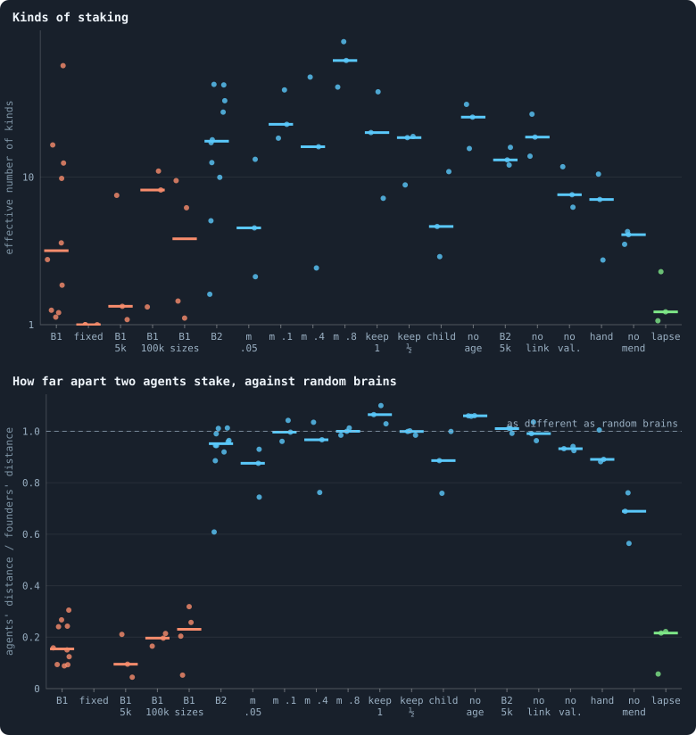

**How alike the agents are, in every lab condition.** Each dot is a world. Top: how many kinds of staking its agents fall into, counted by the agents in each (an effective number; logarithmic axis). Bottom: how far apart two agents' stakes are in the same situation and with the same random inputs, divided by how far apart two fresh founder brains are in the same situations: 1 means as different as brains drawn at random, less means more alike. Orange: B1 and its variants; blue: B2 and its variants; green: B2 with lapsing links. B2 without random inputs is left out of both: without noise every difference counts, and its kinds cannot be compared. B1: B1 at 10,000 tokens (Experiment 2); fixed: brains that never change (Experiment 7); B1 5k, B1 100k, B1 sizes: B1 at 5,000 (Experiment 12), 100,000 (Experiment 10) and 3,200 to 204,800 tokens (Experiment 8). B2: B2 at 10,000 tokens (Experiment 16); m .05 to m .8: the chance that a copied brain changes, 0.05 to 0.8 (B2's own is 0.2; Experiment 9); keep 1, keep ½: the last token kept, half the tokens kept; child: children of any size; no age: no old age (Experiment 15); B2 5k: B2 at 5,000 tokens, and with one of its rules taken away — no link: no links at birth, no val.: no valence, hand: handover allowed, no mend: no mending, lapse: any unused link lapses (Experiment 14).

> [!example]- How to make this figure
> **Runs.** Three seeds of every condition of the lab's experiments at the end of their runs (Experiments 7 to 16; B2 itself from Experiment 16 at 2,000 iterations and B1 from Experiment 2 at 3,000), and both seeds of every pilot condition at its checkpoint of 1,000 or 2,000 iterations.
>
> **Data.** From `GraphOfLifeRuns/.pilots/diversity/across_lab.json`, `B1.json`, `B2.json` (`research/oee/checks/diversity.py`).
>
> 1. Load the world and play one game, so its messages are fresh (`research/oee/checks/diversity.py`).
> 2. Take what 200 living agents read, and draw their random input rows 8 times, the same draws for every brain.
> 3. Put the brains of 400 agents drawn at random, and 400 fresh founder brains, into every situation and draw, and turn their outputs into decisions by the engine's rules.
> 4. Count the kinds of staking as in [How different are the agents?](b1-brains-lineages-and-messages.md#how-different-are-the-agents); divide the agents' total variation by the founders'.
>
> **To make it again:** `python3 book_figures.py how_alike`.
<!-- /figure -->

**In nearly every variant of B2, the agents stay as different as random
brains.** The variants change a great deal:

- how often brains change;
- the last token, or half the tokens, kept at home;
- children of any size, half the tokens, no links at birth;
- no cap on links, and handover.

In each, two agents stake as differently as two fresh founder brains in the
same situations: 0.88 to 1.07 times as far apart. Only without mending are
they somewhat more alike (0.69). Without old age they are as different too
(1.06), but there it says nothing. Most of the agents are the founders
themselves, who never die ([Healthy and rich](building-b2-and-the-search-for-a-healthy-rich-world.md#healthy-and-rich)).

What moves is how many kinds there are, and the rate at which brains change
moves it most.

<!-- figure how_alike/mutation -->
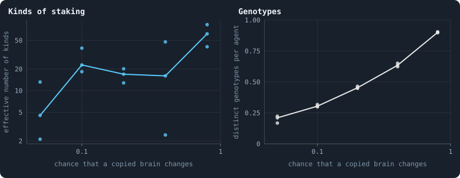

**The more brains change, the more kinds.** B2's worlds of Experiment 9 at 1,500 iterations, at five chances that a brain changes when it is copied (B2's own is 0.2). Each dot is a world; the line joins the medians. Left: kinds of staking, counted by their carriers; right: distinct genotypes per agent.

> [!example]- How to make this figure
> **Runs.** Three seeds of each of Experiment 9's five mutation rates, at iteration 1,500.
>
> **Data.** From `GraphOfLifeRuns/.pilots/diversity/across_lab.json` and `B2_1500.json` (`research/oee/checks/diversity.py`).
>
> 1. Load the world and play one game, so its messages are fresh (`research/oee/checks/diversity.py`).
> 2. Take what 200 living agents read, and draw their random input rows 8 times, the same draws for every brain.
> 3. Put the brains of 400 agents drawn at random, and 400 fresh founder brains, into every situation and draw, and turn their outputs into decisions by the engine's rules.
>
> **To make it again:** `python3 book_figures.py how_alike`.
<!-- /figure -->

Take the chance that a copied brain changes. At 0.05, B2's agents fall into
about 4.5 kinds of staking; at 0.8, into about 60. Meanwhile the genotypes per
agent go from 0.21 to 0.90. The kinds do not rise evenly with the rate: three
worlds per rate are few, and the count of a world swings with its seed. But
the two ends are an order of magnitude apart.

**One rule makes B2's agents as alike as B1's: every unused link lapses.**
Take B1's rule for links, and everything else of B2's. Then the agents fall
into one or two kinds of staking. In six of the seven worlds, nine agents in
ten are of the largest kind. Two agents of such a world stake a fifth as
differently as two random brains, or less. That is 0.22 in the lab's worlds,
and 0.12 and 0.13 in the pilots with and without gifts. It is as alike as the agents
of B1 and its variants (0.10 to 0.26).

And in six of these seven worlds, the agents do what B1's do. They spread
their stake over their candidates, in 95 to 100% of cases, where B2's agents
spread in at most 4%. Why? A link that no stake crosses lapses. So an agent
that goes all in on one neighbour keeps its other links only where they stake
on it, and spreading keeps them all. The brains, and the way brains change,
are B2's in these worlds. So neither is needed for the likeness: the rule for
links is enough, through the stake it selects.

Three other rules make the agents more alike, though not nearly as much:

- links that hold a token: 0.66 and 0.72 of random brains' distance;
- brains that grow: 0.67;
- brains whose every unit holds a token: 0.47.

<!-- figure how_alike/pilots -->
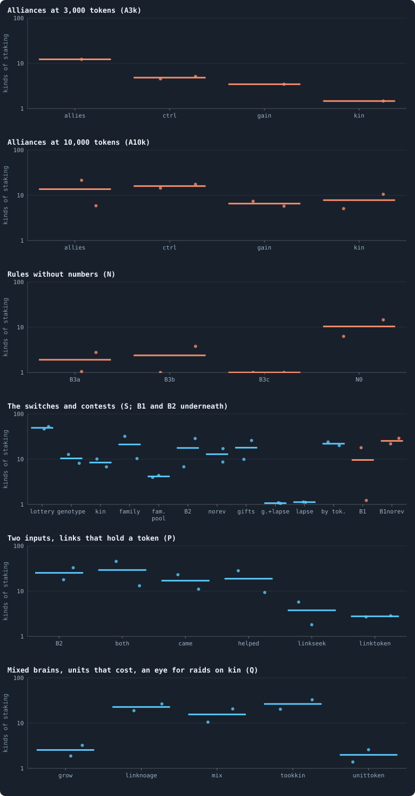

**Kinds of staking in the pilot worlds.** Each dot is a pilot world at its checkpoint of 1,000 iterations (batches A, N and S) or 2,000 (batches P and Q), the bar the median; orange: B1's rules underneath, blue: B2's. The pages that ran each batch say what its conditions change. Batch S: lottery, genotype, kin, family, fam. pool — contests by lottery, sides pooled by genotype, an eye for kin, an eye for a family tag, sides pooled by family (all without revolutions); B2, norev, gifts, g.+lapse, lapse, by tok. — B2 itself, without revolutions, with gifts, with gifts and every unused link lapsing, with every unused link lapsing, estates shared by wealth; B1, B1norev — B1, and B1 without revolutions.

> [!example]- How to make this figure
> **Runs.** Both seeds of every pilot condition that has a checkpoint there.
>
> **Data.** From `GraphOfLifeRuns/.pilots/diversity/across_pilots.json` (`research/oee/checks/diversity.py`).
>
> 1. Load the world and play one game, so its messages are fresh (`research/oee/checks/diversity.py`).
> 2. Take what 200 living agents read, and draw their random input rows 8 times, the same draws for every brain.
> 3. Put the brains of 400 agents drawn at random, and 400 fresh founder brains, into every situation and draw, and turn their outputs into decisions by the engine's rules.
>
> **To make it again:** `python3 book_figures.py how_alike`.
<!-- /figure -->

### Does the variety last?

Variety at one moment is not open-ended evolution. Think of a shop whose
shelves always hold a hundred products, because every new one pushes an old
one out. Its range never grows. A world that keeps making new kinds while it
loses old ones is like that shop. It holds as many kinds at every moment, and
no more.

What the notebook has measured over time:

- **Names churn fastest.** A genotype lasts a couple of iterations
  ([Genotypes and lineages](b1-brains-lineages-and-messages.md#genotypes-and-lineages)).
- **B2's kinds of behaviour turn over in hundreds of iterations.** Of the
  kinds a sample can find, two thirds are gone 500 iterations later, and new
  ones have taken their place. A core of about a quarter lasts 5,000
  iterations ([How different are the agents?](b1-brains-lineages-and-messages.md#how-different-are-the-agents)).
- **B1's few kinds last.** Of the agents of one moment, 0.82 have a kind still
  found 5,000 iterations later, against 0.90 for the same moment sampled
  twice. One of the two long worlds settled on a single kind of staking for
  good.
- **Better brains do keep coming in B2.** The brains of 2,000 iterations beat
  those of 500 over an agent's lifetime
  ([Would we notice if it went on?](how-to-tell-a-world-that-keeps-evolving.md#would-we-notice-if-it-went-on)).
  But they come more and more slowly, towards a plateau from about 5,000
  iterations on. Whether the plateau is the end is still open for B2. Two
  worlds with brains mixed at birth, played to 50,000 iterations, climbed for
  20,000 to 25,000, and then wandered
  ([Every era against three](every-era-against-three.md)).

So B2's variety is renewed, and some of the renewal is improvement. What is
missing is accumulation: new kinds replace old ones instead of joining them.

### What it would take

For many kinds to live side by side, a kind needs a reason to stay: somewhere
it does better than the others. Then a new kind is added to the old ones,
rather than taking their place. The notebook's evidence points four ways, and
none of them needs a tuned number:

1. **Places that differ in what pays.** B2's kinds already sit at different
   [degrees](measuring-networks.md#degree "The number of an agent's connections: how many neighbours it has.") in the network
   ([How different are the agents?](b1-brains-lineages-and-messages.md#how-different-are-the-agents)). That
   fits niches, but it fits families that live together too. To tell them
   apart, move a kind to another place, and see whether it does worse there.
2. **Payoffs that depend on how common a kind is**, so that a rare kind has an
   edge. Nothing in the game does this now. Where payoffs do depend on
   numbers, they favour the common. Alliances, where a convention pays most
   when shared, made one kind win ([Alliances](another-game.md#alliances)).
   And a raider written by hand takes hold only in a crowd
   ([How large a crowd a raider needs](strategies-written-by-hand.md#how-large-a-crowd-a-raider-needs)).
3. **Heredity of whole parts.** Mixing brains at birth gave some of the
   largest steps of evolution of any pilot, in one of two worlds
   ([Brains mixed at birth](what-the-switches-did-in-pilots.md#brains-mixed-at-birth)).
   A child's brain is mixed from a parent and a mate. So a unit that works can
   spread without the rest of the brain it arose in.
4. **Groups that hold together.** None of these worlds makes any beyond the
   regions of its network
   ([Flow modules: the groups tokens stay in](b1-the-game-and-its-flows.md#flow-modules-the-groups-tokens-stay-in),
   [Who helps whom](cooperation-help-and-gliders.md#who-helps-whom)).

And one thing to avoid: a rule that leaves a single way of acting as the way
to keep going. Lapsing links do that to the stake: spread it, or lose your
links. The kinds of staking then collapse to one or two, as above. A rule that
open-ended evolution can use leaves more than one way to live.

And one measure to take before any of them: play each kind against the kinds
that replaced it. If new kinds beat old ones, the turnover is selection. If
they only differ, it is drift: variety without direction.

### What we learned (how alike the agents are)
- **Kinds of behaviour are far fewer than names.** A B1 world holds about a
  thousand genotypes but a handful of kinds of staking. Most of what makes two
  brains two changes nothing they do.
- **B1's agents act alike; B2's do not.** B2's agents differ as widely as
  random brains, in nearly every variant of its rules.
- **The rule for links decides it.** Where every unused link lapses, B2's
  agents spread their stakes and become as alike as B1's, with B2's brains.
- **The rate of change sets how many kinds there are:** about 4.5 kinds of
  staking at 0.05, and about 60 at 0.8.
- **Variety is renewed, not accumulated.** B2's kinds turn over in hundreds of
  iterations, and the new replace the old. For kinds to pile up, a kind needs
  somewhere it does better than the others.

### How this was made (how alike the agents are)
The three figures of this page are drawn with
`python3 book_figures.py how_alike`, from the measures of
`research/oee/checks/diversity.py`. Each says, folded beneath it, which
worlds it reads and how. The counts use
[Effective numbers](statistics.md#effective-numbers-how-many-kinds) and
[Splitting variation](statistics.md#splitting-variation-between-worlds-and-within-them).
[Genotypes, families and the common ancestor](measuring-evolution.md#brain-diversity)
says how genotypes are counted.

## How different are the agents?

We put the brains of a world's agents into the same situations, with the
same random numbers, and compare what they do. In B2 they do not act alike:
nine pairs in ten stake measurably differently, in about 17 effective kinds
of staking. In B1 they mostly do: two agents stake nearly seven times more
alike than two random brains. Either way there are far fewer kinds than
genotypes, and how an agent stakes depends on where it is, often through the
rules. B2's kinds turn over within a few hundred iterations while B1's last,
and kinds sit in somewhat different places: niches, or families.

### Many genotypes, how many ways of playing?

How many different agents does a world hold? One answer counts genotypes.
Every brain carries a number, its genotype, which a copy keeps and a change
replaces ([Genotypes and the family tree](measuring-evolution.md#genotypes-families-and-the-common-ancestor)).

- A B1 world of 10,000 tokens has about 1,500 agents at the end of
  its run. They carry about a thousand genotypes, 0.64 for each agent
  ([Genotypes and lineages](b1-brains-lineages-and-messages.md#genotypes-and-lineages)).
- A B2 world of 10,000 tokens has about 3,400 agents at iteration 2,000.
  They carry about 1,600 genotypes, 0.46 for each agent
  ([Brain diversity](measuring-evolution.md#brain-diversity)). Counted by how many
  agents carry each, as an effective number, these are worth about 950
  equally common genotypes.

But a genotype is a name. A brain gets a new one whenever it changes. In B1
it may change when it is copied into a child, and after every game. In B2 it
may change only when it is copied, into a child or into a node its owner has
won (How a brain changes). It gets the new name even when the
change changes nothing the brain does
([A caution about names](measuring-evolution.md#a-caution-about-names)).

[What the brains are like](what-the-brains-are-like.md) opened the brains of
B1's worlds. It found that selection had set **constants**, the same in every
world: never have children, spread the stake, mark every token
revolutionary. So is a world a thousand variations on one way of playing? Or
do several ways of playing live side by side?

To tell whether two people play chess differently, you would not watch them
in different games. You would show both the same positions, and compare
their moves. This page does that with brains. It takes a world at one
moment, and puts the brains of its agents into the same situations, down to
the random numbers. Then it compares what each brain decides.

### The experiment

- **Situations.** After one game, so that the messages in flight are
  fresh, take 200 living agents at random. Record what each of them reads:
  its tokens and links, its neighbours', and the messages it holds
  ([What a brain sees](rules-in-detail.md#what-a-brain-sees)). The messages are part of the
  situation: they are what the agent holds at that moment. A brain also
  reads a few random numbers ([The brain](the-brain.md)). Draw those 8 times
  for each situation, and give every brain the same 8 draws.
- **Brains.** Take 400 agents at random, and put each one's brain into every
  situation and draw. A brain carried by many agents is drawn as often as it
  is carried. Beside them go 400 fresh **founder** brains, which have
  never met selection. They show what brains do by chance.
- **Decisions.** The engine's own rules turn each brain's outputs into
  decisions (`research/oee/checks/diversity.py`):

| decision | what it is |
|---|---|
| the stake | the shares of its tokens the agent puts on its own node and on each neighbour's |
| kept at home | the share on its own node ([Staking at home](b1-the-game-and-its-flows.md#staking-at-home-and-keeping-ones-node)) |
| given to a child | the share it would give a child; 0 when no child would be made |
| spread or all in | 1 if it spreads its stake over its candidates, 0 if it puts it all on one |
| a newborn's links | how likely a child of its own is to be linked to each of its neighbours |
| marked revolutionary | the share of its stakes on others marked revolutionary ([How a coalition takes a node](rules-in-detail.md#how-a-coalition-takes-a-node)) |

The worlds are all of 10,000 tokens:

- **B2**: the ten worlds of Experiment 16, from the archives they keep every
  100 iterations, at 0, 100, 500, 1,000 and 2,000 iterations;
- **B1**: the first ten worlds of Experiment 2, at the end of their 3,000
  iterations;
- **the long runs of B1**: two [pilot worlds](runs-and-records.md#pilot-worlds) of the same
  settings, from their start to 10,000 iterations;
- **the long runs of B2**: three of B2's ten worlds, played on from 2,000 to
  10,000.

### Where, who and chance

Why does one agent decide differently from another? There are four possible
reasons:

- **where it is**: every brain does the same in the same place, and agents
  differ because their places differ;
- **who it is**: some brains do more of it than others wherever they are: a
  trait, like a temperament;
- **who it is, there**: brains differ in how they answer a place;
- **chance**: the random inputs decide.

With every brain in every situation and draw, the variance of a decision
splits exactly into these four parts.
[Where, who and chance](statistics.md#splitting-variation-between-worlds-and-within-them) shows how each part is computed.

A small example, made up to show the idea. Two brains, A and B, decide what
share of their tokens to keep at home. Each is put in two places, an agent
with one token and an agent with ten, and each place gets two throws of the
dice:

| | one token, throw 1 | one token, throw 2 | ten tokens, throw 1 | ten tokens, throw 2 |
|---|---|---|---|---|
| brain A | 1 | 1 | 0.3 | 0.5 |
| brain B | 1 | 1 | 0.7 | 0.9 |

With one token, both brains keep everything. With ten, A keeps about 0.4 and
B about 0.8, and each throw moves the share by 0.1. So the variance splits
like this:

- **where**: the two places differ, 1 against 0.6 on average: 62% of the
  variance;
- **who**: B keeps more than A, 0.9 against 0.7 on average: 15%;
- **who, there**: the brains differ only in the place with ten tokens: 15%
  too;
- **chance**: the throws: 8%.

"Do agents behave the same in the same circumstance?" asks whether the two
middle parts are small.

<!-- figure diversity/split -->
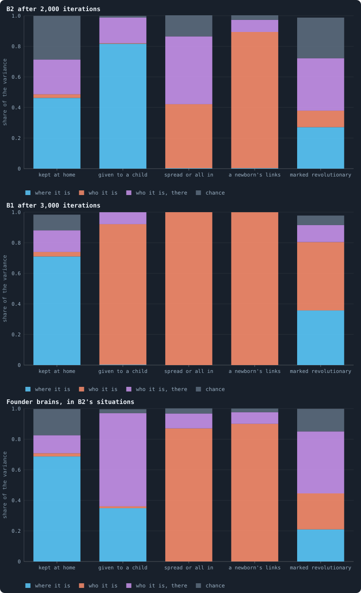

**Where, who and chance.** How the variance of each decision splits: into where the agent is (the situation), who it is (its brain, wherever it is), who it is in that situation (how its brain answers that situation), and chance (its random inputs). The median over ten worlds of each part. A decision driven by where agents are is one they all take alike; one driven by who they are is a trait that differs between them.

> [!example]- How to make this figure
> **Runs.** The ten B2 worlds of Experiment 16 at iteration 2,000 (their archives) and the first ten B1 worlds of Experiment 2 at the end of their 3,000 iterations.
>
> **Data.** From `GraphOfLifeRuns/.pilots/diversity/B2.json` and `B1.json` (`research/oee/checks/diversity.py`).
>
> 1. Load the world and play one game, so its messages are fresh (`research/oee/checks/diversity.py`).
> 2. Take what 200 living agents read, and draw their random input rows 8 times, the same draws for every brain.
> 3. Put the brains of 400 agents drawn at random, and 400 fresh founder brains, into every situation and draw, and turn their outputs into decisions by the engine's rules.
> 4. Split each decision's variance over brains, situations and draws into the four parts (the note *Where, who and chance*); take the median over worlds.
>
> **To make it again:** `python3 book_figures.py diversity`.
<!-- /figure -->

**Where an agent stakes depends on where it is, and on how its brain answers
that place — hardly on a fixed leaning.** In B2 the situation makes 46% of
the variance of the share kept at home. How a brain answers the situation
makes 23%, and chance 29%. The brain on its own, wherever it is, makes 2%. In
B1 the situation makes 71%.

Where an agent is reaches its decisions in two ways. One is what its brain
reads. The other is the rules, which turn the same outputs into different
stakes for different agents. The split cannot tell the two apart, and here
much of it is the rules.

- **In B2**, about half the agents hold a single token (49% and 57% in two
  of the worlds at 2,000 iterations). B2's rule
  [keep_home](settings.md#keep_home) keeps 30% of an agent's tokens at home,
  rounded up. So a single token stays at home, whatever the brain says. The
  other agents nearly all go **all in** (spreading in only 0.1–4% of cases).
  They put what is not kept on whichever candidate scores highest: their own
  node about two times in three, a neighbour's the third time. Among the
  agents with two tokens or more, the two shares were 63–76% and 21–37% in
  three of the worlds at 2,000 iterations. When scores lie close together,
  the random numbers decide which candidate wins. That is why chance is a
  larger part in B2 than among founders (29% against 17%).
- **In B1** nearly every brain spreads its stake, in 94–99% of cases in the
  ten worlds. Most split it evenly, or nearly evenly
  ([What the brains are like](what-the-brains-are-like.md)). An
  even split puts 1/(*k* + 1) of the stake at home for an agent
  with *k* neighbours. That again is where the agent is, not what its brain
  makes of it. It fits the finding of
  [What the brains are like](what-the-brains-are-like.md) that B1's brains are
  nearly blind: the situation reaches B1's stakes mostly through the rules.

**Whether a child is born depends on the place in B2, on the brain in B1.**
In B2, 82% of the variance of a child's share is the situation. B2's rules
refuse a birth to a parent already at its [valence](settings.md#valence) of 8
links. They also refuse one whose child would get fewer than
[10 tokens](settings.md#min_child). Those are facts about where the parent
is. B1 has neither rule, and there 92% is who the agent is. Almost every B1
brain would give a child nothing: the mean share is 0.2–2.7% of its tokens
in the ten worlds. The few that would give more are particular brains. This
is the near abolition of reproduction that
[What the brains are like](what-the-brains-are-like.md) found.

**Two decisions are pure traits, and were so before any selection.** Whether
a brain spreads or goes all in depends almost only on who it is. In B2, 42%
of its variance is *who it is* and 44% *who it is, there*; in B1, 100% is
*who it is*. So does how readily it links a newborn to its neighbours: 89%
*who it is* in B2, and 100% in B1. Founders are no different: 87% and 90%
*who it is*. Each brain has its own answer, and keeps it in nearly every
situation. That is how these decisions are built, not something selection
made.

What selection did was move the answers: B1's brains to spreading, B2's to
going all in. The link stayed a trait on which agents differ widely. Some
brains would link a newborn to nearly every neighbour, others to almost
none. The standard deviation between agents, on a scale from 0 to 1, is
0.34–0.49. That holds in all ten B2 worlds, and in eight of the ten B1
worlds. In the other two B1 worlds it is 0.32, and 0.14 in one where nearly
every brain links a newborn to nearly every neighbour.

### Two agents in the same place

The split looks at decisions one at a time. But the stake, which every agent
makes in every game, is a whole list: a share for its own node and one for
each neighbour. How far apart are two such lists?

Take two agents in the same situation, with the same random numbers. Their
distance is the **total variation**: the share of its tokens one agent would
have to move to stake like the other. It is 0 when they stake alike, and 1
when they stake on no candidate in common. An example: of ten tokens, A
stakes 6 at home and 4 on neighbour X. B stakes 3 at home, 3 on X and 4 on
Y. To stake like A, B would move 3 tokens from Y to home and 1 from Y to X.
That is 4 of its 10: a total variation of 0.4.

Set that beside how far one brain is from *itself* when only the random
numbers change: its own noise.

<!-- figure diversity/life -->
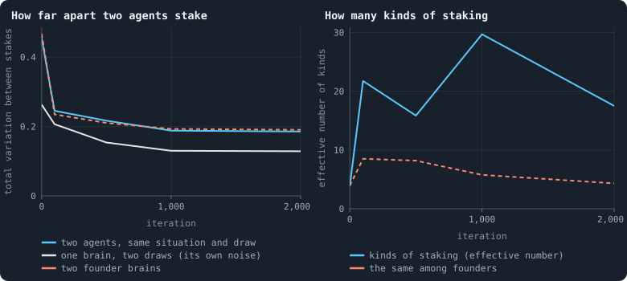

**Through a B2 world's life.** Left: in the same situation and with the same random inputs, how far apart two agents' stakes are (the total variation: the share of tokens one would have to move to stake like the other), against how far one brain is from itself with other random inputs, and against two fresh founders. Right: how many kinds of staking the agents fall into, counted by the agents in each (an effective number), beside the same for founders. Medians of ten worlds.

> [!example]- How to make this figure
> **Runs.** The ten B2 worlds of Experiment 16, from their archives at iterations 0, 100, 500, 1,000 and 2,000.
>
> **Data.** From `GraphOfLifeRuns/.pilots/diversity/B2.json` (`research/oee/checks/diversity.py`).
>
> 1. Load the world and play one game, so its messages are fresh (`research/oee/checks/diversity.py`).
> 2. Take what 200 living agents read, and draw their random input rows 8 times, the same draws for every brain.
> 3. Put the brains of 400 agents drawn at random, and 400 fresh founder brains, into every situation and draw, and turn their outputs into decisions by the engine's rules.
> 4. Two brains are of one kind while their stakes differ by no more than 95% of brains differ from themselves between two halves of the draws; count the kinds by their carriers (1 / sum of squared shares).
>
> **To make it again:** `python3 book_figures.py diversity`.
<!-- /figure -->

In B2 (the left panel):

- At the start two founders differ by 0.46, and each from itself by 0.26
  (the median of ten worlds).
- By 2,000 iterations two agents differ by 0.19, and one from itself by 0.13.
  The evolved brains are steadier: their stakes depend less on the random
  numbers.
- Two fresh founders put into the situations of iteration 2,000 differ by
  just as much, 0.19. So the fall from 0.46 comes from the situations as much
  as from the brains. **B2's agents are no more alike than brains drawn at
  random.**

Every one of these numbers is an average over situations. In B2 about half
of the situations are agents with a single token. There every brain stakes
alike, because the rules leave nothing to choose. All the differences come
from the other half.

In B1 two agents differ by 0.075 (the median of ten worlds; from themselves
by 0.035), and two founders in the same situations by 0.51. **B1's agents are
nearly seven times more alike than random brains.**

### Kinds of behaviour

When do two agents behave differently, rather than by chance? Think of two
kitchen scales. Weigh the same apple twice on one scale, and you get two
slightly different numbers. You would call the two scales different only if
they disagree by more than one scale disagrees with itself.

Brains are compared the same way. Each brain's stakes in the 200 situations
are averaged over two halves of the draws, four draws each. The distance
between its two halves is its own noise. Two brains count as acting
differently when they are further apart than 95% of brains are from
themselves. This is a test at the usual five per cent. Brains are then
grouped into **kinds**. The closest groups are merged, as long as they are
no further apart than that line.

How many kinds are there? A plain count would weigh a kind of one agent as
much as a kind of a thousand. So the kinds are counted by their carriers, as
an **effective number**: how many equally common kinds would give the same
spread ([Effective numbers](statistics.md#effective-numbers-how-many-kinds)). If *p* is the share of the
agents in each kind, the effective number is 1 / Σ *p*². That is one over
the chance that two agents drawn at random are of the same kind.

An example. Ten agents in two kinds of five each count 1 / (0.5² + 0.5²) = 2.
Ten agents in three kinds, of eight, one and one, count
1 / (0.8² + 0.1² + 0.1²) = 1 / 0.66 ≈ 1.5. That is three kinds, but as
varied as one and a half equally common ones. Ten equally common kinds count
10, and one kind with nearly everyone counts close to 1.

**The test checks itself.** [What the brains are like](what-the-brains-are-like.md) found that many
B1 agents score every candidate zero or below. The rules then split their
stake exactly evenly
([Splitting tokens into whole numbers](rules-in-detail.md#splitting-tokens-into-whole-numbers)). Such agents
all stake alike, and should come out as one kind. In nine of the ten B1
worlds, the largest kind of staking holds just the share of such agents, to
within two hundredths. That share is 4% of the agents in one world, and 90%
in another. In the tenth, the largest kind (94%) also takes in agents whose
positive scores are so close that they split nearly evenly too.

At the start, the founders fall into about 4 kinds of staking (the right
panel of *Through a B2 world's life*, above). About half of them spread their
stake, almost evenly, and in every world these make one kind. The other half
go all in, and differ. In B2:

- after 100 iterations the agents fall into about 22 kinds of staking;
  after 2,000, into 17.5 (from 1.6 to 42.5 in the ten worlds);
- nine pairs of agents in ten stake measurably differently (0.90–0.95 at
  every moment after the start);
- counted over every decision, not only the stake, there are about 54 kinds
  (from 6 to 114).

In B1 the median world has 3.2 kinds of staking (from 1.1 to 57), and 9 over
every decision. In four worlds of ten, one kind, built around the even split,
holds 73–94% of the agents.

So B2's agents differ as widely as random brains. But unlike random brains,
their differences are real: they are steady enough to tell apart. They share
one habit, all in and at home two times in three, and differ in *when* and
*on whom* they go all in.

The screen of random worlds uses this count. A world it calls diverse has
more effective kinds of staking than B2's median world, and a higher
diversity score ([What makes a world interesting](rounds-1-and-2-of-the-screen.md#what-makes-a-world-interesting)).
The screen reads the kinds from the world as kept, with no game played first.
And it averages two moments, since the count swings from one moment to the
next ([The diversity score](measuring-health.md#the-diversity-score)).

### Genotypes and kinds

<!-- figure diversity/kinds -->
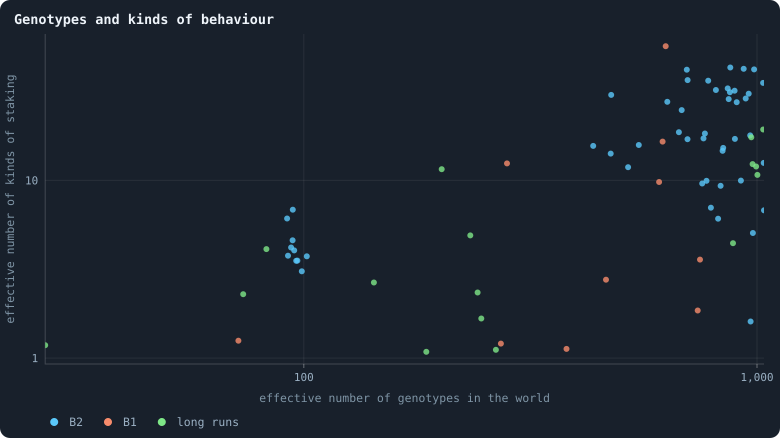

**Genotypes and kinds of behaviour.** Each dot is a world at one moment: across, how many genotypes it holds, counted by their carriers; up, how many kinds of staking its agents fall into, counted the same way. Far more genotypes than kinds means most genetic differences change nothing an agent does.

> [!example]- How to make this figure
> **Runs.** Every world measured: B2 over its life, B1 at its end, the long pilot worlds.
>
> **Data.** From `GraphOfLifeRuns/.pilots/diversity/*.json` (`research/oee/checks/diversity.py`).
>
> 1. Load the world and play one game, so its messages are fresh (`research/oee/checks/diversity.py`).
> 2. Take what 200 living agents read, and draw their random input rows 8 times, the same draws for every brain.
> 3. Put the brains of 400 agents drawn at random, and 400 fresh founder brains, into every situation and draw, and turn their outputs into decisions by the engine's rules.
>
> **To make it again:** `python3 book_figures.py diversity`.
<!-- /figure -->

A B2 world of 3,400 agents holds about 950 effective genotypes and 17 kinds
of staking, or 54 over every decision. So most genetic differences change
nothing an agent does. And the number of kinds hardly follows the number of
genotypes. Worlds with about a thousand effective genotypes hold anything
from 1.6 to 43 kinds of staking.

Both counts here are effective numbers of the same kind, 1 / Σ *p*². The
note on [Brain diversity](measuring-evolution.md#brain-diversity) counts genotypes by
2^*H* instead, which weighs rare genotypes more and so gives a larger number
([Two effective numbers](statistics.md#two-effective-numbers)).

The long runs add time:

- **B1's first long world converges.** At 5,000 iterations one kind of
  staking holds 92% of its agents, and its genotypes have fallen to 27
  effective. At 10,000 one kind holds 96%.
- **B1's second long world goes the other way**, to 12 kinds at 10,000.
- **B2's three long worlds** keep 4–19 kinds of staking, and 35–75 over every
  decision, at 5,000 and at 10,000 iterations. B2 does not converge on one
  way of playing.

### Do kinds last?

A kind of one moment lasts if, at a later moment, some agent still behaves
that way. Take 200 agents from each of two moments of one world. Put all
their brains into the situations of the first moment, and group them into
kinds together. These kinds are over the stake and every other decision,
which makes them finer than kinds of staking alone. Then ask: what share of
the first moment's agents belong to a kind that is found among the second
moment's 200?

A sample of 200 agents can miss a rare kind. So even a world that had not
changed at all would not score 1. The **ceiling** is the same moment sampled
twice. In B2 at 1,000 iterations, 0.68 of the agents' kinds are found again
(the median of ten worlds; 0.56–0.75).

<!-- figure diversity/persist -->
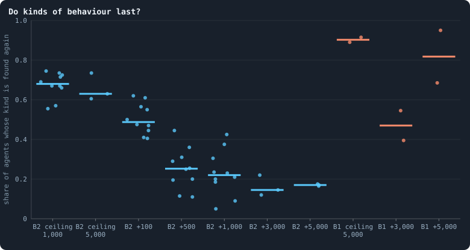

**Do kinds of behaviour last?** For two moments of the same world: 200 agents drawn from each, their brains put into the situations of the first and grouped into kinds together, over the stake and every other decision. The share of the first moment's agents whose kind is found among the second's, +N iterations later. The *ceiling* draws the second 200 from the same world at the same moment (at iteration 1,000 in Experiment 16's worlds, 5,000 in the long runs): it is as much as a sample of 200 can find, since a rare kind can be missed. Each dot is a world.

> [!example]- How to make this figure
> **Runs.** The ten B2 worlds of Experiment 16 at 1,000 (against themselves, and 100 iterations later), 500→1,000 and 1,000→2,000; three of them played on as pilots, at 5,000 against themselves, 2,000→5,000 and 5,000→10,000; and B1's two long pilot worlds, at 5,000 against themselves, 2,000→5,000 and 5,000→10,000.
>
> **Data.** From `GraphOfLifeRuns/.pilots/diversity/persist.json` and `persist_gaps.json` (`research/oee/checks/diversity.py --persist`).
>
> 1. Load the world and play one game, so its messages are fresh (`research/oee/checks/diversity.py`).
> 2. Take what 200 living agents read, and draw their random input rows 8 times, the same draws for every brain.
> 3. Draw 200 agents from each moment and put their brains into the first moment's situations and draws.
> 4. Group the brains of both moments together, over the stake and the five decisions; ask which kinds of the first are found in the second.
>
> **To make it again:** `python3 book_figures.py diversity`.
<!-- /figure -->

In B2 the share found falls fast, then slowly:

- **100 iterations later**, 0.49 are found: seven tenths of the ceiling.
  B2's agents live at most 100 iterations, so by then every agent of the
  first moment has died. The kinds found again are carried by new agents.
- **500 iterations later**, 0.25, and 1,000 later 0.22: about a third of the
  ceiling.
- **In the long runs**, 3,000 and 5,000 iterations later, 0.145 and 0.17,
  against a ceiling of 0.63 at 5,000: about a quarter.

So most of B2's kinds are gone within a few hundred iterations, and others
take their place. The number of kinds stays about where it was. A core lasts
far longer: about a quarter of what a sample can find is still there 5,000
iterations later.

B1's long worlds keep their kinds. Over the 3,000 iterations from 2,000 to
5,000, the kinds of 0.47 of the agents are found again. Over the 5,000 from
5,000 to 10,000, it is 0.82, against a ceiling of 0.90. B1 has few kinds, and
a sample of 200 finds nearly all of them. The first of the two worlds is the
extreme: from 5,000 iterations on, one kind of staking holds more than nine
tenths of its agents.

### Do kinds live in different places?

Suppose each kind were suited to its own kind of place, as a cactus is to a
desert. Then the agents of one kind would sit in similar places. To test
this, ask how much of the variance of the carriers' tokens and links their
kind accounts for. That share is η²: the variance between the kinds' means,
as a share of all the variance. Suppose every agent of one kind had 3 links,
and every agent of another had 9. Then the kind would account for all of it:
η² = 1. If both kinds had the same mix of links, it would account for none:
η² = 0.

Kinds drawn at random account for some variance by chance alone. So η² is
compared with kinds shuffled among the carriers: groups of the same sizes,
drawn at random.

- **B2** after 2,000 iterations: the kind accounts for 31% of the variance of
  its carriers' number of links, against 16% for shuffled kinds. That is more
  than all 200 shuffles in every one of the ten worlds. It accounts for 22% of
  their tokens, against 16%. Both are counted on a logarithmic scale.
- **B1**: 31% of the tokens, against 16%; but of the links, 15% against 16%:
  no more than chance.

Kinds do sit in somewhat different places: in B2 by how many links their
carriers have, in B1 by how rich they are. That fits niches. But it fits
kinship as well. Relatives carry similar brains and live near one another
([Like next to like](b1-the-network-size-and-scaling.md#like-next-to-like-how-alike-agents-are-at-a-distance)). So a kind may share a place
because it is a family, not because the place suits it. Telling the two
apart needs an experiment: move a kind to another place, and see whether it
does worse there.

### What we learned (how different are the agents)
- **In the same place, with the same dice, B2's agents do not act alike.**
  Nine pairs in ten stake measurably differently. There are about 17
  effective kinds of staking, and about 54 over every decision, in worlds of
  about 950 effective genotypes.
- **B1's agents mostly do.** They are nearly seven times more alike than
  random brains. In four worlds of ten, one kind, built around the even
  split, holds 73–94% of the agents.
- **How an agent stakes depends on where it is, hardly on a fixed leaning.**
  The brain on its own makes only 2–3% of the variance of the share kept at
  home. The place, how a brain answers it, and chance make the rest. In B2
  the place also decides a child's share, through its rules. Spreading and
  linking a newborn are traits of each brain, and were before selection
  began. In B1 a child's share is a trait too.
- **Genotypes overstate the variety of behaviour.** B2's worlds hold about
  950 effective genotypes, but 17 kinds of staking (54 over every decision).
  Across worlds, the number of genotypes does not predict the number of
  kinds.
- **B2's kinds turn over; B1's last.** Within 500 iterations, two thirds of
  the kinds a sample of B2 can find are gone, and new ones have taken their
  place. A core lasts thousands of iterations. B1's few kinds are still there
  5,000 iterations later.
- **Kinds sit in somewhat different places**, by links in B2 and by tokens in
  B1: niches or families, not yet told apart.
- **For open-ended evolution, B2 has the raw material and B1 has not**:
  many kinds of behaviour at once, steadily renewed. What B2 lacks is a
  reason for a kind to *stay*: a place where it does better than the others.
  Then new kinds would be added to the old ones, rather than replacing them.
  Whether the turnover is selection or drift is open. Contests as long as an
  agent's life say that later brains beat earlier ones in these worlds
  ([Would we notice if it went on?](how-to-tell-a-world-that-keeps-evolving.md#would-we-notice-if-it-went-on)).
  Those of iteration 2,000 hold 0.73 of a world shared with those of 500. So
  at least some of it is selection. The next measure is to play each kind
  against the kinds that replaced it.

### How this was made (how different are the agents)
The figures read the measurements of `research/oee/checks/diversity.py`,
kept in `GraphOfLifeRuns/.pilots/diversity/`. Each figure says, folded
beneath it, which worlds it reads and how. `python3 book_figures.py diversity`
draws them all, and writes the numbers they quote to
`book/results/diversity.json`.

Nothing in the measure is particular to B1 or B2. It needs only a world at
one moment: a lab run's checkpoint or archive, or a pilot's. The first
command below measures a lab run's world at iteration 1,000, and the second
a pilot's world. The third asks which kinds of one moment are still found at
a later one.

```
python3 research/oee/checks/diversity.py B2-10000-s001:1000 --label mine
python3 research/oee/checks/diversity.py pilot:GraphOfLifeRuns/.pilots/Q/mix-s1:2000 --label mine
python3 research/oee/checks/diversity.py --persist B2-10000-s001:1000 B2-10000-s001:2000 --label mine
```

Two checks come with it. A world without random inputs (Experiment 16's
second condition) must give chance a share of exactly 0, and does. And a kind
the rules make, the even split, must come out as one kind, and does.
[How alike the agents are](b1-brains-lineages-and-messages.md#how-alike-the-agents-are) applies the measure
to every condition of every experiment, and to the pilot worlds.

## Where to go next

- [How a line takes over](b1-the-network-size-and-scaling.md#how-a-line-takes-over):
  how long a line needs to fill a world ten times larger, and why.
- [Do the brains matter?](do-the-brains-matter.md): worlds whose brains
  never change, where every sweep is chance.
- [What the brains are like](what-the-brains-are-like.md): why the brains
  give one line so little to be better at.
- [Does evolution keep going?](how-to-tell-a-world-that-keeps-evolving.md):
  playing a world's brains against their own past.
- [Messages](rules-in-detail.md#messages): how messages are written, delivered and read.
- [Do agents cooperate?](cooperation-help-and-gliders.md#do-agents-cooperate-help-kin-and-partners): kin live side by side, and
  are treated like strangers.
- [Another game](another-game.md): what happened when kin could sense each
  other, and when their stakes were pooled.
- [The diversity score](measuring-health.md#the-diversity-score): how widely a world's agents
  spread in what they hold.
- [Where, who and chance](statistics.md#splitting-variation-between-worlds-and-within-them) and
  [Effective numbers](statistics.md#effective-numbers-how-many-kinds): the two methods of this page.

## How our view changed

- *Genotypes and lineages*:
  - **14 October 2026.** From 8 October, this page said that its survival
    curves follow everything that appeared from iteration 500 on. A review of
    the whole notebook found that they follow only what was alive after a
    game. That leaves out nearly a third of all newborns, which die in the
    iteration of their birth
    ([Births, deaths and ages](b1-lives-and-wealth.md#births-deaths-and-ages)). The agents' 48%
    and 13% hold for the agents that lived through their first game.
  - **14 October 2026.** From 8 October, this page said that
    [Do the brains matter?](do-the-brains-matter.md) builds a world in which no
    brain is better than another. That is the comparison that tells selection
    from chance. But its worlds are not born and do not die as the baseline
    does. How often chance sweeps a world depends on just that, so they could
    not settle the question. A note added that day answered it from the
    brains' side. From iteration 50 on, every era of ten worlds ties with the
    one before
    ([How to tell a world that keeps evolving](how-to-tell-a-world-that-keeps-evolving.md)).
    So the lines that take a settled world over do not carry brains that play
    better. The note became part of
    [Selection, or chance?](#selection-or-chance) on 24 October 2026.
  - **24 October 2026.** From 11 October, this page called the family that
    took over the world of seed 12 "hundreds of different brains". Once it
    fills the world, it holds every genotype there: 0.63 for each of some
    11,800 agents, so thousands at once. These are the means of seed 12 over
    iterations 1,000 to 1,500, in `book/results/E10.json`.
- *What agents say to each other*:
  - **14 October 2026.** From 9 October, this page said that two agents of one
    genotype write exactly the same message. So kin would read identical
    messages from each other. They are the same but for a thousandth or so. One
    brain in two places sees two slightly different things, and a nearly blind
    brain still passes on a thousandth of the difference.
  - **15 October 2026.** From 9 October, this page said that "a brain that can
    see is what it needs" for kin to recognise each other. On 14 October it
    added that pooled stakes for kin were being piloted, with no results yet.
    The pilots of 15 October gave seeing brains a sense of their own clones for
    free. They made little use of it, and no groups formed; groups of kin formed
    only where a rule pooled their stakes ([Another game](another-game.md),
    [Alliances](another-game.md#alliances)). This page took that in on 23 October 2026.
- *How different are the agents?*:
  - **24 October 2026.** From 16 October, this page opened with "A world of
    3,000 agents holds about a thousand genotypes". Neither baseline fits those
    words. A B1 world of 10,000 tokens holds about a thousand genotypes, but it
    has about 1,500 agents. A B2 world of 10,000 tokens has about 3,400 agents
    and about 1,600 genotypes, 0.46 for each agent. Only as an effective number
    are B2's genotypes about a thousand (950). The page now names the baseline
    of each count. The counts are those of the worlds measured here
    (`GraphOfLifeRuns/.pilots/diversity/B1.json` and `B2.json`), and the
    genotypes per agent, 0.64 and 0.46, are in `book/results/how_alike.json`.
  - **24 October 2026.** From 16 October, the page's findings said that where
    an agent is decides more than who it is "for most decisions in both rule
    sets". The page's own split shows that this holds in B2, for the stake, a
    child's share and the revolutionary mark. In B1 it holds only for the
    stake. There a child's share is 92% who the agent is, and spreading and a
    newborn's links are 100%. The revolutionary mark is 45% who against 36%
    where (`book/results/diversity.json`).
  - **24 October 2026.** From 16 October, this page gave the standard deviation
    of a newborn's links between agents as 0.34–0.49, as if for every world. It
    holds in all ten B2 worlds and in eight of the ten B1 worlds. In the other
    two it is 0.32 and 0.14 (`decisions.link.sd_between_agents` in
    `GraphOfLifeRuns/.pilots/diversity/B1.json`).
- **11 November 2026.** Four pages on B1's brains, lineages and messages, and
  on how alike agents are, became this page's sections, and it moved to the
  Archive. Round 3's worlds have other brains and rules, so these measurements
  no longer bear on the notebook's question as they stand. They are kept so
  that every experiment here can be read and made again. Nothing was cut but a
  second copy of the list of the runs of Experiment 10.

<!-- turns -->
---

← [B1: the network, size and scaling](b1-the-network-size-and-scaling.md) · [B1, as described in October 2026](../README.md#b1-as-described-in-october-2026)

**Also about:** [Brains: what they are, and whether they matter](../README.md#brains-what-they-are-and-whether-they-matter), [Does evolution keep going?](../README.md#does-evolution-keep-going).

> [!info]- Pages that link here (24)
> [What this notebook is about](what-this-notebook-is-about.md) · [The ideas this builds on](the-ideas-this-builds-on.md) · [Candidates for open-ended evolution](candidates-for-open-ended-evolution.md) · [Did evolution happen? Fourteen ways to find out](did-evolution-happen.md) · [A hundred thousand iterations](a-hundred-thousand-iterations.md) · [Questioning the mechanics](questioning-the-mechanics.md) · [The rules in detail](rules-in-detail.md) · [Measuring lives: births, deaths, ages and estates](measuring-lives.md) · [Measuring tokens: inequality and flow](measuring-tokens.md) · [What the brains are like](what-the-brains-are-like.md) · [Do the brains matter?](do-the-brains-matter.md) · [Brains replaced by their average](brains-replaced-by-their-average.md) · [Measuring evolution: genotypes, eras and the open-ended test](measuring-evolution.md) · [Measuring health: criteria, the health bar and diversity](measuring-health.md) · [Every simulation: what was run, and what was measured](every-simulation.md) · [Statistics: the tools of the notebook](statistics.md) · [What B1 is, and what stood in its way](what-the-baseline-world-is.md) · [B1: lives and wealth](b1-lives-and-wealth.md) · [B1: the game and its flows](b1-the-game-and-its-flows.md) · [B1: the network, size and scaling](b1-the-network-size-and-scaling.md) · [Building B2, and the search for a healthy, rich world](building-b2-and-the-search-for-a-healthy-rich-world.md) · [Cooperation, help and gliders (side study)](cooperation-help-and-gliders.md) · [Measures, atlases and assembly (side studies)](measures-atlases-and-assembly.md) · [Measures of the archived studies](measures-of-the-archived-studies.md)
<!-- /turns -->
