# B1: lives and wealth

> [!question] Questions of this page
> - What are the thirty worlds that the study of the baseline B1 reads, and what does one of them look like?
> - How long does an agent live, and why do most agents die young?
> - Which agents have children: the rich, the well connected, anyone?
> - The founders start equal: who holds the tokens later? How unequal does a world become, and does inequality keep growing, or does it settle?
> - What does one game do to the agents: how many die, lose, keep exactly what they had, or gain?
> - How rich is the richest agent, and how well connected the best-connected?

## In short

In October 2026 the first baseline, B1, was measured from every side: thirty
worlds of 100,000 tokens (Experiment 10) and thirty of 10,000 (Experiment 2).
Two findings still bear on the notebook's question. A B1 world settles early.
It booms and crashes in its first hundred iterations, and by iteration 500 its
births, ages and lifetimes have stopped changing. Its Gini coefficient stays
near 0.47. And it is a world of places more than of individuals. Most agents
die young, cut off from the network. Wealth follows connections, as in a random
walk, and who is rich keeps changing. Round 3's worlds start from B1's rules
but change many of them, so the numbers here describe B1 alone.

It gathers what were 6 pages of their own, one section each:

- [The life of a B1 world](#the-life-of-a-b1-world): The first baseline, B1, is studied through thirty worlds that differ only in their seed, each run for 1,500 iterations.
- [Births, deaths and ages](#births-deaths-and-ages): From iteration 500 on, a world of 100,000 tokens keeps about 14,400 agents, but replaces about 3.5 in a hundred of them in every iteration.
- [How births build the network](#how-births-build-the-network): In the first baseline, B1, every new node of a world's network is a newborn agent, and every new connection is made at a birth.
- [How unequal is a world, and who stays rich](#how-unequal-is-a-world-and-who-stays-rich): The founders of a world start equal, but the first births end that, and from then on a world is moderately unequal.
- [Gains and losses: who gains, who loses, and the share-out](#gains-and-losses-who-gains-who-loses-and-the-share-out): Every token is staked in every game.
- [The largest and the smallest](#the-largest-and-the-smallest): In a settled world, the richest agent holds about 2% of all tokens and the best-connected some 640 connections; the median agent has 2.

## The life of a B1 world

The first baseline, B1, is studied through thirty worlds that differ only in
their seed, each run for 1,500 iterations. In its youth a world booms from
1,000 founders to well over ten thousand agents, then crashes as its network
breaks apart. Most of its founders' lines die out within a few iterations,
and in most worlds every agent ends up descending from a single founder.
After the youth the typical world hardly changes, at about 14,000 agents,
while every single world wanders by up to half its size. No world died,
though one lost nine tenths of itself in ten games and grew again. Births
kept slowing down until about iteration 500, so Experiment 2's prediction of
a short youth and a steady middle age was refuted.

### Thirty worlds

A single world shows what can happen, not what usually happens: chance takes
part in every step. So the study of the baseline runs one kind of world, the
first baseline B1 ([B1 and B2: the two baselines](b1-and-b2.md)), thirty
times. The thirty worlds share every rule and every setting. They differ only
in their seed, the number that fixes every random choice of a run
([Seeds and the random stream](rules-in-detail.md#seeds-and-the-random-stream)). What all thirty do, the
rules do; where they differ, chance decides.

Each world holds 100,000 tokens, the one thing of value in a world, whose
total never changes ([The world: tokens, agents and a network](the-world.md)).
It starts as a thousand founders of a hundred tokens each, on a ring with a
few shortcuts ([The starting ring](rules-in-detail.md#the-starting-ring)). The seeds are 1 to 30,
and each world runs for 1,500 iterations. Together the thirty runs are
Experiment 10 ([Worlds of 100,000 tokens](b1-the-network-size-and-scaling.md#worlds-of-100000-tokens)). The
pages summed up in [What the baseline world is](what-the-baseline-world-is.md),
and the measurements summed up in
[What the measurements say about open-ended evolution](what-the-baseline-world-is.md#what-the-measurements-say-about-open-ended-evolution),
all read these same thirty runs.

An iteration is one step of a world's time. In it, an agent may first give
some of its tokens to a child, who appears on a new node next to it. Then
comes the game. Every agent stakes all its tokens on its own node and its
neighbours' nodes, and each node goes to whoever staked most on it, or to a
coalition of smaller stakers. Agents left without tokens die, and so does
every piece of the network cut off from the largest
([One iteration, step by step](one-iteration.md)).

Nothing was thrown away. Every frame was kept, with every decision, and every
statistic was recorded for every frame. The statistics that walk the whole
network — bridges, the core, clustering, distances, the flow's loops — were
recorded every 25 iterations ([What a run records](runs-and-records.md#what-a-run-records)).

#### Two sizes of world

The study was first written from smaller worlds: thirty of 10,000 tokens,
about 1,300 agents each (Experiment 2). The worlds of 100,000 tokens hold
about 14,000 agents each. They are big enough for space, for scale and for
rare events to show, so the study now reads them. Where the two sizes differ,
the pages give both, and this one does too. Four of the thirty smaller worlds
died, for example, while all thirty large ones lived to the end
([No world died — but one came close](#no-world-died--but-one-came-close)).

The worlds of 10,000 tokens still have two jobs. The pages on how the
simulation works teach with them. And they are the baseline that the
experiments which change one setting compare against.

#### A first look

What does such a world look like? Here is one after 1,500 iterations. Every
agent is a dot and every connection a line, and the dots are placed so that
joined agents lie near each other. A world of 15,000 agents drawn whole is a
tangle, so the picture holds a piece of it: every agent within a few steps of
the world's oldest agent.

<!-- figure shape/world-end -->
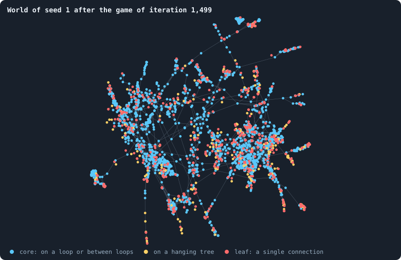

**World of seed 1 after the game of iteration 1,499.** The world with seed 1 after the game of iteration 1,499, the 2,495 of its 14,870 agents within 25 steps of agent 660,973, the oldest, 806 iterations old — a piece, since a world this large is a tangle when drawn whole: every agent drawn is a dot, every connection between two of them a line. Blue: agents in the core, which is what is left when agents with one connection or none are removed again and again until none remains ([Core, trees and leaves](measuring-networks.md#core-trees-and-leaves)); yellow: the rest of the hanging trees; red: leaves, agents with a single connection. Where a dot is drawn means nothing in itself: a layout (networkx's ForceAtlas2, seed 1) pulls joined agents together and pushes the rest apart.

> [!example]- How to make this figure
> **Runs.** `B1-100000-s001`.
>
> **Data.** From each run's frames, `GraphOfLifeRuns/<run>/frames/`, read with `gol_store.read_frame(run, index)`; frame `2·t` is iteration *t* after reproduction and frame `2·t + 1` after the game.
>
> 1. Read frame `2999` (iteration 1,499, after the game): `ids` and `edges`.
> 2. Peel: remove every agent with one connection or none, again and again, until none is left; the agents never removed are the core. Leaves are agents with exactly one connection.
> 3. In a world of more than 2,500 agents, keep the agents within r steps of the oldest agent, for the largest r that keeps at most 2,500 (`book_chapters.society.shown`).
> 4. Lay the graph out with `networkx.forceatlas2_layout(G, max_iter=200, seed=1)`.
>
> **To make it again:** `python3 book_figures.py shape`.
<!-- /figure -->

The thousand founders on their ring have become a network of dense clusters
joined by thin paths, with many agents that hang on by a single connection.
[What shape does the network take?](b1-the-network-size-and-scaling.md#the-shape-of-the-network) takes
this shape apart, and [The core of a world](b1-the-network-size-and-scaling.md#the-core-of-a-world) its core.

Any of the thirty worlds can be opened in the **Viewer** of the Graph of Life
app, which replays a run frame by frame.

#### The questions of the baseline's study

Each page of the study asks the thirty worlds one question. The first two
are answered on this page.

- [A world's life](#a-worlds-life), below — What does a world do over 1,500
  iterations? Does it settle?
- [The first hundred iterations](#the-first-hundred-iterations), below — What
  happens in its first hundred iterations?
- [Births, deaths and ages](b1-lives-and-wealth.md#births-deaths-and-ages) — How often are agents
  born and how do they die? How old do they get?
- [How ages change over a world's life](b1-lives-and-wealth.md#how-ages-change-over-a-worlds-life) — How do ages and
  lifespans change over a world's life?
- [How much does the seed decide?](b1-the-network-size-and-scaling.md#how-much-does-the-seed-decide) — How
  much of what a world does is decided by its seed?
- [Where do the tokens go?](b1-lives-and-wealth.md#how-unequal-is-a-world-and-who-stays-rich) — Where do the tokens
  go — how unequal does a world become?
- [How the game is played](b1-the-game-and-its-flows.md#how-the-game-is-played-what-agents-stake-and-who-wins-the-nodes) — How is the game
  played: where do agents stake, who wins the nodes?
- [What shape does the network take?](b1-the-network-size-and-scaling.md#the-shape-of-the-network) —
  What shape does the network take?
- [Genotypes and lineages](b1-brains-lineages-and-messages.md#genotypes-and-lineages) — How long do genotypes
  last, and do lineages take over?
- [What the brains are like](what-the-brains-are-like.md) and
  [What agents say to each other](b1-brains-lineages-and-messages.md#what-agents-say-to-each-other) — What
  are the brains like, and what do agents say to each other?
- [Do the rich stay rich?](b1-lives-and-wealth.md#do-the-rich-stay-rich) — Do the rich stay rich?
- [How the network grows](b1-lives-and-wealth.md#how-the-network-grows) — How does the network
  grow?
- [Like next to like](b1-the-network-size-and-scaling.md#like-next-to-like-how-alike-agents-are-at-a-distance) — Are neighbours alike?
- [How many dimensions does a world have?](how-many-dimensions-does-a-world-have.md)
  and [The core of a world](b1-the-network-size-and-scaling.md#the-core-of-a-world) — How many [dimensions](measuring-space.md#three-ways-to-measure-a-networks-dimension "How fast the number of agents within a distance grows with the distance: as its square in a plane, its cube in space.")
  does a world have, and its core?
- [What the baseline world is](what-the-baseline-world-is.md) — What the
  baseline world is, in sum.

Five of these pages were planned as experiments, Experiments 2 to 6:
[A world's life](#a-worlds-life),
[How much does the seed decide?](b1-the-network-size-and-scaling.md#how-much-does-the-seed-decide),
[Where do the tokens go?](b1-lives-and-wealth.md#how-unequal-is-a-world-and-who-stays-rich),
[What shape does the network take?](b1-the-network-size-and-scaling.md#the-shape-of-the-network) and
[Genotypes and lineages](b1-brains-lineages-and-messages.md#genotypes-and-lineages). Each wrote down a thesis
before the runs of 10,000 tokens. Each quotes it, says whether it held there,
and tests it again on the worlds of 100,000 tokens. The other pages only ask.

### A world's life

What does a world do over its 1,500 iterations? Picture settlers landing on
an island with a fixed store of food. While food is plenty they have many
children, and their number grows fast. Then food runs short, and the
population levels off at what the island can feed. From then on, every
newcomer eats what someone else no longer has.

A world's tokens are such a store. Their number never changes, and every
agent needs at least one. A founder holds a hundred tokens and can afford
many children, so a world should grow fast at first. Then every birth has to
be paid for with tokens someone else loses. So we expected a world to grow
quickly to some size and then keep it, with births and deaths in balance: a
short youth, then a long, steady middle age. Before the thirty worlds of
10,000 tokens were run, Experiment 2 wrote this down as its thesis:

<!-- thesis E02 -->
> [!quote] The thesis of Experiment 2, written down before any of its runs existed
> **The claim.** A world has a short youth and a long, steady middle age. From its hundred founders it grows within the first hundred iterations to a population it then keeps, rising and falling around the same level, for the rest of its three thousand iterations. Births, deaths and connections settle the same way.
>
> **Why it would be so.** The token supply is fixed, and every agent needs at least one token, so the population has a ceiling it reaches quickly: a founder holds a hundred tokens and can afford many children. After that, every birth has to be paid for with tokens someone else loses, and starvation, pruning and conquest remove agents as fast as they arrive.
>
> **It holds if:** Across the thirty runs, the median population over iterations 100 to 200 is within 20% of its median over iterations 2,800 to 3,000, and the same holds for connections and births. No run dies out.
>
> **It fails if:** The population still trends up or down after iteration 200 by more than 20%, or swings between very different levels for long stretches, or some runs die out. Then a world has more than one phase of life, and the chapters after this one must say which phase they describe.
<!-- /thesis -->

The thesis was tested on those thirty small worlds, and again on the thirty
large ones of 100,000 tokens. Here is what the large worlds did, with the
small ones beside them wherever they differ.

#### One world at a time

Here are six of the thirty worlds, seeds 1 to 6, each drawn alone and all on
the same scale. Each line is the number of agents alive after every game.

<!-- figure life/worlds -->
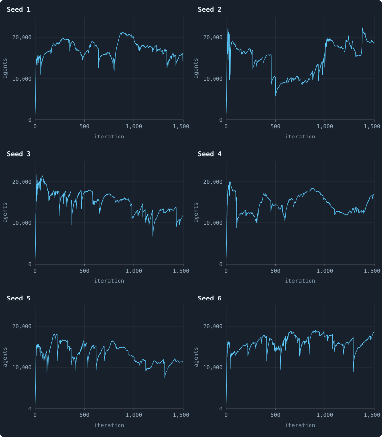

**Six worlds, one at a time.** The number of agents alive after every game in the worlds with seeds 1 to 6, each in a chart of its own and all on the same scale (0 to 25,000 agents, iterations 0 to 1,500). Each line has one point per iteration.

> [!example]- How to make this figure
> **Runs.** `B1-100000-s001` … `B1-100000-s006`, six of the 30 baseline runs (their settings are listed in [Thirty worlds](b1-lives-and-wealth.md#thirty-worlds)).
>
> **Data.** From each run's `GraphOfLifeRuns/<run>/stats.jsonl`, which holds one row per recorded phase: `phase` 1 is the world just after reproduction, `phase` 2 just after the game, and every statistic is a field of the row (see [What a run records](runs-and-records.md#what-a-run-records)).
>
> 1. Take the rows with `phase` = 2.
> 2. Plot `nodes` against `iteration`, one point per iteration, joined.
>
> **To make it again:** `python3 book_figures.py life`.
<!-- /figure -->

Three things are visible in every one of them:

- **A youth.** Within the first twenty or so iterations, the 1,000 founders
  become well over ten thousand agents. The line jumps up and down before it
  settles into a calmer motion.
  [The first hundred iterations](#the-first-hundred-iterations) zooms in on
  this.
- **No fixed level.** After the youth, no world stays at one size. Each
  drifts, over hundreds of iterations, between roughly 10,000 and 20,000
  agents, and the six worlds drift differently.
- **Calm stretches and sudden falls.** In most stretches a world's size
  changes by a few hundred agents from one iteration to the next. Now and
  then it drops by thousands within a few games.

#### All thirty together

To see all thirty at once, draw them as a band
([Bands: many worlds in one figure](statistics.md#bands-many-worlds-in-one-figure)). The line is the typical world
at each moment, the median of the thirty; the shading shows how far the
others spread around it.

<!-- figure life/agents -->
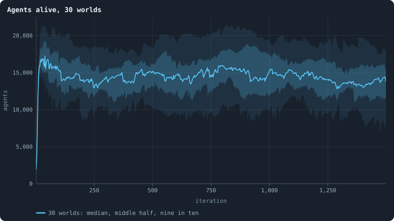

**Agents alive, 30 worlds.** The line is the median of the worlds at each iteration, the darker band holds the middle half of them (from the 25th to the 75th percentile) and the paler band nine in ten (5th to 95th). All 30 live to the end.

> [!example]- How to make this figure
> **Runs.** The 30 baseline runs `B1-100000-s001` … `B1-100000-s030`: the baseline B1 at 100,000 tokens, seeds 1 to 30, 1,500 iterations each (every setting is listed in [Thirty worlds](b1-lives-and-wealth.md#thirty-worlds)). They are made with `python3 gol_lab.py run E10`.
>
> **Data.** As for the figure *Six worlds, one at a time* above.
>
> 1. Take every run's rows with `phase` = 2 and the statistic `nodes`.
> 2. Cut the 1,500 iterations into 600 stretches of 2.5 and take each world's mean in each stretch.
> 3. In each stretch, take the median, the 25th and 75th and the 5th and 95th percentiles of those means over the worlds that still have a value there (a world that died has none after its death).
>
> **To make it again:** `python3 book_figures.py life`.
<!-- /figure -->

The band shows something the single worlds do not. Every world wanders, yet
the **typical** world hardly changes after its youth. From iteration 100 to
the end, the median of the thirty worlds stays between about 13,300 and
15,500 agents nine tenths of the time. That is within 7% of its middle. The
worlds of 10,000 tokens stayed within 15% of theirs (1,070 to 1,450 agents).

Ten times the tokens hold eleven times the agents: 0.14 agents per token,
where the smaller worlds held 0.13. That is a little more than the strict
proportion that
[How does a world's size follow its tokens?](b1-the-network-size-and-scaling.md#worlds-of-many-sizes)
found over a shorter life. And the typical large world holds stiller.

#### Each world, early and late

How far does a single world move? Measure each world twice: by its mean
number of agents over iterations 100 to 200, early in its settled life, and
over iterations 1,300 to 1,499, at its end. Then join the two:

<!-- figure life/early-late -->
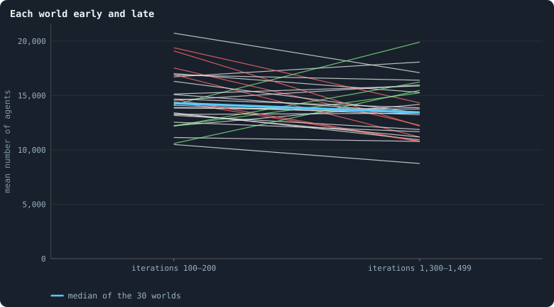

**Each world early and late.** One line per world, from its mean number of agents over iterations 100–200 (left) to its mean over iterations 1,300–1,499 (right). Green: the late mean is more than 1.2 times the early one; red: less than 0.8 times; grey: in between. The thick blue line joins the medians of the 30 worlds.

> [!example]- How to make this figure
> **Runs and data.** As for the figure *Agents alive, 30 worlds* above.
>
> 1. For each run that reached iteration 1,500, take the rows with `phase` = 2.
> 2. Average `nodes` over the rows with 100 ≤ `iteration` ≤ 200, and again over 1,300 ≤ `iteration` ≤ 1,499.
> 3. Draw one line from the first mean to the second; colour it by their ratio.
> 4. Join the two medians over the 30 runs.
>
> **To make it again:** `python3 book_figures.py life`.
<!-- /figure -->

The median hardly moves: 14,300 agents early, 13,440 late. And single worlds
move less than they did at 10,000 tokens. Of the 30 lines, 20 stay within a
fifth of where they began; 4 end more than a fifth higher, and 6 more than a
fifth lower. The most extreme worlds ended with 0.64 and 1.46 times their
early size. Over a run twice as long, the worlds of 10,000 tokens had ended
between 0.38 and 4.6 times theirs, and only 8 of 26 within a fifth.

Some of the difference is the shorter run: a wander has less time to go far.
Some is size: the same number of games moves a large world by a smaller share
of itself. **A typical world exists, and at this size a single world stays
closer to it** — but not close.
[How much does the seed decide?](b1-the-network-size-and-scaling.md#how-much-does-the-seed-decide) measures
the wandering, and asks how much of it the seed decides.

#### Connections

<!-- figure life/connections -->
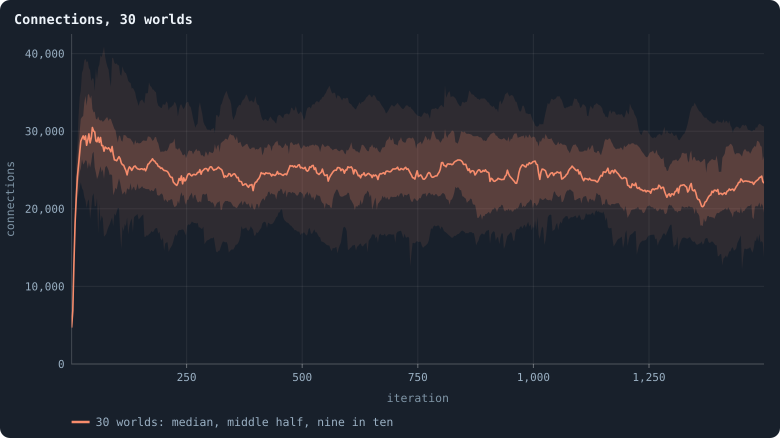

**Connections, 30 worlds.** The number of connections after every game. The line is the median of the worlds at each iteration, the darker band holds the middle half of them (from the 25th to the 75th percentile) and the paler band nine in ten (5th to 95th).

> [!example]- How to make this figure
> **Runs and data.** As for the figure *Agents alive, 30 worlds* above.
>
> 1. Take every run's rows with `phase` = 2 and the statistic `edges`.
> 2. Cut the 1,500 iterations into 600 stretches of 2.5 and take each world's mean in each stretch.
> 3. In each stretch, take the median, the 25th and 75th and the 5th and 95th percentiles of those means over the worlds that still have a value there (a world that died has none after its death).
>
> **To make it again:** `python3 book_figures.py life`.
<!-- /figure -->

The number of connections follows the number of agents, at about 1.7
connections per agent. A connection has two ends, so an agent has about 3.5
connections on average: its mean degree. Every agent is joined to three or
four others ([What shape does the network take?](b1-the-network-size-and-scaling.md#the-shape-of-the-network)).
The median number of connections was 24,730 over iterations 100 to 200, and
22,570 over the last two hundred: 9% fewer. The worlds of 10,000 tokens had
6% more late than early.

#### Births and deaths slow down

The population holds, but its turnover does not. Over iterations 100 to 200
the median world had 656 births per iteration; over its last two hundred
iterations, 470, which is 28% fewer. Deaths fell with them. Agents that
starved in the game, because nobody, not even themselves, staked a token on
their node, fell from 141 per iteration to 93. Agents cut off in the game, on
a piece of the network apart from the largest, fell from 411 to 283. Fewer
births and fewer deaths, around a population of about the same size, mean
that the living get older.

But the slowing is over early. From iteration 500 on, the median world has
between 3.3 and 3.6 births per hundred agents in every stretch of 250
iterations. The ages of the living stop changing too
([How ages change over a world's life](b1-lives-and-wealth.md#how-ages-change-over-a-worlds-life)). So most of the
28% fell before iteration 500. At 10,000 tokens the slowing went on far
longer. There, births per hundred agents kept falling until about iteration
1,250, and the number of births fell by 41% from iterations 100–200 to
2,800–2,999.

#### No world died — but one came close

None of the thirty worlds died: every one lived through its 1,500 iterations.
(A world counts as dead when an iteration ends with 20 agents or fewer;
[When a world ends](rules-in-detail.md#when-a-world-ends) says why.) At 10,000 tokens four of thirty
had died out, one in its fourth iteration and three after long declines. A
world that small can lose its last agents to a few bad games. A world of
15,000 agents has more to lose.

It can still lose most of it. The world with seed 28 held 17,800 agents at
iteration 1,394. In the game of iteration 1,395 it lost 2,390 of them to a
single cut: the network broke in one place, and the piece beyond the break
died. Then, game after game, it lost another large piece: 901 agents, 1,730,
4,060, 2,868, 1,344, 960. Before most of these games, the worst single cut of
the network threatened a seventh to a third of the world
([Cut risk](measuring-networks.md#cut-risk)), against a hundredth or two on an ordinary day.
Births fell from 499 per iteration to 26.

Ten games after the first cut, 2,137 agents were left. At iteration 1,416 one
more cut took the world to 1,405 agents, the smallest any of the thirty
worlds was after its youth. Then it grew again, to 7,400 by the end. No
other world fell that low: the next-smallest low of any world was 5,070.
[How a world breaks](b1-the-network-size-and-scaling.md#how-a-world-breaks) takes such breakdowns apart.

#### Was the thesis right? (the life of a B1 world)
On the worlds of 10,000 tokens the thesis was **refuted**. Two of its tests
passed. The median number of agents was 1,367 over iterations 100–200, among
the 29 worlds alive then, and 1,236 over 2,800–2,999, among the 26 alive
then: 10% fewer. The median number of connections was 2,037 and 2,161: 6%
more. Both stayed within the 20% the thesis allowed. Two tests failed: births
fell by 41%, and four worlds of thirty died out, where the thesis allowed
none. And what the thesis did not test failed too: single worlds wandered far
from where they began.

On the worlds of 100,000 tokens, with the late stretch moved to their last
200 iterations (1,300–1,499), the thesis is refuted again, but on one count
only. Agents (6% fewer late than early) and connections (9% fewer) stay within
20%, and no world died out. Births still fall too much: by 28%. Single worlds
wander less, but still by up to half their size.

So a world has more than one phase of life:

- a **youth** of about a hundred iterations;
- a long **middle**, in which the *typical* world holds still while every
  *single* world wanders, and turnover slows — for a few hundred iterations
  in a large world, for over a thousand in a small one;
- and, for a small world, a **decline** that can end in death.

A large world is safer from dying, not from falling: it can lose nine tenths
of itself in ten games and live.

### The first hundred iterations

Every world begins with a youth unlike the rest of its life
([One world at a time](#one-world-at-a-time)). This section looks at it
closely: how a thousand founders become more than ten thousand agents, how
most of them die, and how the founders' lines narrow down. The youth of the
worlds of 100,000 tokens is that of the worlds of 10,000 tokens ten times
over, and a little faster. Where the two differ, the text says so.

#### A boom and a crash

<!-- figure youth/boom -->
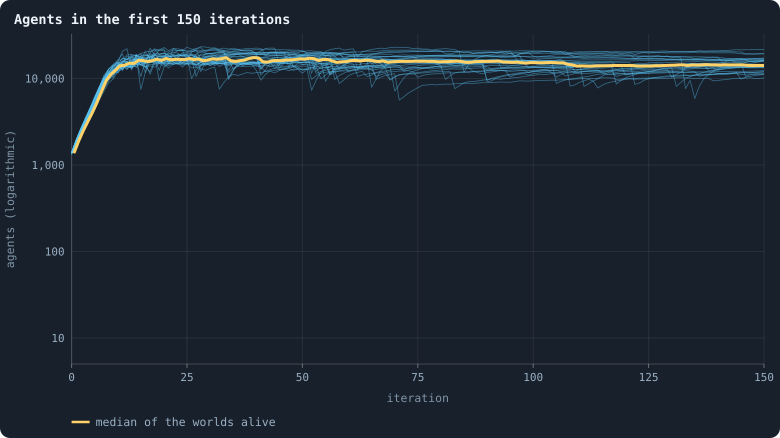

**Agents in the first 150 iterations.** Each thin blue line is one of the 30 worlds: the number of agents alive after every game. The yellow line is their median. The axis is logarithmic, so equal heights are equal factors: the step from 100 to 1,000 is as tall as the one from 1,000 to 10,000.

> [!example]- How to make this figure
> **Runs and data.** As for the figure *Agents alive, 30 worlds* above.
>
> 1. Take every run's rows with `phase` = 2 and 0 ≤ `iteration` ≤ 150.
> 2. Draw `nodes` against `iteration` for each run.
> 3. At each iteration, take the median of `nodes` over the runs that have a row there.
>
> **To make it again:** `python3 book_figures.py youth`.
<!-- /figure -->

At the start every founder holds a hundred tokens, and has a brain nobody
has selected. In the first reproduction phase most of them give a large part
of their tokens to a child: a median of half ([The brain](the-brain.md)). The
children give in turn. The median world grows from 1,000 founders to 1,370
agents after the first game (that of iteration 0), 4,050 after the game of
iteration 5, 12,480 after that of iteration 10 and 16,200 after that of
iteration 20. The median of the thirty worlds peaks at about 17,400 agents
around iteration 39, falls back, and is near 15,000 at iteration 100.

The axis is logarithmic: equal heights are equal factors
([Logarithmic axes and power laws](statistics.md#logarithmic-axes-and-power-laws)). On it, steady
growth by a constant factor per iteration is a straight line, and the first
ten or so iterations are close to one. The population doubles about every
three iterations. That is a little faster than in the worlds of 10,000
tokens, which doubled about every three and a half. They had only grown
sevenfold by iteration 10, where these grew ninefold. Then the lines break,
and many fall steeply for a few iterations: the boom ends in a crash.

#### Where the agents come from, and where they go

<!-- figure youth/flows -->
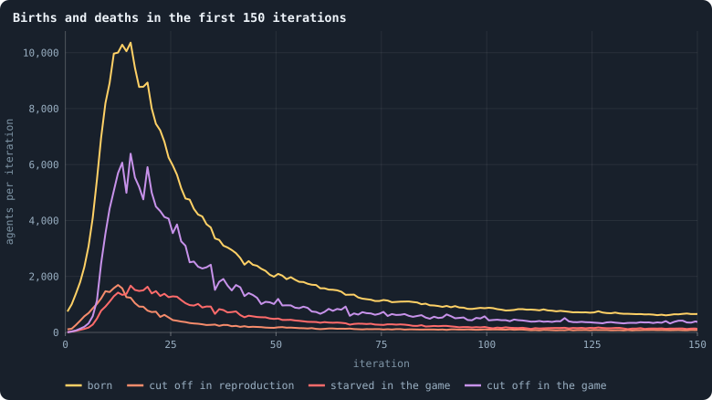

**Births and deaths in the first 150 iterations.** For each iteration, the median over the worlds of: the children born in the reproduction phase (yellow); the agents removed by the cleanup of that phase because they were joined to no one or to a piece smaller than the largest (orange — mostly newborns joined to no one); the agents removed by the cleanup of the game because nobody, not even themselves, staked a token on their node (red); and those removed in the game's cleanup because they were cut off (violet).

> [!example]- How to make this figure
> **Runs and data.** As for the figure *Agents alive, 30 worlds* above.
>
> 1. For iterations 0 to 150, take `births` and `orphaned` from the rows with `phase` = 1, and `starved` and `orphaned` from the rows with `phase` = 2.
> 2. At each iteration, take the median of each over the runs that have a row there.
>
> **To make it again:** `python3 book_figures.py youth`.
<!-- /figure -->

Births peak at a median of 10,360 in the reproduction phase of iteration 15.
Deaths follow. Agents cut off in the game peak at 6,390 per iteration in the
same iteration, and starvation at 1,670. So the crash is mostly the network
breaking apart: at the peak, nearly four agents are cut off for every one
that starves (five at 10,000 tokens).

Why does the network break so easily in the boom? A newborn is joined to
those of its parent's candidates — the parent itself and its neighbours —
that the parent's brain picks
([One iteration, step by step](one-iteration.md)). Every one of those
connections is cut at the end of the game unless tokens cross it. In the
boom, most agents hold a few tokens, and many new connections carry nothing.
Whole branches of the network lose their link to the largest piece, and are
removed with everyone on them.

<!-- figure youth/children-share -->
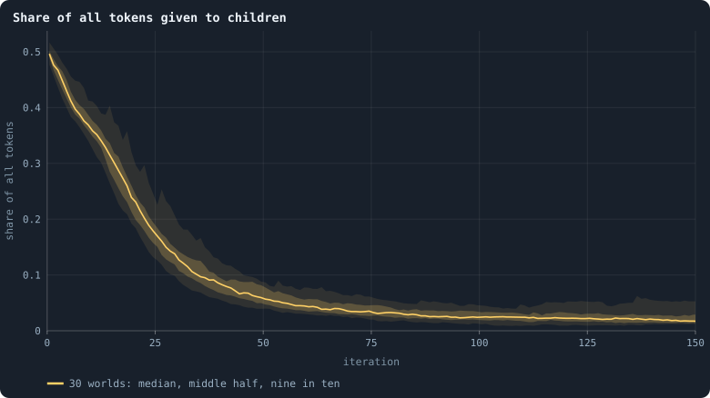

**Share of all tokens given to children.** In each reproduction phase, the tokens all parents together gave their children, as a share of all 100,000 tokens. The line is the median of the worlds at each iteration, the darker band holds the middle half of them (from the 25th to the 75th percentile) and the paler band nine in ten (5th to 95th), here at every single iteration.

> [!example]- How to make this figure
> **Runs and data.** As for the figure *Agents alive, 30 worlds* above.
>
> 1. Take the rows with `phase` = 1 and 0 ≤ `iteration` ≤ 150, and the statistic `reproTokenShare` — the sum of `invested` over the births of that phase, divided by the 100,000 tokens.
> 2. At each iteration take the median, quartiles and 5th and 95th percentiles over the runs.
>
> **To make it again:** `python3 book_figures.py youth`.
<!-- /figure -->

Giving so much to children does not last. In the first reproduction phase,
parents together gave 50% of all tokens to their children; at iteration 10,
37%; at iteration 20, 24%; at iteration 50, 6%; at iteration 100, 2%. That
is almost exactly as in the worlds of 10,000 tokens.

Two things lower it. First, far fewer agents have a child at all: about 74
births for every hundred agents in each of the first ten iterations, about
3.5 in a settled world ([Births, deaths and ages](b1-lives-and-wealth.md#births-deaths-and-ages)).
Second, parents give smaller shares ([The brain](the-brain.md)).

Part of the first is plain rounding. A parent gives ⌊*f* · τ⌋ tokens: the
share *f* its brain picks, times the τ tokens it holds, rounded down. So an
agent holding 3 tokens that would give a fifth gives ⌊0.6⌋ = 0, and has no
child. The founders held 100 tokens each; the median agent of a settled
world holds about 4.5 ([Where do the tokens go?](b1-lives-and-wealth.md#how-unequal-is-a-world-and-who-stays-rich)).

#### A bottleneck of lines

<!-- figure youth/families -->
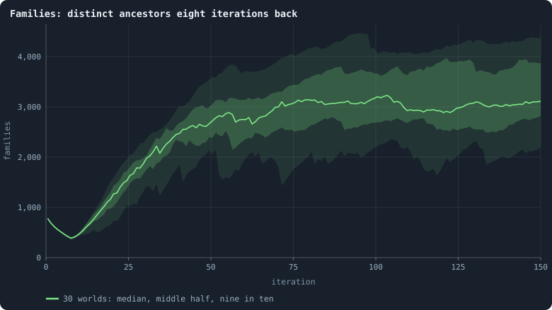

**Families: distinct ancestors eight iterations back.** After every game, how many different genotypes of eight iterations earlier the living descend from (before iteration 8: how many founders). The line is the median of the worlds at each iteration, the darker band holds the middle half of them (from the 25th to the 75th percentile) and the paler band nine in ten (5th to 95th), at every iteration.

> [!example]- How to make this figure
> **Runs and data.** As for the figure *Agents alive, 30 worlds* above.
>
> 1. Take the rows with `phase` = 2 and 0 ≤ `iteration` ≤ 150, and the statistic `cladesInWindow` ([Families](measuring-evolution.md#families): for every living agent, follow its genotype's parents back to the newest one born at or before iteration t − 8, or to a founder's; count the distinct ones).
> 2. At each iteration take the median, quartiles and 5th and 95th percentiles over the runs.
>
> **To make it again:** `python3 book_figures.py youth`.
<!-- /figure -->

Every brain has a genotype: an identity that a copy keeps and a change
replaces ([Genotypes and the family tree](measuring-evolution.md#genotypes-families-and-the-common-ancestor)). The number of
**families** counts the different genotypes of eight iterations earlier that
the living descend from ([Families](measuring-evolution.md#families)). Before iteration 8,
"eight iterations earlier" is before the world began. So there it counts how
many of the 1,000 founders still have descendants.

The count falls fast. In the median world, around iteration 8, the living
descend from about 390 of the founders. Later the count rises again, because
by then there are many more genotypes to descend from.

The bottleneck is narrower in a small world. The worlds of 10,000 tokens kept
about 19 of their 100 founders, a fifth, where these keep two fifths. A
larger world has more places where a line can hold out for a while.

Why do lines die so fast? In the game, a node that is won takes on the
**winner's brain**. A founder whose node is won, and whose children's nodes
are won, has no descendants left, even though its node still exists.

Following the strongest founders' lines in one world shows how one of them
takes over:

<!-- figure youth/founder-lines -->
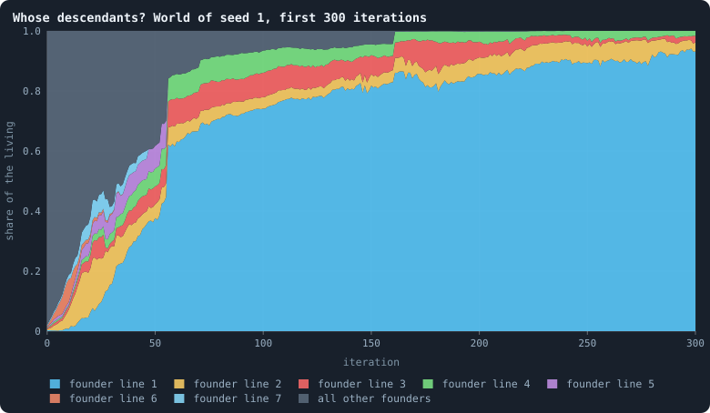

**Whose descendants? World of seed 1, first 300 iterations.** After every game, the share of the living agents that descend from each of the 1,000 founders, stacked. Each coloured layer is the line of one founder; the seven founders whose lines ever held the most are drawn in colour, the other 993 together in grey (most of them with no descendants alive at all). Where a layer reaches the full height, everyone alive descends from that founder.

> [!example]- How to make this figure
> **Runs.** `B1-100000-s001`, one of the 30 baseline runs.
>
> **Data.** As for the figure *World of seed 1 after the game of iteration 1,499* above.
>
> 1. Read every frame in order and remember each genotype's parent genotype (`brain_ids`, `parent_brain_ids`).
> 2. After each game up to iteration 300, follow every living agent's genotype back to its founder and count the agents per founder; divide by the number of agents.
> 3. Stack the shares, the founders with the largest share ever at the bottom.
>
> **To make it again:** `python3 book_figures.py youth`.
<!-- /figure -->

In the world with seed 1, no founder's descendants hold more than 8% of the
world at iteration 10. Then one line pulls ahead. It holds 38% at iteration
50, 74% at iteration 100, 86% at iteration 200 and 93% at iteration 300, with
three other lines still alive beside it. In the smaller world of the same
seed, one line held 52% after ten iterations, and every agent descended from
one founder soon after iteration 300. This one got there at iteration 825.

#### One founder for everyone

How soon does every agent of a world descend from one founder? Every 25
iterations, the family tree of genotypes was climbed from the living
([The common ancestor of the living](measuring-evolution.md#the-common-ancestor-of-the-living) explains how). The
first check at which every living agent descends from one and the same
founder was noted:

<!-- figure youth/one-founder -->
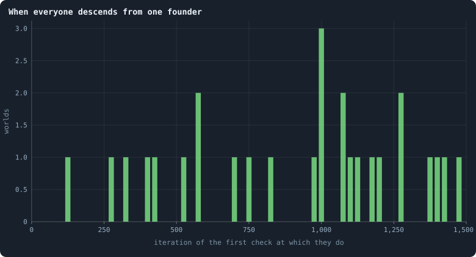

**When everyone descends from one founder.** For each world, the first of the checks — made every 25 iterations — at which every living agent descends from one and the same founder. 27 of the 30 worlds got there; the world with seed 13 never did; the world with seed 18 never did; the world with seed 20 never did.

> [!example]- How to make this figure
> **Runs.** As for the figure *Agents alive, 30 worlds* above.
>
> **Data.** From the runs' frames, through the lineage analysis of Experiment 10 (`python3 gol_lab.py analyse E10`), whose results file `book/results/E10.json` holds every run's `oneFounder`.
>
> 1. Read every frame of a run in order and remember, for every genotype (brain id), the genotype it was copied from (`parent_brain_ids`).
> 2. After the game of every 25th iteration, follow every living agent's genotype back through its parents to a founder's genotype (one with no parent).
> 3. The first iteration at which they all lead to the same founder is the world's value.
> 4. Count the worlds at each value.
>
> **To make it again:** `python3 book_figures.py youth`.
<!-- /figure -->

Of the thirty worlds, 27 got there within their 1,500 iterations. The
fastest did by iteration 125, a quarter by iteration 575, half of the 27 by
iteration 1,000, and the slowest at 1,475. Three worlds, those with seeds 13,
18 and 20, still descended from more than one founder at their last check.

Not one world got there within its first hundred iterations. Of the thirty
smaller worlds, 13 did, and half had done so by iteration 175. **A world ten
times the size takes about six times as long to come down to a single
founder.** [Worlds of 100,000 tokens](b1-the-network-size-and-scaling.md#worlds-of-100000-tokens) reads in
that pace that a line spreads through a world as a random walk spreads, not
as a front.

By then the other 999 founders' lines are gone. A line ends when the last
agent carrying one of its brains either dies, or has its node won by an
agent of another line, whose brain then replaces its own.

#### What the youth means

The youth of a world is a boom, a crash and a bottleneck, at either size.
Its numbers are unlike anything later in a world's life: about 74 births per
hundred agents in each of the first ten iterations, some twenty times the
settled rate, and families falling from a thousand to about four hundred.
That is why the rest of the notebook measures settled worlds from iteration
500 on ([The settled life of a world](statistics.md#the-settled-life-of-a-world)).

A large world comes through its bottleneck with more lines, and keeps them
longer: three of thirty had not come down to one founder after 1,500
iterations. Once a world has, every agent in it is, in its brain, a
descendant of one founder. Whatever diversity of brains a world later holds,
it has made since.

The youth is also when the brains learn.
[How to tell a world that keeps evolving](how-to-tell-a-world-that-keeps-evolving.md)
played the brains of a world at different moments, its eras, against each
other, in ten worlds of 5,000 tokens (Experiment 12). By iteration 50 the
brains of every world beat their founders': in the median world they hold
nine tenths of a world contested with them. Every later era ties with the one
before it. Whatever the brains of a world learn, they learn in its youth.

### What we learned (the life of a B1 world)
- **The youth is unlike the rest of a world's life.** Within twenty
  iterations a world booms to well over ten thousand agents. Then its network
  breaks apart, and most of its founders' lines die. Whatever the brains
  learn, they learn then.
- **A typical world exists; single worlds wander around it.** After the
  youth, the median of thirty worlds of 100,000 tokens stays within 7% of its
  middle. A single world ends anywhere from about two thirds to one and a half
  times its early size. Where a world stands at iteration 1,500 is a moment in
  a wander; its mean over a long stretch says more
  ([How much does the seed decide?](b1-the-network-size-and-scaling.md#how-much-does-the-seed-decide)).
- **Turnover settles late.** Births and deaths slow down until about
  iteration 500 in a large world, and until about 1,250 in a small one.
  Whatever depends on them, such as the ages of the living, settles only
  then. So the notebook measures a settled world from iteration 500 on.
- **Size protects a world from dying, not from falling.** None of the thirty
  large worlds died, where four of thirty small ones did. But one large world
  lost nine tenths of itself in ten games.
- **In the end, one founder for everyone.** In 27 of the 30 worlds every
  agent came to descend from a single founder; a world ten times the size
  takes about six times as long. Whatever diversity of brains a settled world
  holds, it has made since.
- **Experiment 2's thesis was refuted at both sizes.** Births fell by 28%
  (41% in the small worlds), and four small worlds died. A world has more
  than one phase of life.

### How this was made (the life of a B1 world)
Every figure of this page reads the thirty runs of Experiment 10, listed
below. To make them again you need a computer with Python 3, numpy and
networkx, and a copy of this repository. Then `python3 gol_lab.py run E10`
makes the runs into the folder `GraphOfLifeRuns/`. A run of 1,500 iterations
at this size takes about seven hours on one core. The thirty took 211 hours
of computing in all, done in a little over two days on four processor cores,
and they fill 58 GB. The thirty worlds of 10,000 tokens take an eighth of the
computing in all, and show most of the same things.

From the runs, `python3 book_figures.py life` draws the figures of
[A world's life](#a-worlds-life), `python3 book_figures.py youth` those of
[The first hundred iterations](#the-first-hundred-iterations), and
`python3 book_figures.py shape` the first look at a world, together with the
figures of [What shape does the network take?](b1-the-network-size-and-scaling.md#the-shape-of-the-network).
`python3 book_figures.py` alone redraws the figures of every page. Each
figure says, folded beneath it, which of the runs it reads and how.

A few figures on other pages set worlds of different sizes side by side: in
[How ages change over a world's life](b1-lives-and-wealth.md#how-ages-change-over-a-worlds-life),
[How many dimensions does a world have?](how-many-dimensions-does-a-world-have.md),
[The core of a world](b1-the-network-size-and-scaling.md#the-core-of-a-world) and
[The largest and the smallest](b1-lives-and-wealth.md#the-largest-and-the-smallest). They also
read the thirty worlds of 10,000 tokens (`python3 gol_lab.py run E02`), or
the worlds of every size of
[How does a world's size follow its tokens?](b1-the-network-size-and-scaling.md#worlds-of-many-sizes)
(`python3 gol_lab.py run E08`).

#### The runs of Experiment 10 (the life of a B1 world)
<!-- runs E10 -->
> [!info]- The runs behind this page
> **30 runs.** Every condition below is run once for every seed (1 to 30), for 1,500 iterations — or until its world dies out. Every setting is that of the baseline **B1** (the algorithm exactly as a new run is offered it) unless the condition changes it ([At a glance](settings.md#at-a-glance)).
>
> - **baseline** — changes nothing: B1 as it is; 100,000 tokens. Runs `B1-100000-s001` … `B1-100000-s030`.
>
> To make these runs again: `python3 gol_lab.py run E10`, or ▶ in the Research Notebook tab of a computer running `gol_server.py`. Each run writes its settings, seed and engine version beside its frames, in `GraphOfLifeRuns/<run>/meta.json` and `provenance.json`.
<!-- /runs -->

#### The runs of Experiment 2

The thirty worlds of 10,000 tokens, on which the thesis of Experiment 2 was
first tested:

<!-- runs E02 -->
> [!info]- The runs behind this page
> **30 runs.** Every condition below is run once for every seed (1 to 30), for 3,000 iterations — or until its world dies out. Every setting is that of the baseline **B1** (the algorithm exactly as a new run is offered it) unless the condition changes it ([At a glance](settings.md#at-a-glance)).
>
> - **baseline** — changes nothing: B1 as it is; 10,000 tokens. Runs `B1-10000-s001` … `B1-10000-s030`.
>
> To make these runs again: `python3 gol_lab.py run E02`, or ▶ in the Research Notebook tab of a computer running `gol_server.py`. Each run writes its settings, seed and engine version beside its frames, in `GraphOfLifeRuns/<run>/meta.json` and `provenance.json`.
<!-- /runs -->

## Births, deaths and ages

From iteration 500 on, a world of 100,000 tokens keeps about 14,400 agents, but
replaces about 3.5 in a hundred of them in every iteration. Three in four of
those that die are cut off from the network, and the rest starve. Most die
young: nearly a third of all newborns die in the iteration of their birth, and
two thirds within ten iterations. After that, the risk of dying falls with age,
to about one game in a hundred, so agents do not grow old. By iteration 500 the
ages, the lifetimes and the risk at every age have stopped changing. On average
the old are richer and better connected, because the well connected live long;
age itself brings no connections.

### The picture

A Graph of Life world lives in steps called iterations. In each, its agents may
first have a child. Then all of them play a game, staking their tokens on their
own nodes and their neighbours' ([One iteration, step by
step](one-iteration.md)). After a youth of a few hundred iterations, a world
settles: it keeps about the same number of agents ([A world's
life](b1-lives-and-wealth.md#a-worlds-life)). Yet its members come and go. In every
iteration some agents are born and others die, and the two nearly balance. So
how long does an agent live?

Picture a town where most babies die in their first days. Anyone who gets
through childhood can expect a long life, and nobody dies of old age. A settled
world is such a town. Nearly a third of all newborns die in the very iteration
of their birth. The risk of dying is highest just after birth. It falls with
every iteration an agent survives, down to about one game in a hundred. It
never rises again: agents do not grow old.

Why do most die young? Many newborns never get a hold on the network. A
parent's brain may join its child to no one, and then the child is removed at
once. Those that do get a hold are safer with every iteration they last, and
the well connected last longest. Living long does not bring an agent
connections; it is the connections that help it live long.

There are two ways to ask how old agents get, and they give different answers.
Follow every agent from its birth to its death, and you get its **lifetime**.
About half of those that live through their first game are gone within ten
iterations. Or stop a world at one moment, and look at the **ages of the
living**. Their median, the age that half of them are below, is about 55
iterations. The living are older because an agent that lives long is alive at
many moments, so it is counted at many of them. A hospital ward is the same. On
any day, long-stay patients fill most of its beds, though most patients go home
within a day or two ([Age and lifetime](measuring-lives.md#age-lifetime-and-survival-curves)).

The worlds of this page are the thirty of 100,000 tokens of [Thirty
worlds](b1-lives-and-wealth.md#thirty-worlds). They are the first baseline, B1, run
with the seeds 1 to 30 for 1,500 iterations each: Experiment 10. A settled
world holds about 14,400 agents. Unless a passage says otherwise, a number is
measured over a world's settled life, from iteration 500 on. The typical world
is the median of the thirty. This page was first written from the thirty worlds
of 10,000 tokens; [Two sizes](#two-sizes) sets them beside the large ones.

### Four ways in and out

An agent enters a world in one way: it is born in a reproduction phase, with
tokens its parent gives it. It leaves in one of four ways. Every death happens
in a cleanup, at the end of each of the two phases of an iteration ([One
iteration, step by step](one-iteration.md)). An agent is:

- **cut off in reproduction**: mostly a newborn that its parent joined to no
  one;
- **starved in reproduction**: a parent that gave its last token to its child;
- **starved in the game**: no one, not even the agent itself, staked a token
  on its node;
- **cut off in the game**: no tokens crossed the connections that tied its
  part of the network to the rest, so they were cut.

[Births and the four ways to die](measuring-lives.md#births-and-the-four-ways-to-die) defines each. Each is
counted per hundred agents alive when its phase began:

<!-- figure births/rates -->
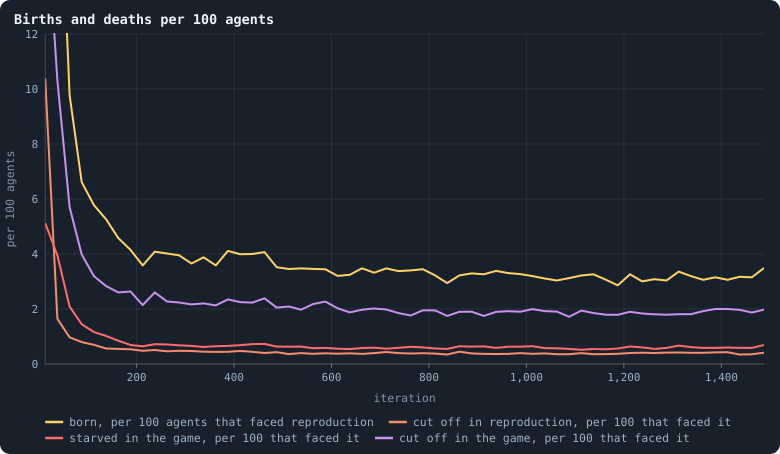

**Births and deaths per 100 agents.** Each line is the median over the worlds, in stretches of 25 iterations, of a count divided by the agents present when the phase began, times 100. The first iterations run far above the top of the axis ([The first hundred iterations](b1-lives-and-wealth.md#the-first-hundred-iterations)).

> [!example]- How to make this figure
> **Runs.** The 30 baseline runs `B1-100000-s001` … `B1-100000-s030`: the baseline B1 at 100,000 tokens, seeds 1 to 30, 1,500 iterations each (every setting is listed in [Worlds of many sizes](b1-the-network-size-and-scaling.md#worlds-of-many-sizes)). They are made with `python3 gol_lab.py run E10`.
>
> **Data.** As for the figure *Six worlds, one at a time* above.
>
> 1. For every row, divide the count (`births` or `orphaned` in rows with `phase` = 1; `starved` or `orphaned` in rows with `phase` = 2) by the row's `nodes_before`, the agents present when that phase began, and multiply by 100.
> 2. Cut the 1,500 iterations into 60 stretches of 25; take each run's mean in each.
> 3. Draw the median over the runs that have a value in the stretch.
>
> **To make it again:** `python3 book_figures.py births`.
<!-- /figure -->

From iteration 500 on, the median world sees 3.5 births per hundred agents in
every reproduction phase. It loses 0.4 per hundred to cutting off in
reproduction, 0.7 to starvation in the game and 2.1 to cutting off in the game.
Starving in reproduction is rarer still, 0.15 per hundred, and it is not drawn.
So of every four agents who die, three die because the network around them came
apart. The fourth starves, most often because nobody staked on its node in the
game.

Each world counts once here. Each rate is a world's mean over its settled life,
and the typical world is the median one. The rates are steady from about
iteration 500 on, after falling from the youth ([The first hundred
iterations](b1-lives-and-wealth.md#the-first-hundred-iterations)). And they differ
little between worlds: the middle half of the worlds have between 3.1 and 3.8
births per hundred agents. That is less obvious than it looks. Worlds whose
brains never change end up anywhere from no births at all to about one child
per agent per iteration ([Do the brains matter?](do-the-brains-matter.md)).

### How long agents live

Not every newborn lives long enough to be followed. From iteration 500 on, 15.2
million agents were born in the thirty worlds. Of these, 4.7 million — nearly a
third — died in the very iteration they were born in. Some 2 million were cut
off in the cleanup of the reproduction phase, most of them because they were
joined to no one. The rest died in their first game, starved or cut off.

An agent's **lifetime** counts the games it lived through ([Age and
lifetime](measuring-lives.md#age-lifetime-and-survival-curves)). It runs from the iteration of its birth to the
last iteration after whose game it was alive, both included. The 4.7 million
were never alive after a game, so the curves of this page leave them out.

The curve below, a **survival curve**, follows the other 10.4 million. These
are all the agents born at iteration 500 or later that were still alive after
the game of their birth iteration. Some were still alive when their run ended.
Their lives are counted as having lasted *at least* that long. The Kaplan–Meier
estimate does this: it uses what is known of an unfinished life, and no more
([Survival curves (Kaplan–Meier)](measuring-lives.md#survival-curves-kaplanmeier)). The share that lived at
least *L* iterations:

<!-- figure births/lifetimes -->
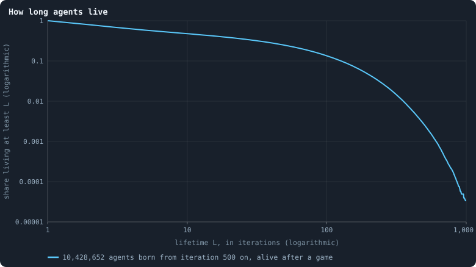

**How long agents live.** Of all agents born at iteration 500 or later in the 30 worlds and alive after at least one game — the newborns cut off in the reproduction phase of their birth, or dead in their first game, are left out — the share that lived at least L iterations, for every L. A life is counted from the iteration of birth to the last iteration after whose game the agent was alive, both included. Lives still going when a run ended are counted as far as they went (Kaplan–Meier). Both axes are logarithmic.

> [!example]- How to make this figure
> **Runs.** As for the figure *Births and deaths per 100 agents* above.
>
> **Data.** As for the figure *World of seed 1 after the game of iteration 1,499* above.
>
> 1. Read every frame with `phase` = 2. For every agent id note its birth iteration (the frame's `iteration` minus its `ages` entry) and the last iteration it appears.
> 2. Keep agents born at iteration 500 or later. An agent still present in the last frame is censored: its life is known to be at least that long.
> 3. Compute the Kaplan–Meier estimate S(L) = Π over lifetimes ℓ < L of (1 − d(ℓ) / n(ℓ)), with d(ℓ) the lives that ended at ℓ and n(ℓ) those still at risk.
>
> **To make it again:** `python3 book_figures.py births`.
<!-- /figure -->

Both axes are logarithmic: each step along them multiplies by the same factor
([Logarithmic axes and power laws](statistics.md#logarithmic-axes-and-power-laws)). On them, the curve
shows several things at once:

- 79% of these agents live at least 2 iterations, 58% at least 5, and 48% at
  least 10. **About half of them are gone within ten iterations**, and their
  median lifetime is 8 iterations. Counted over all 15.2 million newborns,
  with the third that died in their birth iteration, **two thirds are gone
  within ten iterations**. The median lifetime of all newborns is 2.
- 25% live at least 50 iterations and 13% at least 100. The curve falls slowly
  there: an agent that has survived its first ten iterations has good chances
  of surviving many more.
- Then it drops: 0.26% live at least 500 iterations, and 0.003% — about one in
  thirty thousand — at least 1,000.

A curve that fell along a straight line on these axes would be a power law.
This one bends: early deaths are common, and long lives exist, but not without
limit. The bend comes from the risk of dying: past an age of about a hundred,
it holds near one game in a hundred. A steady risk makes the curve fall ever
more steeply on these axes ([The risk of dying at each
age](#the-risk-of-dying-at-each-age)).

### How old the living are

The lifetimes above follow every agent that lived through its first game,
whatever became of it later. The living at one moment are a different sample,
weighted towards long lives ([The picture](#the-picture)). So they are older
than the typical agent at death.

<!-- figure births/ages -->
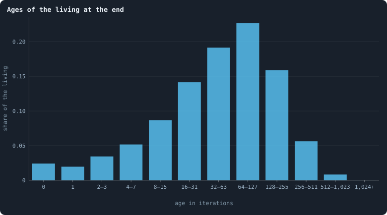

**Ages of the living at the end.** The ages of all 394,056 agents alive after the last game of the 30 worlds, in bins that double in width: age 0 is born in this iteration, age 1 in the one before, and so on.

> [!example]- How to make this figure
> **Runs and data.** As for the figure *How long agents live* above.
>
> 1. Read each run's last frame (iteration 1,499, `phase` 2) and its `ages`.
> 2. Count the ages in the bins 0, 1, 2–3, 4–7, …, and divide by the number of agents.
>
> **To make it again:** `python3 book_figures.py births`.
<!-- /figure -->

After the last game of the thirty worlds, 394,056 agents were alive. Pooled
over all thirty worlds, their median age was 54 iterations. Of them, 2.4% had
been born in that very iteration, 31% were 100 iterations old or more, and 37
were over a thousand.

Is this how a world's ages always look, or only a moment in a drift? The next
section follows the ages through the whole life of the worlds.

### How ages change over a world's life

A world whose size holds still is not necessarily in a steady state. If births
slow while deaths slow too, the population can stay the same size while it
grows older. And births do slow, over a world's first few hundred iterations
([Births and deaths slow down](b1-lives-and-wealth.md#births-and-deaths-slow-down)).
An older population is a different one. Older agents have had more time to
gather connections and tokens, and their brains have survived more games. For
evolution, what matters is how long a brain lasts and what it does in that
time. For a picture of a world as a physical system, what matters is whether it
ever reaches an equilibrium.

So this section follows both views of age from a world's start to its end. How
old are the living at each moment? And how long do the agents born at each
moment live? One number per age connects the two, the **hazard**: of the agents
that reach an age, the share that die at it.

#### How old the living are, iteration by iteration

At iteration 0 every agent is a founder or a founder's first child, and all are
of age 0. From then on, after every game, the run records a frame, the whole
world as it stands, with the age of every agent alive. The figure follows three
ages: the median, the oldest, and the age that nine in ten of the living are
below, the **90th percentile**:

<!-- figure ages/over-time -->
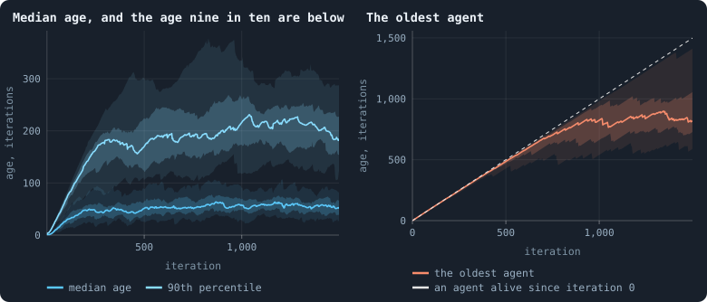

**How old the living are.** After every game of the 30 worlds. Left: the median age of the agents alive, and the age that nine in ten of them are below (the 90th percentile). Right: the age of the oldest agent alive; the dashed diagonal is the age of an agent alive since iteration 0, which only the oldest can follow. For each, the line is the median of the worlds at each iteration, the darker band holds the middle half of them (from the 25th to the 75th percentile) and the paler band nine in ten (5th to 95th).

> [!example]- How to make this figure
> **Runs.** As for the figure *Agents alive, 30 worlds* above.
>
> **Data.** From each run's frames after every game (frame `2·t + 1`, `gol_store.read_frame`), read in order by `book_chapters.ages.lifelines`: every agent's `ages` entry gives its birth iteration (the frame's iteration minus its age), and the last frame it is in its last iteration alive.
>
> 1. After every game, the median, the 90th percentile and the largest of `ages`.
> 2. Cut the 1,500 iterations into 600 stretches of 2.5 and take each world's mean in each stretch.
> 3. In each stretch, take the median, the 25th and 75th and the 5th and 95th percentiles of those means over the worlds that still have a value there (a world that died has none after its death).
>
> **To make it again:** `python3 book_figures.py ages`.
<!-- /figure -->

The median age climbs for two hundred iterations — 12 at iteration 50, 28 at
100, 48 at 200 — and then stops. It is 46 at iteration 300, 51 at 500, 57 at
1,000 and 51 at the last iteration. That last number is the median world's own;
the 54 of [How old the living are](#how-old-the-living-are) pools the agents of
all thirty worlds. Over the settled stretch from 500 to 1,499, the median
world's median age is **55 iterations**. The middle half of the worlds lie
between 51 and 60. The 90th percentile stops a little later, near 200: it is
182 at iteration 300, 216 at 1,000 and 183 at the end. The ages of the living
stop changing long before a world's life is over.

The oldest agent behaves differently. For three hundred iterations it is
someone alive since the start: at iteration 300, the oldest agent of the median
world is 296 iterations old. Then it falls behind the figure's diagonal, which
marks an agent alive since iteration 0. It is 487 at iteration 500, 703 at 750
and 825 at 1,000. From there it goes no further: 841 at 1,250, 820 at the end.

The agents of the start do not last. Of the agents born in iteration 0, the
median world keeps 37 at iteration 25, 2 or 3 at iteration 100, and none at
200. In the median world the last of them died at iteration 161; in one world
the last died at iteration 24, in another at 702.

#### Why the oldest agent stops near 850

Why should the oldest stop near 850? Not because agents wear out: [The risk of
dying at each age](#the-risk-of-dying-at-each-age), below, finds no sign of
that. It is a matter of numbers.

A settled world has about 500 births in every iteration: 3.5 per hundred
agents, of some 14,400. But nearly a third of the newborns die in the iteration
they are born in ([How long agents live](#how-long-agents-live)). So about
*B* = 345 in every iteration live through their first game: 2.4 per hundred agents.
A share *S*(100) = 0.13 of these live to an age of 100 iterations; the curve of
[How long agents live](#how-long-agents-live) counts exactly these agents. And
from then on, about *h* = 1% of those left die in every game, whatever their
age.

Now count the agents alive that are older than *L*. Every past iteration added
*B* lives. Of the lives begun more than *L* iterations ago, a share *S*(100)
reached an age of 100. Every game after that kept a share 1 − *h* of them.
Adding these up over all past iterations gives about

$$
N(L) \approx \frac{B \, S(100)}{h} \, (1-h)^{L-100}
= \frac{345 \times 0.13}{0.01} \, 0.99^{\,L-100}
\approx 4{,}500 \times 0.99^{\,L-100} ,
$$

which falls to one, a single agent older than *L*, at *L* ≈ 100 + ln 4,500 /
−ln 0.99 ≈ 940. That is near the 820 to 850 that the oldest agent reaches,
given that *h* is not quite constant. All 500 births with the same *S*(100)
would give *L* ≈ 975, too high. The share 0.13 is of the agents that live
through their first game, not of all newborns.

A world holds a few agents near that age at any time, and almost never one much
older. The oldest agent is where the long tail of lifetimes runs out of agents.

#### The living, by age

Sorting the living into age classes that widen fourfold shows the whole age
structure at a few moments:

<!-- figure ages/pyramids -->
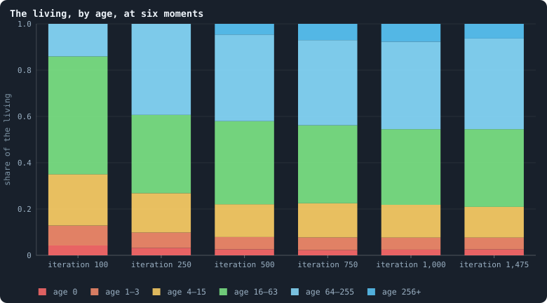

**The living, by age, at six moments.** All agents alive after the games of 100, 250, 500, 750, 1,000 and 1,475, pooled over the 30 worlds and sorted by age in classes that widen fourfold: born in that very iteration (age 0), 1 to 3, 4 to 15, 16 to 63, 64 to 255, and 256 iterations or more. Each column adds up to 1.

> [!example]- How to make this figure
> **Runs and data.** As for the figure *How old the living are* above.
>
> 1. Every 25 iterations, count the agents of each age class; pool the worlds.
> 2. Divide each class by the agents of the moment and stack.
>
> **To make it again:** `python3 book_figures.py ages`.
<!-- /figure -->

At iteration 100, half of the living (51%) are 16 to 63 iterations old. They
were born in iterations 37 to 84, as the boom of [The first hundred
iterations](b1-lives-and-wealth.md#the-first-hundred-iterations) turned into its
crash. Few agents born since have lasted. At iteration 250 that generation has
moved on, and 39% of the living are 64 to 255 iterations old. From iteration
500 on, the columns hardly change:

- about 2.5% of the living were born in that very iteration;
- 5% are 1 to 3 iterations old;
- 13 to 15% are 4 to 15;
- about a third are 16 to 63;
- 37 to 39% are 64 to 255;
- and 5 to 8% are older.

The shape of the population is set by iteration 500, and it holds.

#### How long the agents of each period live

The ages of the living mix agents born at many times. Lifetimes separate them.
Group the agents that lived through their first game by the period in which
they were born: each group is a **cohort**. Then follow each group to its end,
as in [How long agents live](#how-long-agents-live):

<!-- figure ages/cohorts -->
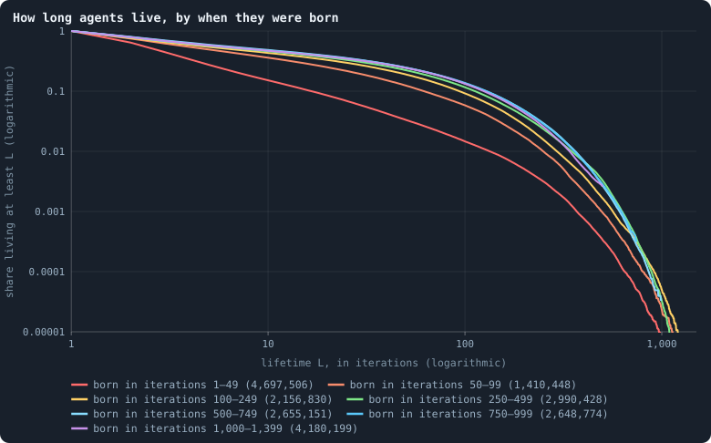

**How long agents live, by when they were born.** Of all agents born in each period of the 30 worlds' lives that were alive after at least one game, the share that lived at least L iterations. A life is counted from the iteration of birth to the last iteration after whose game the agent was alive, both included; lives still going at the end of a run are counted as far as they went (Kaplan–Meier, as in [Births, deaths and ages](b1-lives-and-wealth.md#births-deaths-and-ages)). A period's line stops at the longest life its agents could have had before the run ended. Both axes logarithmic.

> [!example]- How to make this figure
> **Runs and data.** As for the figure *How old the living are* above.
>
> 1. For every agent, its birth iteration b and its last iteration alive d; d − b + 1 iterations lived; alive after the run's last game: still going.
> 2. Sort the agents by b into the periods shown, pool the worlds, and estimate S(L) by Kaplan–Meier (`book_chapters.ages.survival`).
>
> **To make it again:** `python3 book_figures.py ages`.
<!-- /figure -->

Agents born in iterations 1 to 49 lived short lives: their median lifetime was
2 iterations, 15% reached 10 and 1.5% reached 100. The median lifetime is the
longest *L* that more than half of the lives reach. Each later period did
better. The median lifetime was 4 iterations for those born in iterations 50 to
99, 6 for 100 to 249, and 7 for 250 to 499. From iteration 500 on, the
improvement stops. The three cohorts born from iteration 500 on have the same
curve. Each has a median lifetime of 8 iterations; 47 to 48% live at least 10,
and 13 to 14% at least 100. Their three lines lie on top of one another.

#### Life expectancy, birth by birth

A finer view takes every stretch of 25 birth iterations, in each world on its
own. How many of their first 100 iterations do its agents live, on average?
This is the **restricted mean lifetime**, the area under the survival curve up
to 100 ([Age and lifetime](measuring-lives.md#age-lifetime-and-survival-curves)). It can be measured in full
for every agent born at least 100 iterations before the end of a run:

<!-- figure ages/expectancy -->
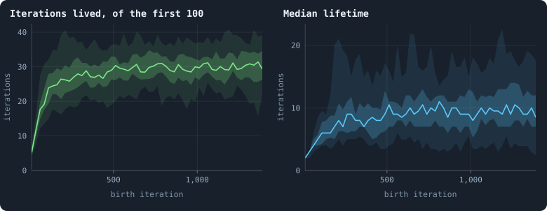

**Life expectancy over a world's life.** Agents born in each stretch of 25 iterations (those born at iteration 0, the founders and their first children, left out). Left: how many of their first 100 iterations they live on average — the sum of the Kaplan–Meier curve up to L = 100, a mean that every stretch born at least 100 iterations before the end can be measured by in full. Right: the median lifetime, the longest L that more than half of them live. For each world separately; the line is the median of the 30 worlds, the darker band the middle half and the paler band nine in ten.

> [!example]- How to make this figure
> **Runs and data.** As for the figure *How old the living are* above.
>
> 1. For each world and stretch of 25 birth iterations with at least 20 births, the Kaplan–Meier curve S(L) of their lives.
> 2. Left: Σ S(L) for L = 1 … 100. Right: the largest L with S(L) > ½.
>
> **To make it again:** `python3 book_figures.py ages`.
<!-- /figure -->

In the median world, an agent born in iterations 1 to 24 lived 5 of its first
100 iterations. One born in 50 to 74 lived 18, and one born in 100 to 124 lived
24. By iteration 250 the expectancy is 27, and from iteration 500 on it hovers
between 28 and 31 for the rest of the run. The median lifetime does the same,
rising from 2 iterations to between 8 and 11. So life expectancy rises through
a world's first five hundred iterations, and then it holds still. Those
iterations are its youth ([The first hundred
iterations](b1-lives-and-wealth.md#the-first-hundred-iterations)) and the slowing of
its turnover after it ([Births and deaths slow
down](b1-lives-and-wealth.md#births-and-deaths-slow-down)).

#### The risk of dying at each age

The **hazard** says, for an agent that has reached an age, how likely it is to
die at that age. Exactly: take the agents alive when the iteration in which
they are *a* iterations old begins. The hazard at age *a* is the share of them
that is gone after that iteration's game ([Age and
lifetime](measuring-lives.md#age-lifetime-and-survival-curves)):

<!-- figure ages/hazard -->
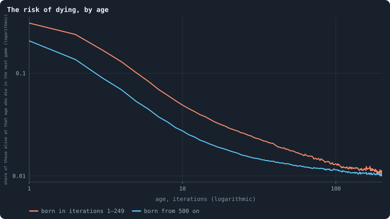

**The risk of dying, by age.** At each age a: of the agents alive after the game at age a − 1, the share that is gone after the game at age a — the agent's chance of dying at that age, pooled over the worlds, for agents born early in a world's life (orange) and in its settled life (blue). An age is drawn only where at least 200 agents reached it.

> [!example]- How to make this figure
> **Runs and data.** As for the figure *How old the living are* above.
>
> 1. For agents born in the period, with d − b + 1 iterations lived: at each L, the lives still going at L (lasting at least L) and those ending at L (lasting exactly L, not still going at the end).
> 2. Divide the second by the first (`book_chapters.ages.hazard`).
>
> **To make it again:** `python3 book_figures.py ages`.
<!-- /figure -->

For an agent born in the settled stretch, the risk is 21% at age 1, 14% at 2,
9% at 3 and 5% at 5. It is 2.7% at 10, 1.8% at 20, 1.3% at 50, 1.1% at 100 and
1.0% at 200. It falls at every age. There is **no ageing**: an old agent is
never more at risk than a young one. Beyond an age of about a hundred, the risk
hardly changes. About one game in a hundred is an old agent's last, whether it
is a hundred iterations old or four hundred.

A constant risk makes the survival curve fall exponentially from there on.
Drawn on a logarithmic axis against a plain axis of *L*, it would be a straight
line. That is what lets the estimate of [the oldest
agent](#why-the-oldest-agent-stops-near-850) work.

Agents born early, in iterations 1 to 249, were at more risk at every age, and
most of all when young. Their risk was 31% at age 1, 4.9% at 10 and 1.3% at
100. The difference between the two periods shrinks with age. An agent of the
early period that had lived a hundred iterations was almost as safe as one born
later.

A risk that falls with age can have two causes, and this figure cannot tell
them apart. Either each agent becomes safer as it lives, gathering tokens and
connections. Or agents differ from birth: the fragile ones die first, and those
left are the robust. Then the risk of each agent stays what it was, but the mix
changes. [Who the old are](#who-the-old-are) looks at what the old have.

#### Who the old are

Every 25 iterations, the agents of each age class, with their mean tokens and
mean number of connections:

<!-- figure ages/wealth-age -->
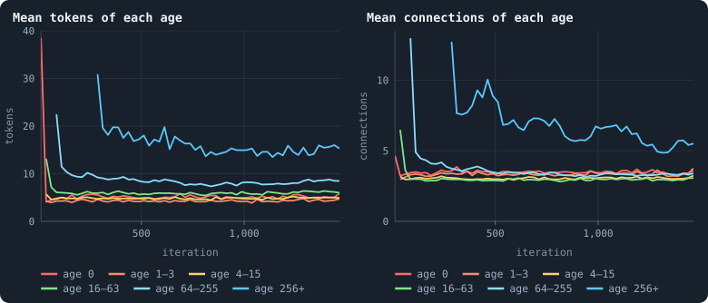

**Who the old are.** Every 25 iterations, the agents alive after the game in each age class: their mean tokens (left) and mean number of connections (right); each line is the median over the 30 worlds of the class's mean.

> [!example]- How to make this figure
> **Runs and data.** As for the figure *How old the living are* above.
>
> 1. Every 25 iterations, for each age class, the mean of `tokens` and of the connections each agent has in `edges`.
> 2. Median over the worlds.
>
> **To make it again:** `python3 book_figures.py ages`.
<!-- /figure -->

At iteration 1,475, the last of these moments, a newborn of the median world
holds 5.9 tokens after its first game, and has 3.6 connections
([How births build the network](b1-lives-and-wealth.md#how-agents-have-children)
says what parents give). A few iterations later the young hold fewer tokens: 4.7 at ages 1 to 3, and 4.9 at 4
to 15. They have 3.8 and 3.2 connections. From then on, the older the class,
the richer: 6.0 tokens at 16 to 63, 8.5 at 64 to 255, **15.3** at 256 and over.
That is three times what the young hold, with 5.5 connections. On average, the
old are the rich and the well connected.

But the average is not the typical agent. [Connections and
age](b1-lives-and-wealth.md#connections-and-age) sorts the living by age,
and looks at the median instead of the mean. The median agent has 2 connections
at every age, from a few iterations to over 700. The old classes' higher means
come from the hubs among them: agents joined to far more agents than most. Hubs
die less often than leaves, the agents with a single connection. Within ten
games, 18% of the agents with a single connection die. Of those with ten
connections or more, fewer than one in ten die ([The fate of the
richest](b1-lives-and-wealth.md#the-fate-of-the-richest)). So the hubs make
up more of the old than of the young. And an agent's tokens follow its
connections ([How properties scale
together](b1-the-network-size-and-scaling.md#how-properties-scale-together)), so the old classes are richer
too.

So, as far as connections go, the risk falls with age because the mix changes.
An agent does not gather connections by living long; the well connected are the
ones that live long. Connections give an agent age, not age connections. [Do
the rich stay rich?](b1-lives-and-wealth.md#do-the-rich-stay-rich) follows
single agents' tokens from game to game.

One caution about what "old" means. An agent's age is its node's, not its
brain's. When a neighbour wins an agent's node in a game, the agent keeps its
id, its age and its connections; only its brain is replaced. So an old agent
may carry a brain that arrived in the last game ([Questioning the
mechanics](questioning-the-mechanics.md)).

#### The ages of a steady world

Suppose a world's births never changed, and every agent's life followed the
same survival curve *S*. Then the ages of the living would follow from *S*
alone. The agents of age *a* alive after a game are those born *a* iterations
earlier whose lives lasted at least *a* + 1 games. With *B* newborns per
iteration that live through their first game, there are *B* · *S*(*a* + 1) of
them. So the share of the living at age *a* is

$$
\frac{S(a+1)}{\sum_{L \ge 1} S(L)} ,
$$

and the sum in the denominator is the mean lifetime. This is the identity of a
**stationary population** in demography: a population whose births and risks of
death never change. It gives a check. If the settled worlds are in such a
state, their ages should follow from their lifetimes.

Pool every life begun from iteration 500 to 1,399, and follow it up to 999
iterations. The mean lifetime is 41.3 iterations. So the newborns should be 1 /
41.3 = **2.4%** of the living, and the median age of the living should be
**55**. The pyramid measured 2.3 to 2.6%, and the median age of the living over
the settled stretch was 55. The large worlds are in a steady state of ages from
about iteration 500 on. Their births per hundred agents are 3.3 to 3.6 in every
stretch of 250 iterations from then on, and the lives follow one curve.

#### Two sizes

The study of the baseline was first written from the thirty worlds of 10,000
tokens of Experiment 2. They hold a tenth as many agents, and they ran for
3,000 iterations. They had a little less of everything. From iteration 500 on,
the median small world had 3.1 births per hundred agents. It lost 0.4 per
hundred to cutting off in reproduction, 0.5 to starvation in the game and 1.7
to cutting off in the game. A large world turns its agents over about a tenth
faster. Their ages, beside these:

<!-- figure ages/two-sizes -->
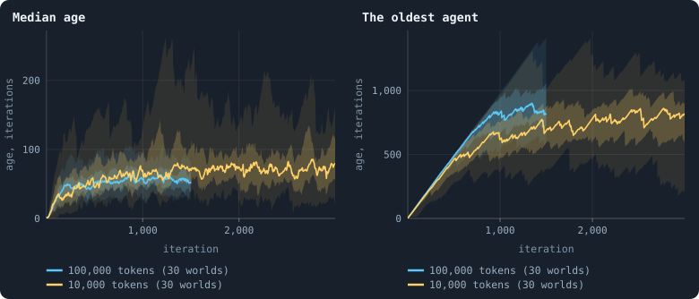

**Ages in worlds of two sizes.** The median age and the oldest agent after every game, in the 30 worlds of 100,000 tokens (blue, 1,500 iterations) and in the 30 worlds of 10,000 tokens of the first edition, Experiment 2 (yellow, 3,000 iterations). The line is the median of the worlds at each iteration, the darker band holds the middle half of them (from the 25th to the 75th percentile) and the paler band nine in ten (5th to 95th); a world that died is no longer counted.

> [!example]- How to make this figure
> **Runs.** The 30 baseline runs `B1-100000-s001` … `B1-100000-s030`: the baseline B1 at 100,000 tokens, seeds 1 to 30, 1,500 iterations each (every setting is listed in [Thirty worlds](b1-lives-and-wealth.md#thirty-worlds)). They are made with `python3 gol_lab.py run E10`. The 30 baseline runs `B1-10000-s001` … `B1-10000-s030`: the baseline B1 at 10,000 tokens, seeds 1 to 30, 3,000 iterations each (every setting is listed in [A world's life](b1-lives-and-wealth.md#the-life-of-a-b1-world)). They are made with `python3 gol_lab.py run E02`.
>
> **Data.** As for the figure *How old the living are* above.
>
> 1. As in the first figure, for both sets of worlds.
> 2. In each stretch, take the median, the 25th and 75th and the 5th and 95th percentiles of those means over the worlds that still have a value there (a world that died has none after its death).
>
> **To make it again:** `python3 book_figures.py ages`.
<!-- /figure -->

The small worlds' living are younger at first and older later. At iteration
500 their median age was 43 in the median world; at 1,000, 68; and at 1,499,
70. The large worlds stayed between 51 and 57. Over the whole settled stretch
of 500 to 2,999, the median small world's median age was 74, where the large
worlds' is 55. When the small worlds ended, after twice as many iterations,
the median age of all their living was 72. Of these, 39% were a hundred or
older, against 31% at the end of the large worlds. The small worlds also differ
far more from one another: a tenth as many agents makes every number noisier.

Their lives explain part of it. Take the lives begun in the settled stretch,
from iteration 500 until a hundred iterations before the end. At first they
lasted much the same: 48% lived at least 10 iterations in the small worlds, and
47% in the large. And young agents died equally often: 21% at age 1, 2.7% at
age 10. But old agents died less often in the small worlds: 0.96% per game at
age 100 against 1.14%, and 0.84% at age 200 against 1.02%. So the small worlds'
curve has a longer tail. Of their lives, 15% reached 100 iterations against 13%
in the large worlds, and 0.6% reached 500 against 0.26%. More long lives give a
mean lifetime of 46.7 iterations instead of 41.3, and a steady small world
would have a median age of 65.

The rest is that the small worlds were not steady. Their births per hundred
agents went on falling after iteration 500. They fell from 3.4 in iterations
500 to 749 to between 2.7 and 2.9 from iteration 1,250 on. So their living grew
older than a steady state with those lives would be, while the large worlds'
births held still.

Why old agents die less often in a small world is open. One candidate is the
cuts. An agent is cut off in a game about a fifth more often in a world of
100,000 tokens than in one of 10,000. The rates are 2.1 and 1.7 per hundred.
Being old is no protection when every connection between an agent's region and
the rest of the world carries no tokens in the same game. Then all of them are
cut together, and the region dies ([How a world breaks](b1-the-network-size-and-scaling.md#how-a-world-breaks)
calls it a border going quiet).

### What we learned (births)
- **A settled world replaces about 3.5 of every 100 agents in every
  iteration.** Three in four of those that die are cut off from the network
  rather than starved. The rates hold steady from iteration 500 on, and differ
  little from world to world.
- **Most agents die young, and none grows old.** Nearly a third of all
  newborns die in the iteration they are born in, and two thirds within ten
  iterations. A few live more than a thousand. The risk of dying falls with
  age and then holds near one game in a hundred, so long lives are almost
  memoryless. The oldest agent is set by how many agents there are, not by any
  limit on a life.
- **The living are older than the dead.** They are a sample weighted towards
  long lives, older than the typical agent ever gets. Half of the agents that
  live through their first game are gone within ten iterations, yet half of
  the living are older than 55.
- **In a world of 100,000 tokens, ages settle by iteration 500.** By then a
  world's age structure, life expectancy and risk at every age are those it
  will still have at iteration 1,500. About 2.4% of its agents are newborns,
  and half are younger than 55. An agent that lives through its first game can
  expect some 41 iterations. The first five hundred iterations, the youth and
  the slowing of turnover after it, are the only time the ages change. The
  ages of the living follow from the lifetimes, as those of a stationary
  population do.
- **A world a tenth the size settles later, and grows older.** Its births kept
  falling after iteration 500, and its old agents died less often.
- **The old are the rich, on average, because the well connected live long.**
  The typical agent has 2 connections at every age; the hubs, which die less
  often, fill the old classes. Connections give an agent age, not age
  connections.
- **For open-ended evolution, a world's demography is finished early.** From
  iteration 500 on, nothing about who lives how long changes. Evolution, if it
  acts, has to act inside that steady turnover, not through how long agents
  last. It would act through which brains the 2.4% of newborns carry, and
  which brains take over nodes in the games
  ([Genotypes and lineages](b1-brains-lineages-and-messages.md#genotypes-and-lineages)). And the brains settle
  even earlier than the ages. In ten worlds of 5,000 tokens, the brains of each
  moment were played against those of earlier moments. They improve over a
  world's first 50 to 100 iterations, and not after. From then on, the brains
  of each moment tie with those of the moment before
  ([How to tell a world that keeps evolving](how-to-tell-a-world-that-keeps-evolving.md)).

### How this was made (births)
Every figure of this page reads the thirty runs of Experiment 10, listed below.
The figure of [Two sizes](#two-sizes) also reads the thirty runs of 10,000
tokens of Experiment 2, made with `python3 gol_lab.py run E02`. From the runs,
`python3 book_figures.py births` draws the figures of [Four ways in and
out](#four-ways-in-and-out), [How long agents live](#how-long-agents-live) and
[How old the living are](#how-old-the-living-are). And `python3 book_figures.py
ages` draws those of [How ages change over a world's
life](#how-ages-change-over-a-worlds-life). Each figure says, folded beneath
it, which runs it reads and how.

The runs of Experiment 10 are listed once on this page, under [The runs of Experiment 10 (the life of a B1 world)](#the-runs-of-experiment-10-the-life-of-a-b1-world).

## How births build the network

In the first baseline, B1, every new node of a world's network is a newborn
agent, and every new connection is made at a birth. Only three or four agents
in a hundred have a child in an iteration, and connections raise the chance
more than wealth does. A child is joined only inside its parent's
neighbourhood, so a new connection never brings two agents closer together.
That is why a world keeps a shape in space. Agents gain connections in
proportion to those they have, and lose them a little faster, so no hub runs
away with the network. Age gives an agent no connections; connections give
it age.

### How agents have children

Where does a world's network come from? Each new node is a newborn agent.
And each new connection, as [Births build the network](#births-build-the-network)
shows, is made at a birth. So to see how the network grows, start with how
agents have children.

Every iteration begins with a reproduction phase, in which any agent may
have one child ([One iteration, step by step](one-iteration.md)).
[Births, deaths and ages](b1-lives-and-wealth.md#births-deaths-and-ages) counted the births. This
section looks at the decisions behind them: who has a child, how much it
gives, and how the child is joined to the world.

The worlds are the thirty of 100,000 tokens of
[Thirty worlds](b1-lives-and-wealth.md#thirty-worlds), the runs of Experiment 10.
This page was first written from the thirty worlds of 10,000 tokens; where
those differ, both are given.

#### A birth, decision by decision

A birth is three decisions, all taken by the parent's brain. Take
agent *u*, holding τ tokens. Its brain gives one column of outputs for each
of its candidates: *u* itself and each of its neighbours. From these
columns:

1. **How much.** Two of the outputs, averaged over all the columns, give two
   numbers (*ā*, *b̄*). The child gets *c* = ⌊*f*(*ā*, *b̄*) · τ⌋ tokens: the
   share *f* of the parent's tokens, rounded down. Here *f* is the share
   function ([The share function](rules-in-detail.md#the-share-function-fa-b)). It gives the positive
   part of *ā* as a share of the positive parts of both, or ½ if neither is
   positive. If *c* = 0, there is no child.
2. **Whom it joins.** For every candidate, the parent included, a yes-or-no
   decision: join the child to it or not.
3. **What it is handed.** For every neighbour of the parent, a yes-or-no
   decision: move the parent's connection to that neighbour over to the child.

Two consequences follow from the arithmetic alone, before any data:

- **A poor agent can only give a lot.** With 1 token, *c* ≥ 1 needs *f* = 1:
  the parent gives its only token. Left with none, it starves at the end of
  the phase. With 2 tokens, *c* ≥ 1 needs *f* ≥ ½: it gives half or
  everything. Only a richer agent can give a small share.
- **"All", "half" and "nothing" are easy to say.** The share *f* is exactly 1
  when *ā* is positive and *b̄* is not, and exactly ½ when neither is. It is
  exactly 0, and there is no child, when *b̄* is positive and *ā* is not. A
  brain does not need to compute a ratio to give half; it only needs two
  negative numbers.

#### Who has a child

Sort the agents of a settled world, from iteration 500 on, by the tokens they
hold. What share of each class has a child, and how much of its tokens does
it give?

<!-- figure children/by-tokens -->
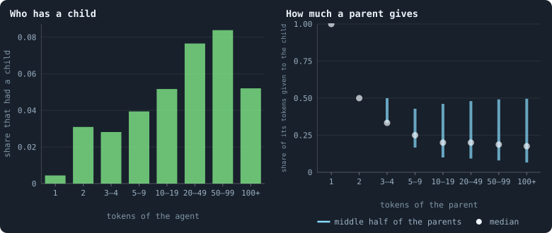

**Children, by the wealth of the parent.** Agents alive at the start of the reproduction phases of every 100th iteration from 500 on, in the 30 worlds, sorted by the tokens they held. Left: the share of them that had a child. Right: for those that did, the share of their tokens they gave it — the white dot is the median, the cyan bar runs from the 25th to the 75th percentile.

> [!example]- How to make this figure
> **Runs.** As for the figure *Agents alive, 30 worlds* above.
>
> **Data.** From each run's frames, read every 25 iterations by `book_figures.sample_pass` (frame `2·t` after the reproduction phase of iteration *t*, frame `2·t + 1` after its game; `gol_store.read_frame(run, index)`).
>
> 1. For every 100th iteration t from 500 on, take the agents of frame `2·t − 1` (after the game before) with their `tokens`.
> 2. In frame `2·t`, `decisions.births` lists every parent (`agent`) with `tokens_before` and `invested`, the tokens its child got.
> 3. Per class of tokens: the share of agents that are parents, and the quantiles of `invested` / `tokens_before` over the parents.
>
> **To make it again:** `python3 book_figures.py children`.
<!-- /figure -->

In the first reproduction phase, three founders in four (74.7%) had a child.
In a settled world, only a few agents in a hundred do in any one phase:

| tokens | 1 | 2 | 3–4 | 5–9 | 10–19 | 20–49 | 50–99 | 100+ |
|---|---|---|---|---|---|---|---|---|
| had a child | 0.4% | 3.1% | 2.8% | 3.9% | 5.2% | 7.7% | 8.4% | 5.2% |
| median share given | 1 | ½ | ⅓ | ¼ | 0.2 | 0.2 | 0.19 | 0.18 |

The 1-token parents all give their only token, and starve for it. The 2-token
parents mostly give half. From 3 tokens on, the median share falls to a
third, then to a quarter and a fifth for the richer. But the spread is wide:
the bars run up to ½ in every class from 10 tokens on. The mean over all
parents is 36% of what they hold. All of this is much as at 10,000 tokens.
There the rich were a little less likely to have a child: 6.5% at 50 to 99
tokens.

Wealth helps: an agent with 50 to 99 tokens is three times as likely to have
a child as one with 3 or 4. Connections help more:

<!-- figure children/by-degree -->
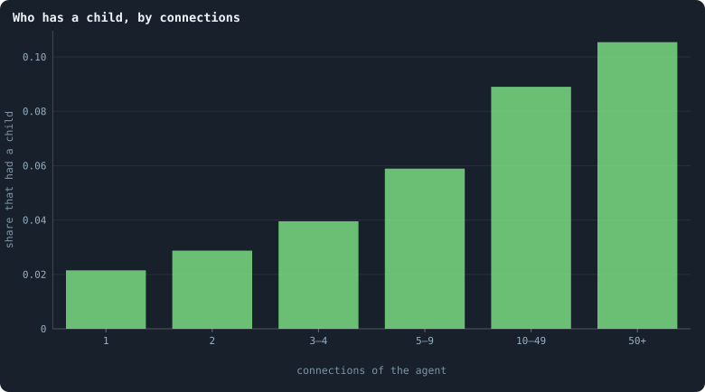

**Who has a child, by connections.** As the left panel of the figure above, with the agents sorted by their number of connections at the start of the reproduction phase instead of their tokens.

> [!example]- How to make this figure
> **Runs and data.** As for the figure *Children, by the wealth of the parent* above.
>
> 1. As for the figure above, counting each agent's connections in frame `2·t − 1`.
>
> **To make it again:** `python3 book_figures.py children`.
<!-- /figure -->

The share with a child rises from 2.1% of agents with one connection to 10.5%
of agents with fifty or more. That is a fivefold rise (fourfold at 10,000
tokens). Part of this is wealth, because well-connected agents are richer
([Where the tokens flow](b1-the-game-and-its-flows.md#where-tokens-flow)). And part is an effect of
the rules themselves. The child-share outputs are **averaged** over all of an
agent's candidates. So an agent with many neighbours decides by an average of
many columns. And an average of many columns is less extreme than one column.
[Decisions averaged over neighbours](questioning-the-mechanics.md#decisions-averaged-over-neighbours)
comes back to it.

#### How a child is joined

Once born, a child needs at least one connection, or it is not part of the
world. It can get connections in two ways: its parent joins it to some of its
candidates, and may hand it some of its own connections.

<!-- figure children/links -->
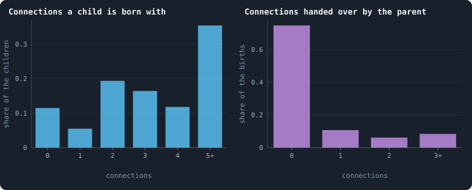

**How a child is joined to the world.** Every birth in the reproduction phases of every 100th iteration from 500 on, in the 30 worlds. Left: how many of its parent's candidates — the parent itself and its neighbours — the child was joined to at birth. Right: how many of its own connections the parent handed to the child. A child with no connection at all is cut off at once.

> [!example]- How to make this figure
> **Runs and data.** As for the figure *Children, by the wealth of the parent* above.
>
> 1. In frame `2·t` of every 100th iteration t from 500 on, read `decisions.births`: the length of `links` and of `handed_over` for every birth.
> 2. Count the births by these lengths and divide by all births.
>
> **To make it again:** `python3 book_figures.py children`.
<!-- /figure -->

**11.5% of children are joined to none of their parent's candidates at
birth.** Two in five of these (39%) are handed connections by their parent
(the right panel), and live. The rest, some 7% of all children, belong to no
network. The cleanup that ends every phase keeps only the largest connected
piece of the network. So it removes these children at once, with the tokens
they were given, and shares those tokens out among the survivors.

The others are most often joined to two, three or four candidates, and 35% of
all children to five or more. On average a child is joined to 5.1, pooled
over the worlds and counting the children with no link at birth. At 10,000
tokens it was 4.6, because agents had fewer connections to pass on.

Most parents hand over nothing (75%). Of all parents, 11% hand over one
connection, 6% two and 8% three or more: about three for every four births,
on average. Rare as it is, a handover can be enormous. A star is a world
held together by a single hub. Every so often its centre has a child, and
hands it nearly all its connections
([How a star is handed down](b1-lives-and-wealth.md#how-a-star-is-handed-down)).

#### Reproduction over a world's life

Four of these numbers are recorded after every reproduction phase, so they
can be followed through a world's whole life:

<!-- figure children/over-time -->
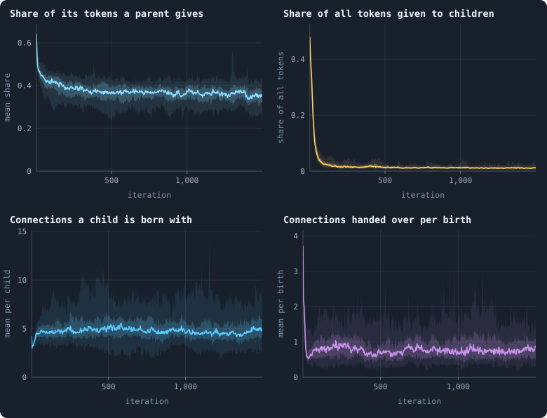

**Reproduction over a world's life.** After every reproduction phase of the 30 baseline worlds ([Reproduction statistics](measuring-lives.md#reproduction-statistics)): the mean share of its tokens a parent gave its child (`meanInvestedShare`); the tokens given to all children as a share of all tokens (`reproTokenShare`); the mean number of connections a child was born with (`meanChildLinks`); and the connections handed over per birth (`handovers` / `births`). The line is the median of the worlds at each iteration, the darker band holds the middle half of them (from the 25th to the 75th percentile) and the paler band nine in ten (5th to 95th).

> [!example]- How to make this figure
> **Runs and data.** As for the figure *Agents alive, 30 worlds* above.
>
> 1. Take the rows with `phase` = 1: `meanInvestedShare`, `reproTokenShare`, `meanChildLinks`, and `handovers` divided by `births`.
> 2. Cut the 1,500 iterations into 600 stretches of 2.5 and take each world's mean in each stretch.
> 3. In each stretch, take the median, the 25th and 75th and the 5th and 95th percentiles of those means over the worlds that still have a value there (a world that died has none after its death).
>
> **To make it again:** `python3 book_figures.py children`.
<!-- /figure -->

Over the settled life, the median world's parents give 36% of what they
hold. All the tokens given to children in one phase are 1.3% of the world's
tokens. And in the median world, a child is joined at birth to 4.8 of its
parent's candidates on average. Births move little wealth.

#### Births build the network

One fact about the rules makes births more important than their numbers
suggest. Look at where connections come from. In B1, the only rule that
**adds** connections is a birth: a newborn is joined to some of its parent's
candidates. A handover only **moves** a connection, from the parent to its
child, or removes it, if the child is already joined to that neighbour. The
game only **removes** connections: after it, every connection that carried no
tokens is cut. And an agent that dies takes its connections with it. So,
apart from the ring the founders start on, **every connection in a world was
made at a birth.** (B2 adds a second source: it mends the network where a
death would cut it in pieces, as
[Mending a death](building-b2-and-the-search-for-a-healthy-rich-world.md#mending-a-death) explains.)

So the network is grown by births and pruned by games. In a settled world,
about 480 children are born per iteration, joined to about 4.8 agents each:
some 2,300 new connections. Each game cuts about 1,600 unused ones, and the
dead take theirs with them. The two balance, and the number of connections
wanders but does not drift
([The life of a B1 world](b1-lives-and-wealth.md#connections)). A world without
births could only lose connections, never gain one.

Births also keep a world alive. A world loses agents in every iteration. In
worlds of 5,000 tokens, the cull alone takes two to five agents in a hundred
each time. The cull is the part of the cleanup that removes everyone cut off
from the largest piece. Such a world lives only while its births keep up.
Brains that
see what is around them, built with fewer layers than B1's, can give up
having children. Then their worlds die out
([Brains that see, and worlds that break](building-b2-and-the-search-for-a-healthy-rich-world.md#brains-that-see-and-worlds-that-break)).

### How the network grows

A world's network is not given. The rules make and unmake it, connection by
connection: births make connections, and games and deaths unmake them
([Births build the network](#births-build-the-network)).
[What shape does the network take?](b1-the-network-size-and-scaling.md#the-shape-of-the-network)
describes the shape that results. This section watches the making and the
unmaking, and asks the question that decides the shape: who gains
connections, and who loses them?

#### How a newborn is wired

Of 600,854 births in the reproduction phases of every 25th iteration from
500 on, **80%** of the children were joined to their own parent. Of all the
children, 6% were joined to just one of their parent's candidates, 56% to two
to five, and 27% to six or more. The other 12% were joined to none of them.
[How a child is joined](#how-a-child-is-joined) follows what becomes of
these, in a smaller sample. A child is born into its parent's neighbourhood
and nowhere else.

That has a consequence worth stating exactly. Every connection the rules make
runs from a newborn to its parent or to one of its parent's neighbours. A
handover only moves a parent's connection to its child. So **no connection
ever brings two agents that already lived closer together**. Two neighbours
of a parent were at most two steps apart, through the parent, before the
child arrived. The child adds only another path of two steps. Distances in a
world can grow, but new connections never shorten them. This is why a world
keeps a shape in space at all
([How many dimensions does a world have?](how-many-dimensions-does-a-world-have.md)).

The same rule limits what births can build. Every loop a birth closes is
small, through agents at most two steps apart. Nothing closes a large loop,
through distant parts of the world. So a network grown by births alone is, at
large scale, a tree: a network without loops, whose nodes are dense blobs of
agents. The blobs hang on each other by necks that one death can cut
([A tree of blobs](building-b2-and-the-search-for-a-healthy-rich-world.md#a-tree-of-blobs)).

#### Who gains and who loses

Picture one agent with *k* connections. In a reproduction phase it can gain
connections. Its own child may be joined to it, or a neighbour's child. Or a
neighbour may hand its connection with it over to a newborn child. In the
game that follows, the agent can lose connections. One that carried nothing
is cut, or a neighbour dies. Or the agent dies itself, and all of them go. Do
the well connected gain more, and lose more?

To measure it, sort the agents by their connections *k* at the start of a
reproduction phase. Count the connections each class gains in it. Then sort
them again at the start of the game that follows, and count what each class
loses in it. Divided by the agents in the class, these are the **gain
kernel** and the **loss kernel** of the network. They say what an agent with
*k* connections gains, and loses, on average
([Preferential attachment and its kernel](measures-of-the-archived-studies.md#preferential-attachment-and-its-kernel)).

<!-- figure grows/kernel -->
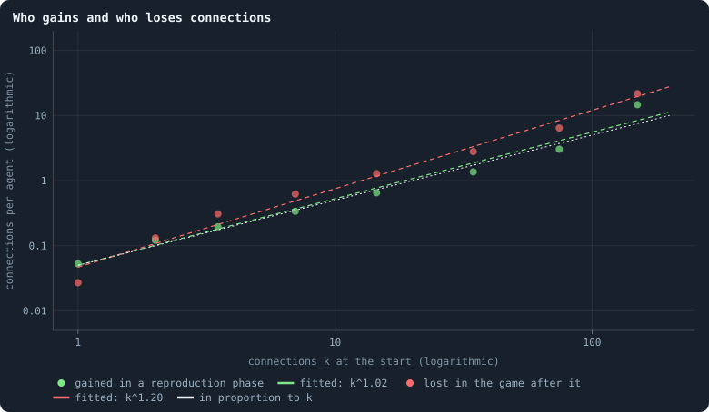

**Who gains and who loses connections.** Agents sorted by their number of connections k at the start of a phase, in classes of growing width (dots at the middle of each class). Green: the new connections an agent alive before and after a reproduction phase gained in it, per agent — to its own newborn child, to a neighbour's child, or handed over. Red: the connections an agent had after the reproduction phase and no longer had after the game that followed — cut for carrying nothing, or gone with it if it died — per agent. Pooled over the reproduction phases and games of every 25th iteration from 500 on, in the 30 worlds. Dashed: straight lines fitted on these logarithmic axes; dotted: a line of slope 1, in proportion to k.

> [!example]- How to make this figure
> **Runs.** The 30 baseline worlds that lived to the end (`B1-100000-s001` … `-s030`, [Thirty worlds](b1-lives-and-wealth.md#thirty-worlds); `python3 gol_lab.py run E10`).
>
> **Data.** As for the figure *World of seed 1 after the game of iteration 1,499* above.
>
> 1. For t = 500, 525, …, 1,475 read frames 2·t − 1 (before the reproduction phase of t), 2·t (after it) and 2·t + 1 (after the game).
> 2. Gained: the edges in 2·t not in 2·t − 1, counted at both ends, for agents in both frames, by their degree in 2·t − 1. Lost: the edges in 2·t not in 2·t + 1, counted for agents of 2·t by their degree there (all of them if the agent is gone).
> 3. Sum over t and worlds per class, divide by the agents; least squares of ln(rate) on ln(class middle).
>
> **To make it again:** `python3 book_figures.py grows`.
<!-- /figure -->

Both are straight lines on logarithmic axes, over two decades of *k*, from 1
to more than 100:

- **Gains grow as *k*^1.02.** An agent with one connection gains 0.05 new
  ones per reproduction phase. One with ten to nineteen gains about 0.65, and
  one with a hundred or more, 15. Gaining in proportion to what one has is
  **linear preferential attachment**. Barabási and Albert (1999) proposed it
  as the mechanism of heavy-tailed networks, in which a few nodes have far
  more connections than most. Here it is reached by copying (*k*^0.94 at
  10,000 tokens). A child joins some of its parent's candidates. So an agent gains a
  connection whenever one of its neighbours has a child that is joined to
  it. An agent with twice the neighbours has twice the chances.
- **Losses grow as *k*^1.20**, faster than in proportion (*k*^1.11 at 10,000
  tokens). From two connections on, every class loses at least as much in a
  game as it gained in the reproduction phase before. Hubs of a hundred
  connections or more gain 15 and lose 22. Only agents with a single
  connection gain more than they lose: 0.053 against 0.027.

One caution about these counts. When a parent hands a connection over to its
child, the neighbour at the other end is counted as gaining a connection,
though the connection only changed hands, and the parent's loss is not
counted. So part of what the leaves gain may be handovers. The hubs' real
losses are, if anything, larger than counted.

So no agent can run away with the network. Linear preferential attachment on
its own makes a few nodes grow without limit, as in a growing web. Here every
gain is offset by losses that grow slightly faster. So the well connected
drift back down, and only agents with a single connection drift up.

The connections of an agent go up and down by a random factor, game after
game. Meanwhile the world's total of connections stays in place, held there
by its tokens, which set how many agents it can hold. Growth by random
factors, kept off zero from below, makes heavy tails (Gabaix 1999). Losses
that grow faster than gains bend the tail down at the top. That fits what
[Power laws, real and apparent](b1-the-network-size-and-scaling.md#power-laws-real-and-apparent-and-how-to-fit-one) finds. Among
the best-connected hundredth of agents, the connections follow a power law of
exponent about 3 (the best-connected twentieth at 10,000 tokens). Below that
tail, nothing is scale-free: nothing follows a power law.

#### Connections and age

In the model of Barabási and Albert, a network grows one node at a time.
Each new node links to old ones, with a chance in proportion to their
connections. There the oldest nodes are the hubs. They had the longest time
to gather connections, and preferential attachment rewards the early. Is that
so here?

<!-- figure grows/age -->
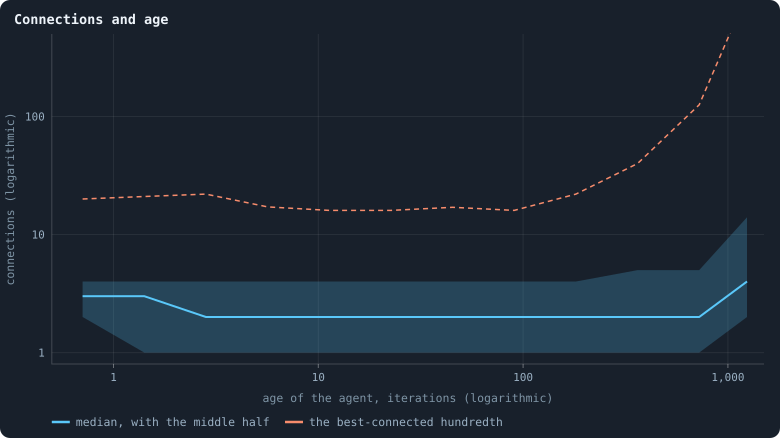

**Connections and age.** The agents alive after the last game of the 30 worlds, sorted by age — the iterations since their node was born — in classes doubling in width: the median number of connections of each class, with the band from its 25th to its 75th percentile, and the 99th percentile (dashed).

> [!example]- How to make this figure
> **Runs and data.** As for the figure *Who gains and who loses connections* above.
>
> 1. Read frame 2,999 of each run: `ages`, and each agent's connections in `edges`.
> 2. Classes of age [0, 1), [1, 2), [2, 4), …, [1,024, 1,500); in each class with at least 30 agents, the median, quartiles and 99th percentile of the connections.
>
> **To make it again:** `python3 book_figures.py grows`.
<!-- /figure -->

For the typical agent, **no**. The median agent has 3 connections when it is
born, and **2** at every age after that, from a few iterations to over 700.
Only the few agents older than a thousand iterations have a median of 4.
Across all agents, the correlation of age and connections (both as
logarithms) is −0.01: none at all.

For the very best connected, a little. Take the best-connected hundredth of
the agents of each age. Up to an age of a hundred iterations, they have 16 to
22 connections. In the class of ages around 362 (256 to 511 iterations) they
have 40, and around 724 (512 to 1,023), 126. The great hubs are old. But
this is mostly survival, not accumulation. A hub is about half as likely to
die within ten games as a leaf, an agent with a single connection
([Do the rich stay rich?](b1-lives-and-wealth.md#the-fate-of-the-richest)).
So among the old, the hubs are overrepresented. Age gives an agent no
connections; connections give it age.

The very greatest hubs, the centres of a world's stars, are the exception the
other way. They pass from parent to newborn child, as
[How a child is joined](#how-a-child-is-joined) showed.

### What we learned (how births build the network)
- **Reproduction is rare, and cheap for the world.** Three or four agents in
  a hundred have a child in a phase, and children take about 1.3% of the
  tokens. Founders, with random brains and 100 tokens each, reproduced some
  twenty times as often: something over the world's youth made brains that
  reproduce less.
- **Births are how the network grows.** Every connection beyond the ring the
  founders start on was made at a birth, so births are the world's only
  source of structure. They also keep a world alive, as long as they make up
  for its losses.
- **Growth is local.** A connection is only ever made inside a parent's
  neighbourhood, and never brings two agents closer together. That is what
  lets a world keep a geometry. A network that added connections between
  random agents would collapse into a small world, in which everything is a
  few steps from everything. The price is that births close only small
  loops, and leave a tree of blobs that one death can cut.
- **The network grows by preferential attachment and shrinks by preferential
  loss.** Both are close to proportional to an agent's connections. What a
  node has, it gains more of, and loses more of.
- **There is no first-mover advantage.** Old agents are no better connected
  than young ones, except that the best connected live longest.
- **Births are not the main road of inheritance.** About 480 children are
  born per iteration, but about 8,100 nodes take on a neighbour's brain in
  every game
  ([Two roads of inheritance](questioning-the-mechanics.md#two-roads-of-inheritance)).
  A brain spreads by conquest seventeen times more than by birth. In most
  models of evolution, reproduction is where heredity and variation happen;
  here, it is a side road.
- **For open-ended evolution, the network is a churn.**
  [Do the rich stay rich?](b1-lives-and-wealth.md#do-the-rich-stay-rich) found connections to be
  the only lasting form of wealth. Yet they too are gained and lost in
  proportion, at every scale. No structure is built up that lasts longer than
  the agents in it.
  [What the measurements say about open-ended evolution](what-the-baseline-world-is.md#what-the-measurements-say-about-open-ended-evolution)
  asks what this means.

### How this was made (how births build the network)
Every figure of this page reads the thirty runs of Experiment 10, listed
below. They are the baseline B1 at 100,000 tokens, seeds 1 to 30, run for
1,500 iterations each. The command `python3 book_figures.py children` draws
the figures of [How agents have children](#how-agents-have-children), and
`python3 book_figures.py grows` those of
[How the network grows](#how-the-network-grows). Each figure says, folded
beneath it, which of the runs it reads and how.

The 39% of [How a child is joined](#how-a-child-is-joined) is counted in the
samples behind its figure. The function `book_figures.sample_pass` keeps, for
every run, a table of the parents of every 100th iteration from 500 on. Each
row holds the child's `links` and `handed`, and the table is kept in
`GraphOfLifeRuns/.book/<run>.sample.npz`. Of the 153,590 births there,
17,638 had no link, and 6,823 of these were handed at least one
connection.

The values given for the worlds of 10,000 tokens were measured the same way,
in the thirty worlds of Experiment 2 (`python3 gol_lab.py run E02`). They
date from when the two pages this one joins were first written.

The runs of Experiment 10 are listed once on this page, under [The runs of Experiment 10 (the life of a B1 world)](#the-runs-of-experiment-10-the-life-of-a-b1-world).

## How unequal is a world, and who stays rich

The founders of a world start equal, but the first births end that, and from
then on a world is moderately unequal. Its Gini coefficient stays near 0.47,
and the richest tenth of its agents hold about 42% of its tokens.
Experiment 4's thesis, that wealth pools because agents defend their own
nodes, was refuted: they stake only about 30% of their tokens at home. Tokens
follow connections instead: the game moves them like a random walk, which
leaves each agent tokens in proportion to its connections plus one. Measured
with entropy, the tokens are as even as if half the agents held them in equal
shares. And who is rich keeps changing: the order of wealth is half forgotten
in fifty to a hundred games.

### Where do the tokens go?

Tokens are the only thing of value in a world, and the only thing conserved:
their total never changes. The founders start exactly equal, with a hundred
tokens each. Who holds the tokens later? How unequal does a world become, and
does it stay that way?

This section reads the thirty worlds of the first baseline, B1, at 100,000
tokens ([Thirty worlds](b1-lives-and-wealth.md#thirty-worlds)). The thirty worlds
of 10,000 tokens it was first written from are given beside them.

#### Measuring inequality

How do we measure inequality? Sort a world's agents from poorest to richest.
Then draw, for every share *x* of the agents counted from the poorest, the
share of all tokens they hold. That is the **Lorenz curve** (Lorenz 1905). If
everyone holds the same, it is the diagonal; the more unequal the world, the
further it sags below. The **Gini coefficient** (Gini 1912) turns the sag into
one number, between 0 (everyone the same) and almost 1 (one agent holds
everything):

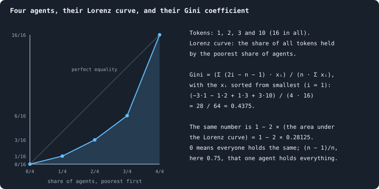

For *n* agents with tokens sorted from smallest, *x*₍₁₎ ≤ … ≤ *x*₍ₙ₎, it is

$$
G = \frac{\sum_{i=1}^{n} (2i - n - 1)\, x_{(i)}}{n \sum_{i=1}^{n} x_{(i)}} ,
$$

which equals 1 minus twice the area under the Lorenz curve. A Gini of 0.5 has
a concrete meaning: two agents picked at random differ, on average, by as much
as the average agent holds.
[The Gini coefficient and the Lorenz curve](measuring-tokens.md#measuring-inequality-the-gini-coefficient-the-richest-tenth-and-entropy) shows why,
and works an example by hand.

A plainer measure reads a single point of the curve: the share of all tokens
held by the **richest tenth** of the agents. If everyone held the same, it
would be 10% ([The richest tenth's share](measuring-tokens.md#the-richest-tenths-share)).

#### What was expected

Why should wealth pool at all? In every game, each agent stakes all its tokens
on its own node and on its neighbours' nodes. A node goes to whoever stakes
most on it, and the winner takes every token staked there. So a big agent
should find it easier to grow bigger, as in any contest where the winner takes
all. Staking on your own node also looked like the safe stake: it is the one
stake never lost to someone else's brain. The tokens of the dead, shared out at
random, would pull the other way, but only a little. Before the runs of 10,000
tokens, Experiment 4 wrote this down as its thesis:

<!-- thesis E04 -->
> [!quote] The thesis of Experiment 4, written down before any of its runs existed
> **The claim.** Tokens pool. The founders start exactly equal, and within a hundred iterations the richest tenth of agents hold more than 40% of all tokens, with a Gini coefficient above 0.5 — and it stays that way. Most of what an agent stakes in the game it stakes on its own node.
>
> **Why it would be so.** A node goes to whoever stakes most on it, and the winner takes everything staked there, so being big makes it easier to become bigger. Staking on your own node is the one stake that is never lost to someone else's brain. The shared-out tokens of the dead pull the other way, but only a little.
>
> **It holds if:** From iteration 100 on, the median Gini across the thirty runs is above 0.5 and the richest tenth hold more than 40% of the tokens, and the median share of tokens staked at home is above one half.
>
> **It fails if:** Wealth stays close to even (Gini below 0.3), or concentrates and then evens out again, or agents stake most of their tokens on their neighbours. Then the game is not a winner-takes-all contest, and what keeps wealth spread out is worth its own chapter.
<!-- /thesis -->

The thesis was tested in the thirty worlds of 10,000 tokens, and again in the
thirty of 100,000 ([Was the thesis right?](#was-the-thesis-right-how-unequal-is-a-world)). First,
here is what the large worlds did, with the small ones beside them.

#### The Lorenz curves of the worlds

<!-- figure tokens/lorenz -->
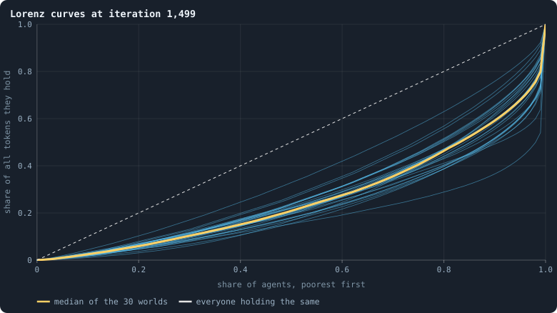

**Lorenz curves at iteration 1,499.** For each of the 30 worlds (thin blue lines), after its last game: the poorest share x of its agents holds the share y of all tokens. The yellow line is the median over the worlds at each x; the dashed diagonal is a world where everyone holds the same. The further a curve sags below the diagonal, the more unequal the world ([How worlds are measured](how-worlds-are-measured.md), and the diagram there).

> [!example]- How to make this figure
> **Runs.** As for the figure *Agents alive, 30 worlds* above.
>
> **Data.** As for the figure *World of seed 1 after the game of iteration 1,499* above.
>
> 1. Read each run's last frame (iteration 1,499, `phase` 2) and its `tokens`.
> 2. Sort the tokens from smallest to largest; the curve passes through the points (i / n, (t₁ + … + tᵢ) / T) for i = 0 … n.
> 3. Interpolate each curve at x = 0, 0.01, …, 1 and take the median there.
>
> **To make it again:** `python3 book_figures.py tokens`.
<!-- /figure -->

After the last game of the thirty worlds, in the median world the poorest half
of the agents hold 21% of all tokens. The poorest 80% hold 46%, so the richest
fifth hold 54%; and the richest tenth hold 41%. The worlds' curves lie close
together, and close to those of the worlds of 10,000 tokens (23%, 49% and
39%).

#### How many tokens an agent holds

<!-- figure tokens/distribution -->
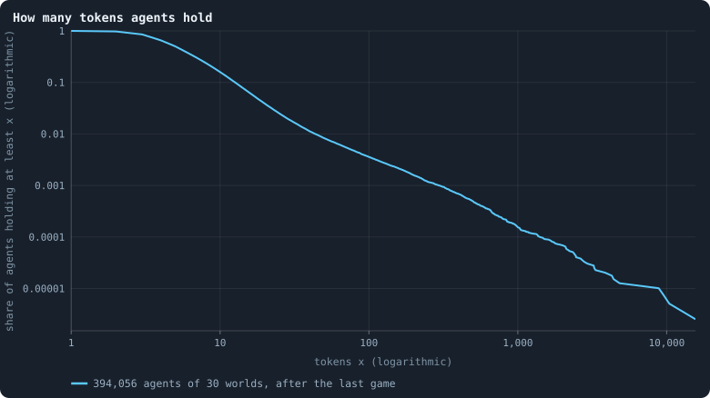

**How many tokens agents hold.** Of all agents alive after the last game of the 30 worlds, the share that hold at least x tokens, for every x. Both axes are logarithmic: a straight falling line here would be a power law.

> [!example]- How to make this figure
> **Runs and data.** As for the figure *Lorenz curves at iteration 1,499* above.
>
> 1. Pool the `tokens` of the last frame of every run.
> 2. For every value x that occurs, the share of agents with at least x.
>
> **To make it again:** `python3 book_figures.py tokens`.
<!-- /figure -->

Of the 394,056 agents alive at the end, the median agent holds 5 tokens, and
62% hold 5 or fewer. Only 2.6% hold exactly one, and 0.4% hold 100 or more;
the richest agent of all held 15,603 tokens. The mean is 7.6.

On logarithmic axes the curve bends down over the first ten or twenty tokens.
Then it falls almost straight, over two powers of ten, to the richest agents.
At 10,000 tokens it kept bending and showed no straight stretch; with ten
times the agents there is room for a long tail. Whether it is a power law is
the question of
[Power laws, real and apparent](b1-the-network-size-and-scaling.md#power-laws-real-and-apparent-and-how-to-fit-one).

#### Inequality over time

<!-- figure tokens/gini -->
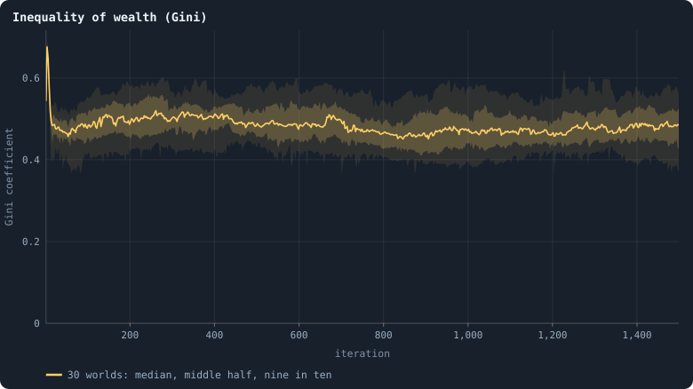

**Inequality of wealth (Gini).** After every game. The line is the median of the worlds at each iteration, the darker band holds the middle half of them (from the 25th to the 75th percentile) and the paler band nine in ten (5th to 95th).

> [!example]- How to make this figure
> **Runs and data.** As for the figure *Agents alive, 30 worlds* above.
>
> 1. Take every run's rows with `phase` = 2 and the statistic `gini` ([What a run records](runs-and-records.md#what-a-run-records)).
> 2. Cut the 1,500 iterations into 600 stretches of 2.5 and take each world's mean in each stretch.
> 3. In each stretch, take the median, the 25th and 75th and the 5th and 95th percentiles of those means over the worlds that still have a value there (a world that died has none after its death).
>
> **To make it again:** `python3 book_figures.py tokens`.
<!-- /figure -->

The founders are equal, but the first reproduction phase ends that: a child
gets only part of its parent's tokens. Over the first five iterations the
median world's Gini is already 0.59, higher than it will be again. It falls
back within a few more (at 10,000 tokens it was 0.48 from the start). Over the
settled life, iterations 500 to 1,499, the median world's average is 0.47
(0.49 at 10,000 tokens). The thirty worlds lie between 0.40 and 0.55.
Inequality appears at once. After its first jolt, it neither grows nor
shrinks.

<!-- figure tokens/rich-tenth -->
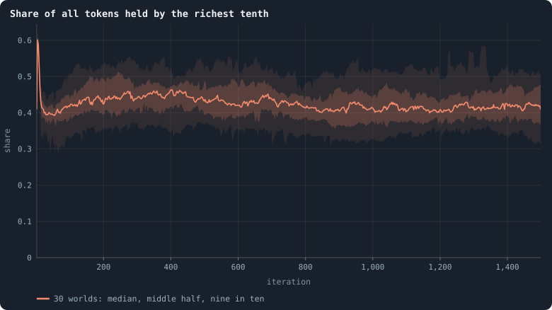

**Share of all tokens held by the richest tenth.** After every game. The line is the median of the worlds at each iteration, the darker band holds the middle half of them (from the 25th to the 75th percentile) and the paler band nine in ten (5th to 95th).

> [!example]- How to make this figure
> **Runs and data.** As for the figure *Agents alive, 30 worlds* above.
>
> 1. Take every run's rows with `phase` = 2 and the statistic `topDecileShare` ([What a run records](runs-and-records.md#what-a-run-records)).
> 2. Cut the 1,500 iterations into 600 stretches of 2.5 and take each world's mean in each stretch.
> 3. In each stretch, take the median, the 25th and 75th and the 5th and 95th percentiles of those means over the worlds that still have a value there (a world that died has none after its death).
>
> **To make it again:** `python3 book_figures.py tokens`.
<!-- /figure -->

<!-- figure tokens/richest -->
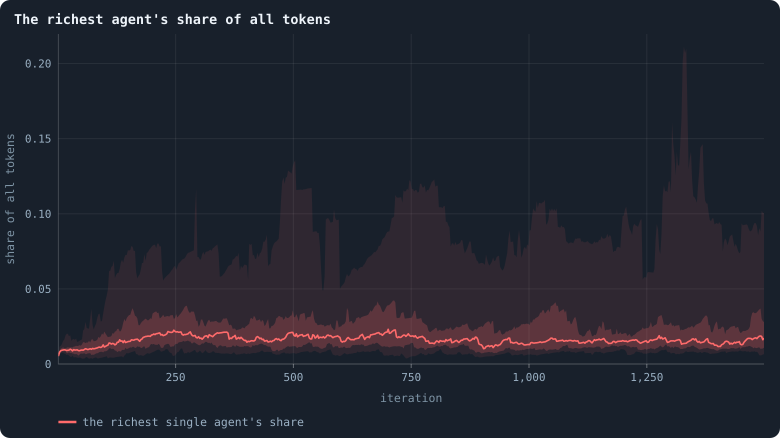

**The richest agent's share of all tokens.** After every game, the tokens of the richest agent divided by all 100,000. The line is the median of the worlds at each iteration, the darker band holds the middle half of them (from the 25th to the 75th percentile) and the paler band nine in ten (5th to 95th).

> [!example]- How to make this figure
> **Runs and data.** As for the figure *Agents alive, 30 worlds* above.
>
> 1. Take the rows with `phase` = 2; divide `maxTokens` by 100,000.
> 2. Cut the 1,500 iterations into 600 stretches of 2.5 and take each world's mean in each stretch.
> 3. In each stretch, take the median, the 25th and 75th and the 5th and 95th percentiles of those means over the worlds that still have a value there (a world that died has none after its death).
>
> **To make it again:** `python3 book_figures.py tokens`.
<!-- /figure -->

The richest tenth hold on average 42% of all tokens over the settled life
(33% to 50% between worlds; 44% at 10,000 tokens). The single richest agent
holds about 2%, some 2,100 tokens, and from 1% to 13% between worlds. At
10,000 tokens it held about 690 tokens over the same iterations, 7% of all
([Worlds of 100,000 tokens](b1-the-network-size-and-scaling.md#worlds-of-100000-tokens)).
Over the small worlds' longer settled life, to iteration 2,999, it held 820.
So in a world ten times larger, the richest agent holds three times as many
tokens, and about a third of the share.
[The largest and the smallest](b1-lives-and-wealth.md#the-largest-and-the-smallest) follows the
richest.

<!-- figure tokens/typical -->
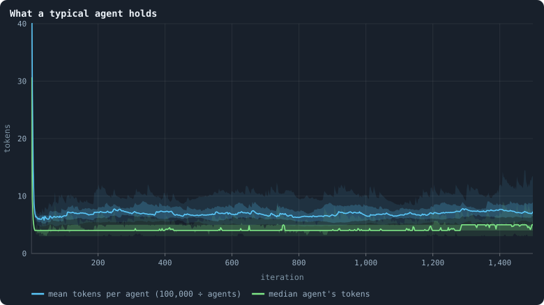

**What a typical agent holds.** After every game: the mean number of tokens per agent, which is 100,000 divided by the number of agents (blue), and the median agent's tokens (green). The median lies below the mean because a few agents hold a lot. The line is the median of the worlds at each iteration, the darker band holds the middle half of them (from the 25th to the 75th percentile) and the paler band nine in ten (5th to 95th).

> [!example]- How to make this figure
> **Runs and data.** As for the figure *Agents alive, 30 worlds* above.
>
> 1. Take the rows with `phase` = 2 and the statistics `meanTokens` and `medianTokens`.
> 2. Cut the 1,500 iterations into 600 stretches of 2.5 and take each world's mean in each stretch.
> 3. In each stretch, take the median, the 25th and 75th and the 5th and 95th percentiles of those means over the worlds that still have a value there (a world that died has none after its death).
>
> **To make it again:** `python3 book_figures.py tokens`.
<!-- /figure -->

The mean number of tokens per agent is 100,000 divided by the number of
agents: about 7 in the median world over its settled life. The median agent
holds about 4.5. At 10,000 tokens they were 9 and 5: those worlds held a few
fewer agents per token. The median lies below the mean because a few agents
hold a lot.

#### Rich agents are connected agents

<!-- figure tokens/tokens-degree -->
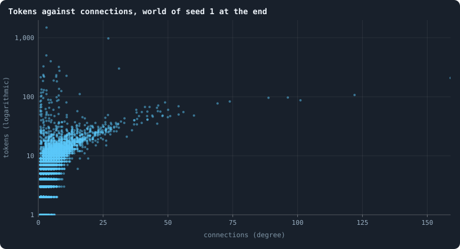

**Tokens against connections, world of seed 1 at the end.** Each dot is one of the 14,870 agents alive after the last game of the world with seed 1: how many connections it has (spread sideways a little so that agents with the same number do not hide each other) and how many tokens it holds.

> [!example]- How to make this figure
> **Runs and data.** As for the figure *World of seed 1 after the game of iteration 1,499* above.
>
> 1. Read the last frame (iteration 1,499, `phase` 2); count each agent's connections in `edges`.
> 2. Plot `tokens` against that count, one dot per agent.
>
> **To make it again:** `python3 book_figures.py tokens`.
<!-- /figure -->

In the world with seed 1 at the end, agents with more connections hold more
tokens. The median agent with one connection holds 3 tokens, with four 6, with
nine 11, with thirteen 16, with twenty 23.5. (The correlation between the
number of connections and the logarithm of the tokens is 0.59.) The game
explains the direction of this. An agent gets every token staked on its node,
and an agent with more neighbours can be staked on by more of them. Whether
connections make agents rich, or rich agents attract connections, this figure
cannot say.

The measurements of the baseline found the law behind it. Agents spread their
stakes nearly evenly over their own node and their neighbours'
([Where the tokens flow](b1-the-game-and-its-flows.md#where-tokens-flow)). Stakes spread that way
move tokens like a random walk. Such a walk comes to rest when every agent
holds tokens in proportion to its connections **plus one**. The median agent
of every class of connections holds close to that resting share
([How properties scale together](b1-the-network-size-and-scaling.md#how-properties-scale-together)). So, in
the main, connections make agents rich. And a rich agent with few connections
drains back to its share within a few games
([Gains and losses](b1-lives-and-wealth.md#gains-and-losses-who-gains-who-loses-and-the-share-out)).

#### The tokens of the dead

<!-- figure tokens/shared-out -->
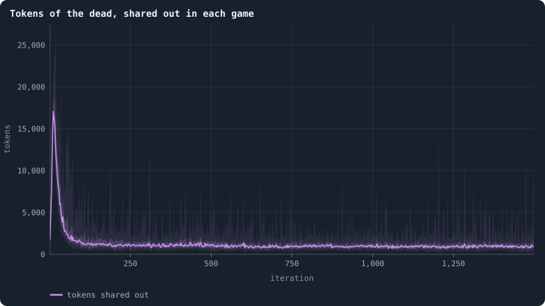

**Tokens of the dead, shared out in each game.** In the cleanup of every game, the tokens of the agents removed — those cut off from the largest piece; agents that starved hold none — which are shared out at random among the survivors. The line is the median of the worlds at each iteration, the darker band holds the middle half of them (from the 25th to the 75th percentile) and the paler band nine in ten (5th to 95th).

> [!example]- How to make this figure
> **Runs and data.** As for the figure *Agents alive, 30 worlds* above.
>
> 1. Take the rows with `phase` = 2 and the statistic `redistributed`.
> 2. Cut the 1,500 iterations into 600 stretches of 2.5 and take each world's mean in each stretch.
> 3. In each stretch, take the median, the 25th and 75th and the 5th and 95th percentiles of those means over the worlds that still have a value there (a world that died has none after its death).
>
> **To make it again:** `python3 book_figures.py tokens`.
<!-- /figure -->

When agents are cut off, their tokens are shared out among the survivors. In
the median settled world, that is about 1,300 tokens per game: 1.3% of all
tokens (1.1% at 10,000 tokens). They are handed out at random, one token at a
time, and every survivor has the same chance at each token, rich or poor.
[The estate of the dead](measuring-lives.md#the-estate-of-the-dead) shows how that levels a world, and what
other ways of sharing the tokens out would do.

#### Was the thesis right? (how unequal is a world)
Checked from iteration 100 on, as planned, the thesis failed in the worlds of
10,000 tokens, of which 26 lived to the end:

- the median world's average Gini was 0.496, just below the 0.5 asked for (10
  of the 26 worlds were above it);
- the richest tenth held 44% (23 of 26 worlds above 40%), so that part holds;
- agents put a median 30% of their stakes on their own node, in no world more
  than 34%: far from the half the thesis expected.

So the thesis is refuted, and refuted mostly in its explanation. Wealth pools
moderately and stays steady, but not because agents defend their own nodes.

**At 100,000 tokens**, checked the same way from iteration 100 on, the thesis
is refuted again, on the same two counts. The median world's average Gini is
0.485 (7 of the 30 worlds above 0.5). The richest tenth hold 43% (26 of 30
above 40%), so that part holds again. And agents put a median 29% of what they
stake on their own node, in no world more than 42%.
[How the game is played](b1-the-game-and-its-flows.md#how-the-game-is-played-what-agents-stake-and-who-wins-the-nodes) looks at how the game is
played instead.

### How even is a world?

The Gini coefficient measures how unequally tokens are held. This section
measures the same thing with a second tool, **entropy**. Then it uses that
tool on two things a Gini cannot measure at all, because they are not
amounts. How are the agents spread over the numbers of connections, and over
the genotypes? It reads the same thirty worlds of 100,000 tokens, with the
thirty of 10,000 tokens beside them where they differ.

#### Entropy in one example

Take a world of four agents, A, B, C and D, holding 4, 2, 1 and 1 of its 8
tokens. Pick one token at random. Whose is it? You may ask yes-or-no
questions, and you ask them well. *Is it A's?* Yes half the time, after one
question. *Is it B's?* Yes a quarter of the time, after two. *Is it C's?* Yes
or no, it settles C and D after three. On average you need

$$
\tfrac12 \cdot 1 + \tfrac14 \cdot 2 + \tfrac18 \cdot 3 + \tfrac18 \cdot 3 = 1.75
$$

questions. That number is the **entropy** of the shares (½, ¼, ⅛, ⅛):

$$
H = -\sum_i p_i \log_2 p_i = 1.75 \text{ bits.}
$$

With four equal shares you would need two questions every time: log₂ 4 = 2,
the most four agents allow. With everything in one hand you would need none.
Two readings of *H* follow ([Entropy and evenness](measuring-tokens.md#entropy-and-evenness)):

- the **evenness** *J* = *H* / log₂ *n* runs from 0 (one holds everything) to
  1 (all hold the same). Here it is 1.75/2 = 0.875;
- the **effective number** 2^*H* is how many agents, holding equal shares,
  would leave you exactly as uncertain: here 2^1.75 ≈ 3.4 agents.
  ([Effective numbers](statistics.md#effective-numbers-how-many-kinds) compares it with other ways of
  counting kinds.)

The same arithmetic works for anything that falls into categories. For the
connections, the categories are the numbers of connections an agent can have:
1, 2, 3, and so on. Then *pᵢ* is the share of agents with exactly *i*. For the
genotypes, the categories are the genotypes, and *pᵢ* is the share of agents
carrying genotype *i*. The question becomes: *pick an agent at random. How
many connections does it have? Which genotype does it carry?*

#### Three things spread over the agents

<!-- figure entropy/evenness -->
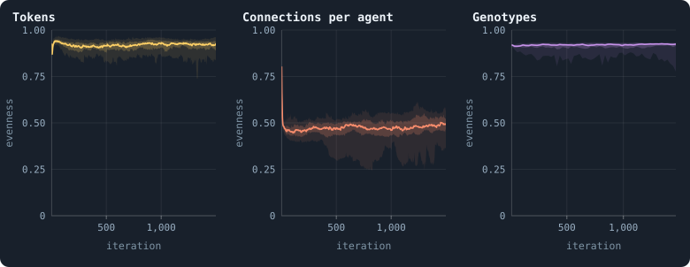

**How even a world is, in three respects.** Evenness after every game of the 30 baseline worlds, from 0 (everything in one hand) to 1 (as even as it can be; [Entropy and evenness](measuring-tokens.md#entropy-and-evenness)). Left: of the tokens over the agents (`tokenEvenness`). Middle: of the agents over the numbers of connections that occur (`degreeEvenness`). Right: of the agents over the genotypes they carry — the entropy of the genotypes' shares divided by log₂ of the number of agents, measured every 25 iterations. In each, the line is the median of the worlds at each iteration, the darker band holds the middle half of them (from the 25th to the 75th percentile) and the paler band nine in ten (5th to 95th).

> [!example]- How to make this figure
> **Runs.** As for the figure *Agents alive, 30 worlds* above.
>
> **Data.** From each run's `GraphOfLifeRuns/<run>/stats.jsonl`, which holds one row per recorded phase: `phase` 1 is the world just after reproduction, `phase` 2 just after the game, and every statistic is a field of the row (see [What a run records](runs-and-records.md#what-a-run-records)); for genotypes, each run's frames, read every 25 iterations by `book_figures.sample_pass` (frame `2·t` after the reproduction phase of iteration *t*, frame `2·t + 1` after its game; `gol_store.read_frame(run, index)`).
>
> 1. Take `tokenEvenness` and `degreeEvenness` of the rows with `phase` = 2.
> 2. For genotypes: in the frame after the game of every 25th iteration, count the agents per genotype (`brain_ids`), turn the counts into shares pᵢ, and compute H = −Σ pᵢ log₂ pᵢ; divide by log₂ of the number of agents.
> 3. Cut the 1,500 iterations into 600 stretches of 2.5 and take each world's mean in each stretch.
> 4. In each stretch, take the median, the 25th and 75th and the 5th and 95th percentiles of those means over the worlds that still have a value there (a world that died has none after its death).
>
> **To make it again:** `python3 book_figures.py entropy`.
<!-- /figure -->

The founders hold equal shares: a token evenness of exactly 1. The first
reproduction phase ends that, and after the first game the median world is at
0.96. Then it falls, and settles a little lower. Over the settled life the
median world's **token evenness** is 0.91, and the thirty worlds lie between
0.84 and 0.95 (0.88 at 10,000 tokens). In bits, the median world has a token
entropy of 12.6 bits. That is some 12.6 questions to find a token's owner
among about 14,000 agents, where perfect equality would need 13.8.

The **degree evenness** is far lower: 0.47 (0.27 to 0.54; 0.59 at 10,000
tokens). Agents are piled onto a few numbers of connections: 35% have exactly
one, 23% exactly two
([What shape does the network take?](b1-the-network-size-and-scaling.md#the-shape-of-the-network)).
Meanwhile the hubs make the list of numbers that occur long, and longer in a
larger world. Read this one with care. Its ceiling is log₂ of the number of
*distinct* degrees in the world. So a single new hub of an unusual size raises
the ceiling and lowers the evenness, without anything else changing.

The **genotype evenness** is high, about 0.9, and steady. The agents are
spread over many genotypes, none of which holds much of the world for long.
But high diversity is not the same as novelty. A genotype lasts about two
iterations ([Genotypes and lineages](b1-brains-lineages-and-messages.md#genotypes-and-lineages)). The variety
is churn: new numbers made by small changes, and lost as fast as they are
made. Entropy counts how many kinds there are *now*. It cannot say whether
any of them is new in a way that matters. Measures of open-ended evolution
have to look across time
([What the measurements say about open-ended evolution](what-the-baseline-world-is.md#what-the-measurements-say-about-open-ended-evolution)).
[How to tell a world that keeps evolving](how-to-tell-a-world-that-keeps-evolving.md)
builds one, playing the brains of different eras against each other.

#### Effective numbers

<!-- figure entropy/effective -->
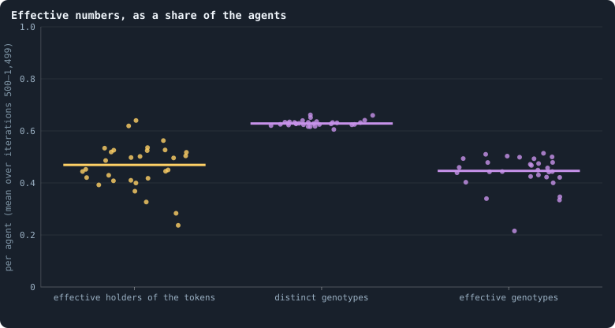

**Effective numbers, as a share of the agents.** One dot per world; the bar is the median. Left: 2^H of the tokens — the number of agents that, holding equal shares, would make the tokens as even as they are — divided by the number of agents. Middle: the number of different genotypes among the living, per agent. Right: 2^H of the genotypes — how many equally common genotypes would be as diverse as the ones there are — per agent. The dots are spread sideways only so that they do not hide each other.

> [!example]- How to make this figure
> **Runs and data.** As for the figure *How even a world is, in three respects* above.
>
> 1. Tokens: for each row with `phase` = 2 and 500 ≤ `iteration` ≤ 1,499, compute 2^`tokenEntropy` / `nodes`, and average over the rows.
> 2. Genotypes: in the frames after the game of every 25th iteration from 500 on, the number of distinct `brain_ids` per agent, and 2^H per agent with H the entropy of the genotypes' shares; average over the frames.
> 3. One dot per run, a bar at the median.
>
> **To make it again:** `python3 book_figures.py entropy`.
<!-- /figure -->

Effective numbers are the easiest way to read an entropy, because they are in
the units of the things counted. Per agent, over the settled life:

- **Token holders.** The tokens are as even as if 47% of the agents held them
  in equal shares (the worlds: 24% to 64%). In a world of 14,000 agents, that
  is some 6,700 equal holders.
- **Distinct genotypes.** There are 0.63 genotypes per agent, as
  [Genotypes and lineages](b1-brains-lineages-and-messages.md#genotypes-and-lineages) found. This is the
  tightest number in the whole notebook so far. The thirty worlds lie between
  0.61 and 0.66, a standard deviation of 0.012, and the worlds of 10,000
  tokens had the same 0.63. Whatever their seed, their history and their
  size, the worlds keep almost exactly five genotypes for every eight agents.
- **Effective genotypes.** Weighted by how many agents carry them, the
  genotypes are worth 0.45 per agent (0.22 to 0.51; 0.49 at 10,000 tokens).
  That is fewer than the distinct count, because some genotypes are carried by
  many agents and most by one.

The gap between the second and the third is a difference ecologists draw
(Hill 1973; Jost 2006). **Richness** is how many kinds there are;
**diversity** is how many equally common kinds would be as varied. A world
could have many genotypes and still be dominated by one; this one is not.

Why is the distinct count so tight? Something in the rules must set it. Every
brain may change after every game (with probability 0.2,
[How a brain changes](rules-in-detail.md#how-a-brain-changes)), which makes a new genotype. And in every
game about half the nodes take a copy of a winner's brain
([How the game is played](b1-the-game-and-its-flows.md#how-the-game-is-played-what-agents-stake-and-who-wins-the-nodes)), which makes genotypes
common again. A balance between a fixed rate of making and a fixed rate of
copying gives a fixed ratio, whatever the brains do. So if a change of the
rules moves the ratio, the change has altered how often brains are changed or
copied. The pilots of
[How fast should brains change?](how-fast-should-brains-change.md) show it.
As the probability of a change rose from 0.05 to 0.8, the ratio rose from
0.32 to 0.98. [Questioning the mechanics](questioning-the-mechanics.md) comes
back to where the new genotypes are made.

#### Two measures of the same inequality

<!-- figure entropy/gini-evenness -->
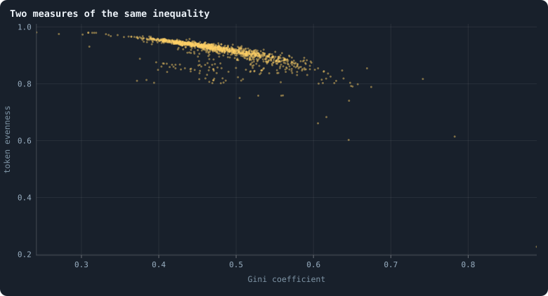

**Two measures of the same inequality.** One dot per world and look: every 25th iteration from 500 on of the 30 worlds (1,200 dots). Across the dots the two measures move against each other — the correlation is -0.72 — but not along one curve: the same Gini comes with different evenness, because the two weigh the poor and the rich differently.

> [!example]- How to make this figure
> **Runs and data.** As for the figure *Agents alive, 30 worlds* above.
>
> 1. Take the rows with `phase` = 2 and `iteration` a multiple of 25 from 500 on.
> 2. Plot `tokenEvenness` against `gini`, one dot per row.
>
> **To make it again:** `python3 book_figures.py entropy`.
<!-- /figure -->

Across 1,200 looks at the 30 worlds, the Gini coefficient and the token
evenness move against each other. Their correlation is −0.72 (−0.90 at
10,000 tokens). They should, since both measure inequality. But they do not
lie on one curve: the same Gini comes with token evenness that differs by
several hundredths. They weigh inequality differently, and the difference can
be stated exactly. Move a small amount of tokens from a richer agent *j* to a
poorer agent *i*:

- the **Gini** falls in proportion to how far apart *i* and *j* are **in
  rank**. That is how many agents hold more than *i* and less than *j*;
- the **entropy** rises in proportion to log₂(τⱼ / τᵢ), how many **times**
  richer *j* is than *i*.

Pass a small amount from an agent with 2 tokens to one with 1. Pass the same
amount from one with 20 to one with 10. Both raise the entropy alike: in both,
the giver holds twice what the taker holds. But the second lowers the Gini far
more. Many agents hold between 10 and 20 tokens, and nobody holds between 1
and 2. (With whole tokens, one token passed from 2 to 1 would only swap the
two holdings and change neither measure. What is compared here is how strongly
each measure answers a small transfer.)

Entropy listens more to the poor; the Gini to the spread of the whole ladder.
Take a world in which a few agents dominate and the rest are equally poor, and
a world in which wealth falls off smoothly. They can have the same Gini and
different evenness.

### Do the rich stay rich?

A world's Gini coefficient hardly moves over its settled life. But an
unchanging inequality can hide two very different worlds. In one, the same
agents are rich game after game. In the other, wealth is as unequal at every
moment, but who holds it keeps changing. This section follows single agents
through time to tell which world Graph of Life is. Economists call this
question **mobility** ([Mobility](measures-of-the-archived-studies.md#mobility)).

#### How the order of wealth is remembered

Line up the agents of a world by their tokens, the poorest first. Do it again
some games later, for the agents still alive. If the order is the same, the
rich stayed rich. Spearman's **rank correlation** ρ measures how alike the two
orders are, from 1 (exactly the same) through 0 (unrelated).

<!-- figure rich/memory -->
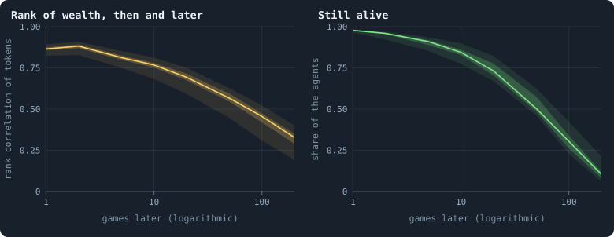

**How long wealth lasts.** Left: the agents alive after the game of an iteration t, and the same agents k games later, if they are still alive: Spearman's rank correlation of their tokens then and later ([Correlation](statistics.md#two-numbers-together-correlation-a-fitted-line-and-logarithmic-axes)) — 1 if every agent kept its place in the order of wealth, 0 if the later order has nothing to do with the earlier. Right: the share of the agents still alive k games later. For each world, the mean over 8 moments t = 500, 600, …, 1,200 (leaving out, for the correlation, the few moments after which fewer than three of the agents were alive); the line is the median of the 30 worlds, the darker band the middle half of them and the paler band nine in ten.

> [!example]- How to make this figure
> **Runs and data.** As for the figure *Who gains and who loses connections* above.
>
> 1. For t = 500, 600, …, 1,200 and k = 1, 2, 5, 10, 20, 50, 100, 200: read frames 2·t + 1 and 2·(t + k) + 1; the agents (`ids`) in both, and their `tokens` in each.
> 2. Spearman's ρ: the correlation of the ranks of the two token counts (ties share their mean rank); alive: agents in both over agents in the first.
> 3. Mean over t for each world; median and quantiles over worlds.
>
> **To make it again:** `python3 book_figures.py rich`.
<!-- /figure -->

After one game, ρ = **0.86**. After 10 games it is 0.77; after 50, 0.57;
after 100, 0.46; after 200, 0.33: almost exactly as at 10,000 tokens.
Meanwhile the agents themselves die, a little faster than in the small worlds.
Of them, 84% are still alive after 10 games, 50% after 50, 30% after 100 and
10% after 200. At 10,000 tokens it was 87%, 58%, 36% and 16%.

The order of wealth is forgotten slowly, and in a particular way. Picture a
process that forgets a fixed fraction every game. Its ρ would fall like 0.86,
0.86², 0.86³, …: to 0.22 after 10 games, and to nothing after 50. In the
worlds, instead, **ρ falls by about 0.1 every time the lag doubles**. It
falls by 0.07 from 10 to 20 games, 0.11 from 50 to 100 and 0.13 from 100 to
200. That is how memory fades when it is held by many things that last for
very different times. Here the likely holders are the connections. An agent's
tokens follow its number of connections plus one
([How properties scale together](b1-the-network-size-and-scaling.md#how-properties-scale-together)). And a
hub's connections outlast many games, while those of a leaf, an agent with a
single connection, change all the time.

#### A two-game rhythm

The left panel of the figure above has a small surprise at its start. After
**two** games the order is *closer* to the first than after one: ρ = 0.88
against 0.86. The richest show it too
([The fate of the richest](#the-fate-of-the-richest)). Of the richest
hundredth, 76% are still in the richest tenth two games later, but only 73%
one game later.

The brains move tokens almost as an even split would
([Where the tokens flow](b1-the-game-and-its-flows.md#where-tokens-flow)). Each agent stakes the
same share on itself and on each of its neighbours. Take a hub with *k*
neighbours that have no other connections. The hub keeps 1/(*k* + 1) of its
tokens and gives each leaf as much. Each leaf keeps half of its tokens and
gives the hub half. After one game,

$$
\tau_h' = \frac{\tau_h}{k + 1} + \frac{k}{2}\,\tau_l, \qquad
\tau_l' = \frac{\tau_h}{k + 1} + \frac{1}{2}\,\tau_l .
$$

The total τ_h + *k* τ_l does not change. The world is at rest when the hub
holds (*k* + 1) shares and each leaf 2. Any departure from rest is
multiplied, game by game, by one factor, the second eigenvalue of this map:

$$
\lambda = \frac{1}{k + 1} - \frac{1}{2} .
$$

It is **negative** for every hub with two neighbours or more: −0.17 for
*k* = 2, −0.4 for *k* = 9. A negative factor flips the sign of the departure
every game. A hub above its resting share falls below it in the next game. It
comes back above it in the one after, each time by less than half as much.
Tokens slosh between hubs and leaves, and the order of wealth swings with a
period of two games. The even split is the step of a diffusion
([Physical inspiration](physical-inspiration.md)), and this rhythm is its
overshoot on the star-shaped parts of the network.

#### Moving up and down

<!-- figure rich/moves -->
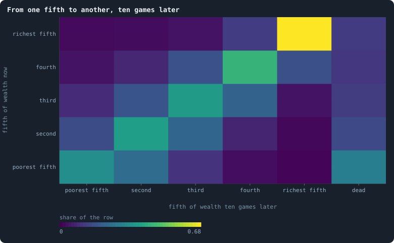

**From one fifth to another, ten games later.** All agents alive after the game of t = 500, 600, …, 1,200 in the 30 worlds, sorted into fifths of the world by their tokens (ranks, ties shared), and where each one was ten games later: in which fifth, or dead. Each row adds up to 1; a cell's colour is the share of its row.

> [!example]- How to make this figure
> **Runs and data.** As for the figure *Who gains and who loses connections* above.
>
> 1. As in the figure above, with k = 10: each agent's fifth is ⌈rank / n · 5⌉ among the n agents of its frame.
> 2. Count the agents in every pair of fifths, and those not in the later frame as dead; divide each row by its total.
>
> **To make it again:** `python3 book_figures.py rich`.
<!-- /figure -->

Ten games on, where are the agents of each fifth of the order of wealth?

- Of the **richest fifth**, 68% are still in it, 12% have fallen one fifth,
  and 12% are dead.
- Of the **middle fifths**, 37% to 44% are where they were, and most of the
  others are one fifth up or down.
- Of the **poorest fifth**, 34% are still in it, 24% have risen one fifth,
  and **29% are dead**. Poverty is where agents die.
  [How a world breaks](b1-the-network-size-and-scaling.md#how-a-world-breaks) shows why: a region too poor to
  keep its connections in use is cut off whole.

Among those still alive, the **Shorrocks index** of the moves is **0.59**
(0.57 at 10,000 tokens). It runs from 0, for a world in which nobody changes
place, to 1, for one that forgets the order completely in ten games
([Mobility](measures-of-the-archived-studies.md#mobility)). The top is the stickiest part of the order: an
agent at the top has the most connections to hold it there.

#### The fate of the richest

<!-- figure rich/richest -->
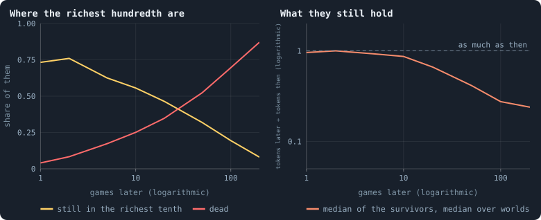

**The fate of the richest.** The agents in the richest hundredth of their world after the game of t = 500, 600, …, 1,200 (36,656 in all, pooled over the 30 worlds), followed k games on. Left: the share of them still in the richest tenth of their world, and the share dead. Right: for those alive, their tokens then divided by their tokens at t — the median in each world, and the median of the worlds.

> [!example]- How to make this figure
> **Runs and data.** As for the figure *Who gains and who loses connections* above.
>
> 1. As in the first figure: the richest hundredth are the agents with tokens at or above the 99th percentile of their frame; the richest tenth later, at or above the 90th.
>
> **To make it again:** `python3 book_figures.py rich`.
<!-- /figure -->

Follow the richest hundredth of a world: 36,656 agents over all the moments
and worlds. One game later, 73% are still in the richest tenth and 4% are
dead. Ten games later, 56% and 25%; a hundred games later, 19% and 70%. The
survivors keep almost all they had for ten games (87% in the median). Then
they lose it steadily: a hundred games later they hold a quarter of what they
held.

So the very richest **die faster** at first than agents in general: 25%
within ten games, against 16% of all agents. That is odd. Nearly half of the
richest are hubs with ten connections or more, and a hub is safe. Which of
them die?

<!-- figure rich/fragile -->
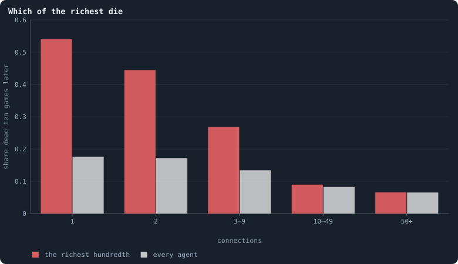

**Which of the richest die.** The agents alive after the game of t = 500, 600, …, 1,200 in the 30 worlds, in classes of their connections at t: the share no longer alive ten games later, for the richest hundredth of their world (red) and for every agent (grey). Pooled over moments and worlds: 7,069 of the richest and 1,367,720 in all with 1, 3,674 of the richest and 818,555 in all with 2, 8,721 of the richest and 1,223,956 in all with 3–9, 11,114 of the richest and 148,486 in all with 10–49, 6,078 of the richest and 6,405 in all with 50+ connections.

> [!example]- How to make this figure
> **Runs and data.** As for the figure *Who gains and who loses connections* above.
>
> 1. For t = 500, 600, …, 1,200: read frames 2·t + 1 and 2·(t + 10) + 1; each agent's connections at t from `edges`; the richest hundredth as above.
> 2. Per class of connections, the agents of the first frame missing from the second, over all agents of the class (`book_chapters.dynamics.fragile`).
>
> **To make it again:** `python3 book_figures.py rich`.
<!-- /figure -->

Not the hubs. Among the richest with ten connections or more, 7% to 9% die
within ten games, as many as among other agents with that many connections.
The excess is all among the **rich with few connections**. Of the richest
agents with a single connection, **54%** are dead ten games later, against 18%
of all agents with a single connection. With two connections it is 44%
against 17%.

Wealth on a dead end does not last. An agent with one connection hangs on it.
If that connection is cut, or the piece it leads to is cut off from the rest
of the world, the agent dies. It dies holding its tokens. The rules then deal
those tokens out among all survivors
([Births and the four ways to die](measuring-lives.md#births-and-the-four-ways-to-die)). A rich leaf is a
large pile of tokens on a single thread. When the thread breaks, its wealth
returns to everyone at once. Concentrated wealth that is not also
connectedness is taxed away in this manner, a little at a time.

### What we learned (how unequal is a world)
- **Inequality comes at once, and then holds still.** The first births end
  the founders' equality. Over the settled life the Gini coefficient stays
  near 0.47, and the richest tenth hold about 42%. Worlds of 10,000 tokens
  are much the same.
- **Experiment 4's thesis was refuted at both sizes, mostly in its reason.**
  Wealth pools, but only moderately, and agents stake about 30% of their
  tokens at home, not most of them.
- **Tokens follow connections, like a diffusion.** The game, as the brains
  play it, is close to a random walk of tokens. It comes to rest with each
  agent holding tokens in proportion to its connections plus one. On hubs
  and leaves it overshoots, in a two-game rhythm.
- **A world is moderately even, and stays so.** Tokens behave as if shared
  equally among half the agents; genotypes as if each were carried by two.
  Neither drifts over the settled life.
- **One number is set by the rules.** Five genotypes for every eight agents,
  in every world: a balance of making and copying brains. That variety is
  churn, not novelty.
- **The rich stay rich for a while, and then they don't.** The order of
  wealth is half forgotten in fifty to a hundred games and mostly forgotten in
  200. It is remembered as long as the connections that carry it.
- **Wealth without connections is fragile.** The richest agents on dead ends
  die three times as often as other agents on dead ends. Wealth is safe only
  where the network is thick.
- **For open-ended evolution, this world rewards position, not strategy.**
  The rich are those that the walk's resting state favours, not those that
  played well. A lineage cannot bank an advantage as tokens for long: wealth
  drains back towards the resting share of its connections within tens of
  games. Selection can only act on what persists: connections, and the brains
  that sit on them.

### How this was made (how unequal is a world)
Every figure of this page reads the thirty runs of Experiment 10, listed
below. They are worlds of the baseline B1 at 100,000 tokens, seeds 1 to 30,
run for 1,500 iterations each. The command `python3 gol_lab.py run E10` makes
them. From the runs, three commands draw the figures:

- `python3 book_figures.py tokens` those of
  [Where do the tokens go?](#where-do-the-tokens-go);
- `python3 book_figures.py entropy` those of
  [How even is a world?](#how-even-is-a-world);
- `python3 book_figures.py rich` those of
  [Do the rich stay rich?](#do-the-rich-stay-rich).

Each figure says, folded beneath it, which runs it reads and how.

The thesis of Experiment 4 was first checked in the thirty worlds of 10,000
tokens of Experiment 2, listed last. There the command
`python3 gol_lab.py analyse E04` checks it. In the worlds of 100,000 tokens,
`python3 book_figures.py tokens` checks it again.

The runs of Experiment 10 are listed once on this page, under [The runs of Experiment 10 (the life of a B1 world)](#the-runs-of-experiment-10-the-life-of-a-b1-world).

#### The runs of Experiment 4

The thirty worlds of 10,000 tokens, on which the thesis of Experiment 4 was
first tested. Four of them died out before iteration 3,000:

<!-- runs E04 -->
> [!info]- The runs behind this page
> These are the runs of Experiment 2; nothing new was run for this page.
>
> **30 runs.** Every condition below is run once for every seed (1 to 30), for 3,000 iterations — or until its world dies out. Every setting is that of the baseline **B1** (the algorithm exactly as a new run is offered it) unless the condition changes it ([At a glance](settings.md#at-a-glance)).
>
> - **baseline** — changes nothing: B1 as it is; 10,000 tokens. Runs `B1-10000-s001` … `B1-10000-s030`.
>
> To make these runs again: `python3 gol_lab.py run E02`, or ▶ in the Research Notebook tab of a computer running `gol_server.py`. Each run writes its settings, seed and engine version beside its frames, in `GraphOfLifeRuns/<run>/meta.json` and `provenance.json`.
<!-- /runs -->

## Gains and losses: who gains, who loses, and the share-out

Every token is staked in every game. Yet in a settled world nearly half the
agents end a game with exactly what they had, because what they send out comes
back. The poorest live on a coin toss: an agent with one token dies in 30% of
games, and the survivors multiply their tokens. The rich lose: agents with 100
tokens or more shrink by 48% in a game on average, and those with few
connections die most often. Tokens run downhill, from agents richer than their
neighbours to poorer ones. So a rich agent with few connections drains back,
within a few games, to the share its connections give it.

### The bookkeeping of a game

A game reshuffles every token of a world, every iteration. Each agent stakes
**all** of its tokens, on its own node and on its neighbours' nodes. Every
node then ends the game holding exactly the tokens staked on it
([One iteration, step by step](one-iteration.md#phase-2-the-game)). This page
follows what that does to each agent: who gains, who loses, who dies, and
whether there is a law to it.

Start with two neighbours. A holds 6 tokens and B holds 2. A stakes 3 at home
and 3 on B; B stakes 1 at home and 1 on A. After the game A's node holds
3 + 1 = 4 tokens: its change is Δ = −2. B's node holds 1 + 3 = 4, a change of
Δ = +2. Now suppose A had put 5 at home and only 1 on B. Then the two stakes
across the connection would have matched. Neither balance would have changed:
A would hold 5 + 1 = 6, and B 1 + 1 = 2.

The rule behind the example is simple. What an agent puts on its own node, it
keeps. What it puts on a neighbour's node, it loses. What others put on its
node, it gains. To write it down, let *a*(*u* → *v*) be the tokens agent *u*
stakes on node *v*. Here *v* is *u* itself or one of its neighbours. Every
agent stakes everything, so Σᵥ *a*(*u* → *v*) = τᵤ, the tokens *u* held at the
start. After the game node *u* holds the stakes on it, so its change is

$$
\Delta_u \;=\; \underbrace{\sum_{v \ne u} a(v \to u)}_{\text{staked on } u \text{ by others}} \;-\; \underbrace{\sum_{v \ne u} a(u \to v)}_{\text{staked by } u \text{ on others}} .
$$

In words: the tokens others staked on *u*, minus the tokens *u* staked on
others. An agent's change is exactly zero when the two are equal: what goes
out comes back.

Who *wins* a node, and so whose brain the node takes, is a separate question
([How a coalition takes a node](rules-in-detail.md#how-a-coalition-takes-a-node)). The tokens stay with the
node, whoever wins it. So on this page an agent is its node, as in the frames
a run records ([What a run records](runs-and-records.md#what-a-run-records)).

The worlds are the thirty B1 worlds of 100,000 tokens of Experiment 10
([Thirty worlds](b1-lives-and-wealth.md#thirty-worlds)). This page was first written
from the thirty worlds of 10,000 tokens; where those differ, both numbers are
given.

### Gains, losses and the share-out

Every frame of a run records each agent's change of tokens over the phase,
for every agent alive at its end. This change is `delta`: its tokens now
minus its tokens when the phase began. A newborn counts its whole endowment as gained. Five statistics of
every frame sum these changes up.

#### The five statistics

| field | definition |
|---|---|
| `gainers` | agents alive at the end with `delta` > 0 |
| `losers` | agents alive at the end with `delta` < 0 |
| `maxTokenAdded` | the largest `delta` |
| `maxTokenLost` | minus the smallest `delta`, as a positive number |
| `redistributed` | the tokens the cleanup dealt out among the survivors |

The agents with `delta` = 0 are counted by neither. There are
`nodes` − `gainers` − `losers` of them.

#### Why gains and losses do not balance

Tokens are never made or destroyed, so one might expect the gains to equal
the losses. They do not, because a frame only describes the agents **still
alive**. An agent that died in the phase lost everything. But it is not in
the frame, so its loss is never counted. The tokens it let go of turn up as
gains of the survivors: the cut-off agents' tokens through the share-out, the
others' through stakes. Summed over the frame,

$$
\sum_{\text{survivors}} \text{delta} = \text{tokens held by the agents that died, at the start of the phase} .
$$

In words: the survivors' changes add up to exactly what the dead held when
the phase began.

#### The share-out

The cleanup removes the agents that hold nothing, and those cut off from the
largest piece of the network. It pools the tokens of the dead. In B1 only the
cut-off ones hold any; in B2, agents that die of old age hold theirs too
([`max_age`](settings.md#max_age)). Then it deals the pool out in one
multinomial draw: each token goes to a survivor chosen uniformly at random
([Seeds and the random stream](rules-in-detail.md#seeds-and-the-random-stream)). The size of that pool is
`redistributed`. Both baselines deal the tokens out this way; the setting
[`redistribution`](settings.md#redistribution) offers other ways
([The estate of the dead](measuring-lives.md#the-estate-of-the-dead)).

**An example.** 100 tokens are dealt out among 1,000 survivors. Each survivor
gets a binomial number of them, with mean 0.1. About 90% get none, 9% get
one, and fewer than 1% get two or more. For an agent holding 2 tokens, one
extra token is a 50% gain. So the share-out is a small lottery that matters
most to the poor ([The lottery](#the-lottery)).

#### In the code

The engine computes `delta` (`GraphOfLife.py`, `_frame`), and
`gol_series.frame_stats` the five statistics. `redistributed` comes from the
cleanup report of each frame.

### What one game does

<!-- figure gains/outcome -->
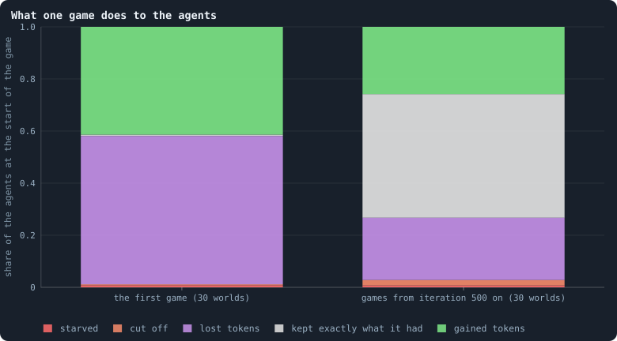

**What one game does to the agents.** Every agent alive at the start of a game ends it in one of five ways: it starved (no one staked on its node), it was cut off from the largest piece of the network, or it survived holding fewer tokens, exactly as many, or more than before. Left: the game of iteration 0 in all 30 worlds. Right: every game from iteration 500 on in the 30 worlds, pooled.

> [!example]- How to make this figure
> **Runs and data.** As for the figure *Agents alive, 30 worlds* above.
>
> 1. Take the rows with `phase` = 2 (iteration 0, or 500 to 1,499).
> 2. Sum over them: `nodes_before` (agents at the start), `starved`, `orphaned`, `gainers`, `losers`, and `nodes` − `gainers` − `losers` (survivors whose tokens did not change).
> 3. Divide each sum by the sum of `nodes_before` and stack the shares.
>
> **To make it again:** `python3 book_figures.py gains`.
<!-- /figure -->

The first game is a scramble. Of the agents alive at its start, 57% lose
tokens and 41% gain. Fewer than one in a hundred come out with exactly what
they had. Few die in it. 0.8% starve: nobody, not even they themselves, staked
on their node. And 0.4% are cut off from the network. The worlds of 10,000
tokens were different. Their founders had four neighbours each instead of ten,
and their first game was violent: 3.8% starved and 4.0% were cut off.

Settled games, from iteration 500 on, are calm. 0.7% starve and 2.1% are cut
off; 24% lose and 26% gain. And **47% of the agents end the game with exactly
the tokens they began with**. Nearly half the world is, in tokens, untouched
by a game in which every token was staked.

That is not because they stake nothing on their neighbours: 71% of the tokens
staked go to neighbours ([How the game is played](b1-the-game-and-its-flows.md#how-the-game-is-played-what-agents-stake-and-who-wins-the-nodes)).
It is because what they send out comes back in equal measure.
[Where tokens flow](b1-the-game-and-its-flows.md#the-budget-of-a-game-where-tokens-flow) counts how
much: 51% of all the tokens staked in a settled game are matched by a stake
coming back.

How much changes hands? In a settled world of about 14,400 agents, some 3,800
agents gain in a game and 3,600 lose. The largest single gain is about 1,400
tokens, and the largest loss about 1,400. That is a hub's worth, changing
hands in one game
([The largest gain is the largest loss](b1-lives-and-wealth.md#the-largest-gain-is-the-largest-loss)).
At 10,000 tokens it was 330 and 320 agents, and about 640 and 620 tokens.

### Rich and poor

<!-- figure gains/by-tokens -->
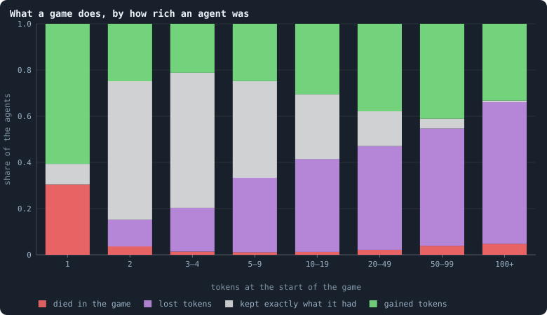

**What a game does, by how rich an agent was.** Agents alive at the start of a game, sorted by the tokens they held then; for each class, the share that died in the game (starved or cut off), and of the rest the shares that lost tokens, kept exactly as many, or gained. From the games of every 100th iteration from 500 on, in the 30 worlds (4,520,044 agents in all).

> [!example]- How to make this figure
> **Runs and data.** As for the figure *Children, by the wealth of the parent* above.
>
> 1. For every 100th iteration t from 500 on, take each agent in frame `2·t` (the start of the game) with its `tokens`.
> 2. Find it in frame `2·t + 1`: if it is not there, it died in the game; if it is, its `delta` there is its change over the game.
> 3. Sort the agents by their tokens at the start into the classes shown, and count the four outcomes in each class.
>
> **To make it again:** `python3 book_figures.py gains`.
<!-- /figure -->

The picture changes completely with wealth.

- **One token.** An agent with a single token can stake it at home or on one
  neighbour. It cannot lose without dying: if it sends its token away and
  nobody stakes on it, its node holds nothing. In a game, 30% of 1-token
  agents die, 61% gain, and only 9% stay at 1. The survivors gain a lot: their
  tokens grow by 321% on average (416% at 10,000 tokens). A node with its own
  token on it and a neighbour's stake besides holds several times what it had.
- **The middle.** Agents with 2 to 9 tokens most often keep exactly what they
  had (42% to 60%), and die rarely (1.1% to 3.6%).
- **The rich.** Agents with 100 tokens or more lose in 61% of games and gain
  in 33%. They almost never keep exactly what they had (0.7%). On average,
  over those that survive the game, their tokens shrink by 48% in one game.
  Those with 50 to 99 tokens shrink by 18%.

The risk of dying is U-shaped. It is high for the poorest and lowest in the
middle. For the rich it rises again, to 4.7% per game for agents with 100
tokens or more. Which rich agents die? Almost only those with few connections.
Among the agents with 100 tokens or more in the sample, the share that died in
the game falls steeply with their connections:

| connections | 1–2 | 3–9 | 10+ |
|---|---|---|---|
| agents with 100 tokens or more, in the sample | 4,845 | 4,978 | 4,757 |
| died in the game | 10.4% | 3.1% | 0.7% |

All these shares are as at 10,000 tokens, within a few points.

A rich agent with one connection can die in two ways of its own, both visible
in the rules. It can put all its tokens on its neighbour while nobody stakes
on it. Then it starves, and its tokens are not lost: they have moved to the
neighbour's node. Or its connection carries nothing in the game and is cut.
Then it is cut off, and dies with its tokens. Otherwise it can only go with
its branch. That happens when a connection further in is cut, so that its
whole branch is no longer joined to the largest piece.

### Token curvature

Picture the tokens of a world as a landscape. An agent richer than its
neighbours stands on a hill; an agent poorer than them sits in a valley. The
**token curvature** says how deep a valley or how high a hill is. It adds up,
over an agent's neighbours *N*(*u*), how many more tokens each holds than the
agent does:

$$
\kappa(u) = \sum_{v \in N(u)} (\tau_v - \tau_u)
         = \sum_{v \in N(u)} \tau_v \;-\; \deg(u)\, \tau_u .
$$

Here τ is an agent's tokens, and deg(*u*) its number of connections.

- κ > 0: the agent is in a **valley**. Its neighbours hold more than it does.
- κ < 0: the agent is on a **hill**. It holds more than its neighbours.
- κ = 0: it is as much above some neighbours as below others.

**Example.** An agent with 5 tokens has neighbours holding 2, 8 and 20. Its
curvature is (2 − 5) + (8 − 5) + (20 − 5) = −3 + 3 + 15 = 15: a valley. A hub
with 200 tokens has 50 neighbours holding 4 each. Its curvature is
κ = 50 · (4 − 200) = −9,800: a high hill.

#### Why it is called curvature: heat

Take agents in a row, each joined to the next. For an agent in the middle, κ
is the tokens on its left plus those on its right, minus twice its own. That
is the discrete second derivative of the token landscape: how it bends at the
agent. A valley bends up and a hill bends down. This is where the name comes
from. On any network, κ is the **discrete Laplacian** of the tokens.

It is also the quantity that drives heat. Suppose heat spreads along the
connections of a network. Then each node's temperature changes in proportion
to the sum of its differences with its neighbours, which is exactly κ. A
valley warms up, a hill cools down, and the landscape smooths out. In the
language of matrices, κ = −*L*τ. Here *L* is the network's Laplacian matrix,
with the degrees on its diagonal and −1 for every connection.

If tokens behaved like heat, an agent's change of tokens in a game would
follow its curvature at the start of the game.
[Tokens run downhill](#tokens-run-downhill) tests that.

#### In the viewer

The viewer can colour every agent by its token curvature
([What the viewer can colour by](measures-atlases-and-assembly.md#what-the-viewer-can-colour-by)). The field
`token_curvature` is measured on the frame itself. The field
`token_curvature_pre` is measured on the network and the tokens as they were
when the phase began. So it can be read against the change the phase then
produced. On a signed colour scale, blue is a hill and
red a valley.

### Tokens run downhill

<!-- figure gains/downhill -->
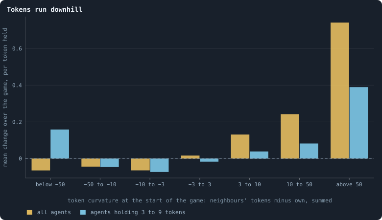

**Tokens run downhill.** The token curvature of an agent is the sum, over its neighbours, of how many more tokens the neighbour holds than it does ([Token curvature](b1-lives-and-wealth.md#token-curvature)): negative for an agent richer than its neighbourhood, positive for one poorer. For each class of curvature, the mean change of an agent's tokens over the game divided by the tokens it held at the start, over the agents that survived the game. Yellow: all agents; cyan: only agents that held 3 to 9 tokens, so that wealth itself cannot explain the pattern. A class with fewer than 1,000 agents is left out (drawn at 0).

> [!example]- How to make this figure
> **Runs and data.** As for the figure *Children, by the wealth of the parent* above.
>
> 1. For every 100th iteration t from 500 on, read frame `2·t`: for every agent u, κ(u) = Σ over its neighbours v of (τ(v) − τ(u)).
> 2. Find each agent in frame `2·t + 1` and take its `delta` (agents not there died and are left out).
> 3. Sort by κ into the classes shown and average `delta` / τ(u) in each.
>
> **To make it again:** `python3 book_figures.py gains`.
<!-- /figure -->

The tokens run downhill. Agents in deep valleys (κ > 50) gain 74% on average
in a game; agents on hills (κ < −50) lose 6.5%. At 10,000 tokens it was 113%
and 6.6%.

Is that only because valleys are poor and hills rich, and we saw above that
the poor gain? The cyan line answers. Take only agents that hold 3 to 9
tokens. Those in valleys still gain: +39% above κ = 50 (+63% at 10,000
tokens). And those on hills still lose: −7% between κ = −10 and −3.

One class goes the other way. The few agents of 3 to 9 tokens on the steepest
hills, κ < −50, gain. They are hubs among many poorer neighbours. With fewer
tokens than neighbours, they cannot send one token to each, while each
neighbour sends them one or two.

There is a reason to expect the tokens to run downhill. Suppose every agent
split its tokens evenly over its own node and its *d* neighbours, and every
agent had the same number *d*. Node *u* would receive τᵤ/(*d*+1) from itself
and τᵥ/(*d*+1) from each neighbour, so

$$
\Delta_u = \frac{\tau_u + \sum_{v \in N(u)} \tau_v}{d+1} - \tau_u = \frac{\kappa(u)}{d+1} .
$$

The change would be **proportional to the curvature**. This is the discrete
heat equation of [Why it is called curvature](#why-it-is-called-curvature-heat):
heat flows from warm to cold in proportion to the difference
([Physical inspiration](physical-inspiration.md)). Real agents do
not split exactly evenly, and degrees differ. That is why the relation is a
tendency and not a law. But
[Where tokens flow](b1-the-game-and-its-flows.md#the-game-as-a-random-walk) shows
how close to an even split the brains in fact play.

### How a rich agent drains back

If the rich lose 48% of their tokens in a game, how can the richest tenth
always hold 42% of all tokens
([Inequality over time](b1-lives-and-wealth.md#inequality-over-time))?
Because wealth has places where it can rest, and whoever sits in such a place
is rich, game after game.

The places are set by the connections. Under the even split, tokens move like
a random walk. The walk comes to rest when every agent holds tokens in
proportion to its connections plus one
([Where tokens flow](b1-the-game-and-its-flows.md#the-game-as-a-random-walk)).
Call that an agent's **resting share**. In the thirty worlds after their last
game, rest would mean 1.7 tokens for each candidate: an agent's own node, and
each neighbour's. Agents of every class of connections hold about that on
average
([How properties scale together](b1-the-network-size-and-scaling.md#tokens-and-connections)).
So an agent with one connection rests at about 3.4 tokens, and a hub with a
hundred connections at about 170.

A rich agent with few connections is far above its resting share, and the even
split takes the excess away. Take an agent with one connection, holding τ
tokens, and write *s* for the tokens per candidate at rest. The agent keeps
τ/2 at home and stakes τ/2 on its neighbour. If the neighbour holds its own
resting share, it stakes *s* on each of its candidates, so *s* comes back. The
agent ends the game with τ/2 + *s*. Its resting share is 2*s*, and its excess
over it has halved:

$$
\left(\frac{\tau}{2} + s\right) - 2s = \frac{\tau - 2s}{2} .
$$

An agent with one connection and 40 tokens ends such a game with about 22. If
little comes back in the next games either, the excess halves again and again.
Within a few games, little of it is left at the agent. The tokens are not
lost. They run downhill into the neighbourhood, and spread from there.

Real agents do not split exactly evenly. But the rich do lose: those with 100
tokens or more shrink by 48% in a game on average. And many of the richest are
rich far beyond their place. Take the tail of the distribution of tokens: the
3,358 agents that held 49 tokens or more after the last game of the thirty
worlds. Of them, 33% have only one or two connections
([Power laws, real and apparent](b1-the-network-size-and-scaling.md#the-tokens-a-power-law-in-the-tail)).

Some die before they drain. A rich agent with one or two connections dies in
about one game in ten ([Rich and poor](#rich-and-poor)). If it is cut off, the
share-out deals its tokens out among all the survivors
([The lottery](#the-lottery)). Either way, its wealth returns to the world.

Wealth that sits on many connections is near its resting share, and lasts.
Nearly half of the richest hundredth of a world are hubs with ten connections
or more. The survivors among the richest keep 87% of their tokens over ten
games, in the median
([The fate of the richest](b1-lives-and-wealth.md#the-fate-of-the-richest)).
Even there, wealth sways. On a hub with many leaves the even split overshoots.
Tokens slosh between the hub and its leaves, with a period of two games
([A two-game rhythm](b1-lives-and-wealth.md#a-two-game-rhythm)).

So the rich are replaced as fast as they shrink: tokens pile up again wherever
there are many connections. Who is rich is mostly a matter of **where** an
agent is.

### The lottery

When the cleanup removes the agents cut off from the network, it pools their
tokens. Then it deals them out, token by token, to survivors drawn at random,
every survivor with the same chance ([The share-out](#the-share-out)).

<!-- figure gains/lottery -->
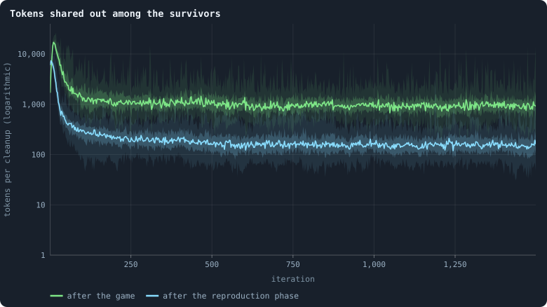

**Tokens shared out among the survivors.** How many tokens the cleanup dealt out at random among the survivors — the tokens of the agents that were cut off — after each game (green) and after each reproduction phase (cyan), on a logarithmic axis. For each, the line is the median of the worlds at each iteration, the darker band holds the middle half of them (from the 25th to the 75th percentile) and the paler band nine in ten (5th to 95th).

> [!example]- How to make this figure
> **Runs and data.** As for the figure *Agents alive, 30 worlds* above.
>
> 1. Take `redistributed` of the rows with `phase` = 2 and of those with `phase` = 1.
> 2. Cut the 1,500 iterations into 600 stretches of 2.5 and take each world's mean in each stretch.
> 3. In each stretch, take the median, the 25th and 75th and the 5th and 95th percentiles of those means over the worlds that still have a value there (a world that died has none after its death).
>
> **To make it again:** `python3 book_figures.py gains`.
<!-- /figure -->

In a settled world, about 1,300 tokens are dealt out after each game, and
about 210 after each reproduction phase. Per agent and game that is 0.10
tokens (the thirty worlds: 0.05 to 0.15; 0.11 at 10,000 tokens): on average
one token every ten games. That is small. But half of all agents hold 5 tokens
or fewer, and for an agent with 1 token, one lottery token doubles its wealth.
The share-out is a small basic income that matters only to the poor.
[The estate of the dead](measuring-lives.md#the-estate-of-the-dead) shows what other ways of sharing the
tokens out would do.

### What we learned (gains and losses)
- **A game is an exchange, plus diffusion.** Nearly half the agents end a game
  with exactly what they had, because what they send out comes back. What does
  move runs downhill, from agents richer than their neighbourhood to agents
  poorer than it. In tokens, a world works much like heat spreading through a
  network.
- **The poor live on a knife's edge.** Nearly a third of 1-token agents die in
  every game; the survivors multiply their tokens. Being poor in this world is not a
  slow decline, it is a coin toss.
- **Wealth above its resting share does not last.** A rich agent with few
  connections loses its excess to its neighbours within a few games. Or it
  dies on its dead end, and its tokens are shared out. The rich are replaced
  where connections are many.
- **Wealth is a place, not a memory.** An agent's tokens drain back to the
  share its connections give it, so its wealth cannot record that its brain
  did well in the past. For evolution, that matters: selection needs
  differences in success that last long enough to be inherited
  ([What the measurements say about open-ended evolution](what-the-baseline-world-is.md#what-the-measurements-say-about-open-ended-evolution)).
- **The share-out is a lottery for the poor.** It deals out 0.10 tokens per
  agent and game: nothing to the rich, and a doubling to an agent with one
  token.

### How this was made (gains and losses)
Every figure of this page reads the thirty runs of Experiment 10, listed
below. They are worlds of the baseline B1 at 100,000 tokens, seeds 1 to 30,
run for 1,500 iterations each. The command `python3 gol_lab.py run E10` makes
them, and `python3 book_figures.py gains` draws every figure of this page.
Each figure says, folded beneath it, which runs it reads and how. The numbers
given for the worlds of 10,000 tokens come from the thirty runs of
Experiment 2, from which this page was first written.

The runs of Experiment 10 are listed once on this page, under [The runs of Experiment 10 (the life of a B1 world)](#the-runs-of-experiment-10-the-life-of-a-b1-world).

## The largest and the smallest

In a settled world, the richest agent holds about 2% of all tokens and the
best-connected some 640 connections; the median agent has 2. First place in
tokens changes hands in three games out of five; first place in connections
lasts longer, often passing from parent to newborn child. In seven of thirty
worlds one agent is joined to a tenth of the world or more: a star. Its centre
is a place, handed down a line of agents, while the brain on it changes almost
every game. As worlds grow, the richest agent's share of the tokens falls, and
the best-connected agent's connections rise.

### Why look at the extremes

A typical agent of a settled world holds a few tokens and has two or three
connections. After every game the viewer also reports the extremes
([What a run records](runs-and-records.md#what-a-run-records)):

- the richest agent and the poorest, `maxTokens` and `minTokens`
  ([Tokens per agent: mean, median, extremes](measuring-tokens.md#tokens-per-agent-mean-median-extremes));
- the best-connected agent and the least, `maxDegree` and `minDegree`, beside
  the median agent's `medianDegree` ([Degree](measuring-networks.md#an-agents-connections-degree-and-clustering));
- the largest gain and the largest loss of one agent in the game,
  `maxTokenAdded` and `maxTokenLost`
  ([Gains, losses and the share-out](b1-lives-and-wealth.md#gains-losses-and-the-share-out)).

This page asks what they are, who holds them, for how long, and how they grow
with the size of a world.

Why look at them at all? Averages describe the typical agent; extremes
describe the exceptions. In a world built on unequal parts, the exceptions can
carry the whole. A hub joined to a tenth of the world is one agent. Yet the
connections of a tenth of all agents depend on what it does in every game.

Extremes are also where scale shows first. In a larger world there is more
room for one agent to become very large. Or the rules may hold every agent
below some size, whatever the size of the world. Which of the two happens is a
question about the rules.
[Power laws, real and apparent](b1-the-network-size-and-scaling.md#power-laws-real-and-apparent-and-how-to-fit-one) asked it of
the whole distribution; this page asks it of the top.

The worlds are the thirty B1 worlds of 100,000 tokens of Experiment 10
([Thirty worlds](b1-lives-and-wealth.md#thirty-worlds)). They are read over their
settled life, from iteration 500 to their end.

### The largest, over a world's life

The figure follows the largest of them through the worlds' lives, beside the
mean agent and the median one:

<!-- figure extremes/over-time -->
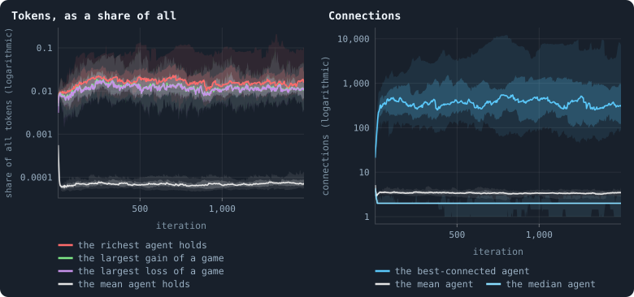

**The largest, over a world's life.** After every game of the 30 worlds. Left: the tokens of the richest agent, the largest gain and the largest loss of one agent in that game, and the tokens of the mean agent, each as a share of all 100,000 tokens. Right: the connections of the best-connected agent, of the mean agent and of the median one. Both on logarithmic axes; the line is the median of the worlds at each iteration, the darker band holds the middle half of them (from the 25th to the 75th percentile) and the paler band nine in ten (5th to 95th).

> [!example]- How to make this figure
> **Runs and data.** As for the figure *Agents alive, 30 worlds* above.
>
> 1. Take the rows with `phase` = 2: `maxTokens`, `maxTokenAdded`, `maxTokenLost` and `meanTokens`, divided by 100,000; `maxDegree`, `meanDegree` and `medianDegree`.
> 2. Cut the 1,500 iterations into 600 stretches of 2.5 and take each world's mean in each stretch.
> 3. In each stretch, take the median, the 25th and 75th and the 5th and 95th percentiles of those means over the worlds that still have a value there (a world that died has none after its death).
>
> **To make it again:** `python3 book_figures.py extremes`.
<!-- /figure -->

Over the settled life of the median world, the richest agent holds **2.1%** of
all tokens. That is some 2,100 tokens, where the mean agent holds 7. The
worlds range from 1.0% to 13%. The largest gain of a game is 1.4% of all
tokens, and the largest loss 1.4%.

The best-connected agent has **640** connections in the median world, and from
130 to 11,000 between worlds. The mean agent has 3.5 connections, and the
median agent 2.

At the bottom, the scale stops at one. The least connected agent has one
connection, after every game of every world. The poorest agent holds a single
token after almost every game. It cannot hold fewer: an agent that ends a
phase with no tokens is removed. Averaged over the settled life, the poorest
agent holds 1.001 tokens in the median world, and 1.014 at most.

### The largest gain is the largest loss

Why should the largest gain of a game be about as large as the largest loss?
Because in most games they are the two ends of one connection. In the median
world, the agent that gained most and the one that lost most were neighbours
when the game began, in **92%** of games. A pile of tokens crossed from one to
the other. One large transfer across a single connection is both the largest
gain and the largest loss of the game.

### Who comes first, and for how long

Follow the first place through a world's life. After every game, one agent is
the richest and one has the most connections. A **reign** is a stretch of
games in a row with the same agent first. How long do reigns last?

<!-- figure extremes/reigns -->
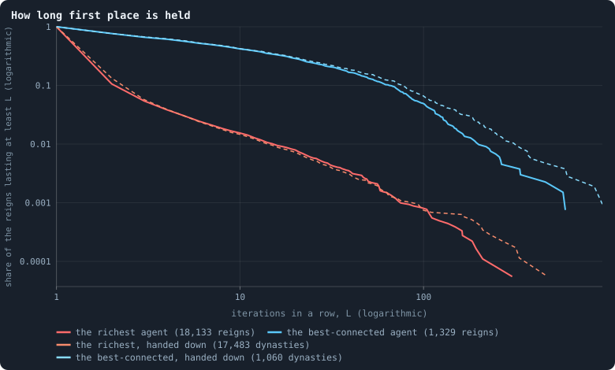

**How long first place is held.** After every game from iteration 500 on, in the 30 worlds, which agent holds the most tokens and which the most connections. A reign is a stretch of consecutive iterations with the same agent first; for every L, the share of the reigns that lasted at least L iterations, pooled over the worlds. Dashed: the same for dynasties — a dynasty goes on while every new first agent is a child of the one before it, and ends when first place passes to anyone else — pooled over the worlds. A reign still going at the end of a run is counted as far as it went.

> [!example]- How to make this figure
> **Runs and data.** As for the figure *Lorenz curves at iteration 1,499* above.
>
> 1. Read the frame after every game; the agent with the most `tokens`, and the one with the most connections in `edges` (`book_chapters.extremes.reigns`).
> 2. Cut each run's sequence of first agents into stretches of the same agent; count lengths.
>
> **To make it again:** `python3 book_figures.py extremes`.
<!-- /figure -->

The richest agent changes in three games out of five. There were 18,133 reigns
of the richest over the settled lives of the thirty worlds. Of them, 89%
lasted a single iteration and only 1.5% ten or more; the longest lasted 304.
The best-connected agent holds on far longer. Its reigns last a median of 6
iterations; 42% last ten or more, 5% a hundred or more, and the longest 592.

Wealth is a flicker: a pile that crosses a connection and spreads out again
([Gains and losses](b1-lives-and-wealth.md#gains-and-losses-who-gains-who-loses-and-the-share-out)). Connections last, and first place
in them lasts with them.

Who are they? The richest agent of the median world has 7 connections and is
133 iterations old. The best-connected holds 474 tokens and is 289 iterations
old. The two are the same agent in 19% of games in the median world. Across
the worlds that runs from almost never to 91% of the time, in a star, where
the centre is both ([Stars](#stars)).

### Stars

In most worlds the best-connected agent is joined to a few percent of the
world. In some it is joined to much more:

<!-- figure extremes/stars -->
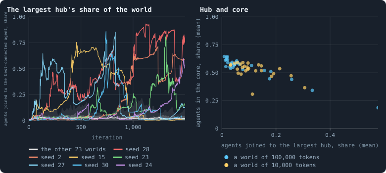

**Worlds held together by one agent.** Left: after every game, the connections of the best-connected agent divided by the agents alive, in the worlds whose best-connected agent held, on average over iterations 500–1,499, a tenth of the world or more (one line each), and in the other worlds (the line is the median of the worlds at each iteration, the darker band holds the middle half of them (from the 25th to the 75th percentile) and the paler band nine in ten (5th to 95th)). Right: one dot per world, its mean over the settled life of that share and of the share of agents in the core ([Core, trees and leaves](measuring-networks.md#core-trees-and-leaves)), for the worlds of 100,000 tokens (blue) and of 10,000 (yellow, over iterations 500–2,999).

> [!example]- How to make this figure
> **Runs.** The 30 baseline runs `B1-100000-s001` … `B1-100000-s030`: the baseline B1 at 100,000 tokens, seeds 1 to 30, 1,500 iterations each (every setting is listed in [Thirty worlds](b1-lives-and-wealth.md#thirty-worlds)). They are made with `python3 gol_lab.py run E10`. The 26 surviving ones of the 30 baseline runs `B1-10000-s001` … `B1-10000-s030`: the baseline B1 at 10,000 tokens, seeds 1 to 30, 3,000 iterations each (every setting is listed in [A world's life](b1-lives-and-wealth.md#the-life-of-a-b1-world)). They are made with `python3 gol_lab.py run E02`.
>
> **Data.** As for the figure *Six worlds, one at a time* above.
>
> 1. Take the rows with `phase` = 2: `maxDegree` / `nodes`, and `coreShare` (every 25 iterations).
> 2. Left: one line per star world; the band over the others as every band. Right: each world's means over its settled life.
>
> **To make it again:** `python3 book_figures.py extremes`.
<!-- /figure -->

Seven of the thirty worlds had, on average over their settled life, a
best-connected agent joined to a tenth of the world or more. In the world with
seed 28 it was joined to **58%** of all agents on average, for a thousand
iterations. Such a world is a **star**: one agent at the centre, thousands of
leaves around it. A leaf is an agent with a single connection
([Stars and hubs](measuring-networks.md#stars-and-hubs)).

A star sets the shape of its world. The core of a world is what is left when
agents with a single connection are peeled away, again and again
([Core, trees and leaves](measuring-networks.md#core-trees-and-leaves)). Across the thirty worlds,
the share of agents in the core falls as the share joined to the largest hub
rises. Their correlation is **−0.96** (right panel). At 10,000 tokens stars
were no rarer. Ten of the 26 worlds had one by the same measure, the largest
joined to 31% of its world. But there the core went with the hub far more
loosely (−0.54).

### How a star works

Look inside the largest star, in the world with seed 28. Take the game of its
settled life in which its centre was joined to the largest share of the world:
iteration 1,122. One agent is joined to **20,666** of the 25,958 agents alive,
four in five. It holds 20,286 tokens, a fifth of all there are. Of its
neighbours, 19,452 (94%) are leaves, joined to nothing else, holding 2.8
tokens each on average. Three agents in four hang on this one agent alone: it
holds the world together.

In the game, the centre stakes **exactly one token** on 98% of its neighbours,
and nothing on its own node. It holds fewer tokens than it has neighbours, and
spreads them one by one. Its leaves stake 41% of their few tokens on the
centre's node and keep the rest at home
([How the game is played](b1-the-game-and-its-flows.md#how-the-game-is-played-what-agents-stake-and-who-wins-the-nodes)). Two tokens at home
outbid the centre's single token and keep the leaf its node. One token at home
ties it, and a coin then settles who wins
([How a coalition takes a node](rules-in-detail.md#how-a-coalition-takes-a-node)).

So across nearly every one of the twenty thousand connections, about one token
goes out and about one comes back, every game. The centre is a clearing house.
Its tokens are, almost to the token, the number of its connections. That is
the resting state of an even split at its most extreme. At rest, every agent
holds tokens in proportion to its connections plus one
([Where tokens flow](b1-the-game-and-its-flows.md#the-game-as-a-random-walk)).

The centre's own node is won by a coalition of its neighbours in every game:
in all of the hundred games from iteration 1,122 on. Its own agent, spreading
its tokens one by one, stakes a token or two there at most, and often none, as
in the game above. On a node with twenty thousand stakers it is at best one
small staker among many. Each time, a winner's brain is copied in: the centre
carried 78 different genotypes in those hundred games. What persists is not a
brain but a place: the agent's connections, and the tokens that flow through
them.

### How a star is handed down

And the place is inherited. Every so often the agent at the centre has a
child, and hands it nearly all its connections
([How a child is joined](b1-lives-and-wealth.md#how-a-child-is-joined)).
At iteration 1,153 the centre of seed 28 went from 18,913 connections to 219,
and its child, of age 0, took 18,865. Over the settled life, first place in
that world changed hands ten times. Eight times in ten, the new centre was a
newborn child of the old one. A star outlives every agent that holds it. It is
passed down a line of parents and children like a crown: a **dynasty**.

Across all thirty worlds, the best-connected agent changed 1,299 times over
the settled life. Of these changes, 21% went to a child of the agent before,
and 16% to a newborn, an agent of age 0. Now count the dynasties: the runs of
first agents, each the child of the one before. The figure in
[Who comes first, and for how long](#who-comes-first-and-for-how-long) shows
them dashed. They last a median of 7 iterations; 7% of them last a hundred or
more, and the longest 942. The richest agent is passed on far less often: 4%
of its 18,103 changes went to a child.

### The largest, by the size of a world

The worlds of Experiment 8 say how the extremes grow with a world. It runs the
baseline B1 at ten sizes, from 800 to 409,600 tokens, each double the one
before ([Worlds of many sizes](b1-the-network-size-and-scaling.md#worlds-of-many-sizes)).
Each size has three seeds, run for 600 iterations. The figure shows the 25 of
its worlds that lived to the end: none of 800 tokens, and one of 1,600.

<!-- figure extremes/with-size -->

**The largest, by the size of a world.** For every world of Experiment 8 that lived to its end, from 800 to 409,600 tokens, its mean over iterations 300–599 of the number of agents (x), and of the richest agent's share of all tokens (left) or the best-connected agent's connections (right); and the same for the 30 worlds of 100,000 tokens over iterations 500–1,499 (yellow). Both axes logarithmic; grey: the straight line least squares fits through the worlds of Experiment 8.

> [!example]- How to make this figure
> **Runs.** The baseline worlds of Experiment 8, from 800 to 409,600 tokens, three seeds each, 600 iterations ([How does a world's size follow its tokens?](b1-the-network-size-and-scaling.md#worlds-of-many-sizes); `python3 gol_lab.py run E08`); The 30 baseline runs `B1-100000-s001` … `B1-100000-s030`: the baseline B1 at 100,000 tokens, seeds 1 to 30, 1,500 iterations each (every setting is listed in [Thirty worlds](b1-lives-and-wealth.md#thirty-worlds)). They are made with `python3 gol_lab.py run E10`.
>
> **Data.** As for the figure *Six worlds, one at a time* above.
>
> 1. Average `nodes`, `maxTokens` / total tokens and `maxDegree` over the rows with `phase` = 2 in the stretch.
> 2. Fit ln y = a + b·ln x by least squares.
>
> **To make it again:** `python3 book_figures.py extremes`.
<!-- /figure -->

The richest agent's share of all tokens **falls** with the number of agents,
as about agents^−0.52. So its tokens rise only as about the square root of the
world's tokens. The best-connected agent's connections **rise**, as about
agents^0.61. The thirty worlds of 100,000 tokens lie around both lines, with
their stars far above the second.

So a world of ten times the tokens, which holds about eleven times the agents,
has a richest agent about three times as rich. Its best-connected agent is
about four times as connected. That is faster than the width of a world grows:
×2, since its diameter grows about as agents^0.30
([Distances grow like a power](b1-the-network-size-and-scaling.md#distances-grow-like-a-power)).
And it is slower than its agents (×11). Measured directly against the worlds
of 10,000 tokens, the richest agent is 3.1 times as rich. The best-connected,
stars included, is 7.7 times as connected
([A large world beside ten small ones](b1-the-network-size-and-scaling.md#a-large-world-beside-ten-small-ones)).

No agent becomes a fixed share of the world as it grows. But there is more
room at the top in a large world, and the stars show what it can be used for.

### What a dynasty carries

For open-ended evolution, a dynasty is the first thing in these worlds that is
inherited and lasts. It is not a brain: the centre's brain is replaced in
nearly every game. It is a position, passed from parent to child for hundreds
of iterations. If brains could hold what they inherit, a dynasty would be the
obvious unit of selection. As the rules stand, it carries nothing a brain did.

Suppose a rule let the centre's brain keep its node: an advantage for the
incumbent. It would turn the dynasty of a place into a dynasty of a line
([Two roads of inheritance](questioning-the-mechanics.md#two-roads-of-inheritance)).
Such a rule was tried later. The setting
[`incumbency`](settings.md#incumbency) counts an agent's stake on its own node
more than anyone else's. In pilot worlds, counted twice, it let one agent
gather 57% of all tokens behind a home stake nobody could outbid. Counted one
and a half times, it is part of the second baseline, B2
([Holding one's place](building-b2-and-the-search-for-a-healthy-rich-world.md#holding-ones-place)). But
B2 also switches handover off. So in B2 a place can no longer be handed to a
newborn child, as it is here in B1
([B2, rule by rule](building-b2-and-the-search-for-a-healthy-rich-world.md#b2-rule-by-rule)). How long a
brain holds its node in B2 has not been measured directly, as
[Hubs are places](questioning-the-mechanics.md#hubs-are-places) notes.

### What we learned (the largest and the smallest)
- **The top is a place.** The best-connected agent of a world sits on a node
  whose brain is replaced in nearly every game. What lasts is its connections,
  and they are handed from parent to newborn child. A star is the clearest
  case of what
  [Where tokens flow](b1-the-game-and-its-flows.md#who-keeps-their-node) calls a
  hub: a place, not an individual.
- **Wealth flickers, connections last.** First place in tokens changes in
  three games out of five. First place in connections lasts a median of 6
  iterations, and often ten or more. A dynasty can keep it in one line of
  descent for hundreds.
- **The extremes grow with the world, but slower than it.** In a world of ten
  times the tokens, the richest agent is about three times as rich and the
  best-connected about four times as connected. No agent becomes a fixed share
  of the world.
- **A dynasty is inherited, and carries nothing a brain did.** It is the first
  thing in these worlds that is inherited and lasts, but what it passes on is
  a position. B2's rules took handover away, and with it this kind of
  inheritance.

### How this was made (the largest and the smallest)
Every figure of this page reads the thirty runs of Experiment 10, listed
below. They are worlds of the baseline B1 at 100,000 tokens, seeds 1 to 30,
run for 1,500 iterations each. The command `python3 gol_lab.py run E10` makes
them. The figure of stars also reads the 26 worlds of 10,000 tokens of
Experiment 2 that lived to the end (`python3 gol_lab.py run E02`). The figure
by size reads the worlds of Experiment 8 (`python3 gol_lab.py run E08`). The
command `python3 book_figures.py extremes` draws every figure of this page.
Each figure says, folded beneath it, which runs it reads and how.

The runs of Experiment 10 are listed once on this page, under [The runs of Experiment 10 (the life of a B1 world)](#the-runs-of-experiment-10-the-life-of-a-b1-world).

## Where to go next

- [How much does the seed decide?](b1-the-network-size-and-scaling.md#how-much-does-the-seed-decide): how far
  single worlds wander, and how much of it their seed decides.
- [The settled life of a world](statistics.md#the-settled-life-of-a-world): why the notebook measures a
  world from iteration 500 on.
- [What the baseline world is](what-the-baseline-world-is.md): the whole study
  of the baseline, in sum.
- [Age and lifetime](measuring-lives.md#age-lifetime-and-survival-curves): age, lifetime, the hazard and the
  stationary population, made exact.
- [How a world breaks](b1-the-network-size-and-scaling.md#how-a-world-breaks): the cuts that kill three in
  four of the agents that die.
- [Genotypes and lineages](b1-brains-lineages-and-messages.md#genotypes-and-lineages): how long brains and
  their lines last, rather than agents.
- [What shape does the network take?](b1-the-network-size-and-scaling.md#the-shape-of-the-network):
  the shape that all this making and unmaking leaves.
- [Power laws, real and apparent](b1-the-network-size-and-scaling.md#power-laws-real-and-apparent-and-how-to-fit-one): whether
  the connections follow a power law, and where.
- [Questioning the mechanics](questioning-the-mechanics.md): why a brain
  spreads by conquest more than by birth, and other rules worth questioning.
- [Building B2: a world that cannot break](building-b2-and-the-search-for-a-healthy-rich-world.md#building-b2-a-world-that-cannot-break):
  rules that mend what births alone cannot build.
- [Where the tokens flow](b1-the-game-and-its-flows.md#where-tokens-flow): where each staked token
  goes, and the random walk that sets every agent's resting share.
- [How the game is played](b1-the-game-and-its-flows.md#how-the-game-is-played-what-agents-stake-and-who-wins-the-nodes): what the brains do in
  the game, if not defend their own nodes.
- [Physical inspiration](physical-inspiration.md): the heat equation, and the
  other physics the notebook borrows from.
- [Stars and hubs](measuring-networks.md#stars-and-hubs): hubs and stars in short, and why the
  [health bar](measuring-health.md#the-health-bar "The seven marks, of 12 October 2026, a world's network must meet to count as healthy: one piece, mostly on loops, no fatal cut, no hub, three to twelve links per agent, a dimension of 2.3 to 4. Still part 4 of the open-ended test.") counts a hub as a fault.

## How our view changed

- *The life of a B1 world*:
  - **8 October 2026.** [The first hundred iterations](#the-first-hundred-iterations)
    was first written from the thirty worlds of 10,000 tokens. It said that
    within a few hundred iterations every world descends from a single one of
    its hundred founders. It also said that a newborn is joined to its parent
    and to some of its parent's neighbours. [A world's life](#a-worlds-life)
    said that some worlds decline, and die.
  - **11 October 2026.** Both were rewritten from the thirty worlds of 100,000
    tokens, and two of those claims turned out to depend on a world's size. No
    large world came down to a single founder within its first hundred
    iterations; the typical one took about six times as long, and three never
    did in 1,500 iterations. And no large world died, though one lost nine tenths of
    itself in ten games.
  - **14 October 2026.** The rule for a newborn's links was corrected: the
    parent's brain decides, for itself and for each of its neighbours, whether
    the child is joined to it ([One iteration, step by step](one-iteration.md)).
    So a child can be joined to no one, and the cleanup then removes it at once.
- *Births, deaths and ages*:
  - **8 and 11 October 2026.** The page was first written, on 8 October, from
    the thirty worlds of 10,000 tokens. It followed "every agent born at
    iteration 500 or later", and found that about half of all agents are gone
    within ten iterations. On 11 October it was rewritten from the thirty worlds
    of 100,000 tokens. It took the 10.4 million agents of its curve to be every
    agent born from iteration 500 on. Half of all agents, it said, are gone
    within ten iterations, and the median lifetime is 8.
    [How ages change over a world's life](#how-ages-change-over-a-worlds-life),
    written beside it, estimated the oldest agent from all 500 births of an
    iteration, at *L* ≈ 930. It also said that the old are the rich and the
    well connected.
  - **14 October 2026.** A review of the whole notebook found that the curves
    leave out nearly a third of all newborns. They are the 4.7 million of 15.2
    million that die in the iteration of their birth, never alive after a game.
    Half gone within ten iterations, and a median lifetime of 8, hold only for
    the agents that live through their first game. Of all newborns, two thirds
    are gone within ten iterations, and the median lifetime is 2. The oldest
    agent was estimated again from the 345 newborns per iteration that live
    through their first game: *L* ≈ 940. The same day, the page took in what
    [How the network grows](b1-lives-and-wealth.md#how-the-network-grows) had found: the median
    agent has 2 connections at every age. The old are well connected only on
    average, because hubs die less often than leaves: connections give an agent
    age, not age connections.
  - **23 October 2026.** When the two pages were merged, three slips were
    corrected against the data and the analysis code. The hazard at age *a* had
    been described as a share of the agents alive after the game at age *a*. It
    is a share of those alive when the iteration in which they are *a* begins,
    after the game at age *a* − 1. Its numbers were right. The tokens and connections of
    [Who the old are](#who-the-old-are) are from iteration 1,475, the last of the
    moments drawn, not from the last iteration. And agents aged 1 to 3 have 3.8
    connections on average, not three.
- *How births build the network*:
  - **14 October 2026.** From 8 October on,
    [How a child is joined](#how-a-child-is-joined) said that every child
    joined to none of its parent's candidates is cut off at once. That was
    11.4% of the children at 10,000 tokens, and 11.5% at 100,000. A pass
    through the whole notebook corrected it. About a third of these children
    are handed connections by their parent, and live; only some 7% of all
    children are cut off. The same pass corrected
    [How a newborn is wired](#how-a-newborn-is-wired). It had said that the
    other children were joined to two to six of their parent's candidates,
    often more. In fact 6% of all children are joined to just one.
  - **23 October 2026.** [How a newborn is wired](#how-a-newborn-is-wired) had
    kept the old claim since it was first written, on 9 October. It said that
    the 12% of children joined to no one are cut off at once. Merging the two
    pages into this one put it right. The samples
    behind the figure *How a child is joined to the world* also sharpen "about
    a third". Of the children with no link at birth, two in five (39%) were
    handed connections. So 7.0% of all children were cut off.
- *How unequal is a world, and who stays rich*:
  - **11 October 2026.** The three parts of this page were first written from
    the thirty worlds of 10,000 tokens. On this day they were rewritten from the
    thirty of 100,000 tokens, with the small worlds' numbers beside the new
    ones where they differ. One claim changed with the size of a world.
    [How many tokens an agent holds](#how-many-tokens-an-agent-holds) had said
    that the curve falls faster and faster. It had no straight stretch "of the
    kind a power law would make". In the large worlds it falls almost straight
    over two powers of ten.
  - **14 October 2026.** A pass through the whole notebook checked every
    statement against the numbers it rested on, and corrected these:
    - The richest agent had been compared over different stretches of time.
      The page said that at 10,000 tokens it held 8%, about 820 tokens. So a
      world ten times larger had a richest agent with two and a half times the
      tokens, and a quarter of the share. Over the same iterations it is three
      times the tokens and a third of the share. The page also said the small
      worlds held a few more agents per token; they held a few fewer.
    - [Effective numbers](#effective-numbers) read 0.63 genotypes per agent as
      two genotypes for every three agents. It is five for every eight.
    - [Two measures of the same inequality](#two-measures-of-the-same-inequality)
      took one token passed from an agent with 2 to one with 1. It said that
      this counts for a lot in entropy and for little in the Gini. With whole
      tokens it only swaps the two holdings, so the comparison is now made with
      small amounts.
    - The page said that a change of the rules that moved the 0.63 would be "a
      sign the change reached the brains". The pilots of
      [How fast should brains change?](how-fast-should-brains-change.md) showed
      that it measures how often brains are changed or copied.
    - [How the order of wealth is remembered](#how-the-order-of-wealth-is-remembered)
      said that the worlds lose "a tenth of ρ" every time the lag doubles. It
      said they forget half the order in about 50 games. In fact ρ falls by
      about 0.1, not by a tenth of itself, and half the order is forgotten in
      fifty to a hundred games. [A two-game rhythm](#a-two-game-rhythm) said
      that a hub's swing shrinks "each time by a little less"; it shrinks to
      less than half.
- *Gains and losses: who gains, who loses, and the share-out*:
  - **11 October 2026.** This page was first written, on 8 October, from the
    thirty worlds of 10,000 tokens. On this day it was rewritten from the thirty
    of 100,000 tokens, with the small worlds' numbers beside the new ones where
    they differ. One claim changed with the size of a world. The page had called
    the first game violent: 3.8% of the agents starved in it and 4.0% were cut
    off. In the large worlds, whose founders have ten neighbours each instead of
    four, few agents die in the first game.
  - **14 October 2026.** A pass through the whole notebook corrected two
    statements. The page had given the founders of a world of 10,000 tokens five
    neighbours each. They have four: the rules wire an odd number of neighbours
    as one less. And the page had said that a rich agent with one connection
    dies in one of two ways. It starves, or its only connection is cut. Those
    are its two ways of its own. It can also go with its branch, when a
    connection further in is cut.
- *The largest and the smallest*:
  - **14 October 2026.** A pass through the whole notebook corrected three
    statements. [How a star works](#how-a-star-works) had said that one or two
    tokens at home are enough for a leaf to outbid the centre's single token.
    Two outbid it; one only ties, and a coin settles the tie. The same section
    had called the centre's own agent one staker among many on its node. It
    stakes a token or two there at most, and often nothing. And
    [Who comes first, and for how long](#who-comes-first-and-for-how-long) had
    said that the richest agent changes almost every game. It changes in three
    games out of five: 18,103 changes in some thirty thousand games.
  - **23 October 2026.** Checked against the numbers the figures were drawn
    from, two statements were too strong. The page said that the poorest agent
    holds one token, always. In a few games it held more. Averaged over the
    settled life, the poorest agent holds 1.001 tokens in the median world, and
    up to 1.014. And the page said that the brain on the best-connected agent's
    node changes every game. On the node of the largest star a coalition did win
    in all of a hundred games. But on nodes with fifty connections or more, the
    agent keeps its node in 2.0% of games
    ([Who keeps their node](b1-the-game-and-its-flows.md#who-keeps-their-node)). So
    the brain there is replaced in nearly every game, not in every one.
- **11 November 2026.** Six pages on B1's lives and wealth became the sections
  of this one, and it moved to the Archive. Round 3's worlds start from B1's
  rules but change many of them. So B1's own numbers no longer bear on the
  notebook's question, and they are kept so that every experiment here can be
  read and made again. Nothing was cut but five copies of the list of the runs
  of Experiment 10: it is now shown once.

<!-- turns -->
---

← [What B1 is, and what stood in its way](what-the-baseline-world-is.md) · [B1, as described in October 2026](../README.md#b1-as-described-in-october-2026) · [B1: the game and its flows](b1-the-game-and-its-flows.md) →

**Also about:** [The baselines B1 and B2](../README.md#the-baselines-b1-and-b2), [Wealth: who holds the tokens](../README.md#wealth-who-holds-the-tokens).

> [!info]- Pages that link here (32)
> [The ideas this builds on](the-ideas-this-builds-on.md) · [One iteration, step by step](one-iteration.md) · [The brain](the-brain.md) · [Questioning the mechanics](questioning-the-mechanics.md) · [Glossary](glossary.md) · [The rules in detail](rules-in-detail.md) · [Measuring lives: births, deaths, ages and estates](measuring-lives.md) · [What keeps wealth spread?](what-keeps-wealth-spread.md) · [Measuring tokens: inequality and flow](measuring-tokens.md) · [Measuring a network: connections, hubs, distances and cuts](measuring-networks.md) · [Physical inspiration](physical-inspiration.md) · [Is a world a space? Dimension, and what folds it](how-many-dimensions-does-a-world-have.md) · [Particles: patterns that outlast what carries them](particles.md) · [What the brains are like](what-the-brains-are-like.md) · [Do the brains matter?](do-the-brains-matter.md) · [Measuring evolution: genotypes, eras and the open-ended test](measuring-evolution.md) · [Does evolution keep going?](how-to-tell-a-world-that-keeps-evolving.md) · [A source and a sink](a-source-and-a-sink.md) · [How runs are made, recorded and costed](runs-and-records.md) · [How worlds are measured](how-worlds-are-measured.md) · [Every simulation: what was run, and what was measured](every-simulation.md) · [Statistics: the tools of the notebook](statistics.md) · [What B1 is, and what stood in its way](what-the-baseline-world-is.md) · [B1: the game and its flows](b1-the-game-and-its-flows.md) · [B1: the network, size and scaling](b1-the-network-size-and-scaling.md) · [B1: brains, lineages and messages](b1-brains-lineages-and-messages.md) · [Building B2, and the search for a healthy, rich world](building-b2-and-the-search-for-a-healthy-rich-world.md) · [What the switches did in pilots (indicative)](what-the-switches-did-in-pilots.md) · [Cooperation, help and gliders (side study)](cooperation-help-and-gliders.md) · [Space at scale (side study)](space-at-scale.md) · [Measures, atlases and assembly (side studies)](measures-atlases-and-assembly.md) · [Measures of the archived studies](measures-of-the-archived-studies.md)
<!-- /turns -->
