# B1: the game and its flows

> [!question] Questions of this page
> - Every game, every token is staked somewhere. Where does it go, and does anything come back?
> - How much of their tokens do agents stake on their own node?
> - Every game, every agent stakes all its tokens. How many stay at home, how many cross a connection and are matched by a stake coming back, and how many go one way only?
> - When agents stake tokens on one another, do the tokens stay inside groups? How large are the groups, and who belongs to one?

## In short

How [B1](b1-and-b2.md "The first baseline: the algorithm exactly as a new run is offered it.")'s game is played, and where its tokens go, as measured in October 2026.
Most of what was found is the arithmetic of one rule: every agent splits all
its tokens over its own node and its neighbours'. Played out on a network, that
rule makes a game close to a random walk of tokens. Wealth follows connections,
tokens run downhill, and almost nothing goes round in loops. The [brains](the-brain.md "The neural network each agent decides with: inputs about itself and its neighbours, outputs that become its decisions.") add a
small margin on top. Tokens keep to groups, but in B1 these are the network's
own regions, not groups the agents make. Two rules decide the rest: whether a
link must carry tokens to survive, and who inherits the dead.

It gathers what were 4 pages of their own, one section each:

- [Where tokens go](#where-tokens-go): In every game each agent stakes all its tokens, on its own node and on its neighbours'.
- [How the game is played: what agents stake, and who wins the nodes](#how-the-game-is-played-what-agents-stake-and-who-wins-the-nodes): In every game, each agent stakes all its tokens on its own node and its neighbours' nodes.
- [Where tokens flow](#where-tokens-flow): In every game, each agent stakes all its tokens on itself and its neighbours, and whoever wins a node keeps what was staked on it.
- [Flow modules: the groups tokens stay in](#flow-modules-the-groups-tokens-stay-in): When an agent stakes tokens on a neighbour's node, the tokens flow along the connection between them.

## Where tokens go

In every game each agent stakes all its tokens, on its own node and on its
neighbours'. Seven pages measured where the tokens go, each with its own tool,
and this page puts them side by side. Most of what they found is the
arithmetic of one rule, every agent splitting its tokens over its node and its
neighbours', played out on a network. That rule makes wealth follow
connections, makes tokens run downhill, and leaves almost nothing going round
in one game. The brains add a small margin on top. Two rules decide the rest:
whether a connection must carry tokens to survive, and who inherits the dead.

### The picture

Picture every agent cutting its tokens into equal heaps: one for its own node,
and one for each neighbour's. That is the **even split**
([The even split](measuring-tokens.md#the-even-split)). If every agent did only that, the tokens of
a world would wander like a drop of ink in water: each token, game after game,
stays or steps to a neighbour, each with the same chance. Such a wandering is
a **random walk**, and it has a resting state that can be worked out exactly.

The brains of a B1 world come close to that picture. So the measures of flow
mostly measure the walk, and the interesting part is where a world departs
from it.

### The budget of a game (where tokens go)
Every token is staked in every game, in one of three ways: on the agent's own
node; on a neighbour that stakes back, so the two stakes cancel (*matched*);
or one way. In a settled world of B1 at 100,000 tokens, **30% of the tokens
stay home, 51% are matched and 20% go one way**; at 10,000 tokens it is 30%,
49% and 21% ([The budget of a game](b1-the-game-and-its-flows.md#where-tokens-flow)).

Nine stakes in ten are returned. That sounds like reciprocity, but it is what
breadth alone gives: agents stake on 81% to 96% of the agents they could stake
on, so a stake usually meets one coming back
([Stakes that are returned](b1-the-game-and-its-flows.md#stakes-that-are-returned)).

The brains come close to the even split. Agents with one connection keep 58%
of their tokens at home, where an even split gives 50%. Agents with ten to
forty-nine connections keep 10%, where it gives 7%. Nearly all of the
difference is the rounding of tokens into whole ones. And 42% of the agents
score every target zero or less, so the rules split their tokens evenly for
them ([How widely agents stake](b1-the-game-and-its-flows.md#how-widely-agents-stake)).

On a single connection, a game is small change. 52% of the connections carry
exactly two tokens, and on 70% the two directions cancel exactly: a stake for
a stake. In B1 a connection that carries nothing is cut, every one of the
1,650,222 such connections counted
([What crosses a connection](b1-the-game-and-its-flows.md#how-much-crosses-a-connection)).

### Where tokens come to rest

A random walk on a network comes to rest when every agent holds tokens in
proportion to its connections plus one: **an agent's share settles near
(connections + 1) / Σ(connections + 1)**. B1's games follow that walk with a
slope of 0.94, in the worlds without a giant star
([The game as a random walk](b1-the-game-and-its-flows.md#the-game-as-a-random-walk)).

So in B1, wealth is a matter of place. Tokens and connections go together (a
rank correlation of +0.56). A rich agent is still rich ten games later
(+0.78). The richest tenth hold about two fifths of the tokens, 39% to 44%
([Rich agents are connected agents](b1-lives-and-wealth.md#rich-agents-are-connected-agents),
[What goes with what](what-goes-with-what.md#the-agents)).

But the place is rich, not whoever sits on it. The more connections a node
has, the more often its agent loses it. An agent with one connection keeps its
node in 74% of games, one with fifty or more in 2%. A hub of a hundred
connections changes hands in 98 games of 100
([Who keeps their node](b1-the-game-and-its-flows.md#who-keeps-their-node)).

In [B2](b1-and-b2.md "The second baseline: B1 with the rules that keep its network from breaking and its agents from staking or breeding themselves to death.") wealth has come loose from place. Tokens and connections go *against*
each other (−0.18), and wealth sticks half as well (+0.41 over ten games).
B2's agents keep their nodes, 88% to 98% of the time, and tokens move through
stakes that fail instead
([What goes with what](what-goes-with-what.md#token-curvature-and-token-change)).

### Downhill

Tokens run from peaks to valleys. An agent that holds more than its neighbours
loses, on average, and one that holds less gains. They do so at about a fifth
of the pace a plain even split would give: a slope of 0.20 in B2 and 0.21 in
B1, where the even split would give 1
([What goes with what](what-goes-with-what.md#token-curvature-and-token-change)).

The two [baselines](b1-and-b2.md "The stated rules an experiment starts from and changes one thing of: B1 or B2.") run downhill in different ways
([Chains of takeovers](gliders-and-who-helps-whom.md#chains-of-takeovers)):
- **B1 through gliders.** A rich agent takes a neighbour's node and moves on,
  carrying its packet of tokens. Chains of three or more takeovers are eleven
  times as common as chance would make them. The mover keeps its old node
  after only 9% of moves. And the packet grows on the way, from 18 tokens to
  82; one grew from 380 to 1,358, a seventh of its world.
- **B2 through tribute.** Takeovers in chains are 23 times chance, but they
  are *puffers*: the mover keeps its node after 93% of moves, and the packet
  shrinks from three tokens to two. Gifts drain weakly towards the richer.

### Round and round?

Within one game almost nothing goes round. Cancel every stake against the one
coming back, and look for loops in what is left. A greedy search finds 0.3%
of the net flow in loops, and the conservation of tokens allows at most 16%:
the net flow of a game runs downhill
([Do tokens go round?](b1-the-game-and-its-flows.md#do-tokens-go-round),
[The flow, in round figures](b1-the-game-and-its-flows.md#the-flow-in-round-figures)).
Before cancelling, the longest loops are as long as the world is wide: the
longest grows as the tokens to the power 0.31. After cancelling they are five
or six agents long at 100,000 tokens
([The longest loop grows with the world](b1-the-game-and-its-flows.md#the-longest-loop-grows-with-the-world)).

Over fifty games the picture changes. The flow of fifty games can be split
exactly into a part that runs downhill and a part that circulates: 80% of
B1's net flow circulates, and 59% of B2's. **But random flow on the same
networks circulates 59% to 60% and 50% to 53%.** The excess the agents add is
about 0.2 in B1, and under 0.1 in B2
([A greedy count and an exact one](b1-the-game-and-its-flows.md#a-greedy-count-and-an-exact-one)).

One rule decides how much goes round in the first place: **whether a
connection must carry tokens to survive.** Where it must (B1, and B2 with
every unused link lapsing), the greedy search finds about a sixth of the
staked flow on loops: 13% in B1 at 100,000 tokens, 17% at 10,000, and 11% to
28% in the B2 pilots whose links lapse. In B2, whose connections survive
unused if their ends share two neighbours, it finds 4.5%, and the share falls
over a world's life
([Every world](b1-the-game-and-its-flows.md#every-world)).

### Gifts, takeovers and groups

- **Gifts circulate less than chance**, in B1 and B2 alike, and run downhill:
  towards the well connected in B1, towards the richer in B2. Only alliances
  make gifts go round (+0.04 to +0.14 over chance), and not for long
  ([Where the tokens go](gliders-and-who-helps-whom.md#where-the-tokens-go)).
- **Takeovers circulate more than chance** (+0.065 in B2, +0.24 in B1), but
  never twice in the same place: their persistence is 0.00.
- **The groups tokens stay in** are, in B1, the network's own regions. A null
  model that keeps the network and redeals the stakes compresses the flow as
  well (0.388 against 0.384). In B2 they are short-lived pairs: 9% last five
  games, where the null gives 4%. These pairs are the one structure B2's
  agents add themselves
  ([Flow modules](b1-the-game-and-its-flows.md#what-the-network-makes-and-what-the-agents-make)).
  A fifth of B1's long-lived groups end with none of their first members, but
  so do the null's.

### The estate of the dead

The dead leave their tokens to the living ([The estate of the dead](measuring-lives.md#the-estate-of-the-dead)).
In B1 that is 1.3% of the tokens in every game, handed out one token at a
time, and it levels the world: over a world's life, the estate goes with
falling inequality
([The tokens of the dead](b1-lives-and-wealth.md#the-tokens-of-the-dead),
[What goes with what](what-goes-with-what.md#a-whole-world-over-time)). In B2
the pool is small, about seventy tokens an iteration among 3,600 agents. There
where it goes matters more than how much it is: **an estate that pays for
births fills a world**, to half as many agents again, and poorer ones
([Who inherits?](who-inherits.md),
[What holds a world's size](what-holds-a-worlds-size.md)).

### What we learned (where tokens go)
- **Flow here is mostly arithmetic.** An even split on a network, rounded to
  whole tokens, explains where tokens rest, why wealth follows connections in
  B1, how fast tokens run downhill, and most of what circulates. The brains'
  part is a margin: about 0.2 of circulation in B1, pairs in B2, brief rings
  in alliances.
- **Nothing that flows comes back to the same place.** Gliders move on and
  grow, takeovers never repeat, gifts drain. A lasting cycle of exchange, the
  kind a structure could be built on, has not appeared in any world.
- **Two rules matter most for flow.** Whether an unused connection lapses
  decides how much goes round. Who inherits the dead decides how many agents
  share the tokens.
- **Still open:** how one game's 0.3% to 16% of circulation grows to fifty
  games' 80% and 59%; what makes B1's excess over chance; whether alliances'
  groups outlast the network's regions; how the flow of brains that see
  differs; and how an estate shared by wealth (`by_tokens`) moves tokens.

## How the game is played: what agents stake, and who wins the nodes

In every game, each agent stakes all its tokens on its own node and its
neighbours' nodes. A node goes to its largest staker or to a coalition, and
the winner's brain is copied into it. The founders' random brains play in
every way there is. Within a few hundred iterations, every world but the
stars plays the same game. There, 98% of the agents spread their stakes, and
97% of the staked tokens are marked revolutionary. About 30% of the staked
tokens stay at home.
An agent then keeps its node in 44% of games, and coalitions decide about
half of all nodes. So brains spread mostly by conquest, not by children.

### The game, and what the rules leave open

The game is where tokens and brains change hands. Every agent stakes all its
tokens on itself and its neighbours. Every node goes to the largest staker or
to a coalition, and the winner's brain is copied into the node
([One iteration, step by step](one-iteration.md)). The rules leave
everything else to the brains. This page looks at what the brains of the
baseline actually do.

The worlds are the thirty of 100,000 tokens of
[Thirty worlds](b1-lives-and-wealth.md#thirty-worlds). This page was first written
from the thirty worlds of 10,000 tokens; where they differ, both are given.

Each agent takes three decisions in every game
([What a brain says](rules-in-detail.md#what-a-brain-says)):

1. **Spread or all in.** Either the agent splits its tokens over its
   candidates in proportion to its stake scores. Or it puts all of them on
   the candidate with the highest score.
2. **How much at home.** Its own node is one of its candidates. So the share
   it stakes there follows from the scores: anything from nothing to
   everything ([Staking at home, and keeping one's node](#staking-at-home-and-keeping-ones-node)).
3. **How much is revolutionary.** Of what it stakes on each candidate, the
   agent marks a share as revolutionary. That share counts for a coalition
   against the largest staker
   ([How a coalition takes a node](rules-in-detail.md#how-a-coalition-takes-a-node)).

### Staking at home, and keeping one's node

Two questions run through this page. How much do agents stake **at home**,
on their own node? And how often does an agent **keep** its node, by winning
it itself? Every game row of a run records the statistics that answer them
([What a run records](runs-and-records.md#what-a-run-records)).

**How much is staked at home.** `selfAllocationShare` is, of all the tokens
staked in the game, the share that agents staked on their own node:

$$
\text{selfAllocationShare} = \frac{\sum_u a_{u \to u}}{\sum_u \tau(u)} .
$$

Here *a*ᵤ→ᵤ is what agent *u* staked on its own node, and τ(*u*) everything
it staked, which is all its tokens. The sums run over all agents. It is a
share of **tokens**, so a rich agent counts more than a poor one.

The notebook also looks at single agents. For an agent *u*, the share of its
own stake that it put at home is *a*ᵤ→ᵤ / τ(*u*). This is read from the
decisions kept in the frames.

**Example.** Agent *A* holds 10 tokens and stakes 3 of them at home. Agent
*B* holds 2 and stakes both at home. Their own shares are 0.3 and 1, a mean
of 0.65. But of the 12 tokens staked, 5 went home: `selfAllocationShare` is
5/12 ≈ 0.42. The rich agent weighs more, so the token share leans toward
what the rich do.

**How often an agent keeps its node.** `heldHomeShare` is, of all nodes on
which anyone staked anything, the share won by **their own agent**. A node
that is not kept was won by a neighbour, alone or with a coalition. Its agent
now carries a copy of that neighbour's brain.

**How often a coalition wins.** `revolutions` is the number of nodes won by a
coalition ([How a coalition takes a node](rules-in-detail.md#how-a-coalition-takes-a-node)). The notebook
divides it by the number of agents at the start of the game:
`revolutions/nodes_before`.

Together these say what kind of contest the game is. Suppose agents staked
everything at home and always kept their nodes. Then the game would change
nothing, and brains would be passed on only to children. In fact, in a
settled baseline world, agents stake about 30% of their tokens at home and
keep their node in about 45% of games. About half of all nodes are won by a
coalition rather than by their largest staker. The rest of this page shows
how the worlds get there.

### How much is staked at home

<!-- figure game/home-stake -->
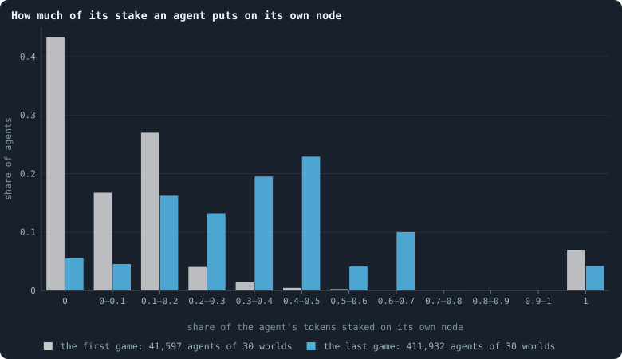

**How much of its stake an agent puts on its own node.** For every agent that staked in a game: the share of its tokens it put on its own node. '0' and '1' are exact: nothing at home, everything at home. Grey: the game of iteration 0, played by the founders and their first children, whose brains no selection has touched yet. Blue: the game of iteration 1,499.

> [!example]- How to make this figure
> **Runs.** The 30 baseline runs `B1-100000-s001` … `B1-100000-s030`: the baseline B1 at 100,000 tokens, seeds 1 to 30, 1,500 iterations each (every setting is listed in [Thirty worlds](b1-lives-and-wealth.md#thirty-worlds)). They are made with `python3 gol_lab.py run E10`.
>
> **Data.** From each run's frames, `GraphOfLifeRuns/<run>/frames/`, read with `gol_store.read_frame(run, index)`; frame `2·t` is iteration *t* after reproduction and frame `2·t + 1` after the game.
>
> 1. In the frames of iteration 0 and 1,499 with `phase` 2, read `decisions.allocations`: for each agent, `alloc[0]` is what it staked on its own node (its first target is itself) and `tokens` all it staked.
> 2. Put `alloc[0] / tokens` into the bins; divide each count by the number of agents.
>
> **To make it again:** `python3 book_figures.py game`.
<!-- /figure -->

The founders and their first children have brains that nobody selected, and
they are extreme. In the first game, 43% of them put **nothing** on their own
node, and 7% put **everything** there. By the last game both extremes have
almost gone: 5.5% stake nothing at home, and 4.2% everything. Most agents put
between a tenth and two thirds of their tokens on their own node. The mean
share rose from 0.14 to 0.38.

The first game differs from that of the worlds of 10,000 tokens. There, 38%
staked nothing at home, 12% everything, and the mean share was 0.25. The
reason is the starting ring
([The world: tokens, agents and a network](the-world.md)). Each of the 1,000
founders here starts with *k* = max(⌊1,000 / 100⌋, 5) = 10 neighbours. The
100 founders of a small world had 4: there *k* = 5, and an odd *k* is wired
as *k* − 1. A brain that splits its tokens between more candidates puts a
smaller share on any one of them, its own node included. By the last game the
two sizes agree (0.39 at 10,000 tokens).

Why do the bars of the last game have peaks? Agents hold few tokens: half of
all agents hold 5 or fewer
([How unequal is a world, and who stays rich](b1-lives-and-wealth.md#how-unequal-is-a-world-and-who-stays-rich)).
And they stake whole tokens. An agent with 3 tokens can put only 0, ⅓, ⅔ or
all of them at home; one with 2, only 0, ½ or all. So the shares cluster at
simple fractions.

### How agents stake

<!-- figure game/doctrine -->
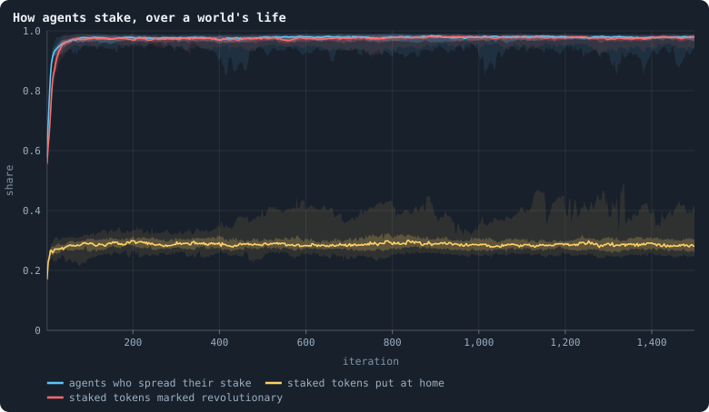

**How agents stake, over a world's life.** After every game of the 30 baseline worlds. Blue: the share of the agents that staked who spread their tokens over several candidates rather than putting all on one (`spreadShare`). Yellow: of all tokens staked, the share staked by agents on their own node (`selfAllocationShare`). Red: of all tokens staked, the share marked revolutionary (`revoltShare`). For each, the line is the median of the worlds at each iteration, the darker band holds the middle half of them (from the 25th to the 75th percentile) and the paler band nine in ten (5th to 95th) ([Bands](statistics.md#bands-many-worlds-in-one-figure)).

> [!example]- How to make this figure
> **Runs.** The 30 baseline runs `B1-100000-s001` … `B1-100000-s030`: the baseline B1 at 100,000 tokens, seeds 1 to 30, 1,500 iterations each (every setting is listed in [Thirty worlds](b1-lives-and-wealth.md#thirty-worlds)). They are made with `python3 gol_lab.py run E10`.
>
> **Data.** From each run's `GraphOfLifeRuns/<run>/stats.jsonl`, which holds one row per recorded phase: `phase` 1 is the world just after reproduction, `phase` 2 just after the game, and every statistic is a field of the row (see [What a run records](runs-and-records.md#what-a-run-records)).
>
> 1. Take the rows with `phase` = 2 and the statistics `spreadShare`, `selfAllocationShare`, `revoltShare` (`a/b` is the row's `a` divided by its `b`; [Staking at home](b1-the-game-and-its-flows.md#staking-at-home-and-keeping-ones-node) defines each).
> 2. Cut the 1,500 iterations into 600 stretches of 2.5 and take each world's mean in each stretch.
> 3. In each stretch, take the median, the 25th and 75th and the 5th and 95th percentiles of those means over the worlds that still have a value there (a world that died has none after its death).
>
> **To make it again:** `python3 book_figures.py game`.
<!-- /figure -->

Three shares change over the life of the worlds:

- **Spreading becomes the rule.** In the first game, 50% of the agents that
  staked spread their tokens over several candidates, in the median world.
  That is about what random brains give, since the choice turns on which of
  two random outputs is larger. From iteration 500 on, it is 98%.
- **Nearly every token is revolutionary.** The share of staked tokens marked
  revolutionary rose from 49% in the first game to 97%. So nearly every stake
  on a neighbour's node counts for a coalition against that node's largest
  staker.
- **Tokens at home**, counted as a share of all staked *tokens*, rose from 13%
  in the first game to 29%. That is lower than the average agent's share
  (0.38 in the last game, above), because here each agent counts by its
  tokens. The richer an agent, the smaller the share it keeps at home.

At 10,000 tokens the same three shares went from 49%, 50% and 25% to 98%,
97% and 30%: the same game, from a different start.

### Who wins the nodes

A node on which anyone staked has four possible outcomes. It is won by the
agent living on it or by a neighbour. And the winner is either the largest
single staker, or a member of a coalition that outweighed the largest staker.

<!-- figure game/winners -->
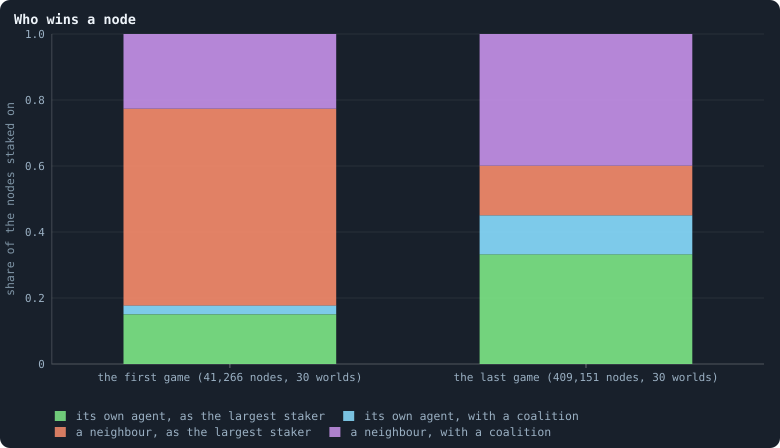

**Who wins a node.** Every node on which anyone staked in the game, by who won it: the agent living on it (green and cyan) or one of its neighbours (orange and violet), and whether the winner was the largest single staker (green, orange) or the member of a coalition that outweighed the largest staker (cyan, violet; see [How a coalition takes a node](rules-in-detail.md#how-a-coalition-takes-a-node)). Each column adds up to 1. Left: the game of iteration 0; right: the game of iteration 1,499.

> [!example]- How to make this figure
> **Runs.** The 30 baseline runs `B1-100000-s001` … `B1-100000-s030`: the baseline B1 at 100,000 tokens, seeds 1 to 30, 1,500 iterations each (every setting is listed in [Thirty worlds](b1-lives-and-wealth.md#thirty-worlds)). They are made with `python3 gol_lab.py run E10`.
>
> **Data.** From each run's frames, `GraphOfLifeRuns/<run>/frames/`, read with `gol_store.read_frame(run, index)`; frame `2·t` is iteration *t* after reproduction and frame `2·t + 1` after the game.
>
> 1. Read frame 1 of each of the 30 runs (the game of iteration 0) and frame 2,999 of the 30 that reached it (the game of iteration 1,499).
> 2. For every entry of `decisions.winners`, note whether `winner` is the `node` itself, and whether `revolt` is true (the node was won by a coalition).
> 3. Count the four kinds over all runs of a column, divide by the number of entries, and stack them.
>
> **To make it again:** `python3 book_figures.py game`.
<!-- /figure -->

In the **first game**, 82% of the nodes went to a neighbour. Most of them
(60% of all nodes) went to a neighbour that simply staked the most there, and
23% to a coalition. The founders' random brains, each with ten neighbours to
stake on, left their own nodes open. At 10,000 tokens, with four neighbours
each, 72% went to a neighbour.

In the **last game**, the agent living on a node won it 45% of the time. It
won 33% of the nodes as the largest staker, and 12% with a coalition.
Neighbours won 55%, most of
them (40% of all nodes) as members of a coalition. **Coalitions decided half
of all nodes** (12% + 40%), as at 10,000 tokens.

<!-- figure game/kept-taken -->
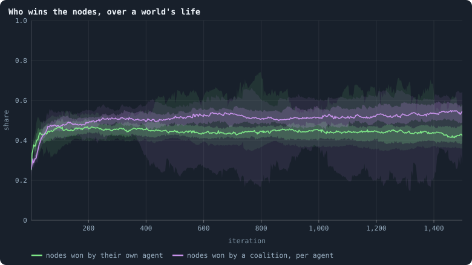

**Who wins the nodes, over a world's life.** After every game of the 30 baseline worlds. Green: of all nodes on which anyone staked, the share won by the agent living on it (`heldHomeShare`). Violet: the number of nodes won by a coalition, divided by the number of agents at the start of the game (`revolutions/nodes_before`). For each, the line is the median of the worlds at each iteration, the darker band holds the middle half of them (from the 25th to the 75th percentile) and the paler band nine in ten (5th to 95th) ([Bands](statistics.md#bands-many-worlds-in-one-figure)).

> [!example]- How to make this figure
> **Runs.** The 30 baseline runs `B1-100000-s001` … `B1-100000-s030`: the baseline B1 at 100,000 tokens, seeds 1 to 30, 1,500 iterations each (every setting is listed in [Thirty worlds](b1-lives-and-wealth.md#thirty-worlds)). They are made with `python3 gol_lab.py run E10`.
>
> **Data.** From each run's `GraphOfLifeRuns/<run>/stats.jsonl`, which holds one row per recorded phase: `phase` 1 is the world just after reproduction, `phase` 2 just after the game, and every statistic is a field of the row (see [What a run records](runs-and-records.md#what-a-run-records)).
>
> 1. Take the rows with `phase` = 2 and the statistics `heldHomeShare`, `revolutions/nodes_before` (`a/b` is the row's `a` divided by its `b`; [Staking at home](b1-the-game-and-its-flows.md#staking-at-home-and-keeping-ones-node) defines each).
> 2. Cut the 1,500 iterations into 600 stretches of 2.5 and take each world's mean in each stretch.
> 3. In each stretch, take the median, the 25th and 75th and the 5th and 95th percentiles of those means over the worlds that still have a value there (a world that died has none after its death).
>
> **To make it again:** `python3 book_figures.py game`.
<!-- /figure -->

The change happened in the first few hundred iterations, and then held. From
iteration 500 on, the median world's agents kept their node in 44% of games.
The number of nodes won by a coalition was 51% of the number of agents (45%
and 52% at 10,000 tokens).

That 45% is an average over very different places.
[Where tokens flow](b1-the-game-and-its-flows.md#where-tokens-flow) sorts the nodes by their
connections. An agent with one connection keeps its node in 74% of games, an
agent with fifty or more in only 2%. On a node with *d* connections, the
agent living there is one of *d* + 1 stakers. Agents spread their stakes
almost evenly over everyone they can reach. So on a hub, the agent living
there wins about as often as any one of its stakers would. **Hubs are places,
not individuals**: the brain on a hub is replaced in nearly every game.

### Do the worlds agree?

<!-- figure game/settled -->
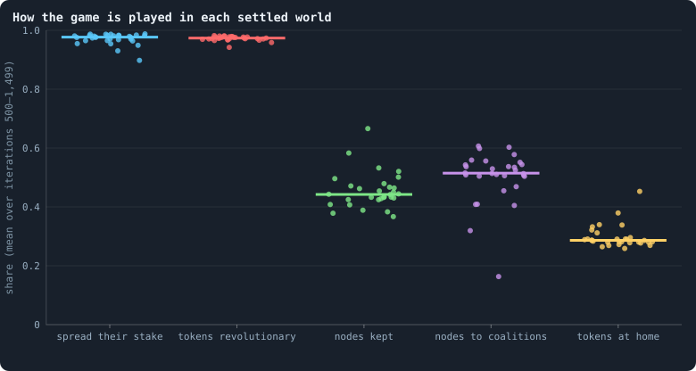

**How the game is played in each settled world.** One dot per world: its mean over iterations 500 to 1,499 of each statistic of the two figures above; the bar is the median of the 30. From left: the share of stakers who spread their stake, the share of staked tokens marked revolutionary, the share of nodes kept by their own agent, nodes won by a coalition per agent, and the share of staked tokens put at home. The dots are spread sideways only so that they do not hide each other.

> [!example]- How to make this figure
> **Runs.** The 30 baseline runs `B1-100000-s001` … `B1-100000-s030`: the baseline B1 at 100,000 tokens, seeds 1 to 30, 1,500 iterations each (every setting is listed in [Thirty worlds](b1-lives-and-wealth.md#thirty-worlds)). They are made with `python3 gol_lab.py run E10`.
>
> **Data.** From each run's `GraphOfLifeRuns/<run>/stats.jsonl`, which holds one row per recorded phase: `phase` 1 is the world just after reproduction, `phase` 2 just after the game, and every statistic is a field of the row (see [What a run records](runs-and-records.md#what-a-run-records)).
>
> 1. For each run, average each statistic over the rows with `phase` = 2 and 500 ≤ `iteration` ≤ 1,499.
> 2. Draw one dot per run and statistic, and a bar at the median.
>
> **To make it again:** `python3 book_figures.py game`.
<!-- /figure -->

Remarkably well, with one kind of exception. Over the settled life, 23 of the
30 worlds have between 96% and 99% of their stakers spreading. Their agents
keep their node in 37% to 48% of games. Coalitions win nodes numbering 47% to
61% of the agents, and 26% to 31% of the staked tokens go home.

In the other seven, one agent became a hub joined to a tenth of the world or
more
([How much does the seed decide?](b1-the-network-size-and-scaling.md#how-much-does-the-seed-decide)). They
lie apart, in the order of their hubs. Take the world with seed 28, whose hub
is joined to 58% of all agents. There, agents keep their node in 67% of
games, and coalitions win nodes numbering only 16% of the agents. And 45% of
the staked tokens go home, while 90% of stakers spread. A leaf of a star has
two candidates, its own node and the hub's. With a few tokens, it outstakes
the single token the hub puts on its node
([The largest and the smallest](b1-lives-and-wealth.md#the-largest-and-the-smallest)).

At 10,000 tokens, where hubs were smaller, all 26 surviving worlds lay
together. They had 95% to 99% spreading, 39% to 52% of nodes kept, and 41% to
56% won by coalitions per agent. Apart from its stars, every world ends up
playing the game in much the same way, whatever its founders started with.

### What we learned (how the game is played)
- **Brains spread mostly by conquest.** In a settled world of about 14,400
  agents, about 56% of nodes, some 8,000, go to a neighbour in every game.
  Each takes on the winner's brain. Against that, about 500 children are
  born per iteration
  ([Births, deaths and ages](b1-lives-and-wealth.md#births-deaths-and-ages)). A brain's
  descendants are mostly the nodes it conquers, not its children.
- **The game is a game of coalitions.** 97% of staked tokens are marked
  revolutionary. So a node goes, nearly always, to one of its other stakers
  when together they put more on it than its largest single staker did. That
  winner may be the agent living there.
- **The stakes are nearly an even split.**
  [Where tokens flow](b1-the-game-and-its-flows.md#where-tokens-flow) shows that agents stake on
  almost all of their candidates. They keep a little more than an even share
  at home, which is the rules' rounding of whole tokens, not the brains. A
  game moves tokens almost as a random walk would.
- **The behaviour converges, by selection, and early.** The founders' random
  brains play every way there is; every world but the stars ends up at
  nearly the same shares. Selection set them:
  [What the brains are like](what-the-brains-are-like.md) finds the brains'
  constants (few children, the stake spread, every token revolutionary)
  made alike in every world.
  [Does evolution keep going?](how-to-tell-a-world-that-keeps-evolving.md)
  plays the brains of each [era](measuring-evolution.md#eras-contests-and-invasions-does-a-world-keep-getting-better "Brains of a world at two moments, its eras, played against each other: do the later ones win?") against their founders' in ten worlds of
  5,000 tokens. By iteration 50 they hold nine tenths of a contested world,
  and no later era does better than the one before it.
  [Do the brains matter?](do-the-brains-matter.md) compares worlds whose
  brains never change.

### How this was made (how the game is played)
Every figure of this page says, folded beneath it, which runs it reads and
how. To make every figure of this page again: `python3 book_figures.py game`.

#### The runs of Experiment 10 (how the game is played)
<!-- runs E10 -->
> [!info]- The runs behind this page
> **30 runs.** Every condition below is run once for every seed (1 to 30), for 1,500 iterations — or until its world dies out. Every setting is that of the baseline **B1** (the algorithm exactly as a new run is offered it) unless the condition changes it.
>
> - **baseline** — changes nothing: B1 as it is; 100,000 tokens. Runs `B1-100000-s001` … `B1-100000-s030`.
>
> To make these runs again: `python3 gol_lab.py run E10`, or ▶ in the Research Notebook tab of a computer running `gol_server.py`. Each run writes its settings, seed and engine version beside its frames, in `GraphOfLifeRuns/<run>/meta.json` and `provenance.json`.

> [!info]- Every setting of these runs
> | setting | baseline | what it is |
> |---|---|---|
> | [`total_tokens`](settings.md#total_tokens) | 100,000 | The number of tokens in the world, *T*. It never changes during a run. |
> | [`n_nodes`](settings.md#n_nodes) | 0 | How many founders the world starts with. 0 means one founder per hundred tokens: *n* = ⌊*T* / 100⌋. |
> | [`k_neighbors`](settings.md#k_neighbors) | 0 | How many neighbours each founder starts with in the ring. 0 means *k* = max(⌊*n* / 100⌋, 5); an odd *k* is wired as *k* − 1. |
> | [`rewire_p`](settings.md#rewire_p) | 0.2 | In the starting ring, the probability that a connection is moved to a founder chosen at random (Watts–Strogatz). |
> | [`hidden_layers`](settings.md#hidden_layers) | 50, 45, 40, 35, 30 | The widths of the brain's hidden layers, in order from input to output. |
> | [`hidden_activation`](settings.md#hidden_activation) | sigmoid | The curve each hidden unit applies to its sum: `sigmoid`, which passes on at most a quarter of a change, so that deep brains barely respond to what they see, or `tanh`, the same S-shape centred on zero, through which a change still passes in several layers. |
> | [`brain_kind`](settings.md#brain_kind) | float16 | How weights are stored: `float` (64-bit), `float16` (16-bit, computed in 64-bit) or `binary` (−1, 0, +1). |
> | [`brain_bits`](settings.md#brain_bits) | 16 | Only for binary brains: how many input rows encode one number. Unused by float and float16 brains. |
> | [`message_amount`](settings.md#message_amount) | 30 | How many numbers one message holds. Each agent sends one message to itself and one to each neighbour, every phase. |
> | [`random_input_amount`](settings.md#random_input_amount) | 5 | How many random numbers, drawn uniformly from −2 to 2, a brain reads per neighbour, every time it looks. |
> | [`exchange_messages`](settings.md#exchange_messages) | on | Whether agents send and read messages at all. |
> | [`message_prepass`](settings.md#message_prepass) | on | Whether every phase begins with an extra look in which agents only write messages, so the look that acts reads messages written this phase. |
> | [`allow_handover`](settings.md#allow_handover) | on | Whether a parent may move some of its own connections to its newborn child. |
> | [`allow_revolutions`](settings.md#allow_revolutions) | on | Whether a coalition of smaller stakers can take a node from its largest staker (see the note *How a coalition takes a node*). |
> | [`contest`](settings.md#contest) | largest | Who takes a contested node: the `largest` stake as the game weighs it, or a staker drawn by `lottery` with a chance in proportion to its stake (needs revolutions off). |
> | [`allocation`](settings.md#allocation) | full | How the game's stakes are placed: all at once (`full`), or a token at a time in rounds with the game as it stands in view, the poorest done first (`weakest_first`) or the richest starting alone (`strongest_first`), as the original engine played. |
> | [`allow_gifting`](settings.md#allow_gifting) | off | Whether agents may give tokens to neighbours during reproduction. Off in both baselines; on in a few pilots, in Experiment 24 and in half the worlds of the screen. |
> | [`random_decisions`](settings.md#random_decisions) | off | The control: every number a brain would produce is replaced by a random draw from the standard normal distribution. |
> | [`prune_after`](settings.md#prune_after) | blotto | After which phase connections that carried no tokens are cut: `blotto` (the game), `reproduction`, or `both`. |
> | [`inactive_window`](settings.md#inactive_window) | phase | How long a connection may go unused: `phase` means it must carry tokens in the phase being judged; `iteration` allows the two last phases. |
> | [`redistribution`](settings.md#redistribution) | uniform | How the tokens of removed agents are shared: `uniform` gives every survivor the same chance at each token; `by_tokens` weights by what a survivor holds; `poorest` raises the poorest to one common level first; `newborns` gives them to this iteration's children, `parents` to their parents, once per child (both `uniform` in an iteration without births); `children` leaves each dead agent's estate to its own living children (`uniform` where there are none); `local` lets each estate flow through the network to the nearest living agents, split evenly at every step. |
> | [`tokens_created_per_phase`](settings.md#tokens_created_per_phase) | 0 | Tokens added to the world at every cleanup. 0 keeps the supply fixed. |
> | [`mutate_on_replication`](settings.md#mutate_on_replication) | off | Whether a brain changes only when it is copied — into a newborn, or into a node its owner has just won — instead of also after every game, wherever it sits. |
> | [`incumbency`](settings.md#incumbency) | 1.0 | How many times over an agent's stake on its own node counts when the game decides who takes the node. 1 is the old rule. |
> | [`birth_links`](settings.md#birth_links) | 0 | How many of its parent's neighbours a newborn is joined to, drawn at random, besides its parent itself; 0 leaves every link to the brain's choice. |
> | [`mend_on_death`](settings.md#mend_on_death) | off | Whether the neighbours of an agent that dies are joined up where its death would leave them in separate pieces. |
> | [`prune_needs`](settings.md#prune_needs) | 0 | How many neighbours the two ends of an unused connection must share for it to be cut; 0 cuts every unused connection. |
> | [`valence`](settings.md#valence) | 0 | The most connections an agent's brain may choose to hold (0 = no limit). An agent at its limit cannot have a child. |
> | [`link_token`](settings.md#link_token) | off | Whether every link holds one token: its maker pays for it, a lapsing link gives it back to one of its ends, and a link of a dead agent to the end that lives on, so the links can never outnumber the tokens. |
> | [`link_upkeep`](settings.md#link_upkeep) | off | Whether an agent may pay a token an iteration to keep a link, each brain deciding for each neighbour: `paid_or_used` keeps a link that was paid for or used, `paid_only` only one that was paid for; `off`, only use keeps a link. |
> | [`upkeep_to`](settings.md#upkeep_to) | end | Where a link's upkeep goes: to the link's other end (`end`), or into the estate of the dead (`estate`), shared out by the world's redistribution rule. |
> | [`keep_home`](settings.md#keep_home) | 0.0 | The share of an agent's tokens — rounded up, never less than one — that stays on its own node whatever its brain says; a parent also keeps one. 0 is the old rule. |
> | [`max_age`](settings.md#max_age) | 0 | The age at which an agent dies (0 = never); its tokens are shared out like those of any other dead agent. |
> | [`buy_life`](settings.md#buy_life) | off | Whether an agent that has reached max_age may live on by paying one token an iteration into the estate of the dead — never its last, so one with a single token left dies. Needs max_age. |
> | [`min_child`](settings.md#min_child) | 1 | The fewest tokens a child can be born with; a parent that would give less has no child. |
> | [`child_floor`](settings.md#child_floor) | fixed | The least a child may start with: min_child alone (fixed), or also the median holding of its parent's neighbours (neighbours), so that a world grows only as rich as it is. |
> | [`mix_at_birth`](settings.md#mix_at_birth) | off | Whether a newborn's brain is its parent's mixed with a mate's — one of the parent's neighbours, drawn at random — each hidden unit whole from one or the other by an even chance, before it mutates; off, a newborn has a copy of its parent's brain. |
> | [`mix_mates`](settings.md#mix_mates) | any | Under mix_at_birth, who may be the mate: any neighbour of the parent, or only parents — a neighbour with a living child of its own (with none, the newborn's brain is a copy). |
> | [`mate_pays`](settings.md#mate_pays) | off | Under mix_at_birth, whether the mate pays the child as many tokens as the parent gave it, as far as it can and never its last. |
> | [`self_message`](settings.md#self_message) | own | What an agent writes to itself, which each neighbour reads: what its own column says (own), or the largest, number by number, of what it writes to anyone (largest), so that news one column marks reaches every neighbour. |
> | [`link_search`](settings.md#link_search) | off | Whether an agent may reach beyond its neighbours to propose a link: off; jump, a walk as many steps long as the tokens it spends in one iteration, with a link proposed where it ends; walk, a scout that goes one step further in every iteration it pays for; or reach, a jump whose steps are free, as many as the tokens it holds would pay for. A paid step costs one token, paid to the agent it enters, and never the last. |
> | [`link_steering`](settings.md#link_steering) | random | Which way each step of a search goes: to a neighbour drawn at random, or to the one the searcher would most like a link with (looking). |
> | [`link_consent`](settings.md#link_consent) | mutual | Who has to agree to a link a search proposes: both ends (mutual), or only the one who proposes (forced). Nobody at its valence gets a new link either way. |
> | [`proto`](settings.md#proto) | none | Rules first played in the pilots' prototype, by name: came_from and helped_by (an input row each), contest = lottery, pool by genotype or family, kin_sense, tag_rate, mate_pays, grow, unit_token, link_token. Empty in every run but those that ask for one; only the prototype's world plays them (see the settings note). |
> | [`mutation_probability`](settings.md#mutation_probability) | 0.2 | The probability that a brain changes when it is copied to a child, and again, for every brain, after every game. |
> | [`mutation_noise_std`](settings.md#mutation_noise_std) | 0.2 | How large a change to one weight is: a normal draw with standard deviation this times 1/√(fan-in) of its layer. |
> | [`mutation_sparsity`](settings.md#mutation_sparsity) | 0.1 | The share of a brain's numbers a change touches; also the probability, for each weight matrix and bias vector, of a rarer reset that redraws that share of it. |
> | [`extinction_threshold`](settings.md#extinction_threshold) | 20 | A run stops, as extinct, when an iteration ends (after its game) with this many agents or fewer. |
> | seeds | 1 to 30 | one run per seed |
> | iterations | 1,500 | how far each run goes, unless its world dies first |
>
> A value in **bold** differs from the baseline B1.
<!-- /runs -->

## Where tokens flow

In every game, each agent stakes all its tokens on itself and its neighbours,
and whoever wins a node keeps what was staked on it. In a settled B1 world, 30%
of the tokens stay home, 51% are matched by a stake coming back, and only 20%
move one way. The brains spread their tokens almost evenly, so a game is close
to a random walk of tokens, and wealth follows connections. Most connections
carry one or two tokens a game, one each way, and in B1 a connection that
carries nothing is cut. Once returned stakes cancel, almost nothing goes round
in loops, in any world. How much goes round before cancelling is set by one
rule, not by the brains: whether a link must carry tokens to survive.

### Where the tokens flow

In every game, each agent stakes all its tokens on its own node and on its
neighbours' nodes. Every token staked ends up with whoever wins the node it was
staked on. So tokens move along the connections, game after game.
[Gains and losses](b1-lives-and-wealth.md#gains-and-losses-who-gains-who-loses-and-the-share-out) follows the agents through a game: who
gains, who loses. This section follows the tokens.

Where does each staked token go, and how much of it comes back? Does the whole
movement obey a simple law? It does, nearly, and the law explains several
findings of other pages at once.

The worlds here are the thirty B1 worlds of 100,000 tokens of Experiment 10
([Thirty worlds](b1-lives-and-wealth.md#thirty-worlds)). This section was first
written from the thirty worlds of 10,000 tokens. Where those differ, both
numbers are given.

#### The budget of a game (where tokens flow)
Start with the bookkeeping. In every game of these worlds, exactly 100,000
tokens are staked: every token, by whoever holds it. Each staked token lands in
one of three places ([Token flow](measuring-tokens.md#measuring-the-flow-token-flow-lightning-and-circulation)):

1. on the staker's **own node**;
2. on a neighbour's node, **matched** by a stake coming back. Say A puts 5 on
   B's node, and B puts 3 on A's. Then 3 tokens go each way and cancel:
   neither balance changes because of them;
3. on a neighbour's node, **one way**: the 2 left over in the example. Only
   these move tokens between agents.

<!-- figure flow/budget -->
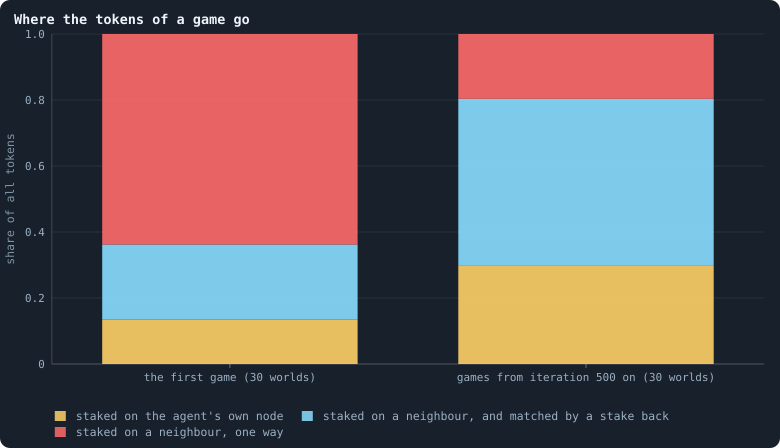

**Where the tokens of a game go.** Every token is staked in every game. Yellow: the share staked by agents on their own node. Cyan: staked on a neighbour's node, but cancelled by what that neighbour staked back — if A puts 5 on B's node and B puts 3 on A's, 3 tokens each way cancel. Red: what is left after cancelling, flow with a direction ([Token flow](measuring-tokens.md#measuring-the-flow-token-flow-lightning-and-circulation)). Left: the game of iteration 0, pooled over the 30 worlds; right: every game from iteration 500 on of the 30 worlds, pooled. Exactly 100,000 tokens are staked in each game.

> [!example]- How to make this figure
> **Runs.** The 30 baseline runs `B1-100000-s001` … `B1-100000-s030`: the baseline B1 at 100,000 tokens, seeds 1 to 30, 1,500 iterations each (every setting is listed in [Thirty worlds](b1-lives-and-wealth.md#thirty-worlds)). They are made with `python3 gol_lab.py run E10`.
>
> **Data.** From each run's `GraphOfLifeRuns/<run>/stats.jsonl`, which holds one row per recorded phase: `phase` 1 is the world just after reproduction, `phase` 2 just after the game, and every statistic is a field of the row (see [What a run records](runs-and-records.md#what-a-run-records)).
>
> 1. Take the rows with `phase` = 2: `tokens` (all staked), `totalFlow` (staked on others) and `netFlowShare` (the share of that flow left after cancelling).
> 2. Sum over the rows: at home = Σ `tokens` − Σ `totalFlow`; cancelled = Σ `totalFlow` × (1 − `netFlowShare`); one way = Σ `totalFlow` × `netFlowShare`.
> 3. Divide each by Σ `tokens`.
>
> **To make it again:** `python3 book_figures.py flow`.
<!-- /figure -->

In the first game, 13% of the tokens stay home, 23% are matched and 64% go one
way. The founders of these worlds have ten neighbours each. They keep less at
home than the founders of a world of 10,000 tokens, which have four. There a
quarter stays home, a quarter is matched and a half goes one way.

In settled games, from iteration 500 on, 30% stays home, **51% is matched**
and only 20% goes one way. At 10,000 tokens the shares are 30%, 49% and 21%.
Most of what agents send to their neighbours is an exchange of equal amounts.
That is why half of all agents end a game with exactly what they had
([Gains and losses](b1-lives-and-wealth.md#gains-and-losses-who-gains-who-loses-and-the-share-out)).

#### Stakes that are returned

A matched stake needs a stake in each direction. How often does a stake get one
back?

<!-- figure flow/reciprocity -->
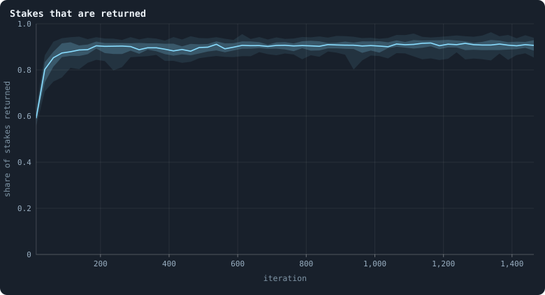

**Stakes that are returned.** Of all pairs (A, B) in a game where agent A staked at least one token on neighbour B's node, the share in which B also staked at least one token on A's — every 25 iterations, in the 30 baseline worlds. The line is the median of the worlds at each iteration, the darker band holds the middle half of them (from the 25th to the 75th percentile) and the paler band nine in ten (5th to 95th).

> [!example]- How to make this figure
> **Runs.** The 30 baseline runs `B1-100000-s001` … `B1-100000-s030`: the baseline B1 at 100,000 tokens, seeds 1 to 30, 1,500 iterations each (every setting is listed in [Thirty worlds](b1-lives-and-wealth.md#thirty-worlds)). They are made with `python3 gol_lab.py run E10`.
>
> **Data.** From each run's frames, read every 25 iterations by `book_figures.sample_pass` (frame `2·t` after the reproduction phase of iteration *t*, frame `2·t + 1` after its game; `gol_store.read_frame(run, index)`).
>
> 1. In the frame after the game of every 25th iteration, read `decisions.allocations`: for every agent A and every target B ≠ A with a stake > 0, note the pair (A, B).
> 2. Count the pairs whose reverse (B, A) is also there, divided by all pairs.
> 3. In each stretch, take the median, the 25th and 75th and the 5th and 95th percentiles of those means over the worlds that still have a value there (a world that died has none after its death).
>
> **To make it again:** `python3 book_figures.py flow`.
<!-- /figure -->

When A stakes on B, B stakes back on A in 90% of cases (the thirty worlds: 88%
to 93%; 92% at 10,000 tokens). Is that reciprocity, agents answering a stake
with a stake? Not necessarily.

Look at how widely agents stake (the next figure): they stake on 81% to 96% of
everyone they can. Suppose every agent picked its targets without regard to who
staked on it. B would still stake on A with about that probability. So a
reciprocity of 90% is what breadth alone would give. Real reciprocity would
mean that B stakes *more* on A *because* A staked on B. That is a question for
[Do agents cooperate?](do-agents-cooperate.md).

#### How widely agents stake

An agent with *d* connections has *d* + 1 **candidates**: its own node and its
neighbours' nodes. If it split its tokens evenly, it would put 1/(*d* + 1) of
them on each, home included.

<!-- figure flow/breadth -->
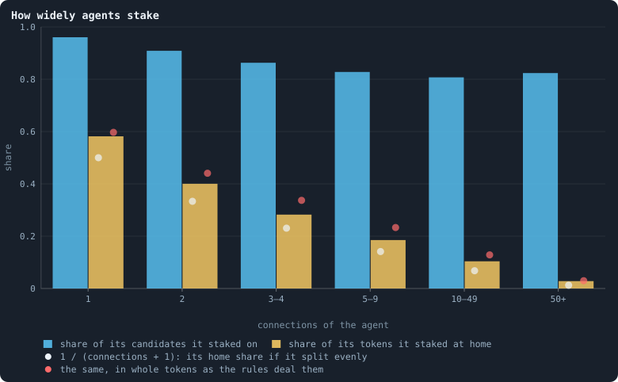

**How widely agents stake.** Agents at the start of a game, sorted by their number of connections. Blue: the share of their candidates (themselves and their neighbours) on which they staked at least one token. Yellow: the share of their tokens they staked on their own node. White dots: the home share an agent would have if it split its tokens evenly over all its candidates, 1/(d + 1), averaged over the class. Red dots: the same even split dealt out in whole tokens by the rules' own rounding ([Splitting tokens into whole numbers](rules-in-detail.md#splitting-tokens-into-whole-numbers)), which gives the tokens left over to the largest remainders, and, when all remainders tie, to the agent's own node first. From the games of every 100th iteration from 500 on, in the 30 worlds.

> [!example]- How to make this figure
> **Runs.** The 30 baseline runs `B1-100000-s001` … `B1-100000-s030`: the baseline B1 at 100,000 tokens, seeds 1 to 30, 1,500 iterations each (every setting is listed in [Thirty worlds](b1-lives-and-wealth.md#thirty-worlds)). They are made with `python3 gol_lab.py run E10`.
>
> **Data.** From each run's frames, read every 25 iterations by `book_figures.sample_pass` (frame `2·t` after the reproduction phase of iteration *t*, frame `2·t + 1` after its game; `gol_store.read_frame(run, index)`).
>
> 1. For every 100th iteration t from 500 on, take each agent's degree d in frame `2·t`.
> 2. In frame `2·t + 1`, read its entry of `decisions.allocations`: the number of `targets` (its candidates), how many of them got `alloc` > 0, and `alloc[0]` / `tokens` (its home share; its first target is itself).
> 3. Average by class of d; the white dots are the mean of 1/(d + 1) in each class.
> 4. Red dots: for every agent, `GraphOfLife._apportion` of equal scores over its candidates and its tokens; the share that lands on its own node, averaged by class.
>
> **To make it again:** `python3 book_figures.py flow`.
<!-- /figure -->

Agents stake on almost all their candidates: on 96% of them for agents with
one connection, falling to 81–82% for agents with ten or more. And their
**home share** follows the even split closely, a little above it:

| connections | 1 | 2 | 3–4 | 5–9 | 10–49 | 50+ |
|---|---|---|---|---|---|---|
| staked at home | 58% | 40% | 28% | 19% | 10% | 2.8% |
| even split, 1/(*d*+1) | 50% | 33% | 23% | 14% | 7% | 1.2% |
| even split, in whole tokens | 60% | 44% | 34% | 23% | 13% | 3.0% |

The extra at home is not the brains' doing. Tokens are whole, and an even split
rarely comes out even: an agent with 3 tokens and 2 candidates cannot stake 1.5
on each. The rules deal the tokens left over to the candidates with the largest
remainders ([Splitting tokens into whole numbers](rules-in-detail.md#splitting-tokens-into-whole-numbers)). In an
even split every remainder ties. So the leftovers go down the list of
candidates in order, and an agent's own node is always first.

Dealt out in whole tokens this way, an exact even split puts 60% at home for
an agent with one connection. For one with two, it puts 44%. The brains put a
little *less* at home than that.

Often there is not even a split to round. In the median world, 42% of agents
give every candidate a score of zero or below (58% at 10,000 tokens). Then the
rules split their tokens evenly by default
([What the brains are like](what-the-brains-are-like.md)). The brains that do
give positive scores give nearly the same one to every candidate: a brain's
outputs barely move with what it sees. So the evolved brains end up doing
something close to the simplest thing possible: spreading their tokens evenly
over everyone they can reach.

That is what blind brains do.
[Brains that see, and worlds that break](a-world-that-cannot-break.md#brains-that-see-and-worlds-that-break)
gives the brains one hidden layer instead of five. With it, what an agent sees
reaches what it stakes. A founder's brain passes on about 0.2 of a change in
what it sees, instead of 0.0006. These brains stake on one neighbour or two,
and their unused connections lapse. Their worlds need the rules of
[A world that cannot break](a-world-that-cannot-break.md#a-world-that-cannot-break)
and [Who dies, and why](a-world-that-cannot-break.md#who-dies-and-why) to hold
together.

#### The game as a random walk

Suppose, then, that every agent split its tokens **exactly** evenly. Follow a
single token at node *u*. In a game it goes to each of the *d*ᵤ + 1 candidates
of *u* with the same chance. Repeated game after game, that is a **random
walk** of tokens. At every step a token stays where it is or moves to a
neighbour, each with probability 1/(*d*ᵤ + 1). It is a "lazy" walk, because
staying is one of the choices.

How good is that description? For every agent at the start of a game, work out
the balance the even split would give it. That is the stakes it would receive,
minus the tokens it holds. Then set it against the balance it really ended
with.

<!-- figure flow/random-walk -->
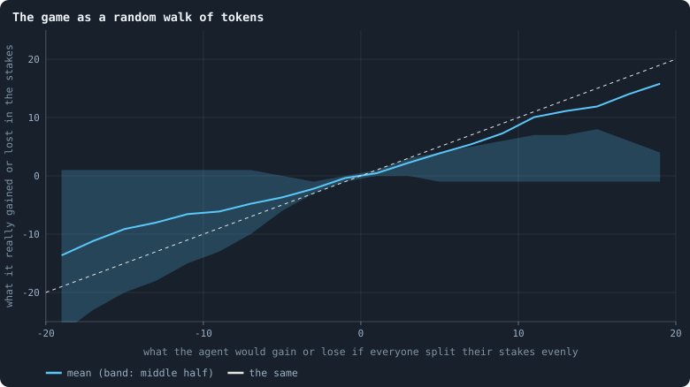

**The game as a random walk of tokens.** For every agent at the start of a game: x is the balance it would end the stakes with — the tokens staked on its node minus the tokens it held — if every agent split its tokens evenly over itself and its neighbours; y is the balance it really ended them with. Agents are binned by x in steps of 2; the line is the mean of y in each bin and the band its middle half. The dashed line is y = x. Over all 1,798,806 agents (the games of every 250th iteration from 500 on, 30 worlds), the straight line fitted to the points has slope 0.65, and the even split accounts for 34% of the variance (R², [Fitting a straight line](statistics.md#fitting-a-straight-line)); over the 23 worlds that are not held together by a single hub ([The largest and the smallest](b1-lives-and-wealth.md#the-largest-and-the-smallest)), slope 0.94 and 45%.

> [!example]- How to make this figure
> **Runs.** The 30 baseline runs `B1-100000-s001` … `B1-100000-s030`: the baseline B1 at 100,000 tokens, seeds 1 to 30, 1,500 iterations each (every setting is listed in [Thirty worlds](b1-lives-and-wealth.md#thirty-worlds)). They are made with `python3 gol_lab.py run E10`.
>
> **Data.** From each run's frames, read (frame `2·t` after the reproduction phase of iteration *t*, frame `2·t + 1` after its game; `gol_store.read_frame(run, index)`).
>
> 1. For every 250th iteration t from 500 on, read frame `2·t` (the start of the game): each agent's tokens τ and neighbours.
> 2. Even split: every agent u gives τ(u)/(d(u) + 1) to itself and to each neighbour; x(u) is what u receives minus τ(u).
> 3. Real: in frame `2·t + 1`, add up every `alloc` whose target is u; y(u) is that minus τ(u).
> 4. Bin by x and average y; fit y = a·x + b by least squares over all agents.
>
> **To make it again:** `python3 book_figures.py flow`.
<!-- /figure -->

Over 1,798,806 agents of the thirty worlds, the real balances follow the even
split's with a slope of only 0.65. A slope of 1 would mean that the real
balances move exactly as much as the even split's. The even split accounts for
34% of the variance, that is, of how much the real balances differ from agent
to agent.

But that is the stars speaking. Leave out the seven worlds held together by one
hub ([The largest and the smallest](b1-lives-and-wealth.md#the-largest-and-the-smallest)). Then
the slope is **0.94**, and the even split accounts for **45%**: exactly as in
the worlds of 10,000 tokens (0.94 and 46%). The median world, fitted on its
own, has 0.90.

In those worlds the brains move tokens almost exactly as much as the random
walk would, and in the same direction. The rest of the variance is what they do
differently, agent by agent.

The stars break the fit through a single agent each. A star has thousands of
leaves: agents whose one connection is the centre. The even split, worked in
fractions of a token, expects each leaf to send the centre half its tokens.
Dealt out in whole tokens, home first, a leaf with one token sends nothing, and
one with three sends one. So a star's leaves, holding about three tokens, send a
quarter of a token less each than the fractions say. Over twenty thousand
leaves, that is some five thousand tokens at one agent. A point that far out
tilts a straight line fitted to two million. The rounding of
[Splitting tokens into whole numbers](rules-in-detail.md#splitting-tokens-into-whole-numbers) is a small
correction for an agent, and a large one for a star.

A random walk on a network has a well-known resting state, and it takes two
lines to find. Write π(*u*) for the share of all tokens at node *u*. The walk is
at rest when, across every connection, as many tokens go one way as the other:

$$
\pi(u) \cdot \frac{1}{d_u + 1} = \pi(v) \cdot \frac{1}{d_v + 1}
\quad\text{for every connection } \{u, v\} .
$$

The left side is what *u* sends to *v* in a game: its share, split over its
*d*ᵤ + 1 candidates. The right side is what *v* sends back. The two are equal
if π(*u*) is proportional to *d*ᵤ + 1. So:

> [!summary] The resting state of the even split
> On a fixed network, tokens moved by the even split settle to
> τᵤ = *T* · (*d*ᵤ + 1) / Σᵥ (*d*ᵥ + 1): **every agent holds tokens in
> proportion to its number of connections plus one.**

Here *T* is the number of tokens in the world, and τᵤ what agent *u* holds.
This is the law behind several findings of other pages:

- agents with more connections hold more tokens
  ([How unequal is a world, and who stays rich](b1-lives-and-wealth.md#rich-agents-are-connected-agents));
- tokens run downhill, from agents richer than their neighbourhood to poorer
  ones ([Gains and losses](b1-lives-and-wealth.md#gains-and-losses-who-gains-who-loses-and-the-share-out));
- a rich agent with few connections drains away within a few games.

A world is never quite at rest, because the network keeps changing under the
tokens. [How properties scale together](b1-the-network-size-and-scaling.md#how-properties-scale-together)
measures how close it comes.
[The geometry of a world](b1-the-network-size-and-scaling.md#the-geometry-of-a-world) measures how fast a
random walk on such a network can settle at all.

#### Who keeps their node

The winner of a node, whose brain the node takes, is its largest staker. The
exception is a coalition of smaller stakers that outweighs it
([How a coalition takes a node](rules-in-detail.md#how-a-coalition-takes-a-node)). Under the even split, the
agent living on a node of degree *d* is one of *d* + 1 stakers of roughly equal
size there.

<!-- figure flow/kept -->
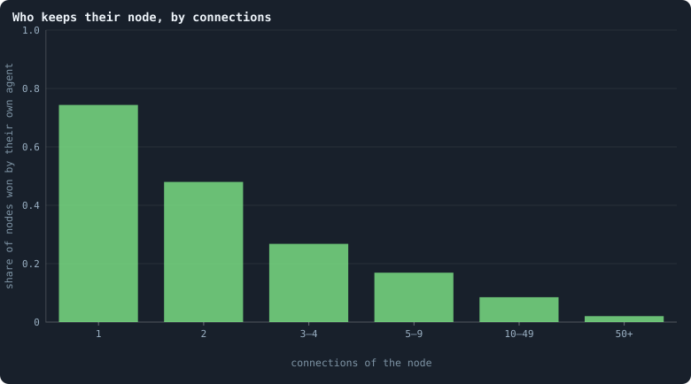

**Who keeps their node, by connections.** Every node on which anyone staked in a game, sorted by its number of connections at the start of the game; the share that was won by the agent living on it — whether as the largest staker or through a coalition. From the games of every 25th iteration from 500 on, in the 30 worlds.

> [!example]- How to make this figure
> **Runs.** The 30 baseline runs `B1-100000-s001` … `B1-100000-s030`: the baseline B1 at 100,000 tokens, seeds 1 to 30, 1,500 iterations each (every setting is listed in [Thirty worlds](b1-lives-and-wealth.md#thirty-worlds)). They are made with `python3 gol_lab.py run E10`.
>
> **Data.** From each run's frames, read every 25 iterations by `book_figures.sample_pass` (frame `2·t` after the reproduction phase of iteration *t*, frame `2·t + 1` after its game; `gol_store.read_frame(run, index)`).
>
> 1. For every 25th iteration t from 500 on, count each node's connections in frame `2·t`.
> 2. In frame `2·t + 1`, read `decisions.winners`: for each node, whether `winner` = `node`.
> 3. Pool over runs and frames, and divide kept by all, per class.
>
> **To make it again:** `python3 book_figures.py flow`.
<!-- /figure -->

The more connections a node has, the less often the agent living on it keeps
it:

| connections | 1 | 2 | 3–4 | 5–9 | 10–49 | 50+ |
|---|---|---|---|---|---|---|
| node kept by its agent | 74% | 48% | 27% | 17% | 9% | **2.0%** |

At 10,000 tokens the shares are the same, within a point or two. The pattern
is 1/(*d* + 1) again, raised a little by the rounding that hands the leftover
tokens to the agent's own node first. The agent on a node is one of *d* + 1
contenders, and wins about as often as any one of them would.

So a hub does not have an owner. The agent sitting on a node with a hundred
connections is replaced by a neighbour's brain in 98 games out of 100. **Hubs
are places, not individuals.** They hold many tokens because of where they are,
and the brains on them pass through. A brain cannot "become a hub"; it can only
be, for a game or two, the brain sitting on one.

### What crosses a connection

Whatever two agents stake on each other crosses the connection between them.
The section above followed the tokens through a whole world. This section looks
at the connections one at a time. How much crosses each one? How much of that
is cancelled by what comes back? And which connections carry nothing at all?

Why look at single connections? Because a connection lives only as long as
tokens keep crossing it. In B1, every connection that no token crossed in a
game is cut at the end of that game ([Every setting](settings.md),
`prune_after` and `inactive_window`). The viewer, the app that charts a run's
statistics ([What a run records](runs-and-records.md#what-a-run-records)), counts these cuts as
`prunedEdges`. So the flow on the connections is not only how tokens move: it
is what keeps B1's network standing. A connection that carries nothing for one
game is gone, and with it, perhaps, the only path between two parts of a world.

The second baseline changes this rule
([Building B2: a world that cannot break](a-world-that-cannot-break.md#a-world-that-cannot-break)).
In B2 an unused connection lapses only if its two ends share at least two
neighbours ([`prune_needs`](settings.md#prune_needs)). So no lapse can cut a
world in two. This section measures B1.

The flow is also where cooperation would first show. Two agents that keep
staking on each other keep their connection, and with it each other's tokens
within reach. And tokens that go round a loop and arrive back where they
started, the viewer's **lightning**, are the most organised flow there can be.
They are the subject of [Lightning in every world](#lightning-in-every-world).

#### How much crosses a connection

Every 25 iterations from 500 on, take every connection at the start of the
game. Add up what its two agents staked on each other in that game, both
directions together. Separately, cancel the smaller direction against the
larger, and see what is left.

<!-- figure connections/per-connection -->
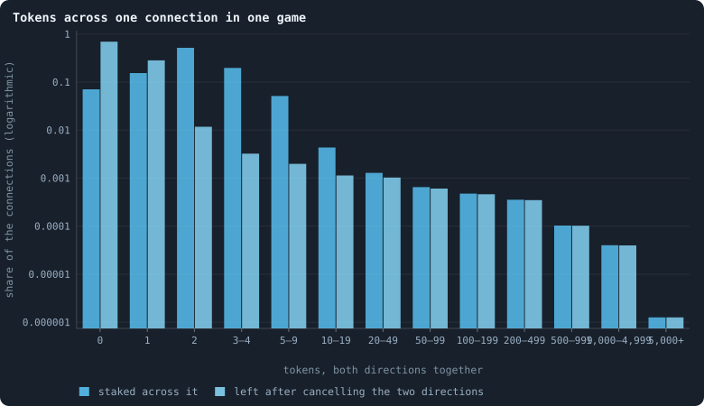

**Tokens across one connection in one game.** Every connection at the start of the games of every 25th iteration from 500 on, in the 30 worlds, pooled: how many tokens its two agents staked on each other in that game, both directions added (blue), and what is left when the smaller direction is cancelled against the larger (cyan; [Token flow](measuring-tokens.md#measuring-the-flow-token-flow-lightning-and-circulation)). A connection in the first class carried nothing and is cut at the end of the game.

> [!example]- How to make this figure
> **Runs.** The 30 baseline runs `B1-100000-s001` … `B1-100000-s030`: the baseline B1 at 100,000 tokens, seeds 1 to 30, 1,500 iterations each (every setting is listed in [Thirty worlds](b1-lives-and-wealth.md#thirty-worlds)). They are made with `python3 gol_lab.py run E10`.
>
> **Data.** From each run's frames every 25 iterations from 500 on, read by `book_chapters.connections.edge_flow`: the connections of frame `2·t` (the start of the game of t), `decisions.allocations` and the connections of frame `2·t + 1` (after it).
>
> 1. For every connection (a, b) of frame `2·t`: the tokens a staked on b and b on a, from `decisions.allocations` of frame `2·t + 1`.
> 2. Count the connections by the sum, and by the difference, in the classes shown.
>
> **To make it again:** `python3 book_figures.py connections`.
<!-- /figure -->

Most connections carry very little. Pooled over the thirty worlds, **52%**
carried exactly two tokens, 15% exactly one, 20% three or four, and 5% five to
nine. Fewer than one connection in a hundred carried ten tokens or more. But
the classes do not stop there. A few connections carry hundreds of tokens in a
game, and about one in a million carried five thousand or more. And **7%**
carried nothing at all.

The cyan bars show how much of this is an exchange. On **70%** of all
connections the two directions cancel exactly: as many tokens went each way.
That counts the 7% that carried nothing; of the connections that carried
anything, two thirds cancel. Almost all of the connections that carried two
tokens carried one each way. Where something is left, it is mostly a single
token: 28% of the connections moved one token net, and only 2% moved more.

[Do agents cooperate?](do-agents-cooperate.md) calls this a **handshake**, and
here it is seen from the connections. Two neighbours, each splitting a few
tokens evenly over a few candidates, put one token on each other.

#### Which connections carry nothing

In B1 the rule is simple. A connection across which no token was staked in a
game is cut at the end of that game. One across which anything was staked is
kept. Counted over every connection of the sampled games, the rule holds
without exception. Of those connections, 1,650,222 carried nothing, and every
one was cut; 29,186,620 carried something, and every one was kept.
(Connections with an end that died in the game are left out.) Which
connections are the empty ones?

<!-- figure connections/cut -->
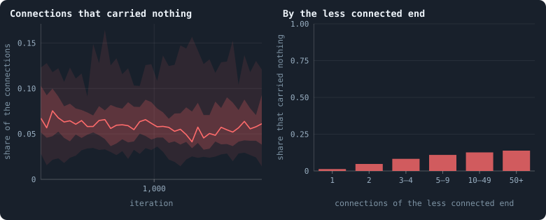

**The connections a game cuts.** Left: at the start of the game of every 25th iteration from 500 on, the share of the connections across which no token was staked in that game — the ones the game cuts; the line is the median of the worlds at each iteration, the darker band holds the middle half of them (from the 25th to the 75th percentile) and the paler band nine in ten (5th to 95th). Right: the same share, pooled over the games and worlds, for connections sorted by the number of connections of their less connected end.

> [!example]- How to make this figure
> **Runs.** The 30 baseline runs `B1-100000-s001` … `B1-100000-s030`: the baseline B1 at 100,000 tokens, seeds 1 to 30, 1,500 iterations each (every setting is listed in [Thirty worlds](b1-lives-and-wealth.md#thirty-worlds)). They are made with `python3 gol_lab.py run E10`.
>
> **Data.** From each run's frames every 25 iterations from 500 on, read by `book_chapters.connections.edge_flow`: the connections of frame `2·t` (the start of the game of t), `decisions.allocations` and the connections of frame `2·t + 1` (after it).
>
> 1. As above; a connection carried nothing if neither end staked a token on the other.
> 2. Sort the connections by the smaller of their two ends' degrees in frame `2·t`.
>
> **To make it again:** `python3 book_figures.py connections`.
<!-- /figure -->

In a settled game, **6%** of the connections carry nothing (the worlds: 3% to
12%). The share wanders with the world, higher in some stretches than in
others. And it is not the same for every connection. Sort the connections by
their less connected end. If that end has a single connection, the link is a
leaf's only one, and it is empty in 1.3% of games. A connection between two
agents with ten connections or more is empty in 13% to 14%.

Why? A leaf stakes on its only neighbour or keeps everything at home, and its
neighbour almost always stakes back on it. An agent with many connections and
few tokens cannot send a token across each. If its neighbour does not send one
either, the connection is gone. Every connection costs a token a game, from one
side or the other. [How a world breaks](b1-the-network-size-and-scaling.md#how-a-world-breaks) calls this the
price of a connection; here it is paid connection by connection.

The viewer counts the connections cut after every game as `prunedEdges`: 6.7%
of all connections in the median world (5.3% at 10,000 tokens). That is a
little more than the empty share at the start of a game, because connections
also die with their agents.

#### The flow, in round figures

After every game, the viewer sums up the flow on the connections in a few
numbers:

<!-- figure connections/round-figures -->
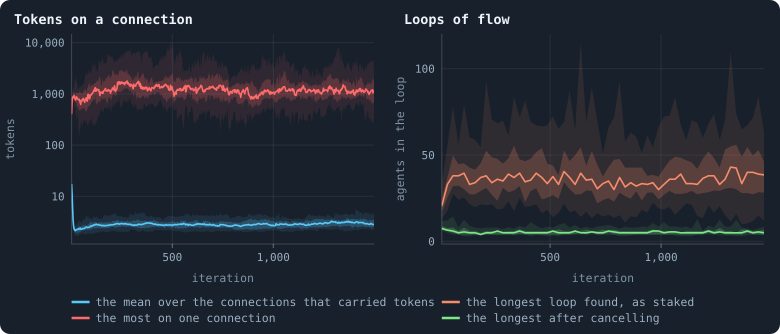

**Flow on the connections, and the loops it makes.** After every game of the 30 worlds. Left: the viewer's `meanEdgeFlow` — the tokens staked across a connection, over the connections something crossed — and `maxEdgeFlow`, the most across one, on a logarithmic axis. Right, every 25 iterations: the longest closed loop of flow the greedy peel of [Lightning](measuring-tokens.md#lightning-tokens-that-go-round) found in the flow as staked (`lightningLongest`) and in what is left after cancelling (`netLightningLongest`). The line is the median of the worlds at each iteration, the darker band holds the middle half of them (from the 25th to the 75th percentile) and the paler band nine in ten (5th to 95th).

> [!example]- How to make this figure
> **Runs.** The 30 baseline runs `B1-100000-s001` … `B1-100000-s030`: the baseline B1 at 100,000 tokens, seeds 1 to 30, 1,500 iterations each (every setting is listed in [Thirty worlds](b1-lives-and-wealth.md#thirty-worlds)). They are made with `python3 gol_lab.py run E10`.
>
> **Data.** From each run's `GraphOfLifeRuns/<run>/stats.jsonl`, which holds one row per recorded phase: `phase` 1 is the world just after reproduction, `phase` 2 just after the game, and every statistic is a field of the row (see [What a run records](runs-and-records.md#what-a-run-records)).
>
> 1. Take the rows with `phase` = 2: `meanEdgeFlow`, `maxEdgeFlow`, `lightningLongest` and `netLightningLongest`.
> 2. Cut the 1,500 iterations into 600 stretches of 2.5 and take each world's mean in each stretch.
> 3. In each stretch, take the median, the 25th and 75th and the 5th and 95th percentiles of those means over the worlds that still have a value there (a world that died has none after its death).
>
> **To make it again:** `python3 book_figures.py connections`.
<!-- /figure -->

- **The typical connection.** Over the connections something crossed, the
  mean flow is **3.0** tokens a game (3.7 at 10,000 tokens).
- **The busiest connection.** The most that crossed one connection in a game
  is about **1,400** tokens in the median world: 1.4% of all the tokens of the
  world. The busiest connection of a world of 10,000 tokens carried 640, 6.4%
  of its tokens. A larger world has busier single connections, but they carry
  a smaller part of the whole.
- **Loops of flow.** A quick, greedy search
  ([What a lightning is](#what-a-lightning-is)) finds closed loops of flow.
  The longest it finds is **41** agents long in the median world (20 at
  10,000 tokens). Once each pair's two directions cancel, the longest loop
  found is 5 or 6 agents. At 10,000 tokens it averages 2.2 over the games. A loop left after
  cancelling needs at least three agents, and in many games none was found at
  all.

What these loops are, and how much of the flow they carry, is the subject of
the next section.

### Lightning in every world

Could the flow carry tokens around loops, from A to B to C and back to A, like
money circulating in an economy? This section asks it first in the thirty B1
worlds of 100,000 tokens. Then it asks it in every world the notebook has made:
both rule sets, every size, every setting an experiment changed.

#### What a lightning is

In every game each agent splits its tokens over its own node and its
neighbours' nodes. A token staked on a neighbour's node **flows** along that
connection, from the agent to the neighbour. Draw an arrow for every such
token, and a game becomes a network of arrows: the flow.

A **lightning** is what the viewer calls a closed loop in that flow: A stakes on
B, B on C, and C back on A. A loop of *L* agents carries *L* tokens, one along
each of its arrows, and scores *L*². So one long circuit counts for more than
many short ones. Ecologists measure the same thing in food webs, as a *cycling
index*. The note [Lightning: tokens that go round](measuring-tokens.md#lightning-tokens-that-go-round) works through
the definition with an example. Why it matters:

- **Flow that goes round is flow that can keep going.** Tokens that run one way
  end up somewhere and stop; tokens that go round can circulate for ever. In
  physics, a current that closes on itself (a vortex, a loop of current) is a
  different thing from one that runs downhill. In an economy, a cycle of trade
  is a different thing from a transfer.
  [Physical inspiration](physical-inspiration.md) hoped for both kinds of flow
  to appear in these worlds.
- **Two agents that stake on each other already form a loop of length two.** A
  token from A to B and a token from B back to A *cancel*: on balance, nothing
  has moved. So every number below comes twice: for the flow as it was staked
  (*gross*), and for what is left after cancelling (*net*).

Finding the largest set of loops in a flow is as hard as some of the hardest
problems in computing. So the engine (`gol_lightning.py`) does not try. It
peels loops off greedily. It walks along the arrows, preferring agents it has
not visited yet, until an agent repeats. It takes that loop, removes one token
from each of its arrows, and starts again. Every count is therefore a **lower
bound**: there are at least this many tokens on loops, perhaps more. A run
records eight numbers, every 25th iteration:

| statistic | what it is |
|---|---|
| `cyclingShare` | the share of the staked flow the greedy search put on loops |
| `lightningLongest` | the longest loop it found, in agents |
| `lightningScore` | the sum over its loops of the length squared (long loops count for more) |
| `netFlowShare` | the flow left after cancelling, as a share of the flow staked |
| `netCyclingShare` | the share of that net flow on loops |
| `netLightningLongest`, `netLightningScore` | the longest net loop, and the score of the net loops |
| `flowImbalance` | half the sum over agents of the gap between flow in and flow out (counted positive either way), over the total: how much of the flow *must* run one way, whatever the loops are |

#### Do tokens go round?

Start with the thirty B1 worlds of 100,000 tokens. How much of their flow
goes round? Only bounds can be given ([Lightning](measuring-tokens.md#lightning-tokens-that-go-round)). The greedy
search finds some loops: a floor. Conservation sets a ceiling. A token that comes back to where it started
changes no balance. So an agent that ends a game with more or less than it
sent cannot have had all its flow in loops. At least the difference runs one
way.

<!-- figure flow/circulation -->
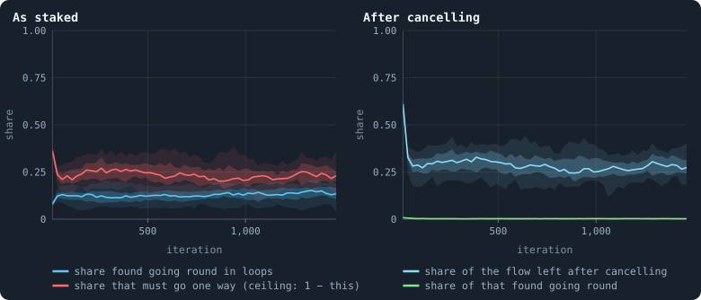

**Do tokens go round?** Left, on the flow as staked: the share of all tokens staked on neighbours that a greedy search could place in closed loops (blue; [Lightning](measuring-tokens.md#lightning-tokens-that-go-round)), and the share that conservation forbids from ever going round, because some agents receive more than they send (red) — so at most 1 − red can circulate. Right, after cancelling every stake against the one coming back: the share of the flow left (cyan), and of that, the share found in loops (green). Every 25 iterations, 30 worlds; the line is the median of the worlds at each iteration, the darker band holds the middle half of them (from the 25th to the 75th percentile) and the paler band nine in ten (5th to 95th).

> [!example]- How to make this figure
> **Runs.** The 30 baseline runs `B1-100000-s001` … `B1-100000-s030`: the baseline B1 at 100,000 tokens, seeds 1 to 30, 1,500 iterations each (every setting is listed in [Thirty worlds](b1-lives-and-wealth.md#thirty-worlds)). They are made with `python3 gol_lab.py run E10`.
>
> **Data.** From each run's `GraphOfLifeRuns/<run>/stats.jsonl`, which holds one row per recorded phase: `phase` 1 is the world just after reproduction, `phase` 2 just after the game, and every statistic is a field of the row (see [What a run records](runs-and-records.md#what-a-run-records)).
>
> 1. Take `cyclingShare`, `flowImbalance`, `netFlowShare` and `netCyclingShare` of the rows with `phase` = 2 (measured every 25 iterations).
> 2. In each stretch, take the median, the 25th and 75th and the 5th and 95th percentiles of those means over the worlds that still have a value there (a world that died has none after its death).
>
> **To make it again:** `python3 book_figures.py flow`.
<!-- /figure -->

On the flow as staked, [the budget of a game](#the-budget-of-a-game-where-tokens-flow) already
pins the answer down. Two
neighbours staking on each other form a loop of length 2. A token goes from A
to B, and one comes back from B to A. So every matched stake goes round.
Matched stakes are 51% of all tokens, which is 72% of the tokens staked on
neighbours (51 of the 71). That is a floor: at least 72% of the flow goes
round.

The ceiling comes from conservation, which forbids 23% of the flow from ever
going round (red), so at most 77% can. Between 72% and 77% of the flow as
staked goes round, then. Nearly all of it goes round in loops of two:
neighbours trading equal stakes back and forth. The greedy search (blue) hunts
for long loops, and places only 13% of the flow in the loops it finds. Beside
the 72% the matched stakes guarantee, that is a weak floor.

Now cancel every stake against the one coming back (right panel). No loop of
two is left, and 28% of the flow remains. Of that, the search finds only
**0.3%** in loops. The ceiling is not much higher. Cancelling changes no
agent's balance, so the imbalance stays the same, and at least
23.4/27.8 ≈ 84% of what is left must flow one way. Between 0.3% and 16% of the
net flow can go round, and the search finds almost nothing, as at 10,000
tokens.

A theorem says what that means. Any flow on a network can be split into two
parts ([Flows that go round](measuring-tokens.md#flows-that-go-round)). One part runs **downhill**,
from high to low along a "potential": a height that every agent has. The other
part **circulates**. This is the Helmholtz–Hodge decomposition (for networks,
Jiang, Lim, Yao and Ye 2011). A downhill flow can never go round: round a loop,
you would come back to the height you started from.

The net flow of a game is almost entirely of the downhill kind. Tokens move
from hills to valleys, as heat does: from agents richer than their
neighbourhood to agents poorer than it. The few loops that survive cancelling
are tokens really going round, but they carry almost nothing.

#### Every world

Is it the same in every world the notebook has made? The table of every world
(`research/atlas/across.py`;
[Every world side by side](every-world-side-by-side.md)) holds these numbers
for each of them.

<!-- figure lightning/every_world -->
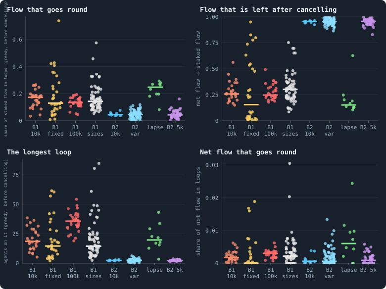

**Loops of flow in every world.** Each dot is one world, over iterations 900–999 (400–499 for a world that did not live to 1,000), a column per kind of world; the bar is the median. Top left: how much of what agents stake on their neighbours a greedy search can put on closed loops, before a token one way and a token back cancel. Top right: what is left once they cancel. Bottom: the longest loop found, and how much of the net flow goes round. B1 10k: the thirty B1 worlds of 10,000 tokens (Experiment 2); B1 fixed: the same with brains that never change (Experiment 7); B1 100k: B1 at 100,000 tokens (Experiment 10); B1 sizes: B1 at 800 to 409,600 tokens (Experiment 8) and at 5,000 with and without a hidden layer (Experiments 12 and 13); B2 10k: the ten B2 worlds of Experiment 16; B2 var: B2 with one rule or rate changed (Experiments 9, 15 and 16); B2 5k: B2 at 5,000 tokens, with all its rules or with one taken away (Experiment 14) — except lapse: the condition in which any unused link lapses; B1 pil. and B2 pil.: the pilot worlds that play the engine's game.

> [!example]- How to make this figure
> **Runs.** every simulation made so far, as `book/results/worlds.json` holds it (`python3 research/atlas/across.py lab`, `pilots`, `write`): a lab run's statistics are the means of its record over a stretch of iterations; a pilot's, of 20 games recorded from its checkpoint and summarised the same way.
>
> **Data.** From each world's `cyclingShare`, `netFlowShare`, `lightningLongest` and `netCyclingShare` (gol_lightning.py, on the heavy rows of a run's record).
>
> 1. Take each world's mean over iterations 900–999, or 400–499 if it has no later one.
> 2. Put it in the first group of the list in book_chapters/everyworld.py it belongs to.
> 3. Draw one dot per world; the bar is each group's median.
>
> **To make it again:** `python3 book_figures.py lightning`.
<!-- /figure -->

Three things stand out.

**The two rule sets are opposites.** In the B1 worlds, the greedy search puts a
sixth of the staked flow on loops (median 0.17 at 10,000 tokens). And three
quarters of the flow cancels: the net flow is a quarter of the staked flow. In
the worlds of B2, at every setting an experiment changed, the loops hold about
a twentieth (0.045). Almost nothing cancels there: the net flow is 95% of the
flow. B1's flow is mostly agents staking on each other; B2's is mostly agents
staking on others who do not stake back. Every pair of stakes that cancels is
a loop of two, so most of B1's flow goes round, if only between neighbours.

**One rule of B2 decides it.** A single kind of B2 world flows like B1: the
condition of
[Experiment 14](a-world-that-cannot-break.md#a-world-that-cannot-break) in
which *any unused link lapses* (`prune_needs = 0`), green in the figure. In B1
too, a connection that carries no tokens is cut after the game. B2 keeps a link
alive unless cutting it is safe for the network (`prune_needs = 2`), so its
links no longer have to be used.

Where a link must carry tokens to survive, agents stake on each other, and the
flow goes round. Where it need not, the flow runs one way. Nothing in the
brains changed: one of the rules that make B2's network unbreakable also made
its economy run one way.

The pilot worlds say the same, independently
([The switches the world was built with](the-switches-the-world-was-built-with.md)).
Of all the B2 pilots, four let unused links lapse, and they are the only ones
whose flow mostly cancels. They keep 0.11 to 0.23 of their flow after
cancelling; every other B2 pilot keeps 0.87 or more. Three of the four put
0.21–0.28 of their flow on loops, and the fourth 0.11.

**Little goes round once the cancelling is done.** In every kind of world, the
net flow on loops is a fraction of a percent (bottom right). Within one game,
nearly all of what goes round is two agents staking on each other. The longer
loops are there, but they carry little.

The B1 worlds whose brains never change (yellow) spread over the whole range:
from almost nothing on loops to more than 70% of their flow. Each of those
worlds is frozen in whatever play its founders had
([Do the brains matter?](do-the-brains-matter.md)), and the founders differ.

The pilot worlds that play the engine's game are in the figures too. Each was
played on from its saved checkpoints and recorded as a lab run is. B2's pilots flow
as B2 does (0.046 on loops, 0.95 left after cancelling), and B1's as B1 does
(0.20 and 0.26).

#### The longest loop grows with the world

<!-- figure lightning/size -->
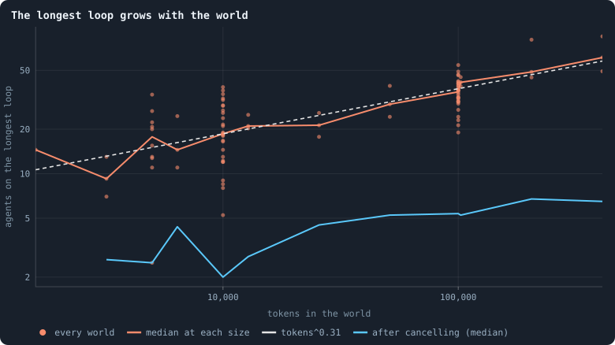

**The longest loop grows with the world.** The longest loop the greedy search finds in a B1 world, against the world's size, both axes logarithmic: the median grows as the tokens to the power 0.31, so a world twice the size has loops 1.24 times as long. The blue line is the same after a token one way and a token back have cancelled.

> [!example]- How to make this figure
> **Runs.** The B1 worlds of Experiment 8 (800 to 409,600 tokens, three seeds each, over iterations 400–499), of Experiments 12 and 2 (5,000 and 10,000 tokens) and of Experiment 10 (100,000 tokens), over iterations 900–999.
>
> **Data.** From each world's mean `lightningLongest` and `netLightningLongest` in book/results/worlds.json.
>
> 1. Take each world's mean of the longest loop over its stretch.
> 2. Take the median at each size; fit a straight line to the logarithms.
>
> **To make it again:** `python3 book_figures.py lightning`.
<!-- /figure -->

The longest loop grows with the size of the world, as the tokens to the power
0.31. That number is not new. The distances across these worlds grow as the
number of agents to the power 0.25–0.30
([Worlds of many sizes](b1-the-network-size-and-scaling.md#worlds-of-many-sizes)). And the
number of agents is proportional to the tokens. The worlds have a [dimension](measuring-space.md#three-ways-to-measure-a-networks-dimension "How fast the number of agents within a distance grows with the distance: as its square in a plane, its cube in space.") of
about 3.3
([How many dimensions does a world have?](how-many-dimensions-does-a-world-have.md)).
So a world's width grows as its size to the power 1/3.3 = 0.30.

**So the longest loop is as long as the world is wide.** The greedy search
finds loops that go across the world, and they lengthen exactly as the world
widens. After cancelling (blue), the longest loops stay short and grow more
slowly. They are five or six agents long at 100,000 tokens, and six or seven in
the largest worlds.

#### Through a world's life

<!-- figure lightning/life -->
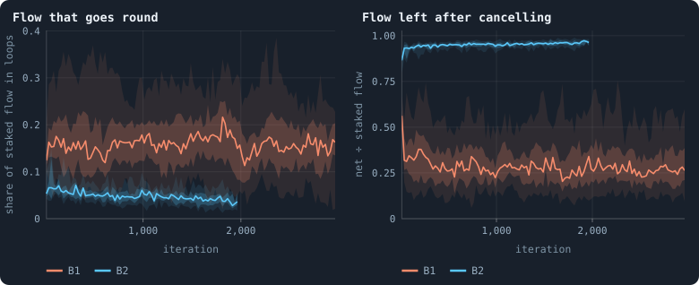

**Through a world's life.** The two statistics through the life of thirty B1 worlds (Experiment 2) and ten B2 worlds (Experiment 16): the median at each recorded iteration, with the middle half of the worlds as a band.

> [!example]- How to make this figure
> **Runs.** The thirty B1 worlds of Experiment 2 and the ten B2 worlds of Experiment 16, 10,000 tokens each.
>
> **Data.** From `stats.jsonl`, the heavy rows (every 25th iteration).
>
> 1. Read each world's statistic at every heavy row.
> 2. Draw the median of the worlds and their middle half at each iteration.
>
> **To make it again:** `python3 book_figures.py lightning`.
<!-- /figure -->

In B1 the share of the flow on loops is about the same from the first hundred
iterations to the last. In B2 it falls slowly, from 0.065 to 0.04, while the
flow left after cancelling rises towards all of it. As a B2 world ages, its
agents stake less on each other. Neither rule set builds more circulation as it
evolves.

#### A greedy count and an exact one

The greedy count looks at one game at a time.
[Gliders, and who helps whom](gliders-and-who-helps-whom.md) took the net flow
of fifty games together. It split that flow exactly into a part that runs
downhill and a part that circulates. The tool is the Helmholtz–Hodge
decomposition (the note [Flows that go round](measuring-tokens.md#flows-that-go-round)).

<!-- figure lightning/exact -->
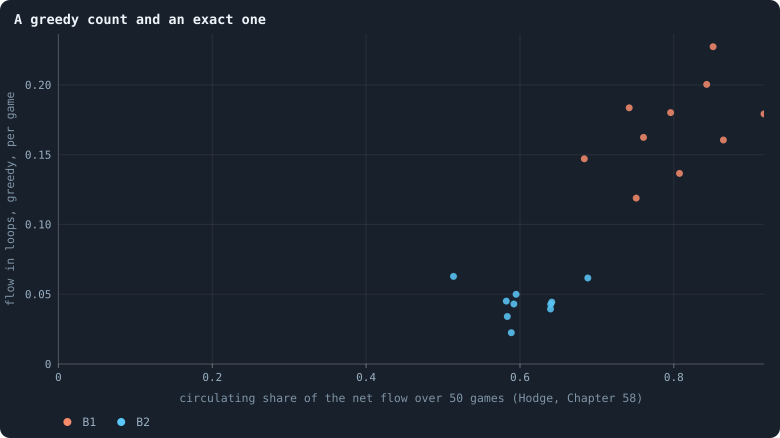

**A greedy count and an exact one.** Each dot is a world: across, the exact share of the flow over 50 games that circulates (the Helmholtz–Hodge decomposition of [Gliders, and who helps whom](gliders-and-who-helps-whom.md)); up, the greedy loop count of a single game, averaged over the same thousand iterations.

> [!example]- How to make this figure
> **Runs.** The ten B2 worlds of Experiment 16 and the first ten B1 worlds of Experiment 2, iterations 1,000 to 2,000.
>
> **Data.** From `GraphOfLifeRuns/.pilots/circulation_20.json` (research/oee/checks/circulation.py) and each world's `cyclingShare`.
>
> 1. Take each world's circulating share, the median over its twenty windows of 50 games.
> 2. Take its mean greedy loop share over the same iterations.
> 3. Draw one against the other.
>
> **To make it again:** `python3 book_figures.py lightning`.
<!-- /figure -->

Across the twenty worlds, the two counts agree on which worlds circulate more.
Their correlation is r = 0.88, carried by the difference between the rule
sets. Within a rule set they agree loosely in B1 (r = 0.46 over ten worlds),
and not at all in B2 (0.01).

And the exact count finds much more. Measure a flow by its energy: the sum of
the squares of the flows on the connections, as in the note. Then 80% of B1's
net flow over fifty games circulates (the median of ten worlds), and 59% of
B2's. One game's greedy loops hold only 17% and 4.5% of the tokens.
Circulation in these worlds is spread over time. A token goes from A to B in
one game and from B to C in the next; no single game closes the loop.

That is a warning about both numbers. Random flow on the same network would
circulate too. There are two ways to make it. One puts random amounts of the
same size on every connection. The other keeps each connection's own amount,
and throws its direction at random. By these two null models of
[Gliders, and who helps whom](gliders-and-who-helps-whom.md), random flow
circulates 59–60% in B1, and 50–53% in B2. The real excess over chance is
about 0.2 in B1, and less than 0.1 in B2. B1's agents
keep tokens going round more than chance would; B2's barely do.

### What we learned (where tokens flow)
- **A game is close to a random walk of tokens.** The evolved brains of B1
  spread their tokens nearly evenly over everyone they can reach, as blind
  brains do. In tokens, a world's economy is an exchange of equal stakes, plus
  a diffusion downhill.
- **Wealth follows connections, and hubs are places.** At rest, an agent holds
  tokens in proportion to its connections plus one: being rich is a matter of
  being in a well-connected place. The brains on hubs change almost every game,
  so the network's most important positions are held by no one.
- **A connection lives on a token a game.** Two connections in three carry one
  or two tokens, most of them one each way, and cancel exactly. In B1 the rule
  that cuts is exact and local: every empty connection is cut, and every
  connection that carried a token is kept. Well-connected agents with few
  tokens cannot pay for all their connections; leaves almost always can. The
  flow that keeps the network standing is a web of handshakes.
- **Big flows are rare.** A few connections carry hundreds or thousands of
  tokens in a game. Only an agent holding that many can send them, and the
  rich are the well connected
  ([How properties scale together](b1-the-network-size-and-scaling.md#how-properties-scale-together)).
- **Whether tokens go round is decided by one rule, not by the brains.** If a
  link must carry tokens to survive, agents stake on each other and the flow
  goes round (B1, and B2 with unused links lapsing). If links survive unused,
  the flow runs one way (B2).
- **Within a game, almost all that goes round is two agents staking on each
  other.** What is not exchanged runs downhill. The longest loops are as long
  as the world is wide: they grow as its size to the power 0.31, like its
  distances. But they carry almost nothing. Over fifty games much more
  circulates, but in B2 hardly more than random flow would. No world builds
  more circulation as it evolves.
- **For [open-ended evolution](measuring-evolution.md#what-would-count-as-open-ended-evolution "Evolution that keeps producing new things without end, not only up to a plateau.") this is a warning.** A behaviour this close to
  "split evenly" leaves little for brains to differ in. And a world whose
  wealth and positions are set by the network, rather than by the brains,
  gives selection little to grip.
  [Questioning the mechanics](questioning-the-mechanics.md) asks which rules
  make it so, and
  [What the measurements say about open-ended evolution](what-the-baseline-world-is.md#what-the-measurements-say-about-open-ended-evolution)
  what could be changed.
- **The connections carry no economy of their own.** There is nothing like a
  trade route along which one part of a world could feed another. A rule that
  made flows along loops pay, or let a connection store what crosses it, could
  give them one. One rule of this kind was tried:
  [Why evolution stops](how-to-tell-a-world-that-keeps-evolving.md#why-evolution-stops) pilots a yield on stakes that
  are returned across a connection. The yield went to whoever had the most
  partners, and it built stars rather than partnerships.

### How this was made (where tokens flow)
The first two sections, and [Do tokens go round?](#do-tokens-go-round), read
the thirty runs of Experiment 10, listed below. They are worlds of the
baseline B1 at 100,000 tokens, seeds 1 to 30, run for 1,500 iterations each.
The command `python3 gol_lab.py run E10` makes them. From the runs, two
commands draw the figures:

- `python3 book_figures.py flow` those of
  [Where the tokens flow](#where-the-tokens-flow) and of
  [Do tokens go round?](#do-tokens-go-round);
- `python3 book_figures.py connections` those of
  [What crosses a connection](#what-crosses-a-connection).

The rest of [Lightning in every world](#lightning-in-every-world) reads every
world the notebook has made, from the table `book/results/worlds.json`. The
commands `python3 research/atlas/across.py lab`, `pilots` and `write` make
that table ([Every world side by side](every-world-side-by-side.md)). The
exact split of fifty games comes from `research/oee/checks/circulation.py`.
The command `python3 book_figures.py lightning` draws these figures. Each
figure says, folded beneath it, which runs it reads and how.

The measures are explained in the notes
[Lightning: tokens that go round](measuring-tokens.md#lightning-tokens-that-go-round),
[Token flow](measuring-tokens.md#measuring-the-flow-token-flow-lightning-and-circulation), [Flows that go round](measuring-tokens.md#flows-that-go-round) and
[Logarithmic axes and power laws](statistics.md#logarithmic-axes-and-power-laws).

The runs of Experiment 10 are listed once on this page, under [The runs of Experiment 10 (how the game is played)](#the-runs-of-experiment-10-how-the-game-is-played).

## Flow modules: the groups tokens stay in

When an agent stakes tokens on a neighbour's node, the tokens flow along the
connection between them. A **flow module** is a group of agents that a token
wandering this flow tends to stay inside, and the **map equation** finds such
groups. In all 183 worlds measured, the tokens keep to groups. In B1 the
groups are the network's own regions: redeal every agent's stakes among its
neighbours, and the flow compresses as well (0.388 against 0.384). In B2 the
flow falls into short-lived pairs, and 9% last five games against 4% with the
stakes redealt: the one structure the agents add. A group outlasts its first
members only as a region of the network does.

### Flow modules and the map equation

Which agents belong together? There are many ways to ask: agents joined to
each other, agents related to each other — or agents **between whom the
tokens actually go**. A flow module is a group of the third kind. Picture a
token wandering the flow from agent to agent: a flow module is a set of agents
it tends to stay inside. This section explains how such groups are found,
followed through time and checked against chance. The Research tab's *Flow
modules* view draws them for any run, and the study below uses the same
program (`web/js/flowmodules.js`, run through `tools/flowmodules_cli.js`).

#### The flow of one game

In every game, each agent splits its tokens over its own node and its
neighbours' nodes ([How the game is played](b1-the-game-and-its-flows.md#how-the-game-is-played-what-agents-stake-and-who-wins-the-nodes)). A
token staked on a neighbour's node **flows** along the connection between
them ([Token flow](measuring-tokens.md#token-flow)). Add up, for each pair of
neighbours, the tokens that crossed between them in either direction. That
sum is the weight of their connection in this game, and the game becomes a
weighted network: the **flow**. Tokens an agent keeps on its own node say
nothing about whom it is grouped with, so they are left out.

#### Describing a walk in as few bits as possible

Think of street names. Many towns have a Station Road, and nobody is
confused: you name the town only when you travel to another one. So a
street's name can be short, because it has to be unique only within its town.

The map equation (Rosvall and Bergstrom, 2008) does the same with the flow.
Imagine a walker that steps along the weighted connections for ever, choosing
each step in proportion to the weights. It spends a share p_a of its time at
agent a. To write down where it goes, you could give every agent a code word
and write one word per step. Groups can do better:

- give every group a name;
- give every agent a short code word that has to be unique only *within* its
  group, so that other groups can use it again;
- write the group's name only when the walk enters it.

If the walk lingers in groups, with many steps inside and few between, group
names are rarely needed. Then the description is shorter than the plain one.
Its length per step is

$$
L = q \log_2 q \;-\; 2\sum_i q_i \log_2 q_i \;-\; \sum_a p_a \log_2 p_a \;+\; \sum_i (q_i + p_i)\log_2 (q_i + p_i)
$$

with p_i the share of time inside group i, q_i the share of steps that leave
it, and q the sum of the q_i. In words: the first term and half of the second
are the cost of group names, paid each time the walk moves into a group. The
rest is the cost of naming the agents within their groups, with one more word
to say that the walk leaves. The best grouping is the one with the smallest
L. One group holding everyone describes the walk with no structure at all, in
L₀ bits a step, and

$$
\text{compression} = \frac{L_0 - L}{L_0}
$$

says how much the groups shorten the description: 0 for flow with no group
structure, and more the more the flow keeps to groups.

**An example.** Four agents form two pairs, A–B and C–D, and tokens cross
only within each pair. The walker spends a quarter of its time at each agent.
Without groups, naming one agent of four takes 2 bits a step. With the two
pairs as groups, naming one agent of two takes 1 bit. No group's name is ever
needed, because the walk never leaves its pair. So L₀ = 2, L = 1, and the
compression is (2 − 1)/2 = 0.5. With more pairs L₀ grows while L stays at
1 bit, so flow made of many separate pairs compresses far more.

#### Finding the groups

Trying every grouping is impossible, so the program starts with every agent
alone. It takes the agents one at a time, in a shuffled but fixed order. Each
moves into whichever of its partners' groups shortens L most, or stays if none
does. The program goes round again until no move helps, twelve times at most.
This is the local-moving step of the Louvain method (Blondel and others,
2008). The result is a good
grouping, not always the best.

#### Following groups through time

A group of one game and a group of the next are taken to be **the same
module** when they share enough agents. Their overlap is the Jaccard index:
the agents they share, divided by the agents in either. "Enough" can be
decided in two ways:

- **above a floor**: the best overlaps first, each module used once, and none
  below 0.3. This is the view's default, which you can move, and the rule of
  the study below.
- **mutually best**: of the pairs above the floor, only those in which each
  module is the other's best overlap. With the floor at 0, this matches at
  any overlap at all.

A small module can be "followed" on very little: two modules of two agents
that share one agent overlap by a third. A B2 agent that stakes on a
neighbour at all puts its whole stake on one. So B2's flow is made mostly of
pairs, and there a matching at any overlap follows chains of chance. The
notebook therefore matches above the floor, and checks the result against
chance (below).

A module is known by its overlap, not by its members. So it can keep going
while its agents change, as a town keeps its name while its people change.
Its **turnover** is the share of its agents in a game that were not in it the
game before. The change has two sources, and the difference matters:

- **regeneration**: newcomers that were born, and members that died. The
  module makes and loses its own agents, and the pattern outlives every one of
  them, as a town lasts through its births and deaths.
- **exchange**: newcomers that were alive before, in another module or in
  none, and members that left while still alive. The agents were there all
  along, and the border moved, as when people move between neighbouring
  towns.

#### Checking against chance

Flow on any network has some group structure, because neighbours trade with
neighbours. So each measure is set beside a **null**: the same measure with
one thing shuffled at random and the rest kept. Three nulls answer three
questions.

- **Is there group structure at all?** The same game's flow is **rewired**.
  Every token that crossed a connection is cut into two halves, one at each
  end, and the halves are paired again at random. Every agent keeps how much
  flow it sends and receives; whom it trades with is shuffled. A real module
  structure compresses the flow better than the rewired one does.
- **Is the structure the network's, or the agents'?** Rewired tokens cross
  between agents that are not neighbours, which no token can. The fair
  yardstick, **partners dealt**, keeps the network and deals every agent's
  stakes among its own neighbours at random. Why it is fair is told in
  [What the network makes, and what the agents make](#what-the-network-makes-and-what-the-agents-make).
- **Do modules last longer than chance?** The rewired flow cannot say: its
  modules are pairs and threes, which "live" long on single shared agents.
  Instead each game's own modules are kept, with their sizes, and their
  agents are dealt among them at random, game by game: **members dealt**.
  Followed the same way, they show what following finds when nothing but the
  sizes carries over.

Two more measures complete the set. One needs no following at all, and the
other asks what following finds:

- **Kept together**: of two agents in one module, the share still in one
  module so many games later. Beside it stands the same share with the later
  game's agents dealt at random: what chance alone keeps together.
- **Outlasting**: of the modules followed for many games, the share in which
  none of the first members is left at the end. That is the sense in which a
  group can outlast its members.

### Flow modules in the worlds

When tokens move, do they stay inside groups of agents? And are those groups
the network's own regions, or something the agents make? To find out, we read
183 worlds for fifty games in a row, each world counted once. They are of
every kind the notebook had made by 16 October 2026
([How this was made](#how-this-was-made-flow-modules)). The first and the last figure
show them all; the two between set eighteen lab worlds beside the nulls.

#### Groups in every world

<!-- figure flowmodules/every_world -->
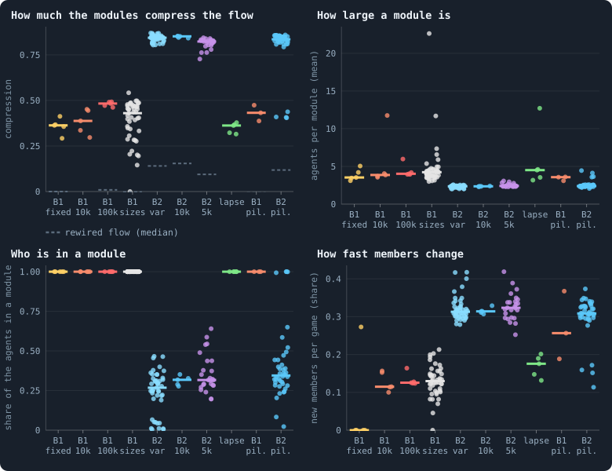

**Flow modules in every world.** Each dot is a world, over fifty games. Compression: how much shorter the modules make a description of a token wandering the flow (0: no group structure); the dashed bars are the same games' flow rewired at random, each agent's amounts kept. Size: agents per module. Who is in a module: the share of the agents that send or receive any flow, which is what puts an agent in a module. How fast members change: of a module followed from one game to the next, the share of its members that are new. B1 10k: the thirty B1 worlds of 10,000 tokens (Experiment 2); B1 fixed: the same with brains that never change (Experiment 7); B1 100k: B1 at 100,000 tokens (Experiment 10); B1 sizes: B1 at 800 to 409,600 tokens (Experiment 8) and at 5,000 with and without a hidden layer (Experiments 12 and 13); B2 10k: the ten B2 worlds of Experiment 16; B2 var: B2 with one rule or rate changed (Experiments 9, 15 and 16); B2 5k: B2 at 5,000 tokens, with all its rules or with one taken away (Experiment 14) — except lapse: the condition in which any unused link lapses; B1 pil. and B2 pil.: the pilot worlds that play the engine's game, except those that replay a lab world with its settings and seed.

> [!example]- How to make this figure
> **Runs.** Fifty consecutive games of each world: a lab run's from its record, from iteration 950 when it lived that long (up to five seeds of every condition); a pilot's played on from its checkpoint at 1,000 (`python3 research/atlas/flowmodules.py lab`, `pilots`).
>
> **Data.** From `GraphOfLifeRuns/.pilots/atlas/flowmodules/*.json`.
>
> 1. For every game, the flow between each pair of neighbours: the tokens staked either way.
> 2. Group the agents by the map equation (web/js/flowmodules.js, through tools/flowmodules_cli.js).
> 3. Follow the groups from game to game as the Research view does: best overlap first, above its floor of 0.3 of the members two modules share.
> 4. Do the same on each game's flow rewired at random, every agent's amounts kept: the null.
>
> **To make it again:** `python3 book_figures.py flowmodules`.
<!-- /figure -->

The worlds fall into the same two kinds as everywhere else in the notebook.

**In B1's worlds**, and in every world where unused links lapse, the flow is
grouped, but loosely. The modules compress it by 0.36–0.48 (the medians of
the groups of worlds), where the same flow rewired at random compresses by
about 0. A module holds about four agents, and every agent is in one. B1's
agents spread their stake over nearly all their neighbours
([How widely agents stake](b1-the-game-and-its-flows.md#how-widely-agents-stake)),
so every agent sends and receives. From one game to the next, a module of
the lab's B1 worlds changes about an eighth of its members (0.11–0.13). Where
B2's unused links lapse, and in the B1 pilots, it changes more (0.18 and
0.26).

**In B2's worlds** the flow falls apart into pairs. The modules compress it
by 0.82–0.85 and hold 2.3–2.4 agents, and only about three agents in ten are
in a module at all. A B2 agent puts its whole stake on one node, its own in
about two games of three. And half of B2's agents hold a single token, which
stays at home ([How different are the agents?](how-different-are-the-agents.md)).
So in a game most B2 agents send nothing, and those that do send it to one
neighbour: the two are a module. Such flow compresses even when rewired at
random (0.09–0.15), since pairs are groups of a kind
([the example above](#describing-a-walk-in-as-few-bits-as-possible)). A
module changes a third of its members every game.

Some worlds stand apart within their kind:

- Where **brains never change** (Experiment 7), the modules never change
  either, in four worlds of five. These are the frozen worlds of
  [Do the brains matter?](do-the-brains-matter.md): the same agents playing
  the same game, game after game.
- Two of Experiment 15's rules leave almost nobody in a module: **children
  of any size** (1% of the agents) and **no old age** (4–7%). So do the pilot
  worlds of
  [Links that hold a token, and nobody dies of age](mixed-brains-costly-units.md#links-that-hold-a-token-and-nobody-dies-of-age)
  (2–8%). In those worlds hardly anyone stakes on a neighbour.
- Batch S's pilot worlds with **lapsing links**, with gifts and without, are
  B1-like, as are the lab's worlds with lapsing links. It is the same split
  that [Lightning in every world](b1-the-game-and-its-flows.md#lightning-in-every-world)
  found for loops of flow.

#### What the network makes, and what the agents make

Compression against rewired flow says that the flow has groups. It does not
say who made them. Rewired flow sends tokens between agents that are not
neighbours, which no token can. So any flow that keeps to the network looks
grouped beside it: the network itself has regions.

A fairer yardstick keeps the network. In every game, each agent keeps its
stake at home and the amounts it staked on neighbours. But the amounts are
dealt among its own neighbours at random
(`tools/flowmodules_cli.js --neighbours`). Everything is as it was except the
agent's choice of whom to stake on. What the real flow has beyond this is the
agents' doing; the rest is the network's.

The compression hardly changes: 0.388 against 0.384 in a B1 world, and 0.845
against 0.846 in a B2 world. It changes as little in the others measured. In
B1 that is no surprise. An agent that splits its stake evenly over its
neighbours gives every neighbour the same, and dealing equal amounts changes
nothing ([The even split](measuring-tokens.md#the-even-split)). B1's flow modules are its
network's regions. Whether they last, and whether B2's agents choose their
partners, the next two sections ask.

#### How long modules live

<!-- figure flowmodules/lives -->
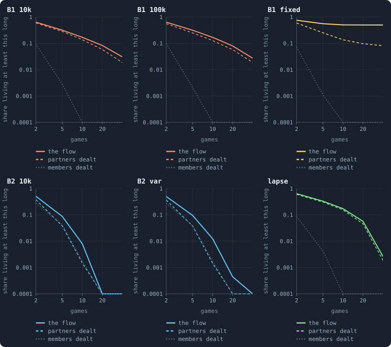

**How long modules live.** Of all the modules fifty games hold, the share followed for at least so many games, as the Research view follows them (the median of each group's worlds; logarithmic axes, a share of 0 drawn at the bottom). The flow: as it was. Partners dealt: the same games with every agent's stakes on its neighbours dealt among the same neighbours at random — the network and every agent's amounts kept, its choice of whom to stake on undone. Members dealt: the real modules with their agents dealt among them at random, game by game — only the sizes kept. B1 fixed: two worlds whose brains never change, one frozen (every module lasts) and one teeming with births (almost none does), so their median lies between. B2 var: B2 without random inputs, at mutation rates 0.05 and 0.8, and at 5,000 tokens; lapse: B2 at 5,000 tokens where any unused link lapses.

> [!example]- How to make this figure
> **Runs.** The same fifty games of eighteen lab worlds: B1 at 10,000 tokens (three seeds), B2 at 10,000 (three), B1 at 100,000 (two), B1 whose brains never change (two), B2 without random inputs (two), B2 at mutation rates 0.05 and 0.8 (one each), B2 at 5,000 tokens (two) and with lapsing links (two) (`python3 research/atlas/flowpersist.py`).
>
> **Data.** From `GraphOfLifeRuns/.pilots/atlas/flowpersist/*.json`.
>
> 1. For every game, the flow between each pair of neighbours: the tokens staked either way.
> 2. Group the agents by the map equation (web/js/flowmodules.js, through tools/flowmodules_cli.js).
> 3. Follow the groups from game to game as the Research view does: best overlap first, above its floor of 0.3 of the members two modules share.
> 4. Deal every agent's stakes on its neighbours among the same neighbours at random and do the same (`tools/flowmodules_cli.js --neighbours 1`).
> 5. Deal each game's agents at random among modules of the sizes that game had, and follow those (`--shuffle 1`).
>
> **To make it again:** `python3 book_figures.py flowmodules`.
<!-- /figure -->

Eighteen lab worlds of every kind were read again, the same fifty games. Each
was followed three ways: as it was, with partners dealt, and with members
dealt.

- **B1**: a third of the modules are followed for five games or more, and
  one in six for ten or more. That is 0.32 and 0.17, the median of B1's
  worlds at 10,000 and at 100,000 tokens alike. With members dealt, almost
  none last (0.003 and 0): B1's modules are no accident of their sizes. But
  with partners dealt, nearly as many last (0.25–0.28 and 0.13–0.14): it is
  the network that holds them together. The two B2 worlds whose unused links
  lapse are the same (0.33 and 0.17, against 0.31 and 0.16).
- **B2**: pairs rarely outlive a few games. 9% are followed for five games,
  and 0.8% for ten. With partners dealt, fewer than half as many last five
  games (4%), and about a fifth as many last ten (0.15%). So B2's agents keep
  a partner longer than chance would: the one structure in the flow that the
  agents themselves add. They keep it longest without random inputs. In the
  two worlds of that kind measured (Experiment 16), about two pairs in a
  hundred last ten games. That is nine to twelve times as many as with
  partners dealt. The dice B2's brains read
  ([Why evolution stops](how-to-tell-a-world-that-keeps-evolving.md#why-evolution-stops))
  break up partnerships too.
- **Brains that never change**: in the frozen world every module lasts all
  fifty games, and with partners dealt only a quarter last ten. A world whose
  agents repeat the same moves for ever keeps the same groups; the groups are
  those moves, fixed.

Some long-lived modules outlast the agents they began with. Of B1's modules
followed for ten games or more, a fifth end with none of their first members
(0.21 at 10,000 tokens, 0.17 at 100,000). On average, two thirds of the first
members are still there. But the same is true with partners dealt (0.21 and
0.17): the network's regions outlast their occupants, not groups that the
agents hold together. In B2, pairs followed for ten games are about four
times as many as with partners dealt. Half of them end with neither first
member.

#### Two agents of one module, games later

<!-- figure flowmodules/together -->
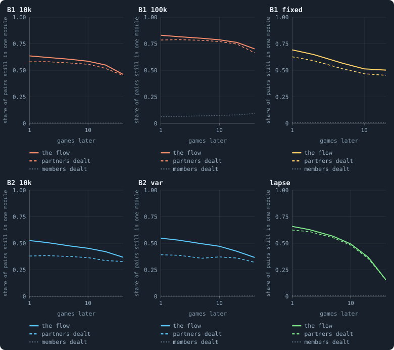

**Two agents of one module, games later.** Of two agents in one module, the share still in one module so many games later, over the pairs whose agents are both in a module then (the median of each group's worlds). The flow: as it was; partners dealt: every agent's stakes dealt among its own neighbours at random; members dealt: the later game's agents dealt at random among modules of its sizes. No module is followed, so no rule for following one is needed.

> [!example]- How to make this figure
> **Runs.** The same fifty games of eighteen lab worlds: B1 at 10,000 tokens (three seeds), B2 at 10,000 (three), B1 at 100,000 (two), B1 whose brains never change (two), B2 without random inputs (two), B2 at mutation rates 0.05 and 0.8 (one each), B2 at 5,000 tokens (two) and with lapsing links (two) (`python3 research/atlas/flowpersist.py`).
>
> **Data.** From `GraphOfLifeRuns/.pilots/atlas/flowpersist/*.json`.
>
> 1. For every game, the flow between each pair of neighbours: the tokens staked either way.
> 2. Group the agents by the map equation (web/js/flowmodules.js, through tools/flowmodules_cli.js).
> 3. For every two games lag apart, the pairs of agents sharing a module in the first that are both in a module in the second; the share that share one there.
> 4. The same on the flow with every agent's stakes dealt among its neighbours (`--neighbours 1`), and with the later game's agents dealt among modules of its sizes (three deals).
>
> **To make it again:** `python3 book_figures.py flowmodules`.
<!-- /figure -->

Following modules needs a rule for when a module of one game is the same as
one of the next. The measure *kept together* needs none. Of two agents in one
module, how often are both in one module again so many games later, if both
are in a module then?

- **B1**: of two agents in one module, 0.64 are together a game later and
  0.46 forty games later. That is the median of B1's worlds at 10,000 tokens.
  With partners dealt: 0.58 and 0.45, nearly the same. At 100,000 tokens more
  pairs stay together (0.83 and 0.70), and as many with partners dealt (0.79
  and 0.67). But only two worlds were measured there, so the median is their
  mean. One of the two is a star, a world held together by a single hub
  ([Stars and hubs](measuring-networks.md#stars-and-hubs)). Its flow has one module of nearly
  6,000 agents, two fifths of the world. The other keeps 0.73 and 0.46 of its
  pairs together: more than B1 at 10,000 tokens a game later, the same forty
  games later.
- **B2**: 0.53 are together a game later and 0.37 forty games later. With
  partners dealt: 0.38 and 0.33. So B2's agents go back to the same partner
  more often than chance for a few games. Over forty, they do so hardly more
  often than their neighbourhood makes them.
- **Lapsing links**: 0.66 are together a game later, but only 0.16 forty
  games later, as with partners dealt (0.62 and 0.16). Where unused links
  lapse, the network itself changes fast.
- **Members dealt**: dealt at random among modules of the same sizes, two
  agents are together again less than once in a hundred. The one exception
  is B1 at 100,000 tokens. There the star's great module keeps 6 to 9 pairs
  in a hundred together, even with its members dealt at random. Being
  neighbours is what keeps pairs together.

#### Where new members come from

<!-- figure flowmodules/renewal -->
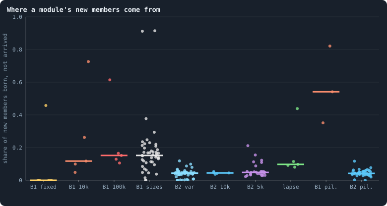

**Where a module's new members come from.** Of the new members of modules followed from one game to the next, the share that had been born since (the rest were alive before, in another module or none). A module that renews itself from births regenerates; one that takes in agents from around it exchanges them. Each dot is a world. B1 10k: the thirty B1 worlds of 10,000 tokens (Experiment 2); B1 fixed: the same with brains that never change (Experiment 7); B1 100k: B1 at 100,000 tokens (Experiment 10); B1 sizes: B1 at 800 to 409,600 tokens (Experiment 8) and at 5,000 with and without a hidden layer (Experiments 12 and 13); B2 10k: the ten B2 worlds of Experiment 16; B2 var: B2 with one rule or rate changed (Experiments 9, 15 and 16); B2 5k: B2 at 5,000 tokens, with all its rules or with one taken away (Experiment 14) — except lapse: the condition in which any unused link lapses; B1 pil. and B2 pil.: the pilot worlds that play the engine's game, except those that replay a lab world with its settings and seed.

> [!example]- How to make this figure
> **Runs.** Fifty consecutive games of each world: a lab run's from its record, from iteration 950 when it lived that long (up to five seeds of every condition); a pilot's played on from its checkpoint at 1,000 (`python3 research/atlas/flowmodules.py lab`, `pilots`).
>
> **Data.** From `GraphOfLifeRuns/.pilots/atlas/flowmodules/*.json`.
>
> 1. For every game, the flow between each pair of neighbours: the tokens staked either way.
> 2. Group the agents by the map equation (web/js/flowmodules.js, through tools/flowmodules_cli.js).
> 3. Follow the groups from game to game as the Research view does: best overlap first, above its floor of 0.3 of the members two modules share.
> 4. A new member is born if its id was not alive the game before.
>
> **To make it again:** `python3 book_figures.py flowmodules`.
<!-- /figure -->

A module renews its members in the two ways of
[Following groups through time](#following-groups-through-time). It
**regenerates** when agents born since the last game join it. It
**exchanges** when agents that were already alive move in from around it,
and its border moves.

Modules renew mostly by exchange. Of a B1 module's new members, 12–15% were
born since the game before, in the medians of the groups of B1 worlds. Of a B2
module's, 4% were. Only where agents are born and die often does a module
renew from births. In the B1 world whose modules lose 4.5% of their members to
death every game, three new members in four were born. In the pilot worlds of
B1 without revolutions, where agents come and go faster, between a third and
four fifths were.

### What we learned (flow modules)
- **Tokens keep to groups in every world, and the groups are the
  network's.** In B1 a module is about four agents of one region of the
  network. Dealing every agent's stakes among its neighbours at random gives
  the same modules, lasting nearly as long. Agents that split their stake
  evenly cannot choose a group; their neighbourhood is their group.
- **B2's flow is pairs, and most agents take no part in it.** In a game two
  agents in three stake nothing on anyone. A pair lasts a game or two. But
  pairs that last five games are twice as common as with partners dealt at
  random among the same neighbours. They are the only structure in the flow
  that the agents themselves make, and they make more of it without random
  inputs.
- **Groups outlast their first members only as regions do.** A fifth of B1's
  long-lived modules end with none of the agents they began with. A module
  renews mostly by agents moving in from around it, rather than by births.
  The same happens when every agent's partners are dealt at random.
- **Some rules leave almost no flow at all.** Where children may be of any
  size, or nobody dies of age, almost no agent stakes on a neighbour.
- **For open-ended evolution**, a group that holds together while its
  members change is what a higher level of individual would be built from.
  It is the step from single cells to organisms that Maynard Smith and
  Szathmáry (1995) call a major transition. These worlds make no such group beyond
  the regions of their network. That fits what
  [Who helps whom](who-helps-whom.md) found for help: nothing in the game
  rewards staying with a partner. A group of the agents' own needs a rule that
  does. It could be a support stake that counts only if it is returned, or a
  share in what a partnership wins. [Alliances](another-game.md#alliances)
  are such a rule, and were taken up at once. This measure, run on worlds
  with alliances, would show whether their groups outlast the network's.

### How this was made (flow modules)
This page reads the runs of many experiments and many pilot worlds, so it has
no single box of runs. Every figure says, folded beneath it, which worlds it
reads and how.

- **Every world, fifty games.** `research/atlas/flowmodules.py` (`lab`, then
  `pilots`) reads fifty consecutive games of every world. A lab run is read
  from its record, from iteration 950 when it lived that long, for up to five
  seeds of every condition. A pilot is played on from its checkpoint at
  iteration 1,000. That makes 183 worlds of every kind, each counted once.
  Sixteen pilot worlds replay a lab world, with its settings and seed, game
  for game; they are left out. And seven worlds give another's answer to the
  last digit, a condition that never came into play, so each is counted once. The results are kept in
  `GraphOfLifeRuns/.pilots/atlas/flowmodules/`.
- **Eighteen worlds, three ways.** `research/atlas/flowpersist.py` reads the
  same fifty games of eighteen lab worlds again. It follows each world as it
  was, with partners dealt (`tools/flowmodules_cli.js --neighbours 1`) and
  with members dealt (`--shuffle 1`). The results are kept in
  `GraphOfLifeRuns/.pilots/atlas/flowpersist/`. The worlds are:
  - B1 at 10,000 tokens (three seeds), at 100,000 (two), and with brains that
    never change (two);
  - B2 at 10,000 tokens (three), without random inputs (two), and at mutation
    rates 0.05 and 0.8 (one each);
  - B2 at 5,000 tokens (two), and with lapsing links (two).
- **The modules** are found and followed by the Research view's own program,
  `web/js/flowmodules.js`, through `tools/flowmodules_cli.js`.
- **The figures** are drawn again by `python3 book_figures.py flowmodules`,
  and the numbers they hold are in `book/results/flowmodules.json`.

## Where to go next

- [How unequal is a world, and who stays rich](b1-lives-and-wealth.md#how-unequal-is-a-world-and-who-stays-rich):
  who holds the tokens the flow leaves behind.
- [Gliders, and who helps whom](gliders-and-who-helps-whom.md): chains of
  takeovers, gifts, and the flow of fifty games.
- [How a coalition takes a node](rules-in-detail.md#how-a-coalition-takes-a-node): the rule behind half of all
  nodes.
- [The even split](measuring-tokens.md#the-even-split): what the rules do with a stake no brain
  decided.
- [What the brains are like](what-the-brains-are-like.md): the brains that
  learned to play this way.
- [Who helps whom](who-helps-whom.md): why nothing in the game rewards
  keeping a partner.

## How our view changed

- **11 November 2026.** Four pages on B1's game and its flows became the
  sections of this one, and it moved to the Archive. Round 3's worlds play
  other rules, so these measurements no longer bear on the notebook's question.
  They are kept so that every figure here can be read and made again. Nothing
  was cut but a second copy of the list of the runs of Experiment 10.
- *Where tokens go*:
  - **23 October 2026.** This page said that in a settled B1 world 30% of the
    tokens stay home, 51% are matched and 20% go one way "at 10,000 tokens and
    at 100,000 alike". At 10,000 tokens the shares are 49% and 21%
    ([The budget of a game](b1-the-game-and-its-flows.md#where-tokens-flow)). It
    also said that where a connection must carry tokens, 17% to 28% of the
    staked flow is on loops. B1 at 100,000 tokens has 13% there, and one of the
    four B2 pilots whose unused links lapse has 11%
    ([Every world](b1-the-game-and-its-flows.md#every-world)). And it said the
    longest loops after cancelling are five or six agents long, which holds at
    100,000 tokens; in the largest worlds they are 6.5 to 6.75. It also said
    that batch H was testing the estate left to a dead agent's own children:
    that was done, and is in [Who inherits?](who-inherits.md).
  - **24 October 2026.** This page gave the circulation of takeovers above
    chance in B2 as +0.07. It is 0.065 (0.0647 in `book/results/patterns.json`),
    as [Gliders, and who helps whom](gliders-and-who-helps-whom.md#where-the-tokens-go)
    now gives it.
- *Where tokens flow*:
  - **9 October 2026.** [How widely agents stake](#how-widely-agents-stake) had
    said that the brains put "a little extra at home", above the even split.
    [Who keeps their node](#who-keeps-their-node) had said that this "home
    bias" raised how often an agent keeps its node.
    [What the brains are like](what-the-brains-are-like.md) and the note
    [Splitting tokens into whole numbers](rules-in-detail.md#splitting-tokens-into-whole-numbers) showed where the
    extra comes from. It is the rules' rounding of whole tokens, not the brains.
    An exact even split, dealt out in whole tokens, puts even more at home than
    the brains do.
  - **11 October 2026.** [Where the tokens flow](#where-the-tokens-flow) was
    first written from the thirty worlds of 10,000 tokens. On this day it was
    rewritten from the thirty worlds of 100,000 tokens, with the small worlds'
    numbers beside the new ones where they differ.
    [What crosses a connection](#what-crosses-a-connection) was written from the
    large worlds on the same day. One finding changed with the size of a world.
    Over all 335,453 agents of the small worlds, the real balances followed the
    even split with a slope of 0.94. Over all the agents of the large worlds the
    slope is 0.65, because a few stars tilt the fit; without them it is 0.94
    again.
  - **14 October 2026.** A pass through the whole notebook corrected three
    things:
    - [Where the tokens flow](#where-the-tokens-flow) and
      [What crosses a connection](#what-crosses-a-connection) had read the
      greedy search's count as the flow that goes round. That was 13% of the
      staked flow, most of it, they said, in trivial loops of two. But every
      matched stake is itself a loop of two, so at least 72% of the flow as
      staked goes round, and at most 77%. The greedy search is only a weak
      floor.
    - [What crosses a connection](#what-crosses-a-connection) had said that
      after cancelling, the longest loop at 10,000 tokens was 2 agents. A loop
      left after cancelling needs at least three agents. The 2.2 it reports is
      an average over games, in many of which no such loop was found.
    - The founders of a world of 10,000 tokens have four neighbours each, not
      five: the rules wire an odd number of neighbours as one less.
  - **23 October 2026.** When the three pages became one, these statements were
    checked against the numbers the figures were drawn from, and corrected:
    - [The budget of a game](#the-budget-of-a-game-where-tokens-flow) said that in settled games
      51% of the tokens are matched and 20% go one way "at both sizes". At
      10,000 tokens the shares are 49% and 21%, as this page said on
      8 October.
    - [Every world](#every-world) said that the three B2 pilots whose flow goes
      round are exactly those in which unused links lapse. In the table of every
      world, four B2 pilots let unused links lapse. Three put 0.21–0.28 of their
      flow on loops; the fourth puts 0.11 there, and keeps 0.23 after
      cancelling. What sets all four apart is how much of their flow cancels.
    - [The longest loop grows with the world](#the-longest-loop-grows-with-the-world)
      said that after cancelling, the longest loops are five or six agents in
      the largest worlds. That holds at 100,000 tokens. In the worlds of 204,800
      and 409,600 tokens the median is 6.75 and 6.5 agents.
    - The table of statistics defined `flowImbalance` as half the sum over agents
      of flow in minus flow out. That sum is always zero. The engine adds up the
      gaps without their signs.
- *Flow modules: the groups tokens stay in*:
  - **16 October 2026.** The note on the map equation, written that day, first
    said that the mutual matching needs no floor, but the program matched above
    the floor. As its test against chance, it also said that real modules live
    longer than those of the rewired flow. That is no fair test: the rewired
    flow's modules are pairs and threes that "live" long on single shared
    agents. The note was corrected the same day, and the study on this page
    uses the nulls of [Checking against chance](#checking-against-chance).
  - **24 October 2026.** When the note was merged into this page, the page's
    numbers were checked against `book/results/flowmodules.json` and the worlds'
    own files in `GraphOfLifeRuns/.pilots/atlas/`. Six were set right. With
    partners dealt, B2's pairs that last ten games were said to be "an eighth as
    many" (0.1%). They are 0.15% against 0.8%, about a fifth. In the two worlds
    without random inputs, such pairs were said to be "eight to nine times" as
    many as with partners dealt. The two worlds give 9.4 and 11.7 times. Both
    ratios are what the shares give when rounded to three decimals, as the
    analysis printed them. Of B1's long-lived modules at 100,000 tokens, 0.17
    end with none of their first members, not 0.18: the same share as with
    partners dealt. Where unused links lapse, 0.62 of pairs are together a game
    later with partners dealt, not 0.63. Members dealt at random were said to
    keep two agents together less than once in a hundred. In B1 at 100,000
    tokens they keep 6 to 9 in a hundred. One of the two worlds there is a star,
    with a module of nearly 6,000 agents. That star, more than "modules a little
    larger", is also why more pairs stay together there. And a turnover of an
    eighth (0.11–0.13) was said of every world where unused links lapse. It
    holds for the lab's B1 worlds. Where B2's unused links lapse, modules change
    0.18 of their members a game, and in the B1 pilots 0.26.
  - **24 October 2026.** How this was made said that eighteen pilot worlds
    replay a lab world and are left out. Counted again, with every lab run's
    settings readable (`book_chapters/everyworld.replicas`), sixteen do. Seven
    more give the same answer as another world to the last digit, and are
    counted once. So 206 complete results make the 183 worlds of this page.

## References

- Blondel, V. D., Guillaume, J.-L., Lambiotte, R. and Lefebvre, E. (2008).
  Fast unfolding of communities in large networks. *Journal of Statistical
  Mechanics: Theory and Experiment*, P10008.
- Maynard Smith, J. and Szathmáry, E. (1995). *The Major Transitions in
  Evolution*. Oxford: W. H. Freeman.
- Rosvall, M. and Bergstrom, C. T. (2008). Maps of random walks on complex
  networks reveal community structure. *Proceedings of the National Academy
  of Sciences* 105, 1118–1123.

<!-- turns -->
---

← [B1: lives and wealth](b1-lives-and-wealth.md) · [B1, as described in October 2026](../README.md#b1-as-described-in-october-2026) · [B1: the network, size and scaling](b1-the-network-size-and-scaling.md) →

**Also about:** [Wealth: who holds the tokens](../README.md#wealth-who-holds-the-tokens), [Groups and cooperation](../README.md#groups-and-cooperation).

> [!info]- Pages that link here (35)
> [The world: tokens, agents and a network](the-world.md) · [One iteration, step by step](one-iteration.md) · [The brain](the-brain.md) · [Questioning the mechanics](questioning-the-mechanics.md) · [Glossary](glossary.md) · [The rules in detail](rules-in-detail.md) · [Measuring lives: births, deaths, ages and estates](measuring-lives.md) · [What keeps wealth spread?](what-keeps-wealth-spread.md) · [Measuring tokens: inequality and flow](measuring-tokens.md) · [Measuring a network: connections, hubs, distances and cuts](measuring-networks.md) · [Physical inspiration](physical-inspiration.md) · [Is a world a space? Dimension, and what folds it](how-many-dimensions-does-a-world-have.md) · [Measuring space: dimension and the random twin](measuring-space.md) · [A source and a sink](a-source-and-a-sink.md) · [Particles: patterns that outlast what carries them](particles.md) · [How alike the agents are](how-alike-the-agents-are.md) · [Genotypes and lineages](genotypes-and-lineages.md) · [What the brains are like](what-the-brains-are-like.md) · [Do the brains matter?](do-the-brains-matter.md) · [How different are the agents?](how-different-are-the-agents.md) · [Measuring evolution: genotypes, eras and the open-ended test](measuring-evolution.md) · [Does evolution keep going?](how-to-tell-a-world-that-keeps-evolving.md) · [Who helps whom](who-helps-whom.md) · [Do agents cooperate? Help, kin and partners](do-agents-cooperate.md) · [Gliders, and who helps whom](gliders-and-who-helps-whom.md) · [Healthy and rich](healthy-and-rich.md) · [Brains mixed at birth, in long worlds](mixed-at-birth-ten-long-worlds.md) · [Every world side by side](every-world-side-by-side.md) · [How runs are made, recorded and costed](runs-and-records.md) · [One world, many colours: what the viewer can colour by](one-world-many-colours.md) · [What goes with what](what-goes-with-what.md) · [Every simulation: what was run, and what was measured](every-simulation.md) · [What B1 is, and what stood in its way](what-the-baseline-world-is.md) · [B1: lives and wealth](b1-lives-and-wealth.md) · [B1: the network, size and scaling](b1-the-network-size-and-scaling.md)
<!-- /turns -->
