# B1: the network, size and scaling

> [!question] Questions of this page
> - What becomes of the founders' ring? Is the network that replaces it a tree, a web, or something in between?
> - How much of a world hangs on single [connections](the-world.md#the-network "A link between two agents of the network: they are neighbours, and can stake on each other's nodes.")?
> - How is a power law fitted properly: where does its tail start, and how can one tell whether it is a power law at all?
> - How do an [agent](the-world.md#agents-and-tokens "One member of a world: it lives on a node of the network, holds tokens and has a brain that takes all its decisions.")'s [tokens](the-world.md#agents-and-tokens "The one thing of value in a world: every agent holds a whole number of them, and their total never changes.") grow with its connections? Is that the resting state of the [even split](measuring-tokens.md#the-even-split "What the rules do when a brain scores no candidate above zero: the stake is spread evenly.") ([Where tokens flow](b1-the-game-and-its-flows.md#the-game-as-a-random-walk))?
> - How is likeness at a distance measured, and what is a correlation length?
> - Does a world of twice the tokens hold twice the agents and twice the connections?
> - How different do thirty worlds of the same settings end up?

## In short

The network of [B1](b1-and-b2.md "The first baseline: the algorithm exactly as a new run is offered it.")'s worlds as measured in October 2026: its shape, how it
breaks, what scales with what, and how much the seed decides. Four findings
still bear on the notebook's question. Births make the network: a child joins
only its parent's neighbourhood, so a world keeps a shape in space of two to
three dimensions. A world breaks along its poor regions, not at its weakest
bridge. Agents and connections follow the tokens in proportion, about 0.14
agents per token, and nothing points to a critical state. And thirty seeds of
one world end up alike: each world wanders, and forgets its level within about
three hundred iterations.

It gathers what were 7 pages of their own, one section each:

- [The shape of the network](#the-shape-of-the-network): Within a hundred iterations, the founders' ring with its few shortcuts becomes a mesh, the **core**, with small trees hanging off it.
- [How a world breaks](#how-a-world-breaks): Only the largest connected piece of a world's network survives each phase, so a whole region can die in one game.
- [Power laws, real and apparent, and how to fit one](#power-laws-real-and-apparent-and-how-to-fit-one): A power law has no typical size, and on logarithmic axes it is a straight line.
- [How properties scale together](#how-properties-scale-together): On average, agents hold tokens in proportion to their connections plus one: the resting state of the even split.
- [Like next to like: how alike agents are at a distance](#like-next-to-like-how-alike-agents-are-at-a-distance): How alike are two agents a given number of steps apart, and up to how far?
- [Worlds of many sizes](#worlds-of-many-sizes): Experiment 8 ran the first [baseline](b1-and-b2.md "The stated rules an experiment starts from and changes one thing of: B1 or B2."), B1, at ten sizes, from 800 to 409,600 tokens.
- [How much does the seed decide?](#how-much-does-the-seed-decide): Thirty baseline worlds that differ only in their seed end up alike: at 100,000 tokens, their sizes vary by about a tenth of the mean.

## The shape of the network

Within a hundred iterations, the founders' ring with its few shortcuts becomes
a mesh, the **core**, with small trees hanging off it. The core holds more
than half of the agents, three quarters of the tokens and every loop. Most
agents have one or two connections, and a few hubs have hundreds or thousands.
Experiment 5 had predicted a thinner, more tree-like world, and was refuted on
the size of the core. A child joins only its parent's neighbourhood, so the
world is stretched, with bottlenecks that make it slow to mix and easy to
break. By the room it holds, a world and its core have two to three
dimensions; by how a walker spreads, a little under two.

### What shape does the network take?

The founders start on a small-world ring
([The starting ring](rules-in-detail.md#the-starting-ring)). Each is joined to its nearest
founders on a circle, and some connections are moved at random to make
shortcuts. From then on the agents make and lose every connection themselves.
A child is joined to some of its parent's candidates, and a parent may hand
connections to it. In every game, a connection that carries no tokens is cut
when the game ends ([One iteration, step by step](one-iteration.md)). Nothing
in the rules aims at any shape. So what shape comes out?

Every section of this page reads the thirty worlds of the first baseline, B1,
at 100,000 tokens ([Thirty worlds](b1-lives-and-wealth.md#thirty-worlds)). Much of
it was first written from the thirty worlds of 10,000 tokens; where those
differ, their numbers are given beside.

#### What was expected (the shape of the network)
Why should the ring not last? A new connection can only be made at a birth,
between the newborn and its parent's neighbourhood. And any connection that
carries no tokens in a game is cut, a new one too. Nothing ever joins two
distant parts of a world, so the ring's long shortcuts are a budget that is
only spent. Children should hang off their parents like leaves off a branch,
and a world should become a tree of families.

How tree-like is a network? Three measures say. A **bridge** is a connection
on no loop: cut it, and the world falls in two ([Bridges](measuring-networks.md#bridges-cut-risk-loops-and-the-core-how-a-network-can-be-cut)).
**Clustering** says how often two [neighbours](the-world.md#the-network "An agent joined to another by a connection.") of an agent are neighbours of
each other too; in a tree, never ([Clustering](measuring-networks.md#clustering)). And the
**core** is what is left when agents with one connection or none are peeled
away, again and again. In it, every agent lies on a loop or on a path between
loops ([Core, trees and leaves](measuring-networks.md#core-trees-and-leaves)); a tree has no core at
all. Before the runs of 10,000 tokens, Experiment 5 wrote down its thesis:

<!-- thesis E05 -->
> [!quote] The thesis of Experiment 5, written down before any of its runs existed
> **The claim.** The small-world ring the founders start on is gone within a hundred iterations, and what replaces it is thin and tree-like: more than a fifth of all connections are bridges — connections on no loop — clustering stays below 0.1, and less than half of all agents sit in the core where every agent is on some loop.
>
> **Why it would be so.** A new connection can only be made at birth, between a newborn and its parent's neighbourhood, and any connection that carries no tokens in a game is cut at its end — a new one included. Nothing ever joins distant parts of the world, so the long-range shortcuts of the starting ring are a budget that is only spent. Children hang off their parents like leaves off a branch.
>
> **It holds if:** From iteration 100 on, the median share of connections that are bridges is above 0.2, the median clustering is below 0.1, and the median core share is below 0.5, across the thirty runs.
>
> **It fails if:** The graph keeps or rebuilds loops: bridges below a tenth of connections, or clustering above 0.2, or a core holding most agents. Then something in the rules closes loops, and the picture of a world as a tree of families is wrong.
<!-- /thesis -->

The thesis was tested in the thirty worlds of 10,000 tokens, and again in the
thirty of 100,000 ([Was the thesis right?](#was-the-thesis-right-the-shape-of-the-network)). First,
here is what the large worlds did, with the small ones beside them.

#### One world, four moments

<!-- figure shape/worlds -->
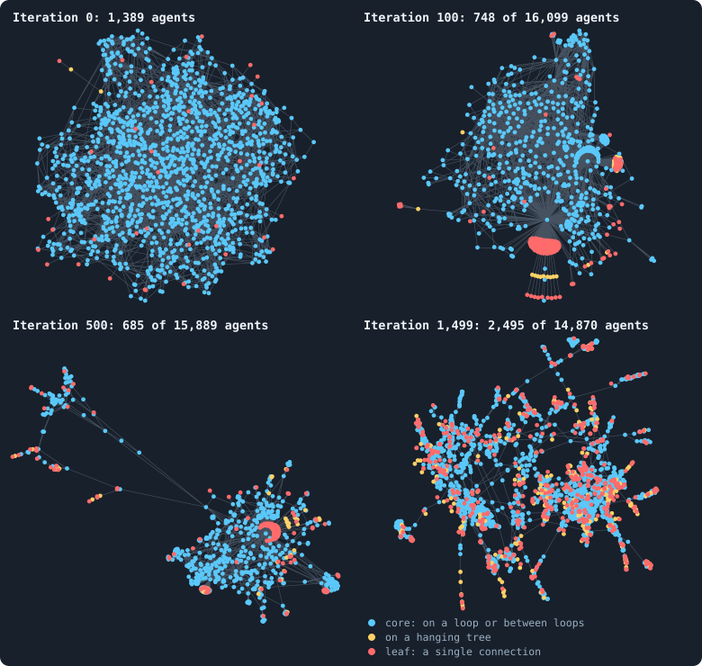

**One world at four moments.** The world with seed 1 after the games of iterations 0, 100, 500 and 1,499. Every agent alive is a dot, every connection a line (at iteration 0, every one of its 1,389 agents; at iteration 100, the 748 of its 16,099 agents within 2 steps of agent 415, the oldest, 100 iterations old — a piece, since a world this large is a tangle when drawn whole; at iteration 500, the 685 of its 15,889 agents within 10 steps of agent 424, the oldest, 500 iterations old — a piece, since a world this large is a tangle when drawn whole; at iteration 1,499, the 2,495 of its 14,870 agents within 25 steps of agent 660,973, the oldest, 806 iterations old — a piece, since a world this large is a tangle when drawn whole). Blue: agents in the core, which is what is left when agents with one connection or none are removed again and again until none remains ([Core, trees and leaves](measuring-networks.md#core-trees-and-leaves)); yellow: the rest of the hanging trees; red: leaves, agents with a single connection. Where a dot is drawn means nothing in itself: a layout (networkx's ForceAtlas2, seed 1) pulls joined agents together and pushes the rest apart.

> [!example]- How to make this figure
> **Runs.** `B1-100000-s001`, one of the 30 baseline runs.
>
> **Data.** From each run's frames, `GraphOfLifeRuns/<run>/frames/`, read with `gol_store.read_frame(run, index)`; frame `2·t` is iteration *t* after reproduction and frame `2·t + 1` after the game.
>
> 1. Read frames `1`, `201`, `1001` and `2999` (iterations 0, 100, 500 and 1,499, after the game): `ids` and `edges`.
> 2. Peel: remove every agent with one connection or none, again and again, until none is left; the agents never removed are the core. Leaves are agents with exactly one connection.
> 3. In a world of more than 2,500 agents, keep the agents within r steps of the oldest agent, for the largest r that keeps at most 2,500 (`book_chapters.society.shown`).
> 4. Lay the graph out with `networkx.forceatlas2_layout(G, max_iter=200, seed=1)`.
>
> **To make it again:** `python3 book_figures.py shape`.
<!-- /figure -->

The pictures colour every agent by its place in the network. Blue marks the
agents of the core. Red marks the **leaves**, agents with a single connection.
Yellow marks the agents in between, on the trees that hang off the core.

After the first game, the founders and their first children, 1,389 agents,
still form one web. It is the founders' ring with its shortcuts, and 97% of
its agents are in the core. A hundred iterations later the world has 16,099
agents, too many to draw. The picture holds the 748 within two steps of its
oldest agent. The world has changed character. It is now dense knots of core,
joined by thin strands, with leaves bunched at their ends. At iterations 500
and 1,499 it looks the same in kind. More than half of all agents are in the
core (58% and 64% of the whole world). About a third or less are leaves (36%
and 29%).

#### Connections per agent

<!-- figure shape/degree -->
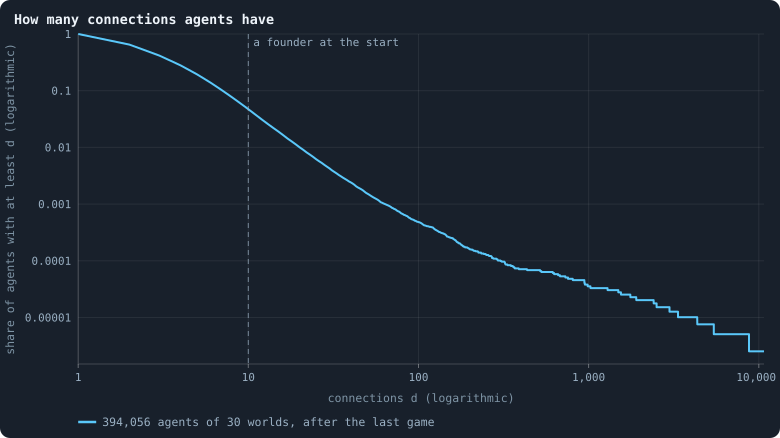

**How many connections agents have.** Of all agents alive after the last game of the 30 worlds, the share that have at least d connections, for every d. At the start a founder had 10 on average (the grey line) — every one of them exactly that many before the ring's rewiring ([The starting ring](rules-in-detail.md#the-starting-ring)).

> [!example]- How to make this figure
> **Runs.** The 30 baseline runs `B1-100000-s001` … `B1-100000-s030`: the baseline B1 at 100,000 tokens, seeds 1 to 30, 1,500 iterations each (every setting is listed in [Thirty worlds](b1-lives-and-wealth.md#thirty-worlds)). They are made with `python3 gol_lab.py run E10`.
>
> **Data.** From each run's frames, `GraphOfLifeRuns/<run>/frames/`, read with `gol_store.read_frame(run, index)`; frame `2·t` is iteration *t* after reproduction and frame `2·t + 1` after the game.
>
> 1. Count every agent's connections in the last frame's `edges`; pool the 30 runs.
> 2. For d = 1, 2, …, the share of agents with at least d.
>
> **To make it again:** `python3 book_figures.py shape`.
<!-- /figure -->

An agent's **degree** is its number of connections ([Degree](measuring-networks.md#an-agents-connections-degree-clustering-assortativity-attachment-and-scaling)). The
figure shows, for every *d*, the share of agents with at least *d* connections
(a complementary cumulative distribution). Both axes are logarithmic: each
step along them multiplies by the same factor
([Logarithmic axes](statistics.md#logarithmic-axes-and-power-laws)). After the last game of the thirty
worlds, 35% of all agents have exactly one connection and 23% have two. The
mean is 3.5. But 4.7% have ten or more, and the curve reaches out to an agent
with 10,735. That agent is the centre of a star, a world held together by a
single hub ([The largest and the smallest](b1-lives-and-wealth.md#the-largest-and-the-smallest)).
Every founder started with ten. At 10,000 tokens, 37% had one connection and
23% two, and the mean was 3.2. There, 4% had ten or more, the largest had
1,399, and the founders started with four.

So the network is very unequal in connections. Most agents have one or two,
and a few are **hubs**, joined to hundreds. On the log–log axes the curve
bends downward instead of running straight, so it is not a clean power law.

#### Core, leaves and bridges

<!-- figure shape/structure -->
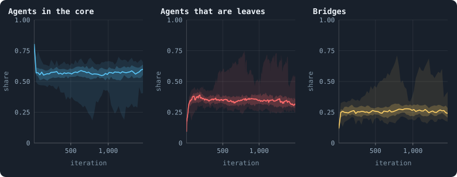

**Core, leaves and bridges.** Three shares, after every game of the 30 baseline worlds. Left: the share of agents in the core ([Core, trees and leaves](measuring-networks.md#core-trees-and-leaves)), measured every 25 iterations. Middle: the share of agents with exactly one connection, after every game. Right: the share of connections that are bridges ([Bridges](measuring-networks.md#bridges-cut-risk-loops-and-the-core-how-a-network-can-be-cut)), every 25 iterations. In each, the line is the median of the worlds at each iteration, the darker band holds the middle half of them (from the 25th to the 75th percentile) and the paler band nine in ten (5th to 95th).

> [!example]- How to make this figure
> **Runs.** The 30 baseline runs `B1-100000-s001` … `B1-100000-s030`: the baseline B1 at 100,000 tokens, seeds 1 to 30, 1,500 iterations each (every setting is listed in [Thirty worlds](b1-lives-and-wealth.md#thirty-worlds)). They are made with `python3 gol_lab.py run E10`.
>
> **Data.** From each run's `GraphOfLifeRuns/<run>/stats.jsonl`, which holds one row per recorded phase: `phase` 1 is the world just after reproduction, `phase` 2 just after the game, and every statistic is a field of the row (see [What a run records](runs-and-records.md#what-a-run-records)).
>
> 1. Take the rows with `phase` = 2 and the statistics `coreShare`, `leaves/nodes` and `bridges/edges` (`a/b` is the row's `a` divided by its `b`).
> 2. For `leaves/nodes`, make the band as for every other band ([Bands](statistics.md#bands-many-worlds-in-one-figure)): cut the 1,500 iterations into 600 stretches of 2.5 and take each world's mean in each stretch.
> 3. For `coreShare` and `bridges/edges`, which are measured every 25 iterations, use stretches of 25.
>
> **To make it again:** `python3 book_figures.py shape`.
<!-- /figure -->

Three shares settle within the first hundred or so iterations, and then hold:

- **The core** holds 97% of the agents after the first game. Over the settled
  life, iterations 500 to 1,499, it settles near 57% in the median world (54%
  at 10,000 tokens). Across the thirty worlds it lies between 19% and 64%.
- **Leaves** rise from 3% to about 35% of all agents (36% at 10,000 tokens).
- **Bridges** rise from 1% to about 26% of all connections (31%).

All three are counted after the game, when the connections that carried
nothing have just been cut. [Peeling a world](#peeling-a-world) counts them at
the start of a game, and finds a slightly larger core.

The worlds at the far ends of these ranges are the stars. In the world with
seed 28, the largest hub is joined to more than half of all agents. Only 19%
of its agents are in the core, 72% are leaves, and 72% of its connections are
bridges.

#### Clustering

<!-- figure shape/clustering -->
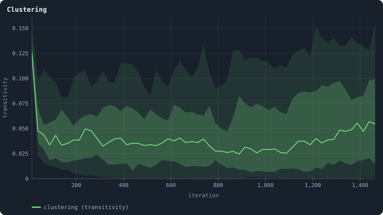

**Clustering.** Three times the number of triangles divided by the number of connected triples ([Clustering](measuring-networks.md#clustering)), every 25 iterations. The founders' ring starts at 0.34 in the median world. The line is the median of the worlds at each iteration, the darker band holds the middle half of them (from the 25th to the 75th percentile) and the paler band nine in ten (5th to 95th).

> [!example]- How to make this figure
> **Runs.** The 30 baseline runs `B1-100000-s001` … `B1-100000-s030`: the baseline B1 at 100,000 tokens, seeds 1 to 30, 1,500 iterations each (every setting is listed in [Thirty worlds](b1-lives-and-wealth.md#thirty-worlds)). They are made with `python3 gol_lab.py run E10`.
>
> **Data.** From each run's `GraphOfLifeRuns/<run>/stats.jsonl`, which holds one row per recorded phase: `phase` 1 is the world just after reproduction, `phase` 2 just after the game, and every statistic is a field of the row (see [What a run records](runs-and-records.md#what-a-run-records)).
>
> 1. Take the rows with `phase` = 2 and the statistic `transitivity`.
> 2. Bands as above, in stretches of 25.
>
> **To make it again:** `python3 book_figures.py shape`.
<!-- /figure -->

Clustering is taken over the whole world. Of all the pairs of neighbours that
agents have, it is the share that are joined to each other. A triangle closes
three such pairs, so it is three times the number of triangles over the number
of pairs ([Clustering](measuring-networks.md#clustering)).

In the founders' ring, about a third of the pairs of neighbours of a founder
are neighbours themselves (0.34). Within the first game that halves (0.17). In
a settled world it is 0.039, between 0.002 and 0.114 across the thirty worlds:
half of the 0.075 of the worlds of 10,000 tokens.

That is low. But it is still more than a hundred times what a random network
of the same size would have, about 0.0002. There are triangles, and they are
not there by chance. A child joined both to its parent and to one of its
parent's neighbours closes a triangle the moment it is born.

#### How far apart are two agents?

<!-- figure shape/distance -->
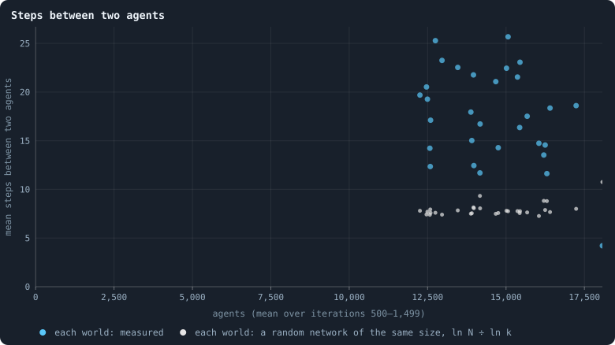

**Steps between two agents.** For each world (blue): its mean number of agents and the mean number of steps along connections from one agent to another, both averaged over iterations 500–1,499. Grey: the rough distance in a random network with the same number of agents N and connections per agent k, ln N / ln k.

> [!example]- How to make this figure
> **Runs.** The 30 baseline runs `B1-100000-s001` … `B1-100000-s030`: the baseline B1 at 100,000 tokens, seeds 1 to 30, 1,500 iterations each (every setting is listed in [Thirty worlds](b1-lives-and-wealth.md#thirty-worlds)). They are made with `python3 gol_lab.py run E10`.
>
> **Data.** From each run's `GraphOfLifeRuns/<run>/stats.jsonl`, which holds one row per recorded phase: `phase` 1 is the world just after reproduction, `phase` 2 just after the game, and every statistic is a field of the row (see [What a run records](runs-and-records.md#what-a-run-records)).
>
> 1. Average `nodes`, `meanDegree` and `meanPathLength` over the rows with `phase` = 2 and 500 ≤ `iteration` ≤ 1,499 (`meanPathLength` is measured every 25 iterations, from breadth-first searches out of 8 to 16 evenly spread agents; [Path length](measuring-networks.md#distances-in-a-network-path-length-radius-and-diameter-the-spectral-gap)).
> 2. Plot one dot per run, and ln N / ln k for the same run.
>
> **To make it again:** `python3 book_figures.py shape`.
<!-- /figure -->

The distance between two agents is the fewest connections on a path between
them ([Path length](measuring-networks.md#distances-in-a-network-path-length-radius-and-diameter-the-spectral-gap)). Two agents of a settled world are a
median 17.7 steps apart. Take a random network with the same number of agents
*N* and connections per agent *k*. There, two agents are about ln *N* / ln *k*
steps apart: about 7.8. So the agents of a world are 2.3 times as far apart.
In the worlds of 10,000 tokens they were 1.6 times as far (9.8 steps against
6). The worlds are stretched out. A token moves at most one connection in a
game, so it needs about eighteen games to go from one agent to another, on
average.

Among these thirty worlds, the larger ones do not have their agents further
apart. The worlds hold 12,300 to 18,100 agents, and the
[correlation](statistics.md#two-numbers-together-correlation-a-fitted-line-and-logarithmic-axes) between size and distance is −0.35. Without the
seven stars, which are both large and short, it is −0.18. In a star, the
agents joined to its centre are two steps from one another through it. The
shortest world, seed 28, has its agents 4.2 steps apart. Among the others,
distances range from 12 to 26 steps, for reasons other than size.
[Distances](#distances) measures one world exactly, against a sharper null.

#### Was the thesis right? (the shape of the network)
The thesis was checked, as planned, from iteration 100 on. In the worlds of
10,000 tokens it holds in three of its four clauses. The ring is gone almost
at once. More than a fifth of all connections are bridges: a median of 32%.
They are more than a fifth in every one of the 26 worlds that lived to the
end. Clustering stays below 0.1: a median of 0.077, and above 0.2 in no world.
But the thesis fails in its fourth clause. The core holds about half of all
agents, not less: a median of 53%, and less than half in only 6 of the 26
worlds. Over the settled life, from iteration 500 on, the numbers are almost
the same: 31%, 0.075 and 54%. So the thesis is **refuted**, narrowly, on its
last clause.

At 100,000 tokens, checked the same way from iteration 100 on, it is refuted
again on the same clause, and more clearly. Bridges are a median 26% of all
connections, and more than a fifth in every one of the thirty worlds.
Clustering is 0.043, above 0.1 in one world and above 0.2 in none. But the
core holds a median 57% of all agents, and less than half in only 5 of the 30.
A larger world is, if anything, more of a web.

#### What closes the loops

The thesis said what its failure would mean. Something in the rules closes
loops, and the picture of a world as a tree of families is wrong. Births close
them. A child is joined to some of its parent's candidates. If two of them are
neighbours of each other, the child closes a triangle at once
([Clustering](#clustering)).

The measurements of the baseline found how this shapes a world. It grows only
locally, by copying. An agent gains a connection whenever a neighbour has a
child that is joined to it too. So the well-connected gain connections in
proportion to those they have, and each connection a hub gains this way comes
with about one triangle. Clustering then falls as one over an agent's number
of connections. The result is a **hierarchy of stars**, with leaves hanging on
hubs ([Power laws, real and apparent](b1-the-network-size-and-scaling.md#power-laws-real-and-apparent-and-how-to-fit-one),
[How properties scale together](b1-the-network-size-and-scaling.md#how-properties-scale-together)).

### The core of a world

Peel away every agent with one connection or none, again and again, and what
is left is a world's **core**
([Core, trees and leaves](measuring-networks.md#core-trees-and-leaves)). Its agents lie on a loop, or
on a path between loops. Everything peeled hangs off the core in trees.
[Core, leaves and bridges](#core-leaves-and-bridges) found that the core holds
more than half of the agents. This section looks inside it. How much of the
tokens does it hold? How far do the trees hang from it, and how deep does it
go? Where are the loops, and who lives where?
[How many dimensions does a world have?](how-many-dimensions-does-a-world-have.md)
measured the dimensions of a whole world; this section asks the same of its
core.

#### Why the core matters

The core is where a world can hold anything together. Every connection in it
lies on a loop or on a path between loops. Cutting one on a loop splits
nothing: there is another way round. But a connection on a path between loops
is a bridge, and its loss splits the core in two ([Bridges](measuring-networks.md#bridges-cut-risk-loops-and-the-core-how-a-network-can-be-cut)). The
**cut risk** of a world is the largest share of it that one bridge holds to
the rest ([Cut risk](measuring-networks.md#cut-risk)). In one world of
[How a world breaks](b1-the-network-size-and-scaling.md#how-a-world-breaks), a third to almost half of the
world hung on a single connection, for 140 iterations. A tree is cut off whole
by the loss of the one connection that holds it. So anything larger than an
agent that might last and evolve can only live in the core. Such a thing would
be a group of agents that holds together while its members come and go.

And the core is the better candidate for a **space**, in the sense of
[Physical inspiration](physical-inspiration.md). Trees branch. A tree of depth
*d* can hold a number of agents that grows exponentially with *d*. So the
agents within *r* steps of an agent, its **ball** of radius *r*, swell in
number with every tree the ball meets. Such growth makes a network look
higher-dimensional than the space it hangs from. If the worlds have a
dimension of their own, it should show most cleanly in their cores. The
difference between a world's dimension and its core's says how much the trees
inflate it.

#### Peeling a world

Every 25 iterations, at the start of the game, each world is peeled. Its
agents and tokens are counted in three parts: the core, the hanging trees and
the leaves. The hanging trees are the agents that the peeling removes,
although they have two connections or more.

<!-- figure core/parts -->
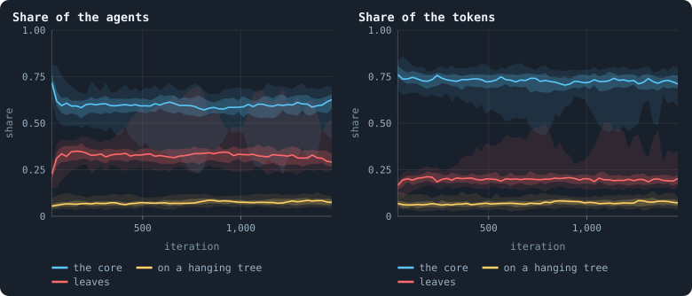

**Core, trees and leaves.** At the start of the game of every 25th iteration of the 30 worlds: the share of the agents (left) and of the tokens (right) in the core, on the hanging trees (agents with two connections or more that the peeling removes), and on leaves (agents with one connection). The line is the median of the worlds at each iteration, the darker band holds the middle half of them (from the 25th to the 75th percentile) and the paler band nine in ten (5th to 95th).

> [!example]- How to make this figure
> **Runs.** The 30 baseline runs `B1-100000-s001` … `B1-100000-s030`: the baseline B1 at 100,000 tokens, seeds 1 to 30, 1,500 iterations each (every setting is listed in [Thirty worlds](b1-lives-and-wealth.md#thirty-worlds)). They are made with `python3 gol_lab.py run E10`.
>
> **Data.** From each run's frames, read every 25 iterations by `book_chapters.core.core_shape`: frame `2·t` (the start of the game of t) and frame `2·t + 1` (after it), `gol_store.read_frame`.
>
> 1. Peel every agent with one connection or none, again and again; what is never peeled is the core; leaves are agents with one connection; the rest of the peeled are on trees.
> 2. Count the agents and add up the tokens of each part; divide by the world's.
>
> **To make it again:** `python3 book_figures.py core`.
<!-- /figure -->

Over the settled life, the core holds **60%** of the agents in the median
world. In the middle half of the worlds it holds between 56% and 63%. The
hanging trees hold 7.5% and the leaves 32%. These shares are counted at the
start of a game, just after the births. After the game, when the connections
that carried nothing have just been cut, the core holds 57% and the leaves 35%
([Core, leaves and bridges](#core-leaves-and-bridges)). The core holds more of
the tokens than of the agents, **73%**. The leaves hold less: 20% of the
tokens, on 32% of the agents. The shares settle within the first hundred
iterations and do not move after.

#### How far the trees hang

Search outward from all core agents at once, one step at a time: a
breadth-first search. It gives every other agent its distance from the core,
and the core agent its tree hangs from.

<!-- figure core/trees -->
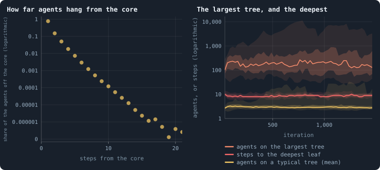

**The trees that hang off the core.** Left: of all agents off the core at the start of the games of every 25th iteration from 500 on, pooled over the worlds, the share at each number of steps from the core, on a logarithmic axis: a straight falling line is a share that shrinks by the same factor with every step. Right: every 25 iterations, the number of agents hanging from the core agent that holds the most, the steps from the core to the farthest agent, and the mean number hanging from a core agent that holds any. The line is the median of the worlds at each iteration, the darker band holds the middle half of them (from the 25th to the 75th percentile) and the paler band nine in ten (5th to 95th).

> [!example]- How to make this figure
> **Runs.** The 30 baseline runs `B1-100000-s001` … `B1-100000-s030`: the baseline B1 at 100,000 tokens, seeds 1 to 30, 1,500 iterations each (every setting is listed in [Thirty worlds](b1-lives-and-wealth.md#thirty-worlds)). They are made with `python3 gol_lab.py run E10`.
>
> **Data.** From each run's frames, read every 25 iterations by `book_chapters.core.core_shape`: frame `2·t` (the start of the game of t) and frame `2·t + 1` (after it), `gol_store.read_frame`.
>
> 1. Peel as above; a breadth-first search out of every core agent at once gives every other agent its steps from the core and the core agent its tree hangs from (`book_chapters.core.hanging`).
> 2. Count the agents per step and per core agent.
>
> **To make it again:** `python3 book_figures.py core`.
<!-- /figure -->

Most of what hangs off the core hangs close to it. Of the agents off the core,
77% are one step from it, mostly leaves joined straight to a core agent.
Another 15% are two steps away, 5% three and 1.8% four. From the third step
on, each step holds about 40% of the agents of the one before. On the
logarithmic axis the points fall along a straight line: the mark of a share
that shrinks by the same factor at every step. The deepest agent of a world is
about **9 steps** from the core. A core agent from which anything hangs
carries 3 agents on average. But the largest tree of a world holds some 345
agents in the median world, and between 190 and 650 in the middle half. The
trees are small, with a few large ones.

#### A core within the core

Peeling can go on. Remove, again and again, every agent with fewer than three
connections, and what is left is the **3-core**; with fewer than *k*, the
*k*-core. The core of this page is the 2-core. An agent's **core number** is
the deepest core it belongs to. It is 1 for the trees and leaves, which the
first peeling removes. It is 2 for the agents of the core that the 3-core no
longer holds, and so on. A world is an onion:

<!-- figure core/onion -->
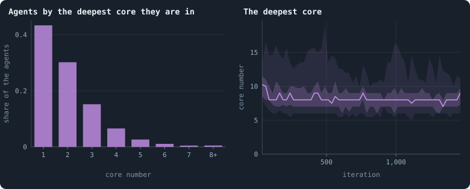

**A world as an onion.** An agent's core number is the largest k such that it belongs to the k-core: what is left when every agent with fewer than k connections is removed, again and again. Core number 1 is everything peeled to reach the 2-core (trees and leaves), 2 the agents of the 2-core that the 3-core no longer holds, and so on. Left: the share of agents with each core number, at the start of every 25th game from 500 on, pooled over the worlds. Right: the deepest core number in a world every 25 iterations; the line is the median of the worlds at each iteration, the darker band holds the middle half of them (from the 25th to the 75th percentile) and the paler band nine in ten (5th to 95th).

> [!example]- How to make this figure
> **Runs.** The 30 baseline runs `B1-100000-s001` … `B1-100000-s030`: the baseline B1 at 100,000 tokens, seeds 1 to 30, 1,500 iterations each (every setting is listed in [Thirty worlds](b1-lives-and-wealth.md#thirty-worlds)). They are made with `python3 gol_lab.py run E10`.
>
> **Data.** From each run's frames, read every 25 iterations by `book_chapters.core.core_shape`: frame `2·t` (the start of the game of t) and frame `2·t + 1` (after it), `gol_store.read_frame`.
>
> 1. `networkx.core_number` of the network at the start of the game.
> 2. Count the agents of each core number (8 and more together); and the largest.
>
> **To make it again:** `python3 book_figures.py core`.
<!-- /figure -->

Two agents in five have core number 1, three in ten core number 2, 15% core
number 3 and 7% core number 4. From there, each shell holds less than half the
one before. In the median world, the deepest core has core number **8**. It is
a small group of agents, each joined to at least eight others of the group:
the world's densest knot.

#### The loops live in the core

A world after cleanup is one piece. How much more than a tree is it? Take any
tree of its connections that reaches every agent, a **spanning tree**. It has
one connection fewer than the world has agents. Every other connection closes
one loop with it, and none of these loops is a combination of the others. So a
world has connections − agents + 1 **independent loops**, its **cycle rank**
([Loops](measuring-networks.md#loops)). That many connections, the right ones, could be cut
without splitting the world. All of those loops are in the core:

<!-- figure core/loops -->
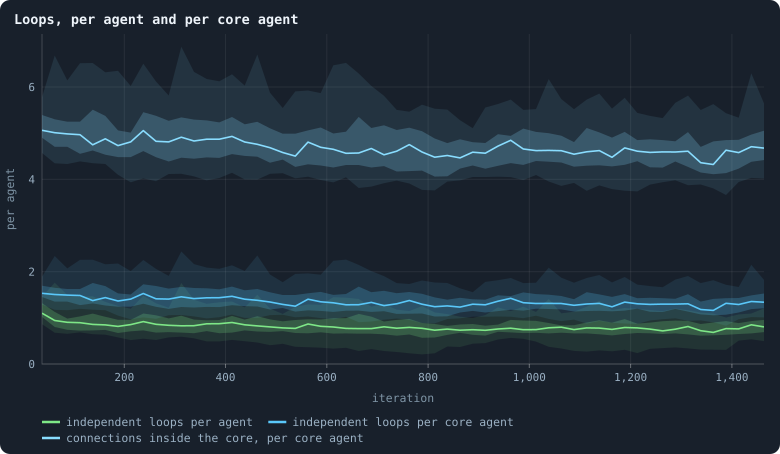

**Loops, per agent and per core agent.** Every 25 iterations at the start of the game: the number of independent loops of a world — connections minus agents plus one, its cycle rank ([Loops](measuring-networks.md#loops)) — divided by its agents and by the agents of its core, which holds every loop; and the mean number of connections a core agent has to other core agents. The line is the median of the worlds at each iteration, the darker band holds the middle half of them (from the 25th to the 75th percentile) and the paler band nine in ten (5th to 95th).

> [!example]- How to make this figure
> **Runs.** The 30 baseline runs `B1-100000-s001` … `B1-100000-s030`: the baseline B1 at 100,000 tokens, seeds 1 to 30, 1,500 iterations each (every setting is listed in [Thirty worlds](b1-lives-and-wealth.md#thirty-worlds)). They are made with `python3 gol_lab.py run E10`.
>
> **Data.** From each run's frames, read every 25 iterations by `book_chapters.core.core_shape`: frame `2·t` (the start of the game of t) and frame `2·t + 1` (after it), `gol_store.read_frame`.
>
> 1. Cycle rank = connections − agents + 1 (the world is one piece after every cleanup).
> 2. Divide by the agents, and by the core's agents; connections with both ends in the core, twice, over the core's agents.
>
> **To make it again:** `python3 book_figures.py core`.
<!-- /figure -->

A settled world has **0.82** independent loops per agent, and **1.34** per
agent of its core. Inside the core, an agent has on average 4.7 connections to
other core agents. Each connection has two ends, so the core has 4.7 / 2,
about 2.3, connections per agent, where a tree would have one. Each of the 1.3
more closes a loop: 4.7 / 2 − 1 = 1.35 loops per agent, as many as are
counted.

#### Who lives where

Which part an agent is in at the start of a game, and what it has:

<!-- figure core/where -->
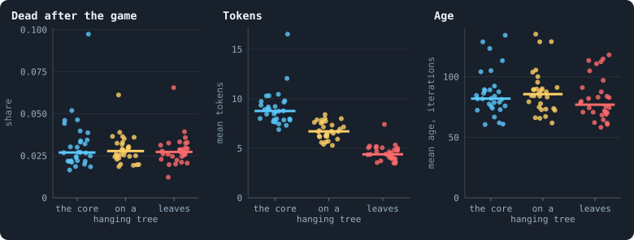

**Who lives where.** At the start of the games of every 25th iteration from 500 on: for the agents of the core, of the trees and the leaves, the share no longer alive after that game, their mean tokens, and their mean age. One dot per world; the bar is the median.

> [!example]- How to make this figure
> **Runs.** The 30 baseline runs `B1-100000-s001` … `B1-100000-s030`: the baseline B1 at 100,000 tokens, seeds 1 to 30, 1,500 iterations each (every setting is listed in [Thirty worlds](b1-lives-and-wealth.md#thirty-worlds)). They are made with `python3 gol_lab.py run E10`.
>
> **Data.** From each run's frames, read every 25 iterations by `book_chapters.core.core_shape`: frame `2·t` (the start of the game of t) and frame `2·t + 1` (after it), `gol_store.read_frame`.
>
> 1. Peel as above; for each part, the agents of frame `2·t` missing from frame `2·t + 1`, and the means of `tokens` and `ages`.
> 2. Pool the looks of a world; one dot per world.
>
> **To make it again:** `python3 book_figures.py core`.
<!-- /figure -->

A core agent holds 8.8 tokens on average, an agent of a tree 6.7 and a leaf
4.4. Core agents are a little younger than tree agents, 82 iterations against
86 on average, and older than leaves (77). But in a game they all die alike.
Of the core agents at the start of a game, **2.7%** are gone after it; of the
tree agents, 2.8%; of the leaves, 2.7%. Hanging from the world by a single
connection does not make a leaf more likely to die. A tree is cut off whole by
the loss of one connection. But agents in the core are lost in other ways just
as often. They starve, and whole parts of the core go quiet at once
([How a world breaks](b1-the-network-size-and-scaling.md#how-a-world-breaks)).

#### How many dimensions the core has

Two rulers measure a network's dimension
([How many dimensions does a world have?](how-many-dimensions-does-a-world-have.md)).
The first counts the agents in a ball of radius *r*. In a space of *d*
dimensions, their number grows like *r*^*d*
([Dimension and curvature](measuring-space.md#three-ways-to-measure-a-networks-dimension)). The second
releases a walker that steps at random. It asks how often the walker is back
where it started after *t* steps: the more dimensions, the rarer
([The spectral dimension](measuring-space.md#the-spectral-dimension)). Both rulers are laid on the
whole world, on its core alone, and on its **random twin**
([The random twin: is a world a space?](measuring-space.md#the-random-twin-is-a-world-a-space)). The twin has the
same agents, each with as many connections, wired at random.

<!-- figure core/dimension -->
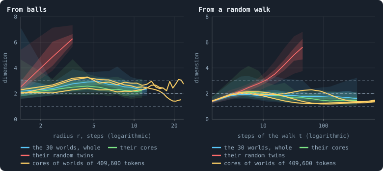

**How many dimensions the core has.** The two rulers of [How many dimensions does a world have?](how-many-dimensions-does-a-world-have.md) — the local dimension from how balls grow, and the spectral dimension from how a random walk spreads — on the 30 worlds after their last game (blue), on their cores alone (green), and on their random twins (red); each line is the median of the worlds, the darker band the middle half of them and the paler band nine in ten. Yellow: the cores of the three worlds of 409,600 tokens of [How does a world's size follow its tokens?](b1-the-network-size-and-scaling.md#worlds-of-many-sizes).

> [!example]- How to make this figure
> **Runs.** The 30 baseline runs `B1-100000-s001` … `B1-100000-s030`: the baseline B1 at 100,000 tokens, seeds 1 to 30, 1,500 iterations each (every setting is listed in [Thirty worlds](b1-lives-and-wealth.md#thirty-worlds)). They are made with `python3 gol_lab.py run E10`. The three worlds of 409,600 tokens of Experiment 8 (`B1-409600-s001` … `-s003`, [How does a world's size follow its tokens?](b1-the-network-size-and-scaling.md#worlds-of-many-sizes); `python3 gol_lab.py run E08`), after their last game.
>
> **Data.** From each run's frames, `GraphOfLifeRuns/<run>/frames/`, read with `gol_store.read_frame(run, index)`; frame `2·t` is iteration *t* after reproduction and frame `2·t + 1` after the game.
>
> 1. Read each run's last frame; build its network from `edges`; its core by peeling; its random twin by `book_graph.degree_preserving` (seed 23).
> 2. Each network's largest piece, measured as in [How many dimensions does a world have?](how-many-dimensions-does-a-world-have.md) (`book_chapters.space.measure`).
>
> **To make it again:** `python3 book_figures.py core`.
<!-- /figure -->

By balls the core reads **2.5** in the median world, and between 2.2 and 2.9
in the middle half; the whole world reads 2.8. By walks the two read the same,
**1.9**. The random twins read 6.5 by balls and 3.2 by walks. That is no
dimension at all in the sense of a space: a random network's balls grow
exponentially, and their reading only rises with *r*.

So the core of a world is a space, as the world is: two to three dimensions by
balls, a little under two by walks. By balls it reads a little lower than the
world. The trees inflate how fast a ball grows, by about 0.3 dimensions, as
[Why the core matters](#why-the-core-matters) supposed. They add agents to
every ball without adding a direction to move in. The random walk is hardly
affected. It spends a few steps in a tree and comes back.

The size of a world matters more than its trees. In the worlds of 10,000
tokens the core reads 1.9 by balls, and the whole world 2.3. The three worlds
of 409,600 tokens of
[How does a world's size follow its tokens?](b1-the-network-size-and-scaling.md#worlds-of-many-sizes)
have about 42,000 core agents each. There the core reads 2.7 over radii 3 to
14 (the whole world 3.3), and 3.1 at radii 3 to 6. By walks the cores read
1.6, 1.9 and 1.5 at 10,000, 100,000 and 409,600 tokens. The core's dimension
by balls grows with the world, as the world's does, and has not settled at any
of these sizes. [Dimensions at scale](dimensions-at-scale.md) followed the
whole world's reading to every size the notebook has: it grows with a world's
size through its hubs, and holds across scales within each world. The
core's own reading has not been followed further.

#### The core's dimension over a world's life

The same readings, after the games of five moments of the settled life, for
the whole world, its core and its 3-core:

<!-- figure core/over-life -->
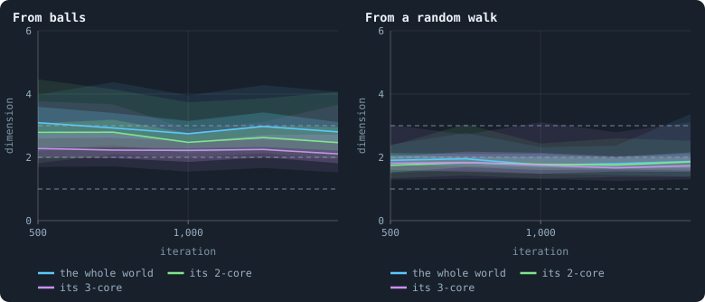

**The core's dimension over a world's life.** After the games of iterations 500, 750, 1,000, 1,250 and 1,499 of the 30 worlds: each ruler's typical reading — the median of its values over the scales of [How many dimensions does a world have?](how-many-dimensions-does-a-world-have.md)'s plateau — on the whole world, on its 2-core and on its 3-core (what is left when agents with fewer than three connections inside the core are peeled away too). The line is the median of the worlds at each iteration, the darker band holds the middle half of them (from the 25th to the 75th percentile) and the paler band nine in ten (5th to 95th).

> [!example]- How to make this figure
> **Runs.** The 30 baseline runs `B1-100000-s001` … `B1-100000-s030`: the baseline B1 at 100,000 tokens, seeds 1 to 30, 1,500 iterations each (every setting is listed in [Thirty worlds](b1-lives-and-wealth.md#thirty-worlds)). They are made with `python3 gol_lab.py run E10`.
>
> **Data.** From each run's frames, read every 25 iterations by `book_chapters.core.core_shape`: frame `2·t` (the start of the game of t) and frame `2·t + 1` (after it), `gol_store.read_frame`.
>
> 1. At each moment, the network after the game, its 2-core, and its 3-core (`networkx.core_number` ≥ 3).
> 2. Both rulers on the largest piece of each (`book_chapters.space.measure`); the median of the readings over the plateau's scales.
>
> **To make it again:** `python3 book_figures.py core`.
<!-- /figure -->

Nothing moves much. By balls, the whole world reads 3.1 at iteration 500 and
2.8 at the end. Its core reads 2.8 and 2.5, and its 3-core 2.3 and 2.1. By
walks all three read between 1.7 and 2.0 at every moment. The bands of the
worlds are far wider than any change. A world's dimension is set by iteration
500, and each world keeps its own.

### The geometry of a world

A network has no space around it: agents are not anywhere, they are only
joined. Still, a network has a **geometry**: distances between its agents, a
way of growing outward from each, and thin places where it could be cut. The
viewer measures it in nine ways. This section reads them on the thirty worlds.
It holds the most telling ones against a **null**, the world's random twin:
exactly the same number of connections at every agent, wired at random. What
the world has and its twin lacks is what the rules built.

#### Distances

[How far apart are two agents?](#how-far-apart-are-two-agents) found two
agents of a settled world a median 17.7 steps apart: that is the world's
**mean path length**. Two more numbers describe its distances
([Radius and diameter](measuring-networks.md#radius-and-diameter)). The **diameter** is the
distance between the two agents furthest apart. The **radius** is how far the
most central agent has to reach to touch everyone.

<!-- figure geometry/distances -->
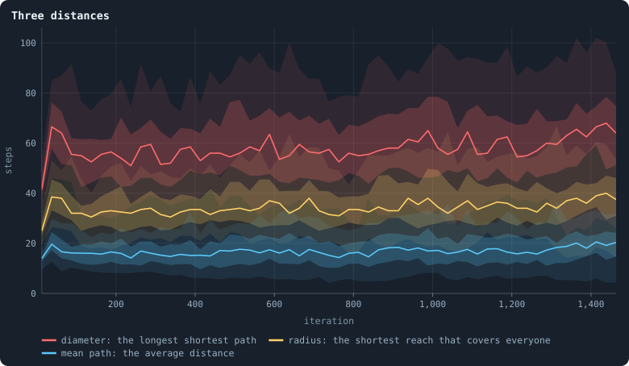

**Three distances.** Every 25 iterations, in the 30 baseline worlds: the diameter, the radius and the mean path length, all estimated from breadth-first searches out of 8 to 16 spread agents ([Radius and diameter](measuring-networks.md#radius-and-diameter)). For each, the line is the median of the worlds at each iteration, the darker band holds the middle half of them (from the 25th to the 75th percentile) and the paler band nine in ten (5th to 95th).

> [!example]- How to make this figure
> **Runs.** The 30 baseline runs `B1-100000-s001` … `B1-100000-s030`: the baseline B1 at 100,000 tokens, seeds 1 to 30, 1,500 iterations each (every setting is listed in [Thirty worlds](b1-lives-and-wealth.md#thirty-worlds)). They are made with `python3 gol_lab.py run E10`.
>
> **Data.** From each run's `GraphOfLifeRuns/<run>/stats.jsonl`, which holds one row per recorded phase: `phase` 1 is the world just after reproduction, `phase` 2 just after the game, and every statistic is a field of the row (see [What a run records](runs-and-records.md#what-a-run-records)).
>
> 1. Take `diameter`, `radius` and `meanPathLength` of the rows with `phase` = 2.
> 2. In each stretch, take the median, the 25th and 75th and the 5th and 95th percentiles of those means over the worlds that still have a value there (a world that died has none after its death).
>
> **To make it again:** `python3 book_figures.py geometry`.
<!-- /figure -->

Over the settled life, the median world has a radius of 36 and a diameter of
60. With the mean path length, all three are about twice those of the worlds
of 10,000 tokens (9.8, 17 and 29).

Are those long? Take the world of seed 1 after its last game, with 14,870
agents, and compute every distance exactly. Its mean path is 27.9 steps, its
radius 48 and its diameter 96. Now keep every agent's number of connections,
and wire them at random, five times over: a "configuration model", the world's
random twin. The mean path falls to **6.0**, the radius to 8.6 and the
diameter to 16.

So the world is **four and a half times as long** as its connections require.
The world of seed 1 at 10,000 tokens was twice as long (8.8 against 4.2). The
gap widens with size. A random network's distances grow with the logarithm of
its number of agents, a world's with a power of it. In worlds of up to 60,000
agents, they grow like the number of agents to the power 0.25 to 0.30. That is
how distances grow in a body of about three dimensions
([How does a world's size follow its tokens?](b1-the-network-size-and-scaling.md#worlds-of-many-sizes)).

Random networks are "small worlds" because every connection is as likely to be
a long jump as a short one. In these worlds there are no long jumps. A child
is joined to its parent's neighbourhood
([How agents have children](b1-lives-and-wealth.md#how-agents-have-children)),
so the network only ever grows locally, branch by branch.

#### How a world grows around an agent

Stand on an agent and count the agents within *r* steps. This is the ball of
[How many dimensions the core has](#how-many-dimensions-the-core-has), seen up
close in one world. In a space of *d* dimensions the count grows like *r*^*d*.
In a tree, or in a random network, it grows exponentially: by about the same
factor with every step
([Dimension and curvature](measuring-space.md#three-ways-to-measure-a-networks-dimension)).

<!-- figure geometry/ball -->
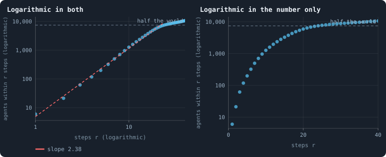

**How many agents are within r steps.** The world with seed 1 after its last game (14,870 agents). From 24 agents spread evenly through the list of ids, a breadth-first search counts how many agents lie within r steps; the dots are the means over the 24. Left, both axes logarithmic: a power law r^d — growth like a d-dimensional space — is a straight line of slope d; red is the line least squares fits up to the radius where half the world is reached. Right, only the vertical axis logarithmic: exponential growth, as in a tree or a random network, would be a straight line there ([Dimension and curvature](measuring-space.md#three-ways-to-measure-a-networks-dimension)).

> [!example]- How to make this figure
> **Runs.** `B1-100000-s001`.
>
> **Data.** From each run's frames, `GraphOfLifeRuns/<run>/frames/`, read with `gol_store.read_frame(run, index)`; frame `2·t` is iteration *t* after reproduction and frame `2·t + 1` after the game.
>
> 1. Read frame `2999`; build the network from `edges`.
> 2. From every ⌊n/24⌋-th agent of the id-sorted list, breadth-first search; count the agents at distance ≤ r for r = 1 … 40; average over the 24 sources.
> 3. Fit ln V(r) = a + d·ln r by least squares for r with V(r) ≤ n/2.
>
> **To make it again:** `python3 book_figures.py geometry`.
<!-- /figure -->

In the world of seed 1, one step holds 6 agents on average: the agent and its
neighbours. Two steps hold 21, three 62, five 200 and ten 1,270. The count
grows as *r*^2.38 until half the world is reached, at 24 steps. Then it
flattens, as the balls run into the edges of the world. In the world of seed 1
at 10,000 tokens, two steps already held 70 agents, because most agents were
two steps from a hub. Half that world lay within seven steps. A power law
would run straight in the left panel, an exponential in the right one. The
growth here is closer to a power law, and
[How many dimensions does a world have?](how-many-dimensions-does-a-world-have.md)
reads it as a dimension.

#### Four measures of a world's shape

From ball growth and from coverings come four numbers that the viewer records
every 25 iterations. Each is given for the median world, with the range of the
thirty worlds in brackets:

<!-- figure geometry/measures -->
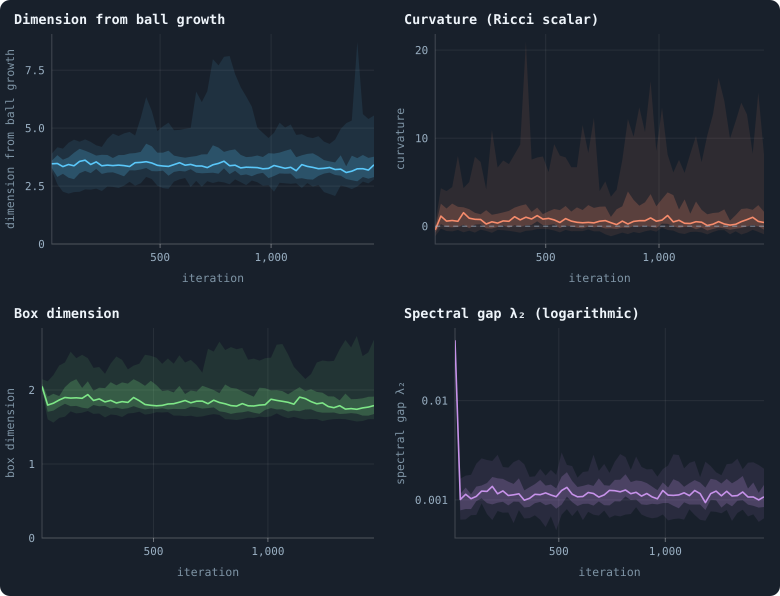

**Four measures of a world's geometry.** Every 25 iterations, in the 30 baseline worlds: the dimension and the curvature read off how balls grow ([Dimension and curvature](measuring-space.md#three-ways-to-measure-a-networks-dimension)), the box dimension ([Box dimension](measuring-space.md#box-dimension)), and the spectral gap, on a logarithmic axis ([The spectral gap](measuring-networks.md#the-spectral-gap)). In each, the line is the median of the worlds at each iteration, the darker band holds the middle half of them (from the 25th to the 75th percentile) and the paler band nine in ten (5th to 95th).

> [!example]- How to make this figure
> **Runs.** The 30 baseline runs `B1-100000-s001` … `B1-100000-s030`: the baseline B1 at 100,000 tokens, seeds 1 to 30, 1,500 iterations each (every setting is listed in [Thirty worlds](b1-lives-and-wealth.md#thirty-worlds)). They are made with `python3 gol_lab.py run E10`.
>
> **Data.** From each run's `GraphOfLifeRuns/<run>/stats.jsonl`, which holds one row per recorded phase: `phase` 1 is the world just after reproduction, `phase` 2 just after the game, and every statistic is a field of the row (see [What a run records](runs-and-records.md#what-a-run-records)).
>
> 1. Take `dimension`, `ricciCurvature`, `boxDimension` and `spectralGap` of the rows with `phase` = 2 (measured every 25 iterations).
> 2. In each stretch, take the median, the 25th and 75th and the 5th and 95th percentiles of those means over the worlds that still have a value there (a world that died has none after its death).
>
> **To make it again:** `python3 book_figures.py geometry`.
<!-- /figure -->

- **Dimension from ball growth**: the viewer's reading of how balls grow over
  their first five steps. It is 3.4 (2.9 to 6.9; 3.0 at 10,000 tokens),
  against 3.7 in the founders' ring after the first game. Over their first few
  steps, balls grow about as fast as in three-dimensional space, or faster.
- **Curvature**: +1.4 (0.1 to 23), from −1.7 at the start. Positive curvature
  means that balls grow more slowly at larger *r* than at smaller, as on a
  sphere ([Dimension and curvature](measuring-space.md#three-ways-to-measure-a-networks-dimension)). Here
  that is mostly the bushy neighbourhoods of hubs, which fill the first steps
  of a ball. In a star, most agents are two steps from most others, through
  the centre (the 23). Read it as "the growth slows", not as a sphere.
- **Box dimension**, from how many boxes it takes to cover the world
  ([Covering a world with boxes](#covering-a-world-with-boxes)). It is 1.88
  (1.66 to 2.58; 1.85 at 10,000 tokens), from 2.48 in the ring. A straight
  line fits the counts well, with R² = 0.96.
- **Spectral gap**, which says how hard the world is to cut in two
  ([How easily a world could be cut](#how-easily-a-world-could-be-cut)). It is
  0.0012 (0.0010 to 0.0019), half that of the worlds of 10,000 tokens
  (0.0026), down from 0.080 in the ring.

Two dimensions, 3.4 and 1.9, for the same worlds. They do not contradict each
other; they look at different scales. Ball growth is fitted at radii 1 to 5,
where the bushy neighbourhoods of hubs make the world look high-dimensional.
Box covering runs from size 1 to 33, and at large sizes it counts the long,
thin branches, which make the world look low-dimensional. Neither number is
"the" dimension of a network that has no single one; both are indices for
comparing worlds. The rulers of
[How many dimensions the core has](#how-many-dimensions-the-core-has) read the
same worlds as 2.8 by balls. They use the typical ball over radii 3 to 10. The
viewer uses the mean ball over radii 1 to 5, which the few agents next to a
hub pull up.

#### Covering a world with boxes

Cover the world with boxes. A box of size ℓ is every agent within (ℓ − 1)/2
steps of a centre. The larger the boxes, the fewer are needed: in a space of
*d* dimensions, their number falls like ℓ^−*d*. Halve the size of the boxes,
and a line needs twice as many, a sheet four times as many
([Box dimension](measuring-space.md#box-dimension)).

<!-- figure geometry/boxes -->
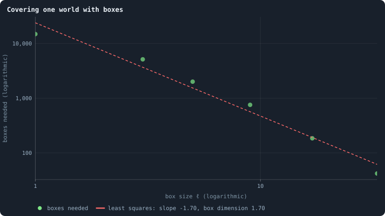

**Covering one world with boxes.** The world with seed 1 after its last game, covered by boxes: a box of size ℓ is every agent within (ℓ − 1)/2 steps of a centre, and centres are taken greedily, best-connected first, among the agents no box holds yet. Dots: how many boxes it takes for ℓ = 1, 3, 5, 9, 17 and 33; red: the least-squares line on logarithmic axes, whose slope is minus the box dimension ([Box dimension](measuring-space.md#box-dimension)).

> [!example]- How to make this figure
> **Runs.** `B1-100000-s001`.
>
> **Data.** From each run's frames, `GraphOfLifeRuns/<run>/frames/`, read with `gol_store.read_frame(run, index)`; frame `2·t` is iteration *t* after reproduction and frame `2·t + 1` after the game.
>
> 1. Read frame `2999`; order the agents by degree, highest first.
> 2. For each ℓ: go down the order; every agent not yet in a box starts a new box, which takes every agent within (ℓ − 1)/2 steps of it; count the boxes.
> 3. Fit ln(boxes) on ln ℓ by least squares.
>
> **To make it again:** `python3 book_figures.py geometry`.
<!-- /figure -->

The world of seed 1 needs this many boxes of each size (of size 1, every agent
is a box alone):

| size of the boxes, ℓ | 1 | 3 | 5 | 9 | 17 | 33 |
|---|---|---|---|---|---|---|
| boxes needed | 14,870 | 5,135 | 2,004 | 756 | 185 | 42 |

On logarithmic axes these lie close to a line of slope −1.70: a box dimension
of about 1.7, between a line and a sheet. The world of seed 1 at 10,000 tokens
read 2.0.

#### How easily a world could be cut

The **spectral gap** λ₂ measures, in one number, how hard a network is to cut
into two large parts. It also says how quickly a random walk on it forgets
where it started: after about 1/λ₂ steps
([The spectral gap](measuring-networks.md#the-spectral-gap)).

The world of seed 1 has λ₂ = 0.00095. Its random twin has 0.031:
**thirty-three times larger** (thirty-two at 10,000 tokens). By Cheeger's
inequality, a small λ₂ guarantees a bottleneck: a large part of the world
joined to the rest by few connections.
[How a world breaks](b1-the-network-size-and-scaling.md#how-a-world-breaks) finds those bottlenecks: whole
branches hanging on single connections. A world breaks, when it breaks, along
its poorest regions.

The gap also says something about the tokens. A game moves tokens almost like
a random walk ([Where the tokens flow](b1-the-game-and-its-flows.md#where-tokens-flow)). On this
network, a random walk needs about a thousand steps to forget its start. So
tokens could spread evenly across a whole world only over about a thousand
games, most of a run. Meanwhile the network changes in every game. About 2,300
connections are made and 1,600 cut per iteration, and the hubs change [brains](the-brain.md "The neural network each agent decides with: inputs about itself and its neighbours, outputs that become its decisions.")
in nearly every game. **Locally**, tokens settle within a few games, which is
why every agent's tokens follow its connections
([How properties scale together](b1-the-network-size-and-scaling.md#how-properties-scale-together)).
**Globally**, the world is never at rest: far-apart regions are only loosely
coupled.

#### Where the loops run

A world's independent loops are counted by its cycle rank
([The loops live in the core](#the-loops-live-in-the-core)). Over the settled
life, the median world has 10,000 of them. Its **loop density**, independent
loops per connection, is 0.42 (0.38 at 10,000 tokens). So 42% of the
connections are "spare", beyond what holding the world together needs. Where
do the loops run?

<!-- figure geometry/loops -->
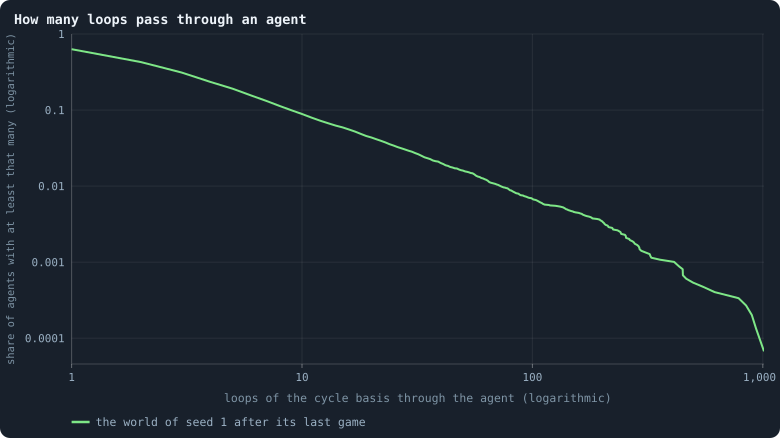

**How many loops pass through an agent.** A breadth-first spanning tree of the world with seed 1 after its last game leaves 11,297 connections over, each closing one loop of a cycle basis ([Loops](measuring-networks.md#loops)). For every count x, the share of agents that at least x of those loops pass through. 37% of the agents lie on none of them.

> [!example]- How to make this figure
> **Runs.** `B1-100000-s001`.
>
> **Data.** From each run's frames, `GraphOfLifeRuns/<run>/frames/`, read with `gol_store.read_frame(run, index)`; frame `2·t` is iteration *t* after reproduction and frame `2·t + 1` after the game.
>
> 1. Read frame `2999`; build a breadth-first spanning tree.
> 2. For every connection not in the tree, walk both ends up the tree to where they meet; every agent on the way, and the meeting point, lies on that loop.
> 3. Count the loops per agent; draw the share with at least x.
>
> **To make it again:** `python3 book_figures.py geometry`.
<!-- /figure -->

A breadth-first spanning tree of the world of seed 1 leaves 11,297 connections
over, and each closes one loop. Of its agents, 37% lie on none of those loops:
they hang on tree-like branches. One agent lies on 1,012 of them, so a tenth
of all the loops of the world run through a single hub. In the smaller world
of seed 1, at 10,000 tokens, half of them did. The number of loops through an
agent is heavy-tailed: most agents are on a few, a handful on hundreds.

### What we learned (the shape of the network)
- **The ring is gone at once, and a mesh with trees replaces it.** Within a
  hundred iterations, more than half of the agents are in the core: 57% after
  a game, 60% before it. Small trees hang off the core. A third of all agents
  are leaves, and a quarter of all connections are bridges. At a tenth of the
  size, a world was half tree and half web.
- **Experiment 5's thesis was refuted, on one clause.** Bridges and clustering
  were as tree-like as it predicted. But the core held most of the agents:
  narrowly so at 10,000 tokens, more clearly at 100,000. Births close loops: a
  child joined to two agents that are neighbours closes a triangle as it is
  born.
- **Connections are very unequal.** Most agents have one or two, and a few
  hubs have hundreds or thousands. Growth by copying makes a hierarchy of
  stars, with leaves hanging on hubs.
- **The core is a mesh within meshes.** It holds three quarters of the tokens
  and every loop. Inside it is a denser mesh, and inside that a denser one
  still, down to a knot of agents each joined to eight others. The trees
  around it are small, mostly a single step deep.
- **The mesh is a space.** By balls the core has two to three dimensions, a
  little fewer than the whole world, because trees add room without adding
  directions. By walks it reads a little under two (1.5 to 1.9 at the three
  sizes), as the world does. Its random twin has no dimension at all. So a
  world's dimension is not an artefact of its trees: it is the dimension of
  its core. By balls, it grows with the world's size, over the sizes run so
  far.
- **The world is stretched.** Two agents are a median 17.7 steps apart, 2.3
  times as far as in a random network of the same size. A token needs about
  eighteen games to go between them. Measured exactly, one world is four and a
  half times as long as its random twin (twice at 10,000 tokens). Nothing
  makes long jumps, and the gap widens with size.
- **It mixes slowly, through bottlenecks.** Its spectral gap is a thirty-third
  of its twin's. Tokens settle within neighbourhoods and not across the world,
  and far-apart regions are only loosely coupled.
- **For evolution, that cuts both ways.** A network that mixes slowly lets
  regions differ for a long time. That is how spatial structure protects
  variety, and how cooperation can grow among neighbours (Nowak and May 1992;
  [Do agents cooperate?](do-agents-cooperate.md)). But a network with
  bottlenecks also breaks easily, and whole branches can be lost at once
  ([How a world breaks](b1-the-network-size-and-scaling.md#how-a-world-breaks)).
- **Anything lasting would have to live in the core, and the core is not
  safe.** A group of agents that holds together while its members change (P3
  in [What this notebook is about](what-this-notebook-is-about.md)) needs
  loops. The core is the only part of a world where a group is joined by more
  than one path. There, losing one connection does not cut it in two. Yet core
  agents die as often as leaves, 2.7% in every game. A part of the world that
  lasted would show as core agents that die less often than the rest. There
  are none but the hubs, which die about half as often as other agents
  ([Do the rich stay rich?](b1-lives-and-wealth.md#do-the-rich-stay-rich)).
  And a hub is a place, not an individual: the brain on it changes in nearly
  every game ([How the game is played](b1-the-game-and-its-flows.md#how-the-game-is-played-what-agents-stake-and-who-wins-the-nodes)).

### How this was made (the shape of the network)
Every figure of this page reads the thirty runs of Experiment 10, listed
below. They are worlds of the baseline B1 at 100,000 tokens, seeds 1 to 30,
run for 1,500 iterations each. The command `python3 gol_lab.py run E10` makes
them. [How many dimensions the core has](#how-many-dimensions-the-core-has)
also reads the three worlds of 409,600 tokens of Experiment 8. It quotes the
worlds of 10,000 tokens of Experiment 2 too. From the runs, three commands
draw the figures:

- `python3 book_figures.py shape` those of
  [What shape does the network take?](#what-shape-does-the-network-take);
- `python3 book_figures.py core` those of
  [The core of a world](#the-core-of-a-world);
- `python3 book_figures.py geometry` those of
  [The geometry of a world](#the-geometry-of-a-world).

Each figure says, folded beneath it, which runs it reads and how.

The thesis of Experiment 5 was first checked in the thirty worlds of 10,000
tokens of Experiment 2, listed last. There `python3 gol_lab.py analyse E05`
checks it. In the worlds of 100,000 tokens, `python3 book_figures.py shape`
checks it again.

#### The runs of Experiment 10 (the shape of the network)
<!-- runs E10 -->
> [!info]- The runs behind this page
> **30 runs.** Every condition below is run once for every seed (1 to 30), for 1,500 iterations — or until its world dies out. Every setting is that of the baseline **B1** (the algorithm exactly as a new run is offered it) unless the condition changes it.
>
> - **baseline** — changes nothing: B1 as it is; 100,000 tokens. Runs `B1-100000-s001` … `B1-100000-s030`.
>
> To make these runs again: `python3 gol_lab.py run E10`, or ▶ in the Research Notebook tab of a computer running `gol_server.py`. Each run writes its settings, seed and engine version beside its frames, in `GraphOfLifeRuns/<run>/meta.json` and `provenance.json`.

> [!info]- Every setting of these runs
> | setting | baseline | what it is |
> |---|---|---|
> | [`total_tokens`](settings.md#total_tokens) | 100,000 | The number of tokens in the world, *T*. It never changes during a run. |
> | [`n_nodes`](settings.md#n_nodes) | 0 | How many founders the world starts with. 0 means one founder per hundred tokens: *n* = ⌊*T* / 100⌋. |
> | [`k_neighbors`](settings.md#k_neighbors) | 0 | How many neighbours each founder starts with in the ring. 0 means *k* = max(⌊*n* / 100⌋, 5); an odd *k* is wired as *k* − 1. |
> | [`rewire_p`](settings.md#rewire_p) | 0.2 | In the starting ring, the probability that a connection is moved to a founder chosen at random (Watts–Strogatz). |
> | [`hidden_layers`](settings.md#hidden_layers) | 50, 45, 40, 35, 30 | The widths of the brain's hidden layers, in order from input to output. |
> | [`hidden_activation`](settings.md#hidden_activation) | sigmoid | The curve each hidden unit applies to its sum: `sigmoid`, which passes on at most a quarter of a change, so that deep brains barely respond to what they see, or `tanh`, the same S-shape centred on zero, through which a change still passes in several layers. |
> | [`brain_kind`](settings.md#brain_kind) | float16 | How weights are stored: `float` (64-bit), `float16` (16-bit, computed in 64-bit) or `binary` (−1, 0, +1). |
> | [`brain_bits`](settings.md#brain_bits) | 16 | Only for binary brains: how many input rows encode one number. Unused by float and float16 brains. |
> | [`message_amount`](settings.md#message_amount) | 30 | How many numbers one message holds. Each agent sends one message to itself and one to each neighbour, every phase. |
> | [`random_input_amount`](settings.md#random_input_amount) | 5 | How many random numbers, drawn uniformly from −2 to 2, a brain reads per neighbour, every time it looks. |
> | [`exchange_messages`](settings.md#exchange_messages) | on | Whether agents send and read messages at all. |
> | [`message_prepass`](settings.md#message_prepass) | on | Whether every phase begins with an extra look in which agents only write messages, so the look that acts reads messages written this phase. |
> | [`allow_handover`](settings.md#allow_handover) | on | Whether a parent may move some of its own connections to its newborn child. |
> | [`allow_revolutions`](settings.md#allow_revolutions) | on | Whether a coalition of smaller stakers can take a node from its largest staker (see the note *How a coalition takes a node*). |
> | [`contest`](settings.md#contest) | largest | Who takes a contested node: the `largest` stake as the game weighs it, or a staker drawn by `lottery` with a chance in proportion to its stake (needs revolutions off). |
> | [`allocation`](settings.md#allocation) | full | How the game's stakes are placed: all at once (`full`), or a token at a time in rounds with the game as it stands in view, the poorest done first (`weakest_first`) or the richest starting alone (`strongest_first`), as the original engine played. |
> | [`allow_gifting`](settings.md#allow_gifting) | off | Whether agents may give tokens to neighbours during reproduction. Off in both baselines; on in a few pilots, in Experiment 24 and in half the worlds of the screen. |
> | [`random_decisions`](settings.md#random_decisions) | off | The control: every number a brain would produce is replaced by a random draw from the standard normal distribution. |
> | [`prune_after`](settings.md#prune_after) | blotto | After which phase connections that carried no tokens are cut: `blotto` (the game), `reproduction`, or `both`. |
> | [`inactive_window`](settings.md#inactive_window) | phase | How long a connection may go unused: `phase` means it must carry tokens in the phase being judged; `iteration` allows the two last phases. |
> | [`redistribution`](settings.md#redistribution) | uniform | How the tokens of removed agents are shared: `uniform` gives every survivor the same chance at each token; `by_tokens` weights by what a survivor holds; `poorest` raises the poorest to one common level first; `newborns` gives them to this iteration's children, `parents` to their parents, once per child (both `uniform` in an iteration without births); `children` leaves each dead agent's estate to its own living children (`uniform` where there are none); `local` lets each estate flow through the network to the nearest living agents, split evenly at every step. |
> | [`tokens_created_per_phase`](settings.md#tokens_created_per_phase) | 0 | Tokens added to the world at every cleanup. 0 keeps the supply fixed. |
> | [`mutate_on_replication`](settings.md#mutate_on_replication) | off | Whether a brain changes only when it is copied — into a newborn, or into a node its owner has just won — instead of also after every game, wherever it sits. |
> | [`incumbency`](settings.md#incumbency) | 1.0 | How many times over an agent's stake on its own node counts when the game decides who takes the node. 1 is the old rule. |
> | [`birth_links`](settings.md#birth_links) | 0 | How many of its parent's neighbours a newborn is joined to, drawn at random, besides its parent itself; 0 leaves every link to the brain's choice. |
> | [`mend_on_death`](settings.md#mend_on_death) | off | Whether the neighbours of an agent that dies are joined up where its death would leave them in separate pieces. |
> | [`prune_needs`](settings.md#prune_needs) | 0 | How many neighbours the two ends of an unused connection must share for it to be cut; 0 cuts every unused connection. |
> | [`valence`](settings.md#valence) | 0 | The most connections an agent's brain may choose to hold (0 = no limit). An agent at its limit cannot have a child. |
> | [`link_token`](settings.md#link_token) | off | Whether every link holds one token: its maker pays for it, a lapsing link gives it back to one of its ends, and a link of a dead agent to the end that lives on, so the links can never outnumber the tokens. |
> | [`link_upkeep`](settings.md#link_upkeep) | off | Whether an agent may pay a token an iteration to keep a link, each brain deciding for each neighbour: `paid_or_used` keeps a link that was paid for or used, `paid_only` only one that was paid for; `off`, only use keeps a link. |
> | [`upkeep_to`](settings.md#upkeep_to) | end | Where a link's upkeep goes: to the link's other end (`end`), or into the estate of the dead (`estate`), shared out by the world's redistribution rule. |
> | [`keep_home`](settings.md#keep_home) | 0.0 | The share of an agent's tokens — rounded up, never less than one — that stays on its own node whatever its brain says; a parent also keeps one. 0 is the old rule. |
> | [`max_age`](settings.md#max_age) | 0 | The age at which an agent dies (0 = never); its tokens are shared out like those of any other dead agent. |
> | [`buy_life`](settings.md#buy_life) | off | Whether an agent that has reached max_age may live on by paying one token an iteration into the estate of the dead — never its last, so one with a single token left dies. Needs max_age. |
> | [`min_child`](settings.md#min_child) | 1 | The fewest tokens a child can be born with; a parent that would give less has no child. |
> | [`child_floor`](settings.md#child_floor) | fixed | The least a child may start with: min_child alone (fixed), or also the median holding of its parent's neighbours (neighbours), so that a world grows only as rich as it is. |
> | [`mix_at_birth`](settings.md#mix_at_birth) | off | Whether a newborn's brain is its parent's mixed with a mate's — one of the parent's neighbours, drawn at random — each hidden unit whole from one or the other by an even chance, before it mutates; off, a newborn has a copy of its parent's brain. |
> | [`mix_mates`](settings.md#mix_mates) | any | Under mix_at_birth, who may be the mate: any neighbour of the parent, or only parents — a neighbour with a living child of its own (with none, the newborn's brain is a copy). |
> | [`mate_pays`](settings.md#mate_pays) | off | Under mix_at_birth, whether the mate pays the child as many tokens as the parent gave it, as far as it can and never its last. |
> | [`self_message`](settings.md#self_message) | own | What an agent writes to itself, which each neighbour reads: what its own column says (own), or the largest, number by number, of what it writes to anyone (largest), so that news one column marks reaches every neighbour. |
> | [`link_search`](settings.md#link_search) | off | Whether an agent may reach beyond its neighbours to propose a link: off; jump, a walk as many steps long as the tokens it spends in one iteration, with a link proposed where it ends; walk, a scout that goes one step further in every iteration it pays for; or reach, a jump whose steps are free, as many as the tokens it holds would pay for. A paid step costs one token, paid to the agent it enters, and never the last. |
> | [`link_steering`](settings.md#link_steering) | random | Which way each step of a search goes: to a neighbour drawn at random, or to the one the searcher would most like a link with (looking). |
> | [`link_consent`](settings.md#link_consent) | mutual | Who has to agree to a link a search proposes: both ends (mutual), or only the one who proposes (forced). Nobody at its valence gets a new link either way. |
> | [`proto`](settings.md#proto) | none | Rules first played in the pilots' prototype, by name: came_from and helped_by (an input row each), contest = lottery, pool by genotype or family, kin_sense, tag_rate, mate_pays, grow, unit_token, link_token. Empty in every run but those that ask for one; only the prototype's world plays them (see the settings note). |
> | [`mutation_probability`](settings.md#mutation_probability) | 0.2 | The probability that a brain changes when it is copied to a child, and again, for every brain, after every game. |
> | [`mutation_noise_std`](settings.md#mutation_noise_std) | 0.2 | How large a change to one weight is: a normal draw with standard deviation this times 1/√(fan-in) of its layer. |
> | [`mutation_sparsity`](settings.md#mutation_sparsity) | 0.1 | The share of a brain's numbers a change touches; also the probability, for each weight matrix and bias vector, of a rarer reset that redraws that share of it. |
> | [`extinction_threshold`](settings.md#extinction_threshold) | 20 | A run stops, as extinct, when an iteration ends (after its game) with this many agents or fewer. |
> | seeds | 1 to 30 | one run per seed |
> | iterations | 1,500 | how far each run goes, unless its world dies first |
>
> A value in **bold** differs from the baseline B1.
<!-- /runs -->

#### The runs of Experiment 5

<!-- runs E05 -->
> [!info]- The runs behind this page
> These are the runs of Experiment 2; nothing new was run for this page.
>
> **30 runs.** Every condition below is run once for every seed (1 to 30), for 3,000 iterations — or until its world dies out. Every setting is that of the baseline **B1** (the algorithm exactly as a new run is offered it) unless the condition changes it.
>
> - **baseline** — changes nothing: B1 as it is; 10,000 tokens. Runs `B1-10000-s001` … `B1-10000-s030`.
>
> To make these runs again: `python3 gol_lab.py run E02`, or ▶ in the Research Notebook tab of a computer running `gol_server.py`. Each run writes its settings, seed and engine version beside its frames, in `GraphOfLifeRuns/<run>/meta.json` and `provenance.json`.

> [!info]- Every setting of these runs
> | setting | baseline | what it is |
> |---|---|---|
> | [`total_tokens`](settings.md#total_tokens) | 10,000 | The number of tokens in the world, *T*. It never changes during a run. |
> | [`n_nodes`](settings.md#n_nodes) | 0 | How many founders the world starts with. 0 means one founder per hundred tokens: *n* = ⌊*T* / 100⌋. |
> | [`k_neighbors`](settings.md#k_neighbors) | 0 | How many neighbours each founder starts with in the ring. 0 means *k* = max(⌊*n* / 100⌋, 5); an odd *k* is wired as *k* − 1. |
> | [`rewire_p`](settings.md#rewire_p) | 0.2 | In the starting ring, the probability that a connection is moved to a founder chosen at random (Watts–Strogatz). |
> | [`hidden_layers`](settings.md#hidden_layers) | 50, 45, 40, 35, 30 | The widths of the brain's hidden layers, in order from input to output. |
> | [`hidden_activation`](settings.md#hidden_activation) | sigmoid | The curve each hidden unit applies to its sum: `sigmoid`, which passes on at most a quarter of a change, so that deep brains barely respond to what they see, or `tanh`, the same S-shape centred on zero, through which a change still passes in several layers. |
> | [`brain_kind`](settings.md#brain_kind) | float16 | How weights are stored: `float` (64-bit), `float16` (16-bit, computed in 64-bit) or `binary` (−1, 0, +1). |
> | [`brain_bits`](settings.md#brain_bits) | 16 | Only for binary brains: how many input rows encode one number. Unused by float and float16 brains. |
> | [`message_amount`](settings.md#message_amount) | 30 | How many numbers one message holds. Each agent sends one message to itself and one to each neighbour, every phase. |
> | [`random_input_amount`](settings.md#random_input_amount) | 5 | How many random numbers, drawn uniformly from −2 to 2, a brain reads per neighbour, every time it looks. |
> | [`exchange_messages`](settings.md#exchange_messages) | on | Whether agents send and read messages at all. |
> | [`message_prepass`](settings.md#message_prepass) | on | Whether every phase begins with an extra look in which agents only write messages, so the look that acts reads messages written this phase. |
> | [`allow_handover`](settings.md#allow_handover) | on | Whether a parent may move some of its own connections to its newborn child. |
> | [`allow_revolutions`](settings.md#allow_revolutions) | on | Whether a coalition of smaller stakers can take a node from its largest staker (see the note *How a coalition takes a node*). |
> | [`contest`](settings.md#contest) | largest | Who takes a contested node: the `largest` stake as the game weighs it, or a staker drawn by `lottery` with a chance in proportion to its stake (needs revolutions off). |
> | [`allocation`](settings.md#allocation) | full | How the game's stakes are placed: all at once (`full`), or a token at a time in rounds with the game as it stands in view, the poorest done first (`weakest_first`) or the richest starting alone (`strongest_first`), as the original engine played. |
> | [`allow_gifting`](settings.md#allow_gifting) | off | Whether agents may give tokens to neighbours during reproduction. Off in both baselines; on in a few pilots, in Experiment 24 and in half the worlds of the screen. |
> | [`random_decisions`](settings.md#random_decisions) | off | The control: every number a brain would produce is replaced by a random draw from the standard normal distribution. |
> | [`prune_after`](settings.md#prune_after) | blotto | After which phase connections that carried no tokens are cut: `blotto` (the game), `reproduction`, or `both`. |
> | [`inactive_window`](settings.md#inactive_window) | phase | How long a connection may go unused: `phase` means it must carry tokens in the phase being judged; `iteration` allows the two last phases. |
> | [`redistribution`](settings.md#redistribution) | uniform | How the tokens of removed agents are shared: `uniform` gives every survivor the same chance at each token; `by_tokens` weights by what a survivor holds; `poorest` raises the poorest to one common level first; `newborns` gives them to this iteration's children, `parents` to their parents, once per child (both `uniform` in an iteration without births); `children` leaves each dead agent's estate to its own living children (`uniform` where there are none); `local` lets each estate flow through the network to the nearest living agents, split evenly at every step. |
> | [`tokens_created_per_phase`](settings.md#tokens_created_per_phase) | 0 | Tokens added to the world at every cleanup. 0 keeps the supply fixed. |
> | [`mutate_on_replication`](settings.md#mutate_on_replication) | off | Whether a brain changes only when it is copied — into a newborn, or into a node its owner has just won — instead of also after every game, wherever it sits. |
> | [`incumbency`](settings.md#incumbency) | 1.0 | How many times over an agent's stake on its own node counts when the game decides who takes the node. 1 is the old rule. |
> | [`birth_links`](settings.md#birth_links) | 0 | How many of its parent's neighbours a newborn is joined to, drawn at random, besides its parent itself; 0 leaves every link to the brain's choice. |
> | [`mend_on_death`](settings.md#mend_on_death) | off | Whether the neighbours of an agent that dies are joined up where its death would leave them in separate pieces. |
> | [`prune_needs`](settings.md#prune_needs) | 0 | How many neighbours the two ends of an unused connection must share for it to be cut; 0 cuts every unused connection. |
> | [`valence`](settings.md#valence) | 0 | The most connections an agent's brain may choose to hold (0 = no limit). An agent at its limit cannot have a child. |
> | [`link_token`](settings.md#link_token) | off | Whether every link holds one token: its maker pays for it, a lapsing link gives it back to one of its ends, and a link of a dead agent to the end that lives on, so the links can never outnumber the tokens. |
> | [`link_upkeep`](settings.md#link_upkeep) | off | Whether an agent may pay a token an iteration to keep a link, each brain deciding for each neighbour: `paid_or_used` keeps a link that was paid for or used, `paid_only` only one that was paid for; `off`, only use keeps a link. |
> | [`upkeep_to`](settings.md#upkeep_to) | end | Where a link's upkeep goes: to the link's other end (`end`), or into the estate of the dead (`estate`), shared out by the world's redistribution rule. |
> | [`keep_home`](settings.md#keep_home) | 0.0 | The share of an agent's tokens — rounded up, never less than one — that stays on its own node whatever its brain says; a parent also keeps one. 0 is the old rule. |
> | [`max_age`](settings.md#max_age) | 0 | The age at which an agent dies (0 = never); its tokens are shared out like those of any other dead agent. |
> | [`buy_life`](settings.md#buy_life) | off | Whether an agent that has reached max_age may live on by paying one token an iteration into the estate of the dead — never its last, so one with a single token left dies. Needs max_age. |
> | [`min_child`](settings.md#min_child) | 1 | The fewest tokens a child can be born with; a parent that would give less has no child. |
> | [`child_floor`](settings.md#child_floor) | fixed | The least a child may start with: min_child alone (fixed), or also the median holding of its parent's neighbours (neighbours), so that a world grows only as rich as it is. |
> | [`mix_at_birth`](settings.md#mix_at_birth) | off | Whether a newborn's brain is its parent's mixed with a mate's — one of the parent's neighbours, drawn at random — each hidden unit whole from one or the other by an even chance, before it mutates; off, a newborn has a copy of its parent's brain. |
> | [`mix_mates`](settings.md#mix_mates) | any | Under mix_at_birth, who may be the mate: any neighbour of the parent, or only parents — a neighbour with a living child of its own (with none, the newborn's brain is a copy). |
> | [`mate_pays`](settings.md#mate_pays) | off | Under mix_at_birth, whether the mate pays the child as many tokens as the parent gave it, as far as it can and never its last. |
> | [`self_message`](settings.md#self_message) | own | What an agent writes to itself, which each neighbour reads: what its own column says (own), or the largest, number by number, of what it writes to anyone (largest), so that news one column marks reaches every neighbour. |
> | [`link_search`](settings.md#link_search) | off | Whether an agent may reach beyond its neighbours to propose a link: off; jump, a walk as many steps long as the tokens it spends in one iteration, with a link proposed where it ends; walk, a scout that goes one step further in every iteration it pays for; or reach, a jump whose steps are free, as many as the tokens it holds would pay for. A paid step costs one token, paid to the agent it enters, and never the last. |
> | [`link_steering`](settings.md#link_steering) | random | Which way each step of a search goes: to a neighbour drawn at random, or to the one the searcher would most like a link with (looking). |
> | [`link_consent`](settings.md#link_consent) | mutual | Who has to agree to a link a search proposes: both ends (mutual), or only the one who proposes (forced). Nobody at its valence gets a new link either way. |
> | [`proto`](settings.md#proto) | none | Rules first played in the pilots' prototype, by name: came_from and helped_by (an input row each), contest = lottery, pool by genotype or family, kin_sense, tag_rate, mate_pays, grow, unit_token, link_token. Empty in every run but those that ask for one; only the prototype's world plays them (see the settings note). |
> | [`mutation_probability`](settings.md#mutation_probability) | 0.2 | The probability that a brain changes when it is copied to a child, and again, for every brain, after every game. |
> | [`mutation_noise_std`](settings.md#mutation_noise_std) | 0.2 | How large a change to one weight is: a normal draw with standard deviation this times 1/√(fan-in) of its layer. |
> | [`mutation_sparsity`](settings.md#mutation_sparsity) | 0.1 | The share of a brain's numbers a change touches; also the probability, for each weight matrix and bias vector, of a rarer reset that redraws that share of it. |
> | [`extinction_threshold`](settings.md#extinction_threshold) | 20 | A run stops, as extinct, when an iteration ends (after its game) with this many agents or fewer. |
> | seeds | 1 to 30 | one run per seed |
> | iterations | 3,000 | how far each run goes, unless its world dies first |
>
> A value in **bold** differs from the baseline B1.
<!-- /runs -->

## How a world breaks

Only the largest connected piece of a world's network survives each phase, so
a whole region can die in one game. In a typical settled world one connection
holds a ninth of it to the rest, yet such weak points almost never give way.
Every game that cut off a thousand agents or more did it across a whole
border: ten connections or more, falling quiet at once. The agents on both
sides hold fewer tokens than they have connections, and a connection that
carries no token in a game is cut. So a world breaks along its poor regions,
not at its weakest bridge.

### Whole regions die at once

Picture a world as islands joined by roads. A road stays open only while
traffic crosses it. An island that no open road joins to the mainland is
abandoned, with everyone on it. An island on a single road hangs by that road.
An island on twenty roads is lost only if all twenty fall silent together.
Which of the two is how a world loses its regions?

The rules are just like that. In B1, a connection is cut at the end of a game
if no token crossed it in that game, in either direction
([`prune_after`](settings.md#prune_after)). And after every phase the cleanup
keeps only the **largest connected piece** of the network
([One iteration, step by step](one-iteration.md#cleanup)). Every agent outside
it dies, however many tokens it holds, and its tokens are dealt out among the
survivors. This is the **cull**.

Three deaths in four are of this kind
([Births, deaths and ages](b1-lives-and-wealth.md#births-deaths-and-ages)). And they come in
lumps: half of them in games that cut off hundreds of agents at once
([How many agents one game removes](b1-the-network-size-and-scaling.md#how-many-agents-one-game-removes)).
This page asks how fragile a world is, whether its breaks can be foreseen, and
what actually severs a region from the rest.

The worlds are the thirty B1 worlds of 100,000 tokens of Experiment 10
([Thirty worlds](b1-lives-and-wealth.md#thirty-worlds)), read over their settled
life, from iteration 500 on. The page was first written from the thirty worlds
of 10,000 tokens; where those differ, their numbers are given beside. A
**big** cut is counted against the size of a world: a thousand agents or more
here, a hundred in the worlds of 10,000 tokens. In both, that is one agent for
every hundred tokens of the world.

### Bridges and the worst cut

A **bridge** is a connection that lies on no loop: cut it, and the network
falls in two ([Bridges](measuring-networks.md#bridges-cut-risk-loops-and-the-core-how-a-network-can-be-cut)). A settled world has about 6,400 of them,
26% of its connections
([Core, leaves and bridges](b1-the-network-size-and-scaling.md#core-leaves-and-bridges)).
Most hold a single leaf, an agent with one connection.

How much hangs on the worst of them? Take away one bridge, and the network
falls into two pieces; the smaller piece is what the bridge holds to the rest.
The **cut risk** is the largest such piece, over all bridges, as a share of
all agents ([Cut risk](measuring-networks.md#cut-risk)). It is 0 when there is no bridge, and at
most a half.

In the median world the cut risk is **11%** (12% at 10,000 tokens). Somewhere,
a single connection is all that joins a ninth of the world to the rest.

### Does a fragile world lose more?

If the worst bridge failed, the game would cut off that ninth. Does it?

<!-- figure breaking/risk -->
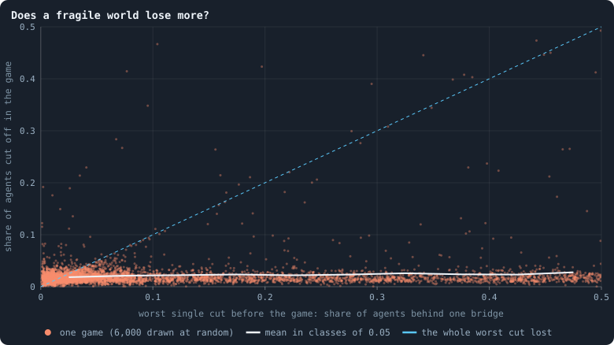

**Does a fragile world lose more?** Every game from iteration 500 on of the 30 worlds. x: after the game's unused connections are cut, just before the cull, the largest share of the world that one bridge held to the rest — if that one connection were cut, that many would be cut off ([Cut risk](measuring-networks.md#cut-risk)). y: the share of agents the game really cut off. White: the mean of y in classes of x 0.05 wide; dashed: y = x.

> [!example]- How to make this figure
> **Runs.** The 30 baseline runs `B1-100000-s001` … `B1-100000-s030`: the baseline B1 at 100,000 tokens, seeds 1 to 30, 1,500 iterations each (every setting is listed in [Thirty worlds](b1-lives-and-wealth.md#thirty-worlds)). They are made with `python3 gol_lab.py run E10`.
>
> **Data.** From each run's `GraphOfLifeRuns/<run>/stats.jsonl`, which holds one row per recorded phase: `phase` 1 is the world just after reproduction, `phase` 2 just after the game, and every statistic is a field of the row (see [What a run records](runs-and-records.md#what-a-run-records)).
>
> 1. Take the rows with `phase` = 2 and 500 ≤ `iteration` ≤ 1,499: `cutRiskBefore`, and `orphaned` / `nodes_before`.
> 2. Plot one against the other; average y in classes of x.
>
> **To make it again:** `python3 book_figures.py breaking`.
<!-- /figure -->

Over 30,000 settled games, the cut risk before a game and the share of agents
it cut off have a correlation of **0.09**: almost nothing. The mean risk is
11%, and the mean share cut off is 2.0%. In 32% of games more than a tenth of
the world hung on one connection. In only 1.1% of games was more than a tenth
cut off. The worst bridge almost never fails. (At 10,000 tokens: 0.06, 41% and
1.25%.)

The cut risk here is the one a run records in each game's row: read after the
game's unused connections are cut, just before the cleanup. Read at the start
of the game instead, in the worlds of 10,000 tokens, it gives the same
picture: a correlation of 0.067, with more than a tenth of the world on one
connection in 40.5% of games.

The rules say why. A connection is cut only if **no** token crosses it, in
either direction, during the game. A bridge with a hundred agents behind it
is, for the same reason that makes it important, a busy connection. Whatever
flows between the branch and the rest flows across it. Like the only road to
an island, it is almost never empty.

### One world, six hundred iterations

<!-- figure breaking/one-world -->
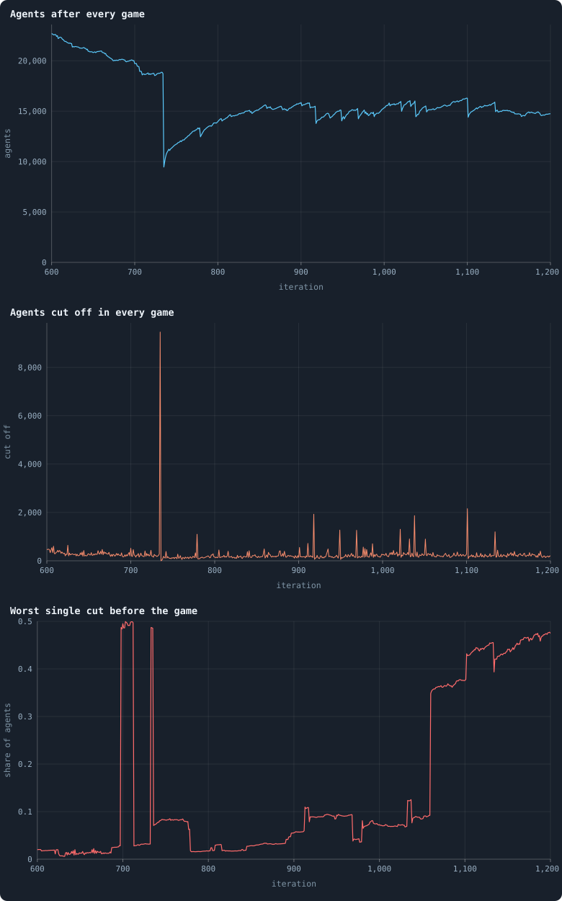

**600 iterations of one world.** The world with seed 26, iterations 600 to 1,200. Top: its number of agents after every game. Middle: how many agents each game cut off. Bottom: before each game, the largest share of the world held to the rest by a single bridge, measured on the network as it stood before the cleanup.

> [!example]- How to make this figure
> **Runs.** `B1-100000-s026`.
>
> **Data.** From each run's `GraphOfLifeRuns/<run>/stats.jsonl`, which holds one row per recorded phase: `phase` 1 is the world just after reproduction, `phase` 2 just after the game, and every statistic is a field of the row (see [What a run records](runs-and-records.md#what-a-run-records)).
>
> 1. Take `nodes`, `orphaned` and `cutRiskBefore` of the rows with `phase` = 2 and 600 ≤ `iteration` ≤ 1,200.
>
> **To make it again:** `python3 book_figures.py breaking`.
<!-- /figure -->

Follow one world closely: the world of seed 26, from iteration 600 to 1,200.
It shrinks from about 22,800 agents to 19,000 by iteration 734. Then a single
game, that of iteration 735, cuts off **9,460** agents. That is half the
world, and the largest cut of all thirty worlds.

Before that game, 49% of the world hung on one connection. The game cut off a
region of about that size, across 79 connections that all carried nothing in
it. The world grows back to 15,000 within a hundred iterations, and wanders
there, losing a thousand or two in a few games.

The bottom panel shows how the worst cut behaves. It lives in **plateaus**:
the same bridge holds a few percent to a tenth of the world for tens of
iterations. Then the plateau ends abruptly. Either a new connection closed a
loop around the bridge, or the branch was lost. From iteration 1,060 on, a
third to almost half of the world hung on one connection, for 140 iterations.
None of it was lost through it.

### Where the cut-off deaths happen

How large are the games that do the killing?

<!-- figure breaking/deaths-by-size -->
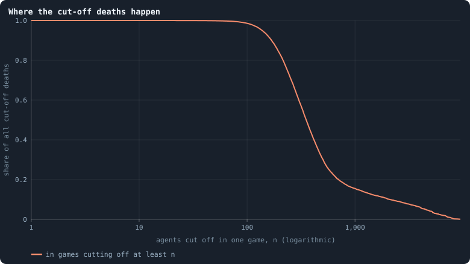

**Where the cut-off deaths happen.** Of all agents cut off in games from iteration 500 on of the 30 worlds, the share that died in games which cut off at least n agents, for every n. Where the line is at 0.5, half of all such deaths happened in games at least that large.

> [!example]- How to make this figure
> **Runs.** The 30 baseline runs `B1-100000-s001` … `B1-100000-s030`: the baseline B1 at 100,000 tokens, seeds 1 to 30, 1,500 iterations each (every setting is listed in [Thirty worlds](b1-lives-and-wealth.md#thirty-worlds)). They are made with `python3 gol_lab.py run E10`.
>
> **Data.** From each run's `GraphOfLifeRuns/<run>/stats.jsonl`, which holds one row per recorded phase: `phase` 1 is the world just after reproduction, `phase` 2 just after the game, and every statistic is a field of the row (see [What a run records](runs-and-records.md#what-a-run-records)).
>
> 1. Take `orphaned` of the rows with `phase` = 2 and 500 ≤ `iteration` ≤ 1,499.
> 2. For every n, add up `orphaned` over the rows with `orphaned` ≥ n and divide by the total.
>
> **To make it again:** `python3 book_figures.py breaking`.
<!-- /figure -->

Half of all agents cut off died in games that cut off at least 353. The
largest single loss was 9,460 agents. One game in fifty cuts off a thousand
agents or more, and these games account for a sixth of all deaths by cutting.

Counted against the size of a world, it is much as at 10,000 tokens. There,
half died in games that cut off at least 42. One game in forty cut off a
hundred or more, and these games held a fifth of the deaths.

### What severs a region

Which rule cuts a region off? There is a clean way to tell. Take a game, the
agents it cut off, and the survivors. Suppose a cut-off agent had a neighbour
among the survivors before the game. Then it must have **lost that connection
to pruning**, the cut of every connection that carried nothing. Otherwise it
would still be joined to that neighbour, and would have survived with it.

So the connections between the lost and the kept, as they stood before the
game, are exactly the connections pruned across the cut. They are the region's
**border**, and counting them tells what kind of break it was. A bridge that
fails leaves a border of one connection. A border of ten means that ten
connections went quiet in the same game.

Of the 601 games that cut off a thousand agents or more (30 worlds, settled
life), **every one** was a whole border going quiet. Each had ten or more
connections between the region and the rest of the world, all carrying nothing
in the same game. Together these games cut off 1.4 million agents. Not one big
cut was a bridge failing.

At 10,000 tokens it was nine in ten. Of the 1,614 games that cut off a hundred
or more, 1,421 went through ten connections or more. Another 161 went through
three to nine, and 32 through one or two.

There, once, a single line of brains cut itself off. In the world of seed 1 of
10,000 tokens, a game at iteration 541 cut off 319 agents. Of them, 60%
carried one genotype, and the typical one staked all its tokens on its own
node. An agent that stakes everything at home sends nothing across its
connections; they stay alive only if its neighbours stake on it.

In the large worlds no such cut shows. Take the six largest cuts of the world
of seed 1 of 100,000 tokens, from 2,177 to 4,608 agents, lost across 202 to
843 connections. In none of them did one genotype hold more than 4% of the
lost.

### Poverty disconnects

Why would ten connections go quiet at once? Look at the agents on the two
sides of the quiet borders, in the games with ten or more border connections:

| | median tokens | median connections | hold fewer tokens than connections |
|---|---|---|---|
| lost side of the border | 1 | 2 | 52% |
| kept side of the border | 3 | 4 | 72% |
| every agent, same games | 3 | 2 | 13% |

The agents on both sides of a quiet border are **poor for their connections**.
Half of those on the lost side, and nearly three in four on the kept side,
hold fewer tokens than they have connections. Among all the agents of the same
games, only 13% do.

Here is the arithmetic that makes that fatal. A connection survives a game
only if at least one token crosses it. An agent with τ tokens can send a token
across at most τ of its connections, and fewer if it keeps any at home. An
agent with one token and two connections can keep at most one of them alive by
itself. The other depends on the neighbour's stake.

So every connection costs at least one token of flow per game, paid by one
side or the other. A poor region cannot pay for all its connections. When the
richer agents beyond the border spend their stakes elsewhere, the border goes
quiet. Then the region dies, all of it, and its tokens are handed out by
lottery to the survivors ([The lottery](b1-lives-and-wealth.md#the-lottery)).

The same price shows connection by connection
([Which connections carry nothing](b1-the-game-and-its-flows.md#which-connections-carry-nothing)).
A leaf's only connection is empty in 1.3% of games. A connection between two
agents with ten connections or more is empty in 13% to 14%.

### Worlds that cannot break

A world that loses regions in every iteration is poor ground for evolution
that should go on. In B1's worlds of 5,000 tokens, the cull removes about 2%
of the agents in every iteration. That is four times as many as starve
([Brains that see, and worlds that break](building-b2-and-the-search-for-a-healthy-rich-world.md#brains-that-see-and-worlds-that-break)).
No such world passes the [health bar](measuring-health.md#the-health-bar "The seven marks a world's network must meet to count as healthy: one piece, mostly on loops, no fatal cut, no hub, three to twelve links per agent, a dimension of 2.3 to 4.")
([The network that holds, in numbers](how-to-tell-a-world-that-keeps-evolving.md#the-network-that-holds-in-numbers)).
One of its marks is a cut risk of at most 1%.

The second baseline, [B2](b1-and-b2.md "The second baseline: B1 with the rules that keep its network from breaking and its agents from staking or breeding themselves to death."), answers with three local rules
([A world that cannot break](building-b2-and-the-search-for-a-healthy-rich-world.md#a-world-that-cannot-break)).
A newborn is joined to two of its parent's neighbours. A death is mended:
where the dead agent's neighbours would be left apart, they are joined up in a
ring. And only redundant links lapse: an unused link is cut only where its two
ends share at least two neighbours. Under these rules neither a death nor a
lapsed link can split a world. In the ten B2 worlds of Experiment 14, not one
agent was cut off from iteration 200 to 1,000
([Nobody cut off](building-b2-and-the-search-for-a-healthy-rich-world.md#nobody-cut-off)). Letting a
separated piece live on as a world of its own is planned for the experiment
[Local rules only](local-rules-only.md).

### What we learned (how a world breaks)
- **A world breaks along its poor regions, not at its weakest bridge.** The
  most fragile-looking connection almost never fails. The big losses are
  borders of agents too poor to keep their connections in use.
- **Connections have a price.** One token of flow per game, per connection,
  paid by one side or the other. That caps how many connections a world of *T*
  tokens can hold. It may be part of why a world's size follows its tokens
  ([Worlds of many sizes](b1-the-network-size-and-scaling.md#worlds-of-many-sizes)).
- **The cull is global, and blind.** A region that is cut off dies whatever
  its brains did, even if it was doing well inside. Selection here acts on
  regions through their borders, not on agents through what they do. And a
  world can never split into two populations that go their own ways, which in
  nature is how new species begin.
  [One rule reaches across the world](questioning-the-mechanics.md#one-rule-reaches-across-the-world)
  questions this rule, and
  [Fourth: open the world](what-the-baseline-world-is.md#fourth-open-the-world)
  what changing it might do. B2 took the other road: rules under which a world
  cannot split at all.

### How this was made (how a world breaks)
Every figure of this page reads the thirty runs of Experiment 10, listed
below. They are worlds of the baseline B1 at 100,000 tokens, seeds 1 to 30,
run for 1,500 iterations each. The command `python3 gol_lab.py run E10` makes
them. The figure of one world reads the world of seed 26 alone. The numbers at
10,000 tokens come from the thirty worlds of Experiment 2, of which 26 lived
to the end of their 3,000 iterations (`python3 gol_lab.py run E02`). Those of
[Worlds that cannot break](#worlds-that-cannot-break), and of a connection's
price connection by connection, are quoted from the pages linked there.

The command `python3 book_figures.py breaking` draws every figure of this
page. It also writes the numbers of the big cuts to
`book/results/breaking.json`. For every game that cut off a thousand agents or
more, it compares the world before the game with the world after it. Then it
counts the border. Each figure says, folded beneath it, which runs it reads
and how.

The runs of Experiment 10 are listed once on this page, under [The runs of Experiment 10 (the shape of the network)](#the-runs-of-experiment-10-the-shape-of-the-network).

## Power laws, real and apparent, and how to fit one

A power law has no typical size, and on logarithmic axes it is a straight
line. Least squares through such a plot gives a biased exponent. The right
way fits the tail by maximum likelihood, finds where it starts, and tests
whether a power law is plausible at all. In the thirty B1 worlds of 100,000
tokens, the tokens of the richest hundredth follow the most convincing power
law. The connections of the best-connected hundredth plausibly follow one.
The agents one game removes have a typical size, and a world's wander is
pulled back to its level: nothing points to a critical state.

### What a power law is, and why it is hard to see

Most quantities have a typical size. People's heights gather around an
average, and nobody is ten times as tall as anyone else. Other quantities
have no typical size at all. In the worlds of this page, the median agent
holds 5 tokens, and a few hold thousands.

A **power law** is the purest case of no typical size. A quantity *k*
follows one if the share of values equal to *k* falls as *k*^−γ, for some
exponent γ: P(*k*) ∝ *k*^−γ. Then doubling *k* always divides the share by
the same factor, 2^γ, whether *k* is 2 or 2,000. With γ = 3, every doubling
divides it by 8.

Such a distribution is easiest to see through the share of values **at
least** *k*: the complementary cumulative distribution, or CCDF
([The degree distribution](measuring-networks.md#the-degree-distribution)). For a power
law it falls as *k*^−(γ−1). On log–log axes, where both axes are
logarithmic, that is a straight line of slope 1 − γ
([Logarithmic axes](statistics.md#logarithmic-axes-and-power-laws)).

Power laws have a special place in the study of complex systems. Networks
whose numbers of connections follow one are called **scale-free**
(Barabási and Albert 1999). Pareto (1896) found one in incomes. Sandpiles,
earthquakes and, in a famous model, extinctions come in avalanches of every
size (Bak, Tang and Wiesenfeld 1987; Bak and Sneppen 1993). And noise whose
power falls as 1/*f*, for the frequency *f*, is found in music, rivers and
heartbeats. A power law is often read as a sign of something deep. It may
mean a system poised at a critical point, or one that grows by "the rich get
richer".

Most claimed power laws do not survive a careful test (Clauset, Shalizi and
Newman 2009). And scale-free networks turn out to be rare (Broido and
Clauset 2019). The trouble is that many curves look straight over a decade
or two of log–log axes.

This page fits power laws to four things in the baseline worlds. They
are the connections, the tokens, the deaths of one game, and the rhythm of a
world's wander. On the way, it shows how a real power law is told from an
apparent one. The worlds are the thirty of 100,000 tokens of
[Thirty worlds](b1-lives-and-wealth.md#thirty-worlds). Where the thirty of 10,000
tokens this page was first written from differ, both are given.

### Fitting a power law properly

Say the connections of a world follow a power law above some size. How is
its exponent γ found, and where does the law begin? This section gives the
method the literature recommends (Clauset, Shalizi and Newman 2009), with a
small example. The sections after it apply the method to the worlds.

#### The obvious way, and its problem

The obvious way is to draw the CCDF on log–log axes and fit a straight line
through it. The viewer's `degreeExponent` and `tokenExponent` are exactly
that. Each is the [least-squares line](statistics.md#fitting-a-straight-line)
of ln *P*(≥ *k*) on ln *k*, one point for each distinct value, and the
exponent is 1 − slope.

The trouble is in the points:

- Neighbouring points of a cumulative distribution are not independent: each
  contains the next.
- The line counts every distinct value once. In the far tail each value
  belongs to one agent or two, so a handful of agents make many of the
  points.

So the estimate wanders, and R² looks good whatever the truth. In the median
world of this page, the line through the whole degree distribution has
R² = 0.96. Yet the distribution is not straight
([The connections of one world](#the-connections-of-one-world)).

#### Maximum likelihood

Maximum likelihood asks a different question. If the values came from a
power law with exponent γ, how probable would the values we see be? The best
γ is the one that makes them most probable.

Precisely: suppose the values *x*₁ … *x*ₙ from some *x*_min upward follow the
density p(*x*) = (γ − 1) *x*_min^(γ−1) *x*^−γ. That is a power law, scaled
so that its shares above *x*_min add up to one. The γ that makes the
observed values most probable is

$$
\hat\gamma = 1 + n \Bigl[\sum_{i=1}^{n} \ln \frac{x_i}{x_{\min}}\Bigr]^{-1} .
$$

In words: take the logarithm of how many times over each value exceeds
*x*_min, add these up, divide *n* by the sum, and add one. Values far above
*x*_min make the sum large and the exponent small: that is a heavy tail. The
estimate is uncertain by about (γ̂ − 1)/√*n*, its standard error.

For whole numbers, like a degree, *x*_min is replaced by *x*_min − ½. That
corrects most of the error of treating them as continuous.

**Example.** Take a tail of four degrees, 2, 3, 4 and 8, with *k*_min = 2,
so that the formula divides by 1.5. The logarithms of 2/1.5, 3/1.5, 4/1.5
and 8/1.5 add up to 3.636. So γ̂ = 1 + 4/3.636 = 2.10. It is known to about
±1.1/√4 = ±0.55, which is to say hardly at all. A tail needs many values.

#### Where does the tail start?

Real distributions are a power law, if at all, only above some *x*_min.
Below it, the body bends away. So the fit tries many starts, and keeps the
one whose fitted law sits closest to the data:

1. Take up to 24 values of *k*_min, spread evenly over the distinct values.
2. For each with at least 25 values at or above it, estimate γ̂ as above.
3. Measure the **Kolmogorov–Smirnov distance**: the largest vertical gap
   between the cumulative distribution of the tail and that of the fitted
   law.
4. Keep the *k*_min with the smallest distance.

The viewer reports five numbers from this fit:

- γ̂ (`degreeGamma`);
- the *k*_min (`degreeKMin`);
- the share of all agents in the tail (`degreeTailShare`);
- the distance (`degreeGammaKS`);
- R² of the CCDF over the tail (`degreeGammaR2`), which describes the fit
  but does not test it.

#### What this does not tell you

The method finds the best power law. It does not prove there is one. Two
more checks are needed.

**Is the gap small enough?** Draw many samples from the fitted law, and fit
each the same way. Then ask how often a sample fits its own law **worse**
than the data fit theirs: how often its distance is at least the data's.
This is the test of Clauset, Shalizi and Newman, and that share is its
p-value. If it is 10% or less, the data are too far from a power law to be
one. If it is larger, a power law is a plausible description, though another
curve might be too.

The viewer does not run this test; the analysis behind this page does. Each
sample draws its values below *k*_min from the data's own, and its tail from
the fitted law. The world of seed 1 gets 200 samples, and every other fit 100.

**Does a different law fit as well?** A **log-normal**, a distribution whose
logarithm is normal, often fits as well over the range one has. So does a
power law with an exponential cut-off, which bends down at the top.

And a tail is a small part of a world. The tail of the connections holds 5%
of its agents at 10,000 tokens, and 1% at 100,000 tokens. A power law there
says nothing about the rest.

### The connections of one world

<!-- figure powerlaws/degree-fit -->
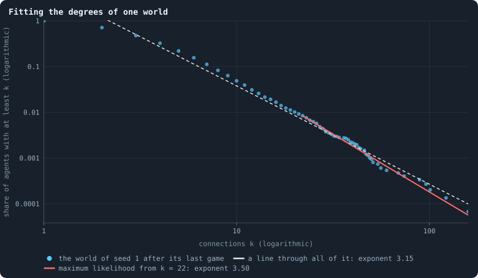

**Fitting the degrees of one world.** Dots: for every number of connections k that occurs among the 14,870 agents of the world with seed 1 after its last game, the share of agents with at least k — the complementary cumulative distribution, on logarithmic axes. Dashed: the straight line least squares fits through all the dots, whose slope is 1 − γ for a power law of exponent γ (the viewer's `degreeExponent`). Red: the power law fitted by maximum likelihood to the tail from the k that fits best, k = 22 (`degreeGamma`, `degreeKMin`), which holds 0.8% of the agents ([Fitting a power law](b1-the-network-size-and-scaling.md#fitting-a-power-law-properly)).

> [!example]- How to make this figure
> **Runs.** `B1-100000-s001`.
>
> **Data.** From each run's frames, `GraphOfLifeRuns/<run>/frames/`, read with `gol_store.read_frame(run, index)`; frame `2·t` is iteration *t* after reproduction and frame `2·t + 1` after the game.
>
> 1. Read the last frame after a game (`2999`) and count every agent's connections in `edges`.
> 2. Dots: for each distinct count k, the share of agents with at least k.
> 3. Dashed: least squares of ln(share) on ln(k) over the dots.
> 4. Red: `gol_series._scale_free(degrees)` — for each candidate k_min, γ = 1 + n / Σ ln(k / (k_min − ½)) over the n agents with k ≥ k_min, and the Kolmogorov–Smirnov distance; the k_min with the smallest distance wins.
>
> **To make it again:** `python3 book_figures.py powerlaws`.
<!-- /figure -->

The world of seed 1 has 14,870 agents after its last game. Least squares
through every point gives the exponent 3.15. But the points are not on a
line: below about twenty connections the distribution bends, and the dashed
line misses the body.

Maximum likelihood chooses the tail from *k*_min = 22. It holds 125 agents,
0.8% of the world, and gives γ = 3.50. With 125 values, the exponent is
known to about ±(γ − 1)/√125 = ±0.22.

Is the tail a power law? The largest gap between the data and the fitted law
is 0.068. Samples drawn from the fitted law show a gap at least as large in
55% of cases (200 samples). So a power law is **not ruled out** for the top
1% of this world. The fit says nothing about the other 99%.

### Thirty worlds

<!-- figure powerlaws/exponents -->
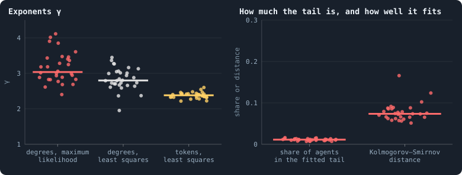

**Power-law exponents of the 30 worlds.** One dot per world, at its mean over the measurements (every 25 iterations) from iteration 500 on; the bar is the median. Left: the exponent γ of the degree distribution by maximum likelihood on the tail (`degreeGamma`) and by least squares on the whole distribution (`degreeExponent`), and of the token distribution by least squares (`tokenExponent`). Right: the share of agents in the tail the maximum-likelihood fit chose (`degreeTailShare`) and the largest gap between that tail and the fitted law (`degreeGammaKS`).

> [!example]- How to make this figure
> **Runs.** The 30 baseline runs `B1-100000-s001` … `B1-100000-s030`: the baseline B1 at 100,000 tokens, seeds 1 to 30, 1,500 iterations each (every setting is listed in [Thirty worlds](b1-lives-and-wealth.md#thirty-worlds)). They are made with `python3 gol_lab.py run E10`.
>
> **Data.** From each run's `GraphOfLifeRuns/<run>/stats.jsonl`, which holds one row per recorded phase: `phase` 1 is the world just after reproduction, `phase` 2 just after the game, and every statistic is a field of the row (see [What a run records](runs-and-records.md#what-a-run-records)).
>
> 1. Average `degreeGamma`, `degreeExponent`, `tokenExponent`, `degreeTailShare` and `degreeGammaKS` over the rows with `phase` = 2 and 500 ≤ `iteration` ≤ 1,499.
> 2. One dot per run, a bar at the median.
>
> **To make it again:** `python3 book_figures.py powerlaws`.
<!-- /figure -->

Across the worlds, over their settled life:

- maximum likelihood finds the tail from about 21 connections, holding 1.1%
  of the agents (0.7% to 1.6%), with γ = 3.04 (2.40 to 4.11);
- least squares through everything gives 2.80 (1.95 to 3.45). It is
  **lower** in every one of the thirty worlds, because a line through the
  whole distribution is tilted by the bend of the body;
- the test, on each world's last frame, rules a power law out in 6 of the 30
  worlds and leaves it plausible in 24.

In the first two lines, each number is that of the median world, and the
brackets hold the least and the largest of the thirty.

At 10,000 tokens the tail began at about 10 connections and held 5% of the
agents, with γ = 3.34. So the top hundredth of the connections looks like a
power law with an exponent near 3, and the bulk does not. The exponent one
reports depends on the method, by a quarter to half a unit. "The network is
scale-free" would claim far more than this.

#### Where the tail of the connections could come from

Where would a tail like this come from? The rules contain a known mechanism.
A child is joined to some of its parent's candidates: in effect, it
**copies** part of its parent's neighbourhood
([How a child is joined](b1-lives-and-wealth.md#how-a-child-is-joined)).
An agent gains a connection whenever one of its neighbours has a child that
is joined to it. So an agent with twice the neighbours has about twice the
chances.

The well connected then gain connections in proportion to their
connections. That is
[preferential attachment](measuring-networks.md#preferential-attachment-and-its-kernel)
(Barabási and Albert 1999), reached here by copying. The "duplication"
models of protein networks reach it the same way (Vázquez, Flammini, Maritan
and Vespignani 2003; Chung, Lu, Dewey and Galas 2003). Preferential
attachment on its own gives γ = 3.

[How the network grows](b1-lives-and-wealth.md#how-the-network-grows)
has measured it here. An agent gains connections in proportion to those it
has, as *k*^1.02, and loses them a little faster, as *k*^1.20. The faster
losses bend the tail down at the top. Whether this is what makes the tail is
still a hypothesis. An experiment that joined children to random agents
instead would test it.

The same mechanism came back when brains could see
([What the game adds](building-b2-and-the-search-for-a-healthy-rich-world.md#what-the-game-adds)). A
brain that chooses a newborn's links ranks its candidates by what it sees of
them. Whatever it favours, the well connected are among the candidates more
often, because they are the neighbours of more agents. In pilots in
which the brains chose a newborn's two extra links, the best-connected agent
was joined to 30% of the world. So the second baseline, B2, draws two of
a newborn's links at random from its parent's neighbours. And it caps at
eight the links a brain may choose.

### The tokens: a power law in the tail

<!-- figure powerlaws/tokens-fit -->
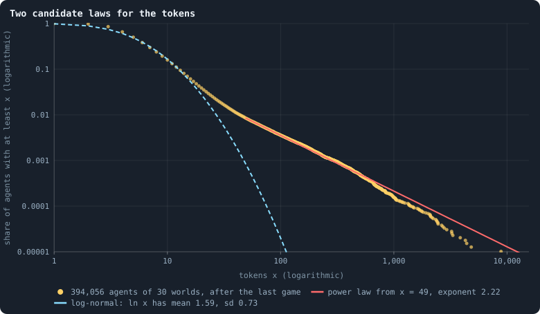

**Two candidate laws for the tokens.** Dots: for every token count x that occurs among the agents alive after the last game of the 30 worlds, the share holding at least x. Red: a power law fitted by maximum likelihood to the tail, from the x that fits it best. Cyan: a log-normal distribution with the mean and standard deviation of ln x over all agents — a distribution whose logarithm is normal. Both on logarithmic axes.

> [!example]- How to make this figure
> **Runs.** The 30 baseline runs `B1-100000-s001` … `B1-100000-s030`: the baseline B1 at 100,000 tokens, seeds 1 to 30, 1,500 iterations each (every setting is listed in [Thirty worlds](b1-lives-and-wealth.md#thirty-worlds)). They are made with `python3 gol_lab.py run E10`.
>
> **Data.** From each run's frames, `GraphOfLifeRuns/<run>/frames/`, read with `gol_store.read_frame(run, index)`; frame `2·t` is iteration *t* after reproduction and frame `2·t + 1` after the game.
>
> 1. Pool the `tokens` of the last frame of every run.
> 2. Dots: for each distinct x, the share of agents with at least x.
> 3. Red: `gol_series._scale_free(tokens)`, as for the degrees.
> 4. Cyan: μ and σ = the mean and standard deviation of ln x; the curve is 1 − Φ((ln x − μ)/σ), Φ the standard normal distribution.
>
> **To make it again:** `python3 book_figures.py powerlaws`.
<!-- /figure -->

The tokens of 394,056 agents, pooled over the thirty worlds after their last
game, tell a clearer story. Two laws are put to them.

The first is a **log-normal**: a distribution whose logarithm has the bell
shape of a normal distribution. The one drawn has the mean and spread of
ln *x* over all agents, μ = 1.59 and σ = 0.73. Its median is
*e*^1.59 ≈ 4.9 tokens. It fits the body up to about 20 tokens, and then
falls far below the data.

The second is a power law. From 49 tokens on, the data follow a straight
line. Maximum likelihood fits it with γ = 2.22, to 3,358 agents (0.9%), with
a largest gap of only 0.016. Samples from the fitted law fit it worse than
the data in **37%** of cases (100 samples), so a power law is plausible.

Look closer, and the line holds for one decade, to about 500 tokens. Above
that, the richest two hundred or so fall below it. At 1,000 tokens the data
hold about 70% of the share the law gives, and from 3,000 to 5,000 tokens
about half. The test does not see this bend. Its gap is decided where most
of the tail's agents are, and only about 6% of them hold 500 tokens or more.

Of the four candidates on this page, this is still the most convincing power
law. The share of agents with at least *x* tokens falls as *x*^−1.22. That
is a heavier tail than Pareto's incomes, which fell about as *x*^−1.5.

At 10,000 tokens the tail followed γ = 2.29 from 33 tokens on, and samples
fitted it worse than the data in 92% of cases. There the line held from 33
tokens to the richest agent, at about 3,300 tokens: two decades.

#### Are the richest the hubs?

Are the richest rich because they are hubs? If tokens were a fixed function of
connections, the two tails would be tied together. A token tail heavier than
the connection tail would then need the hubs to hold *more* tokens per
connection than everyone else.

They do not: agents of every class of connections hold about 1.7 tokens per
candidate on average
([Tokens and connections](b1-the-network-size-and-scaling.md#tokens-and-connections)).
And among the 3,358 agents in the token tail, 40% have ten connections or
more, but **33% have only one or two**. A third of the richest agents are
rich far beyond their place.

[Gains and losses](b1-lives-and-wealth.md#gains-and-losses-who-gains-who-loses-and-the-share-out) showed what happens to such agents.
Those with a hundred tokens or more that survive a game lose 48% of their
tokens in it, on average. And a rich agent with one or two connections dies
in about one game in ten.

#### Where the tail of the tokens could come from

That suggests a different mechanism, also a classic. An agent's tokens are
multiplied, game after game, by a random factor: sometimes a big gain, more
often a loss. Meanwhile a floor holds up the poorest. A node with nothing
dies, and the share-out tops up the poor. Random multiplication with a floor
produces a power-law tail (Champernowne 1953; Kesten 1973; Levy and Solomon
1996; Gabaix 1999 for the sizes of cities). Again this is a hypothesis. The
simplest test would be to look for that multiplication in the worlds.

### How many agents one game removes

A game removes agents in two ways. An agent **starves** when it ends the game
with no tokens. It is **cut off** when the network splits and its piece is
not the largest. The cleanup then removes that whole piece
([How a world breaks](b1-the-network-size-and-scaling.md#how-a-world-breaks)).

<!-- figure powerlaws/avalanches -->
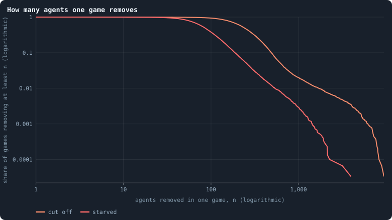

**How many agents one game removes.** Of all games from iteration 500 on in the 30 worlds (30,000 games), the share that cut off at least n agents (orange) and the share in which at least n agents starved (red), for every n, on logarithmic axes. Games in which no one was removed count in the denominator, which is why the curves start below 1.

> [!example]- How to make this figure
> **Runs.** The 30 baseline runs `B1-100000-s001` … `B1-100000-s030`: the baseline B1 at 100,000 tokens, seeds 1 to 30, 1,500 iterations each (every setting is listed in [Thirty worlds](b1-lives-and-wealth.md#thirty-worlds)). They are made with `python3 gol_lab.py run E10`.
>
> **Data.** From each run's `GraphOfLifeRuns/<run>/stats.jsonl`, which holds one row per recorded phase: `phase` 1 is the world just after reproduction, `phase` 2 just after the game, and every statistic is a field of the row (see [What a run records](runs-and-records.md#what-a-run-records)).
>
> 1. Take `orphaned` and `starved` of every row with `phase` = 2 and 500 ≤ `iteration` ≤ 1,499.
> 2. For each n that occurs, the share of rows with at least n.
>
> **To make it again:** `python3 book_figures.py powerlaws`.
<!-- /figure -->

In every settled game but three of the 30,000, at least one agent is cut
off. In 94% of games a hundred or more are, and in 2% a thousand or more.
The median game cuts off 239 agents. The most ever cut off in one game was
9,460. That was half of the world it struck, and two thirds of a typical
world ([One world, six hundred iterations](b1-the-network-size-and-scaling.md#one-world-six-hundred-iterations)).

On log–log axes the curve is flat to about 200 and then falls, bending, with
no straight stretch long enough to call a power law. The removals have a
typical size, a few hundred agents, about 2% of a world. Big ones are rare.

But big ones matter. Of all agents ever cut off, 16% died in the 2% of games
that cut off a thousand or more. Half died in games that cut off 353 or more
([Where the cut-off deaths happen](b1-the-network-size-and-scaling.md#where-the-cut-off-deaths-happen)).

Counted against the size of a world, the worlds of 10,000 tokens did the
same. There, 2.5% of games cut off a hundred or more: a hundredth of their
tokens' worth, as a thousand is here. And 20% of the deaths by cutting fell
in them.

Death by cutting comes in **lumps**: whole branches of the network fall off
at once. Starvation comes in smaller lumps, at most 3,966 in one game.
[How a world breaks](b1-the-network-size-and-scaling.md#how-a-world-breaks) asks where the lumps come from,
and whether they can be foreseen.

### The rhythm of the wander

How does a world's number of agents move over time? The **power spectrum**
splits the movement into rhythms, and says how much of it happens at each
([The power spectrum](statistics.md#the-power-spectrum-of-a-time-series)).
A slow drift puts its power at low frequencies, a quick jitter at high ones.

<!-- figure powerlaws/spectrum -->
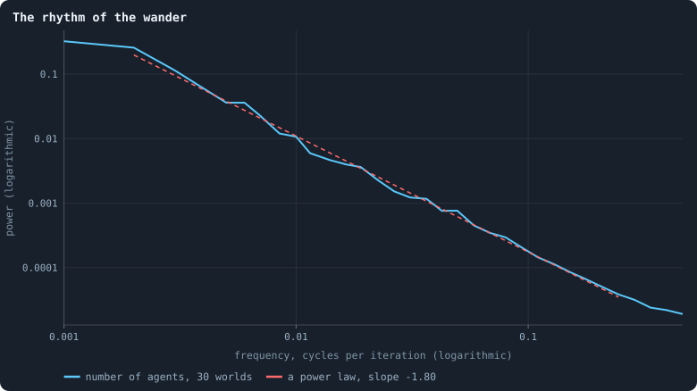

**The rhythm of the wander.** The power spectrum of the number of agents ([The power spectrum](statistics.md#the-power-spectrum-of-a-time-series)): for each frequency, how much of a world's up-and-down motion happens at that rhythm — slow wanders on the left, iteration-to-iteration jitter on the right. Each world's series from iteration 500 to 1,499, with its straight-line trend removed and a Hann window applied, normalised to total power 1 and averaged over the 30 worlds; then averaged in 39 bands of equal width on the logarithmic axis. Red: the straight line least squares fits between periods of 500 and 4 iterations.

> [!example]- How to make this figure
> **Runs.** The 30 baseline runs `B1-100000-s001` … `B1-100000-s030`: the baseline B1 at 100,000 tokens, seeds 1 to 30, 1,500 iterations each (every setting is listed in [Thirty worlds](b1-lives-and-wealth.md#thirty-worlds)). They are made with `python3 gol_lab.py run E10`.
>
> **Data.** From each run's `GraphOfLifeRuns/<run>/stats.jsonl`, which holds one row per recorded phase: `phase` 1 is the world just after reproduction, `phase` 2 just after the game, and every statistic is a field of the row (see [What a run records](runs-and-records.md#what-a-run-records)).
>
> 1. For each run, take `nodes` of the rows with `phase` = 2 and 500 ≤ `iteration` ≤ 1,499 (1,000 values); subtract the least-squares straight line.
> 2. Multiply by a Hann window and take |FFT|², the power at frequencies k/1,000, k = 1 … 500; divide by the total.
> 3. Average over runs; average within bands of equal width in log frequency; fit a line on log–log axes between frequencies 1/500 and 1/4.
>
> **To make it again:** `python3 book_figures.py powerlaws`.
<!-- /figure -->

Between periods of 4 and 500 iterations, the power falls as *f*^−1.80. That
is close to the *f*^−2 of a **random walk**, in which every step is added to
the last (*f*^−2.11 at 10,000 tokens).

At the slowest end, periods near a thousand iterations, the spectrum
flattens a little. The world does not keep walking away: something pulls it
back. A random walk with a pull back to a level is the Ornstein–Uhlenbeck
process. Its spectrum is flat below a corner and falls as *f*^−2 above it.
Here the corner fits a pull that takes a few hundred iterations to act. The
[autocorrelation](statistics.md#how-long-a-world-remembers-autocorrelation-and-the-power-spectrum) of 0.61 after 100 iterations, found in
[How much does the seed decide?](b1-the-network-size-and-scaling.md#a-world-forgets),
fits it too.

Each world's series is a thousand iterations long here. So the slow end is
seen less well than in the worlds of 10,000 tokens, whose wander had 2,500
iterations to show it. Most of the movement happens at the slowest rhythms:
the wander is slow.

It is not 1/*f* noise, a slope of −1, which would mean memory on every time
scale. The world forgets.

### What we learned (power laws)
- **One real power law, one plausible, two apparent.** The token tail
  follows a power law over one to two decades, and the test finds it
  plausible. The tail of the connections is plausibly one, for the top 1%
  (the top 5% at 10,000 tokens). The degree distribution as a whole is not,
  and neither are the lumps of death.
- **Fit the tail, then test it.** Least squares through a whole distribution
  gave a lower exponent than maximum likelihood in all thirty worlds. A good
  fit is not yet a power law, and the test cannot see a bend among the
  richest few.
- **The rules contain two textbook mechanisms for heavy tails**: copying
  neighbourhoods at birth, and multiplying tokens by chance with a floor
  below. Neither is shown here to be the cause; both could be switched off in
  an experiment.
- **No sign of a critical state.** No avalanches of every size, no 1/*f*
  noise: disturbances die out within a few hundred iterations, and the world
  is pulled back to its level. Some theories tie open-ended evolution to
  criticality: to systems on the edge between order and chaos, where small
  causes can have effects of every size. Whatever the truth of that, this
  world is not on such an edge. It is a world that wanders and returns
  ([What the measurements say about open-ended evolution](what-the-baseline-world-is.md#what-the-measurements-say-about-open-ended-evolution)).

### How this was made (power laws)
Every figure and number of this page, unless it says otherwise, reads the
thirty runs of Experiment 10, listed below. They are worlds of the baseline
B1 at 100,000 tokens, seeds 1 to 30, run for 1,500 iterations each, made
with `python3 gol_lab.py run E10`. The numbers at 10,000 tokens come from the
thirty worlds of Experiment 2, of which 26 lived to the end of their 3,000
iterations (`python3 gol_lab.py run E02`). Numbers from other pages are
quoted with a link to their page. They include B2's pilots, the attachment
kernels, the tokens per candidate, the fate of the rich and the largest cut.

The command `python3 book_figures.py powerlaws` draws every figure of this
page, and writes its numbers to `book/results/powerlaws.json`. A run's
statistics `degreeExponent` and `tokenExponent` come from
`gol_series._tail_exponent`, and `degreeGamma` and its kin from
`gol_series._scale_free`. The goodness-of-fit test is `tail_pvalue` in
`book_chapters/measures.py`. Each figure says, folded beneath it, which runs
it reads and how.

How far the token tail follows its law is read off the points of the token
figure, `book/figures/powerlaws/tokens-fit.svg`, against its red line. The
same figure drawn from the worlds of 10,000 tokens is in the notebook's
history (`git show 82062d7:book/figures/powerlaws/tokens-fit.svg`).

The runs of Experiment 10 are listed once on this page, under [The runs of Experiment 10 (the shape of the network)](#the-runs-of-experiment-10-the-shape-of-the-network).

## How properties scale together

On average, agents hold tokens in proportion to their connections plus one:
the resting state of the even split. The exponent that least squares fits to
this, 0.58, is no law; it says only that most agents have one or two
connections. Triangles grow in proportion to connections, and leaves hang on
hubs: the network is a hierarchy of stars, built by children joining their
parents' neighbours. How much an agent's tokens change in a game follows its
wealth only loosely. All four relations are nearly the same in every world:
they belong to the rules, not to what the brains compute.

### Four relations

Does an agent with ten times the connections hold ten times the tokens? Plot
every agent as a dot, its connections across and its tokens up. Use
logarithmic axes, on which each step multiplies by the same factor
([Logarithmic axes and power laws](statistics.md#logarithmic-axes-and-power-laws)). If tokens grew as a
power of connections, *y* ≈ *a xᵇ*, the dots would gather around a straight
line of slope *b*. That slope is the **exponent**. An exponent of 1 means in
proportion; one of 0.5 means that ten times the connections bring about three
times the tokens.

An agent has more such properties. Besides tokens and connections, there are
its triangles, how closely knit its neighbourhood is, and how much its tokens
change in a game. Every 25 iterations, the viewer fits four **scaling
relations** between them by least squares on the logarithms of all agents
([Scaling relations](measuring-networks.md#scaling-relations-between-agents-properties)). This page shows the agents behind
the four fits. And it finds that one of the exponents means something quite
different from what it seems to say.

The worlds are the thirty B1 worlds of 100,000 tokens of Experiment 10
([Thirty worlds](b1-lives-and-wealth.md#thirty-worlds)). The pictures show every
agent alive after the last game of each world. Single worlds are measured
every 25 iterations over their settled life. The page was first written from
the thirty worlds of 10,000 tokens; where those differ, their numbers are
given beside.

### Tokens and connections

<!-- figure scaling/tokens-degree -->
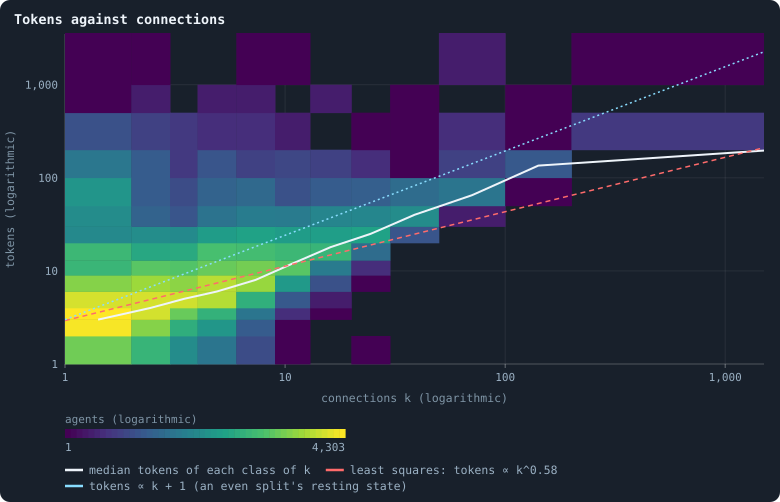

**Tokens against connections.** Every agent alive after the last game of the 30 worlds (394,056 agents), counted in cells of connections k and tokens, both in classes of growing width; a cell's colour is how many agents it holds, on a logarithmic scale. White: the median tokens in each class of k. Red: the straight line least squares fits through ln(tokens) against ln(k) over all agents ([Scaling relations](measuring-networks.md#scaling-relations-between-agents-properties)). Cyan: tokens proportional to k + 1, through the median at k = 1 — where an even split of every stake would leave the tokens on a network that held still ([Where the tokens flow](b1-the-game-and-its-flows.md#where-tokens-flow)).

> [!example]- How to make this figure
> **Runs.** The 30 baseline runs `B1-100000-s001` … `B1-100000-s030`: the baseline B1 at 100,000 tokens, seeds 1 to 30, 1,500 iterations each (every setting is listed in [Thirty worlds](b1-lives-and-wealth.md#thirty-worlds)). They are made with `python3 gol_lab.py run E10`.
>
> **Data.** From each run's frames, `GraphOfLifeRuns/<run>/frames/`, read with `gol_store.read_frame(run, index)`; frame `2·t` is iteration *t* after reproduction and frame `2·t + 1` after the game.
>
> 1. Read frame `2999` of every run: each agent's tokens and its connections in `edges`.
> 2. Count the agents in each cell of the classes shown; colour by the count.
> 3. Fit ln(tokens) = a + b·ln(k) by least squares over all agents (the viewer's `tokensVsDegree` does this for one frame).
>
> **To make it again:** `python3 book_figures.py scaling`.
<!-- /figure -->

The cells show the 394,056 agents alive after the last game of the thirty
worlds. Tokens rise with connections, with a wide scatter: in every class of
connections, the agents' tokens span two decades, a factor of a hundred. Least
squares through all of them gives **tokens ∝ k^0.58**. In single worlds,
measured every 25 iterations over the settled life, it gives 0.59 (0.51 to
0.64), with R² = 0.42. That is as at 10,000 tokens (0.58 over all agents
together, 0.61 in single worlds). Ten times the connections, about four times
the tokens?

Now compare the white line, the median of each class, with the cyan line:
tokens in proportion to *k* + 1. From about five connections on, the two run
parallel. Why *k* + 1? An agent with *k* connections has *k* + 1 candidates:
its own node and its neighbours' nodes. Under the even split, a game moves
tokens like a random walk
([Where tokens flow](b1-the-game-and-its-flows.md#the-game-as-a-random-walk)).

Think of the tokens as water in tanks joined by pipes, each agent's tank as
wide as its number of candidates. The water settles at one level everywhere,
so a tank twice as wide holds twice as much. In the same way, the walk comes
to rest when every agent holds the same number of tokens for each of its
candidates:

$$
\frac{\tau_u}{k_u + 1} = \frac{T}{\sum_v (k_v + 1)} \quad \text{for every agent } u .
$$

Here τᵤ is what agent *u* holds, *k*ᵤ its connections, and *T* all the tokens
of the world. The left side is *u*'s tokens per candidate; the right side is
the same number for everyone. So count tokens per candidate, τ/(*k* + 1), in
each class:

| connections | 1 | 2 | 3–4 | 5–9 | 10–49 | 50+ |
|---|---|---|---|---|---|---|
| median tokens per candidate | 1.5 | 1.33 | 1.2 | 1.1 | 1.0 | 1.0 |
| mean tokens per candidate | 2.28 | 1.86 | 1.68 | 1.50 | 1.43 | 1.51 |

At rest, every agent would hold *T* / Σ(*k* + 1) = 1.70 tokens per candidate.
The means lie around that value in every class, from one connection to
hundreds. The medians lie a little below it, from 1.5 down to 1.0. **On
average, agents of every class hold about the resting state's share.** An
agent with one connection rests at about 3.4 tokens, and a hub with a hundred
connections at about 170.

Then why does the fit say 0.58 and not 1? Because *k* + 1 is not a power of
*k*, and most agents have one or two connections. Between *k* = 1 and *k* = 2,
*k* + 1 grows from 2 to 3: by a factor of 1.5 where *k* doubles. That is a
local exponent of ln 1.5 / ln 2 = 0.58. Least squares counts every agent once,
and 230,000 of the 394,056 have one or two connections. Even if every agent
held **exactly** its resting share, least squares over these agents would
report an exponent of **0.73**.

The rest of the gap, from 0.73 down to 0.58, is the poorly connected holding a
little more per candidate than the well connected. The median agent with one
connection holds 1.5 tokens per candidate, one with five to nine connections
1.1, and one with ten or more 1.0.

This is the most useful lesson of the page. **An exponent fitted to a relation
that is not a power law reports where most of the points are**, not a law.
Here the law is simple, tokens in proportion to connections plus one, and the
exponent 0.6 is what it looks like through a log–log fit.

### How closely knit a neighbourhood is

Among your friends, how many are friends with each other? In a village, most;
in a big city, few. The **clustering coefficient** of an agent with *k* ≥ 2
neighbours asks the same. It is the share of the *k*(*k* − 1)/2 pairs of its
neighbours that are joined to each other ([Clustering](measuring-networks.md#clustering)). Each
joined pair makes a triangle with the agent, and these are its **triangles**.

<!-- figure scaling/clustering-triangles -->
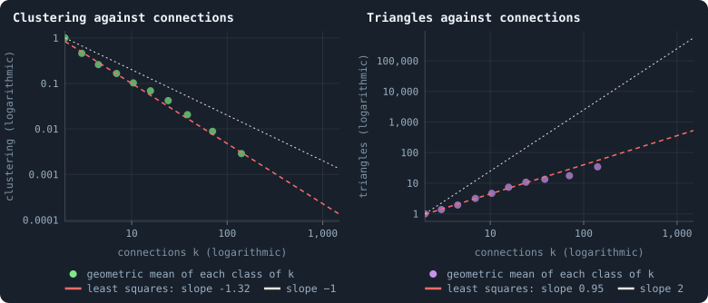

**How an agent's neighbourhood closes, by its connections.** Agents alive after the last game of the 30 worlds, in classes of their connections k. Left: the geometric mean (the mean of the logarithms, turned back) of the clustering coefficient — the share of pairs of an agent's neighbours that are joined to each other — of the agents with k ≥ 2 and clustering above 0. Right: the geometric mean of the number of triangles an agent is a corner of, over the agents in at least one. Red: least squares on the logarithms of all those agents (not of the class means); grey: the slopes −1 and 2 for comparison.

> [!example]- How to make this figure
> **Runs.** The 30 baseline runs `B1-100000-s001` … `B1-100000-s030`: the baseline B1 at 100,000 tokens, seeds 1 to 30, 1,500 iterations each (every setting is listed in [Thirty worlds](b1-lives-and-wealth.md#thirty-worlds)). They are made with `python3 gol_lab.py run E10`.
>
> **Data.** From each run's frames, `GraphOfLifeRuns/<run>/frames/`, read with `gol_store.read_frame(run, index)`; frame `2·t` is iteration *t* after reproduction and frame `2·t + 1` after the game.
>
> 1. Read frame `2999` of every run; for every agent count its triangles: pairs of its neighbours that are joined.
> 2. Clustering of an agent with k ≥ 2 neighbours = triangles / (k(k − 1)/2).
> 3. Average ln(y) by class of k and turn it back for the dots; fit ln(y) on ln(k) over the agents with y > 0 for the red lines (`clusteringVsDegree`, `trianglesVsDegree` in the viewer).
>
> **To make it again:** `python3 book_figures.py scaling`.
<!-- /figure -->

Triangles grow about **in proportion** to connections: slope 0.99 pooled, 0.86
in single worlds. That is far below the slope 2 of a neighbourhood wired at
random. There, the pairs of neighbours, and so the expected triangles, grow as
*k*². So clustering falls steeply: slope −1.28 pooled, −1.41 in single worlds
(R² = 0.70), as at 10,000 tokens. For agents with more than a hundred
connections, the typical share of joined neighbour pairs is a few in a
thousand.

With triangles in proportion to *k*, clustering should fall as 1/*k*. Why does
the fit say −1.28? For the reason the tokens' exponent was low. The pairs,
*k*(*k* − 1)/2, are not a power of *k* either. From two connections to three
they triple, where *k*² would grow only 2.25 times. Over the agents of the fit
they grow as *k* to the power 2.27, and 0.99 − 2.27 = −1.28.

A clustering that falls as 1/*k* is the signature Ravasz and Barabási (2003)
gave for **hierarchical** networks: small, tight groups inside larger, looser
ones. The rules suggest how it comes about here. A hub gains connections
through the children of its neighbours
([Who gains and who loses](b1-lives-and-wealth.md#who-gains-and-who-loses)).
A child born to a neighbour *v* of the hub *h*, and joined to both *v* and
*h*, closes the triangle (child, *v*, *h*). So each connection a hub gains
this way comes with about one triangle: triangles in proportion to
connections, and clustering falling as 1/*k*.

### Whom the well-connected are joined to

In a star, one agent at the centre is joined to many leaves, agents with a
single connection, and each leaf to the centre alone. A leaf's one neighbour
is then the best-connected agent there is, and the centre's neighbours have
one connection each. How close are the worlds to that?

<!-- figure scaling/neighbours -->
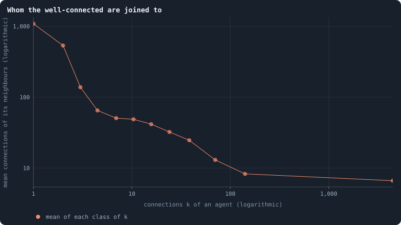

**Whom the well-connected are joined to.** For the agents alive after the last game of the 30 worlds, in classes of their connections k: the mean, over the class, of the average number of connections of an agent's neighbours. A falling line means the well-connected are joined mostly to the poorly connected ([Assortativity](measuring-networks.md#assortativity)).

> [!example]- How to make this figure
> **Runs.** The 30 baseline runs `B1-100000-s001` … `B1-100000-s030`: the baseline B1 at 100,000 tokens, seeds 1 to 30, 1,500 iterations each (every setting is listed in [Thirty worlds](b1-lives-and-wealth.md#thirty-worlds)). They are made with `python3 gol_lab.py run E10`.
>
> **Data.** From each run's frames, `GraphOfLifeRuns/<run>/frames/`, read with `gol_store.read_frame(run, index)`; frame `2·t` is iteration *t* after reproduction and frame `2·t + 1` after the game.
>
> 1. Read frame `2999` of every run; for every agent, the mean degree of its neighbours.
> 2. Average by class of the agent's own degree.
>
> **To make it again:** `python3 book_figures.py scaling`.
<!-- /figure -->

An agent with one connection is, on average, joined to an agent with about
**1,090** connections. With two connections, its neighbours have 540 on
average; with three, 140; from four to fifty, about 25 to 65. The neighbours
of hubs with a hundred connections or more have 7 to 8. The very large
averages of the leaves come from the stars, whose centres hold thousands of
leaves each ([Stars](b1-lives-and-wealth.md#stars)). At 10,000 tokens
a leaf's neighbour had 163 connections on average. **Leaves hang on hubs, and
hubs are surrounded by leaves**: the world is built of stars.

There is a single number for this, the **assortativity** *r*: the correlation
of the connections at the two ends of a connection
([Assortativity](measuring-networks.md#assortativity)). It is −0.07 in the median world, and from
−0.47 to +0.02 across the thirty (−0.11 at 10,000 tokens). That is mildly
negative. And as the note explains, a world with a few large hubs comes out
negative anyway. It has too few hubs for its hubs to be joined to. The curve
says far more than the number.

### Gains, losses and wealth

The fourth relation asks whether the size of an agent's change in a game,
|Δ|, grows with the tokens τ it holds. Think of firms: if every firm risked
the same fraction of its size, a firm ten times as large would gain or lose
ten times as much. That is Gibrat's law of proportionate growth (Gibrat 1931),
|Δ| ∝ τ. The viewer fits it over the agents whose tokens changed in the game,
against what they hold after it.

<!-- figure scaling/exponents -->
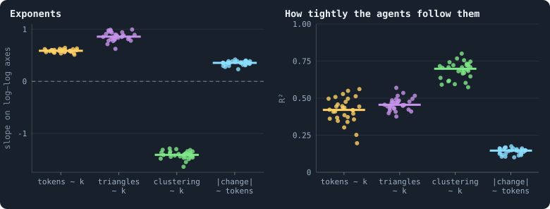

**Four scaling relations in the 30 worlds.** One dot per world: its mean, over the measurements every 25 iterations from 500 on, of four slopes fitted by least squares on the logarithms of the agents of a frame, and of their R². Tokens and triangles against connections, clustering against connections, and the size of an agent's change in tokens over the game against the tokens it holds ([Scaling relations](measuring-networks.md#scaling-relations-between-agents-properties)).

> [!example]- How to make this figure
> **Runs.** The 30 baseline runs `B1-100000-s001` … `B1-100000-s030`: the baseline B1 at 100,000 tokens, seeds 1 to 30, 1,500 iterations each (every setting is listed in [Thirty worlds](b1-lives-and-wealth.md#thirty-worlds)). They are made with `python3 gol_lab.py run E10`.
>
> **Data.** From each run's `GraphOfLifeRuns/<run>/stats.jsonl`, which holds one row per recorded phase: `phase` 1 is the world just after reproduction, `phase` 2 just after the game, and every statistic is a field of the row (see [What a run records](runs-and-records.md#what-a-run-records)).
>
> 1. Average `tokensVsDegree`, `trianglesVsDegree`, `clusteringVsDegree` and `changeVsTokens`, and the same with `R2` appended, over the rows with `phase` = 2 and 500 ≤ `iteration` ≤ 1,499.
> 2. One dot per run, a bar at the median.
>
> **To make it again:** `python3 book_figures.py scaling`.
<!-- /figure -->

In the worlds, |Δ| ∝ τ^0.35 with R² = 0.15. Read the R² first: wealth explains
only 15% of the variance in how much an agent's tokens change. Most of it is
something else: where the agent is, what its neighbours stake. The exponent,
like the tokens' above, is set by the crowd of poor agents. A change is a
whole number of at least one token. So among agents holding 1 to 5 tokens, |Δ|
cannot shrink with τ, and the line is flattened.

The other three relations of the figure are those above, world by world. The
dots lie close together: tokens 0.51 to 0.64, triangles 0.62 to 0.99,
clustering −1.64 to −1.29. The fourth, for the change in a game, lies between
0.23 and 0.42 in every world. These relations are not chance outcomes of a
world's history.

### What we learned (how properties scale together)
- **The even split's resting state describes wealth.** Across three decades of
  connections, agents hold on average about 1.7 tokens for each of their
  candidates, the median agent a little less. The famous-looking exponent 0.6
  is that law seen through a log–log fit.
- **The network is a hierarchy of stars.** Triangles grow with connections,
  clustering falls about as 1/*k*, and leaves hang on hubs. Copying
  neighbourhoods at birth explains all three.
- **These relations belong to the rules.** They are nearly the same in every
  world. And they follow from two mechanisms, splitting stakes evenly and
  joining children to their parents' neighbours, that say nothing about what a
  brain computes. Structure that the rules alone fix is not where to look for
  evolution;
  [What the measurements say about open-ended evolution](what-the-baseline-world-is.md#what-the-measurements-say-about-open-ended-evolution)
  asks where to look instead.

### How this was made (how properties scale together)
Every figure of this page reads the thirty runs of Experiment 10, listed
below. They are worlds of the baseline B1 at 100,000 tokens, seeds 1 to 30,
run for 1,500 iterations each. The command `python3 gol_lab.py run E10` makes
them. The pictures of single agents read each world's frame after its last
game. The exponents of single worlds are the viewer's, every 25 iterations
from iteration 500 on. The numbers at 10,000 tokens come from the 26 worlds of
Experiment 2 that lived to the end (`python3 gol_lab.py run E02`).

The command `python3 book_figures.py scaling` draws every figure of this page,
and writes its numbers to `book/results/scaling.json`. Each figure says,
folded beneath it, which runs it reads and how.

The runs of Experiment 10 are listed once on this page, under [The runs of Experiment 10 (the shape of the network)](#the-runs-of-experiment-10-the-shape-of-the-network).

## Like next to like: how alike agents are at a distance

How alike are two agents a given number of steps apart, and up to how far?
The **correlation function** and the **correlation length** measure it. In the
thirty worlds of 100,000 tokens, neighbours are a little unlike in tokens and
connections, mostly because hubs sit among poor leaves. They are a little
alike in age, as cohorts that arrived together. Every such likeness fades
within three steps, so the correlation length is one to two steps: a world is
far from critical. Agents of one genotype cluster within two or three steps,
and lines of descent in patches 7 to 12 steps wide.

### How alike at a distance

Is a world the same everywhere, or does it have regions? A rich quarter and a
poor one, an old town and new suburbs, the territory of one family and of
another? Physics answers such questions by asking how far the state of one
place reaches. Are two places some distance apart more alike than two places
drawn at random? And up to what distance?

Think of a magnet. It is made of tiny atomic magnets, called spins, each
pointing up or down. A spin pointing up makes its neighbours more likely to
point up, and their neighbours a little more likely, and so on, fading with
distance. How fast it fades is one of the most telling facts about a physical
system. The tool that measures it is the **correlation function** (Chaikin
and Lubensky 1995). On a network, distance is counted in steps along
connections, and the same tool applies.

This is part of the notebook's second aim: to learn whether simple, local
rules grow something like physical space
([Physical inspiration](physical-inspiration.md)). In a space, a difference at
one place shows in the places near it, and fades farther away. The
**correlation length** says how far it reaches.

#### The correlation function

Give every agent *u* a value *x*(*u*), such as its tokens, its age or its
number of connections. **Standardise** the values within the world: subtract
their mean, and divide by their standard deviation. A standardised value says
how far an agent stands above or below the typical one. Then take every pair
of agents exactly *r* steps apart, and ask whether their two values go up and
down together. That is the [correlation](statistics.md#two-numbers-together-correlation-a-fitted-line-and-logarithmic-axes) over all such pairs,
and it is the correlation function:

$$
C(r) = \operatorname{corr}\bigl(x(u), x(v)\bigr) \quad \text{over pairs with } d(u, v) = r .
$$

Here *d*(*u*, *v*) is the number of steps on the shortest path from *u* to
*v*. The sign of *C*(*r*) says which way the likeness goes:

- *C*(*r*) > 0: agents *r* steps apart tend to be alike;
- *C*(*r*) < 0: unlike, such as a rich agent beside poor ones;
- *C*(*r*) = 0: no relation at that distance.

At one step, *C*(1) takes all connected pairs: it is the assortativity of the
value. For the connections themselves, it is the assortativity of the network
([Assortativity](measuring-networks.md#assortativity)).

Pairs *r* steps apart are found by **breadth-first search**. Start from an
agent drawn at random. Its neighbours are one step away. Their neighbours not
yet reached are two steps away, and so on, outward. When pairs from several
moments of a world are pooled, each moment's values are standardised on their
own. Otherwise, pooling would add a false likeness: at a moment when agents
hold more on average, any two would both look rich.

#### How fast it fades

In most systems *C*(*r*) falls off **exponentially**: each further step keeps
the same fraction of the likeness left at the step before. In symbols,
*C*(*r*) ∝ e^(−*r*/ξ). The **correlation length** ξ is the distance over which
likeness fades by a factor e, about 2.7. A system has structure on scales up
to ξ, and looks uniform beyond it.

At a **critical point** this changes. A magnet exactly at its Curie
temperature, above which it loses its magnetism, is at one. There ξ grows
without bound, and *C*(*r*) falls only as a power of *r*. Likeness then
reaches across the whole system. That is the sense in which critical systems
have "no scale": there is no distance beyond which they look uniform
([No scale at all](physical-inspiration.md#no-scale-at-all)).

#### A trap: place versus closeness

On a network, a correlation at distance *r* can arise without any agent
influencing another. Suppose tokens follow connections:
hubs are rich, and **leaves**, agents with a single connection,
are poor. Suppose too that hubs sit among leaves. Then neighbours have
*unlike* tokens. And two leaves of one hub, two steps apart, have *like*
tokens. Both come purely from where hubs and leaves sit.

To see how much of *C*(*r*) is just **place**, shuffle the values among agents
that have about as many connections, and measure again. The shuffle keeps how
values follow connections, and destroys everything else. What survives it was
there because of place; what disappears was **closeness**.

### Like next to like

Now ask it of the worlds of Graph of Life. Are neighbours more alike than
strangers, in their tokens, their connections, their ages and their
genotypes? And how far does the likeness reach?

The worlds are the thirty of 100,000 tokens of
[Thirty worlds](b1-lives-and-wealth.md#thirty-worlds), about 14,000 agents each.
This page was first written from the worlds of 10,000 tokens, the 26 of
thirty that lived to the end, about 1,300 agents each. Where the two sizes
differ, both are given. Every value is read at five moments of each world's
settled life.

#### Neighbours

Start with the closest pairs. Take every connection of a world and the two
agents at its ends, and ask whether their values go together. That is
*C*(1): the correlation, over all connections, of the value at one end with
the value at the other. A positive correlation means like beside like; a
negative one means the opposite, such as rich beside poor. Each value is
first taken as a logarithm: of one plus the tokens, of one plus the age, and
of the number of connections. So a few very rich or very connected agents
cannot decide a correlation alone.

<!-- figure alike/neighbours -->
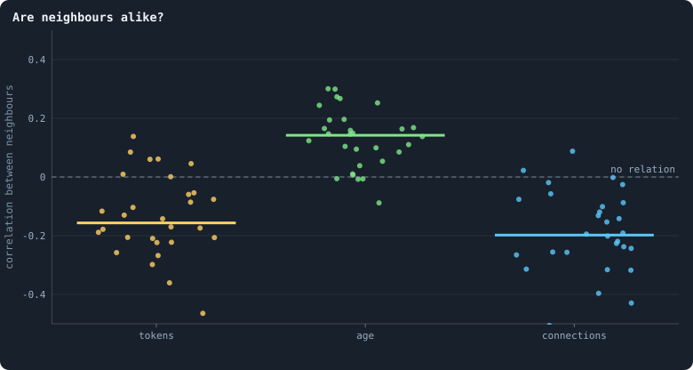

**Are neighbours alike?** For every connection of a world, the two agents at its ends: the correlation of their tokens, of their ages and of their numbers of connections (tokens and age as ln(1 + x), connections as ln k), counting every connection both ways round. One dot per world, the mean over five moments (after the games of iterations 500, 750, 1,000, 1,250 and 1,499); the bar is the median. The same values shuffled among a world's agents give correlations within 0.01 of zero in the median world, and within 0.09 in every world; the last column is the assortativity of [How properties scale together](b1-the-network-size-and-scaling.md#how-properties-scale-together), taken of ln k instead of k.

> [!example]- How to make this figure
> **Runs.** The 30 baseline worlds that lived to the end (`B1-100000-s001` … `-s030`, [Thirty worlds](b1-lives-and-wealth.md#thirty-worlds); `python3 gol_lab.py run E10`).
>
> **Data.** From each run's frames, `GraphOfLifeRuns/<run>/frames/`, read with `gol_store.read_frame(run, index)`; frame `2·t` is iteration *t* after reproduction and frame `2·t + 1` after the game.
>
> 1. Read frames 2·t + 1 for t = 500, 750, 1,000, 1,250, 1,499: `ids`, `tokens`, `ages`, `brain_ids` and `edges`.
> 2. Pearson's correlation of the value at one end of a connection with the value at the other, over every connection in both directions; the null shuffles the values among agents first (`book_chapters.space.likeness`).
>
> **To make it again:** `python3 book_figures.py alike`.
<!-- /figure -->

- **Tokens: unlike.** Neighbours' tokens are correlated at **−0.16** in the
  median world (−0.10 at 10,000 tokens). The rich sit among the poor.
- **Age: like.** **+0.14** (+0.15). The old sit among the old, the young among
  the young.
- **Connections: unlike.** **−0.20** (−0.19): hubs sit among agents with few
  connections. This is the assortativity of
  [How properties scale together](b1-the-network-size-and-scaling.md#how-properties-scale-together), taken of
  the logarithm of the connections. Of the connections themselves, which the
  hubs sway more, it is about −0.07 ([Assortativity](measuring-networks.md#assortativity)).

All three are small in the median world. Neighbours are alike or unlike only
a little. And the worlds differ: the age correlation ranges from −0.09 to
0.30 between them. The worlds with a giant hub
([How much does the seed decide?](b1-the-network-size-and-scaling.md#how-much-does-the-seed-decide)) reach
−0.57 for tokens and −0.64 for connections. Such a world is a star: one rich,
connected agent among thousands of poor leaves.

#### Place, or closeness?

A correlation between neighbours need not mean that neighbours influence each
other. Tokens follow connections
([How properties scale together](b1-the-network-size-and-scaling.md#how-properties-scale-together)), and hubs
sit among leaves. So neighbours' tokens can be unlike without any agent doing
anything to another: the trap of
[place versus closeness](#a-trap-place-versus-closeness). How much of the
likeness is just place?

Shuffle each agent's tokens, and then its age, among the agents with about as
many connections as it has, and measure again.

- For **tokens**, the shuffled worlds give −0.12, most of the −0.16 of the
  real ones. Rich beside poor is mostly place: hubs are rich, leaves are poor,
  and hubs sit among leaves. In the worlds of 10,000 tokens it was all place:
  the shuffle gave −0.13, even more than the real −0.10.
- For **age**, the shuffled worlds give −0.01. Old beside old is not place. It
  is something about the agents themselves.

Why would the old sit beside the old? A likely reason: agents die together,
when a piece of the world is cut off
([How a world breaks](b1-the-network-size-and-scaling.md#how-a-world-breaks)). And they are born into their
parents' neighbourhoods
([How the network grows](b1-lives-and-wealth.md#how-the-network-grows)).
So the young arrive where the old are gone, side by side. Agents that arrived
together live together, as **cohorts**.

#### How far likeness reaches

Now measure the same correlations between agents 2, 3, … up to 15 steps
apart: the correlation function *C*(*r*) of the worlds. The pairs come from
breadth-first searches out of agents drawn at random. At one step they are
the neighbours again. But they are a sample, pooled over the five moments, so
their values differ a little from those above.

<!-- figure alike/distance -->
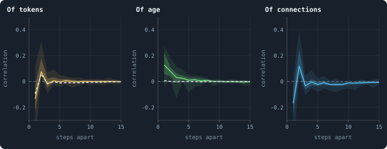

**How alike, how far apart.** For pairs of agents r steps apart, the correlation of their tokens, ages and connections (as in the figure above), for r = 1 to 15. For each world, pairs from breadth-first searches out of 150 agents drawn at random at each of the five moments; the coloured line is the median of the 30 worlds, the darker band the middle half of them and the paler band nine in ten. Grey dashes: the median when each agent's tokens (or age) are first shuffled among the agents with about as many connections (1, 2, 3–4, 5–9, 10–49, 50 and more) — what an agent's place in the network explains without any closeness of its own.

> [!example]- How to make this figure
> **Runs.** The 30 baseline worlds that lived to the end (`B1-100000-s001` … `-s030`, [Thirty worlds](b1-lives-and-wealth.md#thirty-worlds); `python3 gol_lab.py run E10`).
>
> **Data.** From each run's frames, `GraphOfLifeRuns/<run>/frames/`, read with `gol_store.read_frame(run, index)`; frame `2·t` is iteration *t* after reproduction and frame `2·t + 1` after the game.
>
> 1. At each moment, a breadth-first search out of 150 agents drawn at random (generator seeded with 22), to 15 steps; every agent reached at r steps gives the pair (source, agent).
> 2. Standardise each value within its moment (subtract the mean, divide by the standard deviation); per r, pooled over sources and moments, Pearson's correlation of the two values.
> 3. The grey null: the same pairs, with tokens and ages permuted at random within each class of connections (`book_chapters.space.likeness`).
>
> **To make it again:** `python3 book_figures.py alike`.
<!-- /figure -->

Every curve is close to zero from **three steps** on, as in the worlds of
10,000 tokens.

- **Tokens:** −0.13 at one step, **+0.08** at two, and nothing from three on.
  Two agents two steps apart are often two leaves of one hub, poor alike. The
  shuffle explains most of that (+0.06).
- **Age:** +0.13 at one step, +0.08 at two, +0.03 at three, +0.02 at four, and
  nothing from five on. Cohorts span two or three steps.
- **Connections:** −0.17 at one step, +0.12 at two (two leaves of one hub
  again), and close to zero beyond.

In the language of physics, the correlation length of a world is one to two
steps. Within that distance, a world has structure: hubs and their leaves,
cohorts of the same age. Beyond it, every part of a world looks like every
other.

#### Kin, near and far

The last question is about families. Do agents of one
genotype live together? A genotype is the identity of a brain: a copy
keeps it, and a change gives the brain a new one.

<!-- figure alike/kin -->
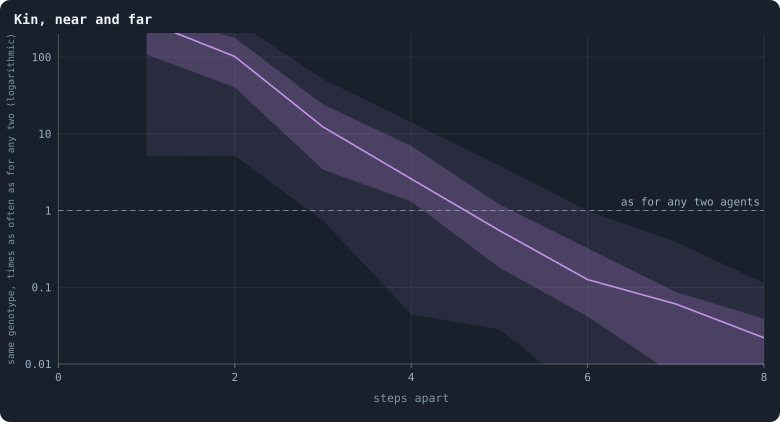

**Kin, near and far.** For pairs of agents r steps apart (as in the figure above), the share that carry the same genotype, divided by the share among all pairs of agents of the world, on a logarithmic axis: a straight falling line would be a relatedness that halves over a fixed number of steps. The line is the median of the 30 worlds, the darker band the middle half of them and the paler band nine in ten. From 9 steps on, at least half of the worlds have no such pair at all. In the others such pairs are rare: at most an eighth of what chance would give at 9 steps, and less than a fortieth from 11 steps on.

> [!example]- How to make this figure
> **Runs.** The 30 baseline worlds that lived to the end (`B1-100000-s001` … `-s030`, [Thirty worlds](b1-lives-and-wealth.md#thirty-worlds); `python3 gol_lab.py run E10`).
>
> **Data.** From each run's frames, `GraphOfLifeRuns/<run>/frames/`, read with `gol_store.read_frame(run, index)`; frame `2·t` is iteration *t* after reproduction and frame `2·t + 1` after the game.
>
> 1. As above; for every pair, whether the two `brain_ids` are equal.
> 2. Any two agents: Σ c(c − 1) / (n(n − 1)) over the genotypes' counts c among the n agents.
>
> **To make it again:** `python3 book_figures.py alike`.
<!-- /figure -->

Among agents one step apart, **9.2%** carry the same genotype. That is 290
times as many as among any two agents of the world (0.03%).
[Do agents cooperate?](do-agents-cooperate.md) finds the same, counting along
every connection instead of from agents drawn at random. Two steps apart the
share is 4.1% (100 times chance), three steps 0.5% (12 times), and four steps
0.09% (2.6 times). From **five steps on, it is lower than chance would give**:
0.55 times at five steps, 0.1 at six. Beyond eight steps, almost no pair
shares a genotype.

At 10,000 tokens the shares were 9.9% at one step and 5.0% at two. But two
agents drawn at random shared a genotype ten times as often (0.30%). So the
share at one step was 33 times chance, and it fell below chance from four
steps on. The kin clusters are the same size in both. What a larger world
changes is only how rare the same genotype is far away.

So kin live together, but only as small clusters: a parent, its children, and
the nodes it has just conquered, within two or three steps. There are no
territories of genotypes. A genotype is a few agents, not a region.

Two reasons keep it so. A genotype lasts about two
iterations before a change renames it
([Genotypes and lineages](b1-brains-lineages-and-messages.md#genotypes-and-lineages)), so a cluster of one
genotype has little time to grow. And more than half of all nodes change hands
in every game
([How the game is played](b1-the-game-and-its-flows.md#how-the-game-is-played-what-agents-stake-and-who-wins-the-nodes)). So any territory is
broken up as soon as it forms.

Lineages, the lines of descent, last much longer than genotypes. A line is all
the agents whose genotypes go back to one ancestor, some iterations earlier.
And lines do hold regions
([Where the lines live](b1-the-network-size-and-scaling.md#where-the-lines-live)).
Give every agent the genotype it descends from 25 iterations back: its
family. Two neighbours share a family 99 times as often as chance would have
them, and the excess reaches about 7 steps. For families of 200 iterations
back it reaches about 12 steps (4 to 17 across the worlds). As a line ages,
its patch widens the way a random walker spreads on these worlds, about as
*t*^0.34 after *t* iterations. A front moving at a steady speed would widen
in proportion to *t*. [One world, many colours](one-world-many-colours.md)
draws such families in colour. So a world has territories after all: of
lines, not of genotypes.

### What we learned (like next to like)
- **Likeness at a distance has a measure.** The correlation function *C*(*r*)
  says how alike agents *r* steps apart are, and the correlation length how
  far likeness reaches. Shuffling values among agents with as many
  connections tells place from closeness.
- **A world has structure only within one or two steps.** Its correlation
  length is one to two connections. Beyond three steps, a world is
  statistically the same everywhere: no rich regions, no old towns, no
  territories of genotypes.
- **Most of the local structure is place, not influence.** Rich beside poor
  is mostly hubs among leaves. Only age is alike beside alike beyond what
  place explains, as cohorts born and dying together.
- **Kin cluster, and lines spread.** Agents of one genotype cluster within two
  or three steps: one step apart, two agents carry the same genotype 290 times
  as often as chance. Lines of descent hold patches of about 7 to 12 steps, which widen
  as a random walker spreads.
- **A world is far from critical.** At a critical point the correlation
  length grows without bound, and likeness falls off with distance only as a
  power. Here it is gone within three steps. That fits
  [Power laws, real and apparent](b1-the-network-size-and-scaling.md#power-laws-real-and-apparent-and-how-to-fit-one), which
  finds no avalanches of every size and no 1/*f* noise. The space itself may
  have no scale: the room within *r* steps grows as a power of *r*
  ([Is a world a space?](how-many-dimensions-does-a-world-have.md)). But what
  the agents hold is alike only within three steps.
- **For open-ended evolution, nothing yet lets a second kind of world form
  inside the first.** Matter in a vacuum, a cell in its medium, a species in
  its habitat: each is a region that keeps differing from its surroundings.
  A world has room for such regions, for it is a space. But what
  its agents hold differs only within three steps, and the patches of lines
  keep widening. [Space and dimension](../README.md#space-and-dimension) looks
  for rules that would let such regions form.

### How this was made (like next to like)
Every figure of this page says, folded beneath it, which runs it reads and
how. All three are drawn again with `python3 book_figures.py alike`. The
measurement is the function `likeness` in `book_chapters/space.py`, and its
numbers are kept in `book/results/alike.json`.

The numbers for the worlds of 10,000 tokens come from the same measurement on
Experiment 2: thirty worlds, `B1-10000-s001` … `-s030`, of 3,000 iterations
each (`python3 gol_lab.py run E02`). The 26 that lived to the end were read at
five moments, from iteration 1,000 to 2,999.

#### The runs of Experiment 10 (like next to like)
Experiment 10 is 30 runs: B1 at 100,000 tokens, seeds 1 to 30, 1,500
iterations each.

The runs of Experiment 10 are listed once on this page, under [The runs of Experiment 10 (the shape of the network)](#the-runs-of-experiment-10-the-shape-of-the-network).

## Worlds of many sizes

Experiment 8 ran the first baseline, B1, at ten sizes, from 800 to 409,600
tokens. As its thesis said, agents and connections followed the tokens in
proportion: about 0.14 agents per token. But big worlds do not calm down: at
every size, a single game can cut off nearly half a world. Experiment 10 then
set thirty worlds of 100,000 tokens beside thirty of 10,000. One founder's
line took about six times as long to take them over: slower than the front
of its thesis, faster than chance. Per agent, a large world lives as ten
small ones do; but its distances grow as in a three-dimensional body.

### How does a world's size follow its tokens?

Think of a city twice the size of another. Does it simply have twice the
people and twice the streets? Or does size change what kind of city it is?
Experiment 8 asks the same of a world.

A world is given one number before it starts: its tokens, whose total never
changes. The study of the baseline looks at worlds of two sizes, 10,000 and
100,000 tokens ([The life of a B1 world](b1-lives-and-wealth.md#the-life-of-a-b1-world)). Experiment 8
runs the baseline B1 at ten sizes, from 800 tokens to 409,600, each double
the one before. It asks what changes with size, and what does not.

#### Why ask

Whether what the notebook has found holds at other sizes rests first on this
question. If agents and connections grow in proportion to the tokens, a
bigger world is more of the same. Then the size of a world can be chosen for
what an experiment can afford. If they do not, size changes what a world is,
and every result belongs to the size it was found at.

#### How it was measured

Experiment 8 runs worlds of the baseline B1 at ten sizes, three seeds each,
for 600 iterations each. A world starts with one founder for every hundred
tokens, so the founders go from 8 to 4,096.

**What is measured.** For every run, two numbers: the agents alive after the
game, and the connections. Each is averaged over iterations 500 to 599, well
past the youth of a world
([The first hundred iterations](b1-lives-and-wealth.md#the-first-hundred-iterations)).
The same means over iterations 400 to 499 say whether a world had settled.

**How it is read.** Suppose the agents follow a power law of the tokens:
agents = *a* × tokens^*b*, some number *a* times the tokens to the power *b*.
On logarithmic axes, on both sides, such a law is a straight line. Its slope
is the exponent *b*
([Logarithmic axes and power laws](statistics.md#logarithmic-axes-and-power-laws)). An exponent of 1
means in proportion: twice the tokens, twice the agents. Below 1, bigger
worlds hold fewer agents per token; above 1, more.

The line is fitted by least squares to the baseline worlds of 3,200 tokens
and more, every run a point ([Fitting a straight line](statistics.md#fitting-a-straight-line)).
Its interval comes from resampling the runs within each size 10,000 times
([The bootstrap](statistics.md#how-sure-can-we-be-the-bootstrap-permutation-tests-the-wilson-interval-and-how-many-seeds)). A second fit, with a squared term, says
whether the points bend away from a straight line.

**The small end.** Two rules of the baseline limit how small a world can be.
The founders' starting ring needs at least six founders
([The starting ring](rules-in-detail.md#the-starting-ring)), so no world can have fewer than 600
tokens. And a run stops, as extinct, once a game leaves 20 agents or fewer
([When a world ends](rules-in-detail.md#when-a-world-ends)). Worlds of 800 and 1,600 tokens start
with 8 and 16 founders, below that line. So the small worlds were also run a
second way, *stopped only when empty* (`extinction_threshold` 0), from 800
to 6,400 tokens. A world that never falls to twenty agents is then exactly
the baseline's world of the same seed.

**A check from elsewhere.** The 28 worlds of
[A world's life](b1-lives-and-wealth.md#a-worlds-life) that reached iteration 600,
at 10,000 tokens, are drawn beside the new runs wherever they can be. They
are a size the experiment did not run, measured the same way.

#### What was expected (worlds of many sizes)
We expected a world of twice the tokens to be two worlds of the same kind.
Everything an agent does is local. It plays the game with its neighbours,
has its children beside itself, and dies when its own tokens run out. Only
one rule seemed to reach across a whole world: the tokens of the dead are
shared out among all survivors. That rule gives every survivor the same
chance, whatever the size of the world. So at every size we expected about
as many agents and connections per token as at 10,000 tokens.

<!-- thesis E08 -->
> [!quote] The thesis of Experiment 8, written down before any of its runs existed
> **The claim.** A world's size follows its tokens in proportion. From a few thousand tokens up to 409,600, a settled world holds about 0.13 agents and 0.2 connections for every token, whatever its size: agents and connections are each a power law of the tokens with exponent 1. A world of twice the tokens is two worlds of the same kind.
>
> **Why it would be so.** Everything an agent does is local. It plays the game with its neighbours, has its children beside itself, and dies when its own tokens run out; nothing in the rules reaches across the world except the sharing out of the tokens of the dead, which gives every survivor the same chance whatever the size of the world. So a bigger world should be more of the same, with as many agents per token and as many connections per agent. At 10,000 tokens the settled worlds of Chapter [3](b1-lives-and-wealth.md#the-life-of-a-b1-world) held 0.13 agents and 0.20 connections per token, from iteration 500 on.
>
> **It holds if:** For the baseline worlds of 3,200 to 409,600 tokens that live to iteration 600, each measured by its mean over iterations 500 to 599: the exponent fitted to agents against tokens lies between 0.9 and 1.1 and its 95% interval contains 1; the same holds for connections; and neither set of points bends away from a straight line on logarithmic axes — the interval of the bend contains 0.
>
> **It fails if:** The exponent's interval leaves out 1, so that bigger worlds hold clearly fewer or more agents (or connections) per token than smaller ones, or the points bend on logarithmic axes. Then a world's size is more than its tokens, something in the dynamics reaches across the whole world, and every result in this book belongs to the size it was found at.
>
> *Written while the notebook still numbered its chapters: each number is a link to the page it meant that day.*
<!-- /thesis -->

#### Agents and connections follow the tokens

<!-- figure size/agents -->
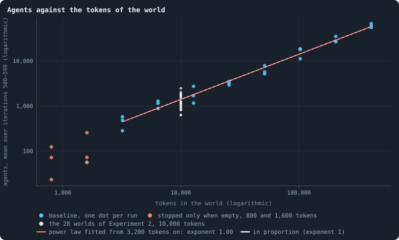

**Agents against the tokens of the world.** Every run that lived to iteration 600 is a dot: the tokens of its world, and the number of agents alive after each game, averaged over iterations 500 to 599 — both on logarithmic axes, on which a power law, agents = a · tokens^b, is a straight line of slope b ([Logarithmic axes](statistics.md#logarithmic-axes-and-power-laws)). Blue: the baseline, three seeds per size (at 1,600 tokens only one of three lived through its first iteration, and its dot lies under the orange one of the same world; at 800 none did). Orange: the same worlds of 800 and 1,600 tokens with the stopping rule switched off. Grey: the baseline worlds of [A world's life](b1-lives-and-wealth.md#the-life-of-a-b1-world), a check from another experiment. Red: the straight line fitted to the blue dots from 3,200 tokens on, exponent 1.00 (95% interval 0.95 to 1.06). Dashed: exponent exactly 1.

> [!example]- How to make this figure
> **Runs.** The 42 runs of Experiment 8 — B1 at 800 to 409,600 tokens, each size double the one before, seeds 1 to 3, 600 iterations — in two conditions: the baseline, `B1-800-s001` … `B1-409600-s003`; and *stopped only when empty* (`extinction_threshold` 0) at 800 to 6,400 tokens, `B1-800-57b358-s001` … `B1-6400-57b358-s003`. They are made with `python3 gol_lab.py run E08`; every setting is listed in the box of the runs behind this page. As a check at 10,000 tokens, the 28 baseline runs of Experiment 2 that reached iteration 600 (`B1-10000-s001` … `-s030`, [A world's life](b1-lives-and-wealth.md#the-life-of-a-b1-world)).
>
> **Data.** From each run's `GraphOfLifeRuns/<run>/stats.jsonl`, which holds one row per recorded phase: `phase` 1 is the world just after reproduction, `phase` 2 just after the game, and every statistic is a field of the row (see [What a run records](runs-and-records.md#what-a-run-records)).
>
> 1. For every run, the mean of `nodes` over the rows with `phase` = 2 and 500 ≤ `iteration` ≤ 599; leave out a run that stopped before iteration 600.
> 2. Fit log₁₀(agents) = log₁₀ a + b · log₁₀(tokens) by least squares over the baseline runs of 3,200 tokens and more; the interval of b from 10,000 resamplings of the runs within each size (`gol_analysis.power_fit`, run by `python3 gol_lab.py analyse E08`).
>
> **To make it again:** `python3 book_figures.py size`.
<!-- /figure -->

From 3,200 tokens to 409,600, the number of agents follows the tokens in
proportion, as closely as three seeds per size can tell. The fitted exponent
is **1.00** (95% interval 0.95 to 1.06). The line explains 98% of the
scatter, and the points do not bend away from it. A settled world holds
about 0.14 agents per token, so a world of 409,600 tokens holds about 60,000
agents.

The worlds of [A world's life](b1-lives-and-wealth.md#a-worlds-life) fall where the
line says they should. The median one holds 0.124 agents per token, against
0.140 predicted, well inside their own spread (0.06 to 0.25).

Below 3,200 tokens the line ends. The baseline stopped all three worlds of
800 tokens, and two of the three of 1,600, after their first game. With the
stopping rule switched off, they lived. They held fewer agents per token than
bigger worlds, 0.09 at 800 tokens and 0.08 at 1,600. But these are only three
worlds each, spread widely.

A log–log plot squeezes everything onto a line. To see how close to
proportion the worlds are, divide by the tokens:

<!-- figure size/per-token -->
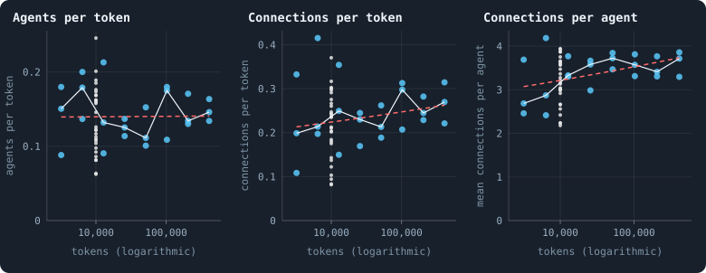

**The same law, seen through a magnifying glass.** The quantities of the figure above divided by what proportion would scale them by, so that growth in proportion is a flat line. Blue: every baseline run of 3,200 tokens and more that lived to iteration 600, its mean over iterations 500 to 599; grey: the 28 worlds of [A world's life](b1-lives-and-wealth.md#the-life-of-a-b1-world) at 10,000 tokens; white: the median of the three runs of each size; dashed red: the power law fitted to the runs, divided by the tokens (for connections per agent, the law fitted to the connections per agent themselves, whose exponent says by how much they grow with size).

> [!example]- How to make this figure
> **Runs.** The 42 runs of Experiment 8 — B1 at 800 to 409,600 tokens, each size double the one before, seeds 1 to 3, 600 iterations — in two conditions: the baseline, `B1-800-s001` … `B1-409600-s003`; and *stopped only when empty* (`extinction_threshold` 0) at 800 to 6,400 tokens, `B1-800-57b358-s001` … `B1-6400-57b358-s003`. They are made with `python3 gol_lab.py run E08`; every setting is listed in the box of the runs behind this page. As a check at 10,000 tokens, the 28 baseline runs of Experiment 2 that reached iteration 600 (`B1-10000-s001` … `-s030`, [A world's life](b1-lives-and-wealth.md#the-life-of-a-b1-world)).
>
> **Data.** From each run's `GraphOfLifeRuns/<run>/stats.jsonl`, which holds one row per recorded phase: `phase` 1 is the world just after reproduction, `phase` 2 just after the game, and every statistic is a field of the row (see [What a run records](runs-and-records.md#what-a-run-records)).
>
> 1. For every run, the means of `nodes`, `edges` and `meanDegree` over the rows with `phase` = 2 and 500 ≤ `iteration` ≤ 599; divide the first two by the tokens.
> 2. The red lines are the fits of `book/results/E08.json`, made by `python3 gol_lab.py analyse E08`.
>
> **To make it again:** `python3 book_figures.py size`.
<!-- /figure -->

Agents per token scatter between 0.09 and 0.21, with no trend. The medians of
the eight sizes run 0.15, 0.18, 0.13, 0.13, 0.11, 0.18, 0.13, 0.15.
Connections follow the tokens with an exponent of **1.04** (0.97 to 1.12),
again without a bend.

The difference shows in the third panel. Connections per agent rise slowly
with size, with an exponent of 0.04 (0.004 to 0.072). Over the 128-fold range
of sizes, the fitted law adds about a fifth. The medians rise from 2.7 at
3,200 tokens to 3.7 at 409,600. Big worlds are a little more richly
connected.

#### Six hundred iterations, at nine sizes

<!-- figure size/lives -->
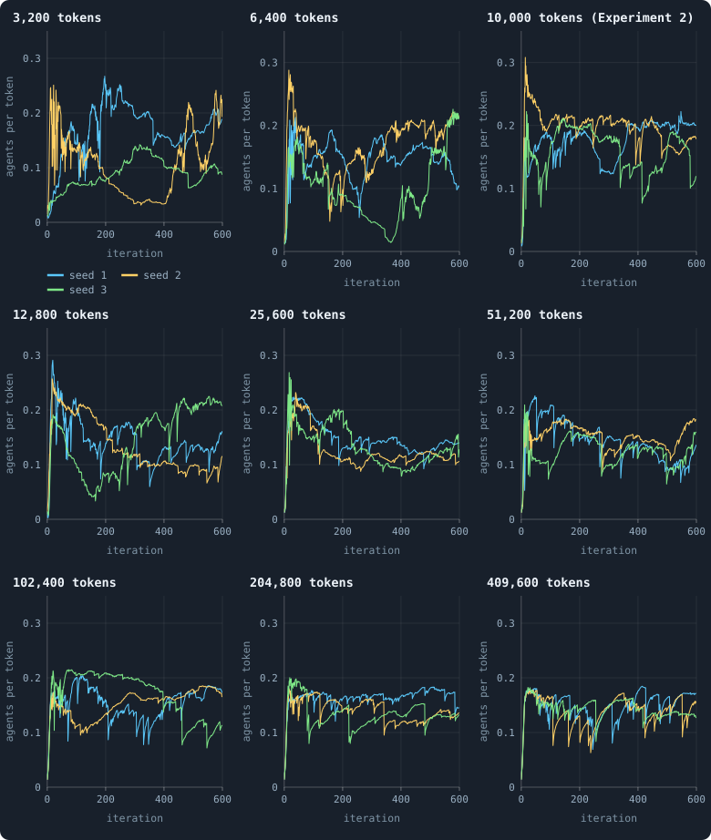

**Six hundred iterations, at nine sizes.** The number of agents after every game, divided by the tokens of the world, over the 600 iterations of every baseline run of 3,200 tokens and more — one panel per size, one line per seed — and, in the third panel, the first three worlds of [A world's life](b1-lives-and-wealth.md#the-life-of-a-b1-world) at 10,000 tokens, over their first 600 iterations. The same vertical scale in every panel.

> [!example]- How to make this figure
> **Runs.** The 42 runs of Experiment 8 — B1 at 800 to 409,600 tokens, each size double the one before, seeds 1 to 3, 600 iterations — in two conditions: the baseline, `B1-800-s001` … `B1-409600-s003`; and *stopped only when empty* (`extinction_threshold` 0) at 800 to 6,400 tokens, `B1-800-57b358-s001` … `B1-6400-57b358-s003`. They are made with `python3 gol_lab.py run E08`; every setting is listed in the box of the runs behind this page. The runs of [A world's life](b1-lives-and-wealth.md#the-life-of-a-b1-world) with seeds 1, 2 and 3.
>
> **Data.** From each run's `GraphOfLifeRuns/<run>/stats.jsonl`, which holds one row per recorded phase: `phase` 1 is the world just after reproduction, `phase` 2 just after the game, and every statistic is a field of the row (see [What a run records](runs-and-records.md#what-a-run-records)).
>
> 1. Take `nodes` of every row with `phase` = 2 and `iteration` ≤ 599, divided by the tokens of the world.
>
> **To make it again:** `python3 book_figures.py size`.
<!-- /figure -->

Every world, whatever its size, shoots up within its first twenty iterations
and then wanders. The small worlds wander widely: at 3,200 tokens, between
0.03 and 0.27 agents per token. The big ones stay within a narrower band,
0.07 to 0.19 at 409,600 tokens. But the way they move is striking: a
**sawtooth**. They climb slowly for tens of iterations. Then, in a single
game, they fall by a tenth, a third, sometimes nearly half.

#### Big worlds do not average out

A familiar law of large numbers predicts the opposite. Picture a world of
twice the tokens as two independent worlds of the same kind, side by side.
Their ups and downs would partly cancel. So the relative size of a world's
changes would shrink as one over the square root of its size.

Here is why. Let each of *N* parts change by a random amount with standard
deviation σ, independently of the others. The variances add, so the total
changes with standard deviation √*N* σ. As a share of a world that grows as
*N*, that is σ/√*N*. A world a hundred times larger would change, relatively,
ten times less.

<!-- figure size/fluctuations -->
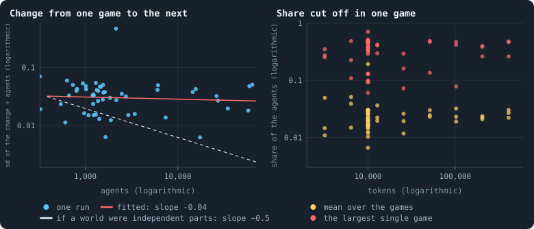

**Big worlds do not average out.** Over the last 300 iterations (300 to 599) of every baseline run of 3,200 tokens and more, and of the 28 worlds of [A world's life](b1-lives-and-wealth.md#the-life-of-a-b1-world). Left: for each run, the standard deviation of the change in the number of agents from one game to the next, divided by the mean number of agents — against that mean, on logarithmic axes. If a world were made of independent parts, its relative changes would shrink as one over the square root of its size (dashed, drawn through the runs of 3,200 tokens); red is the line fitted to the runs. Right: for each run, the share of the agents alive at the start of a game that the game cut off from the network — the mean over the games (yellow) and the largest in any one game (red).

> [!example]- How to make this figure
> **Runs.** The 42 runs of Experiment 8 — B1 at 800 to 409,600 tokens, each size double the one before, seeds 1 to 3, 600 iterations — in two conditions: the baseline, `B1-800-s001` … `B1-409600-s003`; and *stopped only when empty* (`extinction_threshold` 0) at 800 to 6,400 tokens, `B1-800-57b358-s001` … `B1-6400-57b358-s003`. They are made with `python3 gol_lab.py run E08`; every setting is listed in the box of the runs behind this page. As a check at 10,000 tokens, the 28 baseline runs of Experiment 2 that reached iteration 600 (`B1-10000-s001` … `-s030`, [A world's life](b1-lives-and-wealth.md#the-life-of-a-b1-world)).
>
> **Data.** From each run's `GraphOfLifeRuns/<run>/stats.jsonl`, which holds one row per recorded phase: `phase` 1 is the world just after reproduction, `phase` 2 just after the game, and every statistic is a field of the row (see [What a run records](runs-and-records.md#what-a-run-records)).
>
> 1. Take `nodes` of the rows with `phase` = 2 and 300 ≤ `iteration` ≤ 599; the standard deviation of the differences between consecutive rows, divided by the mean.
> 2. Fit the logarithm of that against the logarithm of the mean by least squares; the interval from resampling the runs within each size (`gol_analysis.power_fit`).
> 3. For the right panel, `orphaned` / `nodes_before` of the same rows: the mean and the largest.
>
> **To make it again:** `python3 book_figures.py size`.
<!-- /figure -->

It does not. The typical change from one game to the next, as a share of the
world, is about the same at every size. The fitted exponent is **−0.04**
(−0.15 to 0.07), far from the −0.5 of independent parts. In the worlds of
409,600 tokens, the standard deviation of the change from one game to the
next is about 4.8% of the world. If each of their sixty thousand agents lived
and died independently, it would be about 0.1%.

The right panel shows why. On average a game cuts off about 2% of the agents
of a world: between 1.5% and 3.9%, size by size, with no trend. But the
largest single cut is a large part of the world at every size. It is 35% at
3,200 tokens, 48% at 409,600, and 71% in one world of
[A world's life](b1-lives-and-wealth.md#a-worlds-life). In the biggest worlds, one
game has cut off nearly thirty thousand agents at once.

[How a world breaks](b1-the-network-size-and-scaling.md#how-a-world-breaks) found how such cuts happen: a
whole border of poor agents goes quiet. And
[Questioning the mechanics](questioning-the-mechanics.md) found the rule that
makes them fatal: everything outside the largest connected piece dies. This
experiment adds the scale: **the regions a world can lose grow with the
world.** The removal of what is cut off, the *cull*, couples every part of a
world to every other, however big it is.

So the noise comes from a rule, not from small numbers, and only a change of
the rule removes it. The second baseline, B2, makes that change
([A world that cannot break](building-b2-and-the-search-for-a-healthy-rich-world.md#a-world-that-cannot-break)).
When an agent dies, the groups its former neighbours fall into are joined up
in a ring. And a link that carried no tokens may lapse only if its two ends
share at least two neighbours. A death mended so never splits a world, as
that page proves, and such a lapse cannot either. Under these rules the cull
has nothing left to remove, however large the world.

#### Is a big world the same kind of world?

Most of what the study of the baseline measured is a share or a rate. Think
of the inequality of tokens, the share staked at home, or births per hundred
agents. Such quantities do not grow with a world by definition. Do they
change with it?

<!-- figure size/same-world -->
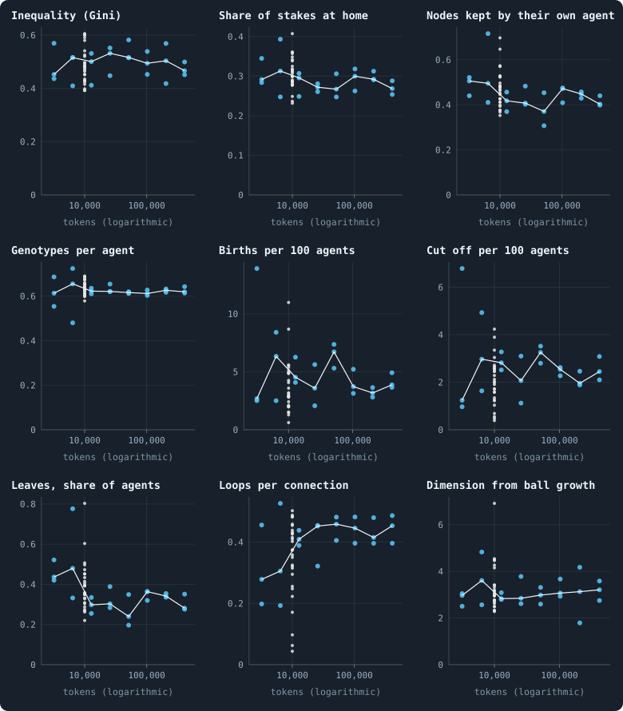

**Is a big world the same kind of world?** Nine properties of a world that do not grow with its size by definition — shares, rates per agent, a dimension. Blue: every baseline run of 3,200 tokens and more that lived to iteration 600, its mean over iterations 500 to 599; grey: the 28 worlds of [A world's life](b1-lives-and-wealth.md#the-life-of-a-b1-world) at 10,000 tokens; white: the median of each size. A world that is the same kind of world at every size gives a flat cloud.

> [!example]- How to make this figure
> **Runs.** The 42 runs of Experiment 8 — B1 at 800 to 409,600 tokens, each size double the one before, seeds 1 to 3, 600 iterations — in two conditions: the baseline, `B1-800-s001` … `B1-409600-s003`; and *stopped only when empty* (`extinction_threshold` 0) at 800 to 6,400 tokens, `B1-800-57b358-s001` … `B1-6400-57b358-s003`. They are made with `python3 gol_lab.py run E08`; every setting is listed in the box of the runs behind this page. As a check at 10,000 tokens, the 28 baseline runs of Experiment 2 that reached iteration 600 (`B1-10000-s001` … `-s030`, [A world's life](b1-lives-and-wealth.md#the-life-of-a-b1-world)).
>
> **Data.** From each run's `GraphOfLifeRuns/<run>/stats.jsonl`, which holds one row per recorded phase: `phase` 1 is the world just after reproduction, `phase` 2 just after the game, and every statistic is a field of the row (see [What a run records](runs-and-records.md#what-a-run-records)).
>
> 1. For every run, the mean over the rows with `phase` = 2 and 500 ≤ `iteration` ≤ 599 of `gini`, `selfAllocationShare`, `heldHomeShare`, `brainDiversity`, `leaves` / `nodes`, `loopDensity` and `dimension` (the last two every 25 iterations).
> 2. Births: `births` of the rows with `phase` = 1, per 100 `nodes_before`; cut off: `orphaned` of the rows with `phase` = 2, per 100 `nodes_before`; each averaged over iterations 500 to 599.
> 3. For the numbers in the text: a power law of each property against the tokens, fitted as for the agents — an exponent near 0 is a property that does not change with size.
>
> **To make it again:** `python3 book_figures.py size`.
<!-- /figure -->

For each property, the same kind of fit as for the agents says how it
changes with size. An exponent of 0 means not at all. Six of the nine are
flat within what three seeds per size can see:

| property | exponent against the tokens | 95% interval |
|---|---|---|
| inequality ([Gini](measuring-tokens.md#measuring-inequality-the-gini-coefficient-the-richest-tenth-entropy-and-mobility "How unequally tokens are held: 0 if every agent holds as many, near 1 if one holds nearly all.")) | 0.003 | −0.022 to 0.026 |
| share of stakes at home | −0.017 | −0.041 to 0.007 |
| genotypes per agent | 0.003 | −0.017 to 0.024 |
| births per 100 agents | −0.05 | −0.18 to 0.06 |
| cut off per 100 agents | 0.000 | −0.14 to 0.11 |
| dimension from ball growth | −0.001 | −0.048 to 0.045 |

Genotypes per agent are flatter than anything: 0.61 to 0.66 at every size.
The balance of making and copying of
[How even is a world?](b1-lives-and-wealth.md#how-even-is-a-world) does not care how big the
world is.

Across these eight sizes, three properties of the network's shape seem to
change, slowly:

- **Leaves**, the share of agents with a single connection, fall with an
  exponent of −0.08 (−0.12 to −0.04). Their median falls from 0.44 at 3,200
  tokens to 0.28 at 409,600.
- **Loops per connection** rise with an exponent of 0.08 (0.02 to 0.14): from
  0.28 to 0.45.
- **Nodes kept by their own agent** fall with an exponent of −0.03 (−0.06 to
  −0.01): from 0.51 to 0.40.

Leaves and loops go with the slow rise in connections per agent: more
connections, fewer leaves, more loops. More neighbours would also mean more
neighbours to lose one's node to. Over a 128-fold range of sizes, the three
shift by between a fifth and a half. The worlds of
[A world's life](b1-lives-and-wealth.md#a-worlds-life) sit among the others in
every panel. So the numbers the study of the baseline first found at 10,000
tokens hold, roughly, at other sizes. The study, now written from worlds of
100,000 tokens, checks them ([Thirty worlds](b1-lives-and-wealth.md#thirty-worlds)).

Three seeds per size cannot see small changes; thirty worlds at each of two
sizes can.
[A large world beside ten small ones](#a-large-world-beside-ten-small-ones),
below, sets thirty worlds of 100,000 tokens beside thirty of 10,000, over
iterations 500 to 1,499. There, inequality, the nodes kept by their own agent
and the genotypes per agent come out within 3% of each other. So the nodes
kept do not fall with size after all.

But at ten times the tokens, the dimension from ball growth is 15% higher
(3.4 against 3.0, [The geometry of a world](b1-the-network-size-and-scaling.md#the-geometry-of-a-world)).
Births and deaths per agent run 13 to 21% higher, as
[Births, deaths and ages](b1-lives-and-wealth.md#births-deaths-and-ages) and
[How ages change over a world's life](b1-lives-and-wealth.md#how-ages-change-over-a-worlds-life) find too. Leaves
are only 5% fewer, and clustering is less than half. So births, the rate of
cutting and the dimension do change with size, a little. And the shape
changes more than leaves and loops alone show.

#### Distances grow like a power

<!-- figure size/distances -->
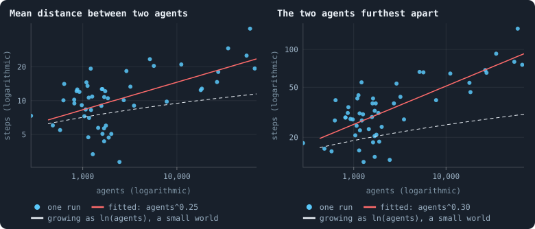

**How far apart agents are, as worlds grow.** Every baseline run of 3,200 tokens and more that lived to iteration 600, and the 28 worlds of [A world's life](b1-lives-and-wealth.md#the-life-of-a-b1-world): the mean number of agents over iterations 500 to 599, and over the same iterations the mean distance between two agents (left) and the largest distance found (right), both estimated by the viewer from breadth-first searches out of 8 to 16 agents every 25 iterations ([Radius and diameter](measuring-networks.md#radius-and-diameter)). Red: a power law fitted to the dots. Dashed: what a small world would do — distances growing in proportion to the logarithm of the number of agents — drawn through the runs of 3,200 tokens.

> [!example]- How to make this figure
> **Runs.** The 42 runs of Experiment 8 — B1 at 800 to 409,600 tokens, each size double the one before, seeds 1 to 3, 600 iterations — in two conditions: the baseline, `B1-800-s001` … `B1-409600-s003`; and *stopped only when empty* (`extinction_threshold` 0) at 800 to 6,400 tokens, `B1-800-57b358-s001` … `B1-6400-57b358-s003`. They are made with `python3 gol_lab.py run E08`; every setting is listed in the box of the runs behind this page. As a check at 10,000 tokens, the 28 baseline runs of Experiment 2 that reached iteration 600 (`B1-10000-s001` … `-s030`, [A world's life](b1-lives-and-wealth.md#the-life-of-a-b1-world)).
>
> **Data.** From each run's `GraphOfLifeRuns/<run>/stats.jsonl`, which holds one row per recorded phase: `phase` 1 is the world just after reproduction, `phase` 2 just after the game, and every statistic is a field of the row (see [What a run records](runs-and-records.md#what-a-run-records)).
>
> 1. For every run, the means of `nodes`, `meanPathLength` and `diameter` over the rows with `phase` = 2 and 500 ≤ `iteration` ≤ 599 (the last two are filled every 25 iterations).
> 2. Fit log(distance) against log(agents) by least squares; the interval from resampling the runs within each size.
>
> **To make it again:** `python3 book_figures.py size`.
<!-- /figure -->

In a random network, the typical distance between two agents grows only with
the **logarithm** of their number ([Path length](measuring-networks.md#distances-in-a-network-path-length-radius-and-diameter-the-spectral-gap)). A hundred
times the agents adds only a few steps. Such a network is called a *small
world*. Start from the worlds of 3,200 tokens: about 500 agents, 6 steps
apart on average. A small world drawn through them would have its agents
about 11 steps apart at 60,000 agents. But the worlds of 409,600 tokens have
a median mean distance of 25 steps, and a diameter of 80. As worlds grow,
their agents grow further apart, and faster than a small world would allow.

Fitted as power laws, the mean distance grows as agents^0.25 (0.18 to 0.32),
and the diameter as agents^0.30 (0.26 to 0.36). That is how distances grow in
a space of a fixed dimension *d*: a lump of *N* points has a width of about
*N*^(1/*d*). A cube of a thousand points, for example, is ten points wide.
Here 1/0.30 ≈ 3.3. That is close to the dimension of about 3 that ball growth
reads off every world, at every size. The last panel of the figure in
[Is a big world the same kind of world?](#is-a-big-world-the-same-kind-of-world)
shows it.

At large scales, then, a world is less like a small world than like a
three-dimensional body. It is grown locally, by children joined to their
parents' neighbourhoods ([The geometry of a world](b1-the-network-size-and-scaling.md#the-geometry-of-a-world)).
It never makes the long jumps that keep a random network small. The mean
distances scatter widely between worlds of one size, and bend a little; the
diameter is the cleaner of the two.

#### Worlds below twenty agents

<!-- figure size/small -->
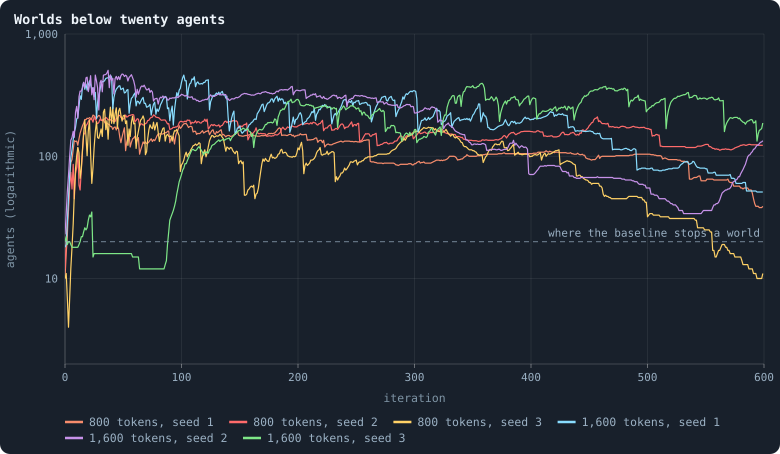

**Worlds below twenty agents.** The six worlds of 800 and 1,600 tokens with the stopping rule switched off (`extinction_threshold` 0): the number of agents after every game, on a logarithmic axis. Five of these six worlds — all three of 800 tokens, and seeds 1 and 3 of 1,600 — were stopped as extinct by the baseline after their first game, at the dashed line or below it.

> [!example]- How to make this figure
> **Runs.** The runs `B1-800-57b358-s001` … `-s003` and `B1-1600-57b358-s001` … `-s003` of Experiment 8 (`python3 gol_lab.py run E08`).
>
> **Data.** From each run's `GraphOfLifeRuns/<run>/stats.jsonl`, which holds one row per recorded phase: `phase` 1 is the world just after reproduction, `phase` 2 just after the game, and every statistic is a field of the row (see [What a run records](runs-and-records.md#what-a-run-records)).
>
> 1. Take `nodes` of every row with `phase` = 2.
>
> **To make it again:** `python3 book_figures.py size`.
<!-- /figure -->

With the stopping rule switched off, **all six** worlds of 800 and 1,600
tokens lived to iteration 600. Five of them were worlds the baseline had
stopped as extinct after their first game. Most climbed above twenty agents
within a few iterations.

Two show what life near the edge is like. The world of 800 tokens and seed 3
fell to **4** agents at iteration 3. It recovered, then fell below twenty
again near the end: 51 iterations at twenty or fewer in all. The world of
1,600 tokens and seed 3 spent 78 iterations at twenty agents or fewer, down
to 12, and then grew to 255.

So the stopping rule ends worlds that would have lived. That matters for how
the notebook has counted extinction. In
[A world's life](b1-lives-and-wealth.md#no-world-died--but-one-came-close),
"4 of 30 worlds die" means "4 of 30 fell to twenty agents". One of them did
so at iteration 4, when worlds are small and fragile. Whether those worlds
would have recovered, no run can now say.

#### Verdict: the thesis holds

The thesis **holds**, on every count it set. The exponent for agents is 1.00,
with an interval from 0.95 to 1.06; for connections it is 1.04, with an
interval from 0.97 to 1.12. Both lie between 0.9 and 1.1, and both intervals
contain 1. Neither set of points bends: the bend is 0.04 for agents
(interval −0.05 to 0.12) and 0.00 for connections (interval −0.12 to 0.12).

But its reasoning missed a rule, and the miss shows. The thesis said nothing
reaches across a world except the sharing out of the tokens of the dead. The
cleanup at the end of every phase does too: it keeps only the largest
connected piece ([One iteration, step by step](one-iteration.md#cleanup)).
That leaves the averages alone, which is all the thesis tested, and shows in
the fluctuations instead. **In its averages, a world of twice the tokens is
two worlds of the same kind. In its ups and downs, it is one world**, which
can lose half of itself in a game.

### Worlds of 100,000 tokens

<!-- experiment E10 -->

Experiment 10 runs thirty worlds of B1 at 100,000 tokens, each for 1,500
iterations. That is ten times the size the baseline was first studied at. It
asks what a world does with more room, and how one line of descent comes to
fill it.

#### Why ask for more room

When this experiment was planned, every finding about the baseline had been
made on worlds of 10,000 tokens, about 1,300 agents each. That is small. A
world of 1,300 agents is some 30 steps across
([The geometry of a world](b1-the-network-size-and-scaling.md#the-geometry-of-a-world)), and its structure
fades within three ([Like next to like](b1-the-network-size-and-scaling.md#like-next-to-like-how-alike-agents-are-at-a-distance)). There is room
for a dozen regions side by side, no more. Questions about space, about
scale, and about whether different kinds of agents can live side by side need
worlds with more room.

[Experiment 8](#how-does-a-worlds-size-follow-its-tokens) had found that a
bigger world is, on average, more of the same. Agents and connections follow
the tokens in proportion, and births seemed to. But it ran only three worlds
of each size, for 600 iterations. So Experiment 10 makes a **second set of
baseline worlds**: thirty worlds of 100,000 tokens, ten times the first. They
are worlds of B1 itself, not of the second baseline B2 of
[A world that cannot break](building-b2-and-the-search-for-a-healthy-rich-world.md#a-world-that-cannot-break).

The physics of space builds on these worlds. Two pages read them:
[Dimensions at scale](dimensions-at-scale.md), for their dimensions, and
[Which properties have no scale?](which-properties-have-no-scale.md). And the experiment answers one
question of its own: how a line takes over a world.

#### How a line takes over

[Genotypes and lineages](b1-brains-lineages-and-messages.md#genotypes-and-lineages) found that whole lines of
descent take the worlds of 10,000 tokens over again and again, about once
every 350 iterations. Is that chance or merit? Three answers give three
different paces, and the size of the world tells them apart:

1. **Chance.** If no line is better than another, all but one die out by
   chance in the end. That takes a time that grows in proportion to the
   number of agents: ten times the agents, ten times as long. This is the
   coalescent ([The ideas this builds on](the-ideas-this-builds-on.md)).
2. **Merit, in a well-mixed world.** A better line grows by a fixed factor
   every generation. It needs only a time that grows with the logarithm of
   the number of agents: ten times the agents, about a third longer.
3. **Merit, in space.** A better line spreads outwards from where it arose,
   as a front at a steady speed (Fisher 1937), the way a fire crosses a
   field. The time grows with the width of the world.

A world is a space. It has a finite dimension
([How many dimensions does a world have?](how-many-dimensions-does-a-world-have.md)).
New connections are only ever made inside a neighbourhood
([How the network grows](b1-lives-and-wealth.md#how-the-network-grows)), and a node can only be
taken by a neighbour. Ten times the agents make a world only about twice as
wide: its diameter grows as agents^0.30
([Distances grow like a power](#distances-grow-like-a-power)). So the third
answer predicts two to three times as long, the first ten times, and the
second barely longer.

[What the brains are like](what-the-brains-are-like.md) gives a reason to
expect the first answer. The brains are nearly blind and agree on every
decision that matters, which leaves little for one line to be better at. The
worlds of [Experiment 8](#how-does-a-worlds-size-follow-its-tokens) point to
the third. At 102,400 tokens, all three came from a single founder by
iterations 400, 400 and 525, where the median world of 10,000 tokens needed
175.

#### The thesis

We expected a front. A world of 100,000 tokens is only about twice as wide as
one of 10,000. So one line should take it over in two to five times as
long: not ten times as long, and not about as fast.

<!-- thesis E10 -->
> [!quote] The thesis of Experiment 10, written down before any of its runs existed
> **The claim.** A line takes a world over the way a front crosses a country: at a steady pace, so that the time it needs grows with the world's width, not with its number of agents. A world of 100,000 tokens holds ten times the agents of the baseline but is only about twice as wide, so a line takes it over in two to five times as long as at 10,000 tokens — not ten times, as chance alone would need, and not about as fast, as a better brain spreading through a well-mixed world would.
>
> **Why it would be so.** Three paces are possible. If no line is better than another, all but one die out by chance, in a time that grows in proportion to the number of agents (the coalescent, Chapter [6](the-ideas-this-builds-on.md)). If a better line spreads through a well-mixed population, it grows by a fixed factor every generation, and the time grows only with the logarithm of the number of agents. If it spreads through space, it does so as a front at a steady speed (Fisher 1937), and the time grows with the width of the world. The worlds are spaces: they have a finite dimension (Chapter [23](how-many-dimensions-does-a-world-have.md)), their diameter grows as agents^0.30 (Chapter [38](b1-the-network-size-and-scaling.md#worlds-of-many-sizes)), and a node can only be taken by a neighbour (Chapter [3](one-iteration.md)). At 10,000 tokens (Experiment 2) the living of the median world all came from a single founder by iteration 175, and of every world by 750. The worlds of Experiment 8 point to the front: at 102,400 tokens, all three worlds got there by iterations 400, 400 and 525.
>
> **It holds if:** Counting each world of 100,000 tokens that reaches iteration 1,500 by the first iteration at which all its living descend from a single founder — and a world that never gets there as later than all of them — the median lies between 350 and 875: two to five times the baseline's 175.
>
> **It fails if:** The median is below 350: a large world is taken over about as fast as a small one, as a better brain spreading through a well-mixed population would take it. Or it is above 875, or most worlds never get there by iteration 1,500: then the pace is set by the number of agents, as chance alone would set it.
>
> *Written while the notebook still numbered its chapters: each number is a link to the page it meant that day.*
<!-- /thesis -->

#### Method

The thirty worlds are B1 at 100,000 tokens, with seeds 1 to 30, each run for
1,500 iterations. Nothing else changes. A world of 100,000 tokens starts
with 1,000 founders in a ring, and was expected to settle at about 13,000
agents.

**What is measured.**

- **How lines take over.** After every 25th iteration: how far back all the
  living share one ancestor. And the first iteration at which they all
  descend from a single founder ([The common ancestor](measuring-evolution.md#the-common-ancestor-of-the-living)):
  this is what the thesis counts. It is set against the baseline's 30 worlds
  of 10,000 tokens over the same iterations. And it is set against the time a
  front would need, from the worlds' diameters.
- **Everything the study of the baseline measures**, over the settled life
  from iteration 500 to 1,499: agents, connections, births, deaths,
  inequality, genotypes and families. Each is taken per token or per agent,
  and set beside the baseline.
- **Space**, in the frames of iterations 500, 1,000 and 1,499. That means
  the two rulers of
  [How many dimensions does a world have?](how-many-dimensions-does-a-world-have.md)
  and the correlation functions of [Like next to like](b1-the-network-size-and-scaling.md#like-next-to-like-how-alike-agents-are-at-a-distance).
  It also means the domains of lines, and the widths of the worlds. The
  domain of a line is how far apart two agents can be that share an ancestor
  of 25, 50 and 100 iterations back.

#### Results

All thirty worlds lived through their 1,500 iterations
([No world died — but one came close](b1-lives-and-wealth.md#no-world-died--but-one-came-close)),
and settled at about 14,400 agents each. As the largest set of worlds of the
notebook, they became the worlds the study of the baseline is written from
([Thirty worlds](b1-lives-and-wealth.md#thirty-worlds)). This section answers the
questions of the experiment itself.

<!-- figure takeover/not-yet -->
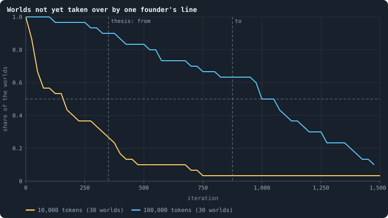

**Worlds not yet taken over by one founder's line.** For every iteration, the share of the worlds whose living, at the check after that iteration's game (every 25 iterations), still descend from more than one founder. Yellow: the 30 worlds of 10,000 tokens; blue: the 30 of 100,000. A world that died, or never got there, stays in the share. Where a line crosses one half is its median; the thesis of Experiment 10 expected the blue one to cross between the two grey lines.

> [!example]- How to make this figure
> **Runs.** The 30 baseline runs `B1-100000-s001` … `B1-100000-s030`: the baseline B1 at 100,000 tokens, seeds 1 to 30, 1,500 iterations each (every setting is listed in [Thirty worlds](b1-lives-and-wealth.md#thirty-worlds)). They are made with `python3 gol_lab.py run E10`. The 30 baseline runs `B1-10000-s001` … `B1-10000-s030`: the baseline B1 at 10,000 tokens, seeds 1 to 30, 3,000 iterations each (every setting is listed in [A world's life](b1-lives-and-wealth.md#the-life-of-a-b1-world)). They are made with `python3 gol_lab.py run E02`.
>
> **Data.** From the lineage analyses of Experiments 10 and 6 (`book/results/E10.json`, `book/results/E06.json`, `oneFounder` of every run).
>
> 1. For every run, the first check at which every living agent descends from one founder.
> 2. For every t, the share of runs whose first such check is later than t, or that have none.
>
> **To make it again:** `python3 book_figures.py takeover`.
<!-- /figure -->

27 of the 30 worlds came down to a single founder's line within their 1,500
iterations. The other three (seeds 13, 18 and 20) are counted as later than
all. The median world got there at iteration **1,037.5**: the fastest at
125, eight of the thirty by iteration 575, three quarters by 1,275. That is
5.9 times the 175 of the worlds of 10,000 tokens, and above the 875 the
thesis allowed. Only 11 of the 30 worlds got there within it.

#### Verdict: slower than a front, faster than chance

The thesis is **refuted**, on the side it gave to chance. A world ten times
the size takes far longer than a front crossing a world twice as wide would
need.

But not all the way to chance either. If no line were better than another,
ten times the agents would take about ten times as long: a median of some
1,750 iterations. Most worlds would then not have got there by iteration
1,500; 27 of 30 did. Between the two sizes, the time grows as the number of
tokens to the power **0.77** (5.9 = 10^0.77). That is faster than the width
of a world, which grows as the power 0.30, and slower than its number of
agents, power 1. A takeover here is neither a front nor pure chance.

#### Across sizes

<!-- figure takeover/sizes -->
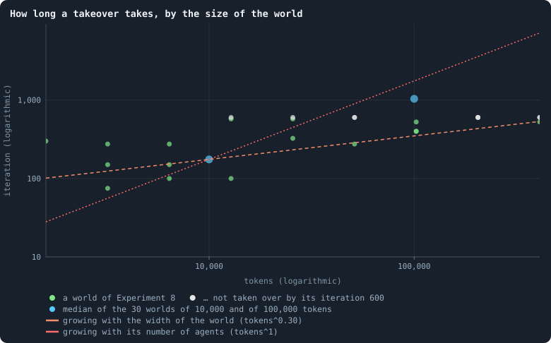

**How long a takeover takes, by the size of the world.** For every world of Experiment 8 that lived to its end (green, or grey if all its living still came from more than one founder at its last check, at iteration 600, drawn there), and for the median of each set of 30 worlds (blue): the first iteration at which every living agent descends from a single founder. Both axes logarithmic. Dashed: what the two paces of the thesis predict, drawn through the median of the worlds of 10,000 tokens, 175 — a front, whose time grows with the width of the world (orange), and chance, whose time grows with the number of agents (red).

> [!example]- How to make this figure
> **Runs.** the baseline worlds of Experiment 8, three seeds at each of ten sizes from 800 to 409,600 tokens, 600 iterations each ([How does a world's size follow its tokens?](b1-the-network-size-and-scaling.md#worlds-of-many-sizes); `python3 gol_lab.py run E08`); and the two sets of 30 worlds above.
>
> **Data.** From each run's frames, `GraphOfLifeRuns/<run>/frames/`, read with `gol_store.read_frame(run, index)`; frame `2·t` is iteration *t* after reproduction and frame `2·t + 1` after the game.
>
> 1. For the runs of Experiment 8, `gol_analysis.lineage` of every run (kept as the notebook measure `lineage`): its `ancestor.oneFounder`.
> 2. Plot it against the run's tokens; the two sets of 30 as in the figure above.
>
> **To make it again:** `python3 book_figures.py takeover`.
<!-- /figure -->

The worlds of [Experiment 8](#how-does-a-worlds-size-follow-its-tokens) ran
for only 600 iterations, three at each size, and say less. Up to 6,400
tokens, all came from one founder by iteration 300. From 12,800 tokens on,
at every size but one, at least one world did not by iteration 600. Of the
six worlds of 204,800 and 409,600 tokens, only one did, at 525.

Their three worlds of 102,400 tokens, on which the thesis leaned, got there
by iterations 400, 400 and 525. These are three of the fastest a world of
that size does. Of the thirty worlds here, only six got there by iteration
525. Three such in a row come up in fewer than one try in a hundred (6/30
cubed is 0.008). They were not run by different rules. A run of the first of
them on the engine of this experiment reproduces its first twenty frames
exactly. Three worlds were too few to lean on; thirty show the pace.

#### Where the lines live

If lines spread as fronts, a line's members should sit together in a region
that widens as the line ages. To look for such regions, give every agent its
**family at lag *k***: the genotype alive *k* iterations earlier from which
its own genotype descends. Then take two agents *r* steps apart. How much
more often than two agents drawn anywhere in the world do they belong to the
same family?

<!-- figure takeover/domains -->
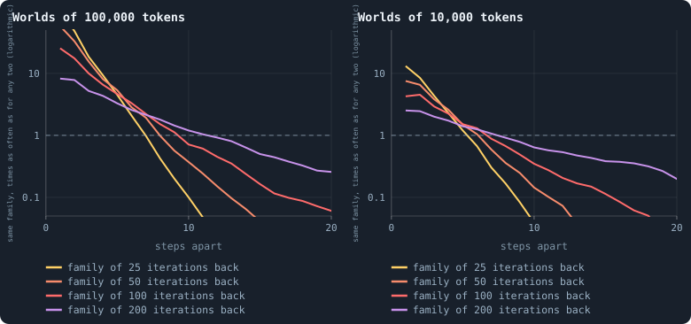

**Do lines of descent hold regions?** An agent's family at lag k is the genotype alive k iterations earlier from which its own genotype descends. For pairs of agents r steps apart — from breadth-first searches out of 100 agents drawn at random, at five moments of each world's settled life — the share that belong to the same family, divided by the share among any two agents of the world, for four lags; each line is the median over the worlds. Left: the 30 worlds of 100,000 tokens; right: the 26 of 10,000. Above 1, neighbours are kin more often than chance; where a line falls to 1 is how far a family reaches.

> [!example]- How to make this figure
> **Runs.** The 30 baseline runs `B1-100000-s001` … `B1-100000-s030`: the baseline B1 at 100,000 tokens, seeds 1 to 30, 1,500 iterations each (every setting is listed in [Thirty worlds](b1-lives-and-wealth.md#thirty-worlds)). They are made with `python3 gol_lab.py run E10`. The 26 surviving ones of the 30 baseline runs `B1-10000-s001` … `B1-10000-s030`: the baseline B1 at 10,000 tokens, seeds 1 to 30, 3,000 iterations each (every setting is listed in [A world's life](b1-lives-and-wealth.md#the-life-of-a-b1-world)). They are made with `python3 gol_lab.py run E02`.
>
> **Data.** From each run's frames, `GraphOfLifeRuns/<run>/frames/`, read with `gol_store.read_frame(run, index)`; frame `2·t` is iteration *t* after reproduction and frame `2·t + 1` after the game.
>
> 1. At five moments t of each run (`book_chapters.space.moments`), read the frames from t − 200 to t and note every genotype's parent; for each lag k, climb from each living agent's genotype to one alive after the game of t − k.
> 2. Breadth-first searches out of 100 agents drawn at random (seed 51), to 30 steps; per r, the pairs and the pairs in one family; chance: Σ c(c − 1) / (n(n − 1)) over the families' counts c (`book_chapters.scale.domains`).
>
> **To make it again:** `python3 book_figures.py takeover`.
<!-- /figure -->

Lines do hold regions, and the regions widen with age. In the median world,
two neighbours belong to the same family of 25 iterations back 99 times as
often as chance would have them. The excess falls with distance and is gone
at about **7 steps**: beyond that, two agents are kin no more often than any
two. For families of 50 iterations back it reaches 8 or 9 steps, and of 100
iterations 10. For 200 iterations back it reaches **12** (between 4 and 17
across the worlds). A family is a patch of the world that grows as its line
ages.

But it grows slowly. From 25 iterations to 200, the patch widens from 7 steps
to 12: 1.7 times over an eightfold time. A front moving at a fixed speed
would widen it eightfold. A random walk on a grid would widen it about
threefold, as the square root of time. On these worlds a walker is slowed by
dead ends, and its distance grows only as about *t*^0.34
([How many dimensions does a world have?](how-many-dimensions-does-a-world-have.md)).
That gives about twofold, close to what is measured.

The rules let a brain spread at most one connection per game, about a step
per iteration. That is because a node can only be won by a neighbour
([Physical inspiration](physical-inspiration.md)). A line's region advances
about a step every thirty-five. The worlds of 10,000 tokens are half as wide,
and their patches were smaller: 6 to 8 steps for the same lags. They were
less marked too: 13 times chance at one step, for 25 iterations back.

So a line spreads through a world as a random walk spreads, not as a front.
It spreads locally, as the rules require, but with no steady speed, slower
and slower as its patch grows. A rough estimate follows. If a patch widens as
*t*^0.34, reaching across a world of width *D* takes a time growing as
*D*^(1/0.34) ≈ *D*^2.9. The width grows as agents^0.30
([Distances grow like a power](#distances-grow-like-a-power)), so that time
grows as agents^0.88. The takeovers measured above grow as tokens^0.77. That
is near the estimate, and between the front's 0.30 and chance's 1, where the
thesis had found no place to put them.

#### A large world beside ten small ones

Is a world of 100,000 tokens ten worlds of 10,000 side by side? Every one of
the viewer's statistics can be set beside its value in the worlds of 10,000
tokens, over the same iterations:

<!-- figure takeover/ten-small -->
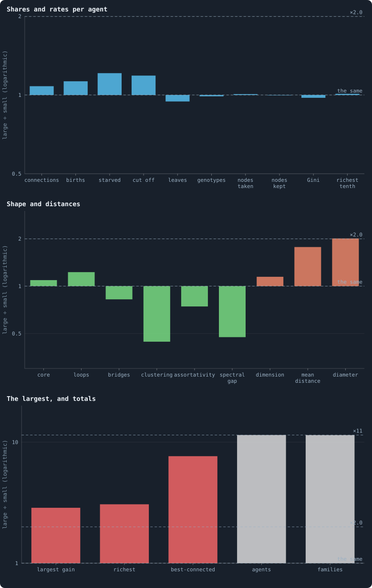

**One world of 100,000 tokens beside one of 10,000.** For each of 24 of the viewer's statistics, its mean over iterations 500–1,499 in each world that lived to the end; the median of the 30 worlds of 100,000 tokens divided by the median of the 26 worlds of 10,000 — over the same iterations, though the small worlds ran on to 2,999. On logarithmic axes, so that half as much and twice as much lie equally far from 1; each bar rises from 1 or falls from it. Blue: shares and rates per agent; green: the shape of the network; orange: its distances; red: its largest single things; grey: totals. The dashed guides: no change; ×2.0, the factor by which the width of a world grows (tokens^0.30, [How does a world's size follow its tokens?](b1-the-network-size-and-scaling.md#worlds-of-many-sizes)); and ×11, the ratio of the agents.

> [!example]- How to make this figure
> **Runs.** The 30 baseline runs `B1-100000-s001` … `B1-100000-s030`: the baseline B1 at 100,000 tokens, seeds 1 to 30, 1,500 iterations each (every setting is listed in [Thirty worlds](b1-lives-and-wealth.md#thirty-worlds)). They are made with `python3 gol_lab.py run E10`. The 26 surviving ones of the 30 baseline runs `B1-10000-s001` … `B1-10000-s030`: the baseline B1 at 10,000 tokens, seeds 1 to 30, 3,000 iterations each (every setting is listed in [A world's life](b1-lives-and-wealth.md#the-life-of-a-b1-world)). They are made with `python3 gol_lab.py run E02`.
>
> **Data.** From each run's `GraphOfLifeRuns/<run>/stats.jsonl`, which holds one row per recorded phase: `phase` 1 is the world just after reproduction, `phase` 2 just after the game, and every statistic is a field of the row (see [What a run records](runs-and-records.md#what-a-run-records)).
>
> 1. For every run and statistic, the mean over the rows of iterations 500 to 1,499 (`phase` 1 for births, 2 for the rest; a ratio such as `edges/nodes` is taken row by row).
> 2. The median over each set's runs; the large set's divided by the small set's.
>
> **To make it again:** `python3 book_figures.py takeover`.
<!-- /figure -->

Per agent, almost nothing changes. The Gini coefficient, the [richest tenth](measuring-tokens.md#the-richest-tenths-share "The share of all tokens held by the richest tenth of the agents.")'s
share and the genotypes per agent are all within 3% of their values at 10,000
tokens. So are the shares of nodes taken by coalitions and kept by their own
agent. There are 8% more connections per agent and 5% fewer leaves. Births
and deaths per agent are 13 to 21% higher
([How ages change over a world's life](b1-lives-and-wealth.md#how-ages-change-over-a-worlds-life) finds the old
dying more often too). A large world is made of the same kind of agents,
living the same kind of lives, a little faster.

Its shape is not the same. Clustering, the share of an agent's pairs of
neighbours that are joined, is **less than half** (0.039 against 0.088). The
spectral gap, which says how fast a random walk forgets where it began
([The spectral gap](measuring-networks.md#the-spectral-gap)), is half too. The large worlds have
23% more loops per agent, 18% fewer bridges, a 9% larger core, and a ball
dimension 15% higher.

Their distances grow as the width of a world does. The mean distance between
two agents is 1.8 times as long, and the diameter 2.0 times. That is the
10^0.30 = 2.0 of [Distances grow like a power](#distances-grow-like-a-power).
And the largest things are larger. The richest agent holds 3.1 times the
tokens, and the largest gain of a game is 2.9 times as large. The
best-connected agent has 7.7 times the connections. Only the totals, agents
and families of genotypes, grow with the tokens: eleven times.

So a large world is ten small ones in what its agents do and hold, but not in
how they are arranged. It is wider, more meshed and less clustered, and its
extremes are rarer and larger. The pages on the baseline say where each of
these matters.

### What we learned (worlds of many sizes)
- **A world's averages follow its tokens.** Agents and connections grow in
  proportion to the tokens, with exponents 1.00 and 1.04. Inequality, home
  stakes and genotypes per agent are the same at every size. For its
  averages, a result found at 10,000 tokens holds from a few thousand tokens
  to hundreds of thousands. So size can be chosen for cost.
- **Its ups and downs do not average out.** In every world, at every size, a
  game can remove a third or half of everyone, whatever their brains. The
  noise comes from a rule, the cull, not from small numbers. So for
  open-ended evolution, size is not a cure. Only a change of the rule removes
  the noise, as B2 does
  ([What the measurements say about open-ended evolution](what-the-baseline-world-is.md#what-the-measurements-say-about-open-ended-evolution)).
- **Size changes the arrangement more than the agents.** Distances grow like
  a power of size, as in a three-dimensional body, not as in a small world.
  At ten times the tokens, clustering is less than half and the extremes are
  larger. Births and deaths per agent run only 13 to 21% faster. A finding
  made at one size holds, per agent, roughly at another; a finding about
  shape has to be checked at both.
- **A line takes over a world ten times larger in about six times as long.**
  The time to a single founder grows as the tokens to the power 0.77. That
  lies between the width of a world (0.30) and its number of agents (1). The
  front the thesis expected is refuted, and so is chance alone.
- **Lines live in patches that widen as a random walk would.** A family is a
  region of a world, a few steps across at first, a dozen after two hundred
  iterations. It spreads locally, as the rules require, but with no steady
  speed, and far slower than the fastest the rules allow.
- **Size gives room.** A world of 60,000 agents is 25 steps across on average
  and 80 at its widest, and keeps the same number of genotypes per agent. At
  10,000 tokens, one founder's line held the median world from iteration 175
  on. At 100,000, the median world was still shared by several lines until
  iteration 1,000. That is time and room for lines to differ, if anything in
  the brains could make them differ
  ([What the brains are like](what-the-brains-are-like.md)).
- **The stopping rule needs care.** A world at twenty agents is not
  necessarily dying. Future experiments that care about extinction should run
  a condition with the rule off, as Experiment 8 did.

### How this was made (worlds of many sizes)
Every figure of this page says, folded beneath it, which runs it reads and
how. To make the runs again you need a computer with Python 3, numpy and
networkx, and a copy of this repository. Then `python3 gol_lab.py run E08`
and `python3 gol_lab.py run E10` make the runs of the two experiments into
the folder `GraphOfLifeRuns/`.

#### The runs of Experiment 8

Experiment 8 is 42 runs: B1 at ten sizes, seeds 1 to 3, 600 iterations each.
The four smallest sizes run once more with the stopping rule switched off.

- **Survived to iteration 600:** in the baseline, 25 of 30. Every world of
  3,200 tokens and more did, one of three at 1,600, and none at 800. Those
  three were stopped after their first game. Stopped only when empty, 12 of
  12 did.
- **Engine:** snapshot `f820369a1583af53`, commit `4bc7165`, for all 42
  runs.
- **Cost:** 56 hours of computing on one worker, from 6 to 9 October 2026,
  and 28 GB on disk. The largest run, at 409,600 tokens, needed at most
  11.0 GB of memory.
- **Fits:** least squares on logarithmic axes
  ([Fitting a straight line](statistics.md#fitting-a-straight-line)). Intervals come from
  resampling the runs within each size, 10,000 times
  ([The bootstrap](statistics.md#how-sure-can-we-be-the-bootstrap-permutation-tests-the-wilson-interval-and-how-many-seeds)). Bends come from a fit with a squared term.
- **Results:** `book/results/E08.json`, made with
  `python3 gol_lab.py analyse E08` (seconds); the figures of
  [How does a world's size follow its tokens?](#how-does-a-worlds-size-follow-its-tokens)
  and every other number with `python3 book_figures.py size`.

<!-- runs E08 -->
> [!info]- The runs behind this page
> **42 runs.** Every condition below is run once for every seed (1 to 3) and every number of tokens it lists, for 600 iterations — or until its world dies out. Every setting is that of the baseline **B1** (the algorithm exactly as a new run is offered it) unless the condition changes it.
>
> - **baseline** — changes nothing: B1 as it is; 800, 1,600, 3,200, 6,400, 12,800, 25,600, 51,200, 102,400, 204,800, 409,600 tokens. Runs `B1-800-s001` … `B1-409600-s003`.
> - **stopped only when empty** — changes `extinction_threshold` = 0; 800, 1,600, 3,200, 6,400 tokens. Runs `B1-800-57b358-s001` … `B1-6400-57b358-s003`.
>
> To make these runs again: `python3 gol_lab.py run E08`, or ▶ in the Research Notebook tab of a computer running `gol_server.py`. Each run writes its settings, seed and engine version beside its frames, in `GraphOfLifeRuns/<run>/meta.json` and `provenance.json`.

> [!info]- Every setting of these runs
> | setting | baseline | stopped only when empty | what it is |
> |---|---|---|---|
> | [`total_tokens`](settings.md#total_tokens) | 800, 1,600, 3,200, 6,400, 12,800, 25,600, 51,200, 102,400, 204,800, 409,600 | 800, 1,600, 3,200, 6,400 | The number of tokens in the world, *T*. It never changes during a run. |
> | [`n_nodes`](settings.md#n_nodes) | 0 | 0 | How many founders the world starts with. 0 means one founder per hundred tokens: *n* = ⌊*T* / 100⌋. |
> | [`k_neighbors`](settings.md#k_neighbors) | 0 | 0 | How many neighbours each founder starts with in the ring. 0 means *k* = max(⌊*n* / 100⌋, 5); an odd *k* is wired as *k* − 1. |
> | [`rewire_p`](settings.md#rewire_p) | 0.2 | 0.2 | In the starting ring, the probability that a connection is moved to a founder chosen at random (Watts–Strogatz). |
> | [`hidden_layers`](settings.md#hidden_layers) | 50, 45, 40, 35, 30 | 50, 45, 40, 35, 30 | The widths of the brain's hidden layers, in order from input to output. |
> | [`hidden_activation`](settings.md#hidden_activation) | sigmoid | sigmoid | The curve each hidden unit applies to its sum: `sigmoid`, which passes on at most a quarter of a change, so that deep brains barely respond to what they see, or `tanh`, the same S-shape centred on zero, through which a change still passes in several layers. |
> | [`brain_kind`](settings.md#brain_kind) | float16 | float16 | How weights are stored: `float` (64-bit), `float16` (16-bit, computed in 64-bit) or `binary` (−1, 0, +1). |
> | [`brain_bits`](settings.md#brain_bits) | 16 | 16 | Only for binary brains: how many input rows encode one number. Unused by float and float16 brains. |
> | [`message_amount`](settings.md#message_amount) | 30 | 30 | How many numbers one message holds. Each agent sends one message to itself and one to each neighbour, every phase. |
> | [`random_input_amount`](settings.md#random_input_amount) | 5 | 5 | How many random numbers, drawn uniformly from −2 to 2, a brain reads per neighbour, every time it looks. |
> | [`exchange_messages`](settings.md#exchange_messages) | on | on | Whether agents send and read messages at all. |
> | [`message_prepass`](settings.md#message_prepass) | on | on | Whether every phase begins with an extra look in which agents only write messages, so the look that acts reads messages written this phase. |
> | [`allow_handover`](settings.md#allow_handover) | on | on | Whether a parent may move some of its own connections to its newborn child. |
> | [`allow_revolutions`](settings.md#allow_revolutions) | on | on | Whether a coalition of smaller stakers can take a node from its largest staker (see the note *How a coalition takes a node*). |
> | [`contest`](settings.md#contest) | largest | largest | Who takes a contested node: the `largest` stake as the game weighs it, or a staker drawn by `lottery` with a chance in proportion to its stake (needs revolutions off). |
> | [`allocation`](settings.md#allocation) | full | full | How the game's stakes are placed: all at once (`full`), or a token at a time in rounds with the game as it stands in view, the poorest done first (`weakest_first`) or the richest starting alone (`strongest_first`), as the original engine played. |
> | [`allow_gifting`](settings.md#allow_gifting) | off | off | Whether agents may give tokens to neighbours during reproduction. Off in both baselines; on in a few pilots, in Experiment 24 and in half the worlds of the screen. |
> | [`random_decisions`](settings.md#random_decisions) | off | off | The control: every number a brain would produce is replaced by a random draw from the standard normal distribution. |
> | [`prune_after`](settings.md#prune_after) | blotto | blotto | After which phase connections that carried no tokens are cut: `blotto` (the game), `reproduction`, or `both`. |
> | [`inactive_window`](settings.md#inactive_window) | phase | phase | How long a connection may go unused: `phase` means it must carry tokens in the phase being judged; `iteration` allows the two last phases. |
> | [`redistribution`](settings.md#redistribution) | uniform | uniform | How the tokens of removed agents are shared: `uniform` gives every survivor the same chance at each token; `by_tokens` weights by what a survivor holds; `poorest` raises the poorest to one common level first; `newborns` gives them to this iteration's children, `parents` to their parents, once per child (both `uniform` in an iteration without births); `children` leaves each dead agent's estate to its own living children (`uniform` where there are none); `local` lets each estate flow through the network to the nearest living agents, split evenly at every step. |
> | [`tokens_created_per_phase`](settings.md#tokens_created_per_phase) | 0 | 0 | Tokens added to the world at every cleanup. 0 keeps the supply fixed. |
> | [`mutate_on_replication`](settings.md#mutate_on_replication) | off | off | Whether a brain changes only when it is copied — into a newborn, or into a node its owner has just won — instead of also after every game, wherever it sits. |
> | [`incumbency`](settings.md#incumbency) | 1.0 | 1.0 | How many times over an agent's stake on its own node counts when the game decides who takes the node. 1 is the old rule. |
> | [`birth_links`](settings.md#birth_links) | 0 | 0 | How many of its parent's neighbours a newborn is joined to, drawn at random, besides its parent itself; 0 leaves every link to the brain's choice. |
> | [`mend_on_death`](settings.md#mend_on_death) | off | off | Whether the neighbours of an agent that dies are joined up where its death would leave them in separate pieces. |
> | [`prune_needs`](settings.md#prune_needs) | 0 | 0 | How many neighbours the two ends of an unused connection must share for it to be cut; 0 cuts every unused connection. |
> | [`valence`](settings.md#valence) | 0 | 0 | The most connections an agent's brain may choose to hold (0 = no limit). An agent at its limit cannot have a child. |
> | [`link_token`](settings.md#link_token) | off | off | Whether every link holds one token: its maker pays for it, a lapsing link gives it back to one of its ends, and a link of a dead agent to the end that lives on, so the links can never outnumber the tokens. |
> | [`link_upkeep`](settings.md#link_upkeep) | off | off | Whether an agent may pay a token an iteration to keep a link, each brain deciding for each neighbour: `paid_or_used` keeps a link that was paid for or used, `paid_only` only one that was paid for; `off`, only use keeps a link. |
> | [`upkeep_to`](settings.md#upkeep_to) | end | end | Where a link's upkeep goes: to the link's other end (`end`), or into the estate of the dead (`estate`), shared out by the world's redistribution rule. |
> | [`keep_home`](settings.md#keep_home) | 0.0 | 0.0 | The share of an agent's tokens — rounded up, never less than one — that stays on its own node whatever its brain says; a parent also keeps one. 0 is the old rule. |
> | [`max_age`](settings.md#max_age) | 0 | 0 | The age at which an agent dies (0 = never); its tokens are shared out like those of any other dead agent. |
> | [`buy_life`](settings.md#buy_life) | off | off | Whether an agent that has reached max_age may live on by paying one token an iteration into the estate of the dead — never its last, so one with a single token left dies. Needs max_age. |
> | [`min_child`](settings.md#min_child) | 1 | 1 | The fewest tokens a child can be born with; a parent that would give less has no child. |
> | [`child_floor`](settings.md#child_floor) | fixed | fixed | The least a child may start with: min_child alone (fixed), or also the median holding of its parent's neighbours (neighbours), so that a world grows only as rich as it is. |
> | [`mix_at_birth`](settings.md#mix_at_birth) | off | off | Whether a newborn's brain is its parent's mixed with a mate's — one of the parent's neighbours, drawn at random — each hidden unit whole from one or the other by an even chance, before it mutates; off, a newborn has a copy of its parent's brain. |
> | [`mix_mates`](settings.md#mix_mates) | any | any | Under mix_at_birth, who may be the mate: any neighbour of the parent, or only parents — a neighbour with a living child of its own (with none, the newborn's brain is a copy). |
> | [`mate_pays`](settings.md#mate_pays) | off | off | Under mix_at_birth, whether the mate pays the child as many tokens as the parent gave it, as far as it can and never its last. |
> | [`self_message`](settings.md#self_message) | own | own | What an agent writes to itself, which each neighbour reads: what its own column says (own), or the largest, number by number, of what it writes to anyone (largest), so that news one column marks reaches every neighbour. |
> | [`link_search`](settings.md#link_search) | off | off | Whether an agent may reach beyond its neighbours to propose a link: off; jump, a walk as many steps long as the tokens it spends in one iteration, with a link proposed where it ends; walk, a scout that goes one step further in every iteration it pays for; or reach, a jump whose steps are free, as many as the tokens it holds would pay for. A paid step costs one token, paid to the agent it enters, and never the last. |
> | [`link_steering`](settings.md#link_steering) | random | random | Which way each step of a search goes: to a neighbour drawn at random, or to the one the searcher would most like a link with (looking). |
> | [`link_consent`](settings.md#link_consent) | mutual | mutual | Who has to agree to a link a search proposes: both ends (mutual), or only the one who proposes (forced). Nobody at its valence gets a new link either way. |
> | [`proto`](settings.md#proto) | none | none | Rules first played in the pilots' prototype, by name: came_from and helped_by (an input row each), contest = lottery, pool by genotype or family, kin_sense, tag_rate, mate_pays, grow, unit_token, link_token. Empty in every run but those that ask for one; only the prototype's world plays them (see the settings note). |
> | [`mutation_probability`](settings.md#mutation_probability) | 0.2 | 0.2 | The probability that a brain changes when it is copied to a child, and again, for every brain, after every game. |
> | [`mutation_noise_std`](settings.md#mutation_noise_std) | 0.2 | 0.2 | How large a change to one weight is: a normal draw with standard deviation this times 1/√(fan-in) of its layer. |
> | [`mutation_sparsity`](settings.md#mutation_sparsity) | 0.1 | 0.1 | The share of a brain's numbers a change touches; also the probability, for each weight matrix and bias vector, of a rarer reset that redraws that share of it. |
> | [`extinction_threshold`](settings.md#extinction_threshold) | 20 | **0** | A run stops, as extinct, when an iteration ends (after its game) with this many agents or fewer. |
> | seeds | 1 to 3 | 1 to 3 | one run per seed |
> | iterations | 600 | 600 | how far each run goes, unless its world dies first |
>
> A value in **bold** differs from the baseline B1.
<!-- /runs -->

#### The runs of Experiment 10 (worlds of many sizes)
Experiment 10 is 30 runs: B1 at 100,000 tokens, seeds 1 to 30, 1,500
iterations each.

- **Survived to iteration 1,500:** all 30.
- **Engine:** snapshot `b840ff37ba4cdad7`, commit `8d99b55`, for all 30
  runs.
- **Cost:** before the runs, the lab estimated about 40 hours on four
  workers and 52 GB of disk (frames and checkpoints). It expected up to
  3.7 GB of memory per run, about 12 seconds per iteration at this size, and
  about five hours per run. With Experiment 9 (48 GB), that fitted on the
  disk with room to spare: 185 GB were free on 9 October 2026. In the event,
  the thirty runs took 211 hours of computing, about 17 seconds per
  iteration, and fill 58 GB.
- **Results:** `book/results/E10.json`, made with
  `python3 gol_lab.py analyse E10`; every figure of
  [Worlds of 100,000 tokens](#worlds-of-100000-tokens) with
  `python3 book_figures.py takeover`.

The runs of Experiment 10 are listed once on this page, under [The runs of Experiment 10 (the shape of the network)](#the-runs-of-experiment-10-the-shape-of-the-network).

## How much does the seed decide?

Thirty baseline worlds that differ only in their seed end up alike: at
100,000 tokens, their sizes vary by about a tenth of the mean. Most of that
difference is not the seed's doing: each world wanders, and forgets its level
within about three hundred iterations. Only the shape of their network sets a
few worlds apart: in those, one agent is joined to a sixth of all agents or
more. With each world measured over its settled life, 19 seeds per condition
reveal a change of a tenth in its number of agents. Experiment 3 had expected
thirty seeds to be enough with worlds measured at the end of their runs; it
was narrowly refuted.

### Same rules, different dice

A Graph of Life world is full of chance. Its founders start with random
brains, ties are broken at random, and the tokens of the dead are dealt out
at random. All of it comes from one number, the run's seed. The seed decides
the starting ring, the founders' brains and every random choice the world
ever makes. So two worlds of the same settings but different seeds share no
single event.

Do they still become the same kind of world? Picture thirty of them side by
side, each summed up by one number, such as how many agents it holds. If the
seed decides little, the thirty numbers lie close together. If it decides
much, they scatter widely, or fall into separate groups.

The answer matters for every experiment in this notebook. An experiment
changes one setting, runs worlds with and without the change, and compares
them. The more worlds differ by chance alone, the more seeds it takes to tell
a real change from luck.

The worlds of this page are the thirty baseline worlds of 100,000 tokens of
[Thirty worlds](b1-lives-and-wealth.md#thirty-worlds), seeds 1 to 30. All of them lived to the
end of their 1,500 iterations. The page was first written from the thirty
worlds of 10,000 tokens, and their values are given alongside. Four of those
died out, so their values are for the 26 that lived.

### What we expected

Before the runs of 10,000 tokens, we expected the seed to decide little. A
world holds thousands of agents and lives for thousands of iterations, so its
accidents should average out. Then the thirty worlds' numbers of agents and
connections, and their inequality, would differ by less than a fifth of their
typical value. And thirty seeds per condition would be enough to see a setting
change a world by a tenth. That was the thesis of Experiment 3, written down
before any of its runs existed:

<!-- thesis E03 -->
> [!quote] The thesis of Experiment 3, written down before any of its runs existed
> **The claim.** Thirty seeds give thirty different histories, but the same kind of world. Where a world ends up — how many agents, how many connections, how unequal — differs from seed to seed by less than a fifth of its typical value. Thirty seeds per condition are enough to see a change of a tenth in those.
>
> **Why it would be so.** A seed decides the starting ring and every coin the world throws, so no two runs share a single event. But each run is made of thousands of agents and thousands of iterations, and a world with that much going on averages its own accidents away, the way two different shuffles of a large deck still hold the same number of each suit.
>
> **It holds if:** For the population, the connections and the Gini coefficient of wealth at the end of the runs, the standard deviation across the thirty seeds is below a fifth of the mean, and the number of seeds needed to see a 10% change is at most thirty.
>
> **It fails if:** One of these varies across seeds by more than a fifth of its mean, or the endings fall into separate groups — some seeds settling at one level, others at another. Then the seed is part of the story, and every later experiment needs more seeds than planned, or must look at the seeds one by one.
<!-- /thesis -->

The thesis speaks of worlds "at the end of the runs", so it was checked, as
planned, on the last fifth of each run. Its verdict follows the measurements,
under *Was the thesis right?* below.

### Where the worlds settle

Measure each world by its mean over its settled life, iterations 500 to
1,499: its mean number of agents, say. The first few hundred iterations are a
world's youth, unlike the rest of its life, so they are left out. Then divide
each world's mean by the mean of the thirty, so that 1 is the average world.
Each world becomes a dot, and a short column of dots means that the worlds
settle alike:

<!-- figure seed/dots-1 -->
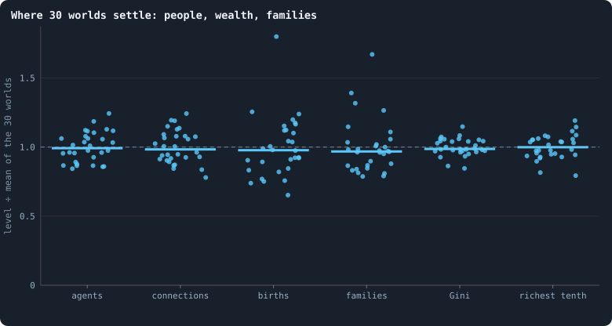

**Where 30 worlds settle: people, wealth, families.** One dot per world: its mean over iterations 500 to 1,499, divided by the mean of that value over the 30 worlds, so that every statistic is on the same scale and 1 is the average world. The bar is the median. A column of dots close to 1 means the worlds settle alike; a tall column, that they do not. The dots are spread sideways only so they do not hide one another.

> [!example]- How to make this figure
> **Runs.** The 30 baseline runs `B1-100000-s001` … `B1-100000-s030`: the baseline B1 at 100,000 tokens, seeds 1 to 30, 1,500 iterations each (every setting is listed in [Thirty worlds](b1-lives-and-wealth.md#thirty-worlds)). They are made with `python3 gol_lab.py run E10`.
>
> **Data.** From each run's `GraphOfLifeRuns/<run>/stats.jsonl`, which holds one row per recorded phase: `phase` 1 is the world just after reproduction, `phase` 2 just after the game, and every statistic is a field of the row (see [What a run records](runs-and-records.md#what-a-run-records)).
>
> 1. For each run and statistic, average the statistic over the rows with 500 ≤ `iteration` ≤ 1,499 (rows with `phase` 1 for births, 2 for the rest; `a/b` means the row's `a` divided by its `b`).
> 2. Divide each run's average by the mean of the 30 averages.
> 3. Plot one dot per run, with a bar at the median.
>
> **To make it again:** `python3 book_figures.py seed`.
<!-- /figure -->

<!-- figure seed/dots-2 -->
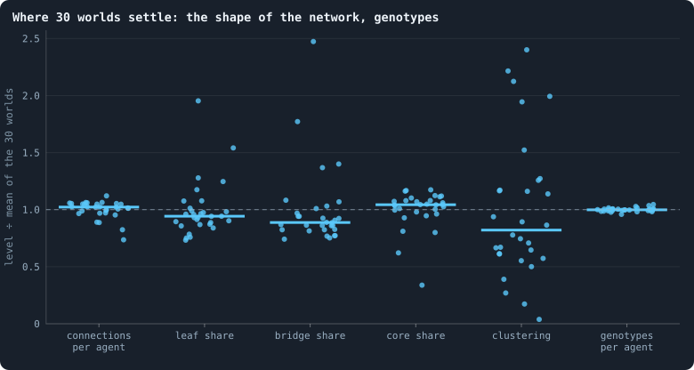

**Where 30 worlds settle: the shape of the network, genotypes.** One dot per world: its mean over iterations 500 to 1,499, divided by the mean of that value over the 30 worlds, so that every statistic is on the same scale and 1 is the average world. The bar is the median. A column of dots close to 1 means the worlds settle alike; a tall column, that they do not. The dots are spread sideways only so they do not hide one another.

> [!example]- How to make this figure
> **Runs.** The 30 baseline runs `B1-100000-s001` … `B1-100000-s030`: the baseline B1 at 100,000 tokens, seeds 1 to 30, 1,500 iterations each (every setting is listed in [Thirty worlds](b1-lives-and-wealth.md#thirty-worlds)). They are made with `python3 gol_lab.py run E10`.
>
> **Data.** From each run's `GraphOfLifeRuns/<run>/stats.jsonl`, which holds one row per recorded phase: `phase` 1 is the world just after reproduction, `phase` 2 just after the game, and every statistic is a field of the row (see [What a run records](runs-and-records.md#what-a-run-records)).
>
> 1. For each run and statistic, average the statistic over the rows with 500 ≤ `iteration` ≤ 1,499 (rows with `phase` 1 for births, 2 for the rest; `a/b` means the row's `a` divided by its `b`).
> 2. Divide each run's average by the mean of the 30 averages.
> 3. Plot one dot per run, with a bar at the median.
>
> **To make it again:** `python3 book_figures.py seed`.
<!-- /figure -->

How tall a column is can be put in one number, the
[spread](statistics.md#spread-between-worlds): the standard deviation of the thirty
worlds' means, divided by their mean. A spread of 0.1 says that a typical
world lies about a tenth of the mean away from the mean.

The columns differ a great deal in height:

- The number of distinct genotypes, or kinds of brain, per agent is almost
  the same in every world: a spread of 0.02.
- Inequality (the Gini coefficient, 0.06), connections per agent (0.08) and
  the share of tokens held by the richest tenth (0.09) vary little.
- The number of agents (0.11) and of connections (0.12) vary more.
- The number of [families](measuring-evolution.md#families), or separate lines of descent
  (0.20), and the number of births in an iteration (0.22) vary more still.

These counts vary *less* than in the worlds of 10,000 tokens. There the
number of agents had a spread of 0.17, and connections 0.19. Larger worlds
average more of their own accidents away.

The shape of the network does the opposite: its columns are taller in the
larger worlds. Here are their spreads, with those at 10,000 tokens in
brackets:

- the share of agents that are leaves, with a single connection: 0.25 (0.12);
- the share of connections that are bridges, whose cut would split the
  network: 0.35 (0.24);
- the share of agents in the [core](measuring-networks.md#core-trees-and-leaves), on loops or
  between them: 0.17 (0.13);
- clustering, how often two neighbours of an agent are neighbours of each
  other: 0.62 (0.34).

And these columns are not one even spread. Most worlds sit together, and a
few lie far out. The same few lie far out for leaves, bridges and the core,
and among the lowest for clustering.

### The worlds of a giant hub

Who are the few? They are worlds in which a single agent became a **hub**,
joined to far more agents than most. In each of them, the largest hub was
joined, on average over the settled life, to a sixth of the world or more. In
the world with seed 28, on average 58% of all agents were neighbours of one
agent, and 72% of that world's connections were bridges.

A sixth is one line. The notebook also draws a second, lower one. A world
whose largest hub is joined, on average, to a tenth of the world or more is
called a [star](measuring-networks.md#stars-and-hubs). Seven of the thirty worlds were stars.
The two lines differ. Every world past a sixth is also past a tenth, but not
the other way round. So the few far-out worlds are some of the seven stars:
those with the largest hubs.

Across all thirty worlds, the share of agents in the core goes with the share
joined to the largest hub almost exactly. Their
[correlation](statistics.md#two-numbers-together-correlation-a-fitted-line-and-logarithmic-axes) is −0.96. A correlation runs from −1 to 1. One
near −1 means that as one quantity goes up, the other goes down, with hardly
an exception. Here, the bigger the hub, the smaller the core.
[What shape does the network take?](b1-the-network-size-and-scaling.md#the-shape-of-the-network)
shows what such a world looks like, and
[The largest and the smallest](b1-lives-and-wealth.md#the-largest-and-the-smallest) how a hub
grows and falls.

Hubs of this kind were there in the worlds of 10,000 tokens too. Ten of the
26 were stars, with a hub joined, on average, to a tenth of the world or
more. In three, the hub was joined to a fifth or more. But there the shape of
a world went with its hub far more loosely: a correlation of −0.54. At
100,000 tokens, the hub is almost the whole story of a world's shape.

### A world forgets

The single worlds of [A world's life](b1-lives-and-wealth.md#the-life-of-a-b1-world) wander: their numbers
drift up and down over hundreds of iterations. How long does a world remember
where it was? Cut each world's life, from iteration 100 on, into 14 stretches
of 100 iterations, and take its mean level in each. Then correlate each
world's level in one stretch with its level some iterations later. This
correlation of a world with its own later self is its
[autocorrelation](statistics.md#how-long-a-world-remembers-autocorrelation-and-the-power-spectrum):

<!-- figure seed/memory -->
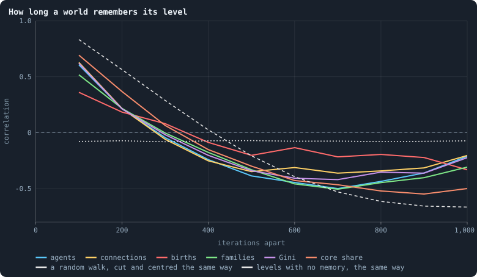

**How long a world remembers its level.** For each statistic, the correlation between a world's level in one stretch of 100 iterations and its level a given number of iterations later, over all pairs of stretches in the 30 worlds. 1 would mean a world stays exactly where it was; 0 that where it was says nothing about where it will be. Because each world's own mean is taken away first, a world cut into only 14 stretches shows negative correlations at long lags even if it simply wandered: the grey dashes are what a random walk, cut and centred the same way, gives (averaged over 200 sets of as many walks), and the grey dots what levels with no memory at all give.

> [!example]- How to make this figure
> **Runs.** The 30 baseline runs `B1-100000-s001` … `B1-100000-s030`: the baseline B1 at 100,000 tokens, seeds 1 to 30, 1,500 iterations each (every setting is listed in [Thirty worlds](b1-lives-and-wealth.md#thirty-worlds)). They are made with `python3 gol_lab.py run E10`.
>
> **Data.** From each run's `GraphOfLifeRuns/<run>/stats.jsonl`, which holds one row per recorded phase: `phase` 1 is the world just after reproduction, `phase` 2 just after the game, and every statistic is a field of the row (see [What a run records](runs-and-records.md#what-a-run-records)).
>
> 1. For each run, cut iterations 100 to 1,499 into 14 stretches of 100 and take the mean of the statistic in each.
> 2. Subtract from each run's 14 values their own mean, so that only the run's movement remains.
> 3. For a lag of L stretches, pair every stretch with the one L later, in every run, and take the Pearson correlation of all the pairs together.
> 4. References: 30 series of 1,400 steps, each step normal with mean 0 — summed (a random walk) or not (no memory) — cut, centred and correlated the same way; the mean over 200 such sets (generator seeded with 13).
>
> **To make it again:** `python3 book_figures.py seed`.
<!-- /figure -->

A hundred iterations on, a world is still much where it was. The correlation
is 0.61 for the number of agents and 0.62 for inequality. Two hundred on, it
is about a third of that: 0.21 for both. Three hundred on, nothing is left.
The share of agents in the core is remembered a little longer (0.37 after 200
iterations), births a little less (0.36 after 100).

Then every line goes below zero, to about −0.5 at 700 iterations. This is not
a real anti-memory. Each world was measured against its own average, or
*centred*, so a world above that average in some stretches must be below it
in others. With only 14 stretches per world, that alone pushes distant
stretches to opposite sides.

How far it pushes depends on how the world moves, and the two grey lines
bracket it. One, dashed, is a random walk: a level that adds a random step at
every iteration, and so wanders without limit. Measured the same way, it falls
from 0.83 at 100 iterations to −0.66 at 900. The other, dotted, is a level
with no memory at all; it sits at −0.08 everywhere.

The worlds forget far faster than the random walk: at 100 and 200 iterations
they lie well below it. Their dip for stretches far apart is just what
centring does to a level that drifts over the 1,400 iterations. In the worlds
of 10,000 tokens, with 29 stretches per world, the same dip was only −0.1 to
−0.17 ([Autocorrelation: how long a world remembers](statistics.md#how-long-a-world-remembers-autocorrelation-and-the-power-spectrum)).

### The seed, or time?

The noon temperatures of two towns differ for two reasons. One town may
simply be warmer, by where it lies; and today's weather may favour one. Over a
year the weather averages out, and only the towns' own difference remains.
The differences between worlds can be split the same way.

All the variation in a statistic's 100-iteration levels, 14 stretches in each
of 30 worlds, splits into two parts
([Between worlds and within them](statistics.md#between-worlds-and-within-them)). One part lies
between the worlds' own averages, like the towns' climates. The other is each
world moving around its own average, like the weather:

<!-- figure seed/between -->
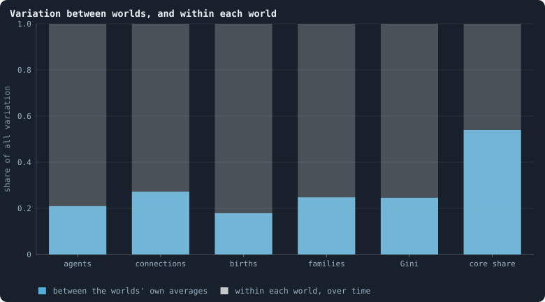

**Variation between worlds, and within each world.** All the variation of a statistic's 100-iteration levels — 14 stretches in each of 30 worlds — split into the part that lies between the worlds' own averages (blue) and the part that is each world moving around its own average (the rest of the column, grey).

> [!example]- How to make this figure
> **Runs.** The 30 baseline runs `B1-100000-s001` … `B1-100000-s030`: the baseline B1 at 100,000 tokens, seeds 1 to 30, 1,500 iterations each (every setting is listed in [Thirty worlds](b1-lives-and-wealth.md#thirty-worlds)). They are made with `python3 gol_lab.py run E10`.
>
> **Data.** From each run's `GraphOfLifeRuns/<run>/stats.jsonl`, which holds one row per recorded phase: `phase` 1 is the world just after reproduction, `phase` 2 just after the game, and every statistic is a field of the row (see [What a run records](runs-and-records.md#what-a-run-records)).
>
> 1. Take each run's 14 stretch means as for the figure above.
> 2. Between: the variance (n − 1 in the denominator) of the 30 runs' own averages.
> 3. Within: the mean over runs of the variance of each run's 14 values.
> 4. Draw between ÷ (between + within).
>
> **To make it again:** `python3 book_figures.py seed`.
<!-- /figure -->

For the counts and for inequality, about a fifth to a quarter of the
variation lies between the worlds. It is 21% for the number of agents, 27% for
connections and 25% for inequality. The rest, about three quarters, is each
world wandering. Even the part between worlds is partly wandering that 1,400
iterations did not average away.

The share of agents in the core is the exception. More than half of its
variation, 54%, lies between the worlds' own averages (24% at 10,000 tokens).
Which shape a world settles into, with a giant hub or without, is more its
own than how many agents it holds.

A sharper test: is a world that is crowded in the first half of its life also
crowded in the second?

<!-- figure seed/halves -->
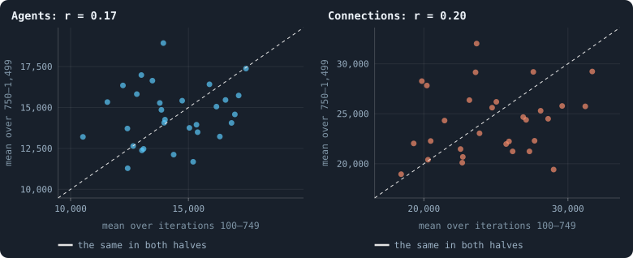

**First half against second half.** One dot per world. Left: its mean number of agents over iterations 100–749 (x) against its mean over iterations 750–1,499 (y). Right: the same for connections. A dot on the dashed diagonal had the same mean in both halves. r is the correlation over the 30 dots.

> [!example]- How to make this figure
> **Runs.** The 30 baseline runs `B1-100000-s001` … `B1-100000-s030`: the baseline B1 at 100,000 tokens, seeds 1 to 30, 1,500 iterations each (every setting is listed in [Thirty worlds](b1-lives-and-wealth.md#thirty-worlds)). They are made with `python3 gol_lab.py run E10`.
>
> **Data.** From each run's `GraphOfLifeRuns/<run>/stats.jsonl`, which holds one row per recorded phase: `phase` 1 is the world just after reproduction, `phase` 2 just after the game, and every statistic is a field of the row (see [What a run records](runs-and-records.md#what-a-run-records)).
>
> 1. For `nodes` and `edges`, average over the rows with `phase` = 2 and 100 ≤ `iteration` ≤ 749, and over 750 ≤ `iteration` ≤ 1,499.
> 2. Plot the second against the first, one dot per run; r is their Pearson correlation ([correlation](statistics.md#two-numbers-together-correlation-a-fitted-line-and-logarithmic-axes)).
>
> **To make it again:** `python3 book_figures.py seed`.
<!-- /figure -->

Hardly. Over the 30 worlds, the correlation between the two halves is 0.17 for
the number of agents and 0.20 for connections. Now pair first and second
halves at random, many times over ([a permutation test](statistics.md#permutation-tests)).
Random pairings give a correlation at least that large 18 and 14 times in 100.
So a world's first half says little more about its second than another
world's first half would.

At 10,000 tokens, connections had kept something of their own: a correlation
of 0.41, which random pairings reached only 2 times in 100. At 100,000 tokens
nothing of the kind shows.

### Longer looks, smaller differences

A world forgets its level within a few hundred iterations. So its mean over a
longer stretch averages more of its wandering away, and the worlds look more
alike:

<!-- figure seed/stretch -->
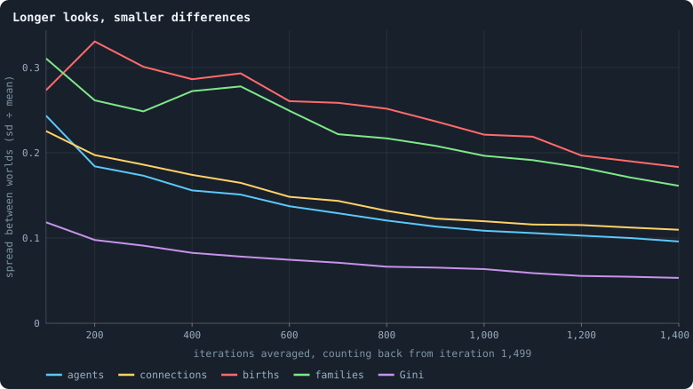

**Longer looks, smaller differences.** For each statistic, how much the 30 worlds differ — the standard deviation of their averages divided by the mean — when each world is measured by its average over its last L iterations, for L from 100 to 1,400.

> [!example]- How to make this figure
> **Runs.** The 30 baseline runs `B1-100000-s001` … `B1-100000-s030`: the baseline B1 at 100,000 tokens, seeds 1 to 30, 1,500 iterations each (every setting is listed in [Thirty worlds](b1-lives-and-wealth.md#thirty-worlds)). They are made with `python3 gol_lab.py run E10`.
>
> **Data.** From each run's `GraphOfLifeRuns/<run>/stats.jsonl`, which holds one row per recorded phase: `phase` 1 is the world just after reproduction, `phase` 2 just after the game, and every statistic is a field of the row (see [What a run records](runs-and-records.md#what-a-run-records)).
>
> 1. For each length L, average the statistic over the rows with 1,500 − L ≤ `iteration` ≤ 1,499 in each run.
> 2. Divide the standard deviation of the 30 averages (n − 1 in the denominator) by their mean.
>
> **To make it again:** `python3 book_figures.py seed`.
<!-- /figure -->

Measured over its last 100 iterations, the number of agents varies between
worlds by 0.24 of the mean. Over the last 300, the last fifth of a run, it
varies by 0.17; over the last 1,400, by 0.10. Inequality falls from 0.12 to
0.05, families from 0.31 to 0.16, and connections from 0.23 to 0.11. Births
fall most slowly, from 0.27 to 0.18, and at every length but the shortest
they vary most.

### How many seeds an experiment needs

From the spread follows how many worlds each condition needs. Say a setting
changes the mean of a statistic by a share Δ: Δ = 0.1 for a change of a
tenth. An experiment should find that change four times in five, with a test
at the 5% level. If the worlds of a condition vary with a spread *c*, each
condition needs about

$$
n = \frac{2\,(z_1 + z_2)^2\, c^2}{\Delta^2} \approx \frac{15.7\, c^2}{\Delta^2}
$$

worlds, rounded up. Here *z*₁ = 1.960 stands for the 5% level, and
*z*₂ = 0.842 for the four times in five.
[How many seeds an experiment needs](statistics.md#how-many-seeds-an-experiment-needs) shows where the formula
comes from. The seeds needed grow with the square of the spread, and fall with
the square of the change. For the number of agents over the settled life,
*c* = 0.11. So a change of a tenth needs *n* = 15.7 × 0.11² / 0.1² ≈ 19
seeds:

<!-- figure seed/seeds-needed -->
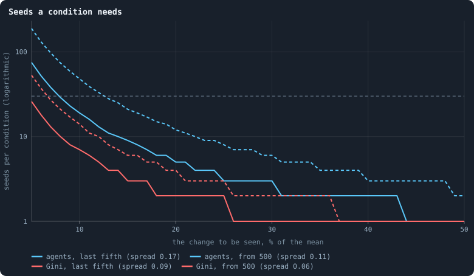

**Seeds a condition needs.** How many worlds each of two conditions needs for a change of a given size in the average to be found four times in five at the 5% level, if worlds vary as much as these do. Dashed: worlds measured over their last fifth (iterations 1,200–1,499); solid: over iterations 500–1,499. The grey line is 30 seeds.

> [!example]- How to make this figure
> **Runs.** The 30 baseline runs `B1-100000-s001` … `B1-100000-s030`: the baseline B1 at 100,000 tokens, seeds 1 to 30, 1,500 iterations each (every setting is listed in [Thirty worlds](b1-lives-and-wealth.md#thirty-worlds)). They are made with `python3 gol_lab.py run E10`.
>
> **Data.** From each run's `GraphOfLifeRuns/<run>/stats.jsonl`, which holds one row per recorded phase: `phase` 1 is the world just after reproduction, `phase` 2 just after the game, and every statistic is a field of the row (see [What a run records](runs-and-records.md#what-a-run-records)).
>
> 1. Measure each run by its average over the stretch, and compute the spread c = sd ÷ mean of the 30 averages.
> 2. For a change Δ (as a share of the mean), n = 2 (z₁ + z₂)² c² / Δ², with z₁ = 1.960 (5%, two-sided) and z₂ = 0.842 (power 80%); round up.
>
> **To make it again:** `python3 book_figures.py seed`.
<!-- /figure -->

Measured over the last fifth of the runs (dashed), seeing a change of 10% in
the number of agents takes 48 seeds per condition. Measured over the settled
life (solid), it takes 19. The worlds of 10,000 tokens needed 100 and 46. For
inequality it takes 14 and 7.

Turn this around, and take 30 seeds per condition with the settled-life
measure. Then the smallest change seen four times in five is about 8% in the
number of agents, 9% in connections and 5% in inequality. Larger worlds make
sharper experiments, at a price: each costs about eight times the computing
([Thirty worlds](b1-lives-and-wealth.md#thirty-worlds)).

Two more things follow for experiments:

- **Pairing by seed helps little.** Two conditions run with the same seed
  share their starting ring and founders. But the seed hardly decides where a
  world goes, so they share little else. A comparison seed by seed is about as
  noisy as one between unrelated worlds.
- **Shape needs more seeds than size.** Only a few worlds in thirty grow a
  giant hub. A change of setting that made giant hubs twice as common would
  need far more than thirty seeds to see.

### Was the thesis right? (how much does the seed decide)
The thesis was checked as planned, on the last fifth of each run of 10,000
tokens: iterations 2,400 to 2,999. Inequality passed both of its tests: its
spread was 0.13, and 26 seeds would see a change of a tenth. Connections
passed the first test and failed the second: a spread of 0.19, but 58 seeds.
The number of agents failed both: a spread of 0.25, and 100 seeds. So the
thesis was refuted, narrowly. But it held in what it says about *kind*: there
were no separate groups of worlds.

At 100,000 tokens, on the last fifth of each run (iterations 1,200 to 1,499),
the thesis is refuted again, more narrowly. All three spreads are now below a
fifth: the number of agents 0.17, connections 0.19, inequality 0.09. But
seeing a change of a tenth still takes more than thirty seeds for the first
two (48 and 55), and 14 for inequality. On kind, the thesis holds less well
than before. In agents, connections and inequality the worlds spread evenly.
But in the shape of their network a few lie far from the rest: the worlds of a
giant hub.

What the thesis missed, at both sizes, is where the spread comes from. It is
mostly not the seed but time. Each world wanders, and the end of a run catches
it wherever it happens to be. That is why every later page measures worlds
over their settled life, from iteration 500 on.

### What we learned (how much does the seed decide)
- Worlds that differ only in their seed settle alike in size and inequality.
  At 100,000 tokens they vary by about a tenth of the mean or less: less than
  at 10,000 tokens.
- Most of what tells such worlds apart is time, not the seed: a world forgets
  its level within about three hundred iterations.
- The shape of the network is the exception: a few worlds grow a giant hub,
  and stay apart from the rest.
- Measure a world over its settled life, not at its end. A change of a tenth
  in the number of agents then takes 19 seeds, not 48.

### How this was made (how much does the seed decide)
This page reads two sets of runs. The thirty worlds of 100,000 tokens are the
runs of Experiment 10:

The runs of Experiment 10 are listed once on this page, under [The runs of Experiment 10 (the shape of the network)](#the-runs-of-experiment-10-the-shape-of-the-network).

The thirty worlds of 10,000 tokens, on which the thesis was first tested, are
the runs of Experiment 2:

<!-- runs E03 -->
> [!info]- The runs behind this page
> These are the runs of Experiment 2; nothing new was run for this page.
>
> **30 runs.** Every condition below is run once for every seed (1 to 30), for 3,000 iterations — or until its world dies out. Every setting is that of the baseline **B1** (the algorithm exactly as a new run is offered it) unless the condition changes it.
>
> - **baseline** — changes nothing: B1 as it is; 10,000 tokens. Runs `B1-10000-s001` … `B1-10000-s030`.
>
> To make these runs again: `python3 gol_lab.py run E02`, or ▶ in the Research Notebook tab of a computer running `gol_server.py`. Each run writes its settings, seed and engine version beside its frames, in `GraphOfLifeRuns/<run>/meta.json` and `provenance.json`.

> [!info]- Every setting of these runs
> | setting | baseline | what it is |
> |---|---|---|
> | [`total_tokens`](settings.md#total_tokens) | 10,000 | The number of tokens in the world, *T*. It never changes during a run. |
> | [`n_nodes`](settings.md#n_nodes) | 0 | How many founders the world starts with. 0 means one founder per hundred tokens: *n* = ⌊*T* / 100⌋. |
> | [`k_neighbors`](settings.md#k_neighbors) | 0 | How many neighbours each founder starts with in the ring. 0 means *k* = max(⌊*n* / 100⌋, 5); an odd *k* is wired as *k* − 1. |
> | [`rewire_p`](settings.md#rewire_p) | 0.2 | In the starting ring, the probability that a connection is moved to a founder chosen at random (Watts–Strogatz). |
> | [`hidden_layers`](settings.md#hidden_layers) | 50, 45, 40, 35, 30 | The widths of the brain's hidden layers, in order from input to output. |
> | [`hidden_activation`](settings.md#hidden_activation) | sigmoid | The curve each hidden unit applies to its sum: `sigmoid`, which passes on at most a quarter of a change, so that deep brains barely respond to what they see, or `tanh`, the same S-shape centred on zero, through which a change still passes in several layers. |
> | [`brain_kind`](settings.md#brain_kind) | float16 | How weights are stored: `float` (64-bit), `float16` (16-bit, computed in 64-bit) or `binary` (−1, 0, +1). |
> | [`brain_bits`](settings.md#brain_bits) | 16 | Only for binary brains: how many input rows encode one number. Unused by float and float16 brains. |
> | [`message_amount`](settings.md#message_amount) | 30 | How many numbers one message holds. Each agent sends one message to itself and one to each neighbour, every phase. |
> | [`random_input_amount`](settings.md#random_input_amount) | 5 | How many random numbers, drawn uniformly from −2 to 2, a brain reads per neighbour, every time it looks. |
> | [`exchange_messages`](settings.md#exchange_messages) | on | Whether agents send and read messages at all. |
> | [`message_prepass`](settings.md#message_prepass) | on | Whether every phase begins with an extra look in which agents only write messages, so the look that acts reads messages written this phase. |
> | [`allow_handover`](settings.md#allow_handover) | on | Whether a parent may move some of its own connections to its newborn child. |
> | [`allow_revolutions`](settings.md#allow_revolutions) | on | Whether a coalition of smaller stakers can take a node from its largest staker (see the note *How a coalition takes a node*). |
> | [`contest`](settings.md#contest) | largest | Who takes a contested node: the `largest` stake as the game weighs it, or a staker drawn by `lottery` with a chance in proportion to its stake (needs revolutions off). |
> | [`allocation`](settings.md#allocation) | full | How the game's stakes are placed: all at once (`full`), or a token at a time in rounds with the game as it stands in view, the poorest done first (`weakest_first`) or the richest starting alone (`strongest_first`), as the original engine played. |
> | [`allow_gifting`](settings.md#allow_gifting) | off | Whether agents may give tokens to neighbours during reproduction. Off in both baselines; on in a few pilots, in Experiment 24 and in half the worlds of the screen. |
> | [`random_decisions`](settings.md#random_decisions) | off | The control: every number a brain would produce is replaced by a random draw from the standard normal distribution. |
> | [`prune_after`](settings.md#prune_after) | blotto | After which phase connections that carried no tokens are cut: `blotto` (the game), `reproduction`, or `both`. |
> | [`inactive_window`](settings.md#inactive_window) | phase | How long a connection may go unused: `phase` means it must carry tokens in the phase being judged; `iteration` allows the two last phases. |
> | [`redistribution`](settings.md#redistribution) | uniform | How the tokens of removed agents are shared: `uniform` gives every survivor the same chance at each token; `by_tokens` weights by what a survivor holds; `poorest` raises the poorest to one common level first; `newborns` gives them to this iteration's children, `parents` to their parents, once per child (both `uniform` in an iteration without births); `children` leaves each dead agent's estate to its own living children (`uniform` where there are none); `local` lets each estate flow through the network to the nearest living agents, split evenly at every step. |
> | [`tokens_created_per_phase`](settings.md#tokens_created_per_phase) | 0 | Tokens added to the world at every cleanup. 0 keeps the supply fixed. |
> | [`mutate_on_replication`](settings.md#mutate_on_replication) | off | Whether a brain changes only when it is copied — into a newborn, or into a node its owner has just won — instead of also after every game, wherever it sits. |
> | [`incumbency`](settings.md#incumbency) | 1.0 | How many times over an agent's stake on its own node counts when the game decides who takes the node. 1 is the old rule. |
> | [`birth_links`](settings.md#birth_links) | 0 | How many of its parent's neighbours a newborn is joined to, drawn at random, besides its parent itself; 0 leaves every link to the brain's choice. |
> | [`mend_on_death`](settings.md#mend_on_death) | off | Whether the neighbours of an agent that dies are joined up where its death would leave them in separate pieces. |
> | [`prune_needs`](settings.md#prune_needs) | 0 | How many neighbours the two ends of an unused connection must share for it to be cut; 0 cuts every unused connection. |
> | [`valence`](settings.md#valence) | 0 | The most connections an agent's brain may choose to hold (0 = no limit). An agent at its limit cannot have a child. |
> | [`link_token`](settings.md#link_token) | off | Whether every link holds one token: its maker pays for it, a lapsing link gives it back to one of its ends, and a link of a dead agent to the end that lives on, so the links can never outnumber the tokens. |
> | [`link_upkeep`](settings.md#link_upkeep) | off | Whether an agent may pay a token an iteration to keep a link, each brain deciding for each neighbour: `paid_or_used` keeps a link that was paid for or used, `paid_only` only one that was paid for; `off`, only use keeps a link. |
> | [`upkeep_to`](settings.md#upkeep_to) | end | Where a link's upkeep goes: to the link's other end (`end`), or into the estate of the dead (`estate`), shared out by the world's redistribution rule. |
> | [`keep_home`](settings.md#keep_home) | 0.0 | The share of an agent's tokens — rounded up, never less than one — that stays on its own node whatever its brain says; a parent also keeps one. 0 is the old rule. |
> | [`max_age`](settings.md#max_age) | 0 | The age at which an agent dies (0 = never); its tokens are shared out like those of any other dead agent. |
> | [`buy_life`](settings.md#buy_life) | off | Whether an agent that has reached max_age may live on by paying one token an iteration into the estate of the dead — never its last, so one with a single token left dies. Needs max_age. |
> | [`min_child`](settings.md#min_child) | 1 | The fewest tokens a child can be born with; a parent that would give less has no child. |
> | [`child_floor`](settings.md#child_floor) | fixed | The least a child may start with: min_child alone (fixed), or also the median holding of its parent's neighbours (neighbours), so that a world grows only as rich as it is. |
> | [`mix_at_birth`](settings.md#mix_at_birth) | off | Whether a newborn's brain is its parent's mixed with a mate's — one of the parent's neighbours, drawn at random — each hidden unit whole from one or the other by an even chance, before it mutates; off, a newborn has a copy of its parent's brain. |
> | [`mix_mates`](settings.md#mix_mates) | any | Under mix_at_birth, who may be the mate: any neighbour of the parent, or only parents — a neighbour with a living child of its own (with none, the newborn's brain is a copy). |
> | [`mate_pays`](settings.md#mate_pays) | off | Under mix_at_birth, whether the mate pays the child as many tokens as the parent gave it, as far as it can and never its last. |
> | [`self_message`](settings.md#self_message) | own | What an agent writes to itself, which each neighbour reads: what its own column says (own), or the largest, number by number, of what it writes to anyone (largest), so that news one column marks reaches every neighbour. |
> | [`link_search`](settings.md#link_search) | off | Whether an agent may reach beyond its neighbours to propose a link: off; jump, a walk as many steps long as the tokens it spends in one iteration, with a link proposed where it ends; walk, a scout that goes one step further in every iteration it pays for; or reach, a jump whose steps are free, as many as the tokens it holds would pay for. A paid step costs one token, paid to the agent it enters, and never the last. |
> | [`link_steering`](settings.md#link_steering) | random | Which way each step of a search goes: to a neighbour drawn at random, or to the one the searcher would most like a link with (looking). |
> | [`link_consent`](settings.md#link_consent) | mutual | Who has to agree to a link a search proposes: both ends (mutual), or only the one who proposes (forced). Nobody at its valence gets a new link either way. |
> | [`proto`](settings.md#proto) | none | Rules first played in the pilots' prototype, by name: came_from and helped_by (an input row each), contest = lottery, pool by genotype or family, kin_sense, tag_rate, mate_pays, grow, unit_token, link_token. Empty in every run but those that ask for one; only the prototype's world plays them (see the settings note). |
> | [`mutation_probability`](settings.md#mutation_probability) | 0.2 | The probability that a brain changes when it is copied to a child, and again, for every brain, after every game. |
> | [`mutation_noise_std`](settings.md#mutation_noise_std) | 0.2 | How large a change to one weight is: a normal draw with standard deviation this times 1/√(fan-in) of its layer. |
> | [`mutation_sparsity`](settings.md#mutation_sparsity) | 0.1 | The share of a brain's numbers a change touches; also the probability, for each weight matrix and bias vector, of a rarer reset that redraws that share of it. |
> | [`extinction_threshold`](settings.md#extinction_threshold) | 20 | A run stops, as extinct, when an iteration ends (after its game) with this many agents or fewer. |
> | seeds | 1 to 30 | one run per seed |
> | iterations | 3,000 | how far each run goes, unless its world dies first |
>
> A value in **bold** differs from the baseline B1.
<!-- /runs -->

Every figure of this page is drawn again by `python3 book_figures.py seed`.
The check of the thesis at 10,000 tokens is in `book/results/E03.json`,
written by `python3 gol_lab.py analyse E03`.

## Where to go next

- [How many dimensions does a world have?](how-many-dimensions-does-a-world-have.md):
  the two rulers, tried on known spaces and then on the worlds.
- [How births build the network](b1-lives-and-wealth.md#how-births-build-the-network): how a child is
  joined, and how births and games make and cut every connection.
- [Where tokens flow](b1-the-game-and-its-flows.md#what-crosses-a-connection):
  what crosses each connection in a game, and which connections carry nothing.
- [Building B2: a world that cannot break](building-b2-and-the-search-for-a-healthy-rich-world.md#building-b2-a-world-that-cannot-break): the
  rules under which nobody is cut off.
- [Questioning the mechanics](questioning-the-mechanics.md#one-rule-reaches-across-the-world):
  the cull, and what could replace it.
- [Preferential attachment and its kernel](measuring-networks.md#preferential-attachment-and-its-kernel):
  who gains new connections, and what that does to the tail.
- [Two numbers together](statistics.md#two-numbers-together-correlation-a-fitted-line-and-logarithmic-axes): least squares, R² and logarithmic
  axes, the tools this page says to use with care.
- [One world, many colours](one-world-many-colours.md): one world drawn by
  tokens, age and family, where cohorts and families can be seen.
- [Physical inspiration](physical-inspiration.md): the physics behind the
  notebook's second aim, and a test of how far a difference travels.
- [Genotypes and lineages](b1-brains-lineages-and-messages.md#genotypes-and-lineages): how lines of descent
  come and go, and take a world over.
- [A hundred thousand iterations](a-hundred-thousand-iterations.md): one
  world of 204,800 tokens, planned to run for a hundred thousand iterations.

## How our view changed

- *The shape of the network*:
  - **11 October 2026.**
    [What shape does the network take?](#what-shape-does-the-network-take) and
    [The geometry of a world](#the-geometry-of-a-world) were first written from
    the thirty worlds of 10,000 tokens. On this day they were rewritten from the
    thirty of 100,000 tokens, with the small worlds' numbers beside the new
    ones. Some claims changed with the size of a world:
    - A world was "half tree, half web": a core of about half the agents, and a
      third of the connections bridges. At 100,000 tokens it is more of a web:
      the core holds more than half the agents, and a quarter of the connections
      are bridges.
    - The growth of balls was "neither a clean power law nor a clean
      exponential", in worlds too small for either. In the large worlds it is
      closer to a power law, and is read as a dimension.
    - The positive curvature was put down to the world's finite size: balls run
      out of world before they reach half of it. In the large worlds it comes
      mostly from the bushy neighbourhoods of hubs.
    - The world of seed 1 had a box dimension of "about 2, like a sheet". At
      100,000 tokens it has about 1.7, between a line and a sheet.
  - **14 October 2026.** A pass through the whole notebook checked every
    statement against the numbers it rested on, and corrected these:
    - Experiment 5's page said that a world is "thirty times easier to cut in
      two" than a random network with the same connections. What was measured is
      the spectral gap, a thirty-third of the random network's. It shows that
      the world has bottlenecks; it is not a factor of how easily it is cut.
    - The page on the core said that every connection of the core lies on a
      loop, "so cutting one connection never splits the core". A connection on a
      path between two loops is a bridge, and cutting it splits the core in two.
    - It said that the core has between two and three dimensions by both rulers.
      By walks it reads a little under two, as the whole world does.
    - It said that no part of the core dies less often than the rest. The hubs
      do, about half as often as other agents; but a hub is a place, not an
      individual.
  - **23 October 2026.** When the three pages became one, their numbers were
    checked against the results the figures are drawn from (`book/results/`),
    and these were corrected:
    - The core of the worlds of 10,000 tokens reads 1.9 by balls (1.94), not
      2.0. The random twins read 3.2 by walks (3.248), not 3.3. And the middle
      half of the cores of 100,000 tokens reads 2.2 to 2.9 by balls (2.9496 at
      its top), not 2.2 to 3.0.
    - The box counts of the world of seed 1 fall along a slope of −1.70
      (−1.7045), not −1.71.
    - The page said that news and tokens "take about eighteen games to cross" a
      world. But 17.7 steps is the mean distance between two agents; to cross a
      world takes up to its diameter, 60 steps. A token needs about eighteen
      games to go from one agent to another, on average.
- *How a world breaks*:
  - **11 October 2026.** This page was first written, on 8 October, from the
    thirty worlds of 10,000 tokens. On this day it was rewritten from the thirty
    of 100,000 tokens, with the small worlds' numbers beside the new ones. Two
    claims changed with the size of a world:
    - The page had said that one big cut in fifty is a bridge failing. In the
      small worlds, 32 of 1,614 went through one connection or two. So did two
      of the six largest cuts of the world of seed 1. In the large worlds not
      one did: every big cut was a border of ten connections or more.
    - It had said that a line of brains that keeps everything at home can cut
      its whole region off, and die with it. One did, in the world of seed 1. In
      the large worlds no such cut shows.
  - **24 October 2026.** The figure *Does a fragile world lose more?* labelled
    its worst cut as taken "before the game". It is taken from the game's row:
    after the game's unused connections are cut, just before the cull. The
    figure's axis and caption now say so; its numbers are unchanged
    ([When the cut risk is read](measuring-networks.md#when-the-cut-risk-is-read)).
- *Power laws, real and apparent, and how to fit one*:
  - **24 October 2026.** When the note on fitting a power law became part of
    this page, the figure of the tokens was read again, point by point. Since 11
    October the page had said that the tokens follow a straight line from 49
    tokens on. It said the line held for two decades, to about 5,000 tokens,
    before the few richest fall a little below it. It had also said that at
    10,000 tokens the law held over a range ten times shorter. The points show
    otherwise. At 100,000 tokens they follow the fitted law for one decade, to
    about 500 tokens. From there they fall below it: to about 70% of its share
    at 1,000 tokens, and to about half from 3,000 tokens on. At 10,000 tokens
    the law held from 33 tokens to the richest agent, at about 3,300 tokens: two
    decades, not a range ten times shorter. The test still finds a power law
    plausible at both sizes.
- *How properties scale together*:
  - **14 October 2026.** A pass through the whole notebook corrected one
    statement. [Tokens and connections](#tokens-and-connections) had said that
    the typical agent holds about the resting state's share, 1.7 tokens per
    candidate. It is the mean of every class that lies near that share. The
    median agent holds a little less: from 1.5 tokens per candidate at one
    connection down to 1.0 at ten or more.
  - **24 October 2026.** When the page was rewritten in plain words, its numbers
    were checked against the results its figures are drawn from
    (`book/results/scaling.json`). The same section had said that the median
    agent holds 1.0 token per candidate from five connections on. With five to
    nine connections it holds 1.1, as its own table shows, and 1.0 from ten on.
    The sentence was left from the worlds of 10,000 tokens, where agents with
    five to nine connections held 1.0.
- *Like next to like: how alike agents are at a distance*:
  - **11 October 2026.** From 9 October, when it was written from the worlds of
    10,000 tokens, this page said that rich beside poor is entirely place.
    There, tokens shuffled among agents with as many connections gave −0.13,
    even more than the real −0.10. The worlds of 100,000 tokens give −0.12 of the real
    −0.16. Rich beside poor is mostly place, but not all
    ([Place, or closeness?](#place-or-closeness)).
  - **14 October 2026.** From 9 October, this page said that a world has no
    territories at all, no regions that differ from their surroundings beyond
    three steps.
    [Worlds of 100,000 tokens](b1-the-network-size-and-scaling.md#worlds-of-100000-tokens)
    then measured lines of descent. They hold patches, about 7 steps wide for
    families of 25 iterations back and about 12 for 200. So a world has
    territories after all, of lines rather than of genotypes
    ([Kin, near and far](#kin-near-and-far)). Each patch keeps widening as its
    line ages.
  - **24 October 2026.** Since 11 October, three numbers of this page had been
    rounded the wrong way. In `book/results/alike.json`, the most negative
    correlation of neighbours' connections, in one world, is −0.6446: −0.64,
    not −0.65. In the median world, the age correlation four steps apart is
    0.0248: +0.02, not +0.03. And agents five steps apart share a genotype
    0.5499 times as often as chance: 0.55, not 0.6.
- *Worlds of many sizes*:
  - **14 October 2026.** From 9 October,
    [Is a big world the same kind of world?](#is-a-big-world-the-same-kind-of-world)
    said that the nodes kept by their own agent fall slowly with size. Across
    three worlds per size, they went from 0.51 at 3,200 tokens to 0.40 at
    409,600. It also said that births, the rate of cutting and the dimension
    from ball growth do not change with size. Thirty worlds at each of two sizes
    ([A large world beside ten small ones](#a-large-world-beside-ten-small-ones))
    found the nodes kept within 3% at 10,000 and 100,000 tokens. They found
    births and deaths per agent 13 to 21% higher, and the dimension 15%
    higher, at ten times the tokens.
  - **14 October 2026.** From 11 October,
    [Worlds of 100,000 tokens](#worlds-of-100000-tokens) said that size changes
    how a world is arranged, not its agents. Per-agent rates and shares, it
    said, are the same at both sizes. Its own comparison has births and deaths
    per agent 13 to 21% higher in the large worlds. So a large world's agents
    live the same kind of lives, a little faster.
- *How much does the seed decide?*:
  - **11 October 2026.** The page was first written from the worlds of 10,000
    tokens. It said that no column of its dot figures falls into separate
    clumps, "as one kind of world would". It also said that the spread between
    worlds is "not the seed but time". The worlds of 100,000 tokens showed
    otherwise for the shape of the network. There a few worlds, those of a
    giant hub, lie far from the rest. And more than half (54%) of the variation
    in the share of agents in the core lies between the worlds. So the page now
    says that the spread is *mostly* time. It changed when it was rewritten
    from the thirty worlds of Experiment 10 ([Thirty worlds](b1-lives-and-wealth.md#thirty-worlds)).
  - **11 October 2026.** The page said that a world keeps something of its own
    in how densely it is connected, "perhaps a trace of its starting ring". At
    10,000 tokens, the two halves of a world's life agreed in connections with
    a correlation of 0.41. And the spread of connections stopped falling at
    about 0.19, however long the look. In the worlds of 100,000 tokens neither
    holds. The halves agree only as well as chance would make them (0.20), and
    the spread of connections falls on, to 0.11. The page changed in the same
    rewrite.
- **11 November 2026.** Seven pages on B1's network, its size and its scaling
  became the sections of this one, and it moved to the Archive. Round 3's
  worlds play other rules, so B1's own numbers no longer bear on the notebook's
  question. They are kept so that every experiment here can be read and made
  again. Nothing was cut but six copies of the list of the runs of Experiment
  10: it is now shown once.

## References

- Bak, P. and Sneppen, K. (1993). Punctuated equilibrium and criticality in a
  simple model of evolution. *Physical Review Letters* 71, 4083–4086.
- Bak, P., Tang, C. and Wiesenfeld, K. (1987). Self-organized criticality: an
  explanation of 1/*f* noise. *Physical Review Letters* 59, 381–384.
- Barabási, A.-L. and Albert, R. (1999). Emergence of scaling in random
  networks. *Science* 286, 509–512.
- Broido, A. D. and Clauset, A. (2019). Scale-free networks are rare.
  *Nature Communications* 10, 1017.
- Champernowne, D. G. (1953). A model of income distribution. *The Economic
  Journal* 63, 318–351.
- Chung, F., Lu, L., Dewey, T. G. and Galas, D. J. (2003). Duplication models
  for biological networks. *Journal of Computational Biology* 10, 677–687.
- Clauset, A., Shalizi, C. R. and Newman, M. E. J. (2009). Power-law
  distributions in empirical data. *SIAM Review* 51, 661–703.
- Gabaix, X. (1999). Zipf's law for cities: an explanation. *Quarterly Journal
  of Economics* 114, 739–767.
- Kesten, H. (1973). Random difference equations and renewal theory for
  products of random matrices. *Acta Mathematica* 131, 207–248.
- Levy, M. and Solomon, S. (1996). Power laws are logarithmic Boltzmann laws.
  *International Journal of Modern Physics C* 7, 595–601.
- Pareto, V. (1896). *Cours d'économie politique*. Lausanne: F. Rouge.
- Vázquez, A., Flammini, A., Maritan, A. and Vespignani, A. (2003). Modeling
  of protein interaction networks. *Complexus* 1, 38–44.

- Chaikin, P. M. and Lubensky, T. C. (1995). *Principles of Condensed Matter
  Physics*. Cambridge University Press.

<!-- turns -->
---

← [B1: the game and its flows](b1-the-game-and-its-flows.md) · [B1, as described in October 2026](../README.md#b1-as-described-in-october-2026) · [B1: brains, lineages and messages](b1-brains-lineages-and-messages.md) →

**Also about:** [The baselines B1 and B2](../README.md#the-baselines-b1-and-b2), [Space and dimension](../README.md#space-and-dimension), [Methods and statistics](../README.md#methods-and-statistics).

> [!info]- Pages that link here (30)
> [What this notebook is about](what-this-notebook-is-about.md) · [A hundred thousand iterations](a-hundred-thousand-iterations.md) · [Questioning the mechanics](questioning-the-mechanics.md) · [Every setting](settings.md) · [Glossary](glossary.md) · [The rules in detail](rules-in-detail.md) · [Measuring tokens: inequality and flow](measuring-tokens.md) · [Measuring a network: connections, hubs, distances and cuts](measuring-networks.md) · [Physical inspiration](physical-inspiration.md) · [Is a world a space? Dimension, and what folds it](how-many-dimensions-does-a-world-have.md) · [Measuring space: dimension and the random twin](measuring-space.md) · [Dimensions at scale](dimensions-at-scale.md) · [Which properties have no scale?](which-properties-have-no-scale.md) · [Local rules only](local-rules-only.md) · [How far does a difference travel?](how-far-does-a-difference-travel.md) · [What the brains are like](what-the-brains-are-like.md) · [Do the brains matter?](do-the-brains-matter.md) · [Assembly theory: how many steps to make a thing, and how many copies](assembly-theory.md) · [Do agents cooperate? Help, kin and partners](do-agents-cooperate.md) · [How runs are made, recorded and costed](runs-and-records.md) · [How worlds are measured](how-worlds-are-measured.md) · [One world, many colours: what the viewer can colour by](one-world-many-colours.md) · [What goes with what](what-goes-with-what.md) · [Every simulation: what was run, and what was measured](every-simulation.md) · [Statistics: the tools of the notebook](statistics.md) · [What B1 is, and what stood in its way](what-the-baseline-world-is.md) · [B1: lives and wealth](b1-lives-and-wealth.md) · [B1: the game and its flows](b1-the-game-and-its-flows.md) · [B1: brains, lineages and messages](b1-brains-lineages-and-messages.md) · [Building B2, and the search for a healthy, rich world](building-b2-and-the-search-for-a-healthy-rich-world.md)
<!-- /turns -->
