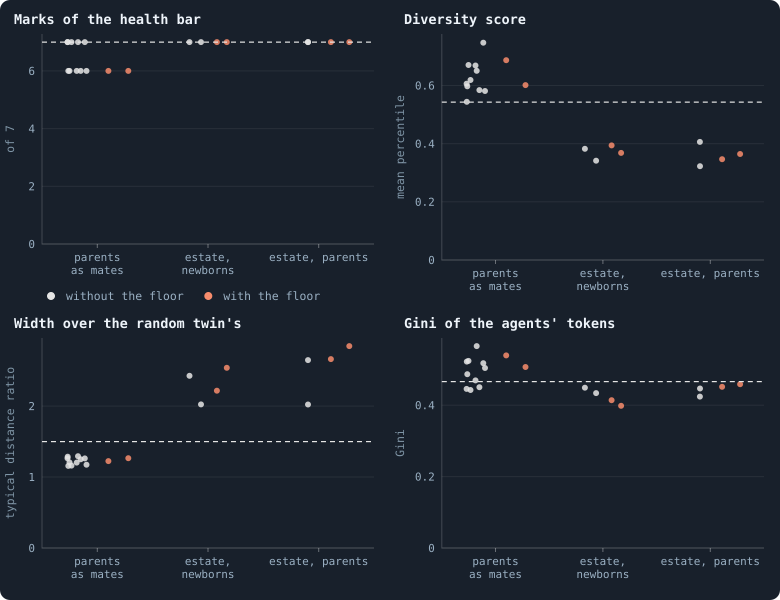
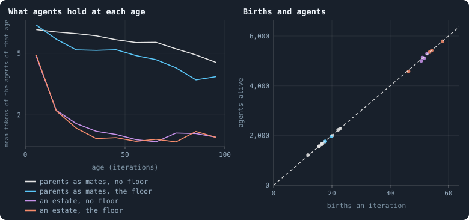

# Births as rich as the neighbours

> [!question] Questions of this page
> - The estates of the dead paid to births make a world a healthy space but
>   fill it with paupers. Can a rule of birth keep the space and stop the
>   paupers?
> - What does a world do when a child may never be poorer than the agents it
>   is born among?

<!-- experiment E32 -->

## Why ask

[Room for the steadiest world](room-for-the-steadiest-world.md) gave Experiment 19's
world each rule that keeps a world's room. The estates of the dead, paid to
the newborns or to the parents, came nearest the network the author's
picture asks for:
- every mark of the health bar;
- a space 2.0 to 2.65 times as wide as its twin, at about three
  dimensions.

But they filled it with children: about 5,000 agents for 10,000 tokens,
1.9 tokens each. Almost every agent held the same few tokens, and the
diversity score fell from Experiment 19's 0.54 to 0.75 to 0.32 to 0.41.

An estate paid to births makes a birth cheap, and nothing stops a world
from making paupers.
[What holds a world's size](what-holds-a-worlds-size.md) asked for a pull: births
that cost more when they would make the world poorer. The rule tried here
is that pull, with no number of its own. A child must start with at least
the median holding of its parent's neighbours
([`child_floor`](settings.md#child_floor) = `neighbours`).
- A parent among rich agents can have a child only by giving it as much as
  they hold.
- A parent among poor ones may have a small child.

The world can grow only as rich as it is.

## The thesis

<!-- thesis E32 -->
> [!quote] The thesis of Experiment 32, written down before any of its runs existed
> **The claim.** Asking a child to start with at least what its parent's neighbours hold keeps the healthy space the estates make and gives back the diversity they cost. With brains mixed at birth, parents as mates and the estate of the dead paid to births, and a child never poorer than the median holding of its parent's neighbours, both worlds of at least one of the two estates (to the newborns, to the parents), at iteration 3,000, meet every mark of the health bar, are more diverse than B2's median world, are at least 1.5 times as wide as their random twins, and are no more even than B2's least even world, B2's ten worlds played on being read at the same iteration.
>
> **Why it would be so.** In Experiment 31 the estates gave Experiment 19's world every mark and a space of about three dimensions, 2.0 to 2.65 times as wide as its twin. But they filled it with children: about 5,000 agents for 10,000 tokens, 1.9 tokens each, whose tokens fill about two doubling classes. The diversity scores fell to 0.32 to 0.41, and the tokens became a little more even than B2's (Ginis of 0.42 to 0.45). The estate makes a birth cheap, and nothing stops a world from making paupers. A child that must start as rich as the agents it is born among stops that, with no number of its own: the world can grow only as rich as it is. Experiment 31's estate worlds of the same seeds are the control, as is Experiment 19's world for the floor alone.
>
> **It holds if:** For at least one estate rule, both worlds (seeds 1 and 2) at 3,000 meet every mark, have a diversity score above the median of B2's ten worlds read at 3,000 (0.54), a typical distance at least 1.5 times their twin's, and a Gini no lower than the least of those ten worlds' (0.47).
>
> **It fails if:** Neither estate rule has both its worlds pass all four at 3,000; the chapter says what the floor changed and what it did not.
<!-- /thesis -->

## The runs

<!-- runs E32 -->
> [!info] The runs behind this page
> **6 runs.** Every condition below is run once for every seed (1 to 2), for 3,000 iterations — or until its world dies out. Every setting is that of the baseline **B2** (a world that cannot break) unless the condition changes it.
>
> - **estate to the newborns, a child as rich as its neighbours** — changes `mix_at_birth` = on, `mix_mates` = parents, `redistribution` = newborns, `child_floor` = neighbours; 10,000 tokens. Runs `B2-10000-12215f-s001` … `B2-10000-12215f-s002`.
> - **estate to the parents, a child as rich as its neighbours** — changes `mix_at_birth` = on, `mix_mates` = parents, `redistribution` = parents, `child_floor` = neighbours; 10,000 tokens. Runs `B2-10000-86df9e-s001` … `B2-10000-86df9e-s002`.
> - **a child as rich as its neighbours** — changes `mix_at_birth` = on, `mix_mates` = parents, `child_floor` = neighbours; 10,000 tokens. Runs `B2-10000-b289dd-s001` … `B2-10000-b289dd-s002`.
>
> To make these runs again: `python3 gol_lab.py run E32`, or ▶ in the Research Notebook tab of a computer running `gol_server.py`. Each run writes its settings, seed and engine version beside its frames, in `GraphOfLifeRuns/<run>/meta.json` and `provenance.json`.

> [!info]- Every setting of these runs
> | setting | estate to the newborns, a child as rich as its neighbours | estate to the parents, a child as rich as its neighbours | a child as rich as its neighbours | what it is |
> |---|---|---|---|---|
> | [`total_tokens`](settings.md#total_tokens) | 10,000 | 10,000 | 10,000 | The number of tokens in the world, *T*. It never changes during a run. |
> | [`n_nodes`](settings.md#n_nodes) | 0 | 0 | 0 | How many founders the world starts with. 0 means one founder per hundred tokens: *n* = ⌊*T* / 100⌋. |
> | [`k_neighbors`](settings.md#k_neighbors) | 0 | 0 | 0 | How many neighbours each founder starts with in the ring. 0 means *k* = max(⌊*n* / 100⌋, 5); an odd *k* is wired as *k* − 1. |
> | [`rewire_p`](settings.md#rewire_p) | 0.2 | 0.2 | 0.2 | In the starting ring, the probability that a connection is moved to a founder chosen at random (Watts–Strogatz). |
> | [`hidden_layers`](settings.md#hidden_layers) | 16 | 16 | 16 | The widths of the brain's hidden layers, in order from input to output. |
> | [`brain_kind`](settings.md#brain_kind) | float16 | float16 | float16 | How weights are stored: `float` (64-bit), `float16` (16-bit, computed in 64-bit) or `binary` (−1, 0, +1). |
> | [`brain_bits`](settings.md#brain_bits) | 16 | 16 | 16 | Only for binary brains: how many input rows encode one number. Unused by float and float16 brains. |
> | [`message_amount`](settings.md#message_amount) | 8 | 8 | 8 | How many numbers one message holds. Each agent sends one message to itself and one to each neighbour, every phase. |
> | [`random_input_amount`](settings.md#random_input_amount) | 5 | 5 | 5 | How many random numbers, drawn uniformly from −2 to 2, a brain reads per neighbour, every time it looks. |
> | [`exchange_messages`](settings.md#exchange_messages) | on | on | on | Whether agents send and read messages at all. |
> | [`message_prepass`](settings.md#message_prepass) | off | off | off | Whether every phase begins with an extra look in which agents only write messages, so the look that acts reads messages written this phase. |
> | [`allow_handover`](settings.md#allow_handover) | off | off | off | Whether a parent may move some of its own connections to its newborn child. |
> | [`allow_revolutions`](settings.md#allow_revolutions) | on | on | on | Whether a coalition of smaller stakers can take a node from its largest staker (see the note *How a coalition takes a node*). |
> | [`allow_gifting`](settings.md#allow_gifting) | off | off | off | Whether agents may give tokens to neighbours during reproduction. Off in every run of this book. |
> | [`random_decisions`](settings.md#random_decisions) | off | off | off | The control: every number a brain would produce is replaced by a random draw from the standard normal distribution. |
> | [`prune_after`](settings.md#prune_after) | blotto | blotto | blotto | After which phase connections that carried no tokens are cut: `blotto` (the game), `reproduction`, or `both`. |
> | [`inactive_window`](settings.md#inactive_window) | phase | phase | phase | How long a connection may go unused: `phase` means it must carry tokens in the phase being judged; `iteration` allows the two last phases. |
> | [`redistribution`](settings.md#redistribution) | **newborns** | **parents** | uniform | How the tokens of removed agents are shared: `uniform` gives every survivor the same chance at each token; `by_tokens` weights by what a survivor holds; `poorest` raises the poorest to one common level first; `newborns` gives them to this iteration's children, `parents` to their parents, once per child (both `uniform` in an iteration without births); `children` leaves each dead agent's estate to its own living children (`uniform` where there are none). |
> | [`tokens_created_per_phase`](settings.md#tokens_created_per_phase) | 0 | 0 | 0 | Tokens added to the world at every cleanup. 0 keeps the supply fixed. |
> | [`mutate_on_replication`](settings.md#mutate_on_replication) | on | on | on | Whether a brain changes only when it is copied — into a newborn, or into a node its owner has just won — instead of also after every game, wherever it sits. |
> | [`incumbency`](settings.md#incumbency) | 1.5 | 1.5 | 1.5 | How many times over an agent's stake on its own node counts when the game decides who takes the node. 1 is the old rule. |
> | [`birth_links`](settings.md#birth_links) | 2 | 2 | 2 | How many of its parent's neighbours a newborn is joined to, drawn at random, besides its parent itself; 0 leaves every link to the brain's choice. |
> | [`mend_on_death`](settings.md#mend_on_death) | on | on | on | Whether the neighbours of an agent that dies are joined up where its death would leave them in separate pieces. |
> | [`prune_needs`](settings.md#prune_needs) | 2 | 2 | 2 | How many neighbours the two ends of an unused connection must share for it to be cut; 0 cuts every unused connection. |
> | [`valence`](settings.md#valence) | 8 | 8 | 8 | The most connections an agent's brain may choose to hold (0 = no limit). An agent at its limit cannot have a child. |
> | [`keep_home`](settings.md#keep_home) | 0.3 | 0.3 | 0.3 | The share of an agent's tokens — rounded up, never less than one — that stays on its own node whatever its brain says; a parent also keeps one. 0 is the old rule. |
> | [`max_age`](settings.md#max_age) | 100 | 100 | 100 | The age at which an agent dies (0 = never); its tokens are shared out like those of any other dead agent. |
> | [`buy_life`](settings.md#buy_life) | off | off | off | Whether an agent that has reached max_age may live on by paying one token an iteration into the estate of the dead — never its last, so one with a single token left dies. Needs max_age. |
> | [`min_child`](settings.md#min_child) | 10 | 10 | 10 | The fewest tokens a child can be born with; a parent that would give less has no child. |
> | [`child_floor`](settings.md#child_floor) | **neighbours** | **neighbours** | **neighbours** | The least a child may start with: min_child alone (fixed), or also the median holding of its parent's neighbours (neighbours), so that a world grows only as rich as it is. |
> | [`mix_at_birth`](settings.md#mix_at_birth) | **on** | **on** | **on** | Whether a newborn's brain is its parent's mixed with a mate's — one of the parent's neighbours, drawn at random — each hidden unit whole from one or the other by an even chance, before it mutates; off, a newborn has a copy of its parent's brain. |
> | [`mix_mates`](settings.md#mix_mates) | **parents** | **parents** | **parents** | Under mix_at_birth, who may be the mate: any neighbour of the parent, or only parents — a neighbour with a living child of its own (with none, the newborn's brain is a copy). |
> | [`self_message`](settings.md#self_message) | own | own | own | What an agent writes to itself, which each neighbour reads: what its own column says (own), or the largest, number by number, of what it writes to anyone (largest), so that news one column marks reaches every neighbour. |
> | [`link_search`](settings.md#link_search) | off | off | off | Whether an agent may reach beyond its neighbours to propose a link: off; jump, a walk as many steps long as the tokens it spends in one iteration, with a link proposed where it ends; walk, a scout that goes one step further in every iteration it pays for; or reach, a jump whose steps are free, as many as the tokens it holds would pay for. A paid step costs one token, paid to the agent it enters, and never the last. |
> | [`link_steering`](settings.md#link_steering) | random | random | random | Which way each step of a search goes: to a neighbour drawn at random, or to the one the searcher would most like a link with (looking). |
> | [`link_consent`](settings.md#link_consent) | mutual | mutual | mutual | Who has to agree to a link a search proposes: both ends (mutual), or only the one who proposes (forced). Nobody at its valence gets a new link either way. |
> | [`proto`](settings.md#proto) | none | none | none | Rules first played in the pilots' prototype, by name: came_from and helped_by (an input row each), contest = lottery, pool by genotype or family, kin_sense, tag_rate, mate_pays, grow, unit_token, link_token. Empty in every run but those that ask for one; only the prototype's world plays them (see the settings note). |
> | [`mutation_probability`](settings.md#mutation_probability) | 0.2 | 0.2 | 0.2 | The probability that a brain changes when it is copied to a child, and again, for every brain, after every game. |
> | [`mutation_noise_std`](settings.md#mutation_noise_std) | 0.2 | 0.2 | 0.2 | How large a change to one weight is: a normal draw with standard deviation this times 1/√(fan-in) of its layer. |
> | [`mutation_sparsity`](settings.md#mutation_sparsity) | 0.1 | 0.1 | 0.1 | The share of a brain's numbers a change touches; also the probability, for each weight matrix and bias vector, of a rarer reset that redraws that share of it. |
> | [`extinction_threshold`](settings.md#extinction_threshold) | 20 | 20 | 20 | A run stops, as extinct, when an iteration ends (after its game) with this many agents or fewer. |
> | seeds | 1 to 2 | 1 to 2 | 1 to 2 | one run per seed |
> | iterations | 3,000 | 3,000 | 3,000 | how far each run goes, unless its world dies first |
>
> A value in **bold** differs from the baseline B2.
<!-- /runs -->

## What the worlds did

<!-- figure floor/measures -->

**The floor, with each estate and without.** Each dot is one world at iteration 3,000, without the floor (grey: Experiment 19's ten worlds for parents as mates alone, Experiment 31's two for each estate) and with it (orange: Experiment 32's two for each). The dashed line is what the author's picture asks: every mark, a diversity score above B2's median world at 3,000 (0.54), a typical distance at least 1.5 times the random twin's, a Gini no lower than B2's least even world at 3,000 (0.47).

> [!example]- How to make this figure
> **Runs.** Experiment 32's six runs (`python3 gol_lab.py run E32`): B2 at 10,000 tokens with brains mixed at birth, parents as mates and a child never poorer than the median holding of its parent's neighbours, with the estate of the dead paid to the newborns (`B2-10000-12215f-…`), to the parents (`-86df9e-…`) or neither (`-b289dd-…`), seeds 1 and 2, to 3,000 iterations; against Experiment 31's estate worlds of the same seeds (`B2-10000-06b876-…`, `-b8e9fc-…`) and Experiment 19's ten worlds (`B2-10000-bcc1bc-s001` … `-s010`), which have no floor.
>
> **Data.** From each world's archive at iteration 3,000.
>
> 1. Read each world as `research/atlas/profile.py` reads every world: the seven marks, the four spreads ranked among the frozen reference worlds (their mean is the diversity score), the Gini of the tokens; and its typical distance over its random twin's, as `research/atlas/space.py` measures it (`research/atlas/readings.py` does both).
> 2. The lines: every mark; the median diversity, and the least Gini, of B2's ten worlds played on and read at 3,000; a typical distance of 1.5 times the twin's.
>
> **To make it again:** `python3 book_figures.py floor`.
<!-- /figure -->

**The floor changed nothing the measures can see.** At iteration 3,000:
- **With an estate,** the four worlds with the floor are [Room for the steadiest world](room-for-the-steadiest-world.md)'s
  estate worlds again:

  | | with the floor | without it ([Room for the steadiest world](room-for-the-steadiest-world.md)) |
  |---|---|---|
  | marks of the health bar | 7 | 7 |
  | width over the twin | 2.2 to 2.85 | 2.0 to 2.65 |
  | agents | 5,063 to 5,735 | 5,036 to 5,445 |
  | tokens per agent | 1.74 to 1.98 | 1.84 to 1.99 |
  | diversity score | 0.35 to 0.39 | 0.32 to 0.41 |
  | Gini of the tokens | 0.40 to 0.46 | 0.42 to 0.45 |

- **Alone,** the floor left Experiment 19's world as it was. Its two worlds
  lie among Experiment 19's ten in every measure:
  - diverse, 0.60 and 0.69 (Experiment 19: 0.54 to 0.75);
  - uneven, Ginis of 0.51 and 0.54 (0.44 to 0.57);
  - folded, 1.27 and 1.22 times their twins (1.16 to 1.29);
  - each missing the mark for dimension, 4.2 and 4.1, as five of
    Experiment 19's ten do.

## Why the floor did nothing

**It could not bind.** Every child already starts with at least ten tokens
(B2's `min_child`). So the floor asks more only of a parent whose
neighbours' median holding is above ten.
- **In the estate worlds with the floor,** at 3,000, the median agent's
  neighbours held a median of one token. Of the 109 to 157 agents rich
  enough to have a child, the floor asked more of 1 to 10.
- **Alone,** it asked more of 6 and of 55, of about 300.

<!-- figure floor/paupers -->

**Where the poor agents come from.** Left: the mean tokens of the agents of each age, in tens of iterations, at iteration 3,000, averaged over the worlds of each kind: Experiment 19's ten, and seeds 1 and 2 of the others. Right: each world's births an iteration and agents alive, both averaged over iterations 2,000 to 3,000; the dashed line is a hundred agents for every birth an iteration, which a world keeps when everyone lives out a hundred iterations.

> [!example]- How to make this figure
> **Runs.** Experiment 32's six runs (`python3 gol_lab.py run E32`): B2 at 10,000 tokens with brains mixed at birth, parents as mates and a child never poorer than the median holding of its parent's neighbours, with the estate of the dead paid to the newborns (`B2-10000-12215f-…`), to the parents (`-86df9e-…`) or neither (`-b289dd-…`), seeds 1 and 2, to 3,000 iterations; against Experiment 31's estate worlds of the same seeds (`B2-10000-06b876-…`, `-b8e9fc-…`) and Experiment 19's ten worlds (`B2-10000-bcc1bc-s001` … `-s010`), which have no floor.
>
> **Data.** From each world's archive at iteration 3,000 and its `stats.jsonl`.
>
> 1. Left: each agent's age is the iteration less the one it was born in; average the tokens of the agents aged 1 to 10, 11 to 20, and so on.
> 2. Right: the births and the agents of each iteration's first phase, averaged over the iterations 2,000 to 2,999.
>
> **To make it again:** `python3 book_figures.py floor`.
<!-- /figure -->

**The poor agents are not born poor.** In the estate worlds, every child
starts with ten tokens or more, as in any world.
- Agents aged 1 to 10 hold 4.8 on average.
- Aged 11 to 20, 2.1.
- From 30 on, about 1.5.

The game strips the young within twenty iterations. In Experiment 19's
worlds, agents hold 7 in their first ten iterations and still 4.4 in their
last ten.

**And the young are the parents.** The agents that can have a child, with
eleven tokens or more, are young in the estate worlds and middle-aged in
the others, at 3,000:

| | median age of the agents able to have a child | share of them aged 10 or less |
|---|---|---|
| an estate, with or without the floor | 4 to 10 | 51% to 64% |
| Experiment 19, and the floor alone | 27 to 45 | 8% to 27% |

In a world where most agents hold a token or two, the only agents rich
enough are those just born, with their ten tokens or more, and those just
paid by the estate, and the game takes it from them within twenty
iterations. [What folds a world](what-folds-a-world.md) found why young parents
make a space: a death closes a ring round the gap it leaves, and the ring
is largest where the old do the breeding. Here the young do, so the rings
stay small and the world keeps its room.

**A world's size is its births.** Every world here held 99 to 102 agents for
each birth an iteration, averaged over iterations 2,000 to 3,000. Its
agents live out their hundred iterations and almost none die sooner, as
[What holds a world's size](what-holds-a-worlds-size.md) found in 454 moments of
other worlds. So:
- a world's size is a hundred times its births an iteration;
- its riches are its 10,000 tokens shared among them.

| | births an iteration | agents |
|---|---|---|
| Experiment 19's ten worlds | 12 to 23 | 1,210 to 2,267 |
| the floor alone | 18 and 20 | 1,762 and 1,962 |
| an estate, without the floor | 51 to 53 | 5,004 to 5,294 |
| an estate, with the floor | 46 to 58 | 4,576 to 5,789 |

## The verdict

**The thesis fails.** With either estate and the floor, both worlds met
every mark and were spaces, as without the floor. None was diverse enough
(0.35 to 0.39, against 0.54) or uneven enough (Ginis of 0.40 to 0.46,
against 0.47). The floor changed nothing measurable, because in a world of
paupers a child's neighbours are paupers too.

> [!info] What these results cover (added 2026-10-21)
> Every world of this page was played under B2's rules, with brains mixed
> at birth and parents as mates, at 10,000 tokens, two seeds each. The floor
> failed because of one of those rules: every B2 child already starts with
> ten tokens (`min_child`), more than a poor world's neighbours hold. A world
> whose least child is a single token, such as B1, is another matter;
> [The floor in plain B2 and in B1](the-floor-in-plain-b2-and-in-b1.md) plays the same floor
> in plain B2 and in B1. The ledger of births, a hundred agents for each birth
> an iteration, holds only where every agent dies at a fixed age, as in B2.

## What it teaches

- **A rule that measures a world against itself follows it down.** The floor
  asked a child to be as rich as its neighbours. In a poor world the
  neighbours are poor, so the floor fell with the world, below the ten
  tokens every child already gets. A pull has to measure against something
  a poor world does not drag down with it.
- **The paupers are made by the game, not at birth.** A rule on what a
  child starts with cannot reach them. Under old age, only two things can:
  - fewer births, since the world's size is a hundred times its births;
  - or a game that strips the young less.
- **Room and riches come from the same coin.** The estate worlds are spaces
  because their young are the parents, and their young are the parents
  because in a world of paupers only the newly born and the newly paid are
  rich enough. Under these rules a world gets young parents only by paying
  for births, and paying for births fills it with paupers. A world that is both a space and rich
  needs its young to breed without the world filling up. Or it needs deaths
  that do not fold it when the old breed: the open question of
  [What folds a world](what-folds-a-world.md), mending without folding.

<!-- turns -->
---

← [How does a world's size follow its tokens?](how-does-a-worlds-size-follow-its-tokens.md) · [Size and riches of a world](../README.md#size-and-riches-of-a-world) · [The floor in plain B2 and in B1](the-floor-in-plain-b2-and-in-b1.md) →

**Also about:** [Looking for a healthy, rich world](../README.md#looking-for-a-healthy-rich-world).

> [!info]- Pages that link here (3)
> [The floor in plain B2 and in B1](the-floor-in-plain-b2-and-in-b1.md) · [Room for the steadiest world](room-for-the-steadiest-world.md) · [A screen of random worlds](a-screen-of-random-worlds.md)
<!-- /turns -->
