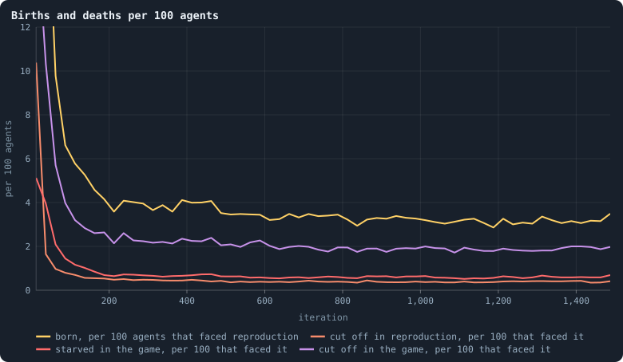
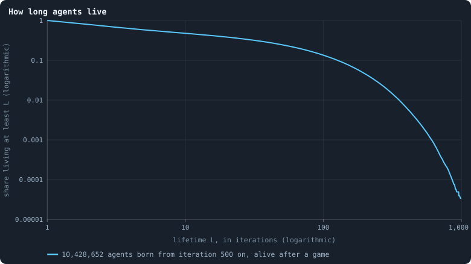
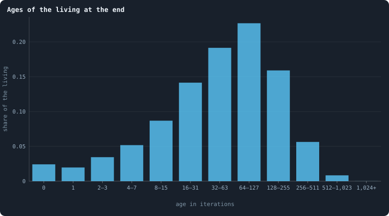

# Births, deaths and ages

A settled world keeps its size ([Chapter 10](a-worlds-life.md)), but its
members come and go.

> [!question] Questions of this chapter
> - How often is an agent born?
> - How do agents die, and which way of dying is the most common?
> - How long do agents live?
> - How old are the living — and why is that a different question?

The worlds are the thirty of 100,000 tokens of [Chapter 9](thirty-worlds.md);
where the thirty of 10,000 tokens this chapter was first written from differ,
both are given.

<!-- runs E10 -->
> [!info] The runs behind this chapter
> **30 runs.** Every condition below is run once for every seed (1 to 30), for 1,500 iterations — or until its world dies out. Every setting is that of the baseline **B1** (the algorithm exactly as a new run is offered it) unless the condition changes it.
>
> - **baseline** — changes nothing: B1 as it is; 100,000 tokens. Runs `B1-100000-s001` … `B1-100000-s030`.
>
> To make these runs again: `python3 gol_lab.py run E10`, or ▶ in the Book tab of a computer running `gol_server.py`. Each run writes its settings, seed and engine version beside its frames, in `GraphOfLifeRuns/<run>/meta.json` and `provenance.json`.

> [!info]- Every setting of these runs
> | setting | baseline | what it is |
> |---|---|---|
> | [`total_tokens`](settings.md#total_tokens) | 100,000 | The number of tokens in the world, *T*. It never changes during a run. |
> | [`n_nodes`](settings.md#n_nodes) | 0 | How many founders the world starts with. 0 means one founder per hundred tokens: *n* = ⌊*T* / 100⌋. |
> | [`k_neighbors`](settings.md#k_neighbors) | 0 | How many neighbours each founder starts with in the ring. 0 means *k* = max(⌊*n* / 100⌋, 5); an odd *k* is wired as *k* − 1. |
> | [`rewire_p`](settings.md#rewire_p) | 0.2 | In the starting ring, the probability that a connection is moved to a founder chosen at random (Watts–Strogatz). |
> | [`hidden_layers`](settings.md#hidden_layers) | 50, 45, 40, 35, 30 | The widths of the brain's hidden layers, in order from input to output. |
> | [`brain_kind`](settings.md#brain_kind) | float16 | How weights are stored: `float` (64-bit), `float16` (16-bit, computed in 64-bit) or `binary` (−1, 0, +1). |
> | [`brain_bits`](settings.md#brain_bits) | 16 | Only for binary brains: how many input rows encode one number. Unused by float and float16 brains. |
> | [`message_amount`](settings.md#message_amount) | 30 | How many numbers one message holds. Each agent sends one message to itself and one to each neighbour, every phase. |
> | [`random_input_amount`](settings.md#random_input_amount) | 5 | How many random numbers, drawn uniformly from −2 to 2, a brain reads per neighbour, every time it looks. |
> | [`exchange_messages`](settings.md#exchange_messages) | on | Whether agents send and read messages at all. |
> | [`message_prepass`](settings.md#message_prepass) | on | Whether every phase begins with an extra look in which agents only write messages, so the look that acts reads messages written this phase. |
> | [`allow_handover`](settings.md#allow_handover) | on | Whether a parent may move some of its own connections to its newborn child. |
> | [`allow_revolutions`](settings.md#allow_revolutions) | on | Whether a coalition of smaller stakers can take a node from its largest staker (see the note *How a coalition takes a node*). |
> | [`allow_gifting`](settings.md#allow_gifting) | off | Whether agents may give tokens to neighbours during reproduction. Off in every run of this book. |
> | [`random_decisions`](settings.md#random_decisions) | off | The control: every number a brain would produce is replaced by a random draw from the standard normal distribution. |
> | [`prune_after`](settings.md#prune_after) | blotto | After which phase connections that carried no tokens are cut: `blotto` (the game), `reproduction`, or `both`. |
> | [`inactive_window`](settings.md#inactive_window) | phase | How long a connection may go unused: `phase` means it must carry tokens in the phase being judged; `iteration` allows the two last phases. |
> | [`redistribution`](settings.md#redistribution) | uniform | How the tokens of removed agents are shared: `uniform` gives every survivor the same chance at each token; `by_tokens` weights by what a survivor holds; `poorest` raises the poorest to one common level first; `newborns` gives them to this iteration's children, `parents` to their parents, once per child (both `uniform` in an iteration without births); `children` leaves each dead agent's estate to its own living children (`uniform` where there are none). |
> | [`tokens_created_per_phase`](settings.md#tokens_created_per_phase) | 0 | Tokens added to the world at every cleanup. 0 keeps the supply fixed. |
> | [`mutate_on_replication`](settings.md#mutate_on_replication) | off | Whether a brain changes only when it is copied — into a newborn, or into a node its owner has just won — instead of also after every game, wherever it sits. |
> | [`incumbency`](settings.md#incumbency) | 1.0 | How many times over an agent's stake on its own node counts when the game decides who takes the node. 1 is the old rule. |
> | [`birth_links`](settings.md#birth_links) | 0 | How many of its parent's neighbours a newborn is joined to, drawn at random, besides its parent itself; 0 leaves every link to the brain's choice. |
> | [`mend_on_death`](settings.md#mend_on_death) | off | Whether the neighbours of an agent that dies are joined up where its death would leave them in separate pieces. |
> | [`prune_needs`](settings.md#prune_needs) | 0 | How many neighbours the two ends of an unused connection must share for it to be cut; 0 cuts every unused connection. |
> | [`valence`](settings.md#valence) | 0 | The most connections an agent's brain may choose to hold (0 = no limit). An agent at its limit cannot have a child. |
> | [`keep_home`](settings.md#keep_home) | 0.0 | The share of an agent's tokens — rounded up, never less than one — that stays on its own node whatever its brain says; a parent also keeps one. 0 is the old rule. |
> | [`max_age`](settings.md#max_age) | 0 | The age at which an agent dies (0 = never); its tokens are shared out like those of any other dead agent. |
> | [`buy_life`](settings.md#buy_life) | off | Whether an agent that has reached max_age may live on by paying one token an iteration into the estate of the dead — never its last, so one with a single token left dies. Needs max_age. |
> | [`min_child`](settings.md#min_child) | 1 | The fewest tokens a child can be born with; a parent that would give less has no child. |
> | [`child_floor`](settings.md#child_floor) | fixed | The least a child may start with: min_child alone (fixed), or also the median holding of its parent's neighbours (neighbours), so that a world grows only as rich as it is. |
> | [`mix_at_birth`](settings.md#mix_at_birth) | off | Whether a newborn's brain is its parent's mixed with a mate's — one of the parent's neighbours, drawn at random — each hidden unit whole from one or the other by an even chance, before it mutates; off, a newborn has a copy of its parent's brain. |
> | [`mix_mates`](settings.md#mix_mates) | any | Under mix_at_birth, who may be the mate: any neighbour of the parent, or only parents — a neighbour with a living child of its own (with none, the newborn's brain is a copy). |
> | [`self_message`](settings.md#self_message) | own | What an agent writes to itself, which each neighbour reads: what its own column says (own), or the largest, number by number, of what it writes to anyone (largest), so that news one column marks reaches every neighbour. |
> | [`link_search`](settings.md#link_search) | off | Whether an agent may reach beyond its neighbours to propose a link: off; jump, a walk as many steps long as the tokens it spends in one iteration, with a link proposed where it ends; walk, a scout that goes one step further in every iteration it pays for; or reach, a jump whose steps are free, as many as the tokens it holds would pay for. A paid step costs one token, paid to the agent it enters, and never the last. |
> | [`link_steering`](settings.md#link_steering) | random | Which way each step of a search goes: to a neighbour drawn at random, or to the one the searcher would most like a link with (looking). |
> | [`link_consent`](settings.md#link_consent) | mutual | Who has to agree to a link a search proposes: both ends (mutual), or only the one who proposes (forced). Nobody at its valence gets a new link either way. |
> | [`proto`](settings.md#proto) | none | Rules first played in the pilots' prototype, by name: came_from and helped_by (an input row each), contest = lottery, pool by genotype or family, kin_sense, tag_rate, mate_pays, grow, unit_token, link_token. Empty in every run but those that ask for one; only the prototype's world plays them (see the settings note). |
> | [`mutation_probability`](settings.md#mutation_probability) | 0.2 | The probability that a brain changes when it is copied to a child, and again, for every brain, after every game. |
> | [`mutation_noise_std`](settings.md#mutation_noise_std) | 0.2 | How large a change to one weight is: a normal draw with standard deviation this times 1/√(fan-in) of its layer. |
> | [`mutation_sparsity`](settings.md#mutation_sparsity) | 0.1 | The share of a brain's numbers a change touches; also the probability, for each weight matrix and bias vector, of a rarer reset that redraws that share of it. |
> | [`extinction_threshold`](settings.md#extinction_threshold) | 20 | A run stops, as extinct, when an iteration ends (after its game) with this many agents or fewer. |
> | seeds | 1 to 30 | one run per seed |
> | iterations | 1,500 | how far each run goes, unless its world dies first |
>
> A value in **bold** differs from the baseline B1.
<!-- /runs -->

## Four ways in and out

An agent enters a world one way, by birth in a reproduction phase. It leaves
in one of four ways ([Chapter 3](one-iteration.md)): it is **cut off in reproduction** — mostly a
newborn joined to no one —; it **starves in reproduction**, a parent that gave
its last token to its child; it **starves in the game**, when no one, not even
itself, staked a token on its node; or it is **cut off in the game**, when the
connections that tied its part of the network to the rest are cut
([Births and the four ways to die](births-and-deaths.md)). Each is
counted per hundred agents alive when its phase began:

<!-- figure births/rates -->

**Births and deaths per 100 agents.** Each line is the median over the worlds, in stretches of 25 iterations, of a count divided by the agents present when the phase began, times 100. The first iterations run far above the top of the axis ([Chapter 11](the-first-hundred-iterations.md)).

> [!example]- How to make this figure
> **Runs.** The 30 baseline runs `B1-100000-s001` … `B1-100000-s030`: the baseline B1 at 100,000 tokens, seeds 1 to 30, 1,500 iterations each (every setting is listed in [Chapter 9](thirty-worlds.md)). They are made with `python3 gol_lab.py run E10`.
>
> **Data.** From each run's `GraphOfLifeRuns/<run>/stats.jsonl`, which holds one row per recorded phase: `phase` 1 is the world just after reproduction, `phase` 2 just after the game, and every statistic is a field of the row (see [What a run records](frames-and-stats.md)).
>
> 1. For every row, divide the count (`births` or `orphaned` in rows with `phase` = 1; `starved` or `orphaned` in rows with `phase` = 2) by the row's `nodes_before`, the agents present when that phase began, and multiply by 100.
> 2. Cut the 1,500 iterations into 60 stretches of 25; take each run's mean in each.
> 3. Draw the median over the runs that have a value in the stretch.
>
> **To make it again:** `python3 book_figures.py births`.
<!-- /figure -->

From iteration 500 on, the median world sees 3.5 births per hundred agents in
every reproduction phase, and loses 0.4 per hundred to cutting off in
reproduction, 0.7 to starvation in the game and 2.1 to cutting off in the
game. (Starving in reproduction is rarer still, 0.15; it is not drawn.) Of
every four agents who die, three die because the network around them came
apart, and one because nobody staked on its node. Each world counts once
here: the rates are each world's mean over its settled life, and the typical
world is the median one.

The rates are steady from about iteration 500 on, after falling from the
youth, and they differ little between worlds: the middle half of the worlds
have between 3.1 and 3.8 births per hundred agents. [Chapter 41](do-the-brains-matter.md) shows how
remarkable that is. The worlds of 10,000 tokens had a little less of
everything — 3.1 births per hundred agents, and 0.4, 0.5 and 1.7 deaths in the
three ways drawn: a large world turns its agents over about a tenth faster.
[Chapter 13](how-ages-change.md) follows what that does to their ages.

## How long agents live

Not every newborn lives long enough to be followed. From iteration 500 on,
15.2 million agents were born in the thirty worlds, and 4.7 million of them —
nearly a third — died in the very iteration they were born in: some 2 million
were cut off in the cleanup of the reproduction phase, most of them because
they were joined to no one, and the rest died in their first game, starved or
cut off. None of them was ever alive after a game, and a life is counted here
to the last game after which an agent was alive, so the curves of this
chapter and the next leave them out.

The curve follows the other 10.4 million: every agent born at iteration 500
or later that was still alive after the game of its birth iteration, from its
birth to the last game after which it was alive
([Age and lifetime](age-and-lifetime.md)). Agents still alive at the
end of a run are counted as having lived *at least* that long, by the
[Kaplan–Meier estimate](kaplan-meier.md). The share that lived at
least *L* iterations:

<!-- figure births/lifetimes -->

**How long agents live.** Of all agents born at iteration 500 or later in the 30 worlds and that took part in at least one game, the share that lived at least L iterations, for every L. A life is counted from the iteration of birth to the last iteration after whose game the agent was alive, both included. Lives still going when a run ended are counted as far as they went (Kaplan–Meier). Both axes are logarithmic.

> [!example]- How to make this figure
> **Runs.** The 30 baseline runs `B1-100000-s001` … `B1-100000-s030`: the baseline B1 at 100,000 tokens, seeds 1 to 30, 1,500 iterations each (every setting is listed in [Chapter 9](thirty-worlds.md)). They are made with `python3 gol_lab.py run E10`.
>
> **Data.** From each run's frames, `GraphOfLifeRuns/<run>/frames/`, read with `gol_store.read_frame(run, index)`; frame `2·t` is iteration *t* after reproduction and frame `2·t + 1` after the game.
>
> 1. Read every frame with `phase` = 2. For every agent id note its birth iteration (the frame's `iteration` minus its `ages` entry) and the last iteration it appears.
> 2. Keep agents born at iteration 500 or later. An agent still present in the last frame is censored: its life is known to be at least that long.
> 3. Compute the Kaplan–Meier estimate S(L) = Π over lifetimes ℓ < L of (1 − d(ℓ) / n(ℓ)), with d(ℓ) the lives that ended at ℓ and n(ℓ) those still at risk.
>
> **To make it again:** `python3 book_figures.py births`.
<!-- /figure -->

On these logarithmic axes the curve shows several things at once:

- 79% of these agents live at least 2 iterations, 58% at least 5, 48% at
  least 10: **about half of them are gone within ten iterations**, and their
  median lifetime is 8 iterations. Counted over all 15.2 million newborns,
  the third that died in the iteration of their birth included, **two thirds
  are gone within ten iterations**, and the median lifetime is 2.
- 25% live at least 50 iterations and 13% at least 100. The curve falls slowly
  there: an agent that has survived its first ten iterations has good chances
  of surviving many more.
- Then it drops: 0.26% live at least 500 iterations, 0.003% — about one in
  thirty thousand — at least 1,000.

The worlds of 10,000 tokens drew almost the same curve up to a hundred
iterations (48% at least 10, 15% at least 100) and a longer tail beyond it:
0.6% of their agents lived 500 iterations or more.

A curve that fell along a straight line on these axes would be a power law;
this one bends. Early deaths are common; long lives exist, but not without
limit.

## How old the living are

The lifetimes above are of every agent that lived through its first game,
whatever became of it later. The **living** are a different sample: an agent
that lives long is alive at many moments, so the living are older than the
typical agent at death.

<!-- figure births/ages -->

**Ages of the living at the end.** The ages of all 394,056 agents alive after the last game of the 30 worlds, in bins that double in width: age 0 is born in this iteration, age 1 in the one before, and so on.

> [!example]- How to make this figure
> **Runs.** The 30 baseline runs `B1-100000-s001` … `B1-100000-s030`: the baseline B1 at 100,000 tokens, seeds 1 to 30, 1,500 iterations each (every setting is listed in [Chapter 9](thirty-worlds.md)). They are made with `python3 gol_lab.py run E10`.
>
> **Data.** From each run's frames, `GraphOfLifeRuns/<run>/frames/`, read with `gol_store.read_frame(run, index)`; frame `2·t` is iteration *t* after reproduction and frame `2·t + 1` after the game.
>
> 1. Read each run's last frame (iteration 1,499, `phase` 2) and its `ages`.
> 2. Count the ages in the bins 0, 1, 2–3, 4–7, …, and divide by the number of agents.
>
> **To make it again:** `python3 book_figures.py births`.
<!-- /figure -->

After the last game of the thirty worlds, 394,056 agents were alive. Their
median age was 54 iterations; 2.4% had been born in that very iteration; 31%
were 100 iterations old or more; and 37 were over a thousand. (At the end of
the worlds of 10,000 tokens, after twice as many iterations, the median age
was 72 and 39% were a hundred or older.)

How old the living are at each moment of a world's life, and how long the
agents born at each moment live, is the next chapter's question.

## What this means

A settled world replaces about 3.5 of every 100 agents in every iteration,
and three in four of those that die are cut off from the network rather than
starved. Nearly a third of its newborns die in the iteration they are born
in, and two thirds within ten iterations, while a few agents live more than a
thousand: the living are a sample weighted towards long lives, older than the
typical agent ever gets. Whether this turnover, and the ages it makes, ever
settle is the question of [Chapter 13](how-ages-change.md).

To make every figure of this chapter: `python3 book_figures.py births`.

<!-- turns -->
---

[Agents' lives: births, deaths, ages](../README.md#agents-lives-births-deaths-ages) · [How ages change over a world's life](how-ages-change.md) →
<!-- /turns -->
