# Building B2, and the search for a healthy, rich world

> [!question] Questions of this page
> - What happens to a world when its [agents](the-world.md#agents-and-tokens "One member of a world: it lives on a node of the network, holds tokens and has a brain that takes all its decisions.")' decisions follow what they see, and what, exactly, kills it?
> - What would a world that might keep evolving look like from the outside?
> - Do brains mixed at birth keep a world healthy and rich for 10,000 iterations, or was that the luck of a few pilot worlds?
> - Why are B2's worlds so poor, and why were the mixed worlds rich — and mortal?
> - Worlds whose brains are mixed at birth die out because their agents stop having children. Is that because a mate spreads its brain for free?
> - The [candidate worlds](candidates-for-open-ended-evolution.md#the-worlds-ruled-out "A world of round 3 that no rule of the funnel rules out: it lived, is no star, its agents' tokens differ, its children act like their parents, and it does not stand still.") met every mark of the health bar at iteration 1,000, with agents more diverse than B2's. Do they stay that way over 10,000 iterations?
> - Which world the notebook has made comes closest to one that might keep evolving, and what does it still miss?

## In short

How B2, the second baseline, was built so that its network cannot break, and
the search for a healthy, rich world that followed. Three lessons from October
2026 still bear on the question. B2 cannot break, but at a price: about half
its agents hold a single [token](the-world.md#agents-and-tokens "The one thing of value in a world: every agent holds a whole number of them, and their total never changes."), and its network is folded. No rule tried made a
world both healthy and rich. Agents that put off children make a world rich,
but its size drifts, and some such worlds die out. And the best of many worlds
is a lucky moment. The best of 63 drawn worlds, played again in five new seeds,
passed in none of them (Experiment 24). Only new seeds can tell a configuration
from a lucky draw.

It gathers what were 7 pages of their own, one section each:

- [Building B2: a world that cannot break](#building-b2-a-world-that-cannot-break): B2, the notebook's second [baseline](b1-and-b2.md), was built in three steps, each tested by an experiment.
- [Healthy and rich](#healthy-and-rich): The author's picture of a world that might keep evolving has two halves: a decentralised, resilient, almost three-dimensional network, and agents that differ in almost everything.
- [Brains mixed at birth, in long worlds](#brains-mixed-at-birth-in-long-worlds): Mixing a newborn's brain from its parent's and a [neighbour](the-world.md#the-network "An agent joined to another by a connection.")'s makes a B2 world smaller, so each of its agents holds more tokens.
- [What holds a world's size](#what-holds-a-worlds-size): Every agent of a B2 world dies at the age of 100, so a world keeps its size only if one agent in a hundred is born each iteration.
- [Who may be a mate](#who-may-be-a-mate): When brains are mixed at birth, a child's brain is half its parent's and half a mate's, but only the parent pays for the child.
- [The candidates, played on and played again](#the-candidates-played-on-and-played-again): A **candidate world** meets every mark of the health bar at iteration 1,000, and its agents are more diverse than B2's.
- [Room and riches for the steadiest world](#room-and-riches-for-the-steadiest-world): The steadiest world the notebook has, Experiment 19's, lives long and its agents differ, but it is folded: a small world, not a space.

## Building B2: a world that cannot break

B2, the notebook's second [baseline](b1-and-b2.md), was built in three steps,
each tested by an experiment. First, brains that see broke their worlds: not
in one great cut, but by a steady bleeding of cut-off agents that births did
not always replace (Experiment 13). Then four local rules made a network with
no single point of failure: not one agent of ten B2 worlds was cut off from
iteration 200 to 1,000 (Experiment 14). Last, rules of death keep a share of
every agent's tokens at home, give every child at least ten tokens, and end
every life at age 100 (Experiment 15). The price is poverty and a folded
space. About half of B2's agents hold a single token, and its network is
nearly a small world, where everyone is a few steps from everyone.

### Brains that see, and worlds that break

<!-- experiment E13 -->

Imagine nudging what a brain sees, and watching how far its decisions move. In
B1, the first baseline, they hardly move at all. A change in what a brain sees
reaches what it does about a thousand times smaller. How much of a change gets
through is the brain's **gain**: 0.0015 in the evolved worlds, and 0.0006 in a
founder ([What the brains are like](what-the-brains-are-like.md)).

The reason is the depth of B1's brain. What it sees passes through five hidden
layers of units before it decides. Each layer ends in a sigmoid, an S-shaped
function whose slope is at most a quarter. So each layer passes on about a
quarter of a change, and five quarters multiply to a thousandth ([How a signal
fades through layers](the-brain.md#how-a-signal-fades-through-layers)). Whatever evolution has done in
B1, it has done to a brain that responds to almost nothing. Its decisions are
near enough constants.

[Open-ended evolution](measuring-evolution.md#what-would-count-as-open-ended-evolution "Evolution that keeps producing new things without end, not only up to a plateau.") needs agents whose behaviour depends on their world: kin
recognised, partners answered, threats met. So the first step towards it is to
give the brains sight, and the cheapest way is to take layers away. With one
hidden layer of 16 units, a founder's gain is about 0.2, some three hundred
times a B1 founder's 0.0006. With no hidden layer at all, it is about 1:

| hidden layers | founders' gain (median of 30 brains) |
|---|---|
| 50, 45, 40, 35, 30 (B1) | 0.0006 |
| 16, 16 | 0.04 |
| 16 | 0.2 |
| none | 1.0 |

A second change goes with it. In B1 every brain may change after every game,
wherever it sits ([How a brain changes](rules-in-detail.md#how-a-brain-changes)). So an adaptation is
worn away in the very agent that carries it, generation or not. The setting
[`mutate_on_replication`](settings.md#mutate_on_replication) makes a brain
change only where biology's do: when it is copied, into a child or into a node
its owner has won.

#### What the pilots showed

Pilots of two seeds each, at 5,000 tokens for 1,500 iterations, compared B1
with brains of one hidden layer, with and without change only when copied.

**The worlds broke.** B1's two worlds never fell below 74 and 397 agents.
With one hidden layer, one world fell to a single agent at iteration 547.
That agent went on making children alone, most of whom it could not keep,
until a lucky one at iteration 1,100 started the world again. The other world
fell to 84. With one hidden layer and change only when copied, one world fell
to 15 agents and dwindled to 25 by the end. The other fell to a single agent
for good.

**The pilots blamed the network.** An agent whose stake follows what it sees
puts it where it matters: on one neighbour, or two. And a [connection](the-world.md#the-network "A link between two agents of the network: they are neighbours, and can stake on each other's nodes.") that
carries no tokens in a game is cut at the game's end ([One iteration, step by
step](one-iteration.md)). So the seeing worlds kept few connections. The
worlds that crashed had as few as 1.3 to 1.9 per agent, against 3.2 in B1.
Only 27–39% of their agents were in the [2-core](measuring-networks.md#core-trees-and-leaves "What is left of a network when agents with one connection or none are peeled away again and again: the agents on loops or between them."), the agents on [loops](measuring-networks.md#loops "A path through the network that comes back to where it started without using a connection twice.") or between
them, against 54–55%.

A network that is mostly trees is a network of [bridges](measuring-networks.md#bridges-cut-risk-loops-and-the-core-how-a-network-can-be-cut "A connection that lies on no loop: cut it and the network falls into two pieces."). When one of them is
cut, everything beyond it is no longer joined to the largest piece. Then the
cull, which keeps only the largest piece after each phase ([the
cleanup](one-iteration.md#cleanup)), removes it whole. In one pilot world a
single game cut off 1,195 agents, that iteration's newborns among them, and
left 562.

**And what was left was ruled by a few.** In a seeing world, the
best-connected agent was joined to 15–35% of the others: more than in B1's two
pilot worlds (9–12%). But B1 can grow such [hubs](measuring-networks.md#stars-and-hubs "An agent joined to far more agents than most; a star is a world held together by a single hub.") too. In one of the ten B1
worlds of the experiment below, the best-connected agent was joined to 55% of
the others (the stars of [The largest and the
smallest](b1-lives-and-wealth.md#the-largest-and-the-smallest)).

**Change only when copied made it worse, not better.** Its two worlds were the
two that fell furthest. A stricter variant changed a brain only when it was
copied into a newborn, never into a won node, and it shows what heredity alone
cannot do. In one of its worlds births stopped, so change stopped, and the
world froze into a single [genotype](measuring-evolution.md#genotypes-families-and-the-common-ancestor "The identity of a brain: a number that a copy keeps and a change replaces, and that remembers the genotype it came from."). Its agents aged by one every iteration,
and every node was taken by its own kin each game. Longer lives, for once,
meant that nothing was happening.

The pilots suggested a simple story. B1 holds together because its agents are
blind: they spread their stakes evenly over every neighbour, so every
connection carries tokens, and the network keeps its loops. Sight is the
precondition of anything evolution might build, and the first thing it does is
break the world it lives in. So we expected brains that see to break most of
ten worlds, and B1's blind brains hardly any. Experiment 13 tested this, and
asked what, exactly, kills a world.

<!-- thesis E13 -->
> [!quote] The thesis of Experiment 13, written down before any of its runs existed
> **The claim.** Brains that see break worlds. With one hidden layer of 16 instead of five, and every brain changed only when it is copied, at least six of ten worlds of 5,000 tokens fall below 50 agents — or die out — at some time after iteration 50 within 1,500 iterations; of the baseline's ten, at most two do.
>
> **Why it would be so.** One hidden layer passes about a fifth of a change in what a brain sees on to what it does (a gain of 0.2 for a founder, against 0.0006 through the baseline's five sigmoid layers: Chapter [19](what-the-brains-are-like.md)), so agents stake on one neighbour rather than evenly on all. Pilots of two seeds each, 5,000 tokens, 1,500 iterations: the baseline's worlds never fell below 74 and 397 agents; with one hidden layer, to 1 (and regrown from it) and 84; with one hidden layer and change only when copied, to 15 and 1. In the worlds that see, fewer agents sat in the 2-core (0.27 to 0.62, against 0.54 and 0.55) and the best-connected agent was joined to 15–35% of the others (9–12%).
>
> **It holds if:** At least 6 of the 10 worlds of the condition 'one hidden layer, change only when copied' have fewer than 50 agents after the game of some iteration from 50 on, or die out; and at most 2 of the baseline's 10 do.
>
> **It fails if:** Fewer than 6 of the 10 worlds that see fall below 50 agents: seeing does not break worlds. Or more than 2 of the baseline's do: worlds of 5,000 tokens break anyway, and seeing is not the reason.
>
> *Written while the notebook still numbered its chapters: each number is a link to the page it meant that day.*
<!-- /thesis -->

#### What the thirty worlds did

<!-- figure seeing/agents -->
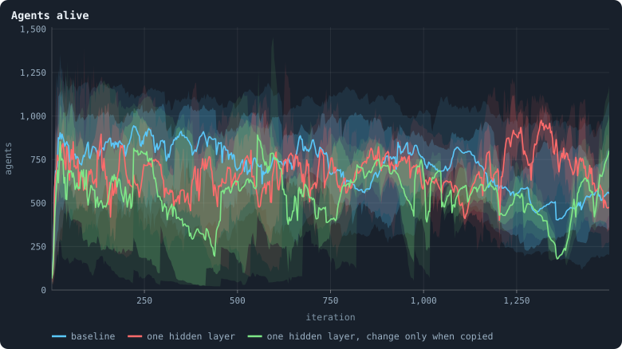

**Agents alive.** For each condition the median world at each iteration, with the middle half of the worlds (darker) and nine in ten (paler).

> [!example]- How to make this figure
> **Runs.** The 30 runs of Experiment 13 — at 5,000 tokens, seeds 1 to 10, 1,500 iterations — in three conditions: the baseline B1 (`B1-5000-s001` … `-s010`, shared with Experiment 12), its brains with one hidden layer of 16, and those brains changed only when copied. They are made with `python3 gol_lab.py run E13`.
>
> **Data.** From each run's `GraphOfLifeRuns/<run>/stats.jsonl`, which holds one row per recorded phase: `phase` 1 is the world just after reproduction, `phase` 2 just after the game, and every statistic is a field of the row (see [What a run records](runs-and-records.md#what-a-run-records)).
>
> 1. Take `nodes` of the rows with `phase` = 2, one line per run.
> 2. For each condition, the median, quartiles and 5th and 95th percentiles of the runs at each iteration (`book_figures.band_series`).
>
> **To make it again:** `python3 book_figures.py seeing`.
<!-- /figure -->

Every B1 world lived its 1,500 iterations. None ever fell below 74 agents
after iteration 50, and the median world's lowest was 188. Brains that see did
not do so well. With one hidden layer, four of the ten worlds died out, at
iterations 219, 478, 534 and 619; the other six fell as low as 84 to 231. With
one hidden layer and change only when copied, eight of ten died out, at
iterations 219, 292, 415, 454, 674, 820, 975 and 1,018. The two that lived
fell to 96 and 181.

"Died out" here means fell to 20 agents or fewer, where the lab stops a run as
extinct ([When a world ends](rules-in-detail.md#when-a-world-ends)). That rule ends some worlds that
would have lived ([How does a world's size follow its
tokens?](b1-the-network-size-and-scaling.md#worlds-of-many-sizes)). The pilot world with
one hidden layer that fell to a single agent at iteration 547 was seed 1, run
on without the rule, and it grew back.

<!-- figure seeing/lowest -->
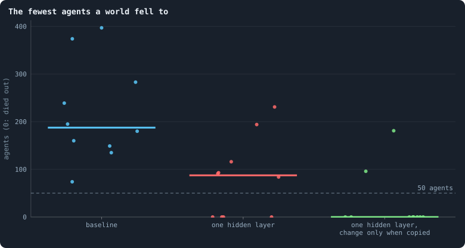

**The fewest agents a world fell to.** One dot per world: its fewest agents after the game of any iteration from 50 on, 0 for a world that died out; the bar is the median world. The dashed line is the thesis's 50 agents.

> [!example]- How to make this figure
> **Runs and data.** As for the figure *Agents alive* above.
>
> 1. Take the smallest `nodes` of the rows with `phase` = 2 and `iteration` ≥ 50; a run that ended extinct counts 0.
> 2. Count the worlds below 50 in each condition.
>
> **To make it again:** `python3 book_figures.py seeing`.
<!-- /figure -->

#### Verdict: the thesis holds

The thesis asked that at least six of the ten seeing worlds with change only
when copied fall below 50 agents or die out, and at most two of B1's. Eight
did, and none of B1's: **the thesis holds.** Brains that see break worlds. And
the second change, which the pilots had already found harmful, doubles the
toll of the first.

#### What kills a world

The pilots blamed the network: seeing brains leave links unused, unused links
are cut, and a world of trees falls apart. The ten worlds of each condition
say that this is only half of it.

**Not one big cut.** A world's largest single cull, the most agents ever cut
off at once, came in its first fifty iterations in seven of B1's worlds. Then
400 to 1,250 agents at a time were lost, as the first boom ended ([The first
hundred iterations](b1-lives-and-wealth.md#the-first-hundred-iterations)). The seeing worlds had
such early culls too. But the worlds that died out did not die of one of them:
each shrank over a hundred iterations or more.

**The network kills in every iteration, in every world.** No world of any
condition passes the health bar of [How to tell a world that keeps
evolving](how-to-tell-a-world-that-keeps-evolving.md#the-network-that-holds-in-numbers).
B1's median world had 51% of its agents in the 2-core, and a link whose loss
cut off 8% of it. The seeing worlds had 55% and 11%. With change only when
copied they had 46% and 6%, and there the best-connected agent was joined to a
fifth of the world in the median.

These networks are not clearly worse than B1's. What they share with it is
that agents are cut off all the time. From iteration 500 on, the cull removed
1.9% of the agents in every iteration of B1's median world, four times as many
as starved (0.5%). In the median world with one hidden layer it removed 5.3%.

<!-- figure seeing/health -->
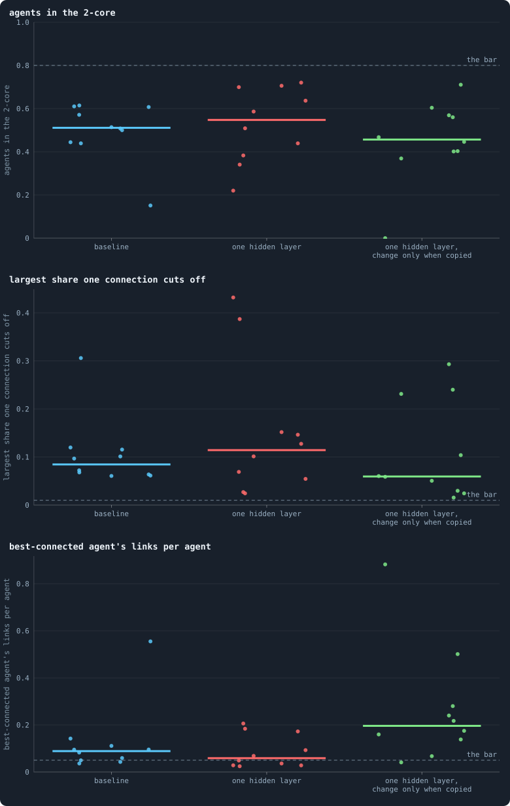

**How the network holds.** One dot per world, at its median over iterations 200 to 1,500 while it lived; the bar is the median world and the dashed line [the health bar](measuring-health.md#the-health-bar).

> [!example]- How to make this figure
> **Runs and data.** As for the figure *Agents alive* above.
>
> 1. Take `coreShare`, `cutRisk` and `maxDegree` / `nodes` of the rows with `phase` = 2 and 200 ≤ `iteration` ≤ 1,500, and each world's median of each.
>
> **To make it again:** `python3 book_figures.py seeing`.
<!-- /figure -->

**So births have to keep up.** A world whose agents are cut off and starve at
a few per cent per iteration lives only as long as it has as many children.
Seeing brains turn the population over faster. From iteration 500 on, the
median world with one hidden layer had 6.4 births per hundred agents and
iteration, against B1's 2.3, and it lost agents correspondingly faster. A
world shrinks whenever its births fall short of its losses for a while. And a
world that shrinks to a few dozen agents is a few unlucky games from the end.

<!-- figure seeing/births -->
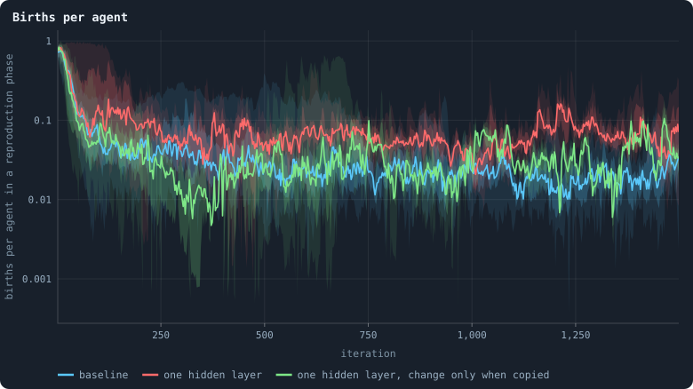

**Births per agent.** For each condition the median world at each iteration, with the middle half of the worlds (darker) and nine in ten (paler), on a logarithmic axis. A world that died out leaves the band when it does.

> [!example]- How to make this figure
> **Runs and data.** As for the figure *Agents alive* above.
>
> 1. Take `births` / `nodes_before` of the rows with `phase` = 1, one line per run.
> 2. For each condition, the median, quartiles and 5th and 95th percentiles of the runs at each iteration (`book_figures.band_series`).
>
> **To make it again:** `python3 book_figures.py seeing`.
<!-- /figure -->

**And seeing brains can stop having children.** In B1, whether an agent has a
child is close to a constant of its brain, because the brains barely see. With
one hidden layer it is a decision that depends on what the agent sees, and
evolution can change it a great deal. To see what it did, every [era](measuring-evolution.md#eras-contests-and-invasions-does-a-world-keep-getting-better "Brains of a world at two moments, its eras, played against each other: do the later ones win?")'s brains
were put back into the same world: their own run's founders' world, 50 agents
with 100 tokens each. There they played ten iterations with mutation off.

The founders' own brains had a child in about three agent-iterations in four
(73–75% in the median world of each condition). An agent-iteration is one
agent living through one iteration. Later brains had far fewer: 3 to 9 per
hundred in the median B1 world, and between 1 and 17 per hundred in the median
seeing world. But the seeing worlds spread far wider. In six of the twelve
worlds that died out, the last brains kept from them had no child at all,
though they were rich, in an empty world. The six worlds with one hidden layer
that lived to the end went the other way. Their last brains had children at 7
to 43 per hundred agent-iterations, 17 in the median, against 3 for B1's last
brains (0 to 13).

<!-- figure seeing/children -->
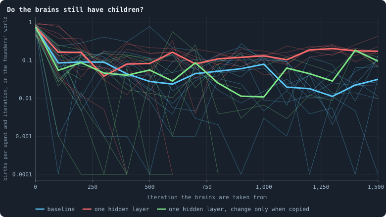

**Do the brains still have children?** Every era's brains play the same world — the founders' world of their own run, 50 agents of 100 tokens on the starting ring — for 10 iterations with mutation off. Thin lines: one world each, its births per agent and iteration, the mean of 2 draws; thick lines: the median world of each condition at each era, over the worlds that still lived. No birth at all is drawn at 0.0001.

> [!example]- How to make this figure
> **Runs.** As for the figure *Agents alive* above.
>
> **Data.** From each run's archive, `GraphOfLifeRuns/<run>/archive/world_<iteration>.npz`, kept every 100 iterations (every 50 for the baseline, of which every 100th is used).
>
> 1. For every era *e* that is a multiple of 100: take the archived world of iteration 0, give every agent a brain drawn at random from the agents of era *e* (`gol_tournament.mixed` with both eras *e*), clear the messages, switch mutation off and run 10 iterations; count the births of the reproduction phases over the agents alive at the start of each iteration (`oee.children`). Draws 5, 6.
> 2. Draw each world's rate by era, and each condition's median.
>
> **To make it again:** `python3 book_figures.py seeing`.
<!-- /figure -->

Why would brains give up their children? A brain spreads mostly by winning
nodes, not by having children: seventeen times more in B1 ([Questioning the
mechanics](questioning-the-mechanics.md#two-roads-of-inheritance)). And tokens
given to a child are tokens not staked. So giving up children may have been
selected, because a [lineage](measuring-evolution.md#families "A line of descent: the agents whose genotypes go back to one ancestor.") gains from keeping its tokens while the world it
lives in drains. Or a decision that had become easy to change may simply have
drifted to zero, in a world already small. These runs cannot say which.

Biologists know both roads to extinction. Selection that is good for each
lineage and fatal for the population is called **evolutionary suicide**
(Gyllenberg and Parvinen, 2001; Rankin and López-Sepulcre, 2005). A small
population whose losses make it smaller still is caught in an **extinction
vortex** (Gilpin and Soulé, 1986).

#### What sight teaches

Sight breaks worlds, but not quite the way the pilots suggested. Every world
of 5,000 tokens, blind or seeing, loses two to five agents in every hundred to
the cull in every iteration. Its network is fragile: half its agents hang in
trees outside the 2-core, and the rest is held together by narrow necks. B1
lives with that because its blind brains keep having children at a steady
rate. Brains that see make having children a real decision, one that evolution
can take away. And a world whose children no longer replace its losses dies.

Two things follow for the rules a world needs before anything can evolve in
it. Its network must stop killing: no agent should be lost because a link or a
neighbour vanished. That is what the rules of [the next
section](#a-world-that-cannot-break) do. And its births must keep up with its
deaths, whatever its brains decide. That depends on who dies, and why, the
subject of [the last section](#who-dies-and-why).

### A world that cannot break

<!-- experiment E14 -->

The seeing worlds bled: agents were cut off in every iteration, and a world
lived only while its births kept up. Nothing can evolve for long in a world
like that. A world that holds only while its brains keep breeding is at the
mercy of what evolution does to their breeding.

So before asking evolution to build anything, this section builds the ground
it stands on: rules that keep the network whole *however the agents play*. The
target is the health bar of [How to tell a world that keeps
evolving](how-to-tell-a-world-that-keeps-evolving.md#the-network-that-holds-in-numbers),
seven marks that a healthy network meets:

- one piece;
- at least 80% of agents in the 2-core;
- no agent whose loss cuts off more than 2% of the others;
- no connection whose loss cuts off more than 1%;
- no agent joined to more than 5% of the others;
- 3 to 12 connections per agent;
- a ball dimension between 2.3 and 4.

And every rule has to be **local**: it may only look at an agent and its
neighbours.

#### Space alone

A world's network is made by three forces. Births add an agent and its links.
Deaths take an agent and its links away. And the cull keeps only the largest
piece. The brains decide who has a child, who dies and which links are kept.
But before asking what brains do to the network, it pays to ask what the three
forces do on their own.

So take the brains away. In the model of `research/oee/space.py`, every agent
has a child in each iteration with a probability that is the same for all, and
then dies with probability 0.02. The probability of a child is set so that
births balance deaths at about 1,500 agents. While there are fewer, it is 0.05
higher, so that the world fills quickly. The world starts as a ring of 50
agents and runs 300 iterations. An agent lives 50 iterations on average, so
that is six lifetimes, and nothing of the start is left. What the network
looks like then is what the rules of space make by themselves. A run takes six
seconds, and each set of rules below was run with ten seeds.

<!-- figure unbreakable/space -->
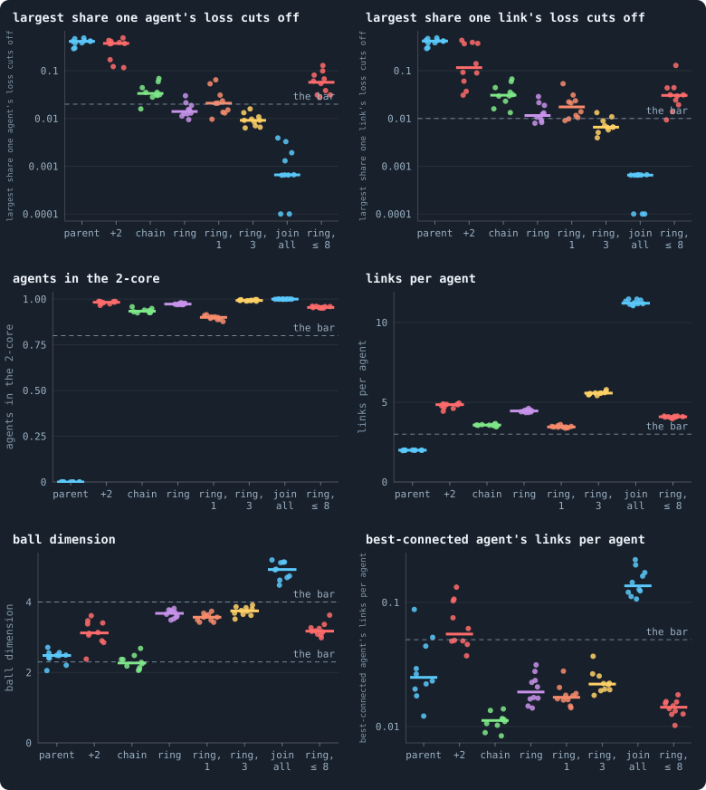

**What the rules of space make, with no brains.** Each column is one set of rules, each dot one world of about 1,500 agents after 300 iterations, the bar the median of ten. *parent*: a newborn is joined to its parent alone; *+2*: also to two of the parent's neighbours, drawn at random; *chain*: also, when an agent dies, the groups of its former neighbours that are not linked to one another are joined in a chain; *ring*: joined in a ring — B2's rules; *ring, 1* and *ring, 3*: the ring, with one or three of the parent's neighbours instead of two; *join all*: every former neighbour of the dead joined in a chain, linked or not; *ring, ≤ 8*: B2's rules, and no child for an agent of 8 links or more nor a newborn's random link to one (mending still links past the cap). The dashed lines are [the health bar](measuring-health.md#the-health-bar). Cut shares and the best-connected agent's share are drawn on logarithmic axes, a cut of nothing at 0.0001.

> [!example]- How to make this figure
> **Runs.** No runs: the worlds are made by the model itself, seeds 1 to 10 for every set of rules.
>
> **Data.** From the networks the model returns.
>
> 1. A world of no brains (`research/oee/space.py`): it starts as a ring of 50 agents, each joined to its 6 nearest (Watts–Strogatz, rewiring 0.2). Every iteration each agent has a child with probability 0.02 × 1,500 / *n*, plus 0.05 while there are fewer than 1,500 agents, and then dies with probability 0.02; after both, only the largest piece is kept. 300 iterations.
> 2. Measure the last network (`space.measure`): the largest share of the others one agent's loss would cut off from the largest piece (`GraphOfLife.worst_node_cut_share`), the same for one link (`cutRisk`), the 2-core, links per agent, the ball dimension, and the best-connected agent's links over the agents less one.
>
> **To make it again:** `python3 book_figures.py unbreakable`.
<!-- /figure -->

#### A tree of blobs

In the simplest rule, a newborn is joined to its parent and nothing else. Then
every birth adds one agent and one link. A network that only ever gains an
agent with one link is a **tree**: it has no loops at all. The first column of
the figure shows it: 2.0 links per agent, and nobody in the 2-core. In a tree,
every agent with two or more neighbours is a single point of failure, and
random deaths hit them all the time. One agent's loss could cut off 41% of the
world (the median of ten). The cull, which throws away everything not in the
largest piece, kept these worlds at about 420 agents instead of 1,500.

The obvious repair is to close loops at birth: join the newborn also to two of
its parent's neighbours, drawn at random. Every birth then closes two
triangles. Locally, the network is no longer a tree: 98% of agents are in the
2-core, and 85% in the 3-core. (The 3-core is what is left when agents with
fewer than three links are peeled away, again and again.) And yet one agent's
loss could still cut off 37% of the world, and one link's 12%.

The reason is that a birth can only close **small** loops. A newborn is joined
to agents at most two steps apart, so every loop it makes has length three.
Nothing in the model ever closes a *large* loop, one through distant parts of
the world. So at the large scale the network stays what it was: a tree, whose
nodes are now dense blobs instead of single agents. Blobs hang on each other
by **necks** of one or two agents, and a death in a neck cuts the world.

<!-- figure unbreakable/blobs -->
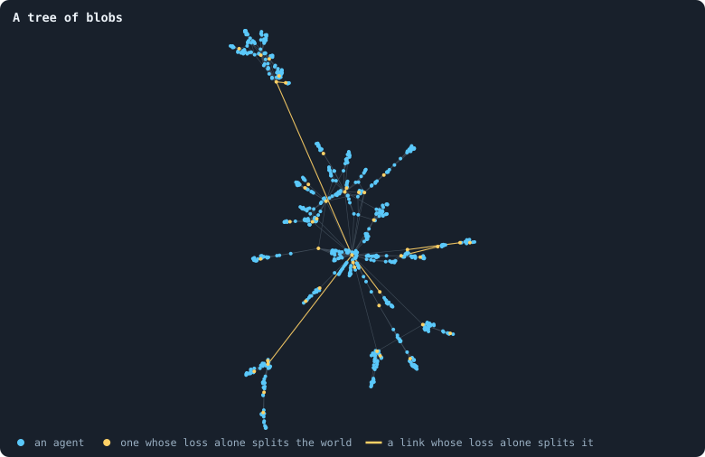

**A tree of blobs.** A world of the model aiming at 600 agents (605 at the end): newborns joined to their parent and two of its neighbours, nothing mended. Of seeds 1 to 5, the world that ended largest. Agents and links whose loss alone would split the world are drawn in the second colour, the links wider; the worst of them cuts off 15.2% of the world.

> [!example]- How to make this figure
> **Runs.** No runs: the model's worlds, seeds 1 to 5.
>
> **Data.** From the network the model returns.
>
> 1. A world of no brains (`research/oee/space.py`): it starts as a ring of 50 agents, each joined to its 6 nearest (Watts–Strogatz, rewiring 0.2). Every iteration each agent has a child with probability 0.02 × 600 / *n*, plus 0.05 while there are fewer than 600 agents, and then dies with probability 0.02; after both, only the largest piece is kept. 300 iterations.
> 2. Keep the world that ended with the most agents.
> 3. Find the bridges and the cut vertices (`networkx.bridges`, `networkx.articulation_points`), lay the network out with `networkx.forceatlas2_layout(G, max_iter=300, seed=1)` and draw it.
>
> **To make it again:** `python3 book_figures.py unbreakable`.
<!-- /figure -->

#### Mending a death

What cuts a world is a death. When agent *u* dies, two of its neighbours *x*
and *y* that were joined only through *u* are no longer joined at all, unless
something replaces *u*. **Mending**
([`mend_on_death`](settings.md#mend_on_death)) replaces it with a few new
links, all between *u*'s former neighbours:

1. Group the former neighbours by the links among them: two neighbours are in
   one group if a path of direct links *among the former neighbours* joins
   them.
2. Join the groups, each through its member with the fewest links (the lowest
   id among equals): the first to the second, the second to the third, and so
   on. When there are three groups or more, join the last back to the first,
   so that the groups form a **ring**.

An example. Agent *u* dies with neighbours *a*, *b*, *c* and *d*, and of these
only *a* and *b* are linked to each other. The groups are {*a*, *b*}, {*c*}
and {*d*}. Mending adds three links: the less-linked of *a* and *b* to *c*,
*c* to *d*, and *d* back to whichever of *a* and *b* has fewer links by then.
(Each member is chosen afresh, so the first link may have tipped it.) A chain
would have needed two links; the ring's third makes sure that no new link is
the only one between two groups. Had *a*, *b*, *c* and *d* all been linked in
a cycle, there would be one group and nothing to add: the death left no hole.

**A mended death never splits the world.** Take any two agents that were
joined before *u* died. If a path between them avoided *u*, it is still there.
If every path went through *u*, take one: it enters *u* from some neighbour
*x* and leaves to some neighbour *y*. After the mending, *x* and *y* are
joined by a path that uses only former neighbours of *u*, through their
groups' links and the new ones. Splice it in where *u* was, and the two agents
are joined again. So connectivity is kept, and the cull never fires because of
a death. The only way left for a mended world to break is through links being
cut, which is the subject of [What the game adds](#what-the-game-adds) below.

In the figure, mending in a ring (the fourth column) brings the largest cut by
one agent from 37% to 1.4%. The largest cut by one link falls from 12% to
1.2%, just above the bar's 1%. The world has 4.5 links per agent, 97% of its
agents in the 2-core, and a ball dimension of 3.7. It stays at its 1,500
agents, because the cull has nothing left to do.

<!-- figure unbreakable/mended -->
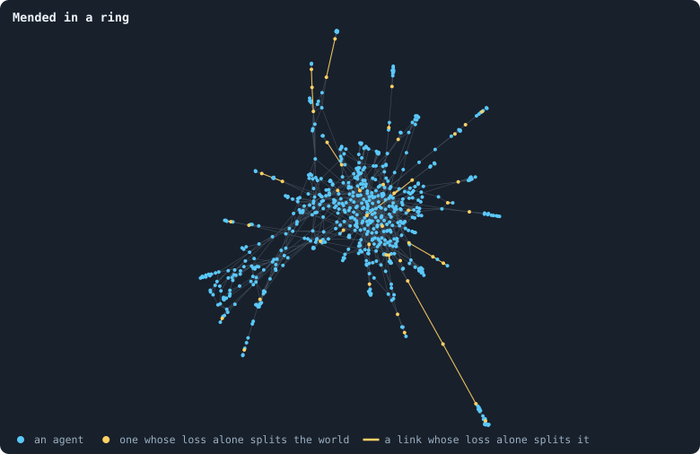

**Mended in a ring.** A world of the model aiming at 600 agents (637 at the end): the same, and every death mended in a ring. Of seeds 1 to 5, the world that ended largest. Agents and links whose loss alone would split the world are drawn in the second colour, the links wider; the worst of them cuts off 2.8% of the world.

> [!example]- How to make this figure
> **Runs, data and steps.** As for the figure *A tree of blobs* above.
>
> **To make it again:** `python3 book_figures.py unbreakable`.
<!-- /figure -->

Mending in a **chain**, the same rule without the link back to the first
group, keeps the world in one piece just as well, by the same argument. But
the network it makes is different: its dimension falls to 2.3, and its
[diameter](measuring-networks.md#radius-and-diameter "The longest of the shortest paths between two agents of a world.") doubles to 38 steps. Every death replaces a star (*u* at the centre,
its groups around it) with a path through the groups. A world in which stars
keep turning into paths is stretched thin, towards a line. The ring replaces
the star with a cycle instead: every two groups are at most half the ring
apart, and no new link is the only one between two groups.

#### Too much, and too little

Mending everything, joining *all* the former neighbours of the dead in a
chain, linked or not, removes the cuts entirely (0.07%). But it has a price.
An agent that lives long collects a link from almost every death around it,
and the world contracts into hubs: the best-connected agent is joined to 14%
of the others. There are 11 links per agent, a diameter of 6 and a dimension
of 4.9. That is not three-dimensional space; it is a crowd.

The number of the parent's neighbours a newborn is joined to,
[`birth_links`](settings.md#birth_links), sets how thick the blobs are. With
one, only 15% of agents are in the 3-core, and the cuts are 2.1% and 1.7%.
With three, the world passes every mark of the health bar: cuts of 0.9% and
0.7%, 99% in the 2-core, 5.6 links per agent, dimension 3.7.

And a cap on links helps nothing here. In the last column, an agent with 8
links or more may have no child and receives no newborn's random link (mending
still links past the cap). Then the cuts *grow*, to 5.7% and 3.0%. The likely
reason: births shift towards the thinly linked parts of the world, where the
cuts are. In this model there is nothing for a cap to stop, because no agent
prefers anyone. It is the brains that will need it.

Each rule, then, answers one force: links at birth close small loops, and the
ring mends what deaths cut, and only what deaths cut. What the model does not
contain is the game, and the game brings forces of its own.

> [!example]- The model, to run yourself
> ```
> python3 research/oee/space.py --links 0
> python3 research/oee/space.py --links 2
> python3 research/oee/space.py --links 2 --mend
> python3 research/oee/space.py --links 2 --mend --ring
> python3 research/oee/space.py --links 3 --mend --ring
> python3 research/oee/space.py --links 2 --mend-all
> python3 research/oee/space.py --links 2 --mend --ring --cap 8
> ```
> Each prints the world at the end: agents, links per agent, the shares in
> the 2-core and 3-core, the largest share one agent's or one link's loss cuts
> off, the ball dimension, the diameter and the best-connected agent's share.
> `--seed`, `--target`, `--deaths` and `--steps` change the rest.

#### What the game adds

Put the brains back, and three things the model did not have start cutting the
network.

**Unused links lapse.** At the end of a game, a link that carried no tokens is
cut. A blind brain spreads its stake over everyone, so every link carries
something. A seeing brain stakes on one neighbour or two, and most of its
links lapse. Every lapse that leaves a part of the world hanging on nothing
hands that part to the cull. That is the steady toll that every world of 5,000
tokens paid in [Experiment 13](#what-kills-a-world), blind or seeing.

The rule [`prune_needs`](settings.md#prune_needs) lets an unused link lapse
only if its two ends share at least that many neighbours. With 1, removing the
link leaves a path of two steps between its ends, so no lapse can cut the
world. But in time the network can thin into a *cactus*: triangles glued to
each other at single agents. Every one of those agents is a cut vertex, an
agent whose loss alone splits the world. With 2, a link may go only if two
paths of two steps remain. Then a lapse can neither cut the world nor leave
two agents hanging on one agent between them. Links that carry tokens are
never touched.

**Brains like some neighbours more.** When a brain chooses whom to link to, it
ranks its candidates by what it sees of them. Whatever it favours, agents that
already have many links are offered as candidates more often, because they are
the neighbours of more agents. That is preferential attachment, and it grows
hubs ([Preferential attachment](measures-of-the-archived-studies.md#preferential-attachment-and-its-kernel)). In pilots where
the brains chose a newborn's two extra links, the best-connected agent was
joined to 30% of the world.

Two rules answer it. The newborn's [`birth_links`](settings.md#birth_links)
are drawn at random rather than chosen. And [`valence`](settings.md#valence) =
8 caps the links a brain may *choose*: an agent with 8 has no child, and no
chosen link is made to it. A newborn's two random links and mending are exempt
from the cap. The first are the rule of space itself; the second only replaces
links that were lost.

**A parent can give its links away.** With
[`allow_handover`](settings.md#allow_handover), a parent moves some of its
links to its newborn, and a parent that hands over all but one hangs on that
one. B2 switches it off.

#### B2, rule by rule

**B2** is the second baseline, built for open-ended evolution. It is B1 with
these changes:

- brains of one hidden layer of 16 units, which change only when copied
  ([above](#brains-that-see-and-worlds-that-break));
- shorter messages: 8 numbers, and no extra look before acting;
- an agent's stake on its own node counting 1.5 times
  ([`incumbency`](settings.md#incumbency));
- the rules of space of this section: links at birth 2, mending in a ring,
  `prune_needs` 2, valence 8, no handover;
- the rules of death of [Who dies, and why](#who-dies-and-why), below: 30% of
  an agent's tokens kept at home, so that nobody stakes itself to death;
  children of at least 10 tokens; and death at age 100.

B2 keeps change only when copied, although Experiment 13 found it harmful. It
is what heredity means: a brain that is not copied stays itself. And the harm
it did there was the drain of worlds whose births fell short of the cull,
which B2's other rules remove. [How this was made](#how-this-was-made-building-b2) lists
every setting.

A first engine run of B2 (5,000 tokens, seed 1) held through iteration 400.
Every agent was in the 2-core, no single agent or link could cut anyone off,
and the world had 5.1 to 5.3 links per agent and a dimension of 3.1 to 3.7.
Prototype worlds under the same rules of space, from 1,250 to 10,000 tokens
and two seeds each, held to iteration 800. They had 99.7% of agents or more in
the 2-core, the best-connected agent joined to 1–5% of the others, and 4 to 5
links per agent. But in the smaller of them, one link's loss could at times
cut off 2–3%, above the bar.

One world is a hint. Experiment 14 runs B2 ten times at 5,000 tokens for 1,000
iterations. Five more conditions each take one rule away (or, for handover,
put one back), to see whether every rule is needed. We expected every B2 world
to pass the whole health bar, with nobody cut off. And we expected each
condition without one of the rules to fail some mark in most of its worlds.

<!-- thesis E14 -->
> [!quote] The thesis of Experiment 14, written down before any of its runs existed
> **The claim.** Under all the rules of B2 every world keeps a network that holds: from iteration 200 to 1,000 every one of ten worlds of 5,000 tokens has all its agents in one piece in every frame, and its medians over those frames pass every line of the health bar of Chapter [49](how-to-tell-a-world-that-keeps-evolving.md) — at least 80% of agents in the 2-core, no connection whose loss cuts off more than 1% of them, no agent joined to more than 5% of the others, 3 to 12 connections per agent, a ball dimension between 2.3 and 4. Each rule taken away on its own breaks some line of it in at least half of the worlds.
>
> **Why it would be so.** Births by themselves grow a tree of blobs, and random deaths cut its necks: in the space-only model of research/oee/space.py (1,500 agents, no brains) one agent's loss could cut off 40% of the world. A newborn joined to its parent and two of its neighbours, and deaths mended in a ring, bring that to 1.1–1.3% with a dimension of 3.4–3.6. Under the game, unused links lapsing cut what mending saves unless only redundant links may lapse; a brain's liking for well-connected neighbours makes hubs unless their number is capped; and a parent handing its links to its child leaves itself hanging. In the engine, B2's seed 1 at 5,000 tokens kept everyone in the 2-core with no single cut at all, 5.1–5.3 connections per agent and a dimension of 3.1–3.7 through iteration 400.
>
> **It holds if:** All ten B2 worlds: no agent cut off in any cull from iteration 200 on, and median coreShare ≥ 0.8, cutRisk ≤ 0.01, maxDegree/nodes ≤ 0.05, meanDegree in 3–12 and dimension in 2.3–4 over iterations 200 to 1,000. And for each of the five conditions that take one rule away, at least five of its ten worlds fail at least one of these.
>
> **It fails if:** A B2 world fails a line of the bar: the rules do not make a network that holds. Or a condition without one of the rules has fewer than five failing worlds: that rule is not needed.
<!-- /thesis -->

#### Nobody cut off

The most direct measure of a world that cannot break is how many of its agents
were cut off. Such agents die not of age or hunger, but because their network
came apart and the cull removed every piece but the largest.

<!-- figure unbreakable/lost -->
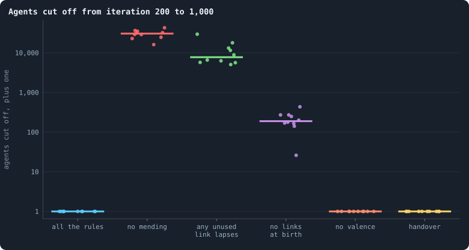

**Agents cut off from iteration 200 to 1,000.** One dot per world: every agent the cull removed because it was no longer joined to the largest piece, in either phase, from iteration 200 to 1,000 — plus one, so that a world that lost nobody sits at 1 on the logarithmic axis. The bar is the median world.

> [!example]- How to make this figure
> **Runs.** The 60 runs of Experiment 14 — B2 at 5,000 tokens, seeds 1 to 10, 1,000 iterations — in six conditions: all the rules of B2, and B2 with one of them taken away or changed. They are made with `python3 gol_lab.py run E14`.
>
> **Data.** As for the figure *Agents alive* above.
>
> 1. Sum `orphaned` over the rows of both phases with 200 ≤ `iteration` ≤ 1,000.
> 2. Add one, and draw a dot per world.
>
> **To make it again:** `python3 book_figures.py unbreakable`.
<!-- /figure -->

**Under all of B2's rules, nobody.** In none of the ten worlds was a single
agent cut off between iteration 200 and iteration 1,000. Every agent sat in
the 2-core in every world. In the median frame of every world, no link and no
agent existed whose loss alone would have cut anything off: not a single cut
vertex among 800 to 1,800 agents. Read every tenth iteration, the worst a
single agent's loss could have done at any moment was to cut off 1.2% of a
world, below the bar's 2%. The best-connected agent was joined to 2.1 to 3.1%
of the others. An agent had 5.0 to 5.8 links in the median frame of its world,
and the ball dimension was 3.45 to 4.19, 3.86 in the median world.

<!-- figure unbreakable/bar -->
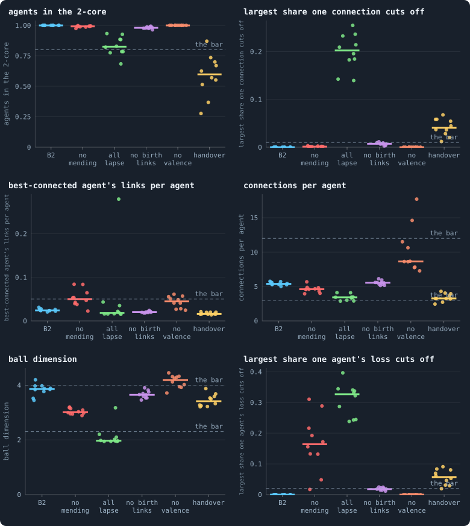

**Each rule against the health bar.** One dot per world, at its median over iterations 200 to 1,000; the bar is the median world; dashed lines are [the health bar](measuring-health.md#the-health-bar). *B2*: every rule; *no mending*: deaths not mended; *all lapse*: any unused link lapses; *no birth links*: a newborn joined to its parent alone; *no valence*: no cap on chosen links; *handover*: a parent may hand its links to its child.

> [!example]- How to make this figure
> **Runs and data.** As for the figure *Agents cut off from iteration 200 to 1,000* above.
>
> 1. For every run take the rows with `phase` = 2 and 200 ≤ `iteration` ≤ 1,000, and the median of `coreShare`, `cutRisk`, `maxDegree` / `nodes`, `meanDegree` and `dimension`.
> 2. No run records the worst cut by one agent, so read it off the frames: every 10th iteration from 200 to 1,000, rebuild the network after the game and take `GraphOfLife.worst_node_cut_share` (`oee.node_cut`); its median.
> 3. A world holds if every median is inside the bar and `orphaned` is 0 in every row of either phase in the same iterations.
>
> **To make it again:** `python3 book_figures.py unbreakable`.
<!-- /figure -->

#### Each rule taken away breaks something

Each condition broke something different.

- **No mending.** Now every death by age can cut, and every iteration someone
  dies of age. The worlds lost 16,000 to 43,000 agents to the cull in 800
  iterations: worlds of 640 to 1,400 agents lost twenty to fifty of them in
  every iteration. Strikingly, no single *link* could cut off more than 0.3%:
  the worlds were knit at every link, but hung together at agents. One agent's
  loss could cut off 16% of the world in the median frame of the median world
  (2% to 31%). In every world there were moments when a single agent held half
  of it to the rest. Without the deaths that mending answers, links at birth
  alone only make the model's tree of blobs.
- **Any unused link lapses.** The network thins towards a tree: a ball
  dimension of 2.0, one link's loss cutting off a fifth of the world, one
  agent's a third, and 18% of agents outside the 2-core. Between 5,000 and
  30,000 agents were cut off, and one world died out at iteration 532.
- **No links at birth.** Mending keeps deaths from cutting, but a newborn
  joined only to its parent hangs on it. Between 25 and 434 agents were cut
  off, and one agent's loss could cut off 1.2 to 2.5% (above the bar's 2% in
  four worlds).
- **No valence.** Nobody was cut off, but the links ran away: 8.7 per agent in
  the median world, and up to 17.7. The best-connected agent was joined to up
  to 6% of the others, and the dimension was above 4 in seven worlds. It is
  the crowd the model made when it mended everything.
- **Handover.** Nobody was cut off, because mending and the pruning rule still
  hold. But 40% of the agents hung in trees outside the 2-core in the median
  world, and one link's loss could cut off 4%.

<!-- figure unbreakable/agents -->
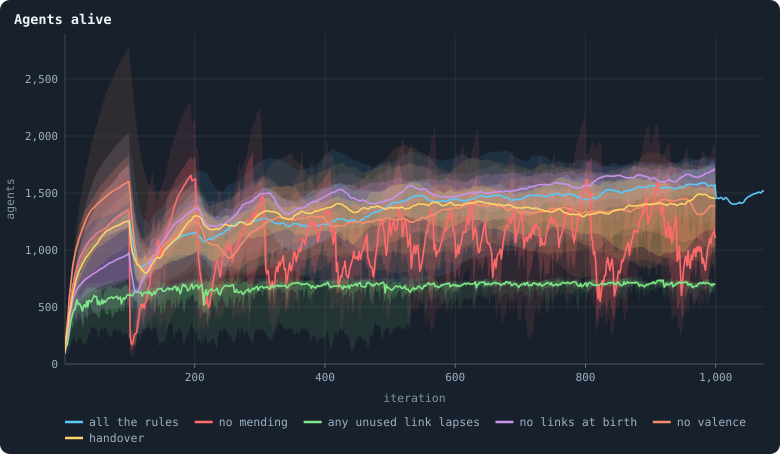

**Agents alive.** For each condition the median world at each iteration, with the middle half of the worlds (darker) and nine in ten (paler). A world that died out leaves the band when it does.

> [!example]- How to make this figure
> **Runs and data.** As for the figure *Agents cut off from iteration 200 to 1,000* above.
>
> Steps 1–2 as for the figure *Agents alive* above.
>
> **To make it again:** `python3 book_figures.py unbreakable`.
<!-- /figure -->

#### Verdict: refuted by one world's dimension

The thesis asked two things. First, every one of the ten B2 worlds should
pass every mark of the health bar, with nobody cut off. Nine did; the tenth
(seed 5) failed by one mark, with a median ball dimension of 4.19 against the
bar's 4. Second, each condition that takes a rule away should fail some mark
in at least five of its ten worlds. Every one did, in nine or ten.
**Strictly, the thesis is refuted**, by one world's dimension. Everything it
was about held: no B2 world lost an agent to a cut, and every rule turned out
to be needed.

The thesis's test lists five marks of the bar. The sixth, the cut by one
agent, is not in the recorded statistics, so it was read off the frames
afterwards. B2 passed it everywhere.

#### What the four rules do, and what they do not

Four local rules make a network with no single point of failure at all, under
brains that see, at every frame of every world. Each answers one force:

- a newborn joined to two of its parent's neighbours: births close small
  loops;
- a death mended in a ring: mending repairs what deaths would cut;
- an unused link that lapses only where its ends share two neighbours: the
  game cannot cut;
- a cap on the links a brain chooses: the brains cannot pile links on a few
  agents.

What they do not make is a space of three dimensions. By the health bar's
measure, B2's worlds sit at 3.4 to 4.2, at the top of the bar. The model shows
why: every mending adds links where a neighbourhood was, and a world that is
mended everywhere is drawn together. [What folds a
world](how-many-dimensions-does-a-world-have.md#what-folds-a-world) later read B2's worlds with fuller rulers. They
are not spaces at all, but nearly small worlds: a typical agent is about as
near to everyone as in a random network with the same links. Deaths mended in
a ring fold a world once its first generation dies. And the dimension the bar
reads off the first few steps grows with the room a world has.

A world closer to three dimensions would need fewer links at birth, or sparser
mending. The model says what fewer links cost: with one link at birth, cuts of
2% instead of 1.4%. And in the model without brains, the sparsest mending that
keeps a world whole stretches it into a line ([What folds a
world](how-many-dimensions-does-a-world-have.md#what-folds-a-world)). That mending joins only the pieces a death
would split the world into. A world that is a space of three dimensions, and
that no single loss can cut, has to sit between the two.

The next experiments keep B2 as it is: a world in which no agent is ever lost
to a cut. So every death that remains is a death of age, and every change in a
population is evolution's. Which deaths a world needs is the subject of the
next section.

### Who dies, and why

<!-- experiment E15 -->

Under B2's rules of space, nobody is cut off. What is left is the other way to
die: starving, by staking one's last token away. And there is a question that
B1 never had to ask: which deaths does a world *need*?

Deaths matter twice. They make room: a world of fixed tokens has new agents
only where old ones have gone. And they are where selection can act on whole
agents, rather than on the brains they carry. But a death can also carry no
information at all: an agent that dies because a link lapsed somewhere, or
because it was born with one token and spent it. Such deaths only add noise.
This section asks what each rule of death does, using the pilots that led to
B2, and then tests it with Experiment 15.

#### Ways to die

In B1 an agent dies in one of four ways ([Births and the four ways to
die](measuring-lives.md#births-and-the-four-ways-to-die)). It **starves**, holding no tokens, or it is **cut
off** from the largest piece, after either of the two phases. B2 adds a fifth:
it dies of **age**, when it has lived [`max_age`](settings.md#max_age)
iterations. Winning a node does not kill anyone. It replaces the node's brain;
the agent, its age and its links stay. ([Questioning the
mechanics](questioning-the-mechanics.md#two-roads-of-inheritance) calls agents
bodies, and brains what moves between them.)

#### Children as missiles

The first pilots of the rules of space joined every newborn to its parent and
two of its neighbours, and mended every death. The worlds never split, and
still they shrank: 30 to 60% of their agents starved in a single game. The
starving were children. Of these, 46% were born that very iteration, and 83%
at most two iterations before. They held one or two tokens, which they staked
in full on a neighbour.

A parent that gives a child one token and lets it stake everything spends the
child as a **missile**. If the stake wins the neighbour's node, the node goes
to the child's brain, which is the parent's lineage. If it loses, the lineage
has lost a token. It is a cheap attack, and evolution found it.

Mending made it worse. Every starved child's neighbours were joined up, so
[degrees](measuring-networks.md#degree "The number of an agent's connections: how many neighbours it has.") climbed to 11–14 links. Every agent's stake was split over more
neighbours, and more of them starved. Letting a newborn keep everything at
home in its first game only delayed the missile by a game.

Two rules remove the missile. A child must be worth having:
[`min_child`](settings.md#min_child) = 10 gives no child to a parent who would
give it fewer than ten tokens. And an agent must not be able to stake itself
to death.

#### The last token

The simplest way to stop agents starving is to keep their last token at home,
whatever the brain says. In a pilot with that rule nobody starved. But at
iteration 1,500, three agents in four held exactly one token (75%, and 8% held
two), against 1% in B1's blind world. The game was played by a fifth of the
world.

The reason is that the rule makes an all-in attack free. An agent that cannot
lose its last token can stake everything else on one neighbour and lose
nothing that matters to it. Seeing brains do exactly that, and the agents they
attack are left with the token they could not lose. Such **zombies** cannot
have children, and still each takes a place.

Without the rule, the same worlds starved: both pilot seeds were down to a
single agent holding all 5,000 tokens by iteration 300.

#### A share kept at home

The middle way is to keep a *share* at home.
[`keep_home`](settings.md#keep_home) = *f* keeps ⌈*f t*⌉ of an agent's *t*
tokens on its own node, rounded up and never fewer than one, and lets its
brain stake the rest. With *f* = 0.3, an agent with 10 tokens stakes at most
7, one with 3 tokens at most 2, and one with a single token nothing. Nobody
starves, because nobody can stake its last token. And an all-in attack is no
longer free, because nearly a third of what an agent has stays where it can
defend it. In pilots with *f* = 0.3, 35 to 61% of the agents held one token:
fewer than with the last token kept, but still many.

A parent keeps at least one token too, so a birth can never starve it.

#### Holding one's place

A brain dies too, when the node it sits on is won. In B1 that happens to 40 to
90% of the nodes in every game. A brain lasts a game or two wherever it is,
and an agent's body outlives a long series of brains ([Questioning the
mechanics](questioning-the-mechanics.md#two-roads-of-inheritance)). [What the
measurements say about open-ended
evolution](what-the-baseline-world-is.md#what-stands-in-the-way)
counts this among the obstacles: conquest erases, and nothing can be held.

[`incumbency`](settings.md#incumbency) weighs an agent's stake on its own node
more than anyone else's. With *h* = 2, an attacker must stake more than twice
what the defender stakes at home. In pilots with brains that see, conquest
fell to 15–25% of the nodes in a game, and births came back as the way brains
spread.

But the worlds found an exploit. One agent gathered 57% of all the tokens and
staked all of them at home, where nobody could outbid them. It had child after
child, while everyone else held a single token: a **queen**. With *h* = 1.5,
as in B2, and a share kept at home, no queen formed in the pilots: the Gini
coefficient of tokens stayed near 0.5. Conquest settled between a few and
about ten per cent of the nodes a game.

#### Old age

With a share kept at home and the rules of space above, nothing kills an agent
any more. It cannot starve, it cannot be cut off, and winning its node changes
only its brain. An agent that cannot die holds its place forever. And in a
world of fixed tokens, a world without deaths has no room for births.

So in B2 every agent dies when it reaches age 100
([`max_age`](settings.md#max_age)). Its tokens are shared out like any estate,
and its neighbourhood is mended. That makes a world's demography simple. Every
agent lives exactly 100 iterations, so a world keeps its size only if one
agent in a hundred has a child in every iteration. In the ten B2 worlds of
Experiment 14, from iteration 200 to 1,000, births ran at 1.00 to 1.05 per
hundred agents and iteration. Not one agent starved or was cut off. The
population settles where enough agents are rich enough to give a child ten
tokens.

Old age also answers what [Experiment 13](#what-kills-a-world) left open.
There, seeing brains could give up having children, and a world whose births
fell short of its losses drained slowly. Under old age, a line that stops
having children loses a body every time one of its agents turns 100. It keeps
its place only by winning nodes from lines that still breed.

#### The rules of death in B2

| rule | B2 | what it removes |
|---|---|---|
| [`incumbency`](settings.md#incumbency) | 1.5 | a brain lost in almost every game |
| [`keep_home`](settings.md#keep_home) | 0.3 | starving; the free all-in attack |
| [`min_child`](settings.md#min_child) | 10 | children spent as missiles |
| [`max_age`](settings.md#max_age) | 100 | agents that hold a place forever; a world without births |

Experiment 15 runs B2 at 10,000 tokens for 1,000 iterations, with ten seeds.
It changes one rule of death at a time:

- only the last token kept (`keep_home` 0.01, which keeps one token for anyone
  with up to a hundred);
- nothing kept;
- half kept;
- children of any size;
- no old age.

The pilots suggested that what an agent keeps at home decides who is left to
play. So we expected fewer than half of B2's agents to hold a single token,
and more than two in three when only the last token is kept. Worlds that keep
nothing, we expected, would starve.

<!-- thesis E15 -->
> [!quote] The thesis of Experiment 15, written down before any of its runs existed
> **The claim.** How agents die decides who is left to play. In B2, with at least 30% of an agent's tokens kept at home, fewer than half the agents hold a single token after iteration 300; with only the last token kept, more than two in three do; with nothing kept, worlds starve: at least half fall below 100 agents within 1,000 iterations.
>
> **Why it would be so.** An agent that cannot lose its last token can stake everything else on one neighbour at no risk to itself, and brains that see do: in a pilot with only the last token kept, 75% of the agents held exactly one token at iteration 1,500, against 1% in the baseline's blind world. Kept to 30% of its tokens, an agent's stake stays spread: 35–61% at one token in pilots. With nothing kept, agents stake themselves to death and worlds starved to a single agent within 300 iterations in both pilot seeds.
>
> **It holds if:** Median over iterations 300 to 1,000 of the share of agents holding one token (from the frames): below 0.5 in at least 7 of the 10 B2 worlds, above 0.67 in at least 7 of the 10 worlds with keep_home 0.01; and at least 5 of the 10 worlds with keep_home 0 have fewer than 100 agents after some game.
>
> **It fails if:** Any of the three fails: the share at one token does not follow what is kept at home, or worlds without it do not starve.
<!-- /thesis -->

#### What each rule of death did

The ten worlds that kept nothing at home did not last. Every one died out
within 26 to 47 iterations, its agents staking their last tokens away, as in
the pilots. The other fifty lived their 1,000 iterations.

<!-- figure whodies/agents -->
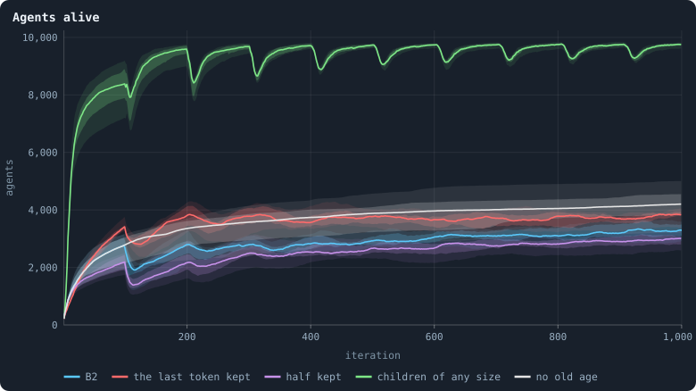

**Agents alive.** Each band is ten worlds: the line their median, the shade the middle half and nine in ten. The worlds that kept nothing at home died out within 50 iterations and are not drawn.

> [!example]- How to make this figure
> **Runs.** The 60 runs of Experiment 15 — B2 at 10,000 tokens, seeds 1 to 10, 1,000 iterations — in six conditions: B2, and B2 with one rule of death changed. The ten worlds with nothing kept died out within 50 iterations and are not drawn. They are made with `python3 gol_lab.py run E15`.
>
> **Data.** From each run's `GraphOfLifeRuns/<run>/stats.jsonl`, one row per recorded phase (see [What a run records](runs-and-records.md#what-a-run-records)).
>
> 1. Read `nodes` from the rows of phase 2, for iterations 0 to 1,000.
> 2. At each iteration, the median of the ten worlds, the middle half and nine in ten.
>
> **To make it again:** `python3 book_figures.py whodies`.
<!-- /figure -->

<!-- figure whodies/births -->
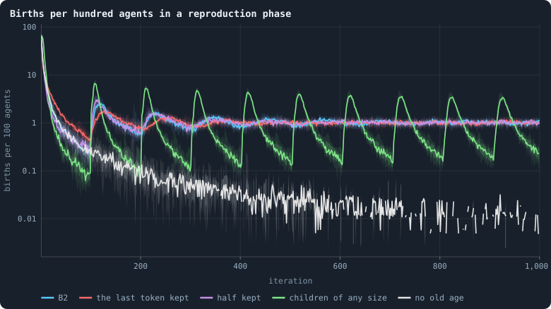

**Births per hundred agents in a reproduction phase.** Each band is ten worlds: the line their median, the shade the middle half and nine in ten. The worlds that kept nothing at home died out within 50 iterations and are not drawn. A logarithmic axis: births fall a hundredfold without old age.

> [!example]- How to make this figure
> **Runs and data.** As for the figure *Agents alive* above.
>
> 1. Read `births` from the rows of phase 1, divided by the agents that faced the phase (`nodes_before`), times 100, for iterations 0 to 1,000.
> 2. At each iteration, the median of the ten worlds, the middle half and nine in ten.
>
> **To make it again:** `python3 book_figures.py whodies`.
<!-- /figure -->

The births tell the rules apart most plainly. Wherever agents die at 100, a
world settles where one agent in a hundred has a child in every iteration,
whatever is kept at home. That is what a life of 100 iterations needs to keep
a world's size. Without old age, births fall to about one in ten thousand by
iteration 1,000, because the founders hold every place and nobody has room for
a child. With children of any size, births come in waves a hundred iterations
apart. A world fills at once with one-token children; they grow old together,
die in the same iteration, and are replaced at once.

<!-- figure whodies/median -->
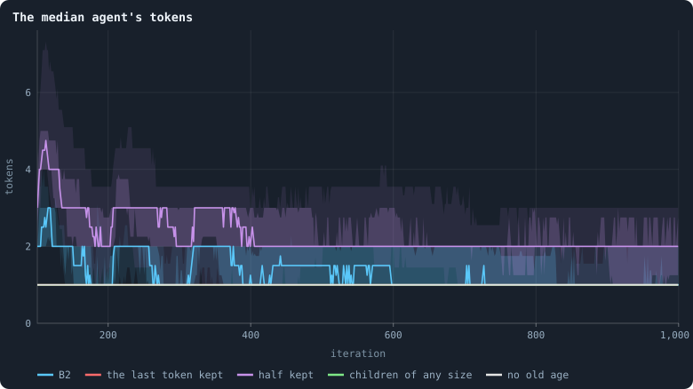

**The median agent's tokens.** Each band is ten worlds: the line their median, the shade the middle half and nine in ten. The worlds that kept nothing at home died out within 50 iterations and are not drawn. From iteration 100, once the founders' first riches are spent.

> [!example]- How to make this figure
> **Runs and data.** As for the figure *Agents alive* above.
>
> 1. Read `medianTokens` from the rows of phase 2, for iterations 100 to 1,000.
> 2. At each iteration, the median of the ten worlds, the middle half and nine in ten.
>
> **To make it again:** `python3 book_figures.py whodies`.
<!-- /figure -->

| rule of death | agents | at a single token | the median agent's tokens | Gini | births per 100 agents an iteration | brains of 1,000 against 500 |
|---|---|---|---|---|---|---|
| B2: 30% kept at home, children of at least ten tokens, death at 100 | 3,030 | 52% | 1.2 | 0.52 | 1.02 | 0.68 |
| the last token kept | 3,688 | 77% | 1.0 | 0.57 | 1.00 | 0.54 |
| half kept | 2,688 | 37% | 2.3 | 0.48 | 1.01 | 0.75 |
| children of any size | 9,543 | 97% | 1.0 | 0.04 | 1.04 | 0.61 |
| no old age | 3,939 | 84% | 1.0 | 0.58 | 0.03 | 0.52 |

Each number is a median over the ten worlds of one number per world, read over
iterations 300 to 1,000. That number is the world's mean, or, for the share at
a single token, its median game, as the thesis asked. The last column is the
share of a contested world that the brains of iteration 1,000 hold against
those of 500 over an agent's lifetime ([below](#does-evolution-go-on-building-b2)); for
every rule but B2 it comes from five of the ten worlds. Keeping nothing is
left out: those worlds were gone.

<!-- figure whodies/one_token -->
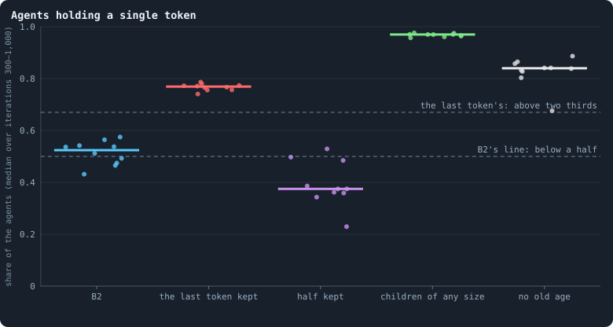

**Agents holding a single token.** Each dot is a world: the share of its agents holding exactly one token after each game, its median over iterations 300 to 1,000; the bar is the median world. The thesis asked B2's worlds to stay below a half and the worlds keeping only the last token to rise above two thirds, seven times in ten each.

> [!example]- How to make this figure
> **Runs.** As for the figure *Agents alive* above.
>
> **Data.** From each run's game frames, `GraphOfLifeRuns/<run>/frames/` (`research/oee/checks/e15_thesis.py`).
>
> 1. For every iteration from 300 to 1,000, read the frame after the game (frame 2t + 1) and count the agents holding exactly one token, as a share of all.
> 2. Take each world's median over those 701 games.
>
> **To make it again:** `python3 book_figures.py whodies`.
<!-- /figure -->

#### Verdict: refuted by B2's own worlds

The thesis asked three things of the share of agents holding a single token,
in each world's median game from iteration 300 to 1,000:

- below a half in at least seven of B2's ten worlds: four were;
- above two thirds in at least seven of the ten worlds keeping only the last
  token: all ten were;
- at least five of the ten worlds keeping nothing below 100 agents after some
  game: all ten died out.

**Strictly, the thesis is refuted**, by B2's own worlds. They keep about half
their agents at a single token, not fewer than half: 43% to 57%, and only four
of ten below the line. Everything else it said held. Keeping only the last
token left more than two agents in three at one token in every world (74% to
79%), and every world that kept nothing died out.

And the order it predicted holds across the rules: the more an agent keeps at
home, the fewer agents hold a single token. That share is 37% with half kept,
52% in B2, and 77% with only the last token. The two rules the thesis did not
name push the other way: 84% without old age, and 97% with children of any
size.

#### Does evolution go on? (building B2)
What is left to play also decides how much evolution there is. Played a
lifetime long, the brains of iteration 1,000 beat those of 500 in B2's worlds
(0.68, ten worlds), and more clearly where half is kept at home (0.75, five
worlds). They beat them less with children of any size (0.61), and hardly at
all where only the last token is kept (0.54) or nobody dies of age (0.52).

<!-- figure whodies/evolution -->
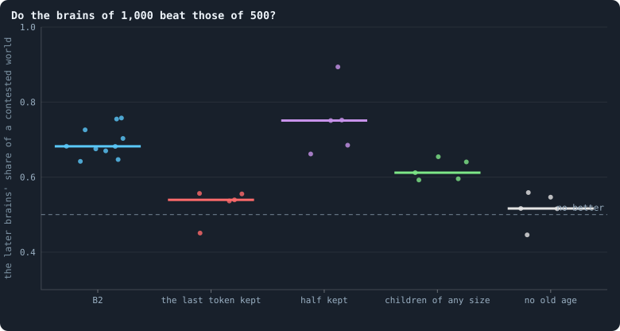

**Do the brains of 1,000 beat those of 500?** Each dot is a world: the share of a world its brains of iteration 1,000 hold after 100 iterations against those of iteration 500, the mean of two contests, one in each era's world; the bar is the median world. B2 from its ten worlds, each other rule from five.

> [!example]- How to make this figure
> **Runs.** As for the figure *Agents alive* above.
>
> **Data.** From each run's archive, `GraphOfLifeRuns/<run>/archive/` (`GraphOfLifeRuns/.pilots/lab_rejudge_T100.json`, `long_steps.json`).
>
> 1. Seat the brains of iteration 500 and of iteration 1,000 by a coin per agent on each era's world and play it on for 100 iterations, the length of an agent's life (`research/oee/checks/rejudge.py`).
> 2. Count the agents the later era's brains hold at the end, as a share of all.
>
> **To make it again:** `python3 book_figures.py whodies`.
<!-- /figure -->

B2's own choices hold up. But keeping half at home did better on both counts
that matter here: richer agents, and evolution that goes on. So it was the
first rule of death to try with the rules that came closest in [Healthy and
rich](building-b2-and-the-search-for-a-healthy-rich-world.md#healthy-and-rich), such as brains mixed at birth ([Mixed at birth:
ten long worlds](building-b2-and-the-search-for-a-healthy-rich-world.md#brains-mixed-at-birth-in-long-worlds)). With mixing, it later
held pilot worlds steady at about two thousand agents, six in ten of them poor
([What holds a world's size](building-b2-and-the-search-for-a-healthy-rich-world.md#what-holds-a-worlds-size)).

### What we learned (building B2)
- **Brains that see break worlds.** With one hidden layer and change only when
  copied, eight of ten worlds of 5,000 tokens died out; none of B1's did.
- **Worlds bleed; they do not snap.** Every world of 5,000 tokens, blind or
  seeing, loses agents to the cull in every iteration, and lives only while
  its births keep up. Seeing brains can stop having children.
- **Births alone grow a tree of blobs, and a death mended in a ring never
  splits a world.** Under four local rules, no agent of ten B2 worlds was cut
  off. Each rule taken away broke something.
- **What is kept at home decides who is left to play.** The more an agent
  keeps, the fewer agents hold a single token, and the more evolution goes on.
  With nothing kept, no world lived 50 iterations. A world of paupers is a
  world where little happens: the author's reading of B2 ([Healthy and
  rich](building-b2-and-the-search-for-a-healthy-rich-world.md#healthy-and-rich)), seen here in the contests.
- **Every agent has to die, and a child has to be worth having.** Without old
  age the founders keep their places, births stop, and so does evolution,
  while the network stays as healthy as any (the frozen worlds of [Healthy and
  rich](building-b2-and-the-search-for-a-healthy-rich-world.md#healthy-and-rich)). With children of any size, a world fills with
  9,543 agents, nearly all of one token (a Gini of 0.04: all equally poor),
  born and dying in cohorts, and evolution is weaker than in B2.
- **B2 pays in riches and in room.** About half its agents hold a single
  token, and its network is nearly a small world, not a space of three
  dimensions.

### How this was made (building B2)
#### The runs of Experiment 13

<!-- runs E13 -->
> [!info]- The runs behind this page
> **30 runs.** Every condition below is run once for every seed (1 to 10), for 1,500 iterations — or until its world dies out. Every setting is that of the baseline **B1** (the algorithm exactly as a new run is offered it) unless the condition changes it ([At a glance](settings.md#at-a-glance)).
>
> - **baseline** — changes nothing: B1 as it is; 5,000 tokens. Runs `B1-5000-s001` … `B1-5000-s010`.
> - **one hidden layer** — changes `hidden_layers` = 16; 5,000 tokens. Runs `B1-5000-f7c30b-s001` … `B1-5000-f7c30b-s010`.
> - **one hidden layer, change only when copied** — changes `hidden_layers` = 16, `mutate_on_replication` = on; 5,000 tokens. Runs `B1-5000-4802b8-s001` … `B1-5000-4802b8-s010`.
>
> To make these runs again: `python3 gol_lab.py run E13`, or ▶ in the Research Notebook tab of a computer running `gol_server.py`. Each run writes its settings, seed and engine version beside its frames, in `GraphOfLifeRuns/<run>/meta.json` and `provenance.json`.
<!-- /runs -->

#### The runs of Experiment 14

<!-- runs E14 -->
> [!info]- The runs behind this page
> **60 runs.** Every condition below is run once for every seed (1 to 10), for 1,000 iterations — or until its world dies out. Every setting is that of the baseline **B2** (a world that cannot break) unless the condition changes it ([At a glance](settings.md#at-a-glance)).
>
> - **all the rules** — changes nothing: B2 as it is; 5,000 tokens. Runs `B2-5000-s001` … `B2-5000-s010`.
> - **no mending** — changes `mend_on_death` = off; 5,000 tokens. Runs `B2-5000-d6b607-s001` … `B2-5000-d6b607-s010`.
> - **any unused link lapses** — changes `prune_needs` = 0; 5,000 tokens. Runs `B2-5000-71fc89-s001` … `B2-5000-71fc89-s010`.
> - **no links at birth** — changes `birth_links` = 0; 5,000 tokens. Runs `B2-5000-28aef0-s001` … `B2-5000-28aef0-s010`.
> - **no valence** — changes `valence` = 0; 5,000 tokens. Runs `B2-5000-5c8c75-s001` … `B2-5000-5c8c75-s010`.
> - **handover** — changes `allow_handover` = on; 5,000 tokens. Runs `B2-5000-894419-s001` … `B2-5000-894419-s010`.
>
> To make these runs again: `python3 gol_lab.py run E14`.
<!-- /runs -->

#### The runs of Experiment 15

<!-- runs E15 -->
> [!info]- The runs behind this page
> **60 runs.** Every condition below is run once for every seed (1 to 10), for 1,000 iterations — or until its world dies out. Every setting is B2's unless the condition changes it.
>
> - **B2** — changes nothing: B2 as it is; 10,000 tokens. Runs `B2-10000-s001` … `B2-10000-s010`.
> - **the last token kept** — changes `keep_home` = 0.01; 10,000 tokens. Runs `B2-10000-054b50-s001` … `B2-10000-054b50-s010`.
> - **nothing kept** — changes `keep_home` = 0.0; 10,000 tokens. Runs `B2-10000-575a1d-s001` … `B2-10000-575a1d-s010`.
> - **half kept** — changes `keep_home` = 0.5; 10,000 tokens. Runs `B2-10000-df2615-s001` … `B2-10000-df2615-s010`.
> - **children of any size** — changes `min_child` = 1; 10,000 tokens. Runs `B2-10000-185eb7-s001` … `B2-10000-185eb7-s010`.
> - **no old age** — changes `max_age` = 0; 10,000 tokens. Runs `B2-10000-3ec24f-s001` … `B2-10000-3ec24f-s010`.
>
> To make these runs again: `python3 gol_lab.py run E15`.
<!-- /runs -->

## Healthy and rich

The author's picture of a world that might keep evolving has two halves: a
decentralised, resilient, almost three-dimensional network, and agents that
differ in almost everything. This page reads the 624 worlds counted on
17 October 2026 against both halves: B1's are rich but fragile, B2's healthy
but poor, and none has both. The worlds that come closest mix their brains
at birth. Played on to 10,000 iterations, most of them did not hold, and
every rich one folded into a small world rather than a space. On the way,
the worry about poor agents became a sharper one: tokens spread too evenly.

### A picture of a world that might keep evolving

A world in which every agent holds one, two or three tokens does not look
like a world in which much can happen. The author put the picture the other
way round, on 16 October 2026. A world that might keep evolving would have a
network that is **decentralised, resilient and almost three-dimensional**.
And its agents would **differ in almost every statistic**: in wealth, in
links, in age, in their genes and in what they do.

Three days later the author made that first worry sharper. What looks
unhealthy is not that agents hold few tokens, but that they all hold the
same few ([Too even, not too poor](#too-even-not-too-poor-healthy-and-rich)).

This page turns the picture into measurements and reads every world the
notebook has made against them. When they were last counted, on 17 October
2026, they were 624 worlds. The lab's runs are read at their end. The pilot
worlds, made by hand in batches, are read at their last checkpoint: the
last whole world the run saved. Each world is counted once.
[Every world side by side](measures-atlases-and-assembly.md#every-world-side-by-side) compares the same
kinds of world through the statistics a run records.

### Two halves

The picture asks two things of a world at once. Its network must hold
together: no single agent or link whose loss cuts off much of it, and no
hub it hangs on. And its agents must differ, or selection has nothing to
choose from. Each half has a measure of its own.

**The network: the health bar.** [The health bar](measuring-health.md#the-health-bar), set in
[How to tell a world that keeps evolving](how-to-tell-a-world-that-keeps-evolving.md#the-network-that-holds-in-numbers),
already says what a decentralised, resilient network is. It has seven
marks, each checked on a world at one moment:

1. one piece;
2. a 2-core, the agents on loops or between them, holding at least 0.8 of
   the agents;
3. no agent whose loss cuts off more than 2% of the others;
4. no link whose loss cuts off more than 1%;
5. no agent joined to more than 5% of the others;
6. 3 to 12 links per agent;
7. a dimension between 2.3 and 4: the number of agents within *r* steps
   grows about as fast as *r* to that power
   ([How many dimensions does a world have?](how-many-dimensions-does-a-world-have.md)).

The author's "almost three" is the middle of that range. The tables below
give the marks a world meets as "marks (of 7)", and the health bar's own
page says why each mark is there.

One mark needs care. A tangle in which everyone is a few steps from
everyone can also read "three dimensions" over its first few steps. Telling
the two apart takes a second test, the [random twin](measuring-space.md#the-random-twin-is-a-world-a-space)
([Healthy, but not a space](#healthy-but-not-a-space)).

**The agents: the diversity score.** How much the agents differ is counted
without drawing any line ([The diversity score](measuring-health.md#the-diversity-score)). For
tokens, links and ages, the agents are sorted into doubling classes: 1,
2–3, 4–7, 8–15, and so on. The **spread** is the effective number of
classes they fill
([Effective numbers: how many kinds there really are](statistics.md#effective-numbers-how-many-kinds)).
It is 1 if every agent is in one class, and *k* if they are spread evenly
over *k*. Agents holding one to three tokens fill at most two, the classes 1
and 2–3. Genotypes are counted as an effective number per agent: 1 when
every agent has a genotype of its own, near 0 when one genotype is
everywhere.

Each spread is then ranked. A world's percentile on it is the share of a
set of reference worlds whose agents spread less widely. A world's
**diversity score** is the mean of its four percentiles: 1 for a world at
the top of all four, 0 for one at the bottom of all four.

The reference is frozen: the 653 worlds read on 17 October 2026. A later
world gets the percentile its spreads would have among them, so no score
moves unless the set is deliberately made again.

The score sees what the agents hold and what they are, not what they do.
How differently they decide is measured apart, as kinds of staking
([How different are the agents?](b1-brains-lineages-and-messages.md#how-different-are-the-agents)).

### Every world on both halves

Put each world on a map. Across: how many marks of the health bar its
network meets. Up: how diverse its agents are. The author's picture is the
top right corner.

<!-- figure healthy/map -->
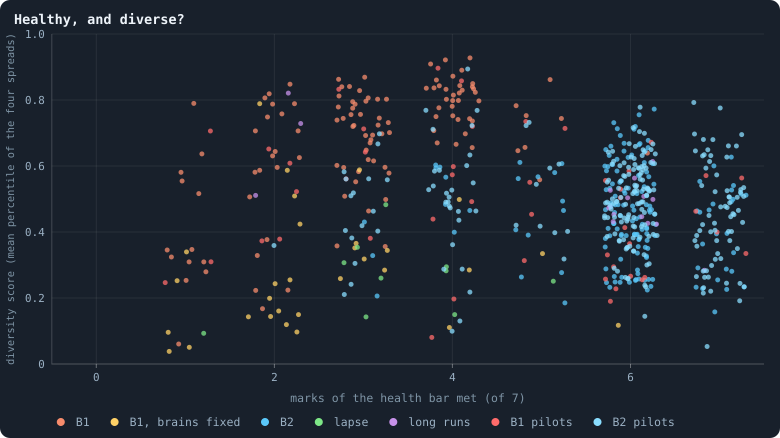

**Healthy, and diverse?** Each dot is a world at its last checkpoint. Across: how many of the seven marks of [the health bar](measuring-health.md#the-health-bar) it meets — one piece, a 2-core of at least 0.8, no agent whose loss cuts off more than 2%, no link more than 1%, no agent joined to more than 5% of the others, 3 to 12 links per agent, a dimension of 2.3 to 4 (the dots are spread sideways within each count only so that they do not hide each other). Up: how widely its agents spread over tokens, links, ages and genotypes, as the mean of its percentiles among all worlds. The author's picture of a world that might keep evolving is the top right. B1: B1 at every size and its variants (Experiments 2, 8, 10, 12, 13); brains fixed: Experiment 7; B2: B2 and its variants (Experiments 9, 14, 15, 16), except lapse, where any unused link lapses; long runs: the pilot worlds played to 10,000 iterations; pilots: the other pilot worlds, by the rule set they start from.

> [!example]- How to make this figure
> **Runs.** Every world the notebook has made that settled (500 iterations or more), each once, at its last checkpoint: the lab's runs at their end, the pilot worlds at theirs, the long runs at 10,000 iterations; pilots that replay a lab world are counted as that world (`python3 research/atlas/profile.py`).
>
> **Data.** From `GraphOfLifeRuns/.pilots/atlas/profile.json`.
>
> 1. Read each world's checkpoint: its agents' tokens, links, birth times and genotypes.
> 2. The network: pieces, the 2-core, the worst cut by one agent and by one link (one depth-first search), the best-connected agent's share, links per agent; the dimension by ball growth on the same checkpoint (the lab's measure, gol_series).
> 3. The spreads: the effective number of doubling classes the agents fill (exp of the entropy), for tokens, links and ages; genotypes per agent (1 / sum of squared shares, over the agents).
> 4. Rank every world on each spread; the score is the mean of its four percentiles.
>
> **To make it again:** `python3 book_figures.py healthy`.
<!-- /figure -->

The worlds fall into two clouds, and the author's corner — every mark met,
the agents most diverse — is empty.

- **B1's worlds are rich but fragile.** B1 is the first baseline, the rules
  exactly as a new run is offered them. Its agents spread widely: over 5.6
  to 6.9 classes of age and 3.5 to 4.1 of tokens, with a diversity score of
  0.67 to 0.75. But its networks meet two to four of the seven marks. Only
  half the agents are in the 2-core, and in the median world one agent's
  loss cuts off 13% to 35% of the others. Where tokens move along every
  link and unused links are cut
  ([What crosses a connection](b1-the-game-and-its-flows.md#what-crosses-a-connection)), the network
  is a tree of blobs held together by single agents.
- **B2's worlds are healthy but poor.** B2 is the second baseline, built so
  that its network cannot break
  ([Building B2: a world that cannot break](building-b2-and-the-search-for-a-healthy-rich-world.md#building-b2-a-world-that-cannot-break)).
  Its networks meet six or seven marks: one piece, the whole world in the
  2-core, nothing that one loss could cut off, no hub. But three agents in
  four hold three tokens or fewer, and the median agent holds one. Its
  agents' ages fill about 4 classes, against B1's 6 to 7, since every agent
  dies at age 100. And at 10,000 tokens B2 misses the one mark B1 meets:
  its dimension is 4.5, above the bar and far from three. That number
  turned out to say more about B2's size than about its shape
  ([What B2's dimension measures](#what-b2s-dimension-measures)).

The four spreads behind the score, world by world:

<!-- figure healthy/spreads -->
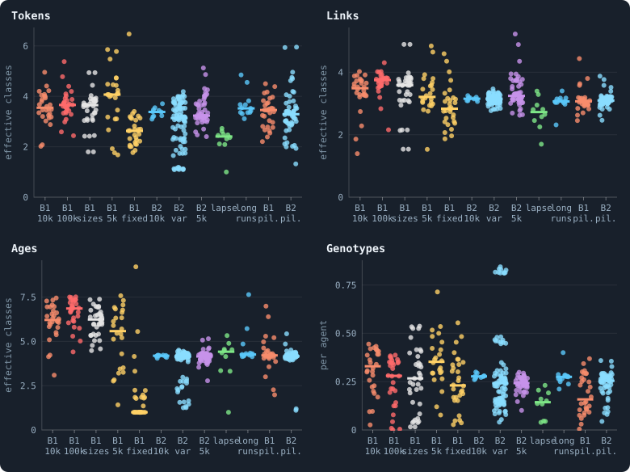

**How widely the agents spread.** Each dot is a world. Tokens, links, ages: the effective number of doubling classes its agents fill (1, 2–3, 4–7, …; for ages, age + 1) — 1 if every agent is in one class, k if they are spread evenly over k. Genotypes: the effective number of genotypes per agent (1 for every agent its own genotype, near 0 for one genotype everywhere).

> [!example]- How to make this figure
> **Runs and data.** As for the figure *Healthy, and diverse?* above.
>
> 1. For each world, exp of the Shannon entropy of its agents' shares over the doubling classes of each quantity; the effective genotypes, 1 / sum of squared shares, per agent.
>
> **To make it again:** `python3 book_figures.py healthy`.
<!-- /figure -->

And the measure of poverty this page started from, the share of agents
holding three tokens or fewer:

<!-- figure healthy/poor -->
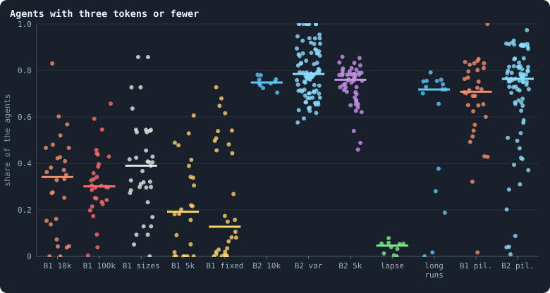

**Agents with three tokens or fewer.** Each dot is a world: the share of its agents holding one, two or three tokens. B1 10k: B1 at 10,000 tokens (Experiment 2); 100k: Experiment 10; sizes: Experiment 8; 5k: Experiments 12 and 13; fixed: brains that never change (Experiment 7); B2 10k: Experiment 16; B2 var: B2 with one rule or rate changed (Experiments 9, 15, 16); B2 5k: Experiment 14, except lapse, where any unused link lapses; long runs: the pilot worlds played to 10,000 iterations; pil.: the other pilot worlds, by the rule set they start from.

> [!example]- How to make this figure
> **Runs and data.** As for the figure *Healthy, and diverse?* above.
>
> 1. Count the agents of each world's checkpoint holding at most three tokens.
>
> **To make it again:** `python3 book_figures.py healthy`.
<!-- /figure -->

#### Too even, not too poor (healthy and rich)
Picture two worlds, each with 10,000 tokens among 3,400 agents: about three
tokens per agent. In one, nearly every agent holds two, three or four. In
the other, most hold one, and a few hold dozens. The two are equally rich,
but only the first is even.

On 19 October 2026 the author made the picture precise. What looks
unhealthy is not that agents hold few tokens, but that they hold them
**evenly**: almost everyone the same few. The share at three tokens or
fewer only stood in for that, and measured directly it stands in badly.
Every world read so far now also carries the
[Gini coefficient](measuring-tokens.md#measuring-inequality-the-gini-coefficient-the-richest-tenth-and-entropy) of its agents' tokens, 0 when all
hold the same and near 1 when one agent holds nearly all. It also carries
the share of all tokens that its richest tenth hold.

Across the 502 worlds read at iteration 1,000, the share at three or fewer
follows the tokens per agent: a correlation of −0.77, and −0.92 across the
54 read at 10,000. It does not follow the Gini: 0.01, and 0.52 at 10,000.
It counts how many agents share the tokens, not how evenly they share
them.

**B2 is poor but not even.** Its Gini is 0.49 to 0.56 at iteration 1,000,
and 0.47 to 0.51 at 10,000. That is above the 0.40 that a random exchange
of tokens would leave at its three tokens per agent. A random exchange
leaves the spread of greatest entropy: a geometric spread, in which each
extra token is less likely than the one before by the same factor. With a
mean of *m* tokens per agent, its Gini is

$$
G = \frac{m - 1}{2m - 1} .
$$

It is 0 when every agent holds one token, and comes nearer to one half the
richer the agents are. It draws no line of its own.

The evenest worlds are others:
- where every unused link lapses: a median Gini of 0.26 over 29 worlds, at
  seven tokens per agent, where random exchange would leave 0.46;
- Experiment 15's children of any size: almost every agent holds one token,
  a Gini of 0.02;
- at 10,000 iterations, four of the five candidate worlds that held
  ([Candidates and long runs](#candidates-and-long-runs)): rich worlds with
  a Gini of 0.37 to 0.44
  ([The candidates, played on and played again](building-b2-and-the-search-for-a-healthy-rich-world.md#the-candidates-played-on-and-played-again)).

So a thesis no longer counts a world's poor. Since 19 October 2026 it asks
instead that the world be **no more even than B2**: a Gini no lower than
the least of B2's worlds read at the same iteration. Old theses keep their
wording.
[The candidates, played on](building-b2-and-the-search-for-a-healthy-rich-world.md#the-candidates-played-on),
[Five more seeds for the rules that held](building-b2-and-the-search-for-a-healthy-rich-world.md#five-more-seeds-for-the-rules-that-held)
and [Rules in company](what-the-switches-did-in-pilots.md#rules-in-company) say what the clarified reading
changes.

#### What B2's dimension measures

How can a network without positions have a dimension? Count the agents
within one step of an agent, within two steps, within three. In a plane the
count grows like the square of the steps, in space like their cube. The
power is the dimension, and the health bar reads it over the first five
steps.

In B2's kind of network that number rises with the number of agents
([The marks a world misses](building-b2-and-the-search-for-a-healthy-rich-world.md#the-marks-a-world-misses)).
B2 at 5,000 tokens, with 1,200 to 1,800 agents, reads 3.6 to 4.1, and six
of its ten worlds meet every mark. The worlds of Experiment 17, B2 with
brains mixed at birth, read about 3.1 below 300 agents and 4 above 1,500.
That is a correlation of 0.78 with the logarithm of the size. B1's does not
rise: from 40 agents to 70,000 it stays between about 2.5 and 4.

So for B2's kind of network, two marks of the bar are partly marks of size.
The dimension fails a large world. The hub mark fails a small one, where a
single well-linked agent is already more than 5% of the world. Worlds of
600 to 1,000 agents met both at 98% of their moments. Health compared
between worlds of different sizes has to be read with that in mind.

[What folds a world](how-many-dimensions-does-a-world-have.md#what-folds-a-world) found why. B2's networks are
nearly small worlds, not spaces: everyone is a few steps from everyone. A
typical agent's ball grows four to six times a step, and holds a quarter of
a world of 3,400 agents within four steps. A typical agent is about as near
to everyone as in a random network with the same links: 1.18 times as far,
against 2.3 in B1. A small world has no dimension to find, and the number
read off its first few steps grows with the room it has.

B2's worlds start as spaces. They fold once their first generation dies,
because each death is mended with a ring of links among the dead agent's
neighbours. The rise with size holds for B2 itself and for its mixed
worlds, but not for every variant of B2. With the estate of the dead left
to the newborns or to the parents, B2's worlds hold more than 5,000 agents
at a dimension of 3.4 to 3.9. They stay spaces, of about three dimensions
([Who inherits?](what-the-switches-did-in-pilots.md#healthy-and-diverse)).

### The worlds that come closest

The author's corner is empty, but some worlds come near it. When last
counted, on 17 October 2026, 99 worlds of 624 met all seven marks:
- 26 of the lab's B2 worlds: fifteen of B2 or its variants at 5,000 tokens
  (Experiment 14: smaller worlds, with a dimension of about 3.8), nine
  without old age (Experiment 15), one of B2 itself, and one whose brains
  rarely change (Experiment 9);
- 67 pilot worlds built on B2: among them 28 of batch Y, which mix brains
  at birth with one other rule
  ([Brains mixed at birth, with every other rule](what-the-switches-did-in-pilots.md#brains-mixed-at-birth-with-every-other-rule)),
  and 12 of batch W;
- five alliance pilots of B1 ([Alliances](another-game.md#alliances)), four of them at
  3,000 tokens, below the notebook's rule of 10,000;
- and one long run.

A healthy network is not enough. Nine of the ten B2 worlds without old age
meet every mark, and have stopped. In a world of 3,800 agents there are
about 0.4 births an iteration. Of the agents, 86 to 95% hold three tokens
or fewer, and nearly all are of one age: the founders' generation, which
never dies. Their ages fill 1.3 to 2.3 classes, and their diversity scores
are among the lowest of all.

Ranked by how diverse their agents are, the twelve most diverse worlds that
meet every mark are:

<!-- table healthy/closest -->
| world | group | at iteration | marks (of 7) | diversity score | median tokens | agents with 3 tokens or fewer | dimension | agents |
|---|---|---|---|---|---|---|---|---|
| `Y/mix-mut80-s2` | B2 pil. | 1,000 | 7 | 0.79 | 5 | 36% | 3.8 | 1,238 |
| `Y/mix-mut80-s1` | B2 pil. | 1,000 | 7 | 0.78 | 5 | 41% | 3.8 | 1,299 |
| `Y/mix-keepone-s2` | B2 pil. | 1,000 | 7 | 0.70 | 1 | 77% | 3.4 | 1,537 |
| `Y/mix-kinsense-s2` | B2 pil. | 1,000 | 7 | 0.70 | 8 | 32% | 3.7 | 821 |
| `U/U-BDFG-s1` | B2 pil. | 1,000 | 7 | 0.68 | 8 | 25% | 3.7 | 652 |
| `W/norev-mix-s1` | B2 pil. | 1,000 | 7 | 0.68 | 2 | 67% | 3.7 | 2,245 |
| `Y/mix-linktoken-s1` | B2 pil. | 1,000 | 7 | 0.66 | 8 | 36% | 3.4 | 588 |
| `Y/mix-came-s2` | B2 pil. | 1,000 | 7 | 0.66 | 3 | 53% | 3.7 | 1,521 |
| `M/mix-children-s2` | B2 pil. | 5,000 | 7 | 0.65 | 10 | 23% | 3.3 | 486 |
| `Y/mix-grow-s1` | B2 pil. | 1,000 | 7 | 0.65 | 12 | 23% | 3.3 | 366 |
| `Y/mix-helped-s1` | B2 pil. | 1,000 | 7 | 0.63 | 5 | 38% | 3.7 | 1,075 |
| `Y/mix-nodice-s2` | B2 pil. | 1,000 | 7 | 0.63 | 3 | 53% | 3.5 | 1,468 |
<!-- /table -->

Every one of the twelve mixes its brains at birth. A newborn's brain then
comes from two agents: its parent, and a mate among the parent's
neighbours. Each hidden unit of the brain comes whole from one or the other
([Brains mixed at birth, units that cost, an eye for raids on kin](what-the-switches-did-in-pilots.md#brains-mixed-at-birth-units-that-cost-an-eye-for-raids-on-kin)).
Each world also changes something else. The two at the top add a faster
change of brains, a mutation probability of 0.8 where B2 has 0.2. They have
diversity scores of 0.79 and 0.78, with about 40% of their agents at three
tokens or fewer. The world of batch W that mixes without revolutions is
larger and poorer: 2,245 agents, two in three of them at three tokens or
fewer. But its agents spread widely in age, links and genotypes.

The first worlds to come this close, on 16 October 2026, were the two of
batch Q, which mix brains at birth and change nothing else. At iteration
2,000 both met every mark at a dimension of 3.5. Their agents were richer
and more varied than in any other world that met every mark then. The
median agent held 5 and 11 tokens, and 37% and 20% held three or fewer.
Their wealth spread over six doubling classes, wider than in any of those
worlds. They are smaller worlds — 660 to 910 agents for 10,000 tokens,
where B2 holds 3,400 — so each agent holds more. They were also among the
worlds whose evolution went on most strongly. They have left the tables
since. The lab's engine and the pilots' prototype play a mixed world alike,
so Experiment 17 made the same two worlds again, agent for agent.
`Q/mix-s1` and `s2`, and their long runs, now count as Experiment 17's
worlds s001 and s002.

### Candidates and long runs

A world that comes this close at one moment may only be passing through.
So it is a **candidate world**, and is played on to see whether it stays.
The rule draws no line of its own. A candidate world meets every mark of
the health bar. Its diversity score is above the median of Experiment 16's
B2 worlds, 0.51. And it has at least 10,000 tokens. So it comes closer than
B2 itself to the author's picture.

Three worlds met the rule first: the two mixed worlds of batch Q, and a
world of batch S whose agents have an eye for a family tag and no
revolutions. Three more followed as batches W and Y finished: mixing
without revolutions, links that hold a token without revolutions, and
mixing with the estates of the dead left to the poorest. Each was played on
to 10,000 iterations in a copy of its own. The table shows the four that
are not Experiment 17's worlds, where each was chosen and where it ended:

<!-- table healthy/long -->
| world | group | at iteration | marks (of 7) | diversity score | median tokens | agents with 3 tokens or fewer | dimension | agents |
|---|---|---|---|---|---|---|---|---|
| `S/G4-familysense-s2` | B2 pil. | 1,000 | 7 | 0.53 | 1 | 74% | 4.0 | 2,935 |
| `LC/S-G4-familysense-s2` | long runs | 10,000 | 6 | 0.51 | 2 | 69% | 4.5 | 3,097 |
| `W/norev-linktoken-s1` | B2 pil. | 1,000 | 7 | 0.59 | 5 | 42% | 4.0 | 921 |
| `LC/W-norev-linktoken-s1` | long runs | 10,000 | 6 | 0.45 | 3 | 51% | 4.1 | 1,359 |
| `W/norev-mix-s1` | B2 pil. | 1,000 | 7 | 0.68 | 2 | 67% | 3.7 | 2,245 |
| `LC/W-norev-mix-s1` | long runs | 10,000 | 6 | 0.61 | 2 | 64% | 4.1 | 2,221 |
| `Y/mix-poorest-s1` | B2 pil. | 1,000 | 7 | 0.57 | 3 | 51% | 3.4 | 1,455 |
| `LC/Y-mix-poorest-s1` | long runs | 10,000 | 7 | 0.28 | 1 | 69% | 3.2 | 2,288 |
<!-- /table -->

**The two mixed worlds of batch Q** parted on the way. The first swung
towards B2's poverty at 2,500 iterations: half as many agents again, half
of them at three tokens or fewer. Then it came back: at 5,500, 38% held
three or fewer, and the median agent six. The second grew richer and
smaller to 4,500 iterations (514 agents, the median holding 13 tokens),
then larger again. At 7,500 it had 883 agents, 19% at three tokens or
fewer and the median holding eight, and met every mark at a dimension of
3.9. At 10,000, read as Experiment 17's worlds, the first held 2,221
agents, 65% of them at three tokens or fewer, and the second 744, 6%
([Mixed at birth: ten long worlds](building-b2-and-the-search-for-a-healthy-rich-world.md#mixed-at-birth-ten-long-worlds)).

**The other four** all reached 10,000, and none kept everything it had at
1,000. The world with an eye for a family tag fell back early. At 2,000
iterations 72% of its agents held three tokens or fewer, as in B2, and a
dimension of 4.3 had cost it a mark. It and two others lost a mark as they
grew: their dimension rose above 4, at 1,359 to 3,097 agents. The fourth,
mixing with the estate left to the poorest, kept every mark but grew poor
and alike. Its diversity score fell to 0.28, and 69% of its agents held
three tokens or fewer.

**The test of a long run.** A candidate world holds if, at iteration
10,000:
- it is still alive: it never fell to 20 agents or fewer, where the lab
  calls a world extinct;
- it meets every mark of the health bar;
- it is more diverse than B2's median world at 10,000, a diversity score of
  0.49;
- fewer of its agents hold three tokens or fewer than in the least poor of
  B2's ten worlds played on that far, 66%.

Since 19 October 2026 the last line asks instead for tokens no more even
than in B2's most even world
([Too even, not too poor](#too-even-not-too-poor-healthy-and-rich)).

The long runs were planned in three steps. Here is what each found.

1. **Every candidate to 10,000 iterations.** A candidate that falls back
   towards B2's poverty, or loses a mark, says its rule does not hold.
   Nineteen more candidates followed the first six, most of them mixed
   worlds of batch Y. By 19 October 2026 every candidate that could be read
   at 10,000 iterations had been: again nineteen worlds, the four above
   among them. Five held, eleven fell back — most of them into B2's poverty
   — and three died out on the way. All five that held mix their brains at
   birth. By the clarified test of evenness, three held. Four candidates
   whose rules exist only in the pilots' prototype wait for Experiment 23
   ([The candidates, played on](building-b2-and-the-search-for-a-healthy-rich-world.md#the-candidates-played-on)).
2. **More seeds for what holds.** One world can be luck. A rule whose
   candidate is still healthy and diverse at 10,000 iterations gets five
   seeds more, from the start, to 10,000. Experiment 21 gave three such
   rules five new seeds each, and none held more often than mixing alone
   ([Five more seeds for the rules that held](building-b2-and-the-search-for-a-healthy-rich-world.md#five-more-seeds-for-the-rules-that-held)).
3. **A pre-registered lab experiment** for what holds in most seeds: ten
   seeds to 10,000 iterations, and the best world on to a hundred thousand,
   as [A hundred thousand iterations](a-hundred-thousand-iterations.md)
   plans for one world. Mixing alone went first. It became a setting of the
   engine, [`mix_at_birth`](settings.md#mix_at_birth), off unless a run
   turns it on. Experiment 17 played ten worlds of B2 with mixing for
   10,000 iterations
   ([Mixed at birth: ten long worlds](building-b2-and-the-search-for-a-healthy-rich-world.md#mixed-at-birth-ten-long-worlds)).
   They are rich: 11% of the agents hold three tokens or fewer in the
   median world at 10,000 iterations. But only five of the ten met every
   mark, so its thesis is refuted. Experiment 18 played those five on to
   50,000 iterations, and they did not stay healthy. Three died out, and
   the two that lived ended between the mixed worlds' riches and B2's
   poverty
   ([Five mixed worlds, fifty thousand iterations](building-b2-and-the-search-for-a-healthy-rich-world.md#five-mixed-worlds-fifty-thousand-iterations)).
   Since no rule held more often than mixing alone, step 3 has no rule to
   take up yet.

The pilot batches T to Y
([Every simulation: what was run, and what was measured](every-simulation.md))
and the search for settings by elimination added candidates as they
finished. The search, batch Z, drew every setting of a world at random, and
dropped the values that made worlds worse, round after round. Experiment 24
played the settings of its best world again, in new seeds. They made
diverse, wide and rich worlds, but thin, easily cut and too even ones
([The search's best world, in new seeds](building-b2-and-the-search-for-a-healthy-rich-world.md#the-searchs-best-world-in-new-seeds)).
The same idea is now a lab experiment:
[A screen of random worlds](a-screen-of-random-worlds.md).

### Healthy, but not a space

The health bar's dimension mark does not tell a space from a small world. A
B2 world of 600 to 1,500 agents passes it because it is small
([What folds a world](how-many-dimensions-does-a-world-have.md#what-folds-a-world)). A stronger test sets a world
beside its [random twin](measuring-space.md#the-random-twin-is-a-world-a-space): the same agents, with as many
links each, wired at random. Count the steps within which a typical
agent's ball holds half the world, and divide by the same count in the
twin: that ratio is the world's **width**. A small world has a width of
about 1. The notebook calls a world a space when its width is 1.5 or
more.

Read this way, the candidate worlds are folded. At iteration 1,000 the 23
candidates read 1.13 to 1.92, most of them below 1.5 and near B2's 1.18;
B1 reads 2.3 at 1,500 agents. Three were spaces then. By
10,000 all but one had folded, and the exception, mixing with the estate
left to the poorest (1.79), is one of the poor worlds
([The candidates, played on](building-b2-and-the-search-for-a-healthy-rich-world.md#the-candidates-played-on)).

Of the 388 worlds read at iteration 1,000, the ones that are spaces and not
poor are of three kinds:
- B1's worlds;
- worlds whose every unused link lapses: rich, but about two-dimensional,
  and missing three or four marks;
- a few others. One mixes with a slow change of brains (`Y/mix-mut05-s1`:
  2.38, 44% at three tokens or fewer, every mark met at a dimension of 2.9,
  a diversity score of 0.48). Two are worlds of the search
  (`Z/r1-15-s1015`: 3.40, 43%, five marks, 0.73; `Z/r1-22-s1022`: 3.42,
  27%, three marks, 0.83).

So the author's "almost three-dimensional" asks more than the bar's mark
does. That is why [What makes a world interesting](rounds-1-and-2-of-the-screen.md#what-makes-a-world-interesting)
asks for a dimension of 2 to 4 *and* a width of at least 1.5.

### What we learned (healthy and rich)
- **No world yet fits the picture.** The two rule sets each have half of
  it: B1 the diverse agents, B2 the healthy network. Neither has both.
- **B2's network rules work; its agents are many, and so poor.** A world of
  10,000 tokens that holds 3,400 agents has about three tokens per agent,
  and in B2 the median agent holds one. What made worlds richer — mixing
  brains at birth, links that hold a token, lapsing links — made them
  smaller ([What holds a world's size](building-b2-and-the-search-for-a-healthy-rich-world.md#what-holds-a-worlds-size)).
- **Poor is not even.** The share of poor agents counts how many agents
  share the tokens. B2 is poor, but its tokens are spread less evenly than
  a random exchange would leave them. Among the candidate worlds, the small
  rich ones are the even ones.
- **Age is capped by a rule.** B2's agents die at 100, so their ages cannot
  spread as B1's do. Without old age, B2's worlds meet every mark of the
  bar and stop: hardly a birth, nearly every agent poor and of one age
  (Experiment 15). Links that hold a token without old age did the same
  ([Brains mixed at birth, units that cost, an eye for raids on kin](what-the-switches-did-in-pilots.md#brains-mixed-at-birth-units-that-cost-an-eye-for-raids-on-kin)).
  Something between, a death that depends on what an agent does rather
  than on a fixed age, would let ages spread without stopping the world.
- **A healthy network is not yet a space.** The candidate worlds' networks
  are folded small worlds, and "almost three-dimensional" asks more than
  the bar's mark does ([What folds a world](how-many-dimensions-does-a-world-have.md#what-folds-a-world)).
- **A good moment is not a good world.** Most candidate worlds did not hold
  over 10,000 iterations, and no rule held more often than mixing alone.
- **A world might be judged by this map before it is judged by its
  evolution.** A rule that moves worlds towards the top right is a
  candidate for the long runs and the lifetime contests. The
  [screen of random worlds](a-screen-of-random-worlds.md) is built this
  way: it judges each world's health before any strategy is tried in it.

### How this was made (healthy and rich)
- **Every world** is read at its last checkpoint by
  `research/atlas/profile.py` (`GraphOfLifeRuns/.pilots/atlas/profile.json`):
  the seven marks of the health bar, and the four spreads. A pilot that
  replays a lab world is counted as that world.
  `python3 book_figures.py healthy` draws this page's figures and tables,
  and the recipe folded under each figure gives every step.
- **The diversity scores** are ranked among the frozen reference worlds,
  `book/results/diversity_reference.json`, made by
  `research/atlas/profile.py --freeze`. This page's figures and tables were
  last drawn on 17 October 2026, from the 624 worlds of that count, a few
  hours before the reference was frozen. So their scores are ranked among
  those 624; drawn again, they would be ranked among the reference.
- **The Gini** and the richest tenth's share of every world:
  `research/atlas/evenness.py`.
- **The width** of a world against its random twin:
  `research/atlas/space.py`.
- **The candidate worlds**: the rule is `research/oee/pilots/candidates.py`,
  the list `research/oee/candidates.md`, and their long runs are in
  `GraphOfLifeRuns/.pilots/LC/`.
- **The search by elimination**: `research/oee/pilots/search.py`, whose
  judge writes `research/oee/search.md`.

## Brains mixed at birth, in long worlds

Mixing a newborn's brain from its parent's and a neighbour's makes a B2 world
smaller, so each of its agents holds more tokens. In ten worlds played for
10,000 iterations (Experiment 17), the median world had 11% of its agents at
three tokens or fewer; B2's worlds have 66% to 79%. The agents are rich
because they put off having children, but how long they put it off drifts, and
a world's size and health drift with it. Only five of the ten worlds met every
mark of the health bar, so the thesis was refuted. Played on to 50,000
iterations (Experiment 18), those five did not stay healthy: three died out,
the two that lived stayed large and fairly poor, and evolution faded.

### Mixed at birth: ten long worlds

<!-- experiment E17 -->

In B2, a newborn's brain is a copy of its parent's, changed now and then by
mutation. With brains **mixed at birth**, a newborn's brain comes from two
agents: its parent and a *mate*, one of the parent's neighbours drawn at
random. For each hidden unit of the brain, a fair coin decides whether the
newborn takes it from the parent or from the mate. B2's brain has a single
hidden layer of 16 units. A unit is taken whole: the weights that lead into
it, its bias, and the weights that lead out of it. So a unit that works
arrives with everything it needs. Then the new brain mutates as usual.

[Healthy and rich](building-b2-and-the-search-for-a-healthy-rich-world.md#healthy-and-rich) read every world the notebook had made
against the author's picture of a world that might keep evolving. The picture
has two halves: a network that is decentralised, resilient and nearly
three-dimensional, and agents that differ in almost every statistic. B2's
worlds meet six of the seven marks of the health bar, the notebook's test of a
healthy network. But their agents do not differ: three in four hold three
tokens or fewer. The worlds that came closest to both halves were those whose
brains are mixed at birth ([Brains mixed at birth, units that cost, an eye for
raids on kin](what-the-switches-did-in-pilots.md#brains-mixed-at-birth-units-that-cost-an-eye-for-raids-on-kin)).

Those were pilots. Batch Q made two worlds with mixing, later batches combined
mixing with other rules, and the two worlds of batch Q were played on
([Healthy and rich](building-b2-and-the-search-for-a-healthy-rich-world.md#candidates-and-long-runs)). Now mixing
is a setting of the engine, [`mix_at_birth`](settings.md#mix_at_birth), off
unless a run turns it on. So the lab can run it, and for longer than any B2
world has lived in the lab: 10,000 iterations, five times as long as
Experiment 16.

#### What the pilots found (brains mixed at birth)
When this plan was written (16 October 2026), the worlds read as follows, each
at the iteration named, as [Healthy and rich](building-b2-and-the-search-for-a-healthy-rich-world.md#healthy-and-rich) reads every
world. The dimension is the ball dimension: how fast the number of agents
within a given number of steps grows with the steps. The health bar asks for
2.3 to 4.

| world | iteration | agents | median tokens | 3 tokens or fewer | marks of the health bar (of 7) | dimension |
|---|---|---|---|---|---|---|
| B2, ten worlds (Experiment 16) | 2,000 | 3,064–3,699 | 1–2 | 70–78% | 6 (one world 7) | 3.9–4.8 |
| the same worlds played on (pilots) | 9,500–10,000 | 2,887–3,661 | 1–2 | 66–79% | 6 | 4.3–4.5 |
| mixed, seed 1 (batch Q) | 2,000 | 908 | 5 | 37% | 7 | 3.5 |
| mixed, seed 2 (batch Q) | 2,000 | 659 | 11 | 20% | 7 | 3.5 |
| seed 1, played on | 2,500 | 1,380 | 3 | 52% | 7 | 3.4 |
| … and on | 5,500 | 1,037 | 6 | 38% | 7 | 3.8 |
| seed 2, played on | 4,500 | 514 | 13 | 15% | 7 | 3.6 |
| … and on | 7,500 | 883 | 8 | 19% | 7 | 3.9 |
| mixed, with gifts (batch T) | 1,000 | 1,541 | 4 | 39% | 6 | 4.1 |
| mixed, estates by wealth (batch Y) | 1,000 | 445 | 8 | 31% | 6 | 3.4 |

Two things stand out. First, a mixed world is a quarter to a third of B2's
size for the same tokens, so each agent holds more. Second, the plain mixed
worlds meet the one mark B2 misses: a dimension below 4.

The two long runs do not go the same way, though. One swung towards B2 at
2,500 iterations and came back. The other grew richer and smaller up to 4,500
iterations, and then larger again. Two worlds cannot say which is the rule.

The pilots showed more than the table does. Mixing doubled the circulation
that [Gliders, and who helps whom](cooperation-help-and-gliders.md#gliders-and-who-helps-whom) measures:
the part of the flow of tokens that goes round in loops. Three things have not
yet been read in the long worlds of this page: that circulation, the kinds of
behaviour of [How different are the agents?](b1-brains-lineages-and-messages.md#how-different-are-the-agents),
and the flow modules of [Flow modules: the groups tokens stay
in](b1-the-game-and-its-flows.md#flow-modules-the-groups-tokens-stay-in).

#### Ten worlds, ten thousand iterations

Experiment 17 runs B2 at 10,000 tokens with brains mixed at birth: ten seeds,
for 10,000 iterations each. The lab records each run as it records every run:
the graph statistics every 25 iterations, and a whole world every 500. The
whole worlds have two uses. Eras of a world can be played against each other
in contests. And each world can be read at any of those moments, as [Healthy
and rich](building-b2-and-the-search-for-a-healthy-rich-world.md#healthy-and-rich) reads every world.

B2's own worlds are not run again. Experiment 16 ran them to 2,000 iterations,
and their continuations to 10,000, played as pilots, are the comparison.

So we expected the ten worlds to do what the pilots did: stay small and rich,
and meet every mark of the health bar. A unit of a brain that works can also
spread from one line of descent to another. But one pilot world swung back
towards B2's poverty for a while, so the riches might not last. The thesis
drew two lines at iteration 10,000. In the median world, fewer than half the
agents should hold three tokens or fewer. And at least seven of the ten worlds
should meet every mark.

<!-- thesis E17 -->
> [!quote] The thesis of Experiment 17, written down before any of its runs existed
> **The claim.** Brains mixed at birth keep a world healthy and make it rich over a long life. In B2 with every newborn's brain mixed from its parent's and a neighbour's, at iteration 10,000, fewer than half the agents hold three tokens or fewer in the median world of ten, where three in four do in B2; and at least seven of the ten worlds meet every mark of the health bar.
>
> **Why it would be so.** In the pilots, the worlds whose brains were mixed at birth came closest of all to a world that is healthy and whose agents differ ([Meta X](building-b2-and-the-search-for-a-healthy-rich-world.md#healthy-and-rich)). The two worlds of batch Q and their continuations meet every mark of the health bar, at a dimension of 3.4 to 3.9, with 15% to 52% of their agents at three tokens or fewer: 37% and 20% at 2,000 iterations, 38% and 19% at 5,500 and 7,500. Mixed with gifts as well, 39%, and with estates shared by wealth, 31%, at 1,000 iterations, with six marks each. B2's own worlds hold 70% to 78% of their agents at three tokens or fewer at 2,000 iterations (Experiment 16) and 66% to 79% at 9,500 to 10,000 (the same worlds played on as pilots), and nine in ten of them meet six marks: their dimension is 4.2 to 4.8, above the bar's 4. A mixed world is a quarter to a third of B2's size, so its agents hold more each, and a unit of a brain that works can spread from one line to another. But one of the two continuations swung back towards B2's poverty at 2,500 iterations, half its agents at three tokens or fewer, before it recovered: it may not last.
>
> **It holds if:** At iteration 10,000, each world read from its last checkpoint as research/atlas/profile.py reads every world ([Meta X](building-b2-and-the-search-for-a-healthy-rich-world.md#healthy-and-rich)): the median of the ten worlds' shares of agents holding three tokens or fewer is below 0.5, and at least seven of the ten worlds meet all seven marks of Chapter [46](how-to-tell-a-world-that-keeps-evolving.md)'s health bar — one piece, a 2-core of at least 0.8, no agent whose loss cuts off more than 2% of the others, no link more than 1%, no agent joined to more than 5% of the others, 3 to 12 links per agent, a dimension of 2.3 to 4.
>
> **It fails if:** A median share of 0.5 or more, or fewer than seven worlds meeting every mark: mixing at birth does not keep a world rich and healthy over a long life.
<!-- /thesis -->

#### What the ten worlds did (brains mixed at birth)
<!-- figure mixedlong/sizes -->
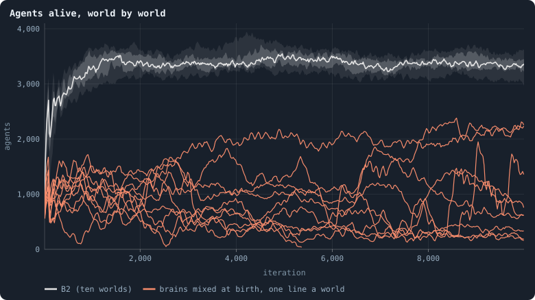

**Agents alive, world by world.** Each orange line is one world of Experiment 17, its agents after each game (means over 25 iterations); the grey band is B2's ten worlds — their median, middle half and nine in ten. B2's worlds keep their size; the mixed ones swing between a few hundred and two thousand agents, and one died out at iteration 5,376.

> [!example]- How to make this figure
> **Runs.** The ten runs of Experiment 17 — B2 at 10,000 tokens with brains mixed at birth, seeds 1 to 10, 10,000 iterations (`python3 gol_lab.py run E17`) — and B2 itself: Experiment 16's ten worlds to 2,000 iterations and the same worlds played on to 10,000 as pilots (`GraphOfLifeRuns/.pilots/L/B2-long-s001` … `s010`).
>
> **Data.** From each run's `stats.jsonl` (the lab's runs) and `series.jsonl` (B2's continuations).
>
> 1. Read the agents after each game (`nodes`, phase 2).
> 2. For B2, join each lab world (to 2,000) to its continuation (2,000 to 10,000).
>
> **To make it again:** `python3 book_figures.py mixedlong`.
<!-- /figure -->

B2's worlds fill up within 1,500 iterations to some 3,000 to 3,700 agents, and
stay there. The mixed worlds never settle. Each wanders, over thousands of
iterations, between a few hundred agents and two thousand. Seed 3 fell to 40
agents at iteration 2,543 and came back to more than 800. Seed 6 fell to 91
and grew back to nearly 2,000. Seed 9 grew to 1,424 agents at iteration 2,592,
then shrank for nearly three thousand iterations. It died out at 5,376, when
20 agents were left: the lab stops a world there.

<!-- figure mixedlong/poor -->
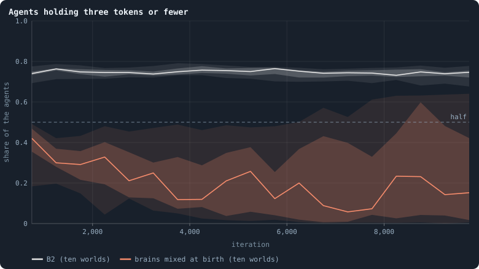

**Agents holding three tokens or fewer.** Each band is ten worlds — the median, the middle half and nine in ten — every 500 iterations: the share of their agents holding one, two or three tokens. A world that died out leaves the band when it does.

> [!example]- How to make this figure
> **Runs.** As for the figure *Agents alive, world by world* above.
>
> **Data.** From each run's whole worlds: the lab's archives (`archive/world_<iteration>.npz`) and the continuations' checkpoints (`ckpt_<iteration>.npz`).
>
> 1. Read every agent's tokens in each whole world kept at a multiple of 500 iterations.
> 2. Count those holding three or fewer, as a share of all.
>
> **To make it again:** `python3 book_figures.py mixedlong`.
<!-- /figure -->

The riches go with the size. In B2, three agents in four hold three tokens or
fewer at every moment of the 10,000 iterations. In the mixed worlds that share
falls from about 40% at iteration 1,000 to between 5% and 25% in the median
world after 3,000. But the worlds spread from none to two thirds.

With the tokens fixed, a world's riches *are* its size. If 152 agents share
10,000 tokens, they hold 66 each; if 2,257 agents share them, 4.4 each.

#### Verdict: rich, but only half healthy

<!-- figure mixedlong/verdict -->
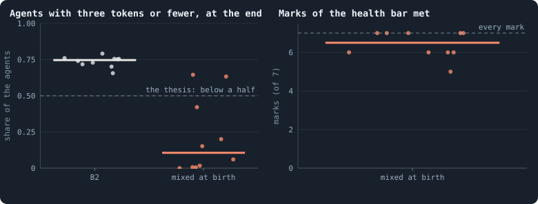

**Experiment 17 at iteration 10,000.** Each dot is a world at its last checkpoint, read as [Healthy and rich](building-b2-and-the-search-for-a-healthy-rich-world.md#healthy-and-rich) reads every world. Left: the share of its agents holding three tokens or fewer, B2's ten worlds at 10,000 iterations beside the mixed ones. Right: how many of the seven marks of [the health bar](measuring-health.md#the-health-bar) each mixed world meets; the world that died out is read at its last checkpoint, with 20 agents.

> [!example]- How to make this figure
> **Runs.** As for the figure *Agents alive, world by world* above.
>
> **Data.** From each run's last checkpoint (`checkpoint.npz`; B2's continuations' `ckpt_010000.npz`) (`GraphOfLifeRuns/.pilots/e17_profile.json`).
>
> 1. Count the agents holding three tokens or fewer, as a share of all.
> 2. Measure the seven marks as `research/atlas/profile.py` does.
>
> **To make it again:** `python3 book_figures.py mixedlong`.
<!-- /figure -->

The thesis asked two things of the worlds at iteration 10,000, and got one.

- **Rich: yes, by far.** In the median world, 11% of the agents hold three
  tokens or fewer, against the thesis's limit of a half; B2's worlds hold 66%
  to 79%. Seven of the ten are below 25%. The two exceptions, seeds 1 and 5,
  at 65% and 63%, are the two largest worlds, with 2,221 and 2,257 agents.
- **Healthy: five worlds of ten, where seven were needed.** Seeds 2, 4, 5, 6
  and 10 meet every mark. Three small worlds miss one mark, the hub: no agent
  may be joined to more than 5% of the others. In seed 3's 152 agents, the
  best-connected agent is joined to 12 others, 7.9% of the world; in seed 8's
  173, to 17 (9.9%); in seed 7's 346, to 47 (13.6%). Seed 1 misses the
  dimension by a hair, 4.05 against the bar's 4. Seed 9 died out.

**Strictly, the thesis is refuted.** And yet five worlds of ten meet every
mark, where none of B2's ten does at 10,000 iterations: each of B2's misses
the dimension, at 4.3 to 4.5.

#### Why a mixed world is rich

<!-- figure mixedlong/breeding -->
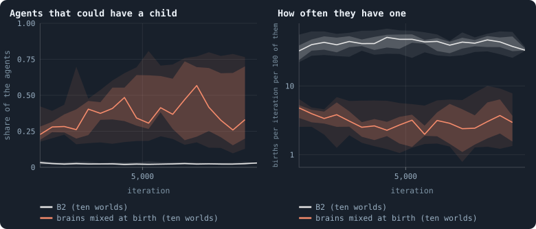

**Who could have a child, and who has one.** Left: the share of the agents that could have a child — 11 tokens or more, since a child takes at least 10 and the parent keeps one, and fewer than 8 links. Right: the births of the next 50 iterations, per iteration, per hundred such agents, on a logarithmic axis. Each band is ten worlds every 500 iterations — the median, the middle half and nine in ten; B2's ten worlds are Experiment 16's to 2,000 iterations and the same worlds played on after.

> [!example]- How to make this figure
> **Runs.** As for the figure *Agents alive, world by world* above.
>
> **Data.** From each world kept whole every 500 iterations, and each run's births (`research/oee/checks/e17_breeding.py`, `GraphOfLifeRuns/.pilots/e17_breeding.json`).
>
> 1. In each whole world, count the agents with 11 tokens or more and fewer than 8 links.
> 2. Read the births of the 50 reproduction phases that follow, from the run's record.
> 3. Divide their mean per iteration by the agents counted.
>
> **To make it again:** `python3 book_figures.py mixedlong`.
<!-- /figure -->

Start with death. In every world of both kinds, an agent lives out its hundred
iterations: almost nobody dies young. A world's agents divided by its births
per iteration is how long its agents live on average. In the median stretch of
500 iterations it is 100, in B2 and in the mixed worlds alike. So every world
replaces itself one for one: a birth per hundred agents per iteration. A
world's size is not set by death. It is set by who has children.

Who can have a child? A child takes at least 10 tokens, and its parent keeps
one. And an agent at its valence, the 8 links its brain may hold at most,
cannot have one at all. So the agents that *could* have a child are those with
11 tokens or more and fewer than 8 links.

In B2, 1% to 6% of the agents could have a child, and they have one at a
median rate of 42 per hundred per iteration. An agent that can afford a child
has it within two or three iterations. In the mixed worlds, a third of the
agents could have a child (8% to 89%). They have one at a median rate of 3 per
hundred per iteration: about fourteen times less often.

That is why a mixed world is rich. B2's agents have a child as soon as they
can afford one. So the world fills up until hardly anyone can: tokens go into
children as fast as they come. The mixed worlds' agents put children off. So a
mixed world settles where many could have a child and few do, and each agent
holds more.

And it is why the size drifts. How eagerly an agent breeds is a matter of its
brain. Where the brains are eager, a world grows until few are able; where
they are reluctant, it shrinks until many are. The mixed worlds' eagerness
wanders, from under 1 to 10 per hundred, and the size follows it. Across the
181 moments, the two go together with a correlation of 0.87, on logarithms.
B2's brains are eager in every world at every moment.

Why should mixing make agents put children off? A brain spreads in two ways:
through its agent's children, and through every node its agent takes in the
game, which gets a copy of the winner's brain. Taking nodes is by far the main
way. In the mixed worlds, 7.7 nodes per hundred agents change hands in the
median iteration (3 to 18); in B2's, 5.6 (4 to 11). Against that stands one
birth per hundred agents.

Where brains are mixed at birth, a child carries only about half of its
parent's brain, while a node taken carries all of it. A brain that spends its
tokens on children spreads less of itself than one that stakes them on its
neighbours' nodes. And the mate's half spreads for free, whether the mate ever
breeds or not ([What holds a world's
size](building-b2-and-the-search-for-a-healthy-rich-world.md#why-mixing-makes-agents-reluctant)). So
selection, which keeps working in these worlds (as the contests
[below](#does-evolution-go-on-brains-mixed-at-birth) show), may come to favour putting children off.

It is not simply that the reluctant fight more, though. Within the mixed
worlds, the share of nodes that change hands does not rise as a world grows
small and rich: its correlation with the world's size is −0.08.

<!-- figure mixedlong/switch -->
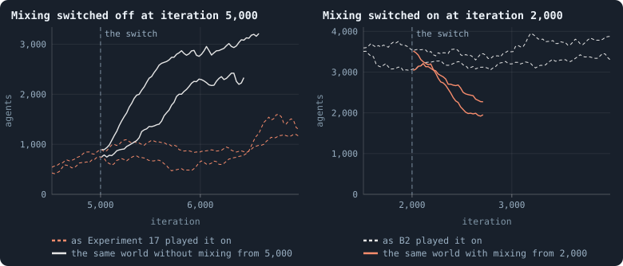

**Mixing switched at a moment.** Each solid line is a world played on as a pilot from the moment the lab had kept it whole, with mixing at birth switched; each dashed line is the same world played on unchanged — the lab's own run of Experiment 17, or B2's continuation. Agents after each game, means over 25 iterations. Batch SW: mixing off in the five worlds of Experiment 17 that met every mark, at iteration 5,000; on in five of B2's worlds, at 2,000.

> [!example]- How to make this figure
> **Runs.** The ten runs of Experiment 17 — B2 at 10,000 tokens with brains mixed at birth, seeds 1 to 10, 10,000 iterations (`python3 gol_lab.py run E17`) — and B2 itself: Experiment 16's ten worlds to 2,000 iterations and the same worlds played on to 10,000 as pilots (`GraphOfLifeRuns/.pilots/L/B2-long-s001` … `s010`). Batch SW: `GraphOfLifeRuns/.pilots/SW/mixoff-sNNN` and `mixon-sNNN` (`research/oee/pilots/make_jobs_TU.py`).
>
> **Data.** From each pilot's `series.jsonl`; the lab runs' `stats.jsonl`.
>
> 1. Start from the lab's whole world at the moment (`run.py --from RUN:ITERATION --set mix_at_birth=…`) and play 2,000 iterations.
> 2. Read the agents after each game in the pilot and in the run it was taken from.
>
> **To make it again:** `python3 book_figures.py mixedlong`.
<!-- /figure -->

Whatever the reason, switching the rule shows that mixing is what does it.
Batch SW took worlds from the lab at a moment, and played them on for 2,000
iterations with the rule switched. All ten went the way the rule says:

- **Without mixing from iteration 5,000**, all five of the worlds that met
  every mark grew: from 893, 744, 2,039, 395 and 1,325 agents to 3,341, 2,797,
  3,243, 2,137 and 2,082, on their way to B2's size. The same worlds with
  mixing stayed far smaller.
- **With mixing from iteration 2,000**, all five of B2's worlds shrank: from
  3,064 to 3,535 agents to between 1,422 and 2,156 — and one, seed 4, to 81,
  nearly dying out. The same worlds without it stayed above 3,000.

How eagerly the able agents breed changed first. Without mixing, it rose
within 1,500 iterations in four of the five worlds: from 1.5–7 births per
hundred per iteration to 14–35. In seed 10 it went from 5 to 10 and back to 5.
With mixing, in B2's worlds, it fell from 26–51 to 4–10. A rule that only five
generations of agents have lived under sets how eagerly they breed, and the
size of the world follows.

#### The marks a world misses

<!-- figure mixedlong/size -->
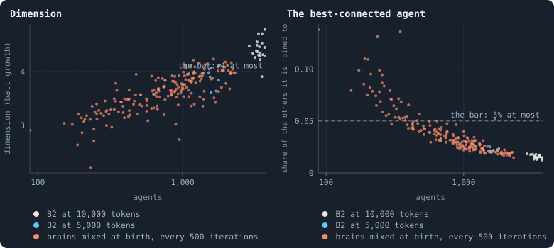

**The marks a world misses, against its size.** Each orange dot is a world of Experiment 17 at one of the moments it was kept whole, every 500 iterations; each grey dot a world of B2 at 10,000 tokens — Experiment 16's ten at 2,000 iterations, and the same worlds played on, at 10,000 or more — and each blue one a world of B2 at 5,000 tokens, Experiment 14's ten at 1,000 iterations. Across, on a logarithmic axis: the agents alive. Left: the dimension the network shows by ball growth; right: the share of the others the best-connected agent is joined to.

> [!example]- How to make this figure
> **Runs.** The ten runs of Experiment 17 — B2 at 10,000 tokens with brains mixed at birth, seeds 1 to 10, 10,000 iterations (`python3 gol_lab.py run E17`) — and B2 itself: Experiment 16's ten worlds to 2,000 iterations and the same worlds played on to 10,000 as pilots (`GraphOfLifeRuns/.pilots/L/B2-long-s001` … `s010`). B2 at 5,000 tokens: Experiment 14's ten runs (`B2-5000-s001` … `s010`).
>
> **Data.** From `GraphOfLifeRuns/.pilots/e17_health.json` (`research/oee/checks/e17_health.py`) and `GraphOfLifeRuns/.pilots/atlas/profile.json`.
>
> 1. Read each whole world as `research/atlas/profile.py` reads every world: the dimension by ball growth, the best-connected agent's links over the others.
> 2. Set each against the number of agents alive.
>
> **To make it again:** `python3 book_figures.py mixedlong`.
<!-- /figure -->

Read every 500 iterations, the ten worlds met every mark at 125 of their 190
moments: two in three. They missed only two marks (and one other once), and
each follows the world's size:

- **Small worlds miss the hub.** Below 300 agents, a world missed it at 96% of
  its moments: a best-connected agent with 12 to 47 links is more than 5% of a
  small world.
- **Large worlds miss the dimension.** The dimension the network shows by ball
  growth rises with the number of agents (a correlation of 0.78 with its
  logarithm). Above 1,500 agents it is near 4 or above.

Worlds of 600 to 1,000 agents met every mark at 98% of their moments.

B2 follows the same rule. Its worlds of 10,000 tokens hold 3,000 to 3,700
agents, and all but one miss the dimension, at 4.2 to 4.8. Its worlds of 5,000
tokens ([Experiment 14](building-b2-and-the-search-for-a-healthy-rich-world.md#building-b2-a-world-that-cannot-break)) hold 1,200 to 1,800
agents, and six of the ten meet every mark. They are as poor as ever: three
agents in four hold three tokens or fewer.

So half of what the thesis asked, every mark of the health bar, was a question
of size. Mixing makes a world smaller, and at that size B2's network meets the
bar. What mixing changes and size does not is how rich the agents are: B2's
worlds of 5,000 tokens are as poor as those of 10,000.

Why does a larger world read a larger dimension? The measure is not to blame.
In B1's worlds, which are true spaces (the agents within *r* steps grow as a
power of *r*), the dimension does not grow with size: from 40 agents to 70,000
it stays between about 2.5 and 4. [What folds a world](how-many-dimensions-does-a-world-have.md#what-folds-a-world)
found the reason in B2's network. It is nearly a small world, where every
agent is a few steps from every other, with no dimension of its own to show.
Every B2 world starts as a space and folds once its first generation dies,
each death mended with a ring of links. A larger world then reads a larger
dimension off the same few steps. Brains mixed at birth fold a world the same
way.

The rise is not a law of every world built on B2, though. It holds for B2
itself, at 5,000 and 10,000 tokens, and for its mixed worlds. Other rules move
the dimension at any size. Leave the estate of the dead to the newborns, or to
the parents, and B2 holds more than 5,000 agents at a dimension of 3.4 to 3.9,
and meets every mark ([Who inherits?](what-the-switches-did-in-pilots.md#healthy-and-diverse)).

#### Does evolution go on? (brains mixed at birth)
<!-- figure mixedlong/evolution -->
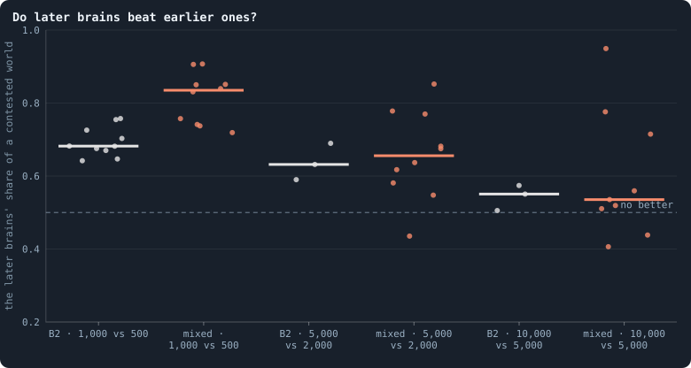

**Do later brains beat earlier ones?** Each dot is a world: the share of a world the later era's brains hold after 100 iterations against the earlier era's, the mean of two contests, one in each era's world; the bar is the median world. Orange: the mixed worlds of Experiment 17; grey: B2 — its ten worlds for 1,000 against 500, three of their continuations for the later pairs.

> [!example]- How to make this figure
> **Runs.** As for the figure *Agents alive, world by world* above.
>
> **Data.** From each run's whole worlds every 500 iterations (`GraphOfLifeRuns/.pilots/e17_T100.json`, `long_steps.json`, `long_rejudge_T100.json`).
>
> 1. Seat the brains of the two eras by a coin per agent on each era's world and play it on for 100 iterations, an agent's lifetime (`research/oee/checks/rejudge.py`).
> 2. Count the agents the later era's brains hold at the end, as a share of all.
>
> **To make it again:** `python3 book_figures.py mixedlong`.
<!-- /figure -->

Yes, and at first faster than in B2. In each world, the brains of a later
moment met those of an earlier one, as [Why evolution
stops](how-to-tell-a-world-that-keeps-evolving.md#would-we-notice-if-it-went-on) did for B2. Each
contest lasts an agent's lifetime, 100 iterations, and is played once in each
era's world. A newborn whose brain is mixed counts for its parent's era.

In the median world, the brains of iteration 1,000 took 84% of a contested
world from those of 500; B2's took 68%. They took more than half in every one
of the ten worlds (72% to 91%). Those of 5,000 took 66% from those of 2,000
(B2: 63%, in three worlds). Those of 10,000 took 54% from those of 5,000 (B2:
55%), more than half in seven worlds of nine.

So mixing does not stop evolution. The steps shrink with time, as they do in
B2, and the first ones are larger. The worlds differ more, though: from 41% to
95% for the last pair. One world's step is uncertain on its own: a contest of
two eras varies by about a tenth from one play to the next. An era of seed 4
played against itself gave 40% and 64%. The median of ten is not uncertain in
that way.

How the brains are counted matters here. The lab's contests told the two eras
apart by the number each brain carries. Mixing makes new brains even where
mutation is switched off, and the numbers those new brains drew counted for
the earlier era. So the first count of these contests said that evolution
stops in mixed worlds. Counted by the parent's era, it goes on.

### Five mixed worlds, fifty thousand iterations

<!-- experiment E18 -->

Whatever else a world that keeps evolving does, it has to *last*. A world that
meets the author's picture for 10,000 iterations and then shrinks to nothing,
or fills up with agents holding a token each, is not a world that keeps
evolving. The author asked for the most promising settings to be run for a
long time, and this is that run. ([A hundred thousand
iterations](a-hundred-thousand-iterations.md) plans a single world twice as
long.)

The first 10,000 iterations left that open. The mixed worlds stayed rich, but
their size drifted, and their health followed it. Small worlds missed the hub
mark and large ones the dimension, while worlds of 600 to 1,000 agents met
every mark at 98% of their moments ([The marks a world
misses](#the-marks-a-world-misses)). One world in ten died out, and two others
fell below a hundred agents before they came back ([What the ten worlds
did](#what-the-ten-worlds-did-brains-mixed-at-birth)). So whether a mixed world stays healthy and
rich depends on where its drift takes it. Ten thousand iterations showed each
world wandering through a range of sizes. Fifty thousand will show whether
that range has edges.

#### Five worlds played on

Experiment 18 takes the five worlds of Experiment 17 that met every mark of
the health bar at iteration 10,000: seeds 2, 4, 5, 6 and 10. It plays them on
to iteration 50,000. They are the same runs. The lab goes on from the world
each run saved at iteration 10,000, its checkpoint, with the engine that made
it. It records as before: the graph statistics every 25 iterations, and a
whole world every 500. Nothing is changed, so their first 10,000 iterations
are those of the [section above](#mixed-at-birth-ten-long-worlds). Each world
is read every 500 iterations from the whole worlds the lab keeps, as [Healthy
and rich](building-b2-and-the-search-for-a-healthy-rich-world.md#healthy-and-rich) reads every world.

When the plan was written (16 October 2026), the five worlds stood like this
at iteration 10,000:

| world | agents | median tokens | 3 tokens or fewer | moments with every mark, of 20 (500 to 10,000) | its fewest and most agents, 500 to 10,000 |
|---|---|---|---|---|---|
| seed 2 | 744 | 11 | 6% | 16 | 337–1,437 |
| seed 4 | 628 | 11 | 20% | 17 | 337–1,371 |
| seed 5 | 2,257 | 2 | 63% | 6 | 1,032–2,257 |
| seed 6 | 1,302 | 4 | 42% | 11 | 188–1,688 |
| seed 10 | 618 | 10 | 15% | 16 | 296–1,649 |

We expected the five worlds to stay mostly healthy and rich, because health
came back. Over the first 10,000 iterations, a world that met every mark still
met them 500 iterations later four times in five. A world that missed a mark
met them all again a third of the time. But forty thousand iterations more is
time for each of the five to drift through every size. It might grow small
enough to miss the hub, or large and poor enough to miss the dimension.

<!-- thesis E18 -->
> [!quote] The thesis of Experiment 18, written down before any of its runs existed
> **The claim.** Over a long life, a world whose brains are mixed at birth stays mostly healthy and rich. The five worlds of Experiment 17 that met every mark of the health bar at iteration 10,000, played on to 50,000, meet every mark at half or more of the moments they are kept whole, and at 50,000 at most one of them has half its agents or more holding three tokens or fewer.
>
> **Why it would be so.** Over Experiment 17's 10,000 iterations, these five worlds met every mark at 66 of the 100 moments they were kept whole (every 500 iterations from 500 on): 16, 17, 6, 11 and 16 of 20 each. A world that met every mark still did 500 iterations later four times in five (95 of 120 times, in all ten worlds), and one that missed a mark met them all again a third of the time (21 of 60): health comes back. At iteration 10,000 four of the five had fewer than half their agents at three tokens or fewer (6%, 20%, 42%, 15%) and one had 63%, where B2's worlds have 66% to 79% at every moment. But a mixed world's size drifts, and its health and its riches follow its size: worlds of 600 to 1,000 agents met every mark at 98% of their moments, worlds below 300 at 4% (their best-connected agent is joined to more than 5% of the others), worlds above 1,500 at 35% to 60% (their dimension rises above 4). And with 10,000 tokens, a world of 2,000 agents is a poor one. In ten worlds one shrank below 20 agents and died out, at iteration 5,376; two others fell below a hundred agents, to 40 and to 91, and came back. Forty thousand iterations more is time for every one of the five to drift through those sizes.
>
> **It holds if:** From iteration 10,500 to 50,000, each world read every 500 iterations from its archive as research/atlas/profile.py reads every world ([Meta X](building-b2-and-the-search-for-a-healthy-rich-world.md#healthy-and-rich)): at half or more of the five worlds' 400 moments together, a world meets all seven marks of Chapter [46](how-to-tell-a-world-that-keeps-evolving.md)'s health bar (a world that has died out misses them at every moment after); and at iteration 50,000, at most one of the five worlds has died out or has half its agents or more holding three tokens or fewer.
>
> **It fails if:** Fewer than half the moments meet every mark, or two or more of the five worlds dead or with half their agents or more at three tokens or fewer at 50,000: the health and the riches of a mixed world do not last.
<!-- /thesis -->

#### What the five worlds did

<!-- figure longmixed/sizes -->
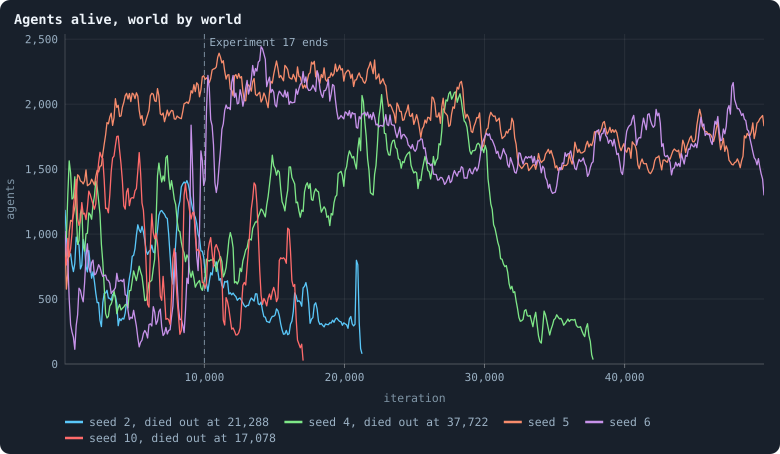

**Agents alive, world by world.** Each line is one world, its agents after each game (means over 100 iterations), from its birth in Experiment 17 to iteration 50,000 or to the game after which 20 agents or fewer were left, where the lab stops a world.

> [!example]- How to make this figure
> **Runs.** The five runs of Experiment 18 — Experiment 17's worlds of seeds 2, 4, 5, 6 and 10 (B2 at 10,000 tokens with brains mixed at birth), played on by the lab from iteration 10,000 to 50,000 or until they died out (`python3 gol_lab.py run E18`); their first 10,000 iterations are Experiment 17's.
>
> **Data.** From each run's `stats.jsonl`.
>
> 1. Read the agents after each game (`nodes`, phase 2).
> 2. Average over stretches of 100 iterations.
>
> **To make it again:** `python3 book_figures.py longmixed`.
<!-- /figure -->

Three of the five worlds died out:

- **Seed 10** grew from 620 agents to 1,450 by iteration 13,556, and died out
  at 17,078. In its last thousand iterations it fell from 1,168 agents to 19.
- **Seed 2** wandered between 230 and 740 agents for eight thousand
  iterations. It rose to 989 at iteration 20,874, and was gone 413 iterations
  later, at 21,288.
- **Seed 4** grew to 2,191 agents by iteration 21,260, and stayed near two
  thousand until 28,000. Then it fell to 123 by 34,000, came back to 345, and
  died out at 37,722.

Two worlds lived to 50,000, and stayed large. Seed 5 already held more than
2,000 agents at iteration 10,000, and seed 6 grew past 2,000 within a few
thousand iterations. Over their last 20,000 iterations, both held between
1,262 and 2,252 agents, and 37% to 61% of their agents held three tokens or
fewer: between the mixed worlds' riches and B2's poverty.

#### Verdict: refuted on both counts

**The thesis is refuted, on both counts.** It asked that the worlds meet every
mark at half or more of their moments from 10,500 to 50,000. A dead world
counted as missing them all. They met them at 115 of 400, 29%. And it allowed
at most one world dead or with half its agents poor at 50,000. Three had died
out, and seed 5 ended with 56% of its agents at three tokens or fewer. Only
seed 6 ended alive with fewer than half its agents poor, at 43%.

#### Health and riches

<!-- figure longmixed/health -->
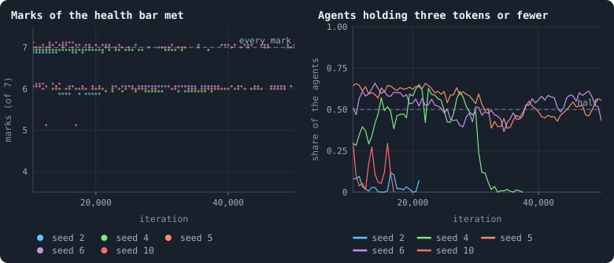

**Health and riches, every 500 iterations.** Each world read as [Healthy and rich](building-b2-and-the-search-for-a-healthy-rich-world.md#healthy-and-rich) reads every world, from the whole worlds the lab kept every 500 iterations from 10,500 on, while it lived. Left: how many of the seven marks of [the health bar](measuring-health.md#the-health-bar) it meets (the dots of each world are set a little apart so that they do not hide each other). Right: the share of its agents holding three tokens or fewer.

> [!example]- How to make this figure
> **Runs.** As for the figure *Agents alive, world by world* above.
>
> **Data.** From each run's `archive/world_<iteration>.npz` (`research/oee/checks/e17_health.py --seeds 2,4,5,6,10 --from 10500 --to 50000`).
>
> 1. Read each whole world as `research/atlas/profile.py` reads every world.
> 2. Count the marks it meets and its agents at three tokens or fewer.
>
> **To make it again:** `python3 book_figures.py longmixed`.
<!-- /figure -->

The marks a world misses follow its size, as they did in the first 10,000
iterations ([The marks a world misses](#the-marks-a-world-misses)). The worlds
that died missed the hub mark while they were small. The two that lived missed
a mark at 50 of their 80 moments each, and it was always the dimension. They
held 1,300 to 2,300 agents, at a dimension of 3.8 to 4.3: just around the
bar's 4. The riches follow the size too: the dead worlds were rich to the end,
the living ones poorer the larger they grew.

#### How a mixed world dies

<!-- figure longmixed/collapse -->
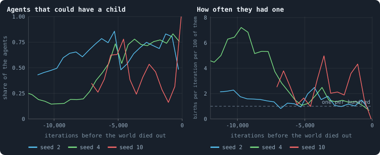

**The worlds that died out.** Each line is a world that died out, read every 500 iterations up to its end: left, the share of its agents that could have a child (11 tokens or more and fewer than 8 links); right, how often they had one in the next 50 iterations, per hundred of them. Every agent dies at 100, so a world whose agents all could have a child dies out once they have fewer than one per hundred an iteration.

> [!example]- How to make this figure
> **Runs.** As for the figure *Agents alive, world by world* above.
>
> **Data.** From each run's whole worlds and births (`research/oee/checks/e17_breeding.py --seeds 2,4,10 --from 10000 --to 50000`).
>
> Step 1 as for the figure *Who could have a child, and who has one* above.
>
> 2. Divide the births per iteration of the next 50 iterations by them.
>
> **To make it again:** `python3 book_figures.py longmixed`.
<!-- /figure -->

Not by a sudden blow. Every agent of these worlds lives out its hundred
iterations. So a world keeps its size only while one agent in a hundred is
born every iteration ([Why a mixed world is
rich](#why-a-mixed-world-is-rich)). The worlds that died had hovered near that
line for thousands of iterations. Then they fell below it, and stayed below.
In the last world kept before each end, births had fallen to 0.39, 0.51 and
0.47 per hundred agents an iteration. Yet a third to three quarters of the
agents could have had a child. In seed 10's last world, 31 agents were left,
every one of them able to have a child, and none had one. Their ages were
spread evenly. This was not a generation dying at once, but a world that
stopped replacing its dead.

#### Did evolution go on?

<!-- figure longmixed/contests -->
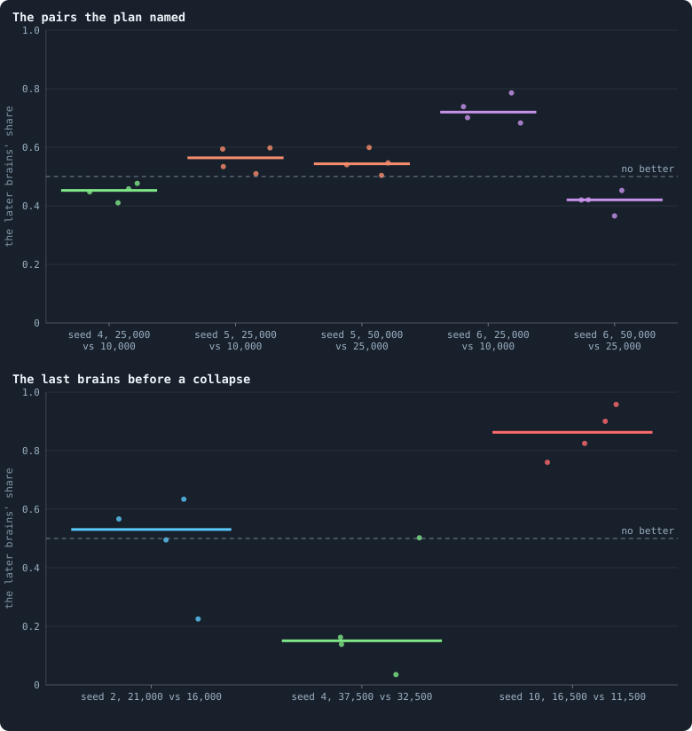

**Later brains against earlier ones.** Each dot is a contest between two of a world's moments: the brains of the later moment against those of the earlier, half and half on the same world, for 100 iterations, in each moment's world with two seeds; the bar is the median of the four. Above: the pairs the plan named, for the worlds alive then. Below: the brains of the last world kept before each collapse that still had a few hundred agents, against those of 5,000 iterations before.

> [!example]- How to make this figure
> **Runs.** As for the figure *Agents alive, world by world* above.
>
> **Data.** From `GraphOfLifeRuns/.pilots/e18_T100.json` (`research/oee/checks/rejudge.py --seeds 17,18`).
>
> 1. Seat the brains of the two moments by a coin per agent on each moment's world and play 100 iterations, an agent's lifetime.
> 2. Count the agents the later moment's brains hold at the end, as a share of all.
>
> **To make it again:** `python3 book_figures.py longmixed`.
<!-- /figure -->

**Hardly.** In the pairs the plan named, the brains of 25,000 beat those of
10,000 in seed 6 (72% of a contested world, the median of four contests)
and narrowly in seed 5 (56%). In
seed 4 they did no better (45%). The brains of 50,000 took 54% from those of
25,000 in seed 5, and lost to them in seed 6 (42%). Over the first 10,000
iterations, the mixed worlds' later brains had won 84%, then 66%, then 54%
([Does evolution go on?](#does-evolution-go-on-brains-mixed-at-birth)). The steps shrink towards
nothing: in the long run, a later era is as likely to lose as to win.

Before the collapses, the contests differ from world to world. In seed 10, the
brains of the last good years took 86% of a contested world from those of
5,000 iterations before. The brains that let the world die out were winners:
selection itself carried it to its end. Biologists call this **evolutionary
suicide**: selection that drives a trait to where the population cannot last.
In seed 4 the last brains lost to their forebears (21%), and in seed 2 they
tied (48%). One world in three is not a law. It is enough to say that a mixed
world can be led to extinction by the very brains that win in it.

### What we learned (brains mixed at birth)
- **A rich world, here, is a small one.** With the tokens fixed, how rich the
  agents are is how few they are. Mixing brains at birth made the worlds rich
  by making their agents slow to have children. In B2 an agent that can afford
  a child has one within two or three iterations; in a mixed world, after
  thirty or so. Switch mixing off, and the riches go within a thousand
  iterations. Switch it on in B2, and its worlds shrink at once, one of them
  nearly to nothing.
- **Nothing holds the size.** How eagerly agents breed drifts as their brains
  change, and the size, the riches and the marks of health drift with it. The
  riches of a world that keeps evolving would need something to hold them: a
  rule, or something the agents keep up themselves. Batch M tried each rule of
  the engine that might hold a mixed world's size: the estates of the dead to
  the newborns, to the parents or to the poorest; half of an agent's tokens
  kept at home; links to strangers; and a slower change of brains. Those that
  held a world steady held it poor ([What holds a world's
  size](building-b2-and-the-search-for-a-healthy-rich-world.md#what-would-hold-a-worlds-size)).
- **A mixed world is mortal.** One world of ten died out within 10,000
  iterations, and three of the five that had met every mark at 10,000 died out
  before 40,000. Each died the same way: births fell below the one per hundred
  agents that replaces the dead, while many of its agents could have afforded
  a child. The two that lived stayed large and fairly poor, and missed the
  dimension mark at most of their moments. They ended closer to B2 than to the
  worlds that came closest in [Healthy and rich](building-b2-and-the-search-for-a-healthy-rich-world.md#healthy-and-rich).
- **Evolution goes on, then fades.** Mixing does not stop selection: later
  brains beat earlier ones as they do in B2, and by more at first. Then the
  steps shrink. By 25,000 to 50,000 iterations, an era is as likely to lose as
  to win against the one before it. In one world, the brains that won were
  those that let it die.
- **Two marks of the health bar measure size.** In B2 and its mixed worlds,
  the dimension fails a large world and the hub a small one. Networks are best
  compared at one size.
- **A count has to follow every way its labels are made.** Mixing makes new
  brains even without mutation. Counted by the number each brain carries, the
  contests said evolution stops in mixed worlds. Counted by the parent's era,
  it goes on.

### How this was made (brains mixed at birth)
The figures of [the first section](#mixed-at-birth-ten-long-worlds) read the
ten runs of Experiment 17. Beside them they read B2's own worlds: Experiment
16's ten, played on as pilots to 10,000 iterations, and a few others that each
figure names. `python3 book_figures.py mixedlong` draws them. The figures of
[the second section](#five-mixed-worlds-fifty-thousand-iterations) read the
five runs of Experiment 18, and `python3 book_figures.py longmixed` draws
them. Each figure says, folded beneath it, which runs it reads and how. A lab
run records every game, so the plans reckoned with about 9 GB of disk for
Experiment 17's ten runs, and 16 GB more for Experiment 18's five.

#### The runs of Experiment 17

<!-- runs E17 -->
> [!info]- The runs behind this page
> **10 runs.** Every condition below is run once for every seed (1 to 10), for 10,000 iterations — or until its world dies out. Every setting is B2's unless the condition changes it.
>
> - **mixed at birth** — changes `mix_at_birth` = on; 10,000 tokens. Runs `B2-10000-4af4a3-s001` … `B2-10000-4af4a3-s010`.
>
> To make these runs again: `python3 gol_lab.py run E17`.
<!-- /runs -->

#### The runs of Experiment 18

These are five of Experiment 17's runs, played on from their checkpoints at
iteration 10,000 with the engine that made them. So they keep their names.

<!-- runs E18 -->
> [!info]- The runs behind this page
> **5 runs.** Every condition below is run once for every seed (2, 4, 5, 6, 10), for 50,000 iterations — or until its world dies out. Every setting is B2's unless the condition changes it.
>
> - **mixed at birth** — changes `mix_at_birth` = on; 10,000 tokens. Runs `B2-10000-4af4a3-s002` … `B2-10000-4af4a3-s010`.
>
> To make these runs again: `python3 gol_lab.py run E18`.
<!-- /runs -->

## What holds a world's size

Every agent of a B2 world dies at the age of 100, so a world keeps its size
only if one agent in a hundred is born each iteration. How eagerly the agents
breed decides how full the world gets; with its tokens fixed, a full world is
a poor one. B2's agents breed as soon as they can, and three in four are poor:
they hold three tokens or fewer. When a newborn's brain is mixed from its
parent's and a neighbour's, agents put children off: their worlds are small
and rich, but the reluctance drifts, and some die out. No rule tried so far
holds a world both rich and steady; the steadiest kept every world alive, but
at about 2,000 agents, six in ten of them poor.

### One number behind riches and health

The author's picture of a world that might keep evolving has two halves
([Healthy and rich](building-b2-and-the-search-for-a-healthy-rich-world.md#healthy-and-rich)). Its network is decentralised,
resilient and almost three-dimensional. And its agents differ: it is not a
world where everyone holds one to three tokens.

Across the experiments with brains mixed at birth
([below](#three-kinds-of-world)), one quantity decided both halves more than
any rule did: **how many agents a world holds**.

**Riches are size.** The number of tokens in a world never changes. So the
fewer its agents, the more each one holds: 10,000 tokens among 3,300 agents
are three each, and among 700 fourteen.

**Health follows size**, in B2's networks
([The marks a world misses](building-b2-and-the-search-for-a-healthy-rich-world.md#the-marks-a-world-misses)).
The health bar asks seven things of a network, its marks. A small world fails
the mark for hubs: below about 300 agents, its best-connected agent is joined
to more than 5% of the others. A large world fails the mark for dimension,
which asks for 2.3 to 4: above about 1,500 agents, it reads near 4 or more.

The large world fails because B2's kind of network is nearly a small world, in
which every agent is a few steps from every other. Every B2 world starts as a
space, wide like a plane or a room. Then the deaths of its old agents fold it:
each death is mended with a ring of links among the dead agent's neighbours.
And a small world reads a larger dimension the more room it has
([What folds a world](how-many-dimensions-does-a-world-have.md#what-folds-a-world)).

**A world that grows too small dies out.**

So this page gathers what the notebook knows about what sets the number of
agents in a world.

### The ledger of a world

Picture a bathtub with the plug pulled. The fuller it is, the faster it
drains. Now picture a tap that pours more slowly the fuller the tub gets. The
water settles at the level where the tap and the drain match. A world built on
B2's rules is such a tub, with agents for water.

**The drain is old age.** In every world built on B2's rules, an agent lives
out its hundred iterations and then dies of age; nearly nobody dies sooner
([Why a mixed world is rich](building-b2-and-the-search-for-a-healthy-rich-world.md#why-a-mixed-world-is-rich)).
So a world of 1,000 agents loses about 10 of them every iteration, and a world
of 3,000 about 30. To keep its size, a world needs one birth per hundred agents
every iteration.

And it gets one. The notebook measured 454 moments: in B2's worlds, in the
worlds whose brains are mixed at birth, and in worlds where that rule was
switched on or off. The median is 1.00 births per hundred agents an iteration. Worlds
read later show the same balance: 99 to 102 agents for each birth an iteration,
averaged over iterations 2,000 to 3,000
([A world's size is its births](building-b2-and-the-search-for-a-healthy-rich-world.md#a-worlds-size-is-its-births)).
A world's size is a hundred times its births an iteration.

**The tap is the agents that can have a child.** A child takes at least 10
tokens, and its parent keeps one, so a parent needs 11 tokens or more. And an
agent with 8 links, the most its brain may hold, cannot have a child at all.
We call an agent **able** when it holds 11 tokens or more and has fewer than
eight links. And we call how often the able have a child their **eagerness**:
the births per hundred able agents an iteration.

The births a world sees are then its able agents, times how eagerly each of
them breeds:

> births per hundred agents = (share of agents able to have a child) ×
> (births per hundred able agents)

The left side has to come to one. In B2's worlds, a median of 2.3% of the agents
are able, and they have a child at a median rate of 42 per hundred an
iteration: 0.023 × 42 ≈ 1. In the worlds whose brains are mixed at birth, a
third are able, and they breed at 3 per hundred: ⅓ × 3 = 1. The births are the
same; the two factors are not.

The share of able agents falls as a world fills up, because more agents share
the same tokens. That is the tap slowing as the tub fills. So every world
settles where its share of able agents brings the product to one: **eager
agents settle a world where few are able, and reluctant ones where many
are.** Eagerness sets the size, and the size sets the riches.

### Three kinds of world

**Eager: B2.** An agent that can afford a child has one at a median rate of 42
per hundred an iteration, so within two or three iterations. The world fills
until only about 2% of its agents can afford one, and three agents in four
hold three tokens or fewer. Nothing drifts. The world is held at that size by
its tokens, as a jar is filled by what is poured in.

**Reluctant: brains mixed at birth.** With brains mixed at birth
([`mix_at_birth`](settings.md#mix_at_birth)), a newborn's brain is half its
parent's and half a **mate**'s: one of the parent's neighbours, drawn at random
([Brains mixed at birth, in long worlds](building-b2-and-the-search-for-a-healthy-rich-world.md#brains-mixed-at-birth-in-long-worlds)).
The able agents of these worlds have a child at 3 per hundred an iteration. So
a world settles where a third of its agents can afford one: small and rich.

But nothing holds the reluctance where it is. It drifts as the brains change,
and the size follows. Across the 181 moments kept of Experiment 17's ten mixed
worlds, eagerness and size go together closely: a correlation of 0.87 between
their logarithms. The marks of health follow the size.

And the eagerness can fall too far. Suppose every agent were able: the share
in the ledger would be one, and the births per hundred agents would equal the
eagerness. So once the able have fewer than one child per hundred an
iteration, even a world in which everyone can afford a child does not replace
its dead. The world dies.

Three of the five mixed worlds played to 50,000 iterations died so
(Experiment 18,
[Five mixed worlds, fifty thousand iterations](building-b2-and-the-search-for-a-healthy-rich-world.md#five-mixed-worlds-fifty-thousand-iterations)).
In the last world kept before each end, a third to three quarters of the
agents could have had a child. Yet births had fallen to 0.4 to 0.5 per hundred
agents an iteration, against the 1.0 that replaces the dead.

**Paid: rules that pay for births.** Some rules make every birth easier or
more rewarding: the estate of the dead paid to the newborns or to their
parents, or a child allowed to start with any number of tokens. Their worlds
fill to more agents than B2's, and are poorer still. With the estate to the
newborns or to the parents, B2's worlds grew by half, to 5,100 to 5,300
agents, and nine agents in ten held three tokens or fewer
([Who inherits?](what-the-switches-did-in-pilots.md#who-inherits)). Mixing brains at birth does not change
that ([Brains mixed at birth, with every other rule](what-the-switches-did-in-pilots.md#brains-mixed-at-birth-with-every-other-rule)).
Nor do parents as mates: with them, the estates filled a world to about 5,000
agents, of 1.9 tokens each
([Room for the steadiest world](building-b2-and-the-search-for-a-healthy-rich-world.md#room-for-the-steadiest-world)).

**Switching a rule shows the ledger at work.** Batch SW, a group of pilot
worlds, took worlds from the lab at a moment and played them on with mixing
switched
([Why a mixed world is rich](building-b2-and-the-search-for-a-healthy-rich-world.md#why-a-mixed-world-is-rich)):
- **Mixing switched off** in five rich worlds: within 1,500 iterations,
  eagerness rose three- to twentyfold in four of them, and all five filled up
  towards B2's size.
- **Mixing switched on** in five of B2's worlds: eagerness fell three- to
  tenfold, and the worlds shrank, one of them to 81 agents.

### Why mixing makes agents reluctant

A brain spreads in two ways. One is through its agent's children. The other is
through the game: each node, a place in the network, that an agent wins there
gets a copy of the winner's brain. Taking nodes is by far the larger way. In
the median iteration of a mixed world, 7.7 nodes per hundred agents change
hands, against one birth per hundred agents.

In B2 a child carries all of its parent's brain. With mixing it carries about
half, and the other half comes from the mate, who pays nothing for it. So
having a child spreads half as much of a brain for the same price. And a
mate's brain spreads for free, whether its own agent breeds or not. We call
this the **free ride**.

Selection keeps working in the mixed worlds. Later brains beat earlier ones,
as in B2, and by more at first
([Does evolution go on?](building-b2-and-the-search-for-a-healthy-rich-world.md#brains-mixed-at-birth-in-long-worlds)).
But what selection rewards has changed, and agents that keep their tokens lose
little by it.

It can even reward the reluctance that ends a world. To see whether brains
still improve, the notebook plays a **lifetime contest**. The brains of two
moments of a world, two eras, are dealt to its agents by a coin each and played
for 100 iterations, an agent's lifetime. If the later brains then hold more than
half of the world, they are the better ones.

In one of the worlds that died, the brains of its last good years beat those
of 5,000 iterations before, 86% to 14%. The brains that let the world die out
were winners
([Five mixed worlds, fifty thousand iterations](building-b2-and-the-search-for-a-healthy-rich-world.md#five-mixed-worlds-fifty-thousand-iterations)).
Biologists call this **evolutionary suicide**: selection driving a trait to
where the population cannot last. In another world, the last brains lost to
their forebears; in a third, they tied. One world in three is not a law, but
it is a warning.

Was the free ride the cause? Two later experiments took it away, in two
different ways, and both steadied mixed worlds
([Who may be a mate](building-b2-and-the-search-for-a-healthy-rich-world.md#who-may-be-a-mate)). So it was at
least one cause of the reluctance.

### What would hold a world's size

Think of a thermostat. When the room is cold it heats, and when the room is
warm it stops, so the room stays near one temperature. A world held at a
middle size needs the same for births: **having a child must pay more when few
have them, and less when many do.** We call that a **pull**.

Such a world would be rich enough that its agents differ, and large enough not
to die out. In B2's networks it could also sit at the size where every mark of
the health bar is met. Among Experiment 17's mixed worlds, those of 600 to
1,000 agents met every mark at 98% of their moments.

B2 has a pull, but only at the top, where the tokens run out. The rules tried
so far either pull too hard or not at all. An estate shared among the newborns
pulls too hard: it pays each newborn more when there are fewer of them, and so
it fills the world.

The pilot worlds of batch M gave a mixed world, one at a time, each rule of
the engine that might steady it, for 5,000 iterations:
- the estate shared out to the poorest first, and half of an agent's tokens
  kept on its own node, held their worlds steady at 1,300 to 2,300 agents, but
  six agents in ten were poor;
- the searches for links beyond an agent's neighbours, and a slower change of
  brains, left them unsteadier than mixing alone.

Five ways to build a pull have been tried. Here is each, and what came of it.

#### The estate to a dead agent's own children

With [`redistribution`](settings.md#redistribution) = `children` (new on
17 October 2026), the tokens a dead agent leaves go to its own living
children. Breeding then pays, but late, at the parent's death, and only within
its own line of descent. A line that does not breed loses its wealth to
everyone else.

**With mixing it did not hold the size** (batch H: two seeds, 5,000
iterations). One world shrank to between 170 and 750 agents. The other fell to
two agents by iteration 4,200 and died out. The engine then started it again
from one agent holding every token, which filled the world within a hundred
iterations. A late reward for a line does nothing for a world whose agents do
not breed in the first place.

#### A mate that pays its share (what holds a world's size)
If the mate gives the child tokens too, the free ride ends. But a child that
two pay for is cheaper to each of them, and that pushes the other way.

Experiment 22 tried it later, in four worlds of 5,000 iterations
([A mate that pays its share](building-b2-and-the-search-for-a-healthy-rich-world.md#who-may-be-a-mate)).
The mate gave the child as many tokens as the parent did, as far as it could
and never its last. Every world held its size more steadily than Experiment
17's world of the same seed, whose mate pays nothing, and none came near dying
out. But the cheaper child counted too. The paying mates' worlds held more
agents than the free mates' worlds of the same seeds: medians of 1,394 to
2,048, against 586 to 1,051. So each of their agents held fewer tokens.

#### Mates among the parents

With [`mix_mates`](settings.md#mix_mates) = `parents` (new on 17 October
2026), only a neighbour with a living child of its own may be the mate. Being
a mate turns from a free gift into something only breeders have. A parent with
no such neighbour gives its newborn a copy of its own brain. This rule was
played twice: first in four pilot worlds, then in the lab's ten.

**The pilots** (batch MP) were four worlds, seeds 1 to 4, played for 5,000
iterations. Each was set beside Experiment 17's world of the same seed, where
any neighbour may be the mate: its *twin*
([What the pilots found](building-b2-and-the-search-for-a-healthy-rich-world.md#who-may-be-a-mate)).
- **More eager.** In every pilot the able agents had a child more often than
  in its twin: 3.5 to 7.5 per hundred an iteration, against 2.1 to 4.3. Each
  number is a world's median moment, read every 500 iterations.
- **Steadier.** Every pilot held its size more steadily than its twin. The
  spread of the logarithm of its number of agents, from iteration 500 to
  5,000, was 0.09 to 0.29, against 0.19 to 0.63. A spread of 0.1 means the
  size strays by about a tenth.
- **Size and riches.** The pilots held about 760 to 2,200 agents from
  iteration 500 to 5,000. At 5,000, 23% to 54% of their agents held three
  tokens or fewer; B2's worlds have 66% to 79%.
- **But** the eagerness rose by only about a half, one pilot still fell from
  2,000 agents to 900, and three of the four ended poorer than their twins.

**The experiment** (Experiment 19) played the same rule in the lab: ten
worlds, seeds 1 to 10, for 20,000 iterations
([Mixed at birth, with parents as mates](building-b2-and-the-search-for-a-healthy-rich-world.md#mixed-at-birth-with-parents-as-mates)).
Every world lived, and settled: from iteration 15,000 on, each held 2,030 to
2,350 agents on average. Over the first 10,000 iterations, the able had a
child 6.0 times per hundred an iteration, twice the 3.0 with any mate. Their
agents differed as much as in mixed worlds with a free mate: a diversity score
of 0.59 in the median world, against 0.58. But eager agents fill their world.
At iteration 20,000, 55% to 66% of each world's agents held three tokens or
fewer.

So taking the free mate away holds a world's size, but at one size for every
world — larger than mixing's, smaller than B2's — and not at a rich one.

#### Tokens that buy a longer life

In B2 an agent dies at 100, whatever it holds. With
[`buy_life`](settings.md#buy_life) (new on 17 October 2026), an agent past
that age lives on by paying a token an iteration into the estate of the dead.

**It gives no pull** (batch BL). With mixing, a rich agent lives on, fewer
births are needed, and the world settles smaller still: 100 to 1,100 agents,
as unsteady as mixing alone. In one world a single agent ended up holding
every token, buying its life without end.

In B2 the worlds hold fewer agents, about 1,400 and 2,450 against 3,300. A few
old agents rich enough to live on keep them small. And they keep evolving as
B2 does. In lifetime contests, the brains of iteration 1,000 take 67% and 64%
of a contested world from those of 500, and those of 2,000 take 79% and 77%
from those of 1,000. In B2 itself: 69% and 67%, then 65% and 76%.

#### A child as rich as its neighbours

With [`child_floor`](settings.md#child_floor) = `neighbours`, a child must
start with at least the median holding of its parent's neighbours. Among rich
neighbours a child costs more, among poor ones less. So a birth cannot make a
pauper where the world is rich, and a world can grow only as rich as it
already is: a pull against filling up, with no number of its own.

Experiment 32 tried it with brains mixed at birth and parents as mates, alone
and beside the estates paid to births: two seeds each, for 3,000 iterations.
**It changed nothing the measures can see**, because it hardly ever bound.
Every B2 child already starts with at least 10 tokens. In a poor world a
parent's neighbours hold far less: in the worlds with an estate, the median
agent's neighbours held a median of one token. A rule that measures a world
against itself follows a poor world down
([Births as rich as the neighbours](building-b2-and-the-search-for-a-healthy-rich-world.md#births-as-rich-as-the-neighbours)).

The same experiment found where the poor come from. In the worlds with an
estate, children start with ten tokens or more, and the game takes most of it
within twenty iterations. In plain B2 the floor is just as idle (Experiment
36): every child already starts with ten tokens there too
([The floor in plain B2 and in B1](building-b2-and-the-search-for-a-healthy-rich-world.md#the-floor-in-plain-b2-and-in-b1)).
In B1, where a child may start with a single token, it binds (Experiment 37).
Most agents may not have a child at all, and those that may give most of what
they hold. For 2,000 iterations the worlds held as many agents as plain B1's,
with births more frequent and lives short. Then both shrank, around a few
hubs that give their whole fortune to one child every iteration
([What the floor did in B1](building-b2-and-the-search-for-a-healthy-rich-world.md#what-the-floor-did-in-b1)).
A floor set by the neighbours is no pull toward a steady size.

### What we learned (what holds a world's size)
- **A world's size is set by how eagerly its agents breed.** Every agent
  lives the same hundred iterations, so the births have to match the deaths:
  one per hundred agents an iteration. In these worlds, eagerness is a matter
  of what selection rewards.
- **Riches here are reluctance.** With the tokens fixed, a small world is a
  rich one. B2's agents breed as soon as they can, and fill their world until
  most are poor. Agents that put children off keep their world small and
  rich.
- **Reluctance that nothing holds can end a world.** In the mixed worlds it
  drifts, and the size, the riches and the marks of health drift with it.
  Three of five long worlds died when births fell below one per hundred
  agents; in one of them, the winning brains were those that let it die.
- **Nothing tried so far holds a world both rich and steady.** Rules that pay
  for births fill a world. Rules that keep agents alive, or reward a line
  late, let it shrink further. The estate to the poorest and half kept at home
  hold it steady at 1,300 to 2,300 agents, six in ten of them poor. With only
  parents as mates every world lived, at about 2,000 agents, again six in ten
  of them poor; a mate that pays filled its worlds further. A floor on a
  child's tokens, set by its neighbours, hardly binds in a poor world.
- **The pull is still missing:** births that pay more when few are born and
  less when many are, measured against something a poor world does not drag
  down with it.

## Who may be a mate

When brains are mixed at birth, a child's brain is half its parent's and half
a mate's, but only the parent pays for the child. Such worlds are rich and
diverse, yet their size drifts, and some die out: their agents stop having
children, perhaps because the mate rides free. With only parents as mates
(Experiment 19), all ten worlds lived to 20,000 iterations, at about 2,000
agents each. But six in ten of their agents hold three tokens or fewer: life
and riches pull apart. With a mate that pays as much as the parent
(Experiment 22), all four worlds held their size more steadily than with a
free one. Both ways of ending the free ride steady a mixed world; neither
unfolds its network into a space.

### Mixed at birth, with parents as mates

<!-- experiment E19 -->

In B2, the notebook's second baseline, a newborn gets a copy of its parent's
brain, sometimes slightly changed. With brains **mixed at birth**
([`mix_at_birth`](settings.md#mix_at_birth)), a newborn has, in a sense, two
parents. Each hidden unit of its brain, one of the brain's inner neurons,
comes whole from its parent or from a **mate**, by an even chance. The mate
is one of the parent's neighbours, drawn at random. Yet only the parent pays:
every token the child starts with comes from the parent.

Brains mixed at birth made the richest healthy worlds the notebook had found
([Mixed at birth: ten long worlds](building-b2-and-the-search-for-a-healthy-rich-world.md#brains-mixed-at-birth-in-long-worlds),
Experiment 17). They also made mortal ones. Of the five that met every mark at
10,000 iterations, three died out before 40,000
([Five mixed worlds, fifty thousand iterations](building-b2-and-the-search-for-a-healthy-rich-world.md#five-mixed-worlds-fifty-thousand-iterations),
Experiment 18). Each died the same way. In B2 every agent lives its hundred
iterations and then dies of age. So a world must see one birth per hundred
agents in every iteration to keep its size. These worlds fell below that line
and stayed below, though many of their agents could have afforded a child.

[What holds a world's size](building-b2-and-the-search-for-a-healthy-rich-world.md#what-holds-a-worlds-size) offers a reason: a
**free ride**. A newborn's mixed brain is half its parent's and half its
mate's, yet the mate pays nothing for the child. So an agent that never breeds
still spreads its brain, through other agents' children. The parent pays the
whole price for half a brain's worth of offspring. Selection then rewards
keeping tokens over spending them on children. And nothing stops that
reluctance at the point where the world can no longer replace its dead.

If that is the reason, it can be taken away. Let only a parent — a neighbour
with a living child of its own — be a mate. Then being a mate is no free ride
for an agent that never breeds.

#### What the pilots found (who may be a mate)
The engine's setting [`mix_mates`](settings.md#mix_mates) = `parents` does
this. A parent with no such neighbour gives its newborn a copy of its own
brain. Four pilot worlds of batch MP played it, seeds 1 to 4. A pilot is a
world made by hand, to see whether an idea is worth an experiment. Each was
set beside Experiment 17's mixed world of the same seed, where any neighbour
may be the mate. The table reads each pair of worlds in three ways:

- **How poor:** the share of agents holding three tokens or fewer, whom we
  call *poor*.
- **How eager:** the births per hundred *able* agents in an iteration. An
  agent is able to have a child when it holds 11 tokens or more and has fewer
  than 8 links. A child takes at least 10 tokens and its parent keeps one,
  and an agent at its limit of 8 links cannot have a child.
- **How steady:** the spread of the logarithm of a world's size, from
  iteration 500 to 5,000. It is the standard deviation of the natural
  logarithm of the number of agents. The logarithm makes it a spread in
  proportion: 0.1 means the size strays by about a tenth, 0.6 by nearly a
  factor of two.

In each cell the world with any mate comes first, the world with parents as
mates second:

| seed | agents at 5,000, any mate / parents | 3 tokens or fewer at 5,000 | births per hundred able agents an iteration | spread of the logarithm of the size, 500 to 5,000 |
|---|---|---|---|---|
| 1 | 1,117 / 1,531 | 35% / 38% | 3.3 / 4.7 | 0.19 / 0.09 |
| 2 | 893 / 932 | 31% / 23% | 2.1 / 3.5 | 0.34 / 0.29 |
| 3 | 285 / 1,709 | 6% / 49% | 2.9 / 5.3 | 0.63 / 0.25 |
| 4 | 744 / 1,983 | 38% / 54% | 4.3 / 7.5 | 0.47 / 0.12 |

With parents as mates, the agents bred more eagerly in every world, and every
world held its size more steadily. But the eagerness rose only by about a
half. Three of the four worlds ended poorer than Experiment 17's world of the
same seed, their *twin*. And one still fell from 2,000 agents to 900. Taking
the free mate away does what the reason says it should. Whether it does
enough to keep a world alive over many thousands of iterations, four pilots
of 5,000 iterations cannot say.

#### Experiment 19 and its thesis

Experiment 19 runs B2 at 10,000 tokens with brains mixed at birth and parents
as mates. It plays ten seeds for 20,000 iterations each. That is twice as
long as Experiment 17, and long enough for the deaths of Experiment 18 to have
begun. Like every run of the lab, it records the graph statistics every 25
iterations and a whole world every 500. So each world can be read at any of
those moments as [Healthy and rich](building-b2-and-the-search-for-a-healthy-rich-world.md#healthy-and-rich) reads every world.
And its brains of one moment, or era, can be played against those of another.
Experiment 17's ten worlds, with any neighbour as a mate, are the comparison.

We expected parents as mates to keep every mixed world alive. If the free
ride makes agents reluctant to breed, ending it should keep births above the
line that replaces the dead. We also expected the worlds to stay richer than
B2's. They might be less rich than mixed worlds with a free mate, as three of
the four pilots warned. So the thesis asks two things. No world may die out.
And at iteration 20,000, the median world's share of poor agents must be below
0.66. That is the share in the least poor of B2's ten worlds, at 10,000
iterations.

<!-- thesis E19 -->
> [!quote] The thesis of Experiment 19, written down before any of its runs existed
> **The claim.** Mixed worlds die out because a mate spreads its brain for free. When only a neighbour with a living child of its own may be a mate, a world whose brains are mixed at birth does not breed itself to death: of ten worlds played for 20,000 iterations, none dies out, and the median world ends richer than any of B2's.
>
> **Why it would be so.** In Experiment 17 one mixed world of ten died out by iteration 10,000, and in Experiment 18 three of the five that had met every mark died out between 17,078 and 37,722: births fell below the one per hundred agents an iteration that replaces the dead, while a third to three quarters of the agents could have had a child. A mate passes half of its brain to a child it pays nothing for, so an agent that never breeds still spreads through other agents' children, and selection rewards keeping tokens over spending them on children ([Meta XI](building-b2-and-the-search-for-a-healthy-rich-world.md#what-holds-a-worlds-size)). With only parents as mates (batch MP: four pilot worlds, seeds 1 to 4, 5,000 iterations), the agents that could have a child had one at 3.5 to 7.5 per hundred an iteration, against 2.1 to 4.3 in Experiment 17's worlds of the same seeds; each world held its size more steadily than its twin (the spread of the logarithm of its size over iterations 500 to 5,000: 0.09, 0.29, 0.25 and 0.12, against 0.19, 0.34, 0.63 and 0.47), at 760 to 2,200 agents, and 23% to 54% of its agents held three tokens or fewer at 5,000, against 66% to 79% in B2. But one pilot world fell from 2,000 agents to 900, the eagerness rose only a little, and three of the four ended poorer than their twins: the free mate may be one cause among others, and taking it away costs some riches.
>
> **It holds if:** No world of the ten ends before iteration 20,000 (the lab stops a world when 20 agents or fewer are left), and at iteration 20,000 the median of the ten worlds' shares of agents holding three tokens or fewer is below 0.66 — the least of B2's ten worlds at 10,000 iterations.
>
> **It fails if:** A world dies out, or the median share is 0.66 or more: taking away the free mate does not keep a mixed world alive and rich.
<!-- /thesis -->

#### What the ten worlds did (who may be a mate)
<!-- figure mixparents/sizes -->
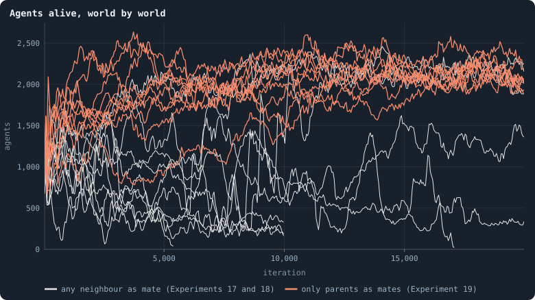

**Agents alive, world by world.** Each line is one world, its agents after each game (means over 50 iterations). Orange: the ten worlds of Experiment 19, whose mates are drawn only among neighbours with a living child; grey: Experiment 17's ten, any neighbour a mate, to 10,000 iterations, and the five of them Experiment 18 played on.

> [!example]- How to make this figure
> **Runs.** The ten runs of Experiment 19 — B2 at 10,000 tokens with brains mixed at birth and the mate drawn only among neighbours with a living child (`mix_mates` = `parents`), seeds 1 to 10, 20,000 iterations (`python3 gol_lab.py run E19`) — beside Experiment 17's ten runs with any neighbour as mate, to 10,000 iterations, and the five of them Experiment 18 played on, read to 20,000.
>
> **Data.** From each run's `stats.jsonl`.
>
> 1. Read the agents after each game (`nodes`, phase 2).
> 2. Average over stretches of 50 iterations.
>
> **To make it again:** `python3 book_figures.py mixparents`.
<!-- /figure -->

**Every world lived, and settled.** None of the ten came near dying out. After
their first 2,000 iterations they held between 760 and 2,670 agents. From
iteration 15,000 on, each held 2,030 to 2,350 on average. Experiment 17's
worlds, with any neighbour as a mate, wandered between 20 and 2,500 agents.
Two of them had died out by iteration 20,000: one before 10,000, and one of
the five that Experiment 18 played on.

Two grey lines run with the orange ones from 10,000 on. They are the two
worlds of Experiment 18 that lived to 50,000. By 20,000 they held 2,170 and
1,880 agents, 62% and 54% of them poor: where these ten are. Parents as mates
bring every world, and soon, to where only the survivors of Experiment 18
arrived.

<!-- figure mixparents/poor -->
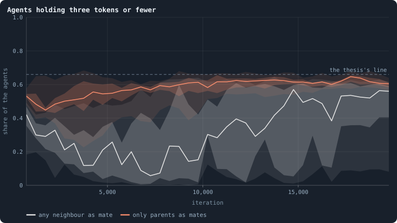

**Agents holding three tokens or fewer.** Each band is the worlds of one experiment — the median, the middle half and nine in ten — every 500 iterations: the share of their agents holding one, two or three tokens. Grey: Experiment 17's ten worlds to 10,000, and the five Experiment 18 played on; a world that died out leaves the band when it does.

> [!example]- How to make this figure
> **Runs.** As for the figure *Agents alive, world by world* above.
>
> **Data.** From each run's whole worlds kept every 500 iterations (`archive/world_<iteration>.npz`).
>
> 1. Read every agent's tokens in each whole world.
> 2. Count those holding three or fewer, as a share of all.
>
> **To make it again:** `python3 book_figures.py mixparents`.
<!-- /figure -->

**Six in ten are poor.** At iteration 20,000, 55% to 66% of each world's
agents hold three tokens or fewer. That is richer than any of B2's worlds: the
least poor of its ten held 66% at 10,000 iterations. But it is far poorer than
Experiment 17's mixed worlds: at 10,000, the median of the nine that lived
held 15%. Only the poorest two of those were as poor.

**As diverse as mixed worlds.** The diversity score says in one number, from
0 to 1, how much a world's agents differ: in tokens, links, ages and
genotypes. At 20,000 it is 0.59 in the median world (0.52 to 0.69). That is
as high as in Experiment 17's worlds at 10,000 (0.58), and above B2's ten
worlds played on to 10,000 (0.49). Part of it is built in: every mixed birth
makes a new genotype
([Brains mixed at birth, with every other rule](what-the-switches-did-in-pilots.md#brains-mixed-at-birth-with-every-other-rule)).

<!-- figure mixparents/breeding -->
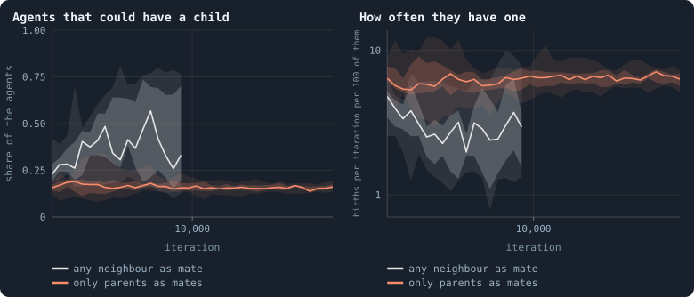

**Who could have a child, and who has one.** Left: the share of the agents that could have a child — 11 tokens or more and fewer than 8 links. Right: the births of the next 50 iterations, per iteration, per hundred such agents, on a logarithmic axis. Each band is an experiment's worlds every 500 iterations — the median, the middle half and nine in ten.

> [!example]- How to make this figure
> **Runs.** As for the figure *Agents alive, world by world* above.
>
> **Data.** From each world kept whole every 500 iterations, and each run's births (`research/oee/checks/e17_breeding.py`, `GraphOfLifeRuns/.pilots/e17_breeding.json` and `e19_breeding.json`).
>
> Step 1 as for the figure *Who could have a child, and who has one* above.
>
> 2. Read the births of the 50 reproduction phases that follow.
> 3. Divide their mean per iteration by the agents counted.
>
> **To make it again:** `python3 book_figures.py mixparents`.
<!-- /figure -->

**More eager, fewer able.** Over the first 10,000 iterations, an able agent
with parents as mates had a child 6.0 times per hundred in an iteration. That
is the median of every world and moment kept. With any mate it was 3.0: the
rise the pilots showed. Over the next 10,000 iterations it was 6.5. And the
eager fill their world. At the median moment only a sixth of the agents could
afford a child, against a third with any mate. This is the rule of
[What holds a world's size](building-b2-and-the-search-for-a-healthy-rich-world.md#what-holds-a-worlds-size) at work. How eagerly
agents breed sets how full a world becomes, and a full world is a poor one.

<!-- figure mixparents/evolution -->
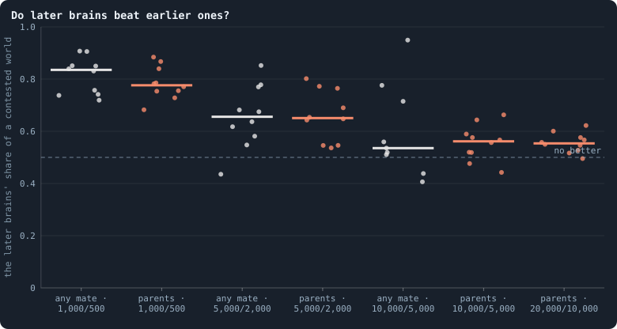

**Do later brains beat earlier ones?** Each dot is a world: the share of a world the later era's brains hold after 100 iterations against the earlier era's, the mean of two contests, one in each era's world; the bar is the median world. 1,000/500: the brains of iteration 1,000 against those of 500. Orange: Experiment 19; grey: Experiment 17, any neighbour a mate.

> [!example]- How to make this figure
> **Runs.** As for the figure *Agents alive, world by world* above.
>
> **Data.** From each run's whole worlds (`GraphOfLifeRuns/.pilots/e19_T100.json` and `e17_T100.json`).
>
> 1. Seat the brains of the two eras by a coin per agent on each era's world and play it on for 100 iterations (`research/oee/checks/rejudge.py`).
> 2. Count the agents the later era's brains hold at the end, as a share of all.
>
> **To make it again:** `python3 book_figures.py mixparents`.
<!-- /figure -->

**Evolution goes on, as it did with any mate.** To see whether brains still
improve, the brains of a later era meet those of an earlier one. They are
dealt to the agents of a world by a coin each and played for a lifetime, 100
iterations. If the later brains then hold more than half the world, they are
better. The brains of 1,000 beat those of 500 in every world (a median of
0.78 of a contested world, against 0.84 with any mate). Those of 5,000 beat
those of 2,000 in every world (0.65, against 0.66). Those of 10,000 beat those
of 5,000 in eight of the ten (0.56, against 0.54). And those of 20,000 beat
those of 10,000 in nine, the tenth all but tied at 0.495 (a median of 0.55).
Evolution is slowing, but not stopping.

#### The verdict: alive, but six in ten poor

<!-- figure mixparents/verdict -->
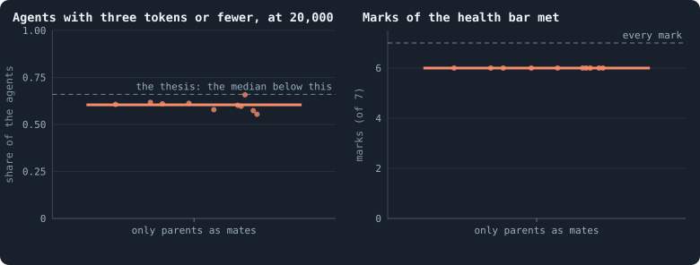

**Experiment 19 at iteration 20,000.** Each dot is a world at iteration 20,000, read from the whole world kept then. Left: the share of its agents holding three tokens or fewer; the thesis asked that the median of the ten be below 0.66, the least of B2's ten worlds at 10,000 iterations. Right: how many of the seven marks of [the health bar](measuring-health.md#the-health-bar) each world meets.

> [!example]- How to make this figure
> **Runs.** As for the figure *Agents alive, world by world* above.
>
> **Data.** From each run's whole world kept at 20,000 (`archive/world_020000.npz`) and `GraphOfLifeRuns/.pilots/e19_health.json` (`research/oee/checks/e17_health.py --family B2-10000-bcc1bc`).
>
> Steps 1–2 as for the figure *Experiment 17 at iteration 10,000* above.
>
> **To make it again:** `python3 book_figures.py mixparents`.
<!-- /figure -->

**The thesis holds.** No world ended before iteration 20,000. At 20,000 the
median world holds 60% of its agents at three tokens or fewer, below the line
of 0.66.

Every world meets six of the seven marks of the health bar, the marks a
network must meet to count as healthy. It did so at every moment kept from
500 on, and met all seven at nearly a quarter of them. The one it misses is
the one B2's own worlds miss: a dimension between 2.3 and 4. These worlds read
4.1 to 4.3. Like B2's, they are folded: nearly small worlds, in which everyone
is a few steps from everyone, not spaces
([What folds a world](how-many-dimensions-does-a-world-have.md#what-folds-a-world)).

Two things the thesis did not ask should be said beside it. Experiment 18's
worlds died between iterations 17,078 and 37,722. So 20,000 iterations cover
only the start of the span in which mixed worlds died. But none of these ten
shows what came before those deaths: a world that shrinks while many of its
agents could breed. And the riches the thesis's line asked for are B2's
riches, not mixing's. These worlds are richer than any of B2's, not rich.

Parents as mates are one way to end the free ride. The next section tries the
other.

### A mate that pays its share (who may be a mate)
<!-- experiment E22 -->

Brains mixed at birth make worlds rich and diverse, and then let them drift.
Their size wanders, many shrink to a few hundred agents, and some die out
([Five mixed worlds, fifty thousand iterations](building-b2-and-the-search-for-a-healthy-rich-world.md#five-mixed-worlds-fifty-thousand-iterations)).
[What holds a world's size](building-b2-and-the-search-for-a-healthy-rich-world.md#what-holds-a-worlds-size) traced this to the
price of a child. A world's size is set by how eagerly its agents breed, and
in a mixed world being a mate is free.

It proposed two ways to end the free ride. The first, mates only among the
parents, is [Experiment 19](#mixed-at-birth-with-parents-as-mates): every
world lived and held about 2,000 agents. The second is a **mate that pays its
share**, the rule this section tests. The mate gives the child as many tokens
as the parent does, as far as it can and never its last. It is one of the
rules first played in the pilots' prototype, `mate_pays` (the setting
[`proto`](settings.md#proto)). One thing pushes the other way: a child that
two pay for is cheaper to each of them.

Two pilot worlds of this rule (batch MPay, seeds 1 and 2) stopped when the
computer was restarted on 18 October 2026. The last whole worlds they had kept
were those of iterations 1,000 and 1,500. The lab now plays the prototype's
rules itself, so it starts them again from the beginning. Its first two worlds
should be the pilots' worlds again, game for game.

#### Experiment 22 and its thesis

Experiment 22 plays the paying mate in B2 at 10,000 tokens, with brains mixed
at birth: four seeds, for 5,000 iterations each. Experiment 17's worlds of
the same seeds, whose mates pay nothing, are the comparison.

We expected the paying mate to steady a mixed world, as parents as mates had.
With no free ride, reluctance should no longer pay, and we expected that to
outweigh the cheaper child. We also expected the lab to play the two stopped
pilots exactly again, since the same settings and the same seed make the same
world. So the thesis asks three things:
- at least three of the four worlds steadier than their Experiment 17 world;
- no world down to 20 agents;
- the first two worlds the same as the pilots, game for game.

<!-- thesis E22 -->
> [!quote] The thesis of Experiment 22, written down before any of its runs existed
> **The claim.** A mate that pays its share holds a mixed world's size more steadily. In four worlds of B2 with brains mixed at birth, where the mate pays the child as many tokens as the parent gives, as far as it can and never its last, the spread of the logarithm of the number of agents from iteration 500 to 5,000 is smaller than in Experiment 17's world of the same seed, where the mate pays nothing, in at least three of the four, and no world falls to 20 agents. And the lab plays the two pilots of this rule that were stopped on 18 October 2026 as they went, game for game, as far as they got.
>
> **Why it would be so.** A mixed world's size drifts, because being a mate is free: an agent that never breeds still spreads half its brain through other agents' children, and how eagerly agents breed sets a world's size ([Meta XI](building-b2-and-the-search-for-a-healthy-rich-world.md#what-holds-a-worlds-size)). A mate that pays ends the free ride, though a child that two pay for is cheaper to each, which pushes the other way. [Meta XI](building-b2-and-the-search-for-a-healthy-rich-world.md#what-holds-a-worlds-size) proposed it and nothing tested it: its pilots (batch MPay) were stopped at iterations 1,000 and 1,500 when the computer was restarted. Mates among the parents only, the other way to end the free ride, held four pilot worlds steadier than Experiment 17's and kept all ten worlds of Experiment 19 alive.
>
> **It holds if:** In at least three of the four seeds the standard deviation of the logarithm of the agents after each game, from 500 to 5,000, is below that of Experiment 17's world of the same seed; no world falls to 20 agents or fewer; and the worlds of seeds 1 and 2 match the pilots' agents and links after every game to 1,000 and 1,500.
>
> **It fails if:** Two or fewer are steadier than their Experiment 17 world, a world falls to 20 agents or fewer, or a world differs from its pilot.
<!-- /thesis -->

#### What the four worlds did

**The lab plays the stopped pilots as they went.** The worlds of seeds 1 and
2 matched the pilots' agents and links after every game. They did so as far as
the pilots had gone: 1,311 and 1,719 iterations.

<!-- figure matepays/sizes -->
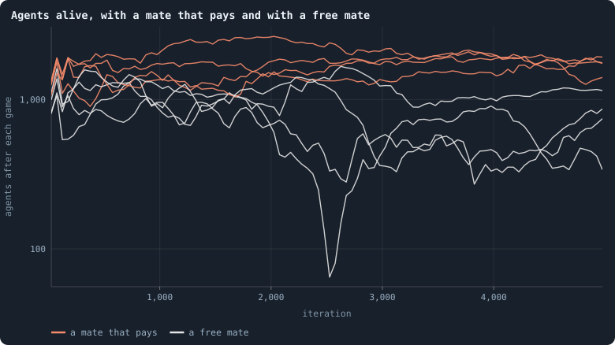

**Agents alive, with a mate that pays and with a free mate.** Each line is one world, its agents after each game in means over 50 iterations, on a logarithmic axis. Orange: brains mixed at birth with a mate that pays the child as much as the parent (seeds 1 to 4); grey: Experiment 17's worlds of the same seeds, whose mates pay nothing.

> [!example]- How to make this figure
> **Runs.** Experiment 22's four runs (`python3 gol_lab.py run E22`): B2 at 10,000 tokens with brains mixed at birth and the pilots' rule `mate_pays`, seeds 1 to 4, to 5,000 iterations, played by the research prototype in the lab (`B2-10000-8ff8c5-s001` … `-s004`); against Experiment 17's runs of the same seeds (`B2-10000-4af4a3-s001` … `-s004`), mixing with a mate that pays nothing.
>
> **Data.** From the pilots' `series.jsonl` and the lab runs' `stats.jsonl`.
>
> 1. Read the agents after each game: a pilot's row of each iteration, a lab run's row of phase 2.
> 2. Average over stretches of 50 iterations.
>
> **To make it again:** `python3 book_figures.py matepays`.
<!-- /figure -->

**A mate that pays holds a mixed world's size.** From iteration 500 to 5,000,
measured as for [the pilots of parents as mates](#what-the-pilots-found-who-may-be-a-mate):

| seed | spread of the logarithm of the agents, paying mate | free mate | fewest agents, paying mate | free mate |
|---|---|---|---|---|
| 1 | 0.12 | 0.19 | 1,685 | 648 |
| 2 | 0.09 | 0.34 | 1,414 | 245 |
| 3 | 0.16 | 0.63 | 1,127 | 40 |
| 4 | 0.12 | 0.47 | 1,012 | 316 |

Every world with a paying mate was steadier than Experiment 17's world of the
same seed, and none came near dying out. Their medians were 1,394 to 2,048
agents. The free mates' worlds wandered between 40 and 1,700, around medians
of 586 to 1,051.

**Healthy and diverse, but folded.** At 5,000 iterations, read as every world
is read:
- **Marks:** six or seven of the health bar.
- **Diversity:** scores of 0.52 to 0.64, against B2's median at 5,000 of
  0.49.
- **Width:** 1.16 to 1.28. A world's random twin has the same agents, with
  as many links each, wired at random. A typical agent here needs only 1.16 to
  1.28 times as many steps to reach half its world as in that twin. A space
  needs at least 1.5 times as many. These are folded small worlds, as
  Experiment 19's are.
- **Evenness:** a Gini coefficient of the tokens of 0.43 to 0.48. A Gini is 0
  if every agent holds as many, and near 1 if one holds nearly all. That is
  about as even as B2's most even world (0.46).

#### The verdict: steadier in all four seeds

**The thesis holds.**
- All four worlds were steadier than their Experiment 17 world.
- None fell to 20 agents.
- The lab's worlds of seeds 1 and 2 are the stopped pilots, game for game.

### What we learned (who may be a mate)
- **The free ride was the cause.** Two ways of ending it both steady a mixed
  world. With only parents as mates, able agents breed twice as eagerly as
  with any mate. None of ten worlds bred itself towards its end in 20,000
  iterations. With a mate that pays, all four worlds held their size more
  steadily than with a free mate.
- **But reluctance was also what made mixed worlds rich.** With parents as
  mates the eager fill their world to about 2,000 agents, six in ten of them
  poor. Its network becomes B2's: six marks of the health bar, and folded,
  with a dimension reading above four. Yet its agents still differ as much as
  in Experiment 17's worlds. Life and riches pull apart again.
- **A child that two pay for is cheaper to each, and the world fills more.**
  The paying mates' worlds held more agents than the free mates' worlds of the
  same seeds. So paying for a child raises how many children there are; it
  does not lower it.
- **What [What holds a world's size](building-b2-and-the-search-for-a-healthy-rich-world.md#what-holds-a-worlds-size) asked for is
  still missing.** It is a pull that makes having a child pay more when few
  have them, and less when many do. Parents as mates raise eagerness
  everywhere, at every size, and so set the world at one size: larger than
  mixing's, smaller than B2's.
- **Steady is not yet a space.** The worlds of both rules are folded. Room is
  the one thing the steadiest mixed worlds still lack
  ([Room for the steadiest world](building-b2-and-the-search-for-a-healthy-rich-world.md#room-and-riches-for-the-steadiest-world)).

### How this was made (who may be a mate)
#### The runs of Experiment 19

<!-- runs E19 -->
> [!info]- The runs behind this page
> **10 runs.** Every condition below is run once for every seed (1 to 10), for 20,000 iterations — or until its world dies out. Every setting is B2's unless the condition changes it.
>
> - **mixed at birth, parents as mates** — changes `mix_at_birth` = on, `mix_mates` = parents; 10,000 tokens. Runs `B2-10000-bcc1bc-s001` … `B2-10000-bcc1bc-s010`.
>
> To make these runs again: `python3 gol_lab.py run E19`.
<!-- /runs -->

#### The runs of Experiment 22

<!-- runs E22 -->
> [!info]- The runs behind this page
> **4 runs.** Every condition below is run once for every seed (1 to 4), for 5,000 iterations — or until its world dies out. Every setting is B2's unless the condition changes it.
>
> - **mixed at birth, the mate pays** — changes `mix_at_birth` = on, `extinction_threshold` = 0, `proto` = mate_pays; 10,000 tokens. Runs `B2-10000-8ff8c5-s001` … `B2-10000-8ff8c5-s004`.
>
> To make these runs again: `python3 gol_lab.py run E22`.
>
> Runs that ask for the pilots' rules are played by the research prototype, frozen beside the engine (`gol_pilot.py`): they keep no frames, but one row of the world's statistics every iteration (`series.jsonl`) and a whole world at every checkpoint.
<!-- /runs -->

## The candidates, played on and played again

A **candidate world** meets every mark of the health bar at iteration 1,000,
and its agents are more diverse than B2's. Played on to 10,000 iterations,
most did not stay there: of nineteen, five held, eleven fell back and three
died out. Three rules whose worlds had held were given five new seeds each,
and did no better than brains mixed at birth alone. In new seeds, the random
search's best settings made diverse, wide and rich worlds, but thin, easily
cut and too even ones. One world says little about its rules: it may have
held by the luck of its seed, or of its moment. Along the way, the lab
learned to play the pilots' worlds again exactly, game for game.

### The candidates, played on

<!-- experiment E20 -->

Picture a world caught at a good moment. At iteration 1,000 its network is
sound and its agents differ. Will it still look like that 9,000 iterations
later?

The author's picture of a world that might keep evolving asks for both at
once ([Healthy and rich](building-b2-and-the-search-for-a-healthy-rich-world.md#healthy-and-rich)). A world that comes close at
iteration 1,000 is a **candidate world**. First, it meets every mark of the
health bar, the seven marks of a sound network:
- one piece;
- at least 80% of its agents on loops or between them (the 2-core);
- no agent whose loss cuts off more than 2% of the others, and no link
  whose loss cuts off more than 1%;
- no agent joined to more than 5% of the others;
- 3 to 12 links per agent;
- a dimension between 2.3 and 4.

Second, its diversity score is above that of B2's median world. The
diversity score says, in one number from 0 to 1, how much a world's agents
differ in tokens, links, ages and genotypes. B2 is the second baseline, the
world built so that its network cannot break.

One moment says little. Most candidate worlds have brains **mixed at
birth**. A newborn's brain is then its parent's mixed with a mate's, one of
the parent's neighbours. Each hidden unit is taken whole from one or the
other. Such mixed worlds drift in size, and their riches drift with it
([What holds a world's size](building-b2-and-the-search-for-a-healthy-rich-world.md#what-holds-a-worlds-size)).

So every candidate world is played on to 10,000 iterations. There it is
read by [Healthy and rich](building-b2-and-the-search-for-a-healthy-rich-world.md#healthy-and-rich)'s **test of a long run**. A
world passes if, at iteration 10,000:
- it is still alive: it never fell to 20 agents or fewer, where the lab
  calls a world extinct;
- it meets every mark of the health bar;
- it is more diverse than B2's median world at 10,000 (a diversity score
  of 0.49);
- it holds a smaller share of its agents at three tokens or fewer than the
  least poor of B2's ten worlds (66%).

B2's own ten worlds, played on to 10,000 iterations, are the yardstick.

#### Six worlds left unfinished

Twenty-five candidate worlds were played on as pilot worlds (batch LC),
each in a copy of its own. A pilot is a world made by hand, outside the
lab's experiments, to see whether an idea is worth one. Nineteen reached
10,000 iterations. Two of them were the mixed worlds of batch Q. These
turned out to be [Experiment 17](building-b2-and-the-search-for-a-healthy-rich-world.md#brains-mixed-at-birth-in-long-worlds)'s
worlds of seeds 1 and 2, agent for agent, and they are read with Experiment
17's worlds.

Then, on 18 October 2026, the computer was restarted. The pilots had been
running out of sight, in no page of the notebook. From then on, every
simulation of this notebook runs where it can be seen. It runs in the lab,
started with ▶ beside the page that asks for it.

Six candidate worlds were left unfinished. Two of them use only the
engine's own settings:
- **links to strangers by a free reach, forced on the other end.** An agent
  may propose a link to an agent beyond its neighbours, reached in free
  steps. The other end cannot refuse
  ([Links to strangers](what-the-switches-did-in-pilots.md#links-to-strangers)).
- **brains mixed at birth, with only the last token kept at home.** B2 keeps
  30% of an agent's tokens on its own node, whatever its brain says. Here
  only one token stays
  ([Brains mixed at birth, with every other rule](what-the-switches-did-in-pilots.md#brains-mixed-at-birth-with-every-other-rule)).

The other four use rules that so far exist only in the pilots' prototype:
- contests decided by lottery;
- brain units that cost a token;
- an input that tells where a brain came from;
- a family tag.

They follow once those rules are part of the engine; Experiment 23 is to
play them.

**Experiment 20** plays the first two in the lab, from iteration 0. We
expected the lab's two worlds to be the pilots' two worlds again, game for
game. A pilot plays the engine's own game, so a pilot with a lab world's
settings and seed is that lab world. It had happened before: the two mixed
worlds of batch Q are Experiment 17's worlds. If the twins match, the lab
can finish what the pilots began.

<!-- thesis E20 -->
> [!quote] The thesis of Experiment 20, written down before any of its runs existed
> **The claim.** Played by the lab from iteration 0, these two worlds are the pilot worlds of batch LC, game for game: in each, the agents alive and the links between them after every game match the pilot's, iteration by iteration, up to where the pilot stopped (iteration 4,344 for links to strangers, 6,522 for mixing with the last token kept). Played on to 10,000, each is then read by [Meta X](building-b2-and-the-search-for-a-healthy-rich-world.md#healthy-and-rich)'s test of a long run.
>
> **Why it would be so.** A pilot plays the engine's own game, so a pilot with a lab world's settings and seed is that lab world: the two mixed worlds of batch Q are Experiment 17's worlds of seeds 1 and 2, agent for agent. These two candidates of [Meta X](building-b2-and-the-search-for-a-healthy-rich-world.md#healthy-and-rich) were being played on to 10,000 iterations as pilots when the computer was restarted on 18 October 2026; pilots now run only where they can be seen, and both use engine settings only, so the lab can finish them. At iteration 1,000 both met every mark of the health bar: links to strangers by a free reach, forced on the other end (batch K), with 1,931 agents, 49% of them at three tokens or fewer and a diversity score of 0.54; mixing with only the last token kept at home (batch Y), with 1,791 agents, 79% poor and 0.62. Read where the pilots stopped, they held 2,584 agents, 59% poor, at 4,000, and 2,066, 78% poor, at 6,500 — this plan was written after those readings, so the claim is only that the lab plays the same worlds.
>
> **It holds if:** Both worlds' agents and links match their pilot's after every game up to where the pilot stopped.
>
> **It fails if:** A world's agents or links differ from its pilot's at some iteration: the lab plays another world than the pilot did, and the chapter says from where.
<!-- /thesis -->

#### The twin check: the thesis holds

Both of the lab's worlds match their pilots. After every game, the same
agents are alive and the same links join them. The pilot of links to
strangers had played 4,344 games, and the pilot of mixing with the last
token kept 6,522. The twins matched through every one. Both pilots had
been resumed from a checkpoint at iteration 1,000, and still matched.
**The thesis holds.**

So a pilot of engine rules is the lab's world. The long runs read below
stand as if the lab had made them. The four candidate worlds with pilot
rules cannot be checked this way yet.

#### Where the candidate worlds went

Nineteen long runs can be read at iteration 10,000: seventeen pilots, and
the two worlds of Experiment 20 in place of their unfinished pilots. The
figure shows where each went.

<!-- figure candidates/paths -->
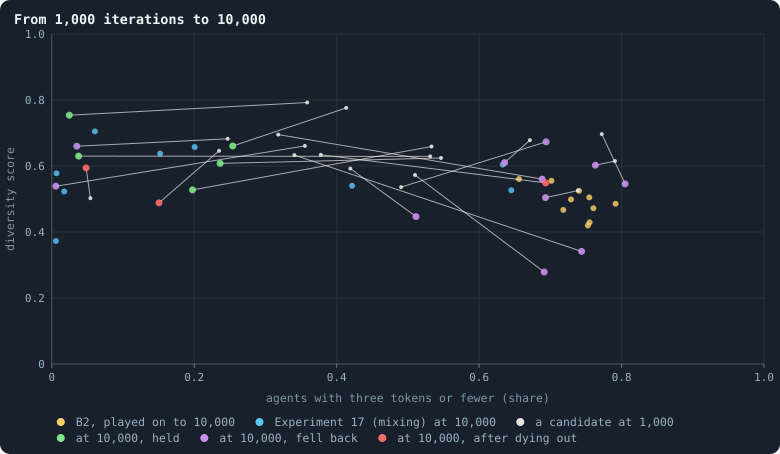

**From 1,000 iterations to 10,000.** Each line is a candidate, from where it stood at iteration 1,000 (small grey dot) to where it stood at 10,000 (large dot): green if it still met every mark of the health bar, was more diverse than B2's median world and poorer than none of B2's worlds — [Healthy and rich](building-b2-and-the-search-for-a-healthy-rich-world.md#healthy-and-rich)'s test of a long run — violet if it fell back, red if it had died out on the way (20 agents or fewer, the lab's line) and was refilled from its last agents. Yellow: B2's ten worlds played on to 10,000; blue: Experiment 17's mixed worlds that lived to 10,000. The author's picture is the top left: agents that differ, and few of them poor.

> [!example]- How to make this figure
> **Runs.** Batch LC's long runs (`GraphOfLifeRuns/.pilots/LC/`): each candidate of [Healthy and rich](building-b2-and-the-search-for-a-healthy-rich-world.md#healthy-and-rich), B2 at 10,000 tokens with the rules of the batch it came from, played on in a copy of its own from its checkpoint to 10,000 iterations (`research/oee/pilots/run.py --resume`), two of them finished by the lab from iteration 0 (Experiment 20: `B2-10000-e10e0d-s001`, `B2-10000-82bd1e-s001`); Experiment 17's ten mixed worlds (`B2-10000-4af4a3-s001` … `s010`) and B2's ten worlds played on to 10,000 (`GraphOfLifeRuns/.pilots/L/B2-long-s001` … `s010`).
>
> **Data.** From each world's checkpoint at 1,000 and at 10,000 (`research/atlas/at.py --at 1000` and `--at 10000`, `GraphOfLifeRuns/.pilots/atlas/at1000.json` and `at10000.json`).
>
> 1. Read each world as `research/atlas/profile.py` reads every world.
> 2. Rank its four spreads among the frozen reference worlds; the diversity score is their mean.
>
> **To make it again:** `python3 book_figures.py candidates`.
<!-- /figure -->

**Five of nineteen held**: they passed the test of a long run. All five
are mixed at birth:
- with a fast change of brains, in both its seeds: a mutation probability of
  0.8, where B2 has 0.2;
- without random inputs, in one seed: B2's brains read five random numbers
  per neighbour each time they look, and these read none;
- without revolutions, in one seed: no coalition of smaller stakers can take
  a node from its largest staker;
- with an input that tells an agent where its brain came from, in one seed.

**Eleven fell back.** Seven fell into B2's poverty: two thirds of their
agents or more held three tokens or fewer. The other four each missed a
single mark of the health bar. Two large worlds had a dimension above four.
Two small ones had an agent joined to more than 5% of the others.

**Three died out on the way**, each falling to a single agent:
- mixing with the estate of a dead agent left to its own children, at
  iteration 4,043;
- mixing with brains that grow, at 3,158;
- mixing with an input that tells who helped, at 4,271.

A pilot plays on where the lab would stop. So each of these pilots filled
its world again from its last agent.

#### Diversity, size and room

**Diversity fell in sixteen of the nineteen.** What a candidate world had at
iteration 1,000 mostly wore off: agents that differ in tokens, links, ages
and genotypes. The median diversity score fell from 0.63 to 0.56. The two
worlds that fell furthest ended less diverse than any of B2's worlds. They
mix with the estate left to the poorest (0.28), and with stakes pooled by
genotype (0.34).

<!-- figure candidates/sizes -->
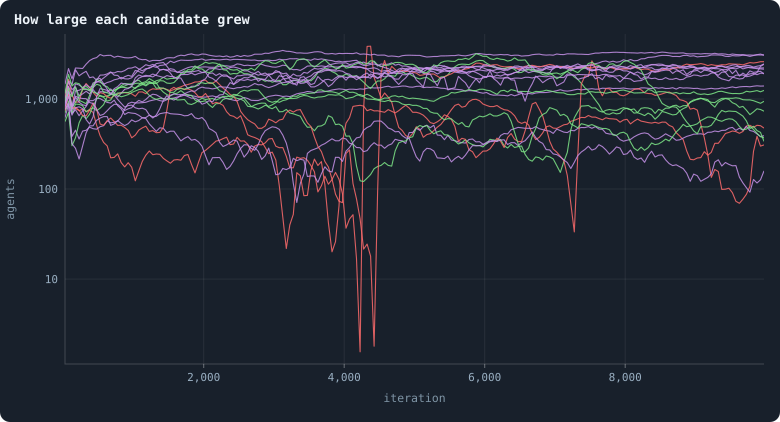

**How large each candidate grew.** Each line is a candidate: its agents after each game, means over 50 iterations, on a logarithmic axis. Green: the candidates that held at 10,000 iterations; violet: those that fell back; red: those that died out on the way and were refilled from their last agents.

> [!example]- How to make this figure
> **Runs.** As for the figure *From 1,000 iterations to 10,000* above.
>
> **Data.** From each long run's `series.jsonl`.
>
> 1. Read the agents after each game.
> 2. Average over stretches of 50 iterations.
>
> **To make it again:** `python3 book_figures.py candidates`.
<!-- /figure -->

**Rich and small, or large and poor.** Sizes wandered: several worlds
shrank to a few hundred agents and grew back. Where a world ended, its
riches went with its size. Across the nineteen at 10,000, the more agents,
the poorer they were (a rank correlation of 0.85). The five that held had
372 to 1,244 agents. The eight largest that lived, with 1,846 to 3,097
agents, all fell back, seven of them into poverty. It is the finding of
[What holds a world's size](building-b2-and-the-search-for-a-healthy-rich-world.md#what-holds-a-worlds-size) again. A world's
size is set by how eagerly its agents breed, and a full world is a poor
one.

Is a world a space, wide like a plane or a room? Or is it a small world,
where everyone is a few steps from everyone? Compare it with its random
twin: a network with the same agents and as many links each, wired at
random. Count the steps within which a typical agent's ball holds half its
world. Divide by the same count in the twin
([What folds a world](how-many-dimensions-does-a-world-have.md#what-folds-a-world)). The notebook calls a world a
space when this ratio is at least 1.5.

<!-- figure candidates/space -->
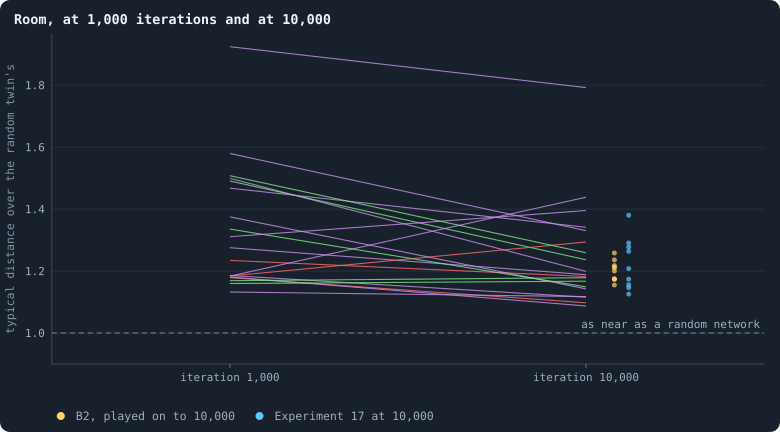

**Room, at 1,000 iterations and at 10,000.** Each line is a candidate: the steps within which a typical agent's ball holds half its world, over the same for its random twin ([What folds a world](how-many-dimensions-does-a-world-have.md#what-folds-a-world)), at iteration 1,000 and at 10,000. Green: the candidates that held; violet: those that fell back; red: those that died out on the way. Beside the right end: B2's ten worlds played on to 10,000 (yellow) and Experiment 17's (blue).

> [!example]- How to make this figure
> **Runs.** As for the figure *From 1,000 iterations to 10,000* above.
>
> **Data.** From each world's checkpoint at 1,000 and 10,000 (`research/atlas/space.py --at 1000` and `--at 10000`).
>
> 1. Count, from a sample of agents, how many others lie within each number of steps.
> 2. Find the steps within which the typical ball holds half the world, between whole steps by the logarithm of the ball.
> 3. Do the same on a random network with every agent's links kept; divide.
>
> **To make it again:** `python3 book_figures.py candidates`.
<!-- /figure -->

**None became a space.** At iteration 1,000 a few candidate worlds were
wider than their random twins by half or more. By 10,000 all but one were
folded, at 1.09 to 1.44 times the twin's typical distance, as B2's own
worlds are. The exception, mixing with the estate left to the poorest
(1.79), is one of the poor worlds.

#### Too even, not too poor (the candidates)
On 19 October 2026 the author made the picture more precise
([Healthy and rich](building-b2-and-the-search-for-a-healthy-rich-world.md#healthy-and-rich)). The worry was never a world with
many poor agents. It was a world whose agents hold their tokens too evenly:
almost everyone the same few. The share at three tokens or fewer had only
stood in for that.

The [Gini coefficient](measuring-tokens.md#measuring-inequality-the-gini-coefficient-the-richest-tenth-and-entropy) of the agents' tokens measures
it directly. It is 0 when every agent holds as many tokens, and near 1 when
one agent holds nearly all. Read with the Gini instead, the verdict on the
five that held turns round:
- **Four of the five that held are more even than every one of B2's
  worlds.** Their Ginis are 0.37 to 0.44, against B2's 0.47 to 0.51. They
  are fast brain change in both seeds, no random inputs and no revolutions.
  They are rich worlds, of 8 to 27 tokens per agent. A random exchange of
  tokens would leave a Gini of 0.47 to 0.49 at those riches. So their
  tokens are spread more evenly than a random exchange would leave them.
- **Two that fell back did so on the share of the poor alone.** They meet
  every other count, and their tokens are less even than B2's. One mixes
  with only the last token kept at home (seed 2). Its Gini is 0.66, with
  80% of its agents at three tokens or fewer. The other mixes with a sense
  of kin, an input that tells which neighbours carry the agent's own brain
  (seed 2). Its Gini is 0.56, with 69% poor.
- **Only the input of where a brain came from (seed 2) passes both
  readings.**

So the **clarified test** asks four things: alive, every mark, more diverse
than B2's median world, and tokens no more even than B2's. By it, **three
of nineteen held**: where a brain came from, the last token kept, and the
sense of kin, each in one seed.

Across the nineteen, a world's size goes with its share of poor agents (the
rank correlation of 0.85 above). It goes far less with how evenly its
tokens are spread: 0.46 with the Gini. The small rich worlds are the even
ones; the large poor ones are not.

#### Does evolution go on? (the candidates)
Are the brains still getting better after thousands of iterations? A
contest tells. Take a world's brains at two moments, say iterations 500 and
1,000. Deal them to the agents of the world as it was at one of those
moments, by a coin for each agent, and play 100 iterations. That is about a lifetime: in B2 every
agent dies by age 100. Then count the share of agents the later brains hold. Above one half, the later brains are
the better players. Each world plays two such contests, one in each
moment's world, and the figure shows their mean.

<!-- figure candidates/evolution -->
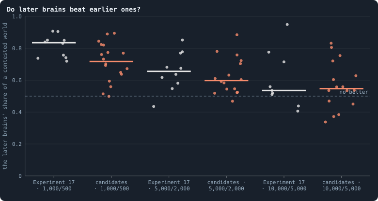

**Do later brains beat earlier ones?** Each dot is a world: the share of a contested world the later moment's brains hold after 100 iterations against the earlier moment's, the mean of two contests, one in each moment's world; the bar is the median world. 5,000/2,000: the brains of iteration 5,000 against those of 2,000. Orange: the candidates (the first step judged on the world each came from; a world that died out on the way has the steps before its death only); grey: Experiment 17's mixed worlds.

> [!example]- How to make this figure
> **Runs.** As for the figure *From 1,000 iterations to 10,000* above.
>
> **Data.** From `GraphOfLifeRuns/.pilots/lc_T100.json` (`research/oee/checks/lc_rejudge_worlds.txt`), the batches' own contests for 1,000/500, and `e17_T100.json`.
>
> 1. Seat the brains of the two moments by a coin per agent on each moment's world and play 100 iterations (`research/oee/checks/rejudge.py`).
> 2. Count the agents the later moment's brains hold, as a share of all.
>
> **To make it again:** `python3 book_figures.py candidates`.
<!-- /figure -->

**Evolution goes on, slowing, as in Experiment 17.** The brains of 1,000
beat those of 500 in seventeen of eighteen worlds, with a median share of a
contested world of 0.72. Those of 5,000 beat those of 2,000 in fifteen of
sixteen (0.60). Those of 10,000 beat those of 5,000 in eleven of sixteen
(0.55). Experiment 17's mixed worlds held 0.84, 0.66 and 0.54 at the same
three steps. Ten worlds won both of the late steps; none ran away.

### Five more seeds for the rules that held

<!-- experiment E21 -->

A few candidate worlds passed the test of a long run
([The candidates, played on](#the-candidates-played-on)). Three rules stood
out, all of them with brains mixed at birth:

| rule, with mixing | seed | agents at 10,000 | agents with 3 tokens or fewer | diversity score |
|---|---|---|---|---|
| a fast change of brains (mutation probability 0.8) | 1 | 1,244 | 25% | 0.66 |
| a fast change of brains (mutation probability 0.8) | 2 | 407 | 2% | 0.75 |
| no random inputs | 2 | 372 | 4% | 0.63 |
| no revolutions | 2 | 948 | 24% | 0.61 |

Was it the rule, or the luck of the seed? One throw of a die cannot tell a
loaded die from a fair one; a few more throws begin to. And there were
reasons to doubt. A mixed world's size drifts, and its riches drift with it.
Plain mixing, with no other rule, passed the same test in five of
Experiment 17's ten worlds. And no revolutions failed it in its own seed 1:
2,221 agents, 64% of them poor, and a dimension above four. One world can
be luck.

So [Healthy and rich](building-b2-and-the-search-for-a-healthy-rich-world.md#healthy-and-rich)'s second step gives each rule
that held **five seeds more, from the start**. **Experiment 21** plays
seeds 3 to 7, which no batch has used for these rules. It sets them beside
Experiment 17's worlds of the same seeds, with plain mixing, which passed
in three of the five.

A fourth rule held in one seed too: mixing with an input that tells each
agent where its brain came from. That input exists so far only in the
pilots' prototype. It joins this experiment once it is part of the engine.

We expected each rule to hold again. A rule that made one world hold should
make most of its worlds hold: at least four of its five. And a rule earns
its place only if it holds more often than mixing alone, which passed in
three of the same five seeds.

<!-- thesis E21 -->
> [!quote] The thesis of Experiment 21, written down before any of its runs existed
> **The claim.** A rule whose candidate held over 10,000 iterations holds again in new worlds: for each of three rules — brains mixed at birth with a fast change of brains (a mutation probability of 0.8), with no random inputs, and with no revolutions — at least four of five new worlds (seeds 3 to 7) live to iteration 10,000 and there meet every mark of the health bar, have a diversity score above that of B2's median world at 10,000 (0.49), and hold a smaller share of their agents at three tokens or fewer than the least poor of B2's ten worlds (0.66).
>
> **Why it would be so.** [Meta X](building-b2-and-the-search-for-a-healthy-rich-world.md#healthy-and-rich)'s candidates were played on to 10,000 iterations as pilots (batch LC), and by [Meta X](building-b2-and-the-search-for-a-healthy-rich-world.md#healthy-and-rich)'s test — it lives, meets every mark, is more diverse than B2's median world and poorer than none of B2's — some held: mixing with a fast change of brains in both its seeds (1,244 agents, 25% at three tokens or fewer, a diversity score of 0.66; 407 agents, 2%, 0.75), mixing without random inputs in seed 2 (372 agents, 4%, 0.63), mixing without revolutions in seed 2 (948 agents, 24%, 0.61; its seed 1 fell back, 2,221 agents, 64%). Plain mixing held in five of Experiment 17's ten worlds, three of them among seeds 3 to 7. One world can be luck: [Meta X](building-b2-and-the-search-for-a-healthy-rich-world.md#healthy-and-rich)'s second step gives each rule that held five seeds more, from the start. Mixed worlds' size drifts, and their riches go with it ([Meta XI](building-b2-and-the-search-for-a-healthy-rich-world.md#what-holds-a-worlds-size)), so a rule earns its place only if it holds more often than mixing alone. The control is Experiment 17's worlds of the same seeds.
>
> **It holds if:** For a rule: at least four of its five worlds live to 10,000 and pass [Meta X](building-b2-and-the-search-for-a-healthy-rich-world.md#healthy-and-rich)'s test there.
>
> **It fails if:** For a rule: three or fewer pass — it does no better than mixing alone, which passed in three of the same five seeds.
<!-- /thesis -->

#### What the twenty worlds did

<!-- figure fiveseeds/verdict -->
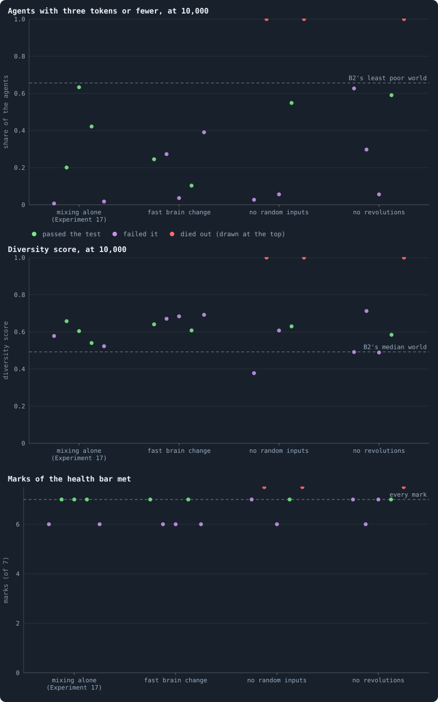

**Experiment 21 at iteration 10,000.** Each dot is a world at iteration 10,000, seeds 3 to 7 from left to right within each rule: green if it passed [Healthy and rich](building-b2-and-the-search-for-a-healthy-rich-world.md#healthy-and-rich)'s test of a long run — alive, every mark of the health bar met, more diverse than B2's median world and poorer than none of B2's ten worlds played on to 10,000 — violet if it failed it, red, at the top, if it died out before 10,000. Grey column: plain mixing, Experiment 17's worlds of the same seeds.

> [!example]- How to make this figure
> **Runs.** The twenty runs of Experiment 21 — B2 at 10,000 tokens with brains mixed at birth, alone (Experiment 17's runs `B2-10000-4af4a3-s003` … `s007`) or with a mutation probability of 0.8 (`B2-10000-0df8be-…`), no random inputs (`B2-10000-1109f3-…`) or no revolutions (`B2-10000-1f9b27-…`), seeds 3 to 7, 10,000 iterations (`python3 gol_lab.py run E21`) — and B2's ten worlds played on to 10,000 (`GraphOfLifeRuns/.pilots/L/B2-long-s001` … `s010`).
>
> **Data.** From each run's whole world kept at iteration 10,000 (`archive/world_010000.npz`, read by `research/atlas/at.py --at 10000`, `GraphOfLifeRuns/.pilots/atlas/at10000.json`).
>
> Steps 1–2 as for the figure *From 1,000 iterations to 10,000* above.
>
> 3. A world that died out (20 agents or fewer) fails.
>
> **To make it again:** `python3 book_figures.py fiveseeds`.
<!-- /figure -->

**No rule held more often than mixing alone.** Plain mixing passed the test
in three of its five worlds: seeds 4, 5 and 6. A fast change of brains
passed in two, seeds 3 and 6. No random inputs and no revolutions passed in
one each, both in seed 6. Every rule needed four.

**A fast change of brains: alive, diverse and not poor, but short of a
mark.** All five of its worlds lived to 10,000, and none was poor: 4% to
39% of their agents held three tokens or fewer. All five were more diverse
than B2's median world, with diversity scores of 0.61 to 0.69; plain
mixing's ranged from 0.52 to 0.66. Three of them each missed one mark. Two
had a dimension just above the bar's limit of 4 (4.03 and 4.22). The third,
a small world of 445 agents, had an agent joined to more than 5% of the
others.

**Without random inputs, two of five worlds died out**, at iterations 3,835
and 3,209. Of the three that lived, one passed, with 1,969 agents, 55% of
them poor. One was small and rich but less diverse than any of B2's worlds:
521 agents, and a diversity score of 0.38. One small world had a hub, an
agent joined to far more agents than most.

**Without revolutions, one world died out**, at iteration 9,338. Of the four
that lived, one passed, with 1,996 agents, 59% of them poor. Two missed
B2's median diversity by a hair: 0.491 and 0.489, against 0.492. And one
small world of 212 agents had a hub.

So taking away the dice, the random inputs, or the revolutions made mixed
worlds mortal: three of ten died out within 10,000 iterations. Plain mixing
lost none of the same seeds.

<!-- figure fiveseeds/sizes -->
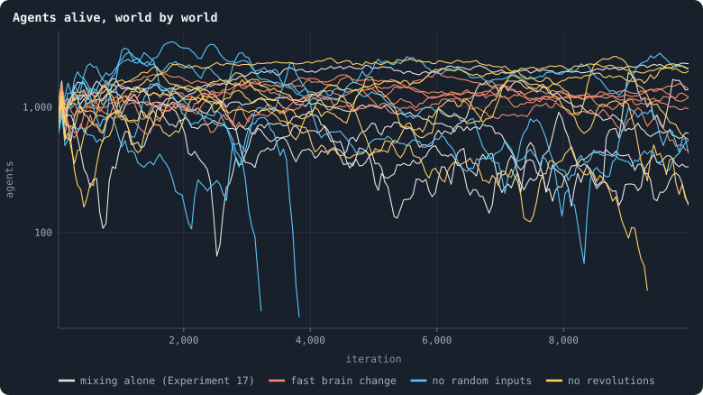

**Agents alive, world by world.** Each line is one world, its agents after each game (means over 50 iterations), on a logarithmic axis; a line that stops early is a world that died out.

> [!example]- How to make this figure
> **Runs.** As for the figure *Experiment 21 at iteration 10,000* above.
>
> **Data.** From each run's `stats.jsonl`.
>
> Steps 1–2 as for the figure *Agents alive, world by world* above.
>
> **To make it again:** `python3 book_figures.py fiveseeds`.
<!-- /figure -->

**Each death was a slow shrinking.** The three worlds that died out had
reached 1,614, 2,983 and 1,931 agents. Five hundred iterations before the
end, they held 745, 685 and 188. For hundreds of iterations fewer were born
than died, as in the mixed worlds of
[Five mixed worlds, fifty thousand iterations](building-b2-and-the-search-for-a-healthy-rich-world.md#five-mixed-worlds-fifty-thousand-iterations).

**Size still sets riches.** Across the seventeen worlds alive at 10,000, the
more agents a world held, the poorer they were (a rank correlation of
0.86). The small worlds are rich, and the large ones half poor
([What holds a world's size](building-b2-and-the-search-for-a-healthy-rich-world.md#what-holds-a-worlds-size)).

**Room is rare.** Fifteen of the seventeen are folded, as near as B2's
worlds to their random twins: a typical distance of 1.09 to 1.29 times the
twin's. The two that are wider, 1.68 and 1.40, are the worlds without
random inputs and without revolutions that passed. They are two of the
largest, half of their agents poor. Other worlds as large are as folded as
the small ones ([What folds a world](how-many-dimensions-does-a-world-have.md#what-folds-a-world)).

<!-- figure fiveseeds/evolution -->
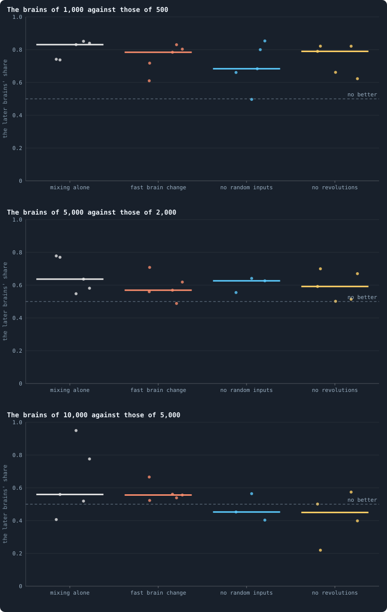

**Do later brains beat earlier ones?** Each dot is a world: the share of a contested world the later moment's brains hold after 100 iterations against the earlier moment's, the mean of two contests, one in each moment's world; the bar is the median world. Mixing alone: Experiment 17's worlds of the same seeds. A world that died out has the steps before its death only.

> [!example]- How to make this figure
> **Runs.** As for the figure *Experiment 21 at iteration 10,000* above.
>
> **Data.** From `GraphOfLifeRuns/.pilots/e21_T100.json` and `e17_T100.json` (`research/oee/checks/rejudge.py`, `research/oee/checks/e20_e21_rejudge_worlds.txt`).
>
> 1. Seat the brains of the two moments by a coin per agent on each moment's world and play 100 iterations.
> 2. Count the agents the later moment's brains hold, as a share of all.
>
> **To make it again:** `python3 book_figures.py fiveseeds`.
<!-- /figure -->

**Evolution slows under every rule.** The brains of 1,000 beat those of 500
in nearly every world, with a median share of a contested world of 0.68 to
0.83. Those of 5,000 beat those of 2,000 less clearly (0.57 to 0.64). Those
of 10,000 against those of 5,000 hold 0.56, both with mixing alone and with
a fast change of brains. Under fast change, the later brains won in all
five worlds. Without random inputs and without revolutions they hold only
0.45. There the later brains won in one of the three worlds that lived
without random inputs, and in two of the four without revolutions.

#### Verdict: no rule beat mixing alone

**The thesis fails for all three rules.** No rule's worlds passed the test
in four of five seeds. None did better than mixing alone, which passed in
three of the same five. The candidate worlds that held over 10,000
iterations held by their seed's luck as much as by their rule's.

Read by the clarified test ([Too even, not too poor](#too-even-not-too-poor-the-candidates)),
the verdict stands. No world here failed on the share of the poor alone, so
leaving that count out changes nothing. Asking instead that a world be no
more even than B2 changes one rule. The line is a Gini of at least 0.47,
the least of B2's ten worlds at 10,000.
- **A fast change of brains passes in none of five.** Its two worlds that
  passed are more even than any of B2's, with Ginis of 0.38 and 0.34. Four
  of its five worlds are, at 8 to 22 tokens per agent. Its "not poor" was
  evenness.
- **The others keep their count.** Plain mixing still passes in three, and
  no random inputs and no revolutions in one each, with Ginis of 0.52 to
  0.55.

By the clarified reading, even the candidate worlds that put these three
rules forward were too even. They are four of the five that held, each more
even than every one of B2's worlds.

The author also counts a configuration that shows open-ended evolution in a
few seeds as enough. That is a claim about what a configuration can do.
This test asked how often a rule's worlds stay healthy, which is a
different question, and its answer stays as it was.

### The search's best world, in new seeds

<!-- experiment E24 -->

Instead of changing one rule at a time, a search can draw every setting at
random. The search by elimination did that, round after round, and kept the
values that did not make worlds worse (`research/oee/search.md`). In its
second round one world stood out, `Z/r2-25`:
- At iteration 1,000 it met every mark of the health bar.
- Its agents were more diverse than in any world the notebook had measured:
  a diversity score of 0.90, against 0.49 for B2's median world.
- It was a space, twice as wide as its random twin.

It plays with:
- brains that can grow;
- a lottery for each node;
- stakes pooled by genotype;
- an input that tells an agent where its brain came from;
- no mending and no old age;
- every unused link lapsing;
- gifts;
- a walk to find strangers.

Was it the settings, or the luck of one draw? The best of 63 draws is also
the luckiest. And rules whose single world had held over 10,000 iterations
did no better than mixing alone
[in new seeds](#five-more-seeds-for-the-rules-that-held). Only new seeds
can tell a configuration from a lucky draw.

Four of these rules exist only in the research prototype, and the lab could
not play them until now. It now hands a run that asks for them to the
prototype itself, frozen beside the engine (`gol_pilot.py`).
**Experiment 24** plays the search's settings in five new seeds, 1 to 5,
and in the search's own seed, 2025, each to 2,000 iterations.

The clarified test ([Too even, not too poor](#too-even-not-too-poor-the-candidates)) asks
one more thing. The search's world has a Gini of 0.44, more even than any
of B2's worlds, which read 0.49 and more at iteration 1,000. So even if the
configuration holds, it is not yet the author's picture. This section
reports how even each new world is.

We expected the settings, not the luck of one draw, to make the world. At
iteration 1,000, at least three of the five new worlds should:
- meet every mark of the health bar;
- be more diverse than B2's median world;
- be spaces, at least 1.5 times as wide as their random twins.

And the lab's world of seed 2025 should be the pilot's again, game for
game.

<!-- thesis E24 -->
> [!quote] The thesis of Experiment 24, written down before any of its runs existed
> **The claim.** The random search's best world was a configuration, not a winner's curse. Played from five new seeds, at least three of the five worlds meet every mark of the health bar at iteration 1,000, have a diversity score above that of B2's median world (0.49) and are spaces: a typical agent reaches half the world in at least 1.5 times the steps its random twin needs. And the lab plays the search's own world, seed 2025, as the pilot did: its agents and links after every game match the pilot's to iteration 1,000.
>
> **Why it would be so.** In the search's second round, the world of Z/r2-25 met every mark at iteration 1,000 with a diversity score of 0.90 and was twice as wide as its random twin: the most promising of 63 worlds whose every setting was drawn at random. It plays with brains that can grow, a lottery for each node, stakes pooled by genotype, an input that tells an agent where its brain came from, no mending, every unused link lapsing, no old age, gifts and a walk to find strangers. The best of 63 draws is also the luckiest, and in Chapter [93](building-b2-and-the-search-for-a-healthy-rich-world.md#five-more-seeds-for-the-rules-that-held) rules whose single world held did not hold in new seeds; only new seeds can tell. The lab now plays the pilots' rules with the prototype itself, frozen beside the engine, so its world of seed 2025 should be the pilot's again. Read by [Meta X](building-b2-and-the-search-for-a-healthy-rich-world.md#healthy-and-rich)'s clarified test the world is more even than any of B2's (a Gini of 0.44 against 0.49 and more): even a configuration that holds would not yet be the author's picture, and the chapter says how even each new world is.
>
> **It holds if:** At least three of the five new worlds (seeds 1 to 5) pass at iteration 1,000 — every mark, a diversity score above 0.49, a typical distance at least 1.5 times the twin's — and the world of seed 2025 matches the pilot's agents and links after every game to iteration 1,000.
>
> **It fails if:** Two or fewer of the five pass, or the world of seed 2025 differs from the pilot's.
<!-- /thesis -->

#### What the six worlds did

**The lab plays the pilots' rules as the pilots did.** The world of seed
2025 was played by the prototype frozen beside the engine. It matched the
pilot's agents and links after every one of its 1,000 games. Every world
of the pilots' rules the lab plays from now on is the world a pilot would
have been.

<!-- figure searchbest/measures -->
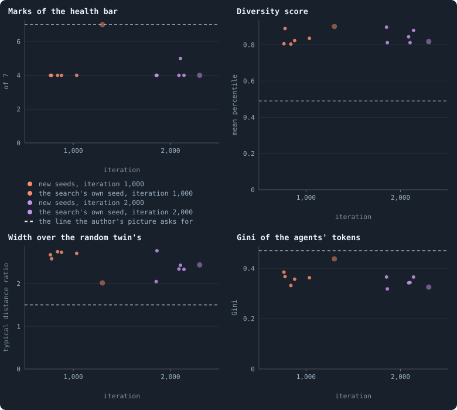

**The search's best settings, in six worlds.** Each dot is one world at iteration 1,000 (orange) or 2,000 (violet): the five new seeds small, the search's own seed large. The dashed line is what the author's picture asks: every mark of the health bar, a diversity score above B2's median world (0.49), a typical distance at least 1.5 times the random twin's, and a Gini no lower than B2's most even world at the same iteration (0.49 at 1,000, 0.46 at 2,000).

> [!example]- How to make this figure
> **Runs.** Experiment 24's six runs (`python3 gol_lab.py run E24`): the settings of `Z/r2-25` played by the research prototype in the lab (`gol_pilot.py`), seeds 1 to 5 (`B2-10000-d2b0d2-s001` … `-s005`) and the search's own seed (`B2-10000-d2b0d2-s2025`), each to 2,000 iterations, with a whole world kept every 100.
>
> **Data.** From each run's checkpoints at 1,000 and 2,000 (`ckpt_001000.npz`, `ckpt_002000.npz`).
>
> 1. Read each world as `research/atlas/profile.py` reads every world: the seven marks, the four spreads ranked among the frozen reference worlds, the Gini of the tokens.
> 2. Its typical distance over its random twin's as `research/atlas/space.py` measures it.
>
> **To make it again:** `python3 book_figures.py searchbest`.
<!-- /figure -->

**The new worlds are what the search's world was, except for its marks.**
At iteration 1,000 every one of the five new worlds was:
- **diverse,** with diversity scores of 0.80 to 0.89 against B2's 0.49,
  among the highest the notebook has measured;
- **a wide space,** 2.6 to 2.75 times as wide as its random twin;
- **rich,** with 11 to 17 tokens per agent.

None met more than four marks of the health bar:
- **One agent's loss** cut off 19% to 47% of the world, and one link's loss
  up to 43%.
- **Their dimension** was 2.0 to 2.2, below the bar's 2.3: thin, about
  two-dimensional networks.

And beyond the bar, **their tokens** were too even, with Ginis of 0.33 to
0.38, against B2's most even world at 1,000, 0.49. At 2,000 the picture was
much the same, against B2's 0.46; one world met five marks.

**The search's own world was a lucky moment of the same thing.** At 1,000
it met every mark, as the search found. By 2,000 it met four, with a
dimension of 2.15. An agent's loss could cut off a quarter of it, and its
Gini fell to 0.33. It is one of these worlds, caught in a moment when it
happened to have no bottleneck.

#### Verdict: a lucky moment, and a faithful lab

**The thesis fails.** None of the five new worlds passed at 1,000; three
were asked for. Every one missed the marks of cuts and dimension. Its
second part holds: the lab's world of seed 2025 is the pilot's, game for
game.

A search judged at one moment finds lucky moments. The best of 63 worlds
was best at iteration 1,000 by a bottleneck that happened to be missing.
Its settings make diverse, wide, rich worlds every time. They also make
thin, cuttable and even ones every time, and the search's measure at one
moment could not see that.

These settings give exactly what
[Experiment 19](building-b2-and-the-search-for-a-healthy-rich-world.md#who-may-be-a-mate)'s world lacks.
That world, mixing with parents as mates, is healthy, diverse and uneven,
but folded. This one is a wide space, but thin and even. Among its
settings, every unused link lapsing is the one
[Rules in company](what-the-switches-did-in-pilots.md#rules-in-company) found to make worlds rich, about
two-dimensional and short of marks. That is where the two configurations
meet, and where [Room for the steadiest world](building-b2-and-the-search-for-a-healthy-rich-world.md#room-and-riches-for-the-steadiest-world)
looks for room.

### What we learned (the candidates)
- **A pilot of engine rules is the lab's world, and the lab now plays the
  pilots' rules too.** Three twin checks match game for game. So what the
  pilots found stands, and the lab can take up where a pilot stopped. Rules
  that lived only in the prototype can now be put to the test like any
  other, beside the pages that ask for them. Among them are a lottery for
  each node, stakes pooled by genotype, brains that grow, and an input of
  where a brain came from.
- **Most candidate worlds do not hold.** Of nineteen, five held over 10,000
  iterations, eleven fell back and three died out. By the clarified test,
  three held.
- **One world says little about a rule.** A candidate world that held was
  one draw from a wide spread. Of the same rule's next five worlds, some
  held, some fell back and some died. No rule held more often than mixing
  alone.
- **A search judged at one moment finds lucky moments.** The search's best
  settings make diverse, wide and rich worlds every time, and thin,
  cuttable and even ones every time.
- **A fast change of brains is the steadiest of the three rules, but its
  riches are evenness.** Every one of its worlds lived, diverse and with
  few poor, and missed at most a single mark. But four of its five are more
  even than any of B2's worlds.
- **What lasts is what [What holds a world's size](building-b2-and-the-search-for-a-healthy-rich-world.md#what-holds-a-worlds-size)
  predicts.** Small worlds are rich, large worlds poor, and diversity wears
  off. Riches and room pull apart: every rich candidate world folded, and
  the few wide ones are large and half poor.
- **Evolution goes on, slowing, and never speeds up.** In nearly every kind
  of world played this long, later brains keep beating earlier ones by less
  and less. Without random inputs or without revolutions, by iteration
  10,000 they won in only some worlds.

### How this was made (the candidates)
The runs behind each section fold away below, each with every setting it
was played with.

#### The runs of Experiment 20

<!-- runs E20 -->
> [!info]- The runs behind this page
> **2 runs.** Every condition below is run once for every seed (1), for 10,000 iterations — or until its world dies out. Every setting is B2's unless the condition changes it.
>
> - **links to strangers, a free reach, forced** — changes `link_search` = reach, `link_consent` = forced; 10,000 tokens. Runs `B2-10000-e10e0d-s001` … `B2-10000-e10e0d-s001`.
> - **mixed at birth, the last token kept** — changes `mix_at_birth` = on, `keep_home` = 0.01; 10,000 tokens. Runs `B2-10000-82bd1e-s001` … `B2-10000-82bd1e-s001`.
>
> To make these runs again: `python3 gol_lab.py run E20`.
<!-- /runs -->

#### The runs of Experiment 21

<!-- runs E21 -->
> [!info]- The runs behind this page
> **20 runs.** Every condition below is run once for every seed (3 to 7), for 10,000 iterations — or until its world dies out. Every setting is B2's unless the condition changes it.
>
> - **mixed at birth** — changes `mix_at_birth` = on; 10,000 tokens. Runs `B2-10000-4af4a3-s003` … `B2-10000-4af4a3-s007`.
> - **mixed at birth, fast brain change** — changes `mix_at_birth` = on, `mutation_probability` = 0.8; 10,000 tokens. Runs `B2-10000-0df8be-s003` … `B2-10000-0df8be-s007`.
> - **mixed at birth, no random inputs** — changes `mix_at_birth` = on, `random_input_amount` = 0; 10,000 tokens. Runs `B2-10000-1109f3-s003` … `B2-10000-1109f3-s007`.
> - **mixed at birth, no revolutions** — changes `mix_at_birth` = on, `allow_revolutions` = off; 10,000 tokens. Runs `B2-10000-1f9b27-s003` … `B2-10000-1f9b27-s007`.
>
> To make these runs again: `python3 gol_lab.py run E21`.
<!-- /runs -->

#### The runs of Experiment 24

<!-- runs E24 -->
> [!info]- The runs behind this page
> **6 runs.** Every condition below is run once for each of its seeds, for 2,000 iterations — or until its world dies out. Every setting is B2's unless the condition changes it.
>
> - **the search's configuration** — changes `hidden_layers` = 32, `random_input_amount` = 0, `message_prepass` = on, `allow_gifting` = on, `prune_after` = reproduction, `inactive_window` = iteration, `incumbency` = 1.0, `birth_links` = 0, `mend_on_death` = off, `prune_needs` = 0, `keep_home` = 0.0, `max_age` = 0, `link_search` = walk, `mutation_probability` = 0.4, `extinction_threshold` = 0, `proto` = came_from, contest = lottery, grow, pool = genotype; 10,000 tokens; seeds 1 to 5. Runs `B2-10000-d2b0d2-s001` … `B2-10000-d2b0d2-s005`.
> - **the search's own world** — changes `hidden_layers` = 32, `random_input_amount` = 0, `message_prepass` = on, `allow_gifting` = on, `prune_after` = reproduction, `inactive_window` = iteration, `incumbency` = 1.0, `birth_links` = 0, `mend_on_death` = off, `prune_needs` = 0, `keep_home` = 0.0, `max_age` = 0, `link_search` = walk, `mutation_probability` = 0.4, `extinction_threshold` = 0, `proto` = came_from, contest = lottery, grow, pool = genotype; 10,000 tokens; seeds 2025. Runs `B2-10000-d2b0d2-s2025` … `B2-10000-d2b0d2-s2025`.
>
> To make these runs again: `python3 gol_lab.py run E24`.
<!-- /runs -->

## Room and riches for the steadiest world

The steadiest world the notebook has, Experiment 19's, lives long and its
agents differ, but it is folded: a small world, not a space. Experiment 31
gave it, one at a time, four rules that keep a world's room; each gave room
and took something else. The estates of the dead paid to births made healthy
spaces of about three dimensions, filled with some 5,000 paupers of about two
tokens each. Experiment 32 then asked every child to start as rich as its
parent's neighbours, and nothing changed: the game, not birth, makes the
poor. These worlds are spaces because their young are the parents, so here
room and riches come from the same coin. In plain B2 the rule is just as idle
(Experiment 36). In B1, where a child may start with a single token, it binds
hard (Experiment 37). Most agents may not have a child at all, and those that
may give most of what they hold. Children start three to nine times as rich
as in plain B1, and agents live a few iterations. Both worlds ended small,
around a few rich hubs that hand their whole fortune to one child every
iteration.

### Room for the steadiest world

<!-- experiment E31 -->

#### Four wishes at once

What would a world that might keep evolving look like? The author's picture
([Healthy and rich](building-b2-and-the-search-for-a-healthy-rich-world.md#healthy-and-rich)) asks four things of it, all at the
same moment:
- **Healthy.** Its network meets all seven marks of the health bar.
- **Diverse.** Its agents differ, more than B2's do: its diversity score is
  above that of B2's median world, read at the same iteration.
- **A space.** It is wide, at least half again as wide as a random network
  with the same links ([What folds a world](how-many-dimensions-does-a-world-have.md#what-folds-a-world)).
- **Uneven.** Its tokens are held no more evenly than B2's: their Gini
  coefficient is no lower than that of B2's most even world. The author
  added this fourth wish later, on 19 October 2026
  ([Healthy and rich](building-b2-and-the-search-for-a-healthy-rich-world.md#healthy-and-rich)). What looks unhealthy is a world
  where almost every agent holds the same few tokens.

*A space* needs a picture. In a space, far places are far apart: to cross a
city, you walk through many streets. In a *small world*, everyone is a few
steps from everyone, as through friends of friends. To tell the two apart,
the notebook sets each world beside its random twin. The twin has the same
agents, each with as many links, but wired at random; and a random network
is a small world. A world counts as a space when a typical agent needs at
least 1.5 times the twin's steps to reach half the world.

Read by all four, few worlds pass even for a moment:
- **At 1,000 iterations:** three of the 466 worlds measured, each with
  brains mixed at birth and one other rule.
- **At 10,000:** one of 64. This is Experiment 21's world without random
  inputs, seed 6
  ([Five more seeds for the rules that held](building-b2-and-the-search-for-a-healthy-rich-world.md#five-more-seeds-for-the-rules-that-held)).
  The same rule's other worlds failed, and two of them died.

#### The steadiest world, and what it misses

The steadiest configuration the notebook has is
[Experiment 19](building-b2-and-the-search-for-a-healthy-rich-world.md#who-may-be-a-mate)'s. In it, a
newborn's brain is mixed at birth: part its parent's, part a mate's, and the
mate is one of the parent's neighbours. And only parents may be mates: a
neighbour with a living child of its own.
- **What it has.** All ten of its worlds lived to 20,000 iterations, at
  about 2,000 agents each. They stay diverse: at 20,000 their diversity
  scores are 0.52 to 0.69, against 0.49 for B2's median world at 10,000.
  They stay uneven, with Ginis of 0.47 to 0.57 at 10,000. And evolution goes
  on in them: later brains beat earlier ones, by less and less.
- **What it misses: room.** A typical agent reaches half its world in 1.13
  to 1.32 times the steps its random twin needs. Nine of the ten miss the
  dimension mark, as a folded world of 2,000 agents does: its dimension
  reads too high. These are small worlds, not spaces.

#### Rules that keep a world's room

Why is the world folded? [What folds a world](how-many-dimensions-does-a-world-have.md#what-folds-a-world) found
the answer in what B2 does at a death. When an agent dies, B2 *mends* the
hole. The dead agent's neighbours are joined in a ring round the gap, as the
edge of a hole closes. Each death joins agents that were two steps apart. In
B2 every agent dies by the age of 100, so this happens to every agent in
turn, generation after generation. The world is pulled together.

The same page found three rules that keep a world's room:
- the estate of the dead paid to births, either to this iteration's
  newborns or to their parents;
- no old age, so that nobody dies at 100;
- no mending, so that a death leaves a hole.

The estate is the tokens a dead agent leaves. B2 gives each of them to a
survivor drawn at random.

Each pays for the room in its own coin
([Rules in company](what-the-switches-did-in-pilots.md#rules-in-company)):
- **The estates** fill a world with alike agents. With plain mixing, where
  any neighbour may be the mate, they gave spaces of about 5,000 agents
  whose diversity scores fell to 0.35 to 0.40.
- **No old age** all but stops births.
- **No mending** lets one loss cut a world.

A world of more tokens would not help. B2's kind of world stays folded at
every size: a world of 100,000 tokens was 1.14 times as wide as its twin.
Room has to come from a rule.

#### What we expected of the room rules

Experiment 31 tries four rules in Experiment 19's world, one at a time. They
are the estate to the newborns, the estate to the parents, no old age and no
mending. Each runs in two seeds, for 3,000 iterations. We expected at least
one rule to unfold the world without costing it the rest. Both its worlds
would then pass all four wishes at iteration 3,000. Our hope rested on the
estates. Parents as mates held a mixed world's size, so with them the
estates might give room without filling the world.

<!-- thesis E31 -->
> [!quote] The thesis of Experiment 31, written down before any of its runs existed
> **The claim.** Experiment 19's world, brains mixed at birth with only parents as mates, is steady, diverse and uneven, but folded. One of the rules that keep a world's room unfolds it without costing the rest. For at least one of four rules (the estate of the dead paid to the newborns, or to the parents, no old age, or deaths not mended) both of its worlds, at iteration 3,000, meet every mark of the health bar, are more diverse than B2's median world, are at least 1.5 times as wide as their random twins, and are no more even than B2's least even world, B2's ten worlds played on being read at the same iteration.
>
> **Why it would be so.** All ten of Experiment 19's worlds lived to 20,000 iterations. At 10,000 they held 1,429 to 2,385 agents, with diversity scores of 0.55 to 0.65 against B2's median of 0.49 and Ginis of 0.47 to 0.57 against B2's least of 0.47. Yet a typical agent reached half its world in 1.13 to 1.31 times the steps its random twin needs, and nine of ten missed the dimension mark: they are folded small worlds, not spaces. Chapter [87](how-many-dimensions-does-a-world-have.md#what-folds-a-world) found what folds a world, a death mended with a ring of links, and what keeps a world's room: the estate paid to births (2.0 to 2.6 times the twin), no old age (1.8 to 1.9) and no mending (2.0). Each pays for the room in its own coin ([Meta XII](what-the-switches-did-in-pilots.md#rules-in-company)): estates fill a world with alike, poor agents, no old age all but stops births, and without mending one loss can cut a world. With plain mixing, the estates gave spaces of about 5,000 agents with diversity scores of only 0.35 to 0.40. With parents as mates a mixed world held its size, which may keep the diversity the estates cost.
>
> **It holds if:** For at least one rule, both worlds (seeds 1 and 2) at iteration 3,000 meet every mark, have a diversity score above the median of B2's ten worlds played on and read at 3,000, a typical distance at least 1.5 times their twin's, and a Gini of their agents' tokens no lower than the least of those ten worlds'.
>
> **It fails if:** No rule has both its worlds pass all four at 3,000: the room and the rest pull apart even in the steadiest mixed world, and the chapter says what each rule cost.
<!-- /thesis -->

#### What the room rules did

<!-- figure room/measures -->
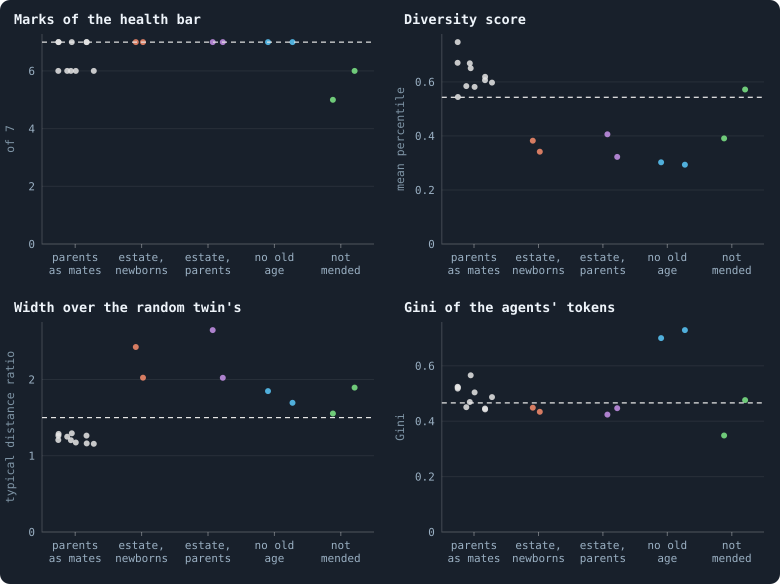

**Experiment 19's world, given room.** Each dot is one world at iteration 3,000: Experiment 19's ten (grey) and Experiment 31's two for each rule. The dashed line is what the author's picture asks: every mark, a diversity score above B2's median world at 3,000 (0.54), a typical distance at least 1.5 times the random twin's, a Gini no lower than B2's most even world at 3,000 (0.47).

> [!example]- How to make this figure
> **Runs.** Experiment 31's eight runs (`python3 gol_lab.py run E31`): B2 at 10,000 tokens with brains mixed at birth and parents as mates, and the estate of the dead paid to the newborns (`B2-10000-06b876-…`) or to the parents (`-b8e9fc-…`), no old age (`-89f5b1-…`) or deaths not mended (`-c58a16-…`), seeds 1 and 2, to 3,000 iterations; and Experiment 19's ten worlds (`B2-10000-bcc1bc-s001` … `-s010`), all read at iteration 3,000 from their archives.
>
> **Data.** From each world's archive at iteration 3,000.
>
> 1. Read each world as `research/atlas/profile.py` reads every world: the seven marks, the four spreads ranked among the frozen reference worlds (their mean is the diversity score), the Gini of the tokens.
> 2. Its typical distance over its random twin's, as `research/atlas/space.py` measures it.
> 3. The lines: every mark; the median diversity, and the least Gini, of B2's ten worlds played on and read at 3,000; a typical distance of 1.5 times the twin's.
>
> **To make it again:** `python3 book_figures.py room`.
<!-- /figure -->

**Every rule gave the world room, and every rule took something else.**
At iteration 3,000:
- **Experiment 19's own worlds** are as before:
  - 6 or 7 marks;
  - diverse, 0.54 to 0.75;
  - uneven, Ginis of 0.44 to 0.57;
  - folded, 1.16 to 1.29 times their twins.
- **The estate to the newborns, or to the parents,** made true spaces:
  - 2.0 to 2.65 times as wide as their twins, at a dimension of about 3.5;
  - every mark of the health bar;
  - about 5,000 agents.

  But the diversity scores fell to 0.32 to 0.41. And the Ginis fell to 0.42
  to 0.45: a little more even than B2's most even world (0.47).
- **No old age** made spaces too, 1.7 and 1.85 times their twins, with every
  mark and very uneven tokens (Ginis of 0.70 and 0.73). Diversity fell to
  0.29 and 0.30.
- **Deaths not mended** went two ways.
  - **Seed 1** came nearest of all: 1.89 times its twin, a diversity score
    of 0.57, a Gini of 0.48. It missed one mark: one agent's loss could cut
    off too much.
  - **Seed 2** missed two marks (a cut and a hub), and fell short on
    diversity (0.39) and on unevenness (a Gini of 0.35).

#### What each rule cost

<!-- figure room/parts -->
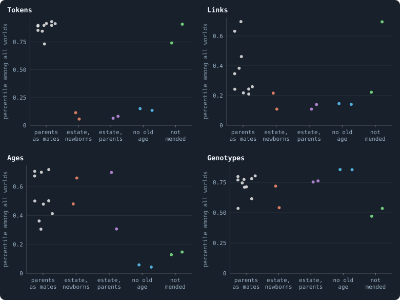

**What each rule costs of the diversity.** The four parts of the diversity score, each world's percentile among the frozen reference worlds: how many doubling classes its agents' tokens, links and ages fill, and its effective number of genotypes per agent. Each dot is one world at iteration 3,000.

> [!example]- How to make this figure
> **Runs, data and steps.** As for the figure *Experiment 19's world, given room* above.
>
> **To make it again:** `python3 book_figures.py room`.
<!-- /figure -->

The diversity score is the mean of four parts. Three of them count how many
doubling classes (1, 2–3, 4–7, and so on) the agents' tokens, links and ages
fill. The fourth counts their genotypes. Each rule took a different part:
- **The estates take the tokens.** Paying the estate to births fills the
  world with children: about 5,000 agents for 10,000 tokens, 1.9 tokens
  each. The agents' tokens fill about two doubling classes, against four or
  five in Experiment 19's world, and their links vary little. Almost every
  agent holds the same few tokens: the case the author called unhealthy.
- **No old age takes the ages.** With no deaths of age there are few births,
  and almost every agent is old.
- **No mending takes the ages too,** and leaves the world cuttable, but
  keeps its tokens as spread as Experiment 19's.

#### Verdict: refuted, each rule pays in its own coin

**The thesis of Experiment 31 fails.** No rule had both its worlds meet all
four at 3,000. One world without mending missed by one mark. Room and the
rest still pull apart, even in the steadiest mixed world. What each rule
pays is now known:
- the estates pay with poor, alike agents;
- no old age pays with one age;
- no mending pays with cuts.

#### What the room rules teach

- **Half the picture is solved.** With the estates to births, a world of
  mixed brains and parents as mates is a healthy space of about three
  dimensions, with every mark. It is the network the author's picture asks
  for. What it lacks is in its agents. There are too many of them, each too
  poor for its tokens to differ.
- **Why so many, and so poor?** We first read it as the price of a child.
  An estate paid to the newborns makes children cheap to have, and the world
  fills with them. So the next rule asked more of a birth: a child must start
  with at least what its parent's neighbours hold. The next section tells
  how that turned out: the price of a child was not the cost.
- **The nearest world is one without mending.** Seed 1 missed only a cut. A
  world whose deaths are not mended keeps its tokens and its room; what it
  needs is to stay whole. Mending without folding is a second rule to try
  ([What folds a world](how-many-dimensions-does-a-world-have.md#what-folds-a-world) traced the folding to the
  rings a death closes).

### Births as rich as the neighbours

<!-- experiment E32 -->

#### A birth that asks more where the world is rich

The estate worlds of
[Room for the steadiest world](#room-for-the-steadiest-world) came nearest
the network the author's picture asks for:
- every mark of the health bar;
- a space 2.0 to 2.65 times as wide as its twin, at about three dimensions.

But they filled up with children: about 5,000 agents for 10,000 tokens, 1.9
tokens each. Almost every agent held the same few tokens, and the diversity
score fell from Experiment 19's 0.54 to 0.75 to 0.32 to 0.41.

An estate paid to births makes a birth cheap, and nothing stops a world from
making paupers. [What holds a world's size](building-b2-and-the-search-for-a-healthy-rich-world.md#what-holds-a-worlds-size)
asked for a pull: births that cost more when they would make the world
poorer. The rule tried here is that pull, with no number of its own. A child
must start with at least the median holding of its parent's neighbours
([`child_floor`](settings.md#child_floor) = `neighbours`). We call it the
*floor*. It is local, too: a parent looks only at its own neighbours.

Think of the neighbours' holdings as the going rate where a parent lives:
- a parent among rich agents can have a child only by giving it as much as
  they hold;
- a parent among poor ones may have a small child.

So the world can grow only as rich as it is. The floor comes on top of a
rule B2 already has: every child starts with at least ten tokens
([`min_child`](settings.md#min_child)). A child must get the larger of the
two.

#### What we expected of the floor

We expected the floor to keep the healthy space the estates make, and to give
back the diversity they cost. Then both worlds of at least one estate would
pass all four wishes at iteration 3,000. Experiment 32 plays three
conditions, two seeds each, for 3,000 iterations. The floor comes with the
estate to the newborns, with the estate to the parents, or alone. Experiment
31's estate worlds of the same seeds are the control, and so is Experiment
19's world, for the floor alone.

<!-- thesis E32 -->
> [!quote] The thesis of Experiment 32, written down before any of its runs existed
> **The claim.** Asking a child to start with at least what its parent's neighbours hold keeps the healthy space the estates make and gives back the diversity they cost. With brains mixed at birth, parents as mates and the estate of the dead paid to births, and a child never poorer than the median holding of its parent's neighbours, both worlds of at least one of the two estates (to the newborns, to the parents), at iteration 3,000, meet every mark of the health bar, are more diverse than B2's median world, are at least 1.5 times as wide as their random twins, and are no more even than B2's least even world, B2's ten worlds played on being read at the same iteration.
>
> **Why it would be so.** In Experiment 31 the estates gave Experiment 19's world every mark and a space of about three dimensions, 2.0 to 2.65 times as wide as its twin. But they filled it with children: about 5,000 agents for 10,000 tokens, 1.9 tokens each, whose tokens fill about two doubling classes. The diversity scores fell to 0.32 to 0.41, and the tokens became a little more even than B2's (Ginis of 0.42 to 0.45). The estate makes a birth cheap, and nothing stops a world from making paupers. A child that must start as rich as the agents it is born among stops that, with no number of its own: the world can grow only as rich as it is. Experiment 31's estate worlds of the same seeds are the control, as is Experiment 19's world for the floor alone.
>
> **It holds if:** For at least one estate rule, both worlds (seeds 1 and 2) at 3,000 meet every mark, have a diversity score above the median of B2's ten worlds read at 3,000 (0.54), a typical distance at least 1.5 times their twin's, and a Gini no lower than the least of those ten worlds' (0.47).
>
> **It fails if:** Neither estate rule has both its worlds pass all four at 3,000; the chapter says what the floor changed and what it did not.
<!-- /thesis -->

#### What the floor did

<!-- figure floor/measures -->
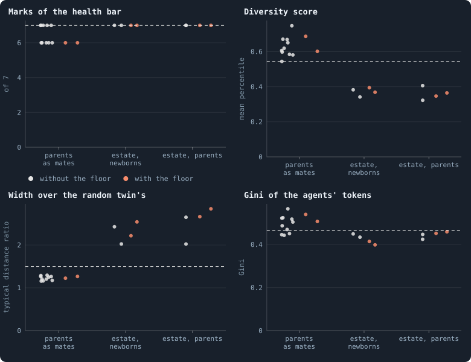

**The floor, with each estate and without.** Each dot is one world at iteration 3,000, without the floor (grey: Experiment 19's ten worlds for parents as mates alone, Experiment 31's two for each estate) and with it (orange: Experiment 32's two for each). The dashed line is what the author's picture asks: every mark, a diversity score above B2's median world at 3,000 (0.54), a typical distance at least 1.5 times the random twin's, a Gini no lower than B2's most even world at 3,000 (0.47).

> [!example]- How to make this figure
> **Runs.** Experiment 32's six runs (`python3 gol_lab.py run E32`): B2 at 10,000 tokens with brains mixed at birth, parents as mates and a child never poorer than the median holding of its parent's neighbours, with the estate of the dead paid to the newborns (`B2-10000-12215f-…`), to the parents (`-86df9e-…`) or neither (`-b289dd-…`), seeds 1 and 2, to 3,000 iterations; against Experiment 31's estate worlds of the same seeds (`B2-10000-06b876-…`, `-b8e9fc-…`) and Experiment 19's ten worlds (`B2-10000-bcc1bc-s001` … `-s010`), which have no floor.
>
> **Data.** From each world's archive at iteration 3,000.
>
> 1. Read each world as `research/atlas/profile.py` reads every world: the seven marks, the four spreads ranked among the frozen reference worlds (their mean is the diversity score), the Gini of the tokens; and its typical distance over its random twin's, as `research/atlas/space.py` measures it (`research/atlas/readings.py` does both).
> 2. The lines: every mark; the median diversity, and the least Gini, of B2's ten worlds played on and read at 3,000; a typical distance of 1.5 times the twin's.
>
> **To make it again:** `python3 book_figures.py floor`.
<!-- /figure -->

**The floor changed nothing the measures can see.** At iteration 3,000:
- **With an estate,** the four worlds with the floor are the estate worlds
  of [Room for the steadiest world](#room-for-the-steadiest-world) again:

  | | with the floor | without it ([Room for the steadiest world](#room-for-the-steadiest-world)) |
  |---|---|---|
  | marks of the health bar | 7 | 7 |
  | width over the twin | 2.2 to 2.85 | 2.0 to 2.65 |
  | agents | 5,063 to 5,735 | 5,036 to 5,445 |
  | tokens per agent | 1.74 to 1.98 | 1.84 to 1.99 |
  | diversity score | 0.35 to 0.39 | 0.32 to 0.41 |
  | Gini of the tokens | 0.40 to 0.46 | 0.42 to 0.45 |

- **Alone,** the floor left Experiment 19's world as it was. Its two worlds
  lie among Experiment 19's ten in every measure:
  - diverse, 0.60 and 0.69 (Experiment 19: 0.54 to 0.75);
  - uneven, Ginis of 0.51 and 0.54 (0.44 to 0.57);
  - folded, 1.27 and 1.22 times their twins (1.16 to 1.29);
  - each missing the mark for dimension, 4.2 and 4.1, as five of
    Experiment 19's ten do.

#### Why the floor did nothing

**It could not bind.** Every child already starts with at least ten tokens
(B2's `min_child`). So the floor asks more only of a parent whose
neighbours' median holding is above ten.
- **In the estate worlds with the floor,** at 3,000, the median agent's
  neighbours held a median of one token. Of the 109 to 157 agents rich
  enough to have a child, the floor asked more of 1 to 10.
- **Alone,** it asked more of 6 and of 55, of about 300.

#### Where the poor agents come from

If every child starts with ten tokens or more, why do the agents of the
estate worlds hold fewer than two on average?

<!-- figure floor/paupers -->
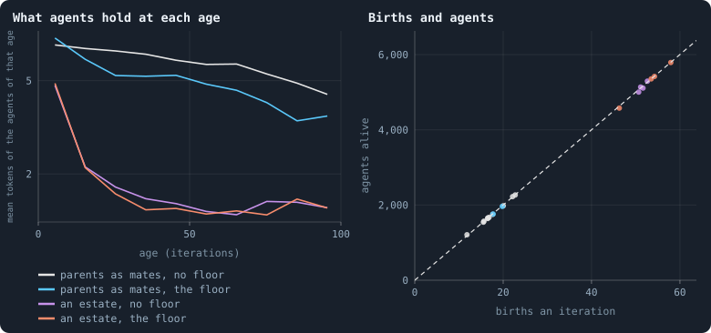

**Where the poor agents come from.** Left: the mean tokens of the agents of each age, in tens of iterations, at iteration 3,000, averaged over the worlds of each kind: Experiment 19's ten, and seeds 1 and 2 of the others. Right: each world's births an iteration and agents alive, both averaged over iterations 2,000 to 3,000; the dashed line is a hundred agents for every birth an iteration, which a world keeps when everyone lives out a hundred iterations.

> [!example]- How to make this figure
> **Runs.** As for the figure *The floor, with each estate and without* above.
>
> **Data.** From each world's archive at iteration 3,000 and its `stats.jsonl`.
>
> 1. Left: each agent's age is the iteration less the one it was born in; average the tokens of the agents aged 1 to 10, 11 to 20, and so on.
> 2. Right: the births and the agents of each iteration's first phase, averaged over the iterations 2,000 to 2,999.
>
> **To make it again:** `python3 book_figures.py floor`.
<!-- /figure -->

**The poor agents are not born poor.** In the estate worlds, every child
starts with ten tokens or more, as in any world. Then the tokens drain away:
- agents aged 1 to 10 hold 4.8 on average;
- aged 11 to 20, 2.1;
- from 30 on, about 1.5.

The game strips the young within twenty iterations. In Experiment 19's
worlds, agents hold 7 in their first ten iterations, and still 4.4 in their
last ten.

**And the young are the parents.** The agents that can have a child, with
eleven tokens or more, are young in the estate worlds and middle-aged in the
others, at 3,000:

| | median age of the agents able to have a child | share of them aged 10 or less |
|---|---|---|
| an estate, with or without the floor | 4 to 10 | 51% to 64% |
| Experiment 19, and the floor alone | 27 to 45 | 8% to 27% |

In a world where most agents hold a token or two, only two kinds of agent are
rich enough to breed. They are those just born, with their ten tokens or
more, and those just paid by the estate. And the game takes it from them
within twenty iterations.

This is also why the estate worlds are spaces.
[What folds a world](how-many-dimensions-does-a-world-have.md#what-folds-a-world) found why young parents make a
space. A death closes a ring round the gap it leaves. The ring is largest
where the old do the breeding, since an agent gathers links all its life,
from its children and its neighbours' children. Here the young breed, so the
rings stay small and the world keeps its room.

#### A world's size is its births

**Every world here held 99 to 102 agents for each birth an iteration,**
averaged over iterations 2,000 to 3,000. Its agents live out their hundred
iterations and almost none die sooner, as
[What holds a world's size](building-b2-and-the-search-for-a-healthy-rich-world.md#what-holds-a-worlds-size) found in 454
moments of other worlds. So:
- a world's size is a hundred times its births an iteration;
- its riches are its 10,000 tokens, shared among them.

| | births an iteration | agents |
|---|---|---|
| Experiment 19's ten worlds | 12 to 23 | 1,210 to 2,267 |
| the floor alone | 18 and 20 | 1,762 and 1,962 |
| an estate, without the floor | 51 to 53 | 5,004 to 5,294 |
| an estate, with the floor | 46 to 58 | 4,576 to 5,789 |

The estates pay for about three times as many births, so their worlds hold
about three times as many agents, sharing the same 10,000 tokens. This
ledger holds only where every agent dies at a fixed age, as in B2.

#### Verdict: refuted, the floor follows the world down

**The thesis of Experiment 32 fails.** With either estate and the floor, both
worlds met every mark and were spaces, as without the floor. None was
diverse enough (0.35 to 0.39, against 0.54) or uneven enough (Ginis of 0.40
to 0.46, against 0.47). The floor changed nothing measurable, because in a
world of paupers a child's neighbours are paupers too.

**What these results cover.** Every world of this experiment was played under
B2's rules, with brains mixed at birth and parents as mates, at 10,000
tokens, two seeds each. The floor failed because of one of those rules:
every B2 child already starts with ten tokens, more than a poor world's
neighbours hold. A world whose least child is a single token, such as B1, is
another matter.
[The floor in plain B2 and in B1](#the-floor-in-plain-b2-and-in-b1) plays
the same floor in both.

#### What the floor teaches

- **In B2, a rule that measures a world against itself follows it down.** The
  floor asked a child to be as rich as its neighbours. In a poor world the
  neighbours are poor, so the floor fell with the world, below the ten
  tokens every child already gets. A pull has to measure against something a
  poor world does not drag down with it.
- **The paupers are made by the game, not at birth.** A rule on what a child
  starts with cannot reach them. Under old age, only two things can:
  - fewer births, since the world's size is a hundred times its births;
  - or a game that strips the young less.
- **Room and riches come from the same coin.** The estate worlds are spaces
  because their young are the parents. Their young are the parents because,
  in a world of paupers, only the newly born and the newly paid are rich
  enough. Under these rules a world gets young parents only by paying for
  births, and paying for births fills it with paupers. A world that is both a
  space and rich needs its young to breed without the world filling up. Or it
  needs deaths that do not fold it when the old breed: the open question of
  [What folds a world](how-many-dimensions-does-a-world-have.md#what-folds-a-world), mending without folding.

### The floor in plain B2 and in B1

<!-- experiment E36 -->

<!-- experiment E37 -->

The floor asks that a child be never poorer than the median holding of its
parent's neighbours ([`child_floor`](settings.md#child_floor) =
`neighbours`). In
[Births as rich as the neighbours](#births-as-rich-as-the-neighbours) it
changed nothing in worlds of B2's rules with brains mixed at birth. In a
world of poor agents the neighbours hold a token or two, and every B2 child
already starts with ten ([`min_child`](settings.md#min_child)). Was it the
estates and the mixed brains that kept the floor idle, or B2's least child?
Two experiments ask:
- **Plain B2.** Is the floor as idle without mixed brains and estates? Plain
  B2 is poor too: about three agents in four hold three tokens or fewer
  ([Who inherits?](what-the-switches-did-in-pilots.md#who-inherits)). Its children start with 11.2 to 12.1
  tokens on average, in Experiment 16's ten worlds over iterations 1,000 to
  2,000.
- **B1.** Its least child is a single token. Over iterations 2,000 to 3,000,
  its children start with 2.0 to 5.1 tokens on average, a median of 2.6.
  These numbers come from the 26 of Experiment 2's 30 worlds that lived to
  3,000. Yet the median agent of its long worlds holds 4 to 15. There the
  floor asks more than most parents give.

#### What we expect in plain B2

If the floor failed because of B2's least child, it should stay idle in plain
B2 too. Experiment 36 plays plain B2 with the floor, in two seeds, for 3,000
iterations. We expect the floor to ask more than ten tokens of fewer than one
in twenty of the agents able to have a child. And we expect children to
start with 11 to 13 tokens on average, as in Experiment 16's worlds.

<!-- thesis E36 -->
> [!quote] The thesis of Experiment 36, written down before any of its runs existed
> **The claim.** Where every child already starts with ten tokens, a floor at the neighbours' median changes nothing. In plain B2, with a child never poorer than the median holding of its parent's neighbours, the floor asks more than B2's ten tokens of fewer than one in twenty of the agents able to have a child, at iterations 1,000, 2,000 and 3,000, and over iterations 1,000 to 2,000 children start with 11 to 13 tokens on average, as in B2's ten worlds of Experiment 16 (11.2 to 12.1).
>
> **Why it would be so.** In Chapter [101](building-b2-and-the-search-for-a-healthy-rich-world.md#births-as-rich-as-the-neighbours) the floor changed nothing in the estate worlds and nothing beyond seed-to-seed scatter in Experiment 19's world: in a world of poor agents a parent's neighbours hold a token or two, and every B2 child already starts with ten (min_child). Plain B2 is such a world: three agents in four hold three tokens or fewer. If the floor cannot bind there either, its failure is B2's least child, not the estates or mixed brains; Experiment 37 plays the same floor in B1, whose least child is a single token.
>
> **It holds if:** In both worlds, at 1,000, 2,000 and 3,000, fewer than one in twenty of the agents holding eleven tokens or more have neighbours whose median holding is above ten; and over iterations 1,000 to 2,000 both worlds' children start with 11 to 13 tokens on average.
>
> **It fails if:** In either world the floor asks more than ten tokens of one in twenty able agents or more at one of those iterations, or its children start with fewer than 11 or more than 13 tokens on average: the floor binds in plain B2, and the chapter says what it changed.
<!-- /thesis -->

#### What we expect in B1

In B1 the floor should bind. If it does, births should become fewer and
larger, and the world smaller and richer: the pull
[What holds a world's size](building-b2-and-the-search-for-a-healthy-rich-world.md#what-holds-a-worlds-size) asked for.
Experiment 37 plays B1 with the floor, in two seeds, for 3,000 iterations. We
expect both worlds to live to 3,000. We expect their children to start
richer than in any of B1's 26 long worlds: with more than 5.1 tokens on
average. And we expect both worlds to hold fewer agents on average than B1's
median world (1,462).

<!-- thesis E37 -->
> [!quote] The thesis of Experiment 37, written down before any of its runs existed
> **The claim.** Where a child may start with a single token, a floor at the neighbours' median binds and makes a world of fewer, richer agents. In B1, with a child never poorer than the median holding of its parent's neighbours, both worlds live to iteration 3,000; over iterations 2,000 to 3,000 their children start with more tokens on average than in any of B1's 26 worlds that lived to 3,000 (more than 5.1), and both hold fewer agents on average than B1's median world (1,462).
>
> **Why it would be so.** B1's children start with 2.0 to 5.1 tokens on average over iterations 2,000 to 3,000 (a median of 2.6, over the 26 of Experiment 2's 30 worlds that lived to 3,000), while the median agent of B1's long worlds holds 4 to 15 tokens. A floor at the neighbours' median asks more than most B1 parents give: births should become fewer and larger, and the world smaller and richer. In B2 every child already starts with ten tokens and the floor never bound (Chapter [101](building-b2-and-the-search-for-a-healthy-rich-world.md#births-as-rich-as-the-neighbours), Experiment 36).
>
> **It holds if:** Both worlds live to 3,000; over iterations 2,000 to 3,000 both worlds' children start with more than 5.1 tokens on average, and both worlds hold fewer than 1,462 agents on average.
>
> **It fails if:** Either world dies before 3,000, or its children start with 5.1 tokens or fewer on average, or it holds 1,462 agents or more on average: the floor does not bind in B1 either, or binding does not leave a smaller, richer world; the chapter says which.
<!-- /thesis -->

#### What the floor did in plain B2

In plain B2 the floor hardly ever asked for anything. Call an agent *able*
when it could have a child: it holds eleven tokens or more, so that a child of
ten leaves it one. At iterations 1,000, 2,000 and 3,000, the two worlds had
82 to 147 able agents each. The floor asked more than ten tokens of 1 to 4 of
them: 0.7% to 2.9%. The median agent's neighbours held a median of 1 to 3
tokens, far below the ten every child gets anyway.

So children started as they do without the floor. Over iterations 1,000 to
2,000 they started with 12.4 and 11.5 tokens on average, against 11.2 to 12.1
in Experiment 16's ten worlds of plain B2. And the worlds were as large:
3,105 and 3,305 agents on average over those iterations, where Experiment
16's held 3,076 to 3,669.

#### Verdict on plain B2: the thesis holds

Both conditions of the thesis are met. At every moment it named, the floor
asked more than ten tokens of fewer than one able agent in twenty (at most
2.9%), and in both worlds children started with 11 to 13 tokens on average.

So it was not the estates or the mixed brains that kept the floor idle in
[Births as rich as the neighbours](#births-as-rich-as-the-neighbours). In
any world of B2's rules, every child already gets ten tokens, and its
parent's neighbours are poor: a floor set by them has nothing to add.

#### What the floor did in B1

In B1 the floor binds. Recall the rule: a parent may have a child only if the
child starts with at least the median holding of the parent's neighbours; a
smaller birth is refused. At iterations 1,000 and 2,000, 54% to 70% of the
floor worlds' agents held less than their neighbours' median. Even if they
gave everything they held, they could not have a child. The floor would bar as
many or more in plain B1: in its 26 long worlds, 58% to 97% of the agents hold
less than their neighbours' median at iterations 1,000, 2,000 and 3,000 (a
median of 70% to 74%).

So the agents richer than their neighbours had the children, and they gave
generously (the figure below). Over iterations 1,000 to 2,000, against plain
B1's 26 long worlds over the same iterations:
- **Parents gave more.** A parent gave its child about two thirds of what it
  held: 62% and 65% on average. In plain B1 a parent gives about a third (25%
  to 43%, a median of 37%).
- **Children started richer.** They started with 9.5 and 9.2 tokens on
  average, more than in any of plain B1's worlds (2.2 to 7.7, a median of
  3.1).
- **Births were not fewer, but more frequent.** There were 19 births in an
  iteration per hundred agents, against 2 to 4 in plain B1.
- **Lives were short.** A world's agents are its births in an iteration times
  how long its agents live. With so many births, an agent lived about 6
  iterations on average, against 28 to 54 in plain B1.

The worlds were as large as plain B1's, or larger: about 1,500 agents after
the births, where plain B1's held 643 to 1,676 (a median of 1,249). Their size
swung more widely than in 17 of plain B1's 26 worlds. Then both shrank: seed 1
from about iteration 2,250, seed 2 from about 2,750.

<!-- figure floorplain/b1 -->
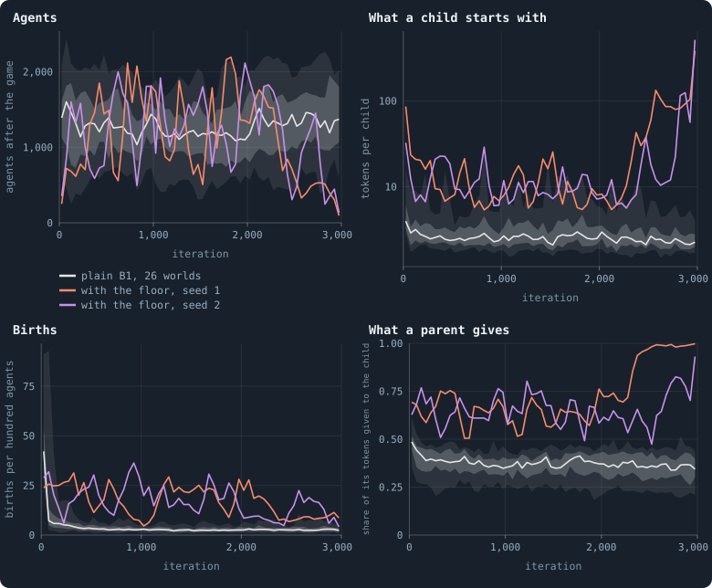

**The floor in B1, through time.** Each line is a mean over stretches of 50 iterations: Experiment 37's two worlds with the floor (orange and violet), beside the 26 worlds of plain B1 that lived to 3,000 (grey: the median line, the middle half darker, nine in ten paler). Top left: the agents. Top right: the tokens a child starts with, all the tokens given to children over all the births (a logarithmic scale). Bottom left: births in an iteration per hundred agents. Bottom right: the share of its tokens a parent gives its child.

> [!example]- How to make this figure
> **Runs.** Experiment 37's two runs (`python3 gol_lab.py run E37`): B1 at 10,000 tokens with a child never poorer than the median holding of its parent's neighbours (`B1-10000-60e522-s001`, `-s002`), to 3,000 iterations; beside the 26 of Experiment 2's 30 worlds of plain B1 (`B1-10000-s001` … `-s030`) that lived to 3,000.
>
> **Data.** From each run's `stats.jsonl`.
>
> 1. Agents: the agents after each iteration's game.
> 2. What a child starts with: the tokens given to children in a stretch (each birth phase's `reproTokenShare` times the tokens) over its births.
> 3. Births: each birth phase's births over the agents it began with, times 100.
> 4. What a parent gives: each birth phase's `meanInvestedShare`, the mean over its births of the tokens given over the tokens the parent held.
> 5. Means over the stretches 0 to 49, 50 to 99, and so on; the band over plain B1's 26 worlds stretch by stretch.
>
> **To make it again:** `python3 book_figures.py floorplain`.
<!-- /figure -->

#### Where the floor leads: a star reborn every iteration

As the worlds shrank, their agents grew richer, and so did the floor. In seed
1, the share of births in which a parent gave its child everything it held
rose from 5% to 17% before iteration 2,250 to 89% to 94% after 2,500. Such a
parent dies with nothing, and its child takes its place and its links. In
plain B1, 0.2% to 10% of births do this, over iterations 2,000 to 3,000.

Seed 1 ended at iteration 3,000 with 30 agents, below 50 since iteration
2,984. It was a **star**. One hub, born in that very iteration, held 3,291
tokens and 28 of the world's 29 links. The 29 others, 27 of them joined to
the hub alone, were 38 to 670 iterations old and held a median of 228 tokens.
For an agent joined to the hub alone, the floor asks for a child of 3,291
tokens, so none of them could have a child. Only the hub could. In each of
the last 15 iterations there was one birth, and every one took the hub's
whole holding, 3,005 to 3,897 tokens: the hub was reborn every iteration.
B1 calls a world dead at 20 agents; this one was ten above.

Seed 2 ended the same way. Its 127 agents sat around three hubs, all born in
the last iteration, with 58, 57 and 31 links and 1,231, 1,173 and 659 tokens.
Its last three births each took a parent's whole holding: 1,209, 1,392 and
670 tokens.

The floor looks like a ratchet in a world where tokens gather. Beside a rich
agent a poor one may not breed; the rich one may, and gives its child enough
to stay above its neighbours. But plain B1 swings and gathers too. After
iteration 500, half its long worlds fall below 349 agents at some point, one
to 114, and 4 of its 30 worlds died. In 16 of its 26 long worlds one agent was
linked to more than a quarter of the world for 250 iterations or more, and in
13 of them that star had broken up by the end. What no plain B1 world did was
end as small (683 agents at the least) or give whole holdings so often (at
most 10% of births). Whether the floor made these two worlds shrink, or B1's
own swings did, two worlds cannot tell; nor whether they would have broken
up their stars, as plain B1's do. Only longer runs and more seeds can.

#### Verdict on B1: the thesis holds, but not as expected

All three conditions of the thesis are met:
- both worlds lived to iteration 3,000;
- over iterations 2,000 to 3,000 their children started with 22.3 and 15.4
  tokens on average, more than the 5.1 of plain B1's richest world;
- they held 919 and 1,130 agents on average, fewer than the 1,462 of plain
  B1's median world.

So the floor binds in B1, and the worlds it leaves are smaller and richer.
But not in the way the thesis expected:
- Births did not become fewer. They became larger and more frequent, and
  lives short.
- For 2,000 iterations the worlds were as large as plain B1's, or larger.
  Their smaller size in the thesis's window comes from their last few hundred
  iterations, when both shrank toward a few rich hubs. One came within ten
  agents of the line where B1 calls a world dead. Plain B1's worlds swing
  too, so two worlds cannot say whether the floor did this.

Fewer and richer agents, yes; a steadier or healthier world, no.

### What we learned (room and riches for the steadiest world)
- **Half the picture is solved.** With the estates paid to births, a world
  of mixed brains and parents as mates is a healthy space of about three
  dimensions. What it lacks is in its agents: too many, each too poor for its
  tokens to differ.
- **Each rule that keeps room pays in its own coin.** The estates pay with
  poor, alike agents; no old age with one age; no mending with cuts. The
  nearest world had no mending, and missed only a cut.
- **The poor are made by the game, not at birth.** Children start with ten
  tokens or more, and the game takes most of it within twenty iterations.
- **A floor set by the neighbours binds only where a child may start poor.**
  In B2, mixed or plain, a poor world's neighbours are poor, and the floor
  falls below the ten tokens every child already gets. In B1 it bars most
  agents from having a child. Those that may give most of what they hold:
  children start richer, births are more frequent, and lives short.
- **In B1 the floor gathers tokens.** Beside a rich agent a poor one may not
  breed. Both worlds ended small, around a few hubs that hand their whole
  fortune to one child every iteration. Whether that was the floor or B1's
  own swings, two worlds cannot tell.
- **Where every agent dies at a fixed age, a world's size is a hundred times
  its births an iteration.**
- **Room and riches come from the same coin.** Young parents keep a world a
  space. Here only births paid for by the estates make young parents, and
  those births fill the world with paupers.

### How this was made (room and riches for the steadiest world)
Experiments 31, 32 and 36 start from B2, and Experiment 37 from B1, all at
10,000 tokens, two seeds per condition, for 3,000 iterations. Each box lists
the runs and every setting.

#### The runs of Experiment 31

<!-- runs E31 -->
> [!info]- The runs behind this page
> **8 runs.** Every condition below is run once for every seed (1 to 2), for 3,000 iterations — or until its world dies out. Every setting is B2's unless the condition changes it.
>
> - **estate to the newborns** — changes `mix_at_birth` = on, `mix_mates` = parents, `redistribution` = newborns; 10,000 tokens. Runs `B2-10000-06b876-s001` … `B2-10000-06b876-s002`.
> - **estate to the parents** — changes `mix_at_birth` = on, `mix_mates` = parents, `redistribution` = parents; 10,000 tokens. Runs `B2-10000-b8e9fc-s001` … `B2-10000-b8e9fc-s002`.
> - **no old age** — changes `mix_at_birth` = on, `mix_mates` = parents, `max_age` = 0; 10,000 tokens. Runs `B2-10000-89f5b1-s001` … `B2-10000-89f5b1-s002`.
> - **deaths not mended** — changes `mix_at_birth` = on, `mix_mates` = parents, `mend_on_death` = off; 10,000 tokens. Runs `B2-10000-c58a16-s001` … `B2-10000-c58a16-s002`.
>
> To make these runs again: `python3 gol_lab.py run E31`.
<!-- /runs -->

#### The runs of Experiment 32

<!-- runs E32 -->
> [!info]- The runs behind this page
> **6 runs.** Every condition below is run once for every seed (1 to 2), for 3,000 iterations — or until its world dies out. Every setting is B2's unless the condition changes it.
>
> - **estate to the newborns, a child as rich as its neighbours** — changes `mix_at_birth` = on, `mix_mates` = parents, `redistribution` = newborns, `child_floor` = neighbours; 10,000 tokens. Runs `B2-10000-12215f-s001` … `B2-10000-12215f-s002`.
> - **estate to the parents, a child as rich as its neighbours** — changes `mix_at_birth` = on, `mix_mates` = parents, `redistribution` = parents, `child_floor` = neighbours; 10,000 tokens. Runs `B2-10000-86df9e-s001` … `B2-10000-86df9e-s002`.
> - **a child as rich as its neighbours** — changes `mix_at_birth` = on, `mix_mates` = parents, `child_floor` = neighbours; 10,000 tokens. Runs `B2-10000-b289dd-s001` … `B2-10000-b289dd-s002`.
>
> To make these runs again: `python3 gol_lab.py run E32`.
<!-- /runs -->

#### The runs of Experiment 36

The numbers of [What the floor did in plain B2](#what-the-floor-did-in-plain-b2)
are read from the two worlds' archives at 1,000, 2,000 and 3,000, and from
their `stats.jsonl` (the tokens given to children over the births), beside
Experiment 16's ten worlds read the same way:
`python3 book_figures.py floorplain` writes them to
`book/results/floorplain.json`.

<!-- runs E36 -->
> [!info]- The runs behind this page
> **2 runs.** Every condition below is run once for every seed (1 to 2), for 3,000 iterations — or until its world dies out. Every setting is B2's unless the condition changes it.
>
> - **a child as rich as its neighbours** — changes `child_floor` = neighbours; 10,000 tokens. Runs `B2-10000-60e522-s001` … `B2-10000-60e522-s002`.
>
> To make these runs again: `python3 gol_lab.py run E36`.
<!-- /runs -->

#### The runs of Experiment 37

The numbers and the figure of [What the floor did in B1](#what-the-floor-did-in-b1)
are read from the two worlds' `stats.jsonl` and frames, beside the 26 of
Experiment 2's 30 worlds of plain B1 that lived to 3,000, read the same way:
`python3 book_figures.py floorplain` writes them to
`book/results/floorplain.json`. A parent gives its child its whole holding
when a birth's `invested` equals its `tokens_before`, counted in every tenth
iteration's frame.

<!-- runs E37 -->
> [!info]- The runs behind this page
> **2 runs.** Every condition below is run once for every seed (1 to 2), for 3,000 iterations — or until its world dies out. Every setting is B1's unless the condition changes it.
>
> - **a child as rich as its neighbours** — changes `child_floor` = neighbours; 10,000 tokens. Runs `B1-10000-60e522-s001` … `B1-10000-60e522-s002`.
>
> To make these runs again: `python3 gol_lab.py run E37`.
<!-- /runs -->

## Where to go next

- [B1 and B2: the two baselines](b1-and-b2.md): B2's settings beside B1's, in
  one table.
- [Why evolution stops](how-to-tell-a-world-that-keeps-evolving.md#why-evolution-stops): the question B2 was built
  for. Does evolution keep going in a world that cannot break?
- [What folds a world](how-many-dimensions-does-a-world-have.md#what-folds-a-world): why deaths mended in a ring
  fold B2 into nearly a small world, and what keeps a world a space.
- [What makes a world interesting](rounds-1-and-2-of-the-screen.md#what-makes-a-world-interesting): the
  picture turned into six criteria, and the screen that uses them.
- [The random twin: is a world a space?](measuring-space.md#the-random-twin-is-a-world-a-space): the test the
  dimension mark needs beside it.
- [How does a world's size follow its tokens?](b1-the-network-size-and-scaling.md#worlds-of-many-sizes):
  the other side of this topic, in B1: a world of twice the tokens holds twice
  the agents.
- [A screen of random worlds](a-screen-of-random-worlds.md): the next step.
  Instead of one rule at a time, rounds of fifty worlds with every setting
  drawn at random, each judged for health.

## How our view changed

- *Building B2: a world that cannot break*:
  - **14 October 2026.** From 12 October, after its pilots, this page said that
    sight breaks a world through its network. Unused links are cut, the network
    thins into trees, and one game can cut off a thousand agents at once. The
    thirty worlds of Experiment 13 showed that this is only half of it. No world
    died of one great cut. Every world, blind or seeing, loses agents to the
    cull in every iteration, and a seeing world dies when its births stop
    keeping up ([What kills a world](#what-kills-a-world)).
  - **14 October 2026.** From 12 October, this page said that B1's even-handed
    stakes never grow hubs as large as the seeing worlds' (9–12% of the others,
    against 15–35%). The ten B1 worlds of Experiment 13 showed that they can: in
    one, the best-connected agent was joined to 55% of the others ([The largest
    and the smallest](b1-lives-and-wealth.md#the-largest-and-the-smallest)).
  - **17 October 2026.** From 14 October, this page read B2's ball dimension,
    3.4 to 4.2, as the dimension of its space: near four, at the top of the bar.
    [What folds a world](how-many-dimensions-does-a-world-have.md#what-folds-a-world) found that B2's worlds are not
    spaces at all, but nearly small worlds, folded by deaths mended in a ring.
    The dimension the bar reads off their first few steps grows with a world's
    size. It also found that sparser mending is no simple cure: in the model,
    the sparsest mending that keeps a world whole makes a line.
- *Healthy and rich*:
  - **16 October 2026.** This page first counted 34 worlds that met every
    mark. A world's dimension was then taken from the table of every world,
    as a mean over the stretch at its end. The same day it was measured
    instead on the same checkpoint as the other six marks, by the same
    measure at one moment
    ([How many dimensions does a world have?](how-many-dimensions-does-a-world-have.md)).
    The two agree for B2's worlds, half of them within 0.12, and swing for
    B1's, whose networks change fast. Worlds with no entry in that table, and
    the batches finished since, were counted too: 424 worlds. Then the
    genotypes of worlds whose brains are mixed at birth were counted by their
    weights. The prototype's rule had given a mixture of two clones — the
    parent's brain again — a number of its own. So those worlds looked richer
    in genotypes than they were. `Y/mix-poorest-s1` fell from a diversity
    score of 0.66 to 0.57. Later that day, 56 worlds met every mark.
  - **16 October 2026.** The page read B2's 4.5 at 10,000 tokens as a
    dimension above the bar and far from three.
    [Brains mixed at birth, in long worlds](building-b2-and-the-search-for-a-healthy-rich-world.md#the-marks-a-world-misses)
    found that in B2's kind of network the dimension read by ball growth
    rises with the number of agents. So two marks of the bar are partly marks
    of size.
  - **17 October 2026.** [What folds a world](how-many-dimensions-does-a-world-have.md#what-folds-a-world) found
    why: B2's networks are folded small worlds, with no dimension to find.
    This page had taken the bar's dimension mark for the author's "almost
    three-dimensional". But the mark cannot tell a space from a small world,
    and the candidate worlds turned out to be folded.
  - **17 October 2026.** The page counted again, with batches K, M, R, SW
    and Y: 99 worlds of 624 met every mark. The two worlds of batch Q were
    now counted once, as Experiment 17's. The closest of all were no longer
    those two, but two that mix brains at birth with a faster change of
    brains.
  - **17 October 2026.** The page had said that the two mixed worlds of
    batch Q go on healthy and richer than B2's, at 5,500 and 7,500
    iterations. At 10,000 the first had grown to 2,221 agents, 65% of them at
    three tokens or fewer
    ([Mixed at birth: ten long worlds](building-b2-and-the-search-for-a-healthy-rich-world.md#mixed-at-birth-ten-long-worlds)).
    Played on in Experiment 18, the second died out at iteration 21,288
    ([Five mixed worlds, fifty thousand iterations](building-b2-and-the-search-for-a-healthy-rich-world.md#five-mixed-worlds-fifty-thousand-iterations)).
  - **17 October 2026.** Diversity scores had been percentiles among all the
    worlds read so far, so they moved whenever worlds were added: by up to
    0.01 between the scores on this page and those of the batches read since.
    Since then they are ranked among a frozen set of 653 worlds (on this page;
    see [The diversity score](measuring-health.md#the-diversity-score)).
  - **19 October 2026.** The page took agents holding three tokens or fewer
    as the mark of a world in which little can happen. The author made the
    picture precise: the worry is agents that hold their tokens evenly. The
    share at three or fewer follows the tokens per agent, not the Gini, and
    B2 is poor but not even. Theses since ask for a Gini no lower than B2's
    most even world (on this page; see
    [The candidates, played on and played again](building-b2-and-the-search-for-a-healthy-rich-world.md#the-candidates-played-on-and-played-again)).
  - **19 October 2026.** On 17 October this page said that none of the
    candidate worlds is a space. By the line the notebook drew later, a
    width of 1.5, a few were spaces at iteration 1,000. By 10,000 all but one
    had folded, and that one had grown poor
    ([The candidates, played on](building-b2-and-the-search-for-a-healthy-rich-world.md#the-candidates-played-on)).
  - **24 October 2026.** This page called the line of evenness "B2's least
    even world". It is B2's most even world, the one with the lowest Gini
    ([What makes a world interesting](measuring-health.md#how-our-view-changed)).
- *Brains mixed at birth, in long worlds*:
  - **17 October 2026.** This page said that B2's worlds have the network of the
    author's picture, decentralised, resilient and nearly three-dimensional, and
    lack only the agents. [What folds a world](how-many-dimensions-does-a-world-have.md#what-folds-a-world) found that
    B2's network is nearly a small world, with no dimension of its own. It
    starts as a space, and folds once its first generation dies, each death
    mended with a ring of links. The dimension the health bar reads off its
    first few steps grows with the world's size.
  - **17 October 2026.** This page said that the dimension's rise with size
    belongs to "B2's kind of network". [Who
    inherits?](what-the-switches-did-in-pilots.md#healthy-and-diverse) showed that this says too
    much. The rise holds for B2 itself, at 5,000 and 10,000 tokens, and for its
    mixed worlds. But other rules move the dimension at any size. B2 with the
    estate of the dead left to the newborns, or to the parents, holds more than
    5,000 agents at a dimension of 3.4 to 3.9.
  - **23 October 2026.** This page said that the two worlds that lived to 50,000
    iterations ended larger and poorer than they began. The whole worlds the lab
    kept say otherwise (`GraphOfLifeRuns/.pilots/e18_health.json`). Seed 5 ended
    smaller and richer than at iteration 10,000: 1,861 agents, 56% of them at
    three tokens or fewer, against 2,257 and 63%. Seed 6 ended about where it
    began: 1,324 agents and 43%, against 1,302 and 42%. Both stayed large and
    fairly poor.
  - **24 October 2026.** Two scores of [Did evolution go on?](#did-evolution-go-on)
    were the means of their four contests, 73% and 55%, beside medians for the
    rest. As medians, like the others and like the thesis of
    [Every era against three](every-era-against-three.md), they are 72% and 54%
    (`GraphOfLifeRuns/.pilots/e18_T100.json`).
- *What holds a world's size*:
  - **18 October 2026.** From 17 October, this page called the free mate the
    most promising lead: taking it away "made mixed worlds steadier, without
    making them poor". That held for the four pilot worlds of 5,000 iterations,
    not for Experiment 19's ten worlds of 20,000. All ten lived, but they settled
    at about 2,000 agents, six in ten of them holding three tokens or fewer
    ([Mixed at birth, with parents as mates](building-b2-and-the-search-for-a-healthy-rich-world.md#mixed-at-birth-with-parents-as-mates)).
  - **23 October 2026.** From 17 October, this page said that in the pilots of
    parents as mates (batch MP) the able agents had a child "3.5 to 6 per
    hundred an iteration, against about 3", in worlds of "760 to 2,000 agents, a
    quarter to a half of them at three tokens or fewer". The pilots' own table
    and Experiment 19's thesis, written the same day, read the same four worlds
    at 5,000 iterations. They give 3.5 to 7.5 against 2.1 to 4.3 in their
    twins, 760 to 2,200 agents, and 23% to 54% of them poor
    ([What the pilots found](building-b2-and-the-search-for-a-healthy-rich-world.md#who-may-be-a-mate)).
    This page's ranges match the four worlds as they stood when two of them,
    seeds 3 and 4, had played only about 2,000 of their 5,000 iterations.
- *Who may be a mate*:
  - **20 October 2026.** From 19 October, this page said that the pilots of a
    paying mate had been stopped at iterations 1,000 and 1,500. Experiment 22's
    thesis says so too. When the lab played them again, they turned out to have
    gone 1,311 and 1,719 iterations. Their last whole worlds kept were only
    those of iterations 1,000 and 1,500
    ([What the four worlds did](#what-the-four-worlds-did)).
  - **23 October 2026.** From 19 October, this page said that a paying mate had
    been tried in four pilot worlds. It had been tried in two, seeds 1 and 2, as
    Experiment 22's thesis says and as
    [Every simulation](every-simulation.md) lists them.
  - **24 October 2026.** This page called the line of evenness "B2's least
    even world". It is B2's most even world, the one with the lowest Gini
    ([What makes a world interesting](measuring-health.md#how-our-view-changed)).
- *The candidates, played on and played again*:
  - **19 October 2026.** Earlier that day, this page counted five of the
    nineteen candidate worlds as holding over 10,000 iterations. It took "not
    poor" to mean fewer agents at three tokens or fewer than in any of B2's
    worlds. The author then made the picture precise: the worry is a world
    too even, not one with many poor ([Healthy and rich](building-b2-and-the-search-for-a-healthy-rich-world.md#healthy-and-rich)).
    Read with the Gini of the agents' tokens, four of those five are more
    even than any of B2's worlds ([Too even, not too poor](#too-even-not-too-poor-the-candidates)).
    Three of nineteen hold, each in one seed: where a brain came from, the
    last token kept, and the sense of kin.
  - **19 October 2026.** Earlier that day, this page called a fast change of
    brains the steadiest of the three rules given new seeds. All its worlds
    lived, diverse and not poor, and two of five passed. It seemed "a rule
    worth building on, beside mixing". Read by the clarified test, it passes
    in none of five. Four of its five worlds, both that passed among them,
    are more even than any of B2's: its "not poor" was evenness. The verdict
    of Experiment 21 stands
    ([Verdict: no rule beat mixing alone](#verdict-no-rule-beat-mixing-alone)).
  - **24 October 2026.** This page called the line of evenness "B2's least
    even world". It is B2's most even world, the one with the lowest Gini
    ([What makes a world interesting](measuring-health.md#how-our-view-changed)).
  - **24 October 2026.** The search's best settings were set beside B2's most
    even world at 10,000 iterations, a Gini of 0.47, though they were read at
    1,000 and 2,000. At those iterations B2's most even world reads 0.49 and
    0.46 (the screen's reference, `research/screen/E38.json`). The six worlds'
    Ginis, 0.32 to 0.44, lie below both, so nothing changes. The figure now
    draws the line of each iteration.
- *Room and riches for the steadiest world*:
  - **21 October 2026.** From 20 October, this page read the cost of the
    estate worlds as the price of a child. An estate paid to the newborns
    makes children cheap to have, so the world fills with them. A rule that
    asks more of a birth should stop it. Experiment 32 tried such a rule
    ([Births as rich as the neighbours](#births-as-rich-as-the-neighbours)),
    and showed that the price of a child was not the cost. With the floor, the
    estate worlds were the same. In a world of paupers a parent's neighbours
    hold a token or two. So the floor asked no more than the ten tokens every
    child already gets. The paupers are not born poor: children start with ten
    tokens or more, and the game takes most of it within twenty iterations. A
    world's size is a hundred times its births an iteration, and the estates
    pay for three times as many births.
  - **23 October 2026.** The page gave the width of the worlds without old age
    as 1.7 to 1.9 times their twins. The two worlds measure 1.70 and 1.85
    (`book/results/room.json`); the 1.9 came from rounding twice.
  - **24 October 2026.** This page called the line of evenness "B2's least
    even world". It is B2's most even world, the one with the lowest Gini
    ([What makes a world interesting](measuring-health.md#how-our-view-changed)).
    The theses of Experiments 31 and 32 keep the old words, as theses do, and
    mean this world.
- **11 November 2026.** Seven pages on building B2 and on the search for a
  healthy, rich world became this page's sections, and it moved to the Archive.
  Since that day health is used only as a filter, and worlds are ranked by
  evolution, so the search no longer bears on the question. Its pages are kept
  so that every experiment here can be read and made again. Nothing was cut.

<!-- turns -->
---

[Building B2, the healthy and rich search, and the pilots](../README.md#building-b2-the-healthy-and-rich-search-and-the-pilots) · [Rounds 1 and 2 of the screen, and the criteria they were judged by](rounds-1-and-2-of-the-screen.md) →

**Also about:** [The baselines B1 and B2](../README.md#the-baselines-b1-and-b2), [Changing the rules](../README.md#changing-the-rules), [Does evolution keep going?](../README.md#does-evolution-keep-going), [Space and dimension](../README.md#space-and-dimension).

> [!info]- Pages that link here (32)
> [A screen of random worlds](a-screen-of-random-worlds.md) · [A hundred thousand iterations](a-hundred-thousand-iterations.md) · [The brain](the-brain.md) · [Questioning the mechanics](questioning-the-mechanics.md) · [Every setting](settings.md) · [B1 and B2: the two baselines](b1-and-b2.md) · [Measuring lives: births, deaths, ages and estates](measuring-lives.md) · [Measuring tokens: inequality and flow](measuring-tokens.md) · [Measuring a network: connections, hubs, distances and cuts](measuring-networks.md) · [Physical inspiration](physical-inspiration.md) · [Is a world a space? Dimension, and what folds it](how-many-dimensions-does-a-world-have.md) · [What the brains are like](what-the-brains-are-like.md) · [How big should a brain be?](how-big-should-a-brain-be.md) · [Measuring evolution: genotypes, eras and the open-ended test](measuring-evolution.md) · [Does evolution keep going?](how-to-tell-a-world-that-keeps-evolving.md) · [How fast should brains change?](how-fast-should-brains-change.md) · [Every era against three](every-era-against-three.md) · [Can a strategy written by hand beat evolution?](strategies-written-by-hand.md) · [Other contests: a lottery, and alliances](another-game.md) · [Rules without numbers](rules-without-numbers.md) · [Measuring health: criteria, the health bar and diversity](measuring-health.md) · [How runs are made, recorded and costed](runs-and-records.md) · [Every simulation: what was run, and what was measured](every-simulation.md) · [What B1 is, and what stood in its way](what-the-baseline-world-is.md) · [B1: lives and wealth](b1-lives-and-wealth.md) · [B1: the game and its flows](b1-the-game-and-its-flows.md) · [B1: the network, size and scaling](b1-the-network-size-and-scaling.md) · [B1: brains, lineages and messages](b1-brains-lineages-and-messages.md) · [Rounds 1 and 2 of the screen, and the criteria they were judged by](rounds-1-and-2-of-the-screen.md) · [What the switches did in pilots (indicative)](what-the-switches-did-in-pilots.md) · [Cooperation, help and gliders (side study)](cooperation-help-and-gliders.md) · [Measures of the archived studies](measures-of-the-archived-studies.md)
<!-- /turns -->
