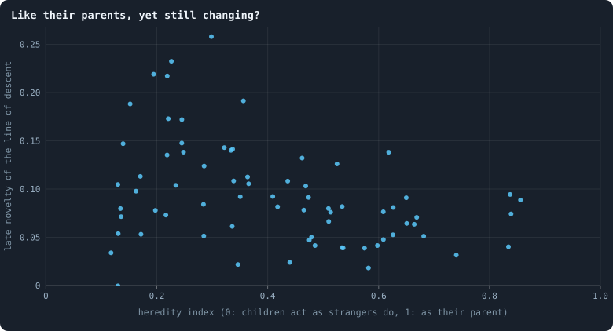
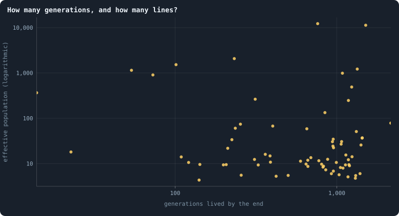
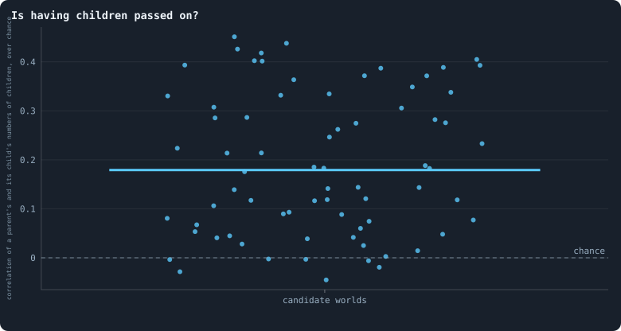

# Candidates for open-ended evolution

> [!question] Questions of this page
> - What must a world have for evolution in it to go on and on?
> - Which of the worlds drawn at random can be ruled out, and why?
> - Which worlds are worth playing on, and how?

## In short

Evolution needs variation, heredity and selection, and open-ended evolution
needs them to last. Each of round 3's hundred worlds was read for them from
what it recorded: its whole family tree, how much children act like their
parents, whether having children runs in families, and how far its main line
of descent keeps moving into new behaviour. Of the hundred, 28 are ruled out:
18 died, one is a [star](measuring-networks.md#stars-and-hubs "An agent joined to far more agents than most; a star is a world held together by a single hub."), four pass nothing on and five stand still. The other
72 evolve fast but narrowly: a [median](statistics.md#many-worlds-at-once-the-median-bands-the-settled-life-and-the-spread "The middle value: half of the numbers lie below it and half above.") of 825 generations in 3,000 [iterations](one-iteration.md "One step of a world's time: a phase of reproduction, then a phase of the game."),
but an effective population of only 14, so chance decides much of which line
survives. The healthiest worlds change a little more than the rest, but they
pass on less. The shortlist is every candidate among the first 13 of any of
health's three orders. On 9 November 2026 it held 24 worlds, which the author
chose to play again with new [seeds](rules-in-detail.md#seeds-and-the-random-stream "The number that fixes every random choice of a run: the same settings and the same seed make the same world.") (Experiment 43, less three that grow far
too many links). Since health also counts [agents](the-world.md#agents-and-tokens "One member of a world: it lives on a node of the network, holds tokens and has a brain that takes all its decisions.") on [loops](measuring-networks.md#loops "A path through the network that comes back to where it started without using a connection twice.") per link, it holds
21. Seeds 3042, 4006 played strongest first, 3018, 3080 and 3057 are among the
first of all three orders; seed 3026, with some of the simplest rules of the
round, evolves the most, and now just misses the shortlist.

## What evolution needs

Evolution needs three things, and open-ended evolution needs them to last
([The open-ended test](measuring-evolution.md#what-would-count-as-open-ended-evolution)):
- **variation:** the agents differ, in what they are and in what they do;
- **heredity:** children are like their parents;
- **selection:** some agents leave more descendants than others *because of*
  what they are, and not by luck alone.

Where all three hold, a population adapts. For it to keep finding new things,
the world must also last, and what its agents do must keep changing rather
than coming to rest or going round in circles. A world that plainly misses one
of these cannot evolve open-endedly however long it runs. So the worlds are
treated as suspects in a line-up: each is ruled out the first time it plainly
misses one, with its reason, and the rest are ranked pillar by pillar, with no
single verdict over all of them.

## How each pillar is read

Every number comes from what a world recorded. No world is played again.

- **The family tree.** A world's [frames](runs-and-records.md#what-a-run-records "A whole world as a run records it after one phase: every agent, its tokens and connections.") hold every birth of every iteration,
  so its whole family tree can be built: who descends from whom, and how many
  generations separate the living from the [founders](rules-in-detail.md#the-starting-ring "One of the agents a world starts with, each holding the same tokens, on a ring with a few shortcuts."). Going back from the agents
  alive at the end, their ancestors grow fewer and fewer, until all of them
  descend from one. In a population of *N* agents left to chance this takes
  about 2*N* generations. Where it takes a few dozen, the **effective
  population** is tiny, and chance decides which line survives, whatever its
  agents are.
- **Heredity.** In the worlds kept at the middle of the run and at its end,
  children and parents alive together are played in the same situations
  ([How different are the agents?](how-different-are-the-agents.md)). The
  **heredity index** is 1 when a child acts as its parent does (as the parent
  acts like itself from one try to the next), and 0 when it acts like a
  stranger.
- **Fertility passed on.** Selection changes a population only through
  differences in how many children its members leave, and only the differences
  that are passed on add up over the generations (Fisher's fundamental theorem
  of natural selection). So we ask whether agents that have many children have
  children that have many too: the [correlation](statistics.md#two-numbers-together-correlation-a-fitted-line-and-logarithmic-axes "Whether two quantities go up and down together, from −1 to 1.") of a parent's and its child's
  numbers of children, over every pair born from iteration 100 to two thirds of
  the run, against the same correlation with the children's counts shuffled
  among the children born in the same iteration. Where it is clearly above
  chance, families differ in how fertile they are, and selection has
  something to work with. The cause need not be in the [brain](the-brain.md "The neural network each agent decides with: inputs about itself and its neighbours, outputs that become its decisions."): a rich parent
  can make rich children, and a good place can favour its families.
- **The line of descent.** At every world kept (every 250 iterations) we find
  the ancestor of most of the agents alive at the end, and keep its brain: one
  brain an era, the world's main line. All of them are played in the same
  situations. How far each era lies from every earlier one says whether the
  line keeps reaching behaviour it has not shown before (**novelty**), stands
  still, or comes back to where it was.
- **Contemporaries.** How differently two agents of the same era act, above
  the noise of one brain played twice: the variation selection has to choose
  from.
- **Health**, by the [proposed order](which-worlds-are-healthy.md).

These follow the measures of the MODES toolbox for open-ended dynamics
(Dolson, Vostinar, Wiser and Ofria, 2019), read on what GraphOfLife records:
*change* and *novelty* along the line of descent, and *ecology* in how many
kinds of behaviour live side by side (the
[same-position share](measuring-health.md#the-same-position-share)
and the effective kinds of staking). Its fourth measure, *complexity*, is not
read yet.

## The worlds ruled out

Of round 3's hundred worlds, 28 are ruled out, each for the first reason it
meets, in this order:
- **It died** (18 worlds;
  [what became of them](a-screen-of-random-worlds.md#what-round-3-found)).
- **It is a star** (1): seed 3020, where one agent is linked to 99.5% of the
  others on average.
- **Its agents hold one number of [tokens](the-world.md#agents-and-tokens "The one thing of value in a world: every agent holds a whole number of them, and their total never changes.")** (none): 80% or more of the agents
  holding the same amount.
- **It has no heredity** (4): children act like strangers, with a heredity
  index below 0.1. In all four, brains change after every [game](one-iteration.md#phase-2-the-game "The second phase of an iteration: every agent stakes all its tokens on its own node and its neighbours', and every node goes to someone.") and not only
  when they are copied, and two mutate with a probability of 0.8. One of them
  is seed 3077, the worked example of
  [Which worlds are healthy?](which-worlds-are-healthy.md#three-ways-to-put-the-criteria-together):
  the first by the sum of its health's criteria, but with nothing for
  evolution to build on.
- **It stands still** (5): its line of descent hardly moves from era to era,
  and two agents of one era hardly act differently (both less than 0.05 above
  the noise of playing one brain twice). All five are crowded and poor: from
  6,470 to 21,298 agents, holding 1.4 to 4.6 tokens each on average. An agent
  with a token or two can hardly stake differently from another.

<!-- table oeecandidates/out -->
| world | round | why it is ruled out |
|---|---|---|
| [s3009](run:B1-30000-f1b401-s3009) | round 3 | died at iteration 920 |
| [s3010](run:B1-30000-30d3da-s3010) | round 3 | died at iteration 202 |
| [s3015](run:B1-30000-f05b17-s3015) | round 3 | died at iteration 214 |
| [s3017](run:B1-30000-44f693-s3017) | round 3 | died at iteration 94 |
| [s3020](run:B1-30000-511930-s3020) | round 3 | a star: one agent linked to 99.5% of the others on average |
| [s3027](run:B1-30000-be02ce-s3027) | round 3 | died at iteration 26 |
| [s3031](run:B1-30000-caf1c5-s3031) | round 3 | died at iteration 142 |
| [s3036](run:B1-30000-1d8c54-s3036) | round 3 | died at iteration 115 |
| [s3037](run:B1-30000-845393-s3037) | round 3 | standing still: its line of descent does not move and its agents act alike (steps 0.01, contemporaries 0.03 above the noise) |
| [s3038](run:B1-30000-1ad8a9-s3038) | round 3 | standing still: its line of descent does not move and its agents act alike (steps 0.01, contemporaries 0.01 above the noise) |
| [s3044](run:B1-30000-63827e-s3044) | round 3 | no heredity: children act like strangers (index 0.01) |
| [s3066](run:B1-30000-dfd51b-s3066) | round 3 | no heredity: children act like strangers (index 0.07) |
| [s3067](run:B1-30000-4bee8e-s3067) | round 3 | standing still: its line of descent does not move and its agents act alike (steps 0.02, contemporaries 0.03 above the noise) |
| [s3069](run:B1-30000-033fbf-s3069) | round 3 | died at iteration 2,442 |
| [s3072](run:B1-30000-f05562-s3072) | round 3 | standing still: its line of descent does not move and its agents act alike (steps 0.02, contemporaries 0.01 above the noise) |
| [s3074](run:B1-30000-165142-s3074) | round 3 | died at iteration 12 |
| [s3077](run:B1-30000-d6eabf-s3077) | round 3 | no heredity: children act like strangers (index 0.06) |
| [s3079](run:B1-30000-afe35f-s3079) | round 3 | died at iteration 210 |
| [s3081](run:B1-30000-378f0a-s3081) | round 3 | died at iteration 167 |
| [s3084](run:B1-30000-ad76aa-s3084) | round 3 | no heredity: children act like strangers (index 0.08) |
| [s3086](run:B1-30000-1393f4-s3086) | round 3 | died at iteration 719 |
| [s3096](run:B1-30000-76ca8e-s3096) | round 3 | died at iteration 1,030 |
| [s3099](run:B1-30000-1ab8a0-s3099) | round 3 | standing still: its line of descent does not move and its agents act alike (steps 0.01, contemporaries 0.02 above the noise) |
| [s3100](run:B1-30000-13bb83-s3100) | round 3 | died at iteration 1,815 |
| [s4001 w](run:B1-30000-1da684-s4001) | round 3, weakest first | died at iteration 144 |
| [s4005 w](run:B1-30000-a6c23a-s4005) | round 3, weakest first | died at iteration 230 |
| [s4006 w](run:B1-30000-673ef1-s4006) | round 3, weakest first | died at iteration 1,445 |
| [s4001 s](run:B1-30000-ec8a95-s4001) | round 3, strongest first | died at iteration 387 |
<!-- /table -->

## The candidates, pillar by pillar

The 72 candidates evolve fast, but in few lines.
- **Many generations.** A median of 825 generations in 3,000 iterations: one
  every 3.6 iterations.
- **Few lines.** Going back from the living, all of them descend from one
  ancestor a median of 23 generations earlier. That is an effective population
  of about 14 in the median world: below 50 in 53 worlds, above 500 in only 8.
  In most worlds, chance decides which line goes on, whatever its agents do.
- **Children are like their parents, partly.** A median heredity index of 0.39,
  from 0.12 to 0.86.
- **Fertility runs in families.** In 65 of the 72 worlds a parent's number of
  children says clearly more of its children's than chance would (a median of
  0.18 above chance in the correlation).
- **The line of descent moves slowly.** Its late eras lie a median of 0.08
  above the noise from every earlier era, and in 15 worlds it never comes back
  to behaviour it had shown before.

Three pulls show across the worlds (rank correlations over the 72):
- **heredity against novelty (−0.37):** where children are most like their
  parents, the line of descent changes least. Keeping what works and finding
  something new pull against each other;
- **health against heredity (−0.30):** the healthiest worlds pass on less;
- **health with novelty (+0.23):** the healthiest worlds change a little more.

Each world's rank in every category, 1 the best:

<!-- table oeecandidates/ranks -->
| world | round | size | generations | heredity | population | novelty | contemporaries | fertility | health | riches | mean rank | channels open |
|---|---|---|---|---|---|---|---|---|---|---|---|---|
| [s3026](run:B1-30000-d6955f-s3026) | round 3 | 58 | 1 | 47 | 14 | 1 | 2 | 42 | 23 | 15 | 22.6 | messages, handover |
| [s4008 w](run:B1-30000-1cfaa4-s4008) | round 3, weakest first | 28 | 43 | 55 | 41 | 2 | 10 | 4 | 8 | 45 | 26.2 | messages, gifts |
| [s4008 s](run:B1-30000-645972-s4008) | round 3, strongest first | 23 | 41 | 52 | 37 | 8 | 8 | 6 | 17 | 50 | 26.9 | messages, gifts |
| [s4003 s](run:B1-30000-fffc7d-s4003) | round 3, strongest first | 10 | 19 | 39 | 53 | 5 | 17 | 19 | 18 | 63 | 27.0 | messages, gifts, handover, upkeep |
| [s4003 w](run:B1-30000-9efb1d-s4003) | round 3, weakest first | 8 | 14 | 22 | 51 | 18 | 23 | 16 | 28 | 65 | 27.2 | messages, gifts, handover, upkeep |
| [s4002 w](run:B1-30000-5379e2-s4002) | round 3, weakest first | 26 | 37 | 57 | 58 | 4 | 6 | 12 | 5 | 47 | 28.0 | messages, gifts, mates pay, partner search, mixing |
| [s3021](run:B1-30000-4aff7d-s3021) | round 3 | 61 | 23 | 46 | 26 | 11 | 16 | 30 | 27 | 12 | 28.0 | messages, handover, partner search, upkeep |
| [s3042](run:B1-30000-b82ad0-s3042) | round 3 | 5 | 15 | 66 | 12 | 10 | 20 | 58 | 1 | 68 | 28.3 | messages, gifts, handover, mates pay, partner search, upkeep, mixing |
| [s3045](run:B1-30000-f6d23f-s3045) | round 3 | 68 | 12 | 58 | 9 | 16 | 18 | 51 | 25 | 5 | 29.1 | messages, gifts, handover, partner search, upkeep, revolutions |
| [s3024](run:B1-30000-f05874-s3024) | round 3 | 31 | 33 | 34 | 38 | 23 | 11 | 44 | 7 | 42 | 29.2 | messages, gifts, handover, upkeep, revolutions |
| [s3062](run:B1-30000-def151-s3062) | round 3 | 51 | 26 | 61 | 45 | 3 | 5 | 26 | 24 | 22 | 29.2 | messages, handover, partner search, upkeep, revolutions |
| [s3082](run:B1-30000-1141ea-s3082) | round 3 | 48 | 5 | 3 | 27 | 29 | 44 | 38 | 47 | 25 | 29.6 | messages, upkeep |
| [s3008](run:B1-30000-e19f2d-s3008) | round 3 | 59 | 30 | 13 | 28 | 15 | 35 | 64 | 10 | 14 | 29.8 | messages, gifts, partner search, revolutions |
| [s4002 s](run:B1-30000-192733-s4002) | round 3, strongest first | 21 | 28 | 56 | 62 | 7 | 4 | 10 | 32 | 52 | 30.2 | messages, gifts, mates pay, partner search, mixing |
| [s3028](run:B1-30000-2eef58-s3028) | round 3 | 20 | 3 | 2 | 20 | 45 | 72 | 17 | 46 | 53 | 30.9 | messages, gifts, handover, partner search, upkeep, revolutions |
| [s3095](run:B1-30000-3e5856-s3095) | round 3 | 46 | 7 | 53 | 5 | 9 | 3 | 70 | 60 | 27 | 31.1 | messages, handover, partner search, upkeep |
| [s3046](run:B1-30000-27bd64-s3046) | round 3 | 55 | 8 | 54 | 19 | 26 | 27 | 36 | 41 | 18 | 31.6 | messages, gifts, partner search, upkeep |
| [s4004 w](run:B1-30000-17ac6e-s4004) | round 3, weakest first | 71 | 9 | 43 | 68 | 12 | 12 | 15 | 58 | 2 | 32.2 | messages, handover, mates pay, partner search, mixing |
| [s3055](run:B1-30000-cca771-s3055) | round 3 | 53 | 25 | 38 | 65 | 21 | 14 | 21 | 34 | 20 | 32.3 | messages, handover, revolutions |
| [s3030](run:B1-30000-90fc91-s3030) | round 3 | 1 | 40 | 6 | 1 | 57 | 25 | 35 | 56 | 72 | 32.6 | messages, upkeep |
| [s4006 s](run:B1-30000-8526cf-s4006) | round 3, strongest first | 14 | 31 | 24 | 25 | 49 | 45 | 46 | 2 | 59 | 32.8 | messages, gifts, handover, upkeep, revolutions |
| [s3033](run:B1-30000-631e49-s3033) | round 3 | 63 | 21 | 65 | 7 | 6 | 7 | 68 | 54 | 10 | 33.4 | handover, partner search, upkeep, revolutions |
| [s4004 s](run:B1-30000-2bac4d-s4004) | round 3, strongest first | 69 | 6 | 48 | 63 | 19 | 15 | 13 | 66 | 4 | 33.7 | messages, handover, mates pay, partner search, mixing |
| [s3094](run:B1-30000-4ac946-s3094) | round 3 | 4 | 2 | 68 | 2 | 40 | 13 | 41 | 64 | 69 | 33.7 | messages, gifts, partner search, upkeep |
| [s3006](run:B1-30000-023c0a-s3006) | round 3 | 15 | 44 | 27 | 18 | 58 | 29 | 50 | 9 | 58 | 34.2 | messages, gifts, handover, partner search, upkeep |
| [s3023](run:B1-30000-b0f6e3-s3023) | round 3 | 64 | 27 | 44 | 29 | 52 | 40 | 34 | 12 | 9 | 34.6 | messages, gifts, upkeep |
| [s3091](run:B1-30000-42d88d-s3091) | round 3 | 56 | 17 | 51 | 70 | 14 | 22 | 14 | 55 | 17 | 35.1 | messages, gifts, handover, partner search, mixing |
| [s3087](run:B1-30000-363694-s3087) | round 3 | 9 | 16 | 19 | 40 | 65 | 70 | 20 | 14 | 64 | 35.2 | messages, handover, partner search, upkeep |
| [s3016](run:B1-30000-b23381-s3016) | round 3 | 67 | 22 | 49 | 24 | 56 | 1 | 60 | 33 | 6 | 35.3 | messages, partner search, upkeep |
| [s4005 s](run:B1-30000-6f6c09-s4005) | round 3, strongest first | 39 | 45 | 45 | 47 | 13 | 9 | 39 | 50 | 34 | 35.7 | messages, gifts, partner search |
| [s3018](run:B1-30000-af1e28-s3018) | round 3 | 50 | 54 | 64 | 11 | 28 | 33 | 55 | 3 | 23 | 35.7 | messages, gifts, handover, mates pay, partner search, mixing |
| [s3032](run:B1-30000-22865f-s3032) | round 3 | 13 | 49 | 50 | 16 | 35 | 26 | 37 | 36 | 60 | 35.8 | messages, gifts, handover, partner search |
| [s3064](run:B1-30000-a6a7ec-s3064) | round 3 | 25 | 59 | 71 | 3 | 25 | 28 | 48 | 15 | 48 | 35.8 | messages, handover, partner search |
| [s3007](run:B1-30000-8119cd-s3007) | round 3 | 43 | 4 | 18 | 21 | 66 | 56 | 29 | 61 | 30 | 36.4 | messages, gifts, handover, mates pay, upkeep, mixing |
| [s3057](run:B1-30000-38aee9-s3057) | round 3 | 30 | 46 | 67 | 43 | 47 | 21 | 27 | 6 | 43 | 36.7 | messages, partner search, mixing |
| [s4007 w](run:B1-30000-04d3eb-s4007) | round 3, weakest first | 17 | 36 | 20 | 56 | 36 | 37 | 3 | 71 | 56 | 36.9 | messages, handover, partner search |
| [s3058](run:B1-30000-4108dd-s3058) | round 3 | 70 | 64 | 32 | 49 | 17 | 30 | 43 | 26 | 3 | 37.1 | messages, partner search, revolutions |
| [s3076](run:B1-30000-66c764-s3076) | round 3 | 32 | 13 | 8 | 55 | 51 | 63 | 2 | 70 | 41 | 37.2 | messages, gifts, handover, mixing |
| [s3014](run:B1-30000-7d129f-s3014) | round 3 | 6 | 11 | 21 | 35 | 64 | 66 | 1 | 65 | 67 | 37.3 | messages, handover, partner search, upkeep |
| [s3080](run:B1-30000-625bc7-s3080) | round 3 | 60 | 66 | 42 | 46 | 22 | 24 | 59 | 4 | 13 | 37.3 | messages, gifts, handover, partner search, revolutions |
| [s3005](run:B1-30000-c18a1f-s3005) | round 3 | 37 | 29 | 23 | 22 | 44 | 53 | 72 | 22 | 36 | 37.6 | messages, handover, mixing |
| [s3047](run:B1-30000-10c9f1-s3047) | round 3 | 41 | 42 | 15 | 57 | 43 | 64 | 23 | 21 | 32 | 37.6 | messages, gifts, handover, partner search |
| [s3049](run:B1-30000-c51eb8-s3049) | round 3 | 27 | 58 | 63 | 17 | 20 | 31 | 45 | 31 | 46 | 37.6 | messages, gifts, handover, partner search |
| [s4007 s](run:B1-30000-a8a2d2-s4007) | round 3, strongest first | 16 | 34 | 37 | 61 | 24 | 34 | 7 | 69 | 57 | 37.7 | messages, handover, partner search |
| [s3054](run:B1-30000-d9254e-s3054) | round 3 | 45 | 60 | 12 | 23 | 55 | 52 | 53 | 13 | 28 | 37.9 | messages, partner search, upkeep |
| [s3061](run:B1-30000-00e3c8-s3061) | round 3 | 47 | 20 | 62 | 60 | 54 | 19 | 18 | 35 | 26 | 37.9 | gifts, mates pay, partner search, revolutions, mixing |
| [s3078](run:B1-30000-dd27b6-s3078) | round 3 | 62 | 48 | 10 | 69 | 33 | 67 | 5 | 40 | 11 | 38.3 | messages, gifts, partner search |
| [s3001](run:B1-30000-68cda7-s3001) | round 3 | 2 | 18 | 4 | 33 | 63 | 71 | 22 | 62 | 71 | 38.4 | messages, handover, mates pay, upkeep, revolutions, mixing |
| [s3089](run:B1-30000-77ad6a-s3089) | round 3 | 22 | 35 | 1 | 13 | 34 | 62 | 67 | 72 | 51 | 39.7 | messages, partner search, upkeep |
| [s3050](run:B1-30000-ebe08c-s3050) | round 3 | 44 | 32 | 31 | 64 | 41 | 42 | 25 | 53 | 29 | 40.1 | messages, gifts, handover, mates pay, partner search, mixing |
| [s3092](run:B1-30000-7fc03f-s3092) | round 3 | 18 | 57 | 60 | 15 | 42 | 32 | 54 | 29 | 55 | 40.2 | messages, partner search, upkeep |
| [s3059](run:B1-30000-2ec87a-s3059) | round 3 | 36 | 55 | 29 | 39 | 32 | 36 | 57 | 42 | 37 | 40.3 | messages, gifts, handover, mixing |
| [s3071](run:B1-30000-605c0d-s3071) | round 3 | 19 | 67 | 30 | 36 | 27 | 48 | 33 | 49 | 54 | 40.3 | messages, partner search |
| [s3052](run:B1-30000-0d058a-s3052) | round 3 | 12 | 51 | 35 | 34 | 37 | 49 | 24 | 63 | 61 | 40.7 | messages, gifts, handover, partner search |
| [s3070](run:B1-30000-a4d3a0-s3070) | round 3 | 11 | 39 | 7 | 42 | 48 | 69 | 47 | 44 | 62 | 41.0 | messages, gifts, partner search, upkeep |
| [s3063](run:B1-30000-924e70-s3063) | round 3 | 3 | 24 | 28 | 59 | 60 | 59 | 8 | 59 | 70 | 41.1 | messages, handover, partner search, upkeep |
| [s3022](run:B1-30000-298337-s3022) | round 3 | 24 | 63 | 59 | 52 | 46 | 39 | 28 | 11 | 49 | 41.2 | messages, partner search |
| [s3040](run:B1-30000-36d076-s3040) | round 3 | 38 | 38 | 40 | 48 | 31 | 41 | 32 | 68 | 35 | 41.2 | messages, gifts, partner search, upkeep |
| [s3085](run:B1-30000-801b34-s3085) | round 3 | 35 | 10 | 33 | 71 | 69 | 38 | 11 | 67 | 38 | 41.3 | messages, handover, partner search, upkeep |
| [s3051](run:B1-30000-b5a76a-s3051) | round 3 | 72 | 65 | 36 | 72 | 30 | 51 | 40 | 16 | 1 | 42.6 | messages, gifts, partner search, upkeep, revolutions |
| [s3083](run:B1-30000-0d7e0c-s3083) | round 3 | 34 | 50 | 11 | 44 | 38 | 47 | 69 | 51 | 39 | 42.6 | messages, gifts, handover, mates pay, upkeep, mixing |
| [s3004](run:B1-30000-7d5208-s3004) | round 3 | 65 | 71 | 25 | 31 | 39 | 68 | 61 | 20 | 8 | 43.1 | messages, gifts |
| [s3056](run:B1-30000-43985b-s3056) | round 3 | 40 | 52 | 16 | 32 | 62 | 60 | 56 | 37 | 33 | 43.1 | messages, gifts, handover, mates pay, partner search, mixing |
| [s3013](run:B1-30000-7f7cd5-s3013) | round 3 | 7 | 47 | 17 | 67 | 71 | 61 | 9 | 48 | 66 | 43.7 | messages, partner search, upkeep |
| [s3093](run:B1-30000-26a341-s3093) | round 3 | 42 | 62 | 14 | 50 | 59 | 54 | 52 | 30 | 31 | 43.8 | messages, gifts, handover, partner search |
| [s3012](run:B1-30000-02fa53-s3012) | round 3 | 54 | 53 | 9 | 54 | 50 | 46 | 63 | 52 | 19 | 44.4 | messages, gifts, partner search, upkeep, mixing |
| [s3019](run:B1-30000-b1209a-s3019) | round 3 | 49 | 68 | 69 | 4 | 53 | 43 | 71 | 19 | 24 | 44.4 | messages, handover, partner search, upkeep |
| [s3041](run:B1-30000-965f1e-s3041) | round 3 | 33 | 61 | 5 | 30 | 68 | 57 | 65 | 43 | 40 | 44.7 | messages, gifts, mates pay, partner search, mixing |
| [s3043](run:B1-30000-02ed17-s3043) | round 3 | 52 | 69 | 41 | 8 | 70 | 65 | 49 | 39 | 21 | 46.0 | messages, gifts, handover, partner search, upkeep |
| [s3098](run:B1-30000-794ae8-s3098) | round 3 | 29 | 56 | 26 | 66 | 61 | 55 | 31 | 57 | 44 | 47.2 | messages, gifts, handover, partner search, revolutions |
| [s3065](run:B1-30000-ba3afe-s3065) | round 3 | 57 | 70 | 72 | 6 | 67 | 50 | 66 | 38 | 16 | 49.1 | messages, handover, partner search, upkeep, mixing |
| [s3090](run:B1-30000-05ba40-s3090) | round 3 | 66 | 72 | 70 | 10 | 72 | 58 | 62 | 45 | 7 | 51.3 | messages, partner search, upkeep, mixing |
<!-- /table -->

<!-- figure oeecandidates/heredity_novelty -->

**Like their parents, yet still changing?** Each dot is a candidate world. Across: how much more a child acts like its parent than like a stranger, in the same situations. Up: how far the later eras of its line of descent lie from every earlier era, above the noise of playing one brain twice. A world in the top right passes on what its agents do and keeps changing it.

> [!example]- How to make this figure
> **Runs.** every world of round 3 of the screen of random worlds that lived to the end of its run (Experiments 40, 41 and 42; 30,000 tokens, 3,000 iterations)
>
> **Data.** From each world's dossier, `GraphOfLifeRuns/.pilots/screen/candidates/<run>.json` (research/screen/candidates.py: the family tree from every birth, heredity in two kept worlds, the line of descent played in every kept world), its families, `.pilots/screen/families/<run>.json` (research/screen/families.py), and its health (research/screen/health.json), gathered by `research/screen/funnel.py` into `research/screen/candidates.json`.
>
> 1. Read each candidate's heredity index (the mean of its kept worlds read) and late novelty from `candidates.json`.
>
> **To make it again:** `python3 book_figures.py oeecandidates`.
<!-- /figure -->

<!-- figure oeecandidates/generations_population -->

**How many generations, and how many lines?** Each dot is a candidate world. Across: the mean generation of the agents alive at the end (how many births separate them from the founders). Up: a rough effective population, from how fast the ancestry of the living narrows: the smaller it is, the more chance decides which line survives, and the larger a difference selection needs before it can see it.

> [!example]- How to make this figure
> **Runs.** every world of round 3 of the screen of random worlds that lived to the end of its run (Experiments 40, 41 and 42; 30,000 tokens, 3,000 iterations)
>
> **Data.** From each world's dossier, `GraphOfLifeRuns/.pilots/screen/candidates/<run>.json` (research/screen/candidates.py: the family tree from every birth, heredity in two kept worlds, the line of descent played in every kept world), its families, `.pilots/screen/families/<run>.json` (research/screen/families.py), and its health (research/screen/health.json), gathered by `research/screen/funnel.py` into `research/screen/candidates.json`.
>
> 1. Read each candidate's generations and effective population from `candidates.json` (`numbers`).
>
> **To make it again:** `python3 book_figures.py oeecandidates`.
<!-- /figure -->

<!-- figure oeecandidates/fertility -->

**Is having children passed on?** Each dot is a candidate world: across every parent and child both born from iteration 100 to two thirds of the run, the correlation between how many children the parent had and how many the child had, less the same correlation with the children's counts shuffled among the children born in the same iteration. Above zero, families differ in how fertile they are, and selection has something to work on.

> [!example]- How to make this figure
> **Runs.** every world of round 3 of the screen of random worlds that lived to the end of its run (Experiments 40, 41 and 42; 30,000 tokens, 3,000 iterations)
>
> **Data.** From each world's dossier, `GraphOfLifeRuns/.pilots/screen/candidates/<run>.json` (research/screen/candidates.py: the family tree from every birth, heredity in two kept worlds, the line of descent played in every kept world), its families, `.pilots/screen/families/<run>.json` (research/screen/families.py), and its health (research/screen/health.json), gathered by `research/screen/funnel.py` into `research/screen/candidates.json`.
>
> 1. Read each candidate's `fertility` from `candidates.json` (families.py: correlation less the shuffled mean).
>
> **To make it again:** `python3 book_figures.py oeecandidates`.
<!-- /figure -->

The numbers behind the ranks:

<!-- table oeecandidates/numbers -->
| world | agents | generations | effective population | heredity | fertility passed on | novelty | contemporaries | health |
|---|---|---|---|---|---|---|---|---|
| [s3026](run:B1-30000-d6955f-s3026) | 2,068 | 2159 | 78 | 0.30 | 0.12 | 0.26 | 0.31 | 0.48 |
| [s4008 w](run:B1-30000-1cfaa4-s4008) | 5,120 | 662 | 12 | 0.23 | 0.42 | 0.23 | 0.26 | 0.53 |
| [s4008 s](run:B1-30000-645972-s4008) | 5,402 | 691 | 14 | 0.25 | 0.40 | 0.17 | 0.27 | 0.50 |
| [s4003 s](run:B1-30000-fffc7d-s4003) | 8,805 | 1131 | 9 | 0.36 | 0.33 | 0.19 | 0.23 | 0.50 |
| [s4003 w](run:B1-30000-9efb1d-s4003) | 10,264 | 1189 | 9 | 0.52 | 0.34 | 0.13 | 0.19 | 0.47 |
| [s4002 w](run:B1-30000-5379e2-s4002) | 5,278 | 822 | 8 | 0.22 | 0.37 | 0.22 | 0.28 | 0.54 |
| [s3021](run:B1-30000-4aff7d-s3021) | 1,715 | 1064 | 27 | 0.32 | 0.22 | 0.14 | 0.23 | 0.47 |
| [s3042](run:B1-30000-b82ad0-s3042) | 11,125 | 1180 | 247 | 0.14 | 0.04 | 0.15 | 0.21 | 0.61 |
| [s3045](run:B1-30000-f6d23f-s3045) | 1,411 | 1237 | 490 | 0.22 | 0.08 | 0.14 | 0.22 | 0.48 |
| [s3024](run:B1-30000-f05874-s3024) | 4,614 | 878 | 12 | 0.44 | 0.12 | 0.11 | 0.26 | 0.54 |
| [s3062](run:B1-30000-def151-s3062) | 2,569 | 993 | 11 | 0.19 | 0.27 | 0.22 | 0.28 | 0.48 |
| [s3082](run:B1-30000-1141ea-s3082) | 3,207 | 1411 | 26 | 0.84 | 0.14 | 0.09 | 0.12 | 0.38 |
| [s3008](run:B1-30000-e19f2d-s3008) | 2,063 | 947 | 24 | 0.62 | 0.01 | 0.14 | 0.15 | 0.53 |
| [s4002 s](run:B1-30000-192733-s4002) | 5,705 | 953 | 7 | 0.22 | 0.39 | 0.17 | 0.29 | 0.44 |
| [s3028](run:B1-30000-2eef58-s3028) | 5,736 | 1437 | 37 | 0.84 | 0.33 | 0.07 | 0.05 | 0.38 |
| [s3095](run:B1-30000-3e5856-s3095) | 3,265 | 1338 | 1,219 | 0.25 | -0.02 | 0.15 | 0.29 | 0.34 |
| [s3046](run:B1-30000-27bd64-s3046) | 2,418 | 1321 | 51 | 0.23 | 0.18 | 0.10 | 0.18 | 0.40 |
| [s4004 w](run:B1-30000-17ac6e-s4004) | 1,186 | 1309 | 5 | 0.34 | 0.35 | 0.14 | 0.25 | 0.35 |
| [s3055](run:B1-30000-cca771-s3055) | 2,507 | 1033 | 6 | 0.36 | 0.31 | 0.11 | 0.24 | 0.42 |
| [s3030](run:B1-30000-90fc91-s3030) | 19,951 | 761 | 12,248 | 0.68 | 0.18 | 0.05 | 0.18 | 0.35 |
| [s4006 s](run:B1-30000-8526cf-s4006) | 7,009 | 940 | 30 | 0.51 | 0.12 | 0.07 | 0.12 | 0.59 |
| [s3033](run:B1-30000-631e49-s3033) | 1,639 | 1083 | 988 | 0.15 | -0.00 | 0.19 | 0.27 | 0.36 |
| [s4004 s](run:B1-30000-2bac4d-s4004) | 1,349 | 1392 | 6 | 0.29 | 0.37 | 0.12 | 0.23 | 0.30 |
| [s3094](run:B1-30000-4ac946-s3094) | 11,256 | 1509 | 11,316 | 0.13 | 0.14 | 0.08 | 0.24 | 0.32 |
| [s3006](run:B1-30000-023c0a-s3006) | 6,774 | 652 | 59 | 0.48 | 0.09 | 0.05 | 0.17 | 0.53 |
| [s3023](run:B1-30000-b0f6e3-s3023) | 1,612 | 955 | 22 | 0.34 | 0.19 | 0.06 | 0.14 | 0.51 |
| [s3091](run:B1-30000-42d88d-s3091) | 2,361 | 1173 | 5 | 0.25 | 0.36 | 0.14 | 0.20 | 0.36 |
| [s3087](run:B1-30000-363694-s3087) | 10,034 | 1179 | 12 | 0.54 | 0.31 | 0.04 | 0.06 | 0.51 |
| [s3016](run:B1-30000-b23381-s3016) | 1,486 | 1071 | 31 | 0.28 | 0.04 | 0.05 | 0.34 | 0.43 |
| [s4005 s](run:B1-30000-6f6c09-s4005) | 3,866 | 646 | 10 | 0.33 | 0.14 | 0.14 | 0.26 | 0.37 |
| [s3018](run:B1-30000-af1e28-s3018) | 2,861 | 313 | 263 | 0.16 | 0.06 | 0.10 | 0.16 | 0.56 |
| [s3032](run:B1-30000-22865f-s3032) | 7,263 | 401 | 67 | 0.28 | 0.18 | 0.08 | 0.18 | 0.41 |
| [s3064](run:B1-30000-a6a7ec-s3064) | 5,290 | 232 | 2,072 | 0.13 | 0.09 | 0.10 | 0.18 | 0.51 |
| [s3007](run:B1-30000-8119cd-s3007) | 3,382 | 1434 | 37 | 0.57 | 0.23 | 0.04 | 0.09 | 0.34 |
| [s3057](run:B1-30000-38aee9-s3057) | 4,802 | 597 | 11 | 0.14 | 0.26 | 0.07 | 0.20 | 0.54 |
| [s4007 w](run:B1-30000-04d3eb-s4007) | 6,489 | 828 | 9 | 0.53 | 0.43 | 0.08 | 0.14 | 0.16 |
| [s3058](run:B1-30000-4108dd-s3058) | 1,257 | 142 | 10 | 0.46 | 0.12 | 0.13 | 0.17 | 0.47 |
| [s3076](run:B1-30000-66c764-s3076) | 4,525 | 1198 | 9 | 0.66 | 0.44 | 0.06 | 0.08 | 0.19 |
| [s3014](run:B1-30000-7d129f-s3014) | 10,836 | 1242 | 14 | 0.53 | 0.45 | 0.04 | 0.07 | 0.31 |
| [s3080](run:B1-30000-625bc7-s3080) | 1,985 | 121 | 11 | 0.34 | 0.04 | 0.11 | 0.18 | 0.55 |
| [s3005](run:B1-30000-c18a1f-s3005) | 4,022 | 950 | 35 | 0.51 | -0.05 | 0.08 | 0.10 | 0.48 |
| [s3047](run:B1-30000-10c9f1-s3047) | 3,607 | 662 | 9 | 0.61 | 0.29 | 0.08 | 0.08 | 0.48 |
| [s3049](run:B1-30000-c51eb8-s3049) | 5,163 | 236 | 60 | 0.17 | 0.12 | 0.11 | 0.17 | 0.45 |
| [s4007 s](run:B1-30000-a8a2d2-s4007) | 6,653 | 855 | 7 | 0.37 | 0.40 | 0.11 | 0.15 | 0.20 |
| [s3054](run:B1-30000-d9254e-s3054) | 3,309 | 224 | 34 | 0.63 | 0.07 | 0.05 | 0.10 | 0.51 |
| [s3061](run:B1-30000-00e3c8-s3061) | 3,236 | 1092 | 8 | 0.17 | 0.33 | 0.05 | 0.22 | 0.41 |
| [s3078](run:B1-30000-dd27b6-s3078) | 1,672 | 422 | 5 | 0.65 | 0.40 | 0.09 | 0.07 | 0.40 |
| [s3001](run:B1-30000-68cda7-s3001) | 17,266 | 1138 | 15 | 0.83 | 0.29 | 0.04 | 0.05 | 0.33 |
| [s3089](run:B1-30000-77ad6a-s3089) | 5,521 | 844 | 133 | 0.86 | -0.00 | 0.09 | 0.09 | 0.13 |
| [s3050](run:B1-30000-ebe08c-s3050) | 3,312 | 926 | 6 | 0.47 | 0.28 | 0.08 | 0.13 | 0.36 |
| [s3092](run:B1-30000-7fc03f-s3092) | 6,165 | 253 | 74 | 0.20 | 0.07 | 0.08 | 0.17 | 0.46 |
| [s3059](run:B1-30000-2ec87a-s3059) | 4,136 | 310 | 12 | 0.47 | 0.05 | 0.09 | 0.15 | 0.40 |
| [s3071](run:B1-30000-605c0d-s3071) | 6,070 | 109 | 14 | 0.47 | 0.19 | 0.10 | 0.11 | 0.38 |
| [s3052](run:B1-30000-0d058a-s3052) | 7,368 | 387 | 15 | 0.42 | 0.28 | 0.08 | 0.11 | 0.33 |
| [s3070](run:B1-30000-a4d3a0-s3070) | 7,767 | 774 | 12 | 0.67 | 0.11 | 0.07 | 0.06 | 0.39 |
| [s3063](run:B1-30000-924e70-s3063) | 14,473 | 1053 | 8 | 0.47 | 0.39 | 0.05 | 0.09 | 0.34 |
| [s3022](run:B1-30000-298337-s3022) | 5,394 | 199 | 9 | 0.22 | 0.25 | 0.07 | 0.14 | 0.53 |
| [s3040](run:B1-30000-36d076-s3040) | 3,904 | 805 | 10 | 0.35 | 0.21 | 0.09 | 0.14 | 0.24 |
| [s3085](run:B1-30000-801b34-s3085) | 4,156 | 1303 | 5 | 0.44 | 0.39 | 0.02 | 0.14 | 0.28 |
| [s3051](run:B1-30000-b5a76a-s3051) | 1,091 | 141 | 4 | 0.41 | 0.14 | 0.09 | 0.11 | 0.50 |
| [s3083](run:B1-30000-0d7e0c-s3083) | 4,159 | 389 | 11 | 0.63 | -0.01 | 0.08 | 0.11 | 0.37 |
| [s3004](run:B1-30000-7d5208-s3004) | 1,581 | 23 | 18 | 0.51 | 0.04 | 0.08 | 0.07 | 0.49 |
| [s3056](run:B1-30000-43985b-s3056) | 3,649 | 361 | 16 | 0.60 | 0.05 | 0.04 | 0.09 | 0.40 |
| [s3013](run:B1-30000-7f7cd5-s3013) | 10,511 | 500 | 5 | 0.58 | 0.39 | 0.02 | 0.09 | 0.38 |
| [s3093](run:B1-30000-26a341-s3093) | 3,387 | 207 | 9 | 0.61 | 0.08 | 0.05 | 0.10 | 0.46 |
| [s3012](run:B1-30000-02fa53-s3012) | 2,487 | 327 | 9 | 0.65 | 0.02 | 0.06 | 0.12 | 0.36 |
| [s3019](run:B1-30000-b1209a-s3019) | 3,019 | 101 | 1,526 | 0.13 | -0.03 | 0.05 | 0.13 | 0.49 |
| [s3041](run:B1-30000-965f1e-s3041) | 4,464 | 212 | 22 | 0.74 | 0.00 | 0.03 | 0.09 | 0.39 |
| [s3043](run:B1-30000-02ed17-s3043) | 2,520 | 73 | 904 | 0.35 | 0.09 | 0.02 | 0.07 | 0.40 |
| [s3098](run:B1-30000-794ae8-s3098) | 4,806 | 256 | 6 | 0.49 | 0.21 | 0.04 | 0.10 | 0.35 |
| [s3065](run:B1-30000-ba3afe-s3065) | 2,104 | 54 | 1,147 | 0.12 | -0.00 | 0.03 | 0.11 | 0.40 |
| [s3090](run:B1-30000-05ba40-s3090) | 1,521 | 14 | 365 | 0.13 | 0.03 | -0.00 | 0.09 | 0.38 |
<!-- /table -->

## The shortlist

Health comes in three orders: the six criteria multiplied, added, or the
worst of them ([Which worlds are healthy?](which-worlds-are-healthy.md#three-ways-to-put-the-criteria-together)).
The author (9 November 2026): "the union of the best of these rankings are
candidates." So the shortlist is every candidate, of the 72 the rules above
leave, among the first 13 of any of the three orders. On 9 November 2026 that
made 24 worlds, the ones the author chose to play again in Experiment 43. Since
health also counts agents on loops per link (the same day, later), it makes 21:
seeds 3004, 3016, 3026, 3030, 3051, 3094 and 3095 left it, and seeds 3005, 3006,
3064 and 3093 joined it. Evolution does not choose them: the
rules above rule out the worlds that cannot evolve, and the table gives each
shortlisted world's evolution beside its health.

<!-- table oeecandidates/shortlist -->
| world | round | among the first 13 by | health (product) | evolution's mean rank | heredity | novelty | generations | effective population | fertility passed on | channels open |
|---|---|---|---|---|---|---|---|---|---|---|
| [s3042](run:B1-30000-b82ad0-s3042) | round 3 | product, sum, worst | 0.606 | 30.2 | 0.14 | 0.15 | 1,180 | 247 | 0.04 | messages, gifts, handover, mates pay, partner search, upkeep, mixing |
| [s4006 s](run:B1-30000-8526cf-s4006) | round 3, strongest first | product, sum, worst | 0.587 | 36.7 | 0.51 | 0.07 | 940 | 30 | 0.12 | messages, gifts, handover, upkeep, revolutions |
| [s3018](run:B1-30000-af1e28-s3018) | round 3 | product, sum, worst | 0.565 | 40.8 | 0.16 | 0.10 | 313 | 263 | 0.06 | messages, gifts, handover, mates pay, partner search, mixing |
| [s3080](run:B1-30000-625bc7-s3080) | round 3 | product, sum, worst | 0.549 | 43.2 | 0.34 | 0.11 | 121 | 11 | 0.04 | messages, gifts, handover, partner search, revolutions |
| [s4002 w](run:B1-30000-5379e2-s4002) | round 3, weakest first | product, sum | 0.544 | 29.0 | 0.22 | 0.22 | 822 | 8 | 0.37 | messages, gifts, mates pay, partner search, mixing |
| [s3057](run:B1-30000-38aee9-s3057) | round 3 | product, sum, worst | 0.541 | 41.8 | 0.14 | 0.07 | 597 | 11 | 0.26 | messages, partner search, mixing |
| [s3024](run:B1-30000-f05874-s3024) | round 3 | product, worst | 0.536 | 30.5 | 0.44 | 0.11 | 878 | 12 | 0.12 | messages, gifts, handover, upkeep, revolutions |
| [s4008 w](run:B1-30000-1cfaa4-s4008) | round 3, weakest first | product, sum | 0.528 | 25.8 | 0.23 | 0.23 | 662 | 12 | 0.42 | messages, gifts |
| [s3006](run:B1-30000-023c0a-s3006) | round 3 | product, sum | 0.526 | 37.7 | 0.48 | 0.05 | 652 | 59 | 0.09 | messages, gifts, handover, partner search, upkeep |
| [s3008](run:B1-30000-e19f2d-s3008) | round 3 | product, worst | 0.526 | 30.8 | 0.62 | 0.14 | 947 | 24 | 0.01 | messages, gifts, partner search, revolutions |
| [s3022](run:B1-30000-298337-s3022) | round 3 | product, worst | 0.525 | 47.8 | 0.22 | 0.07 | 199 | 9 | 0.25 | messages, partner search |
| [s3023](run:B1-30000-b0f6e3-s3023) | round 3 | product, worst | 0.515 | 37.7 | 0.34 | 0.06 | 955 | 22 | 0.19 | messages, gifts, upkeep |
| [s3054](run:B1-30000-d9254e-s3054) | round 3 | product, sum | 0.513 | 42.5 | 0.63 | 0.05 | 224 | 34 | 0.07 | messages, partner search, upkeep |
| [s3087](run:B1-30000-363694-s3087) | round 3 | sum | 0.511 | 38.3 | 0.54 | 0.04 | 1,179 | 12 | 0.31 | messages, handover, partner search, upkeep |
| [s3064](run:B1-30000-a6a7ec-s3064) | round 3 | sum | 0.511 | 39.0 | 0.13 | 0.10 | 232 | 2,072 | 0.09 | messages, handover, partner search |
| [s3019](run:B1-30000-b1209a-s3019) | round 3 | worst | 0.485 | 51.3 | 0.13 | 0.05 | 101 | 1,526 | -0.03 | messages, handover, partner search, upkeep |
| [s3005](run:B1-30000-c18a1f-s3005) | round 3 | worst | 0.481 | 40.5 | 0.51 | 0.08 | 950 | 35 | -0.05 | messages, handover, mixing |
| [s3045](run:B1-30000-f6d23f-s3045) | round 3 | sum | 0.476 | 27.3 | 0.22 | 0.14 | 1,237 | 490 | 0.08 | messages, gifts, handover, partner search, upkeep, revolutions |
| [s3058](run:B1-30000-4108dd-s3058) | round 3 | sum | 0.473 | 39.2 | 0.46 | 0.13 | 142 | 10 | 0.12 | messages, partner search, revolutions |
| [s3093](run:B1-30000-26a341-s3093) | round 3 | worst | 0.457 | 48.5 | 0.61 | 0.05 | 207 | 9 | 0.08 | messages, gifts, handover, partner search |
| [s4004 w](run:B1-30000-17ac6e-s4004) | round 3, weakest first | worst | 0.345 | 26.5 | 0.34 | 0.14 | 1,309 | 5 | 0.35 | messages, handover, mates pay, partner search, mixing |
<!-- /table -->

- **Five worlds are among the first 13 of all three orders:** seeds 3042,
  4006 played strongest first, 3018, 3080 and 3057. Seed 3042 is the
  healthiest by the product, with a large effective population (247) but
  children little like their parents (a heredity index of 0.14).
- **Seed 3026 is the most evolving world of the round:** it lives the most
  generations (2,159), and its line of descent reaches furthest into new
  behaviour (0.26 above the noise) and never comes back. Its rules are among the
  simplest the round drew: [messages](rules-in-detail.md#messages "Numbers an agent writes to itself and to each neighbour every phase, which their brains read."), handing over, mending, [estates](measuring-lives.md#the-estate-of-the-dead "The tokens a dead agent leaves, and who gets them.") to the
  newborns, and a cap of 16 links that seldom binds; no search, no gifts, no
  costs on links. It was on the shortlist by its worst criterion until health
  counted agents on loops per link; now it is the 17th by its worst criterion,
  the 23rd by the product and the 36th by the sum, and just misses it: it
  culls 12% of its tokens in a game, and its agents act alike.
- **Some worlds evolve well but are not among the healthiest:** of the five
  worlds with the best mean rank in evolution, four are not on the shortlist:
  seeds 3026, 4008 played strongest first, and 4003 played either way.
- **Seed 3092, which meets every one of the author's lines, is not on the
  shortlist:** it is the 30th by the product, the 31st by the sum and the 31st
  by its worst criterion
  ([Which worlds are healthy?](which-worlds-are-healthy.md#what-the-orders-show)).

## What a world's rules make possible

A run of 3,000 iterations shows what a world did, not everything it could do.
Evolution may need far longer than any run we can afford, so it matters, too,
what a world's rules allow its agents to do at all: a strategy its rules do
not allow can never evolve, however long the world runs. Each mechanism the
screen draws opens a channel, and most have a price.

| mechanism | what it makes possible | its price |
|---|---|---|
| messages (4 to 30 numbers to each [neighbour](the-world.md#the-network "An agent joined to another by a connection.")) | signals: agents can tell neighbours apart, warn, coordinate their stakes, recognise their kin by a code they learn | a code only works once senders and listeners have evolved it together |
| messages before the game | a round of talk before acting: a stake can answer what a neighbour has just said | — |
| noise inputs (2 to 10 random numbers a neighbour) | a brain can randomise. In a game like Colonel Blotto every fixed way of staking can be beaten by another, so chance in the stakes is worth having | two copies of one brain act differently: behaviour is less heritable |
| gifts | an agent can give tokens: help, payment, support of kin — the raw stuff of cooperation | what is given is lost to the giver |
| handing over | a parent can set its child up with some of its own [connections](the-world.md#the-network "A link between two agents of the network: they are neighbours, and can stake on each other's nodes."): a position is inherited | the parent loses those connections |
| mixing at birth (the mate a parent) | a child's brain from two: two lines can combine what each found | a mix can break what worked in each |
| the mate pays | two parents share a child's cost | — |
| search (jump, walk, reach) | agents choose partners beyond their neighbours: they can find allies, or prey, and move in the network | links made far away fold a world into a small world |
| a token in every link, or upkeep | links with a price: a link is kept only where it is worth it | poor agents can hold few links |
| the lottery | the weaker can win: a node goes to a staker drawn in proportion to its stake | chance decides more: selection is weaker |
| [coalitions](rules-in-detail.md#how-a-coalition-takes-a-node "A node taken by stakers who each marked part of their stake revolutionary and together staked more than the largest single stake.") (revolutions) | the small can join against the largest staker | — |
| estates to the poor, the young, the family or the neighbours | where the wealth of the dead goes shapes who can have children next | — |
| a cap on links (valence) | no hubs, by rule | at 2, chains and rings only, and an agent at its cap has no child |
| a game in rounds, weakest or strongest first | agents see the board before each token and can answer each other's stakes | — |
| [mutation](rules-in-detail.md#how-a-brain-changes "A random change to a brain, made with a set probability when it is copied, and in B1 also after every game: a changed brain is a new genotype.") only when copied | a brain changes only when it is copied, into a child or into a node its owner wins, and never while it sits: a genotype lasts, and can be selected | — |
| larger brains (3 to 5 layers of 16 to 50) | more complicated behaviour can be represented | — |

## What could be played next

From now on only two kinds of world are played (the author, 7 November
2026): more worlds drawn at random as before, and worlds made to follow a
promising candidate. Five ways to go on were put to the author, and the
author chose the second, larger (8 and 9 November 2026): the [settings](settings.md "One number or switch of a run's rules, fixed before it starts.") of the
shortlist's 24 worlds again, with two new seeds each, at 50,000 tokens and for
5,000 iterations ([Round 3's best worlds, played again](#round-3s-best-worlds-played-again)).
The five ways:

1. **Play the shortlist on.** Every shortlisted world kept its last state, so
   the [lab](runs-and-records.md#the-lab-the-engine-and-pilots "The program that runs an experiment's plan as runs, each on a frozen copy of the engine, the code that plays a world.") can play it on from iteration 3,000, to 10,000 say, without playing
   its first 3,000 again. Does its health hold? Does its line of descent keep
   reaching new behaviour, or come to rest? A typical world of round 3 took
   about two and a half hours for its 3,000 iterations on one worker, so 7,000
   more take most of a day each.
2. **Play the shortlist's settings again, with fresh seeds.** A world may be
   healthy by its settings or by the luck of its seed. Three new seeds for each
   shortlisted setting say which: a setting that gives a healthy, evolving
   world in two of three is one to keep (the author, 19 October 2026: a few
   seeds are enough to show that something is possible).
3. **Play the eight draws of the game in rounds once more, with every token
   placed at once**, so that each draw is seen in all three ways of staking
   ([A token at a time](how-the-drawn-settings-shape-a-world.md#a-token-at-a-time)).
4. **Draw a fourth round**, as round 3 was drawn but without what this round
   ruled out ([What could be set aside](how-the-drawn-settings-shape-a-world.md#what-could-be-set-aside-and-what-could-be-simplified)).
5. **Play each shortlisted world's eras against each other.** Every world of
   round 3 kept its whole state every 250 iterations: twelve eras. A contest
   between two eras plays their brains against each other in the same world
   ([Eras, contests and invasions](measuring-evolution.md#eras-contests-and-invasions-does-a-world-keep-getting-better)). If every later era
   beats every earlier one, the world keeps getting better; if the eras win
   and lose in bands, it goes round in circles. The notebook's programme calls
   this the test that a forgetful world cannot pass (`research/Research.md`,
   the cross-time tournament of Cliff and Miller, 1995). It needs no new world,
   only contests: in Experiment 28 one took about half a minute. It is the
   first of fourteen tests of whether evolution happened at all, gathered in
   [Did evolution happen?](did-evolution-happen.md)

## Round 3's best worlds, played again

<!-- experiment E43 -->

Experiment 43 plays every world of the shortlist again: each with its own
drawn settings, exactly as round 3 drew them (the way of staking too, for the
draws played a token at a time), and with as many founders a token as it had.
Each is played twice, with seeds 4301 and 4302, at 50,000 tokens and for 5,000
iterations: 48 runs, about 11 days on the lab's three workers and about 340 GB
of disk, as planned; since three settings were taken out and four added
(below), 50 runs. It asks whether a world's health belongs to its settings, or
was the luck of its seed:

<!-- thesis E43 -->
> [!quote] The thesis of Experiment 43, written down before any of its runs existed
> **The claim.** The health of round 3's best worlds belongs to their settings, not to the luck of their seed or to their size. Each of the 24 worlds chosen from health's three orders is played again with two new seeds, at 50,000 tokens instead of 30,000 and for 5,000 iterations instead of 3,000. Scored together with round 3's 82 living worlds, by the same measures averaged from iteration 100 to the end, the new worlds keep the order their settings had: a world's health by the product (the six criteria multiplied, as their geometric average) follows its setting's health in round 3, and two new worlds of one setting differ less than two worlds of round 3 drawn at random.
>
> **Why it would be so.** In round 3 every setting was played once, with one seed and at one size, so a world's place in the orders mixes what its settings do with the luck of its seed. The five draws that lived both when played weakest first and strongest first differ in health by 0.03 to 0.11 (a median of 0.03), against a median of 0.11 between two living worlds of round 3 drawn at random: a hint that settings, not luck, decide most of a world's health. The author (2026-11-08, 2026-11-09) asked for the best worlds played again with new seeds, larger, and more of them than eleven: the 24 among the first 13 of health's three orders.
>
> **It holds if:** Both, over the 24 settings, with a new world that dies counted as health 0: the rank correlation between a setting's health in round 3 and the mean health of its two new worlds is at least 0.5; and the median difference in health between a setting's two new worlds is below 0.11, the median between two living worlds of round 3 drawn at random.
>
> **It fails if:** Either: the rank correlation is below 0.2, or the median difference between a setting's two new worlds is 0.11 or more. Then health is mostly the luck of a seed or the size of a world, and a world's place in round 3 says little about its settings.
<!-- /thesis -->

> [!info] Added later, 9 November 2026: three settings taken out
> The lab began with the slowest worlds, and eight hours in the author saw that
> they were not healthy. Seeds 3094 and 3030 of round 3, played again, held 10
> to 32 links an agent, where [B1](b1-and-b2.md "The first baseline: the algorithm exactly as a new run is offered it.")'s worlds hold about 3.5, and took 50 to 100
> seconds an iteration. Both drew `link_upkeep` `paid_only`: a link lives only
> while one of its ends pays a token for it every iteration, used or not, and a
> new link counts as paid for the iteration it is made in. In these worlds most
> agents are newborns in every iteration (seed 3094: about 12,800 births an
> iteration among 15,000 agents), each joined to about 25 of its parent's
> neighbours, with no cap on links drawn; those fresh links all stand through
> their first game, where B1's rule would cut every one that carried no stake.
> Round 3 had them dense already, 28 and 10 links an agent against a median of
> 3.6, and health's orders did not see it, since links an agent was left out of
> them ([Which worlds are healthy?](which-worlds-are-healthy.md)). The author
> asked for it to be fixed: these two settings were taken out of the plan, and
> with them seed 3095, the third shortlisted world of the kind (`paid_only`,
> 11 links an agent in round 3), which had not started. So 21 settings and 42
> runs are played. The stopped runs stay on disk: `B1-50000-4ac946-s4301` and
> `-s4302` at about iteration 670, `B1-50000-90fc91-s4301` at about 600. The
> thesis keeps its words, and is judged over the 21 settings played; the three
> taken out are neither counted as dead nor scored. Later that day health came
> to count agents on loops per link, and the shortlist changed; Experiment 43
> plays the shortlist as it was planned, and is judged by health as it was
> then, without that measure (the author's choice). The four worlds that joined
> the shortlist, seeds 3005, 3006, 3064 and 3093, were added to the plan, with
> the same two seeds (the author, the same evening): 25 settings, 50 runs. The
> thesis is judged over the 21 it was planned with; the four are reported beside
> it. And the three settings left without a hard limit on links (seeds 3016,
> 3042 and 3087, whose links are kept while paid for or used, with no token in
> each) are played on, watched: a run whose links an agent climb past twice what
> its world held in round 3 is stopped and shown to the author.

<!-- runs E43 -->
> [!info]- The runs behind this page
> **50 runs.** Every condition below is run once for every seed (4301 to 4302), for 5,000 iterations — or until its world dies out. Every setting is that of the baseline **B1** (the algorithm exactly as a new run is offered it) unless the condition changes it.
>
> - **s3004** — changes `message_prepass` = off, `hidden_activation` = tanh, `hidden_layers` = 16, 16, 16, 16, `mutation_probability` = 0.1, `contest` = lottery, `allow_revolutions` = off, `allow_handover` = off, `allow_gifting` = on, `mutate_on_replication` = on, `mend_on_death` = on, `link_token` = on, `n_nodes` = 250; 50,000 tokens. Runs `B1-50000-cec254-s4301` … `B1-50000-cec254-s4302`.
> - **s3008** — changes `random_input_amount` = 2, `message_prepass` = off, `hidden_activation` = tanh, `hidden_layers` = 32, 32, 32, 32, 32, `mutation_probability` = 0.1, `allow_handover` = off, `allow_gifting` = on, `mutate_on_replication` = on, `mend_on_death` = on, `redistribution` = newborns, `link_search` = jump, `link_consent` = forced, `valence` = 16, `link_token` = on, `n_nodes` = 1,000; 50,000 tokens. Runs `B1-50000-253c1a-s4301` … `B1-50000-253c1a-s4302`.
> - **s3016** — changes `random_input_amount` = 0, `message_prepass` = off, `hidden_activation` = tanh, `hidden_layers` = 16, 16, 16, 16, 16, `mutation_noise_std` = 0.1, `allow_revolutions` = off, `allow_handover` = off, `mutate_on_replication` = on, `mend_on_death` = on, `redistribution` = children, `link_search` = reach, `link_upkeep` = paid_or_used, `upkeep_to` = estate, `n_nodes` = 250; 50,000 tokens. Runs `B1-50000-6a808f-s4301` … `B1-50000-6a808f-s4302`.
> - **s3018** — changes `hidden_activation` = tanh, `hidden_layers` = 50, 50, 50, 50, 50, `mutation_probability` = 0.8, `mutation_noise_std` = 0.4, `contest` = lottery, `allow_revolutions` = off, `allow_gifting` = on, `mend_on_death` = on, `mix_at_birth` = on, `mix_mates` = parents, `mate_pays` = on, `redistribution` = children, `link_search` = reach, `valence` = 8, `link_token` = on; 50,000 tokens. Runs `B1-50000-af1e28-s4301` … `B1-50000-af1e28-s4302`.
> - **s3019** — changes `random_input_amount` = 10, `self_message` = largest, `hidden_activation` = tanh, `hidden_layers` = 32, 32, 32, 32, 32, `contest` = lottery, `allow_revolutions` = off, `mutate_on_replication` = on, `mend_on_death` = on, `redistribution` = children, `link_search` = reach, `link_steering` = looking, `link_token` = on, `link_upkeep` = paid_or_used; 50,000 tokens. Runs `B1-50000-b1209a-s4301` … `B1-50000-b1209a-s4302`.
> - **s3022** — changes `message_amount` = 8, `message_prepass` = off, `hidden_activation` = tanh, `hidden_layers` = 16, 16, 16, `mutation_probability` = 0.8, `mutation_noise_std` = 0.1, `contest` = lottery, `allow_revolutions` = off, `allow_handover` = off, `mend_on_death` = on, `link_search` = walk, `link_steering` = looking, `n_nodes` = 250; 50,000 tokens. Runs `B1-50000-2d6267-s4301` … `B1-50000-2d6267-s4302`.
> - **s3023** — changes `message_amount` = 4, `random_input_amount` = 10, `hidden_activation` = tanh, `hidden_layers` = 16, 16, 16, `allow_revolutions` = off, `allow_handover` = off, `allow_gifting` = on, `mend_on_death` = on, `redistribution` = parents, `link_token` = on, `link_upkeep` = paid_only; 50,000 tokens. Runs `B1-50000-b0f6e3-s4301` … `B1-50000-b0f6e3-s4302`.
> - **s3024** — changes `message_amount` = 16, `random_input_amount` = 2, `message_prepass` = off, `hidden_activation` = tanh, `hidden_layers` = 50, 50, 50, 50, 50, `mutation_noise_std` = 0.1, `allow_gifting` = on, `mend_on_death` = on, `redistribution` = poorest, `link_token` = on, `link_upkeep` = paid_or_used, `n_nodes` = 1,000; 50,000 tokens. Runs `B1-50000-3141af-s4301` … `B1-50000-3141af-s4302`.
> - **s3026** — changes `message_amount` = 16, `random_input_amount` = 0, `hidden_activation` = tanh, `hidden_layers` = 50, 50, 50, `mutation_noise_std` = 0.4, `allow_revolutions` = off, `mutate_on_replication` = on, `mend_on_death` = on, `redistribution` = newborns, `valence` = 16, `n_nodes` = 250; 50,000 tokens. Runs `B1-50000-371d3c-s4301` … `B1-50000-371d3c-s4302`.
> - **s3042** — changes `message_amount` = 16, `message_prepass` = off, `hidden_activation` = tanh, `hidden_layers` = 50, 50, 50, 50, 50, `mutation_noise_std` = 0.4, `contest` = lottery, `allow_revolutions` = off, `allow_gifting` = on, `mend_on_death` = on, `mix_at_birth` = on, `mix_mates` = parents, `mate_pays` = on, `link_search` = jump, `link_steering` = looking, `link_consent` = forced, `link_upkeep` = paid_or_used, `n_nodes` = 250; 50,000 tokens. Runs `B1-50000-4318af-s4301` … `B1-50000-4318af-s4302`.
> - **s3045** — changes `message_amount` = 4, `random_input_amount` = 10, `message_prepass` = off, `hidden_activation` = tanh, `hidden_layers` = 16, 16, 16, 16, 16, `allow_gifting` = on, `mend_on_death` = on, `redistribution` = parents, `link_search` = walk, `link_token` = on, `link_upkeep` = paid_only, `n_nodes` = 1,000; 50,000 tokens. Runs `B1-50000-e12a73-s4301` … `B1-50000-e12a73-s4302`.
> - **s3051** — changes `message_amount` = 8, `hidden_activation` = tanh, `hidden_layers` = 50, 50, 50, `allow_handover` = off, `allow_gifting` = on, `mutate_on_replication` = on, `redistribution` = children, `link_search` = walk, `link_steering` = looking, `link_consent` = forced, `valence` = 16, `link_token` = on, `link_upkeep` = paid_or_used, `upkeep_to` = estate, `n_nodes` = 1,000; 50,000 tokens. Runs `B1-50000-13aad0-s4301` … `B1-50000-13aad0-s4302`.
> - **s3054** — changes `message_amount` = 8, `random_input_amount` = 2, `hidden_activation` = tanh, `hidden_layers` = 50, 50, 50, `contest` = lottery, `allow_revolutions` = off, `allow_handover` = off, `mutate_on_replication` = on, `mend_on_death` = on, `redistribution` = parents, `link_search` = walk, `link_steering` = looking, `link_token` = on, `link_upkeep` = paid_or_used; 50,000 tokens. Runs `B1-50000-d9254e-s4301` … `B1-50000-d9254e-s4302`.
> - **s3057** — changes `message_amount` = 8, `random_input_amount` = 2, `hidden_activation` = tanh, `hidden_layers` = 16, 16, 16, `mutation_noise_std` = 0.1, `mutation_sparsity` = 0.3, `contest` = lottery, `allow_revolutions` = off, `allow_handover` = off, `mix_at_birth` = on, `mix_mates` = parents, `redistribution` = newborns, `link_search` = reach, `n_nodes` = 250; 50,000 tokens. Runs `B1-50000-4f0888-s4301` … `B1-50000-4f0888-s4302`.
> - **s3058** — changes `message_amount` = 4, `random_input_amount` = 2, `message_prepass` = off, `hidden_activation` = tanh, `hidden_layers` = 50, 50, 50, 50, 50, `allow_handover` = off, `mutate_on_replication` = on, `mend_on_death` = on, `redistribution` = children, `link_search` = walk, `link_consent` = forced, `link_token` = on, `n_nodes` = 1,000; 50,000 tokens. Runs `B1-50000-f44ef4-s4301` … `B1-50000-f44ef4-s4302`.
> - **s3080** — changes `message_amount` = 4, `random_input_amount` = 0, `hidden_activation` = tanh, `hidden_layers` = 16, 16, 16, 16, 16, `mutation_probability` = 0.4, `mutation_noise_std` = 0.4, `allow_gifting` = on, `mend_on_death` = on, `redistribution` = children, `link_search` = jump, `valence` = 16, `link_token` = on; 50,000 tokens. Runs `B1-50000-625bc7-s4301` … `B1-50000-625bc7-s4302`.
> - **s3087** — changes `message_amount` = 8, `random_input_amount` = 10, `message_prepass` = off, `self_message` = largest, `hidden_activation` = tanh, `hidden_layers` = 16, 16, 16, 16, 16, `contest` = lottery, `allow_revolutions` = off, `redistribution` = parents, `link_search` = jump, `link_steering` = looking, `link_consent` = forced, `link_upkeep` = paid_or_used, `upkeep_to` = estate; 50,000 tokens. Runs `B1-50000-363694-s4301` … `B1-50000-363694-s4302`.
> - **s4002 weakest first** — changes `message_amount` = 16, `random_input_amount` = 0, `self_message` = largest, `hidden_activation` = tanh, `hidden_layers` = 50, 50, 50, `mutation_probability` = 0.4, `contest` = lottery, `allow_revolutions` = off, `allow_handover` = off, `allow_gifting` = on, `mutate_on_replication` = on, `mix_at_birth` = on, `mix_mates` = parents, `mate_pays` = on, `redistribution` = parents, `link_search` = reach, `link_consent` = forced, `allocation` = weakest_first, `n_nodes` = 250; 50,000 tokens. Runs `B1-50000-8d0936-s4301` … `B1-50000-8d0936-s4302`.
> - **s4004 weakest first** — changes `message_amount` = 8, `random_input_amount` = 2, `hidden_activation` = tanh, `hidden_layers` = 16, 16, 16, 16, `mutation_sparsity` = 0.3, `contest` = lottery, `allow_revolutions` = off, `mix_at_birth` = on, `mix_mates` = parents, `mate_pays` = on, `redistribution` = newborns, `link_search` = walk, `link_steering` = looking, `link_token` = on, `allocation` = weakest_first, `n_nodes` = 1,000; 50,000 tokens. Runs `B1-50000-dad9b8-s4301` … `B1-50000-dad9b8-s4302`.
> - **s4006 strongest first** — changes `message_amount` = 16, `random_input_amount` = 10, `message_prepass` = off, `hidden_activation` = tanh, `hidden_layers` = 16, 16, 16, `mutation_probability` = 0.1, `mutation_noise_std` = 0.1, `allow_gifting` = on, `mutate_on_replication` = on, `mend_on_death` = on, `redistribution` = poorest, `link_token` = on, `link_upkeep` = paid_or_used, `upkeep_to` = estate, `allocation` = strongest_first, `n_nodes` = 1,000; 50,000 tokens. Runs `B1-50000-877f3c-s4301` … `B1-50000-877f3c-s4302`.
> - **s4008 weakest first** — changes `message_amount` = 4, `random_input_amount` = 0, `message_prepass` = off, `hidden_activation` = tanh, `hidden_layers` = 32, 32, 32, 32, 32, `mutation_noise_std` = 0.4, `contest` = lottery, `allow_revolutions` = off, `allow_handover` = off, `allow_gifting` = on, `redistribution` = parents, `allocation` = weakest_first; 50,000 tokens. Runs `B1-50000-1cfaa4-s4301` … `B1-50000-1cfaa4-s4302`.
> - **s3005** — changes `message_amount` = 4, `random_input_amount` = 2, `self_message` = largest, `hidden_activation` = tanh, `hidden_layers` = 16, 16, 16, `contest` = lottery, `allow_revolutions` = off, `mend_on_death` = on, `mix_at_birth` = on, `mix_mates` = parents, `redistribution` = newborns, `link_token` = on; 50,000 tokens. Runs `B1-50000-c18a1f-s4301` … `B1-50000-c18a1f-s4302`.
> - **s3006** — changes `random_input_amount` = 10, `message_prepass` = off, `hidden_activation` = tanh, `hidden_layers` = 16, 16, 16, 16, 16, `mutation_sparsity` = 0.3, `contest` = lottery, `allow_revolutions` = off, `allow_gifting` = on, `mutate_on_replication` = on, `mend_on_death` = on, `redistribution` = poorest, `link_search` = walk, `link_steering` = looking, `link_consent` = forced, `link_token` = on, `link_upkeep` = paid_or_used, `upkeep_to` = estate; 50,000 tokens. Runs `B1-50000-023c0a-s4301` … `B1-50000-023c0a-s4302`.
> - **s3064** — changes `message_prepass` = off, `hidden_activation` = tanh, `hidden_layers` = 32, 32, 32, 32, 32, `mutation_noise_std` = 0.4, `contest` = lottery, `allow_revolutions` = off, `mend_on_death` = on, `redistribution` = local, `link_search` = reach, `link_consent` = forced, `n_nodes` = 250; 50,000 tokens. Runs `B1-50000-b8e076-s4301` … `B1-50000-b8e076-s4302`.
> - **s3093** — changes `message_amount` = 8, `random_input_amount` = 10, `self_message` = largest, `hidden_activation` = tanh, `hidden_layers` = 32, 32, 32, 32, 32, `contest` = lottery, `allow_revolutions` = off, `allow_gifting` = on, `mutate_on_replication` = on, `mend_on_death` = on, `redistribution` = local, `link_search` = jump, `link_steering` = looking, `valence` = 8, `n_nodes` = 1,000; 50,000 tokens. Runs `B1-50000-f372e1-s4301` … `B1-50000-f372e1-s4302`.
>
> To make these runs again: `python3 gol_lab.py run E43`, or ▶ in the Research Notebook tab of a computer running `gol_server.py`. Each run writes its settings, seed and engine version beside its frames, in `GraphOfLifeRuns/<run>/meta.json` and `provenance.json`.

> [!info]- Every setting of these runs
> | setting | s3004 | s3008 | s3016 | s3018 | s3019 | s3022 | s3023 | s3024 | s3026 | s3042 | s3045 | s3051 | s3054 | s3057 | s3058 | s3080 | s3087 | s4002 weakest first | s4004 weakest first | s4006 strongest first | s4008 weakest first | s3005 | s3006 | s3064 | s3093 | what it is |
> |---|---|---|---|---|---|---|---|---|---|---|---|---|---|---|---|---|---|---|---|---|---|---|---|---|---|---|
> | [`total_tokens`](settings.md#total_tokens) | 50,000 | 50,000 | 50,000 | 50,000 | 50,000 | 50,000 | 50,000 | 50,000 | 50,000 | 50,000 | 50,000 | 50,000 | 50,000 | 50,000 | 50,000 | 50,000 | 50,000 | 50,000 | 50,000 | 50,000 | 50,000 | 50,000 | 50,000 | 50,000 | 50,000 | The number of tokens in the world, *T*. It never changes during a run. |
> | [`n_nodes`](settings.md#n_nodes) | **250** | **1,000** | **250** | 0 | 0 | **250** | 0 | **1,000** | **250** | **250** | **1,000** | **1,000** | 0 | **250** | **1,000** | 0 | 0 | **250** | **1,000** | **1,000** | 0 | 0 | 0 | **250** | **1,000** | How many founders the world starts with. 0 means one founder per hundred tokens: *n* = ⌊*T* / 100⌋. |
> | [`k_neighbors`](settings.md#k_neighbors) | 0 | 0 | 0 | 0 | 0 | 0 | 0 | 0 | 0 | 0 | 0 | 0 | 0 | 0 | 0 | 0 | 0 | 0 | 0 | 0 | 0 | 0 | 0 | 0 | 0 | How many neighbours each founder starts with in the ring. 0 means *k* = max(⌊*n* / 100⌋, 5); an odd *k* is wired as *k* − 1. |
> | [`rewire_p`](settings.md#rewire_p) | 0.2 | 0.2 | 0.2 | 0.2 | 0.2 | 0.2 | 0.2 | 0.2 | 0.2 | 0.2 | 0.2 | 0.2 | 0.2 | 0.2 | 0.2 | 0.2 | 0.2 | 0.2 | 0.2 | 0.2 | 0.2 | 0.2 | 0.2 | 0.2 | 0.2 | In the starting ring, the probability that a connection is moved to a founder chosen at random (Watts–Strogatz). |
> | [`hidden_layers`](settings.md#hidden_layers) | **16, 16, 16, 16** | **32, 32, 32, 32, 32** | **16, 16, 16, 16, 16** | **50, 50, 50, 50, 50** | **32, 32, 32, 32, 32** | **16, 16, 16** | **16, 16, 16** | **50, 50, 50, 50, 50** | **50, 50, 50** | **50, 50, 50, 50, 50** | **16, 16, 16, 16, 16** | **50, 50, 50** | **50, 50, 50** | **16, 16, 16** | **50, 50, 50, 50, 50** | **16, 16, 16, 16, 16** | **16, 16, 16, 16, 16** | **50, 50, 50** | **16, 16, 16, 16** | **16, 16, 16** | **32, 32, 32, 32, 32** | **16, 16, 16** | **16, 16, 16, 16, 16** | **32, 32, 32, 32, 32** | **32, 32, 32, 32, 32** | The widths of the brain's hidden layers, in order from input to output. |
> | [`hidden_activation`](settings.md#hidden_activation) | **tanh** | **tanh** | **tanh** | **tanh** | **tanh** | **tanh** | **tanh** | **tanh** | **tanh** | **tanh** | **tanh** | **tanh** | **tanh** | **tanh** | **tanh** | **tanh** | **tanh** | **tanh** | **tanh** | **tanh** | **tanh** | **tanh** | **tanh** | **tanh** | **tanh** | The curve each hidden unit applies to its sum: `sigmoid`, which passes on at most a quarter of a change, so that deep brains barely respond to what they see, or `tanh`, the same S-shape centred on zero, through which a change still passes in several layers. |
> | [`brain_kind`](settings.md#brain_kind) | float16 | float16 | float16 | float16 | float16 | float16 | float16 | float16 | float16 | float16 | float16 | float16 | float16 | float16 | float16 | float16 | float16 | float16 | float16 | float16 | float16 | float16 | float16 | float16 | float16 | How weights are stored: `float` (64-bit), `float16` (16-bit, computed in 64-bit) or `binary` (−1, 0, +1). |
> | [`brain_bits`](settings.md#brain_bits) | 16 | 16 | 16 | 16 | 16 | 16 | 16 | 16 | 16 | 16 | 16 | 16 | 16 | 16 | 16 | 16 | 16 | 16 | 16 | 16 | 16 | 16 | 16 | 16 | 16 | Only for binary brains: how many input rows encode one number. Unused by float and float16 brains. |
> | [`message_amount`](settings.md#message_amount) | 30 | 30 | 30 | 30 | 30 | **8** | **4** | **16** | **16** | **16** | **4** | **8** | **8** | **8** | **4** | **4** | **8** | **16** | **8** | **16** | **4** | **4** | 30 | 30 | **8** | How many numbers one message holds. Each agent sends one message to itself and one to each neighbour, every phase. |
> | [`random_input_amount`](settings.md#random_input_amount) | 5 | **2** | **0** | 5 | **10** | 5 | **10** | **2** | **0** | 5 | **10** | 5 | **2** | **2** | **2** | **0** | **10** | **0** | **2** | **10** | **0** | **2** | **10** | 5 | **10** | How many random numbers, drawn uniformly from −2 to 2, a brain reads per neighbour, every time it looks. |
> | [`exchange_messages`](settings.md#exchange_messages) | on | on | on | on | on | on | on | on | on | on | on | on | on | on | on | on | on | on | on | on | on | on | on | on | on | Whether agents send and read messages at all. |
> | [`message_prepass`](settings.md#message_prepass) | **off** | **off** | **off** | on | on | **off** | on | **off** | on | **off** | **off** | on | on | on | **off** | on | **off** | on | on | **off** | **off** | on | **off** | **off** | on | Whether every phase begins with an extra look in which agents only write messages, so the look that acts reads messages written this phase. |
> | [`allow_handover`](settings.md#allow_handover) | **off** | **off** | **off** | on | on | **off** | **off** | on | on | on | on | **off** | **off** | **off** | **off** | on | on | **off** | on | on | **off** | on | on | on | on | Whether a parent may move some of its own connections to its newborn child. |
> | [`allow_revolutions`](settings.md#allow_revolutions) | **off** | on | **off** | **off** | **off** | **off** | **off** | on | **off** | **off** | on | on | **off** | **off** | on | on | **off** | **off** | **off** | on | **off** | **off** | **off** | **off** | **off** | Whether a coalition of smaller stakers can take a node from its largest staker (see the note *How a coalition takes a node*). |
> | [`contest`](settings.md#contest) | **lottery** | largest | largest | **lottery** | **lottery** | **lottery** | largest | largest | largest | **lottery** | largest | largest | **lottery** | **lottery** | largest | largest | **lottery** | **lottery** | **lottery** | largest | **lottery** | **lottery** | **lottery** | **lottery** | **lottery** | Who takes a contested node: the `largest` stake as the game weighs it, or a staker drawn by `lottery` with a chance in proportion to its stake (needs revolutions off). |
> | [`allocation`](settings.md#allocation) | full | full | full | full | full | full | full | full | full | full | full | full | full | full | full | full | full | **weakest_first** | **weakest_first** | **strongest_first** | **weakest_first** | full | full | full | full | How the game's stakes are placed: all at once (`full`), or a token at a time in rounds with the game as it stands in view, the poorest done first (`weakest_first`) or the richest starting alone (`strongest_first`), as the original engine played. |
> | [`allow_gifting`](settings.md#allow_gifting) | **on** | **on** | off | **on** | off | off | **on** | **on** | off | **on** | **on** | **on** | off | off | off | **on** | off | **on** | off | **on** | **on** | off | **on** | off | **on** | Whether agents may give tokens to neighbours during reproduction. Off in both baselines; on in a few pilots, in Experiment 24 and in half the worlds of the screen. |
> | [`random_decisions`](settings.md#random_decisions) | off | off | off | off | off | off | off | off | off | off | off | off | off | off | off | off | off | off | off | off | off | off | off | off | off | The control: every number a brain would produce is replaced by a random draw from the standard normal distribution. |
> | [`prune_after`](settings.md#prune_after) | blotto | blotto | blotto | blotto | blotto | blotto | blotto | blotto | blotto | blotto | blotto | blotto | blotto | blotto | blotto | blotto | blotto | blotto | blotto | blotto | blotto | blotto | blotto | blotto | blotto | After which phase connections that carried no tokens are cut: `blotto` (the game), `reproduction`, or `both`. |
> | [`inactive_window`](settings.md#inactive_window) | phase | phase | phase | phase | phase | phase | phase | phase | phase | phase | phase | phase | phase | phase | phase | phase | phase | phase | phase | phase | phase | phase | phase | phase | phase | How long a connection may go unused: `phase` means it must carry tokens in the phase being judged; `iteration` allows the two last phases. |
> | [`redistribution`](settings.md#redistribution) | uniform | **newborns** | **children** | **children** | **children** | uniform | **parents** | **poorest** | **newborns** | uniform | **parents** | **children** | **parents** | **newborns** | **children** | **children** | **parents** | **parents** | **newborns** | **poorest** | **parents** | **newborns** | **poorest** | **local** | **local** | How the tokens of removed agents are shared: `uniform` gives every survivor the same chance at each token; `by_tokens` weights by what a survivor holds; `poorest` raises the poorest to one common level first; `newborns` gives them to this iteration's children, `parents` to their parents, once per child (both `uniform` in an iteration without births); `children` leaves each dead agent's estate to its own living children (`uniform` where there are none); `local` lets each estate flow through the network to the nearest living agents, split evenly at every step. |
> | [`tokens_created_per_phase`](settings.md#tokens_created_per_phase) | 0 | 0 | 0 | 0 | 0 | 0 | 0 | 0 | 0 | 0 | 0 | 0 | 0 | 0 | 0 | 0 | 0 | 0 | 0 | 0 | 0 | 0 | 0 | 0 | 0 | Tokens added to the world at every cleanup. 0 keeps the supply fixed. |
> | [`mutate_on_replication`](settings.md#mutate_on_replication) | **on** | **on** | **on** | off | **on** | off | off | off | **on** | off | off | **on** | **on** | off | **on** | off | off | **on** | off | **on** | off | off | **on** | off | **on** | Whether a brain changes only when it is copied — into a newborn, or into a node its owner has just won — instead of also after every game, wherever it sits. |
> | [`incumbency`](settings.md#incumbency) | 1.0 | 1.0 | 1.0 | 1.0 | 1.0 | 1.0 | 1.0 | 1.0 | 1.0 | 1.0 | 1.0 | 1.0 | 1.0 | 1.0 | 1.0 | 1.0 | 1.0 | 1.0 | 1.0 | 1.0 | 1.0 | 1.0 | 1.0 | 1.0 | 1.0 | How many times over an agent's stake on its own node counts when the game decides who takes the node. 1 is the old rule. |
> | [`birth_links`](settings.md#birth_links) | 0 | 0 | 0 | 0 | 0 | 0 | 0 | 0 | 0 | 0 | 0 | 0 | 0 | 0 | 0 | 0 | 0 | 0 | 0 | 0 | 0 | 0 | 0 | 0 | 0 | How many of its parent's neighbours a newborn is joined to, drawn at random, besides its parent itself; 0 leaves every link to the brain's choice. |
> | [`mend_on_death`](settings.md#mend_on_death) | **on** | **on** | **on** | **on** | **on** | **on** | **on** | **on** | **on** | **on** | **on** | off | **on** | off | **on** | **on** | off | off | off | **on** | off | **on** | **on** | **on** | **on** | Whether the neighbours of an agent that dies are joined up where its death would leave them in separate pieces. |
> | [`prune_needs`](settings.md#prune_needs) | 0 | 0 | 0 | 0 | 0 | 0 | 0 | 0 | 0 | 0 | 0 | 0 | 0 | 0 | 0 | 0 | 0 | 0 | 0 | 0 | 0 | 0 | 0 | 0 | 0 | How many neighbours the two ends of an unused connection must share for it to be cut; 0 cuts every unused connection. |
> | [`valence`](settings.md#valence) | 0 | **16** | 0 | **8** | 0 | 0 | 0 | 0 | **16** | 0 | 0 | **16** | 0 | 0 | 0 | **16** | 0 | 0 | 0 | 0 | 0 | 0 | 0 | 0 | **8** | The most connections an agent's brain may choose to hold (0 = no limit). An agent at its limit cannot have a child. |
> | [`link_token`](settings.md#link_token) | **on** | **on** | off | **on** | **on** | off | **on** | **on** | off | off | **on** | **on** | **on** | off | **on** | **on** | off | off | **on** | **on** | off | **on** | **on** | off | off | Whether every link holds one token: its maker pays for it, a lapsing link gives it back to one of its ends, and a link of a dead agent to the end that lives on, so the links can never outnumber the tokens. |
> | [`link_upkeep`](settings.md#link_upkeep) | off | off | **paid_or_used** | off | **paid_or_used** | off | **paid_only** | **paid_or_used** | off | **paid_or_used** | **paid_only** | **paid_or_used** | **paid_or_used** | off | off | off | **paid_or_used** | off | off | **paid_or_used** | off | off | **paid_or_used** | off | off | Whether an agent may pay a token an iteration to keep a link, each brain deciding for each neighbour: `paid_or_used` keeps a link that was paid for or used, `paid_only` only one that was paid for; `off`, only use keeps a link. |
> | [`upkeep_to`](settings.md#upkeep_to) | end | end | **estate** | end | end | end | end | end | end | end | end | **estate** | end | end | end | end | **estate** | end | end | **estate** | end | end | **estate** | end | end | Where a link's upkeep goes: to the link's other end (`end`), or into the estate of the dead (`estate`), shared out by the world's redistribution rule. |
> | [`keep_home`](settings.md#keep_home) | 0.0 | 0.0 | 0.0 | 0.0 | 0.0 | 0.0 | 0.0 | 0.0 | 0.0 | 0.0 | 0.0 | 0.0 | 0.0 | 0.0 | 0.0 | 0.0 | 0.0 | 0.0 | 0.0 | 0.0 | 0.0 | 0.0 | 0.0 | 0.0 | 0.0 | The share of an agent's tokens — rounded up, never less than one — that stays on its own node whatever its brain says; a parent also keeps one. 0 is the old rule. |
> | [`max_age`](settings.md#max_age) | 0 | 0 | 0 | 0 | 0 | 0 | 0 | 0 | 0 | 0 | 0 | 0 | 0 | 0 | 0 | 0 | 0 | 0 | 0 | 0 | 0 | 0 | 0 | 0 | 0 | The age at which an agent dies (0 = never); its tokens are shared out like those of any other dead agent. |
> | [`buy_life`](settings.md#buy_life) | off | off | off | off | off | off | off | off | off | off | off | off | off | off | off | off | off | off | off | off | off | off | off | off | off | Whether an agent that has reached max_age may live on by paying one token an iteration into the estate of the dead — never its last, so one with a single token left dies. Needs max_age. |
> | [`min_child`](settings.md#min_child) | 1 | 1 | 1 | 1 | 1 | 1 | 1 | 1 | 1 | 1 | 1 | 1 | 1 | 1 | 1 | 1 | 1 | 1 | 1 | 1 | 1 | 1 | 1 | 1 | 1 | The fewest tokens a child can be born with; a parent that would give less has no child. |
> | [`child_floor`](settings.md#child_floor) | fixed | fixed | fixed | fixed | fixed | fixed | fixed | fixed | fixed | fixed | fixed | fixed | fixed | fixed | fixed | fixed | fixed | fixed | fixed | fixed | fixed | fixed | fixed | fixed | fixed | The least a child may start with: min_child alone (fixed), or also the median holding of its parent's neighbours (neighbours), so that a world grows only as rich as it is. |
> | [`mix_at_birth`](settings.md#mix_at_birth) | off | off | off | **on** | off | off | off | off | off | **on** | off | off | off | **on** | off | off | off | **on** | **on** | off | off | **on** | off | off | off | Whether a newborn's brain is its parent's mixed with a mate's — one of the parent's neighbours, drawn at random — each hidden unit whole from one or the other by an even chance, before it mutates; off, a newborn has a copy of its parent's brain. |
> | [`mix_mates`](settings.md#mix_mates) | any | any | any | **parents** | any | any | any | any | any | **parents** | any | any | any | **parents** | any | any | any | **parents** | **parents** | any | any | **parents** | any | any | any | Under mix_at_birth, who may be the mate: any neighbour of the parent, or only parents — a neighbour with a living child of its own (with none, the newborn's brain is a copy). |
> | [`mate_pays`](settings.md#mate_pays) | off | off | off | **on** | off | off | off | off | off | **on** | off | off | off | off | off | off | off | **on** | **on** | off | off | off | off | off | off | Under mix_at_birth, whether the mate pays the child as many tokens as the parent gave it, as far as it can and never its last. |
> | [`self_message`](settings.md#self_message) | own | own | own | own | **largest** | own | own | own | own | own | own | own | own | own | own | own | **largest** | **largest** | own | own | own | **largest** | own | own | **largest** | What an agent writes to itself, which each neighbour reads: what its own column says (own), or the largest, number by number, of what it writes to anyone (largest), so that news one column marks reaches every neighbour. |
> | [`link_search`](settings.md#link_search) | off | **jump** | **reach** | **reach** | **reach** | **walk** | off | off | off | **jump** | **walk** | **walk** | **walk** | **reach** | **walk** | **jump** | **jump** | **reach** | **walk** | off | off | off | **walk** | **reach** | **jump** | Whether an agent may reach beyond its neighbours to propose a link: off; jump, a walk as many steps long as the tokens it spends in one iteration, with a link proposed where it ends; walk, a scout that goes one step further in every iteration it pays for; or reach, a jump whose steps are free, as many as the tokens it holds would pay for. A paid step costs one token, paid to the agent it enters, and never the last. |
> | [`link_steering`](settings.md#link_steering) | random | random | random | random | **looking** | **looking** | random | random | random | **looking** | random | **looking** | **looking** | random | random | random | **looking** | random | **looking** | random | random | random | **looking** | random | **looking** | Which way each step of a search goes: to a neighbour drawn at random, or to the one the searcher would most like a link with (looking). |
> | [`link_consent`](settings.md#link_consent) | mutual | **forced** | mutual | mutual | mutual | mutual | mutual | mutual | mutual | **forced** | mutual | **forced** | mutual | mutual | **forced** | mutual | **forced** | **forced** | mutual | mutual | mutual | mutual | **forced** | **forced** | mutual | Who has to agree to a link a search proposes: both ends (mutual), or only the one who proposes (forced). Nobody at its valence gets a new link either way. |
> | [`proto`](settings.md#proto) | none | none | none | none | none | none | none | none | none | none | none | none | none | none | none | none | none | none | none | none | none | none | none | none | none | Rules first played in the pilots' prototype, by name: came_from and helped_by (an input row each), contest = lottery, pool by genotype or family, kin_sense, tag_rate, mate_pays, grow, unit_token, link_token. Empty in every run but those that ask for one; only the prototype's world plays them (see the settings note). |
> | [`mutation_probability`](settings.md#mutation_probability) | **0.1** | **0.1** | 0.2 | **0.8** | 0.2 | **0.8** | 0.2 | 0.2 | 0.2 | 0.2 | 0.2 | 0.2 | 0.2 | 0.2 | 0.2 | **0.4** | 0.2 | **0.4** | 0.2 | **0.1** | 0.2 | 0.2 | 0.2 | 0.2 | 0.2 | The probability that a brain changes when it is copied to a child, and again, for every brain, after every game. |
> | [`mutation_noise_std`](settings.md#mutation_noise_std) | 0.2 | 0.2 | **0.1** | **0.4** | 0.2 | **0.1** | 0.2 | **0.1** | **0.4** | **0.4** | 0.2 | 0.2 | 0.2 | **0.1** | 0.2 | **0.4** | 0.2 | 0.2 | 0.2 | **0.1** | **0.4** | 0.2 | 0.2 | **0.4** | 0.2 | How large a change to one weight is: a normal draw with standard deviation this times 1/√(fan-in) of its layer. |
> | [`mutation_sparsity`](settings.md#mutation_sparsity) | 0.1 | 0.1 | 0.1 | 0.1 | 0.1 | 0.1 | 0.1 | 0.1 | 0.1 | 0.1 | 0.1 | 0.1 | 0.1 | **0.3** | 0.1 | 0.1 | 0.1 | 0.1 | **0.3** | 0.1 | 0.1 | 0.1 | **0.3** | 0.1 | 0.1 | The share of a brain's numbers a change touches; also the probability, for each weight matrix and bias vector, of a rarer reset that redraws that share of it. |
> | [`extinction_threshold`](settings.md#extinction_threshold) | 20 | 20 | 20 | 20 | 20 | 20 | 20 | 20 | 20 | 20 | 20 | 20 | 20 | 20 | 20 | 20 | 20 | 20 | 20 | 20 | 20 | 20 | 20 | 20 | 20 | A run stops, as extinct, when an iteration ends (after its game) with this many agents or fewer. |
> | seeds | 4301 to 4302 | 4301 to 4302 | 4301 to 4302 | 4301 to 4302 | 4301 to 4302 | 4301 to 4302 | 4301 to 4302 | 4301 to 4302 | 4301 to 4302 | 4301 to 4302 | 4301 to 4302 | 4301 to 4302 | 4301 to 4302 | 4301 to 4302 | 4301 to 4302 | 4301 to 4302 | 4301 to 4302 | 4301 to 4302 | 4301 to 4302 | 4301 to 4302 | 4301 to 4302 | 4301 to 4302 | 4301 to 4302 | 4301 to 4302 | 4301 to 4302 | one run per seed |
> | iterations | 5,000 | 5,000 | 5,000 | 5,000 | 5,000 | 5,000 | 5,000 | 5,000 | 5,000 | 5,000 | 5,000 | 5,000 | 5,000 | 5,000 | 5,000 | 5,000 | 5,000 | 5,000 | 5,000 | 5,000 | 5,000 | 5,000 | 5,000 | 5,000 | 5,000 | how far each run goes, unless its world dies first |
>
> A value in **bold** differs from the baseline B1.
<!-- /runs -->

## What we learned

- **72 of round 3's hundred worlds remain candidates.** The others died, are a
  star, pass nothing on (all four have brains that change after every game) or
  stand still (all five are crowded and poor).
- **Evolution in round 3 is fast and narrow:** hundreds of generations, but a
  handful of lines, so chance rules which line survives.
- **Heredity and novelty pull against each other,** and health goes with
  novelty, against heredity.
- **Fertility runs in families in almost every world;** mending deaths weakens
  it.
- **The shortlist is 21 worlds,** every candidate among the first 13 of any
  of health's three orders, now that health counts agents on loops per link.
  The 24 it held before are played again with two new seeds, larger and
  longer, less three whose links ran away (Experiment 43).
- **Seed 3026, with simple rules, evolves the most,** and has just left the
  shortlist: it culls 12% of its tokens in a game.

## Where to go next

- [Did evolution happen? Fourteen ways to find out](did-evolution-happen.md):
  how to tell selection from luck in these candidates.
- [Which worlds are healthy? A proposed order](which-worlds-are-healthy.md):
  the health each candidate brings.
- [How the drawn settings shape a world](how-the-drawn-settings-shape-a-world.md):
  which settings give heredity, selection and change.
- [How to tell a world that keeps evolving](how-to-tell-a-world-that-keeps-evolving.md):
  the notebook's earlier tests of open-ended evolution.

## How this was made

The candidates are every world of round 3 of the screen that lived to the end
of its run (Experiments 40, 41 and 42); round 1, drawn from an older list of
settings, is left out (the author, 8 November 2026).
Nothing is played again but brains, in situations taken from the worlds
themselves.

- `python3 research/screen/candidates.py <round> --jobs 3` builds each world's
  dossier: its family tree from every birth, heredity in the worlds kept at
  the middle and the end of the run (150 parent-child pairs in 100 situations),
  and its line of descent, played in 40 situations of every kept world. Each
  is kept in `GraphOfLifeRuns/.pilots/screen/candidates/<run>.json`.
- `python3 research/screen/families.py <rounds> --jobs 3` reads whether
  fertility is passed on, with 200 shuffles a world, into
  `.pilots/screen/families/<run>.json`.
- `python3 research/screen/funnel.py E41 E42 E40` rules the worlds out,
  ranks the rest, finds the shortlist and writes
  `research/screen/candidates.json`, from which
  `python3 book_figures.py oeecandidates` draws this page.

## How our view changed

- **9 November 2026, later.** Health came to count agents on loops per link
  ([Which worlds are healthy?](which-worlds-are-healthy.md#not-a-tree-and-not-crowded-with-links)).
  The shortlist went from 24 worlds to 21: seeds 3004, 3016, 3026, 3030, 3051,
  3094 and 3095 left it, and seeds 3005, 3006, 3064 and 3093 joined it. Five
  worlds, not three, are among the first 13 of all three orders. Health
  against heredity reads −0.30, where it read −0.37.

