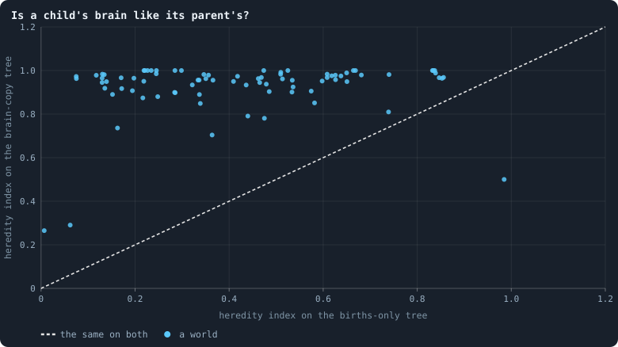
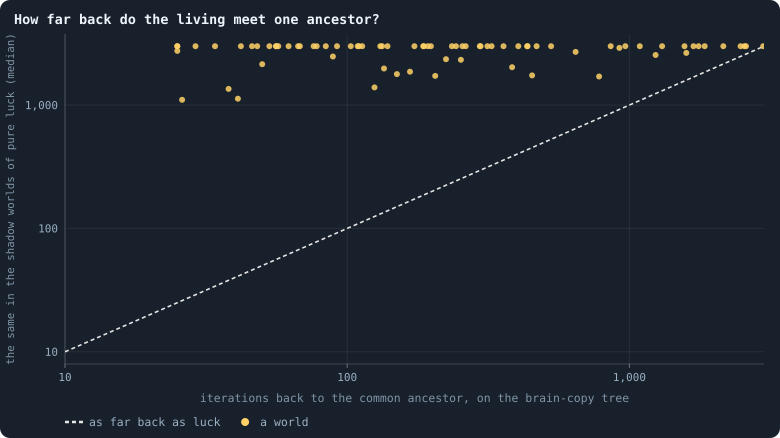
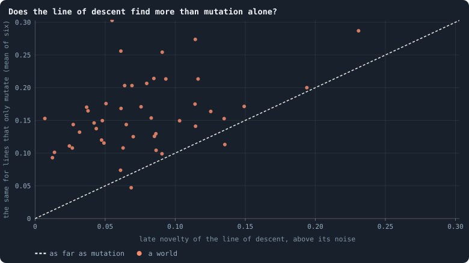

# Candidates for open-ended evolution

> [!question] Questions of this page
> - What must a world have for evolution in it to go on and on?
> - Which of the worlds drawn at random can be ruled out, and why?
> - Which worlds are worth playing on, and how?

## In short

Round 3 drew a hundred worlds at random. This page asks which of them could
evolve without end, and ranks them by how much they evolve. Each world is read
from what it recorded; no world is played again.

- **Ruled out:** 28 of the hundred plainly miss something. 18 died, one is a
  [star](measuring-networks.md#stars-and-hubs "An agent joined to far more agents than most; a star is a world held together by a single hub."), four seemed to pass nothing on and five stand still. The other 72 are
  the *candidate worlds*.
- **What descends is [brains](the-brain.md "The neural network each agent decides with: inputs about itself and its neighbours, outputs that become its decisions.").** A child gets a copy of its parent's brain, and
  a [node](the-world.md#agents-and-tokens "One member of a world: it lives on a node of the network, holds tokens and has a brain that takes all its decisions.") won in the [game](one-iteration.md#phase-2-the-game "The second phase of an iteration: every agent stakes all its tokens on its own node and its neighbours', and every node goes to someone.") gets a copy of the winner's. In round 3 the game
  copies brains about as often as births do, and in some worlds far more
  often. On the brains' own family tree, children act almost exactly as their
  parents, and the living descend from far fewer ancestors than chance would
  leave.
- **The evolution rank** scores every world that lived by four readings, each
  set against a model of chance: lines that spread beyond luck, novelty beyond
  [mutation](rules-in-detail.md#how-a-brain-changes "A random change to a brain, made with a set probability when it is copied, and in B1 also after every game: a changed brain is a new genotype.") alone, selection on behaviour, and heredity. Its first ten are ‹…›.
  Selection is plain in every world, but it holds behaviour in place: no line
  of descent finds more new behaviour than mutation alone would.
- **The shortlist** is drawn from health instead: every candidate world among
  the first 13 of any of health's three orders, 21 worlds. ‹…› of them are
  among the rank's first ten.

> [!info] Added later, 12 November 2026: what the births-only tree said
> Until 12 November 2026 this page read a family tree of births alone. On it,
> the 72 candidate worlds lived a [median](statistics.md#many-worlds-at-once-the-median-bands-the-settled-life-and-the-spread "The middle value: half of the numbers lie below it and half above.") of 825 generations with an effective
> population of only 14, and a child acted only partly like its parent (a
> heredity index of 0.39), so chance seemed to decide much of which line
> survives, and the healthiest worlds seemed to pass on less. That tree misses
> every brain copied by a conquest. Each reading below says which tree it uses.

## What evolution needs

Evolution needs variation, heredity and selection, and open-ended evolution
needs them to last
([What evolution means here](what-this-notebook-is-about.md#what-evolution-means-here);
[the open-ended test](measuring-evolution.md#what-would-count-as-open-ended-evolution)).
A world that plainly misses one of them cannot evolve open-endedly however long
it runs. So the worlds are treated as suspects in a line-up. Each is ruled out
the first time it plainly misses one, with its reason. The rest are compared
reading by reading, and every world that lived is ranked by evolution
([The evolution rank](#the-evolution-rank)).

## How each pillar is read

Every number comes from what a world recorded. No world is played again, only
brains, in situations taken from the worlds themselves. Two family trees are
read:
- **the births-only tree**: who bore whom, from every birth of every
  [iteration](one-iteration.md "One step of a world's time: a phase of reproduction, then a phase of the game."). It gives the rules that rule worlds out and the pillar-by-pillar
  table below, as they stood on 9 November 2026. It misses every brain copied
  by a conquest;
- **the brain-copy tree**: every copy of a brain, by birth or by conquest
  ([The brains' own family tree](#the-brains-own-family-tree)). The evolution
  rank reads this one.

The family tree of genotypes in
[Measuring evolution](measuring-evolution.md#the-family-tree) is a third: it
includes conquest copies, but it branches at every mutation, so a brain that
changes where it sits starts a new genotype there.

The readings, and the tree each uses:
- **Generations and the effective population** (both trees). Going back from
  the brains alive at the end, their ancestors grow fewer and fewer, until all
  of them descend from one. In a population of *N* left to chance this takes
  about 2*N* generations. Where it takes a few dozen, the **effective
  population** is tiny, and chance decides which line survives, whatever its
  brains are.
- **Heredity** (both trees). In the worlds kept at the middle of the run and
  at its end, parents and children alive together are played in the same
  situations
  ([How different are the agents?](b1-brains-lineages-and-messages.md#how-different-are-the-agents)).
  The **heredity index** is 1 when a child acts as its parent does (as the
  parent acts like itself from one try to the next), and 0 when it acts like a
  stranger. On the births-only tree a child is played against the agent that
  bore it; on the brain tree, against the brain it was copied from.
- **Fertility passed on** (the births-only tree). Selection changes a
  population only through differences in how many offspring its members
  leave, and only the differences that are passed on add up (Fisher's
  fundamental theorem of natural selection). So we ask whether agents that
  have many children have children that have many too: the [correlation](statistics.md#two-numbers-together-correlation-a-fitted-line-and-logarithmic-axes "Whether two quantities go up and down together, from −1 to 1.") of a
  parent's and its child's numbers of children, over every pair born from
  iteration 100 to two thirds of the run, against the same correlation with
  the children's counts shuffled among the children born in the same
  iteration. The cause need not be in the brain: a rich parent can make rich
  children, and a good place can favour its families.
- **The line of descent and its novelty** (both trees). At every world kept
  (every 250 iterations) we find the ancestor of most of the brains alive at
  the end, and keep its brain: one brain an era, the world's main line. All
  of them are played in the same situations. How far each era lies from every
  earlier one says whether the line keeps reaching behaviour it has not shown
  before (**novelty**), stands still, or comes back to where it was. The rank
  sets it against lines that only mutate.
- **Contemporaries** (no tree). How differently two agents of the same era
  act, above the noise of one brain played twice: the variation selection has
  to choose from.
- **Health** (no tree), by the [proposed order](which-worlds-are-healthy.md).
  It draws the shortlist, and for the rank it only filters.

These follow the measures of the MODES toolbox for open-ended dynamics
([Open-ended evolution: what it would mean](the-ideas-this-builds-on.md#open-ended-evolution-what-it-would-mean)):
*change* and *novelty* along the line of descent, and *ecology* in how many
kinds of behaviour live side by side (the
[same-position share](measuring-health.md#the-same-position-share)
and the effective kinds of staking). Its fourth measure, *complexity*, is not
read yet.

## The worlds ruled out

Of round 3's hundred worlds, 28 are ruled out, each for the first reason it
meets, in this order (research/screen/funnel.py). The other 72 are the
**candidate worlds**.
- **It died** (18 worlds;
  [what became of them](a-screen-of-random-worlds.md#what-round-3-found)).
- **It is a star** (1): [seed](rules-in-detail.md#seeds-and-the-random-stream "The number that fixes every random choice of a run: the same settings and the same seed make the same world.") 3020, where one agent is linked to 99.5% of the
  others on average.
- **Its agents hold one number of [tokens](the-world.md#agents-and-tokens "The one thing of value in a world: every agent holds a whole number of them, and their total never changes.")** (none): 80% or more of the agents
  holding the same amount.
- **It has no heredity** (4): children act like strangers, with a heredity
  index below 0.1. In all four, brains change after every game and not only
  when they are copied, and two mutate with a probability of 0.8. One of them
  is seed 3077, the worked example of
  [Which worlds are healthy?](which-worlds-are-healthy.md#three-ways-to-put-the-criteria-together):
  the first by the sum of its health's criteria, but with nothing for
  evolution to build on.
- **It stands still** (5): its line of descent hardly moves from era to era,
  and two agents of one era hardly act differently (both less than 0.05 above
  the noise of playing one brain twice). All five are crowded and poor: from
  6,470 to 21,298 agents, holding 1.4 to 4.6 tokens each on average. An agent
  with a token or two can hardly stake differently from another.

> [!info] Added later, 12 November 2026: the four that seemed to pass nothing on
> The rule of no heredity read the births-only tree, which played children
> against agents whose brains had mostly been replaced by conquests since. On
> the brains' own tree ‹…›. So for the evolution rank this rule rules nothing
> out; the other four still filter.

The ten worlds that lived and are ruled out:

<!-- table oeecandidates/out -->
| world | round | why it is ruled out |
|---|---|---|
| [s3020](run:B1-30000-511930-s3020) | round 3 | a star: one agent linked to 99.5% of the others on average |
| [s3037](run:B1-30000-845393-s3037) | round 3 | standing still: its line of descent does not move and its agents act alike (steps 0.01, contemporaries 0.03 above the noise) |
| [s3038](run:B1-30000-1ad8a9-s3038) | round 3 | standing still: its line of descent does not move and its agents act alike (steps 0.01, contemporaries 0.01 above the noise) |
| [s3044](run:B1-30000-63827e-s3044) | round 3 | no heredity: children act like strangers (index 0.01) |
| [s3066](run:B1-30000-dfd51b-s3066) | round 3 | no heredity: children act like strangers (index 0.07) |
| [s3067](run:B1-30000-4bee8e-s3067) | round 3 | standing still: its line of descent does not move and its agents act alike (steps 0.02, contemporaries 0.03 above the noise) |
| [s3072](run:B1-30000-f05562-s3072) | round 3 | standing still: its line of descent does not move and its agents act alike (steps 0.02, contemporaries 0.01 above the noise) |
| [s3077](run:B1-30000-d6eabf-s3077) | round 3 | no heredity: children act like strangers (index 0.06) |
| [s3084](run:B1-30000-ad76aa-s3084) | round 3 | no heredity: children act like strangers (index 0.08) |
| [s3099](run:B1-30000-1ab8a0-s3099) | round 3 | standing still: its line of descent does not move and its agents act alike (steps 0.01, contemporaries 0.02 above the noise) |
<!-- /table -->

## The candidates, pillar by pillar

On the births-only tree, as it was read on 9 November 2026, the 72 candidate
worlds evolve fast, but in few lines.
- **Many generations.** A median of 825 generations in 3,000 iterations: one
  every 3.6 iterations.
- **Few lines.** Going back from the living, all of them descend from one
  ancestor a median of 23 generations earlier. That is an effective population
  of about 14 in the median world: below 50 in 53 worlds, above 500 in only 8.
  In most worlds, chance decides which line goes on, whatever its agents do.
- **Children are like their parents, partly.** A median heredity index of 0.39,
  from 0.12 to 0.86.
- **Fertility runs in families.** In 65 of the 72 worlds a parent's number of
  children says clearly more of its children's than chance would (a median of
  0.18 above chance in the correlation).
- **The line of descent moves slowly.** Its late eras lie a median of 0.08
  above the noise from every earlier era, and in 15 worlds it never comes back
  to behaviour it had shown before.

> [!info] Added later, 12 November 2026: read on the births-only tree
> Generations, the effective population of about 14, heredity and novelty
> above were read on the family tree of births alone, which misses every brain
> copied by a conquest. On the brains' own tree a brain has a median of
> ‹2,900› copies behind it; the effective population is about ‹165›; a child
> acts almost as its parent (‹0.96›), since only ‹3%› of the pairs the
> births-only tree played still held parent and child brains; and the line of
> descent moves a little less, ‹0.08› above the noise in the median world of
> the 82, against ‹0.10› on the births-only line
> ([The brains' own family tree](#the-brains-own-family-tree)).

Three pulls show across the worlds on the births-only tree (rank correlations
over the 72):
- **heredity against novelty (−0.37):** where children are most like their
  parents, the line of descent changes least. Keeping what works and finding
  something new pull against each other;
- **health against heredity (−0.30):** the healthiest worlds pass on less;
- **health with novelty (+0.23):** the healthiest worlds change a little more.

Each candidate world's readings on the births-only tree, with its rank in each
in brackets, 1 the best. The table is sorted by the mean of those ranks; that
mean is superseded by [the evolution rank](#the-evolution-rank), and so is the
mean over six of them that research/screen/funnel.py keeps as
`evolution_rank`.

<!-- table oeecandidates/ranks -->
| world | round | agents | generations | heredity | effective population | novelty | contemporaries | fertility passed on | health | tokens an agent | mean rank | channels open |
|---|---|---|---|---|---|---|---|---|---|---|---|---|
| [s3026](run:B1-30000-d6955f-s3026) | round 3 | 2,068 (58) | 2,159 (1) | 0.30 (47) | 78 (14) | 0.26 (1) | 0.31 (2) | 0.12 (42) | 0.48 (23) | 14.5 (15) | 22.6 | messages, handover |
| [s4008 w](run:B1-30000-1cfaa4-s4008) | round 3, weakest first | 5,120 (28) | 662 (43) | 0.23 (55) | 12 (41) | 0.23 (2) | 0.26 (10) | 0.42 (4) | 0.53 (8) | 5.9 (45) | 26.2 | messages, gifts |
| [s4008 s](run:B1-30000-645972-s4008) | round 3, strongest first | 5,402 (23) | 691 (41) | 0.25 (52) | 14 (37) | 0.17 (8) | 0.27 (8) | 0.40 (6) | 0.50 (17) | 5.6 (50) | 26.9 | messages, gifts |
| [s4003 s](run:B1-30000-fffc7d-s4003) | round 3, strongest first | 8,805 (10) | 1,131 (19) | 0.36 (39) | 9 (53) | 0.19 (5) | 0.23 (17) | 0.33 (19) | 0.50 (18) | 3.4 (63) | 27.0 | messages, gifts, handover, upkeep |
| [s4003 w](run:B1-30000-9efb1d-s4003) | round 3, weakest first | 10,264 (8) | 1,189 (14) | 0.52 (22) | 9 (51) | 0.13 (18) | 0.19 (23) | 0.34 (16) | 0.47 (28) | 2.9 (65) | 27.2 | messages, gifts, handover, upkeep |
| [s4002 w](run:B1-30000-5379e2-s4002) | round 3, weakest first | 5,278 (26) | 822 (37) | 0.22 (57) | 8 (58) | 0.22 (4) | 0.28 (6) | 0.37 (12) | 0.54 (5) | 5.7 (47) | 28.0 | messages, gifts, mates pay, partner search, mixing |
| [s3021](run:B1-30000-4aff7d-s3021) | round 3 | 1,715 (61) | 1,064 (23) | 0.32 (46) | 27 (26) | 0.14 (11) | 0.23 (16) | 0.22 (30) | 0.47 (27) | 17.5 (12) | 28.0 | messages, handover, partner search, upkeep |
| [s3042](run:B1-30000-b82ad0-s3042) | round 3 | 11,125 (5) | 1,180 (15) | 0.14 (66) | 247 (12) | 0.15 (10) | 0.21 (20) | 0.04 (58) | 0.61 (1) | 2.7 (68) | 28.3 | messages, gifts, handover, mates pay, partner search, upkeep, mixing |
| [s3045](run:B1-30000-f6d23f-s3045) | round 3 | 1,411 (68) | 1,237 (12) | 0.22 (58) | 490 (9) | 0.14 (16) | 0.22 (18) | 0.08 (51) | 0.48 (25) | 21.3 (5) | 29.1 | messages, gifts, handover, partner search, upkeep, revolutions |
| [s3024](run:B1-30000-f05874-s3024) | round 3 | 4,614 (31) | 878 (33) | 0.44 (34) | 12 (38) | 0.11 (23) | 0.26 (11) | 0.12 (44) | 0.54 (7) | 6.5 (42) | 29.2 | messages, gifts, handover, upkeep, revolutions |
| [s3062](run:B1-30000-def151-s3062) | round 3 | 2,569 (51) | 993 (26) | 0.19 (61) | 11 (45) | 0.22 (3) | 0.28 (5) | 0.27 (26) | 0.48 (24) | 11.7 (22) | 29.2 | messages, handover, partner search, upkeep, revolutions |
| [s3082](run:B1-30000-1141ea-s3082) | round 3 | 3,207 (48) | 1,411 (5) | 0.84 (3) | 26 (27) | 0.09 (29) | 0.12 (44) | 0.14 (38) | 0.38 (47) | 9.4 (25) | 29.6 | messages, upkeep |
| [s3008](run:B1-30000-e19f2d-s3008) | round 3 | 2,063 (59) | 947 (30) | 0.62 (13) | 24 (28) | 0.14 (15) | 0.15 (35) | 0.01 (64) | 0.53 (10) | 14.5 (14) | 29.8 | messages, gifts, partner search, revolutions |
| [s4002 s](run:B1-30000-192733-s4002) | round 3, strongest first | 5,705 (21) | 953 (28) | 0.22 (56) | 7 (62) | 0.17 (7) | 0.29 (4) | 0.39 (10) | 0.44 (32) | 5.3 (52) | 30.2 | messages, gifts, mates pay, partner search, mixing |
| [s3028](run:B1-30000-2eef58-s3028) | round 3 | 5,736 (20) | 1,437 (3) | 0.84 (2) | 37 (20) | 0.07 (45) | 0.05 (72) | 0.33 (17) | 0.38 (46) | 5.2 (53) | 30.9 | messages, gifts, handover, partner search, upkeep, revolutions |
| [s3095](run:B1-30000-3e5856-s3095) | round 3 | 3,265 (46) | 1,338 (7) | 0.25 (53) | 1,219 (5) | 0.15 (9) | 0.29 (3) | -0.02 (70) | 0.34 (60) | 9.2 (27) | 31.1 | messages, handover, partner search, upkeep |
| [s3046](run:B1-30000-27bd64-s3046) | round 3 | 2,418 (55) | 1,321 (8) | 0.23 (54) | 51 (19) | 0.10 (26) | 0.18 (27) | 0.18 (36) | 0.40 (41) | 12.4 (18) | 31.6 | messages, gifts, partner search, upkeep |
| [s4004 w](run:B1-30000-17ac6e-s4004) | round 3, weakest first | 1,186 (71) | 1,309 (9) | 0.34 (43) | 5 (68) | 0.14 (12) | 0.25 (12) | 0.35 (15) | 0.35 (58) | 25.3 (2) | 32.2 | messages, handover, mates pay, partner search, mixing |
| [s3055](run:B1-30000-cca771-s3055) | round 3 | 2,507 (53) | 1,033 (25) | 0.36 (38) | 6 (65) | 0.11 (21) | 0.24 (14) | 0.31 (21) | 0.42 (34) | 12.0 (20) | 32.3 | messages, handover, revolutions |
| [s3030](run:B1-30000-90fc91-s3030) | round 3 | 19,951 (1) | 761 (40) | 0.68 (6) | 12,248 (1) | 0.05 (57) | 0.18 (25) | 0.18 (35) | 0.35 (56) | 1.5 (72) | 32.6 | messages, upkeep |
| [s4006 s](run:B1-30000-8526cf-s4006) | round 3, strongest first | 7,009 (14) | 940 (31) | 0.51 (24) | 30 (25) | 0.07 (49) | 0.12 (45) | 0.12 (46) | 0.59 (2) | 4.3 (59) | 32.8 | messages, gifts, handover, upkeep, revolutions |
| [s3033](run:B1-30000-631e49-s3033) | round 3 | 1,639 (63) | 1,083 (21) | 0.15 (65) | 988 (7) | 0.19 (6) | 0.27 (7) | -0.00 (68) | 0.36 (54) | 18.3 (10) | 33.4 | handover, partner search, upkeep, revolutions |
| [s4004 s](run:B1-30000-2bac4d-s4004) | round 3, strongest first | 1,349 (69) | 1,392 (6) | 0.29 (48) | 6 (63) | 0.12 (19) | 0.23 (15) | 0.37 (13) | 0.30 (66) | 22.2 (4) | 33.7 | messages, handover, mates pay, partner search, mixing |
| [s3094](run:B1-30000-4ac946-s3094) | round 3 | 11,256 (4) | 1,509 (2) | 0.13 (68) | 11,316 (2) | 0.08 (40) | 0.24 (13) | 0.14 (41) | 0.32 (64) | 2.7 (69) | 33.7 | messages, gifts, partner search, upkeep |
| [s3006](run:B1-30000-023c0a-s3006) | round 3 | 6,774 (15) | 652 (44) | 0.48 (27) | 59 (18) | 0.05 (58) | 0.17 (29) | 0.09 (50) | 0.53 (9) | 4.4 (58) | 34.2 | messages, gifts, handover, partner search, upkeep |
| [s3023](run:B1-30000-b0f6e3-s3023) | round 3 | 1,612 (64) | 955 (27) | 0.34 (44) | 22 (29) | 0.06 (52) | 0.14 (40) | 0.19 (34) | 0.51 (12) | 18.6 (9) | 34.6 | messages, gifts, upkeep |
| [s3091](run:B1-30000-42d88d-s3091) | round 3 | 2,361 (56) | 1,173 (17) | 0.25 (51) | 5 (70) | 0.14 (14) | 0.20 (22) | 0.36 (14) | 0.36 (55) | 12.7 (17) | 35.1 | messages, gifts, handover, partner search, mixing |
| [s3087](run:B1-30000-363694-s3087) | round 3 | 10,034 (9) | 1,179 (16) | 0.54 (19) | 12 (40) | 0.04 (65) | 0.06 (70) | 0.31 (20) | 0.51 (14) | 3.0 (64) | 35.2 | messages, handover, partner search, upkeep |
| [s3016](run:B1-30000-b23381-s3016) | round 3 | 1,486 (67) | 1,071 (22) | 0.28 (49) | 31 (24) | 0.05 (56) | 0.34 (1) | 0.04 (60) | 0.43 (33) | 20.2 (6) | 35.3 | messages, partner search, upkeep |
| [s4005 s](run:B1-30000-6f6c09-s4005) | round 3, strongest first | 3,866 (39) | 646 (45) | 0.33 (45) | 10 (47) | 0.14 (13) | 0.26 (9) | 0.14 (39) | 0.37 (50) | 7.8 (34) | 35.7 | messages, gifts, partner search |
| [s3018](run:B1-30000-af1e28-s3018) | round 3 | 2,861 (50) | 313 (54) | 0.16 (64) | 263 (11) | 0.10 (28) | 0.16 (33) | 0.06 (55) | 0.56 (3) | 10.5 (23) | 35.7 | messages, gifts, handover, mates pay, partner search, mixing |
| [s3032](run:B1-30000-22865f-s3032) | round 3 | 7,263 (13) | 401 (49) | 0.28 (50) | 67 (16) | 0.08 (35) | 0.18 (26) | 0.18 (37) | 0.41 (36) | 4.1 (60) | 35.8 | messages, gifts, handover, partner search |
| [s3064](run:B1-30000-a6a7ec-s3064) | round 3 | 5,290 (25) | 232 (59) | 0.13 (71) | 2,072 (3) | 0.10 (25) | 0.18 (28) | 0.09 (48) | 0.51 (15) | 5.7 (48) | 35.8 | messages, handover, partner search |
| [s3007](run:B1-30000-8119cd-s3007) | round 3 | 3,382 (43) | 1,434 (4) | 0.57 (18) | 37 (21) | 0.04 (66) | 0.09 (56) | 0.23 (29) | 0.34 (61) | 8.9 (30) | 36.4 | messages, gifts, handover, mates pay, upkeep, mixing |
| [s3057](run:B1-30000-38aee9-s3057) | round 3 | 4,802 (30) | 597 (46) | 0.14 (67) | 11 (43) | 0.07 (47) | 0.20 (21) | 0.26 (27) | 0.54 (6) | 6.2 (43) | 36.7 | messages, partner search, mixing |
| [s4007 w](run:B1-30000-04d3eb-s4007) | round 3, weakest first | 6,489 (17) | 828 (36) | 0.53 (20) | 9 (56) | 0.08 (36) | 0.14 (37) | 0.43 (3) | 0.16 (71) | 4.6 (56) | 36.9 | messages, handover, partner search |
| [s3058](run:B1-30000-4108dd-s3058) | round 3 | 1,257 (70) | 142 (64) | 0.46 (32) | 10 (49) | 0.13 (17) | 0.17 (30) | 0.12 (43) | 0.47 (26) | 23.9 (3) | 37.1 | messages, partner search, revolutions |
| [s3076](run:B1-30000-66c764-s3076) | round 3 | 4,525 (32) | 1,198 (13) | 0.66 (8) | 9 (55) | 0.06 (51) | 0.08 (63) | 0.44 (2) | 0.19 (70) | 6.6 (41) | 37.2 | messages, gifts, handover, mixing |
| [s3014](run:B1-30000-7d129f-s3014) | round 3 | 10,836 (6) | 1,242 (11) | 0.53 (21) | 14 (35) | 0.04 (64) | 0.07 (66) | 0.45 (1) | 0.31 (65) | 2.8 (67) | 37.3 | messages, handover, partner search, upkeep |
| [s3080](run:B1-30000-625bc7-s3080) | round 3 | 1,985 (60) | 121 (66) | 0.34 (42) | 11 (46) | 0.11 (22) | 0.18 (24) | 0.04 (59) | 0.55 (4) | 15.1 (13) | 37.3 | messages, gifts, handover, partner search, revolutions |
| [s3005](run:B1-30000-c18a1f-s3005) | round 3 | 4,022 (37) | 950 (29) | 0.51 (23) | 35 (22) | 0.08 (44) | 0.10 (53) | -0.05 (72) | 0.48 (22) | 7.5 (36) | 37.6 | messages, handover, mixing |
| [s3047](run:B1-30000-10c9f1-s3047) | round 3 | 3,607 (41) | 662 (42) | 0.61 (15) | 9 (57) | 0.08 (43) | 0.08 (64) | 0.29 (23) | 0.48 (21) | 8.3 (32) | 37.6 | messages, gifts, handover, partner search |
| [s3049](run:B1-30000-c51eb8-s3049) | round 3 | 5,163 (27) | 236 (58) | 0.17 (63) | 60 (17) | 0.11 (20) | 0.17 (31) | 0.12 (45) | 0.45 (31) | 5.8 (46) | 37.6 | messages, gifts, handover, partner search |
| [s4007 s](run:B1-30000-a8a2d2-s4007) | round 3, strongest first | 6,653 (16) | 855 (34) | 0.37 (37) | 7 (61) | 0.11 (24) | 0.15 (34) | 0.40 (7) | 0.20 (69) | 4.5 (57) | 37.7 | messages, handover, partner search |
| [s3054](run:B1-30000-d9254e-s3054) | round 3 | 3,309 (45) | 224 (60) | 0.63 (12) | 34 (23) | 0.05 (55) | 0.10 (52) | 0.07 (53) | 0.51 (13) | 9.1 (28) | 37.9 | messages, partner search, upkeep |
| [s3061](run:B1-30000-00e3c8-s3061) | round 3 | 3,236 (47) | 1,092 (20) | 0.17 (62) | 8 (60) | 0.05 (54) | 0.22 (19) | 0.33 (18) | 0.41 (35) | 9.3 (26) | 37.9 | gifts, mates pay, partner search, revolutions, mixing |
| [s3078](run:B1-30000-dd27b6-s3078) | round 3 | 1,672 (62) | 422 (48) | 0.65 (10) | 5 (69) | 0.09 (33) | 0.07 (67) | 0.40 (5) | 0.40 (40) | 17.9 (11) | 38.3 | messages, gifts, partner search |
| [s3001](run:B1-30000-68cda7-s3001) | round 3 | 17,266 (2) | 1,138 (18) | 0.83 (4) | 15 (33) | 0.04 (63) | 0.05 (71) | 0.29 (22) | 0.33 (62) | 1.7 (71) | 38.4 | messages, handover, mates pay, upkeep, revolutions, mixing |
| [s3089](run:B1-30000-77ad6a-s3089) | round 3 | 5,521 (22) | 844 (35) | 0.86 (1) | 133 (13) | 0.09 (34) | 0.09 (62) | -0.00 (67) | 0.13 (72) | 5.4 (51) | 39.7 | messages, partner search, upkeep |
| [s3050](run:B1-30000-ebe08c-s3050) | round 3 | 3,312 (44) | 926 (32) | 0.47 (31) | 6 (64) | 0.08 (41) | 0.13 (42) | 0.28 (25) | 0.36 (53) | 9.1 (29) | 40.1 | messages, gifts, handover, mates pay, partner search, mixing |
| [s3092](run:B1-30000-7fc03f-s3092) | round 3 | 6,165 (18) | 253 (57) | 0.20 (60) | 74 (15) | 0.08 (42) | 0.17 (32) | 0.07 (54) | 0.46 (29) | 4.9 (55) | 40.2 | messages, partner search, upkeep |
| [s3059](run:B1-30000-2ec87a-s3059) | round 3 | 4,136 (36) | 310 (55) | 0.47 (29) | 12 (39) | 0.09 (32) | 0.15 (36) | 0.05 (57) | 0.40 (42) | 7.3 (37) | 40.3 | messages, gifts, handover, mixing |
| [s3071](run:B1-30000-605c0d-s3071) | round 3 | 6,070 (19) | 109 (67) | 0.47 (30) | 14 (36) | 0.10 (27) | 0.11 (48) | 0.19 (33) | 0.38 (49) | 4.9 (54) | 40.3 | messages, partner search |
| [s3052](run:B1-30000-0d058a-s3052) | round 3 | 7,368 (12) | 387 (51) | 0.42 (35) | 15 (34) | 0.08 (37) | 0.11 (49) | 0.28 (24) | 0.33 (63) | 4.1 (61) | 40.7 | messages, gifts, handover, partner search |
| [s3070](run:B1-30000-a4d3a0-s3070) | round 3 | 7,767 (11) | 774 (39) | 0.67 (7) | 12 (42) | 0.07 (48) | 0.06 (69) | 0.11 (47) | 0.39 (44) | 3.9 (62) | 41.0 | messages, gifts, partner search, upkeep |
| [s3063](run:B1-30000-924e70-s3063) | round 3 | 14,473 (3) | 1,053 (24) | 0.47 (28) | 8 (59) | 0.05 (60) | 0.09 (59) | 0.39 (8) | 0.34 (59) | 2.1 (70) | 41.1 | messages, handover, partner search, upkeep |
| [s3022](run:B1-30000-298337-s3022) | round 3 | 5,394 (24) | 199 (63) | 0.22 (59) | 9 (52) | 0.07 (46) | 0.14 (39) | 0.25 (28) | 0.53 (11) | 5.6 (49) | 41.2 | messages, partner search |
| [s3040](run:B1-30000-36d076-s3040) | round 3 | 3,904 (38) | 805 (38) | 0.35 (40) | 10 (48) | 0.09 (31) | 0.14 (41) | 0.21 (32) | 0.24 (68) | 7.7 (35) | 41.2 | messages, gifts, partner search, upkeep |
| [s3085](run:B1-30000-801b34-s3085) | round 3 | 4,156 (35) | 1,303 (10) | 0.44 (33) | 5 (71) | 0.02 (69) | 0.14 (38) | 0.39 (11) | 0.28 (67) | 7.2 (38) | 41.3 | messages, handover, partner search, upkeep |
| [s3051](run:B1-30000-b5a76a-s3051) | round 3 | 1,091 (72) | 141 (65) | 0.41 (36) | 4 (72) | 0.09 (30) | 0.11 (51) | 0.14 (40) | 0.50 (16) | 27.5 (1) | 42.6 | messages, gifts, partner search, upkeep, revolutions |
| [s3083](run:B1-30000-0d7e0c-s3083) | round 3 | 4,159 (34) | 389 (50) | 0.63 (11) | 11 (44) | 0.08 (38) | 0.11 (47) | -0.01 (69) | 0.37 (51) | 7.2 (39) | 42.6 | messages, gifts, handover, mates pay, upkeep, mixing |
| [s3004](run:B1-30000-7d5208-s3004) | round 3 | 1,581 (65) | 23 (71) | 0.51 (25) | 18 (31) | 0.08 (39) | 0.07 (68) | 0.04 (61) | 0.49 (20) | 19.0 (8) | 43.1 | messages, gifts |
| [s3056](run:B1-30000-43985b-s3056) | round 3 | 3,649 (40) | 361 (52) | 0.60 (16) | 16 (32) | 0.04 (62) | 0.09 (60) | 0.05 (56) | 0.40 (37) | 8.2 (33) | 43.1 | messages, gifts, handover, mates pay, partner search, mixing |
| [s3013](run:B1-30000-7f7cd5-s3013) | round 3 | 10,511 (7) | 500 (47) | 0.58 (17) | 5 (67) | 0.02 (71) | 0.09 (61) | 0.39 (9) | 0.38 (48) | 2.9 (66) | 43.7 | messages, partner search, upkeep |
| [s3093](run:B1-30000-26a341-s3093) | round 3 | 3,387 (42) | 207 (62) | 0.61 (14) | 9 (50) | 0.05 (59) | 0.10 (54) | 0.08 (52) | 0.46 (30) | 8.9 (31) | 43.8 | messages, gifts, handover, partner search |
| [s3012](run:B1-30000-02fa53-s3012) | round 3 | 2,487 (54) | 327 (53) | 0.65 (9) | 9 (54) | 0.06 (50) | 0.12 (46) | 0.02 (63) | 0.36 (52) | 12.1 (19) | 44.4 | messages, gifts, partner search, upkeep, mixing |
| [s3019](run:B1-30000-b1209a-s3019) | round 3 | 3,019 (49) | 101 (68) | 0.13 (69) | 1,526 (4) | 0.05 (53) | 0.13 (43) | -0.03 (71) | 0.49 (19) | 9.9 (24) | 44.4 | messages, handover, partner search, upkeep |
| [s3041](run:B1-30000-965f1e-s3041) | round 3 | 4,464 (33) | 212 (61) | 0.74 (5) | 22 (30) | 0.03 (68) | 0.09 (57) | 0.00 (65) | 0.39 (43) | 6.7 (40) | 44.7 | messages, gifts, mates pay, partner search, mixing |
| [s3043](run:B1-30000-02ed17-s3043) | round 3 | 2,520 (52) | 73 (69) | 0.35 (41) | 904 (8) | 0.02 (70) | 0.07 (65) | 0.09 (49) | 0.40 (39) | 11.9 (21) | 46.0 | messages, gifts, handover, partner search, upkeep |
| [s3098](run:B1-30000-794ae8-s3098) | round 3 | 4,806 (29) | 256 (56) | 0.49 (26) | 6 (66) | 0.04 (61) | 0.10 (55) | 0.21 (31) | 0.35 (57) | 6.2 (44) | 47.2 | messages, gifts, handover, partner search, revolutions |
| [s3065](run:B1-30000-ba3afe-s3065) | round 3 | 2,104 (57) | 54 (70) | 0.12 (72) | 1,147 (6) | 0.03 (67) | 0.11 (50) | -0.00 (66) | 0.40 (38) | 14.3 (16) | 49.1 | messages, handover, partner search, upkeep, mixing |
| [s3090](run:B1-30000-05ba40-s3090) | round 3 | 1,521 (66) | 14 (72) | 0.13 (70) | 365 (10) | -0.00 (72) | 0.09 (58) | 0.03 (62) | 0.38 (45) | 19.7 (7) | 51.3 | messages, partner search, upkeep, mixing |
<!-- /table -->

<!-- figure oeecandidates/heredity_novelty -->

**Like their parents, yet still changing?** Each dot is a candidate world. Across: how much more a child acts like its parent than like a stranger, in the same situations. Up: how far the later eras of its line of descent lie from every earlier era, above the noise of playing one brain twice. A world in the top right passes on what its agents do and keeps changing it.

> [!example]- How to make this figure
> **Runs.** every world of round 3 of the screen of random worlds that lived to the end of its run (Experiments 40, 41 and 42; 30,000 tokens, 3,000 iterations)
>
> **Data.** From each world's dossier, `GraphOfLifeRuns/.pilots/screen/candidates/<run>.json` (research/screen/candidates.py: the family tree from every birth, heredity in two kept worlds, the line of descent played in every kept world), its families, `.pilots/screen/families/<run>.json` (research/screen/families.py), and its health (research/screen/health.json), gathered by `research/screen/funnel.py` into `research/screen/candidates.json`.
>
> 1. Read each candidate world's heredity index (the mean of its kept worlds read) and late novelty from `candidates.json`.
>
> **To make it again:** `python3 book_figures.py oeecandidates`.
<!-- /figure -->

<!-- figure oeecandidates/generations_population -->

**How many generations, and how many lines?** Each dot is a candidate world. Across: the mean generation of the agents alive at the end (how many births separate them from the founders). Up: a rough effective population, from how fast the ancestry of the living narrows: the smaller it is, the more chance decides which line survives, and the larger a difference selection needs before it can see it.

> [!example]- How to make this figure
> **Runs.** every world of round 3 of the screen of random worlds that lived to the end of its run (Experiments 40, 41 and 42; 30,000 tokens, 3,000 iterations)
>
> **Data.** From each world's dossier, `GraphOfLifeRuns/.pilots/screen/candidates/<run>.json` (research/screen/candidates.py: the family tree from every birth, heredity in two kept worlds, the line of descent played in every kept world), its families, `.pilots/screen/families/<run>.json` (research/screen/families.py), and its health (research/screen/health.json), gathered by `research/screen/funnel.py` into `research/screen/candidates.json`.
>
> 1. Read each candidate world's generations and effective population from `candidates.json` (`numbers`).
>
> **To make it again:** `python3 book_figures.py oeecandidates`.
<!-- /figure -->

<!-- figure oeecandidates/fertility -->

**Is having children passed on?** Each dot is a candidate world: across every parent and child both born from iteration 100 to two thirds of the run, the correlation between how many children the parent had and how many the child had, less the same correlation with the children's counts shuffled among the children born in the same iteration. Above zero, families differ in how fertile they are, and selection has something to work on.

> [!example]- How to make this figure
> **Runs.** every world of round 3 of the screen of random worlds that lived to the end of its run (Experiments 40, 41 and 42; 30,000 tokens, 3,000 iterations)
>
> **Data.** From each world's dossier, `GraphOfLifeRuns/.pilots/screen/candidates/<run>.json` (research/screen/candidates.py: the family tree from every birth, heredity in two kept worlds, the line of descent played in every kept world), its families, `.pilots/screen/families/<run>.json` (research/screen/families.py), and its health (research/screen/health.json), gathered by `research/screen/funnel.py` into `research/screen/candidates.json`.
>
> 1. Read each candidate world's `fertility` from `candidates.json` (families.py: correlation less the shuffled mean).
>
> **To make it again:** `python3 book_figures.py oeecandidates`.
<!-- /figure -->

## The shortlist

Health comes in three orders: the six criteria multiplied, added, or the
worst of them ([Which worlds are healthy?](which-worlds-are-healthy.md#three-ways-to-put-the-criteria-together)).
The author (9 November 2026): "the union of the best of these rankings are
candidates." So the **shortlist** is every candidate world among the first 13
of any of the three orders. Its history, told here once:
- On 9 November 2026 it held 24 worlds, and the author chose to play them
  again with new seeds ([Experiment 43](#round-3s-best-worlds-played-again)).
- Later that day health came to count agents on [loops](measuring-networks.md#loops "A path through the network that comes back to where it started without using a connection twice.") per link
  ([Which worlds are healthy?](which-worlds-are-healthy.md)), and the shortlist
  became 21 worlds: seeds 3004, 3016, 3026, 3030, 3051, 3094 and 3095 left it,
  and seeds 3005, 3006, 3064 and 3093 joined it.
- Experiment 43 took out three of its 24 whose links ran away (seeds 3094,
  3030 and 3095) and added the four that joined: 25 [settings](settings.md "One number or switch of a run's rules, fixed before it starts.").

Health chooses the shortlist, not evolution. The
[evolution rank](#the-evolution-rank) orders the same worlds by evolution; the
table gives each shortlisted world's place in it beside its health, and its
births-only numbers.

<!-- table oeecandidates/shortlist -->
| world | round | among the first 13 by | health (product) | evolution rank | heredity (births only) | novelty (births only) | generations (births only) | effective population (births only) | fertility passed on | channels open |
|---|---|---|---|---|---|---|---|---|---|---|
| [s3042](run:B1-30000-b82ad0-s3042) | round 3 | product, sum, worst | 0.606 | — | 0.14 | 0.15 | 1,180 | 247 | 0.04 | messages, gifts, handover, mates pay, partner search, upkeep, mixing |
| [s4006 s](run:B1-30000-8526cf-s4006) | round 3, strongest first | product, sum, worst | 0.587 | — | 0.51 | 0.07 | 940 | 30 | 0.12 | messages, gifts, handover, upkeep, revolutions |
| [s3018](run:B1-30000-af1e28-s3018) | round 3 | product, sum, worst | 0.565 | 42 | 0.16 | 0.10 | 313 | 263 | 0.06 | messages, gifts, handover, mates pay, partner search, mixing |
| [s3080](run:B1-30000-625bc7-s3080) | round 3 | product, sum, worst | 0.549 | 46 | 0.34 | 0.11 | 121 | 11 | 0.04 | messages, gifts, handover, partner search, revolutions |
| [s4002 w](run:B1-30000-5379e2-s4002) | round 3, weakest first | product, sum | 0.544 | — | 0.22 | 0.22 | 822 | 8 | 0.37 | messages, gifts, mates pay, partner search, mixing |
| [s3057](run:B1-30000-38aee9-s3057) | round 3 | product, sum, worst | 0.541 | 5 | 0.14 | 0.07 | 597 | 11 | 0.26 | messages, partner search, mixing |
| [s3024](run:B1-30000-f05874-s3024) | round 3 | product, worst | 0.536 | 25 | 0.44 | 0.11 | 878 | 12 | 0.12 | messages, gifts, handover, upkeep, revolutions |
| [s4008 w](run:B1-30000-1cfaa4-s4008) | round 3, weakest first | product, sum | 0.528 | — | 0.23 | 0.23 | 662 | 12 | 0.42 | messages, gifts |
| [s3006](run:B1-30000-023c0a-s3006) | round 3 | product, sum | 0.526 | — | 0.48 | 0.05 | 652 | 59 | 0.09 | messages, gifts, handover, partner search, upkeep |
| [s3008](run:B1-30000-e19f2d-s3008) | round 3 | product, worst | 0.526 | 33 | 0.62 | 0.14 | 947 | 24 | 0.01 | messages, gifts, partner search, revolutions |
| [s3022](run:B1-30000-298337-s3022) | round 3 | product, worst | 0.525 | — | 0.22 | 0.07 | 199 | 9 | 0.25 | messages, partner search |
| [s3023](run:B1-30000-b0f6e3-s3023) | round 3 | product, worst | 0.515 | 11 | 0.34 | 0.06 | 955 | 22 | 0.19 | messages, gifts, upkeep |
| [s3054](run:B1-30000-d9254e-s3054) | round 3 | product, sum | 0.513 | 8 | 0.63 | 0.05 | 224 | 34 | 0.07 | messages, partner search, upkeep |
| [s3087](run:B1-30000-363694-s3087) | round 3 | sum | 0.511 | — | 0.54 | 0.04 | 1,179 | 12 | 0.31 | messages, handover, partner search, upkeep |
| [s3064](run:B1-30000-a6a7ec-s3064) | round 3 | sum | 0.511 | — | 0.13 | 0.10 | 232 | 2,072 | 0.09 | messages, handover, partner search |
| [s3019](run:B1-30000-b1209a-s3019) | round 3 | worst | 0.485 | 41 | 0.13 | 0.05 | 101 | 1,526 | -0.03 | messages, handover, partner search, upkeep |
| [s3005](run:B1-30000-c18a1f-s3005) | round 3 | worst | 0.481 | 20 | 0.51 | 0.08 | 950 | 35 | -0.05 | messages, handover, mixing |
| [s3045](run:B1-30000-f6d23f-s3045) | round 3 | sum | 0.476 | 29 | 0.22 | 0.14 | 1,237 | 490 | 0.08 | messages, gifts, handover, partner search, upkeep, revolutions |
| [s3058](run:B1-30000-4108dd-s3058) | round 3 | sum | 0.473 | 12 | 0.46 | 0.13 | 142 | 10 | 0.12 | messages, partner search, revolutions |
| [s3093](run:B1-30000-26a341-s3093) | round 3 | worst | 0.457 | 4 | 0.61 | 0.05 | 207 | 9 | 0.08 | messages, gifts, handover, partner search |
| [s4004 w](run:B1-30000-17ac6e-s4004) | round 3, weakest first | worst | 0.345 | 22 | 0.34 | 0.14 | 1,309 | 5 | 0.35 | messages, handover, mates pay, partner search, mixing |
<!-- /table -->

- **Five worlds are among the first 13 of all three orders:** seeds 3042,
  4006 played strongest first, 3018, 3080 and 3057. Seed 3042 is the
  healthiest by the product. The births-only tree gave it a large effective
  population (247) but children little like their parents (0.14); on the brain
  tree its children act ‹…›.
- **Seed 3026 has some of the simplest rules of the round:**
  [messages](rules-in-detail.md#messages "Numbers an agent writes to itself and to each neighbour every phase, which their brains read."), handing over, mending, [estates](measuring-lives.md#the-estate-of-the-dead "The tokens a dead agent leaves, and who gets them.") to the newborns, and a cap of 16 links that seldom binds; no search, no gifts,
  no costs on links. The births-only categories put it first: the most
  generations (2,159) and the line of descent reaching furthest into new
  behaviour (0.26 above the noise). The evolution rank puts it ‹…›. It just
  misses the shortlist: it is the 17th by its worst criterion of health, the
  23rd by the product and the 36th by the sum, since it culls 12% of its
  tokens in a game and its agents act alike.
- **Many worlds that evolve well are not among the healthiest:** of the
  evolution rank's first ten, ‹…› are not on the shortlist.
- **Seed 3092, which meets every one of the author's lines, is not on the
  shortlist:** it is the 30th by the product, the 31st by the sum and the 31st
  by its worst criterion
  ([Which worlds are healthy?](which-worlds-are-healthy.md#what-the-orders-show)).

## The brains' own family tree

In November 2026 an independent review of this page found two things. The
shortlist is drawn from health, not from evolution. And the numbers of
evolution above were read on a family tree of births alone. But a world copies
brains in two ways. A child gets a copy of its parent's brain, in some worlds
mixed with a mate's, and the copy may change. And a node won in the
game keeps its agent, but takes on a copy
of the winner's brain. In round 3 a game makes about as many copies as births
do, and in some worlds many more: from ‹0.8› to ‹14› conquests for every
birth, ‹1.3› in the median world. So what descends in a world is its brains,
not its agents. The author approved a plan to rank round 3 by evolution on
the brains' own family tree, every reading set against a model of what chance
alone would do (11 November 2026).

The **brain-copy tree** follows every copy of a brain, an **instance**. An
instance begins in one of three ways:
- **as a [founder](rules-in-detail.md#the-starting-ring "One of the agents a world starts with, each holding the same tokens, on a ring with a few shortcuts.")'s brain**, at the start;
- **at a birth**: a copy of the brain of the parent that pays for the child
  (mixed with a mate's in the worlds that mix at birth, and the mate is
  recorded where the mate pays);
- **at a conquest**: a copy of the winner's brain, as the game began. Every
  node of one game is won with the brains the game started with.

An instance lasts while it holds its node, until the node is won by another or
dies. A mutation that changes a brain
where it sits gives it a new genotype, but it is the same copy, so it counts as
a change of that copy, not as a new branch. One pass over every [frame](runs-and-records.md#what-a-run-records "A whole world as a run records it after one phase: every agent, its tokens and connections.") of a
world builds the tree: ‹2.7› million copies in the smallest world, ‹39›
million in s3042. Most copies are short-lived: a brain holds its node for
about one iteration before a [neighbour](the-world.md#the-network "An agent joined to another by a connection.") wins it.

On this tree every number of evolution changes. In the median world of the 82
that lived:

<!-- table evolutionrank/changed -->
| in the median world | births-only tree | brain-copy tree |
|---|---|---|
| generations by the end | 897 | 2,887 |
| births on the way | — | 905 |
| effective population | 12 | 100 |
| heredity index | 0.35 | 0.96 |
| late novelty above noise | 0.09 | 0.07 |
| shadow worlds' effective population | — | 2,226 |
| copies made by conquest | — | 57% |
<!-- /table -->

- **Many more generations.** A brain of the last iteration has a median of
  ‹2,900› copies behind it, against ‹976› births on the births-only tree:
  conquests copy as often as births do, or more.
- **More lines, but far fewer than chance leaves.** The effective population
  is about ‹165›, not 14 (or ‹26› over these 82 worlds). In a shadow world,
  where every copy's parent is drawn at random among the living (below), it
  is about ‹1,200›. Going back from the living at the end, all of them descend
  from one brain a median of ‹250› iterations earlier; in their shadows,
  ‹2,000›.
- **Children are copies.** On the brain tree a child acts almost exactly as
  its parent does: a heredity index of ‹0.96›, against ‹0.32› on the
  births-only tree. The births-only tree played the wrong pairs. By the time a
  child and the agent that bore it were played together, one of their nodes
  had nearly always been won by a neighbour since. Only ‹3%› of those pairs
  still held the parent's brain and the child's.
- **The line of descent moves somewhat less.** Its late eras lie a median of
  ‹0.08› above the noise from every earlier era, against ‹0.10› on the
  births-only line.

## The evolution rank

The **evolution rank** orders every world of round 3 that lived by four
readings of evolution on the brain-copy tree, each set against a model of what
would happen without evolution (research/screen/evolution.py, 12 November
2026). It is the rank in force. The mean ranks over the births-only categories
(the pillar-by-pillar table above, and the mean over six of them that
research/screen/funnel.py keeps) are superseded. Health does not score it.
Health of 9 November only filters, by the funnel's rules: a world that died
(the dead are not ranked), a star, one holding, or a line that stands still.
The rule of no heredity filters nothing, since it read the births-only tree
([The worlds ruled out](#the-worlds-ruled-out)).

The four readings and their nulls:

1. **Lines beyond luck.** The shadow world of pure luck
   ([test 3](did-evolution-happen.md#3--a-shadow-world-of-pure-luck)): the
   same copies at the same moments into the same living, but each copy's
   parent drawn at random among the living, 100 times. In each era, the
   clades of the era's first brains are followed to its end: how many still
   have descendants, how large the largest is, and how much of the
   *evolutionary activity* (a clade's size summed over the era, after Bedau
   and Packard) lies in clades more active than 99% of the shadow's. Each is a
   z-score: how many of the shadow's own spreads the real tree lies beyond it.
   The reading is their mean over the twelve eras.
2. **Novelty beyond mutation alone.** The line of descent's brain of
   iteration 250 is given, era by era, as many random changes as the real
   line made, of the world's own kind: six such lines a world. All are played
   in the same situations of every kept world. The reading is the real line's
   late novelty above its noise, less the null lines'. Above 0, the line found
   more new behaviour than mutation alone would; below 0, selection held its
   behaviour in place.
3. **Selection on behaviour**
   ([test 4](did-evolution-happen.md#4--selection-on-behaviour-measured)): in
   every iteration, how strongly four behaviours go with a brain's
   descendants at the next iteration, with its wealth held fixed. The reading
   is the size of that selection gradient, in standard deviations of the
   behaviour. Its null: the descendants shuffled among the agents of each
   iteration.
4. **Heredity on the brain tree**: the heredity index, played on the tree's
   own parent and child brains, alive together in the worlds kept at
   iterations 1,500 and 3,000. Its null: each child given another pair's
   parent at random, 200 times.

Each reading is scored as the share of the 82 worlds it beats: the best 1,
the worst 1/82, as health's measures are scored
([Which worlds are healthy?](which-worlds-are-healthy.md)). The four scores are
combined three ways, as the author asked for health (9 November 2026):
multiplied, added, and the worst of them. A world's score is the product, read
as the four's geometric average, and its rank orders by it; ties go by the
sum, then by the worst. The first ten of each of the three orders, together,
are the rank's bests. Every world's readings, their z-scores and its rank are
in `research/screen/evolution.json`.

What the four readings say across round 3:
- **Lines spread beyond luck in ‹26› of the 82 worlds**, by more than two of
  the shadow's spreads, and in ‹…› the common ancestor of the living is more
  recent than in any of its 100 shadows. Copies are made next door, and
  locality alone makes lines meet and sweep more slowly than in a shadow whose
  parents come from anywhere. So a world that beats its shadow does so in
  spite of being local.
- **No line of descent finds more than mutation alone.** In ‹81› of 82
  worlds the line moves less far than lines that only mutate: selection holds
  behaviour in place, rather than pushing it somewhere new.
- **Selection on behaviour is plain, but behaviours do not follow it.**
  Spreading the stake brings more descendants in ‹every› era of every world;
  more links for a newborn in ‹three› eras of four; a larger share for a child
  ‹fewer› in four of five. Yet a behaviour's mean does not move the way its
  selection points (a rank correlation of ‹0.0› in the median world). A copy
  lands in another node, with other tokens and neighbours, and acts as its new
  place makes it act.
- **Heredity is near 1 everywhere**, from ‹0.85› to ‹1.00›: on the brain tree,
  copies are faithful, and this reading orders the worlds little.

### The first ten

<!-- table evolutionrank/top -->
| rank | world | round | score | among the first 10 by | lines beyond luck (z) | novelty above the null | selection strength | heredity | copies by conquest | health's rank | on the shortlist |
|---|---|---|---|---|---|---|---|---|---|---|---|
| 1 | [s3047](run:B1-30000-10c9f1-s3047) | round 3 | 0.692 | product, sum, worst | 7.8 | -0.079 | 0.149 | 0.97 | 66% | 21 | no |
| 2 | [s3076](run:B1-30000-66c764-s3076) | round 3 | 0.673 | product, sum, worst | 12.4 | -0.055 | 0.068 | 1.00 | 44% | 78 | no |
| 3 | [s3050](run:B1-30000-ebe08c-s3050) | round 3 | 0.660 | product, sum, worst | 9.6 | -0.045 | 0.129 | 0.94 | 64% | 56 | no |
| 4 | [s3093](run:B1-30000-26a341-s3093) | round 3 | 0.651 | product, sum, worst | 8.1 | -0.087 | 0.091 | 0.98 | 78% | 31 | yes |
| 5 | [s3057](run:B1-30000-38aee9-s3057) | round 3 | 0.649 | product, sum | 13.3 | -0.071 | 0.166 | 0.92 | 66% | 6 | yes |
| 6 | [s3078](run:B1-30000-dd27b6-s3078) | round 3 | 0.648 | product, sum, worst | 6.2 | -0.008 | 0.074 | 0.99 | 49% | 42 | no |
| 7 | [s3026](run:B1-30000-d6955f-s3026) | round 3 | 0.626 | product, sum | 4.4 | -0.056 | 0.101 | 1.00 | 50% | 23 | no |
| 8 | [s3054](run:B1-30000-d9254e-s3054) | round 3 | 0.605 | product, worst | 7.2 | -0.095 | 0.102 | 0.98 | 75% | 13 | yes |
| 9 | [s4005 s](run:B1-30000-6f6c09-s4005) | round 3, strongest first | 0.595 | product, sum, worst | 11.1 | -0.013 | 0.069 | 0.96 | 54% | 53 | no |
| 10 | [s3062](run:B1-30000-def151-s3062) | round 3 | 0.594 | product, sum | 7.2 | -0.006 | 0.125 | 0.91 | 52% | 25 | no |
<!-- /table -->

FIRSTTEN

<!-- figure evolutionrank/heredity -->

**Is a child's brain like its parent's?** Each dot is a world of round 3 that lived. Across: the heredity index as the births-only tree read it, playing a child against the agent that bore it. Up: the same index on the brain-copy tree, playing each brain against the brain it was copied from, by birth or by conquest. 1 means a child acts as its parent does, 0 as a stranger does.

> [!example]- How to make this figure
> **Runs.** every world of round 3 of the screen of random worlds that lived to the end of its run (Experiments 40, 41 and 42; 30,000 tokens, 3,000 iterations)
>
> **Data.** From each world's readings on its brain-copy tree, `GraphOfLifeRuns/.pilots/screen/braintree/<run>.json` (research/screen/braintree.py: one pass over every frame, births and conquests both copying brains, and 100 shadow worlds of pure luck; selection.py; brainplay.py, brains of the kept worlds played), gathered by `research/screen/evolution.py` into `research/screen/evolution.json`, with the births-only numbers of `research/screen/candidates.json` beside them.
>
> 1. Read each world's `heredity_births_only` (`beside`) and its brain-tree heredity (`values`) from `evolution.json`.
>
> **To make it again:** `python3 book_figures.py evolutionrank`.
<!-- /figure -->

<!-- figure evolutionrank/ancestry -->

**How far back do the living meet one ancestor?** Each dot is a world of round 3 that lived. Across: how many iterations before the end all its last agents' brains descend from one brain. Up: the same in 100 shadow worlds, whose copies are made at the same moments into the same living but from parents drawn at random (the median; a world whose shadows mostly never meet one ancestor within the run is drawn at 3,000). A dot above the line: the real ancestry narrows faster than luck would narrow it.

> [!example]- How to make this figure
> **Runs.** every world of round 3 of the screen of random worlds that lived to the end of its run (Experiments 40, 41 and 42; 30,000 tokens, 3,000 iterations)
>
> **Data.** From each world's readings on its brain-copy tree, `GraphOfLifeRuns/.pilots/screen/braintree/<run>.json` (research/screen/braintree.py: one pass over every frame, births and conquests both copying brains, and 100 shadow worlds of pure luck; selection.py; brainplay.py, brains of the kept worlds played), gathered by `research/screen/evolution.py` into `research/screen/evolution.json`, with the births-only numbers of `research/screen/candidates.json` beside them.
>
> 1. Read each world's `common_ancestor_age` and `common_ancestor_age_shadow` (`beside`) from `evolution.json`.
>
> **To make it again:** `python3 book_figures.py evolutionrank`.
<!-- /figure -->

<!-- figure evolutionrank/novelty -->

**Does the line of descent find more than mutation alone?** Each dot is a world of round 3 that lived. Across: how far the later eras of its line of descent, on the brain-copy tree, lie from every earlier era in the same situations, above the noise of playing one brain twice. Up: the same for six lines that start from the line's brain of iteration 250 and make as many changes as it made, at random. A dot below the line: the real line moved further than mutation alone would take it; above it, less far.

> [!example]- How to make this figure
> **Runs.** every world of round 3 of the screen of random worlds that lived to the end of its run (Experiments 40, 41 and 42; 30,000 tokens, 3,000 iterations)
>
> **Data.** From each world's readings on its brain-copy tree, `GraphOfLifeRuns/.pilots/screen/braintree/<run>.json` (research/screen/braintree.py: one pass over every frame, births and conquests both copying brains, and 100 shadow worlds of pure luck; selection.py; brainplay.py, brains of the kept worlds played), gathered by `research/screen/evolution.py` into `research/screen/evolution.json`, with the births-only numbers of `research/screen/candidates.json` beside them.
>
> 1. Read each world's `novelty_above_noise` and `novelty_null_above_noise` (`beside`) from `evolution.json`.
>
> **To make it again:** `python3 book_figures.py evolutionrank`.
<!-- /figure -->

### Every world, by evolution

Every world that lived, best first. Beside the brain tree's generations and
effective population stand the births-only tree's, and the shadow's
effective population.

<!-- table evolutionrank/all -->
| rank | world | score | ranks by product, sum, worst | lines beyond luck (z) | novelty above the null | selection strength | heredity | copies by conquest | generations (births only) | effective population (births only, shadow) | on the shortlist |
|---|---|---|---|---|---|---|---|---|---|---|---|
| 1 | [s3047](run:B1-30000-10c9f1-s3047) | 0.692 | 1, 3, 1 | 7.8 | -0.079 | 0.149 | 0.97 | 66% | 3,695 (662) | 57 (9, 1,416) | no |
| 2 | [s3076](run:B1-30000-66c764-s3076) | 0.673 | 2, 1, 10 | 12.4 | -0.055 | 0.068 | 1.00 | 44% | 3,351 (1,198) | 16 (9, 3,131) | no |
| 3 | [s3050](run:B1-30000-ebe08c-s3050) | 0.660 | 3, 4, 6 | 9.6 | -0.045 | 0.129 | 0.94 | 64% | 2,900 (926) | 48 (6, 2,636) | no |
| 4 | [s3093](run:B1-30000-26a341-s3093) | 0.651 | 4, 8, 2 | 8.1 | -0.087 | 0.091 | 0.98 | 78% | 2,323 (207) | 197 (9, 2,464) | yes |
| 5 | [s3057](run:B1-30000-38aee9-s3057) | 0.649 | 5, 2, 12 | 13.3 | -0.071 | 0.166 | 0.92 | 66% | 3,263 (597) | 51 (11, 4,477) | yes |
| 6 | [s3078](run:B1-30000-dd27b6-s3078) | 0.648 | 6, 5, 3 | 6.2 | -0.008 | 0.074 | 0.99 | 49% | 3,480 (422) | 23 (5, 668) | no |
| 7 | [s3026](run:B1-30000-d6955f-s3026) | 0.626 | 7, 6, 11 | 4.4 | -0.056 | 0.101 | 1.00 | 50% | 5,232 (2,159) | 181 (78, 1,279) | no |
| 8 | [s3054](run:B1-30000-d9254e-s3054) | 0.605 | 8, 11, 4 | 7.2 | -0.095 | 0.102 | 0.98 | 75% | 2,233 (224) | 491 (34, 2,462) | yes |
| 9 | [s4005 s](run:B1-30000-6f6c09-s4005) | 0.595 | 9, 10, 8 | 11.1 | -0.013 | 0.069 | 0.96 | 54% | 2,718 (646) | 31 (10, 3,944) | no |
| 10 | [s3062](run:B1-30000-def151-s3062) | 0.594 | 10, 9, 15 | 7.2 | -0.006 | 0.125 | 0.91 | 52% | 4,034 (993) | 36 (11, 1,202) | no |
| 11 | [s3023](run:B1-30000-b0f6e3-s3023) | 0.559 | 11, 14, 5 | 4.9 | -0.018 | 0.078 | 0.96 | 49% | 3,875 (955) | 99 (22, 1,080) | yes |
| 12 | [s3058](run:B1-30000-4108dd-s3058) | 0.557 | 12, 15, 9 | 4.4 | -0.061 | 0.093 | 0.96 | 80% | 2,303 (142) | 70 (10, 743) | yes |
| 13 | [s3061](run:B1-30000-00e3c8-s3061) | 0.498 | 13, 19, 13 | 8.9 | -0.104 | 0.127 | 0.92 | 57% | 3,933 (1,092) | 32 (8, 2,626) | no |
| 14 | [s3040](run:B1-30000-36d076-s3040) | 0.490 | 14, 12, 27 | 10.6 | -0.139 | 0.257 | 0.96 | 39% | 3,085 (805) | 188 (10, 2,993) | no |
| 15 | [s3021](run:B1-30000-4aff7d-s3021) | 0.488 | 15, 21, 14 | 4.2 | -0.038 | 0.094 | 0.93 | 48% | 3,571 (1,064) | 214 (27, 1,108) | no |
| 16 | [s3083](run:B1-30000-0d7e0c-s3083) | 0.485 | 16, 22, 17 | 11.1 | -0.127 | 0.078 | 0.96 | 66% | 1,987 (389) | 137 (11, 2,927) | no |
| 17 | [s3056](run:B1-30000-43985b-s3056) | 0.481 | 17, 26, 7 | 4.4 | -0.081 | 0.089 | 0.95 | 80% | 2,414 (361) | 119 (16, 3,646) | no |
| 18 | [s4004 s](run:B1-30000-2bac4d-s4004) | 0.476 | 18, 17, 20 | 4.5 | -0.046 | 0.133 | 0.90 | 54% | 3,774 (1,392) | 26 (6, 680) | no |
| 19 | [s3091](run:B1-30000-42d88d-s3091) | 0.470 | 19, 16, 28 | 7.6 | -0.043 | 0.112 | 0.88 | 57% | 3,642 (1,173) | 16 (5, 1,580) | no |
| 20 | [s3005](run:B1-30000-c18a1f-s3005) | 0.453 | 20, 13, 31 | 11.6 | -0.041 | 0.057 | 0.96 | 69% | 3,293 (950) | 104 (35, 3,601) | yes |
| 21 | [s3098](run:B1-30000-794ae8-s3098) | 0.448 | 21, 24, 19 | 16.3 | -0.102 | 0.078 | 0.90 | 46% | 2,012 (256) | 42 (6, 2,595) | no |
| 22 | [s4004 w](run:B1-30000-17ac6e-s4004) | 0.438 | 22, 18, 25 | 4.2 | -0.018 | 0.128 | 0.89 | 55% | 3,738 (1,309) | 15 (5, 639) | yes |
| 23 | [s3043](run:B1-30000-02ed17-s3043) | 0.434 | 23, 25, 26 | 2.7 | -0.081 | 0.079 | 0.98 | 91% | 2,394 (73) | 663 (904, 2,119) | no |
| 24 | [s3082](run:B1-30000-1141ea-s3082) | 0.415 | 24, 23, 21 | 9.5 | -0.129 | 0.062 | 1.00 | 47% | 3,238 (1,411) | 59 (26, 3,053) | no |
| 25 | [s3024](run:B1-30000-f05874-s3024) | 0.409 | 25, 30, 18 | 11.2 | -0.097 | 0.063 | 0.93 | 46% | 2,702 (878) | 75 (12, 3,689) | yes |
| 26 | [s3090](run:B1-30000-05ba40-s3090) | 0.399 | 26, 33, 22 | 3.3 | -0.117 | 0.092 | 0.97 | 77% | 2,590 (14) | 279 (365, 959) | no |
| 27 | [s3051](run:B1-30000-b5a76a-s3051) | 0.379 | 27, 35, 16 | 3.9 | -0.107 | 0.082 | 0.95 | 83% | 2,137 (141) | 44 (4, 420) | no |
| 28 | [s3012](run:B1-30000-02fa53-s3012) | 0.371 | 28, 34, 29 | 7.7 | -0.073 | 0.057 | 0.95 | 70% | 2,322 (327) | 101 (9, 2,309) | no |
| 29 | [s3045](run:B1-30000-f6d23f-s3045) | 0.365 | 29, 32, 32 | 1.7 | -0.027 | 0.076 | 0.95 | 51% | 2,874 (1,237) | 202 (490, 850) | yes |
| 30 | [s3041](run:B1-30000-965f1e-s3041) | 0.364 | 30, 28, 33 | 5.0 | -0.066 | 0.056 | 0.98 | 82% | 2,177 (212) | 566 (22, 3,016) | no |
| 31 | [s3046](run:B1-30000-27bd64-s3046) | 0.355 | 31, 27, 34 | 6.6 | -0.159 | 0.070 | 1.00 | 51% | 4,198 (1,321) | 173 (51, 1,340) | no |
| 32 | [s3044](run:B1-30000-63827e-s3044) | 0.347 | 32, 7, 43 | 10.9 | +0.022 | 0.124 | 0.26 | 56% | 3,708 (916) | 26 (7, 3,396) | no |
| 33 | [s3008](run:B1-30000-e19f2d-s3008) | 0.338 | 33, 36, 23 | 5.3 | -0.127 | 0.060 | 0.98 | 60% | 3,160 (947) | 706 (24, 1,056) | yes |
| 34 | [s3065](run:B1-30000-ba3afe-s3065) | 0.319 | 34, 39, 24 | 3.4 | -0.100 | 0.059 | 0.98 | 92% | 2,351 (54) | 689 (1,147, 2,143) | no |
| 35 | [s3059](run:B1-30000-2ec87a-s3059) | 0.316 | 35, 20, 39 | 11.6 | -0.195 | 0.063 | 1.00 | 75% | 2,321 (310) | 93 (12, 3,179) | no |
| 36 | [s3007](run:B1-30000-8119cd-s3007) | 0.302 | 36, 31, 36 | 6.9 | +0.021 | 0.054 | 0.91 | 48% | 3,807 (1,434) | 89 (37, 884) | no |
| 37 | [s3016](run:B1-30000-b23381-s3016) | 0.237 | 37, 29, 37 | 0.7 | -0.164 | 0.103 | 1.00 | 44% | 1,926 (1,071) | 75 (31, 715) | no |
| 38 | [s3033](run:B1-30000-631e49-s3033) | 0.235 | 38, 37, 40 | 0.6 | -0.022 | 0.076 | 0.89 | 52% | 2,628 (1,083) | 649 (988, 1,050) | no |
| 39 | [s3095](run:B1-30000-3e5856-s3095) | 0.233 | 39, 42, 30 | 2.7 | -0.133 | 0.058 | 0.99 | 49% | 1,372 (1,338) | 509 (1,219, 2,663) | no |
| 40 | [s3004](run:B1-30000-7d5208-s3004) | 0.232 | 40, 41, 35 | 1.7 | -0.146 | 0.072 | 0.98 | 93% | 2,562 (23) | 395 (18, 1,078) | no |
| 41 | [s3019](run:B1-30000-b1209a-s3019) | 0.230 | 41, 40, 41 | 2.9 | -0.094 | 0.051 | 0.98 | 88% | 2,317 (101) | 830 (1,526, 3,139) | yes |
| 42 | [s3018](run:B1-30000-af1e28-s3018) | 0.225 | 42, 44, 38 | 3.6 | -0.125 | 0.091 | 0.74 | 79% | 2,452 (313) | 754 (263, 2,465) | yes |
| 43 | [s3055](run:B1-30000-cca771-s3055) | 0.207 | 43, 43, 42 | 7.9 | -0.134 | 0.072 | 0.70 | 52% | 3,131 (1,033) | 43 (6, 3,010) | no |
| 44 | [s3084](run:B1-30000-ad76aa-s3084) | 0.179 | 44, 45, 44 | 0.1 | -0.120 | 0.066 | 0.96 | 59% | 3,157 (976) | 415 (179, 1,012) | no |
| 45 | [s3085](run:B1-30000-801b34-s3085) | 0.170 | 45, 38, 45 | 11.5 | -0.087 | 0.039 | 0.79 | 42% | 3,195 (1,303) | 13 (5, 3,058) | no |
| 46 | [s3080](run:B1-30000-625bc7-s3080) | 0.136 | 46, 46, 46 | 6.1 | -0.248 | 0.067 | 0.85 | 83% | 2,254 (121) | 165 (11, 1,759) | yes |
<!-- /table -->

## What a world's rules make possible

A run of 3,000 iterations shows what a world did, not everything it could do.
Evolution may need far longer than any run we can afford, so it matters, too,
what a world's rules allow its agents to do at all: a strategy its rules do
not allow can never evolve, however long the world runs. Each mechanism the
screen draws opens a channel, and most have a price.

| mechanism | what it makes possible | its price |
|---|---|---|
| messages (4 to 30 numbers to each neighbour) | signals: agents can tell neighbours apart, warn, coordinate their stakes, recognise their kin by a code they learn | a code only works once senders and listeners have evolved it together |
| messages before the game | a round of talk before acting: a stake can answer what a neighbour has just said | — |
| noise inputs (2 to 10 random numbers a neighbour) | a brain can randomise. In a game like Colonel Blotto every fixed way of staking can be beaten by another, so chance in the stakes is worth having | two copies of one brain act differently: behaviour is less heritable |
| gifts | an agent can give tokens: help, payment, support of kin — the raw stuff of cooperation | what is given is lost to the giver |
| handing over | a parent can set its child up with some of its own [connections](the-world.md#the-network "A link between two agents of the network: they are neighbours, and can stake on each other's nodes."): a position is inherited | the parent loses those connections |
| mixing at birth (the mate a parent) | a child's brain from two: two lines can combine what each found | a mix can break what worked in each |
| the mate pays | two parents share a child's cost | — |
| search (jump, walk, reach) | agents choose partners beyond their neighbours: they can find allies, or prey, and move in the network | links made far away fold a world into a small world |
| a token in every link, or upkeep | links with a price: a link is kept only where it is worth it | poor agents can hold few links |
| the lottery | the weaker can win: a node goes to a staker drawn in proportion to its stake | chance decides more: selection is weaker |
| [coalitions](rules-in-detail.md#how-a-coalition-takes-a-node "A node taken by stakers who each marked part of their stake revolutionary and together staked more than the largest single stake.") (revolutions) | the small can join against the largest staker | — |
| estates to the poor, the young, the family or the neighbours | where the wealth of the dead goes shapes who can have children next | — |
| a cap on links (valence) | no hubs, by rule | at 2, chains and rings only, and an agent at its cap has no child |
| a game in rounds, weakest or strongest first | agents see the board before each token and can answer each other's stakes | — |
| mutation only when copied | a brain changes only when it is copied, into a child or into a node its owner wins, and never while it sits: a genotype lasts, and can be selected | — |
| larger brains (3 to 5 layers of 16 to 50) | more complicated behaviour can be represented | — |

## What could be played next

Of the five ways to go on put to the author on 8 November 2026, the author
chose to play the shortlist's settings again with fresh seeds: Experiment 43
([Round 3's best worlds, played again](#round-3s-best-worlds-played-again)).
Playing each world's eras against each other, the first test of whether
evolution happened at all, is planned as Experiment 45
([Did the brains get better?](round-3-eras-against-each-other.md)).

## Round 3's best worlds, played again

<!-- experiment E43 -->

Experiment 43 plays the shortlist of 9 November 2026 again: each world with
its own drawn settings, exactly as round 3 drew them (the way of staking too,
for the draws played a token at a time), and with as many founders a token as
it had. Each is played twice, with seeds 4301 and 4302, at 50,000 tokens and
for 5,000 iterations. It asks whether a world's health belongs to its
settings, or was the luck of its seed:

<!-- thesis E43 -->
> [!quote] The thesis of Experiment 43, written down before any of its runs existed
> **The claim.** The health of round 3's best worlds belongs to their settings, not to the luck of their seed or to their size. Each of the 24 worlds chosen from health's three orders is played again with two new seeds, at 50,000 tokens instead of 30,000 and for 5,000 iterations instead of 3,000. Scored together with round 3's 82 living worlds, by the same measures averaged from iteration 100 to the end, the new worlds keep the order their settings had: a world's health by the product (the six criteria multiplied, as their geometric average) follows its setting's health in round 3, and two new worlds of one setting differ less than two worlds of round 3 drawn at random.
>
> **Why it would be so.** In round 3 every setting was played once, with one seed and at one size, so a world's place in the orders mixes what its settings do with the luck of its seed. The five draws that lived both when played weakest first and strongest first differ in health by 0.03 to 0.11 (a median of 0.03), against a median of 0.11 between two living worlds of round 3 drawn at random: a hint that settings, not luck, decide most of a world's health. The author (2026-11-08, 2026-11-09) asked for the best worlds played again with new seeds, larger, and more of them than eleven: the 24 among the first 13 of health's three orders.
>
> **It holds if:** Both, over the 24 settings, with a new world that dies counted as health 0: the rank correlation between a setting's health in round 3 and the mean health of its two new worlds is at least 0.5; and the median difference in health between a setting's two new worlds is below 0.11, the median between two living worlds of round 3 drawn at random.
>
> **It fails if:** Either: the rank correlation is below 0.2, or the median difference between a setting's two new worlds is 0.11 or more. Then health is mostly the luck of a seed or the size of a world, and a world's place in round 3 says little about its settings.
<!-- /thesis -->

On 9 November 2026 three of the 24 settings whose links ran away were taken
out (seeds 3094, 3030 and 3095), and the four worlds that had just joined the
shortlist were added, so the experiment plays 25 settings in 50 runs. The
thesis is judged over the 21 it was planned with, by health as it was then;
the four are reported beside it, and the three settings without a hard limit
on links (seeds 3016, 3042 and 3087) are played on, watched
([How our view changed](#how-our-view-changed)).

> [!info] Added later, 12 November 2026: 25 settings, not 24
> The thesis names 24 worlds. Experiment 43 has played 25 settings since commit
> `650c4ab` (9 November 2026): the 24 planned, less the three taken out, and the
> four that joined the shortlist. The thesis keeps its words, and is still
> judged over the 21 it was planned with.

<!-- runs E43 -->
> [!info]- The runs behind this page
> **50 runs.** Every condition below is run once for every seed (4301 to 4302), for 5,000 iterations — or until its world dies out. Every setting is that of the baseline **B1** (the algorithm exactly as a new run is offered it) unless the condition changes it.
>
> - **s3004** — changes `message_prepass` = off, `hidden_activation` = tanh, `hidden_layers` = 16, 16, 16, 16, `mutation_probability` = 0.1, `contest` = lottery, `allow_revolutions` = off, `allow_handover` = off, `allow_gifting` = on, `mutate_on_replication` = on, `mend_on_death` = on, `link_token` = on, `n_nodes` = 250; 50,000 tokens. Runs `B1-50000-cec254-s4301` … `B1-50000-cec254-s4302`.
> - **s3008** — changes `random_input_amount` = 2, `message_prepass` = off, `hidden_activation` = tanh, `hidden_layers` = 32, 32, 32, 32, 32, `mutation_probability` = 0.1, `allow_handover` = off, `allow_gifting` = on, `mutate_on_replication` = on, `mend_on_death` = on, `redistribution` = newborns, `link_search` = jump, `link_consent` = forced, `valence` = 16, `link_token` = on, `n_nodes` = 1,000; 50,000 tokens. Runs `B1-50000-253c1a-s4301` … `B1-50000-253c1a-s4302`.
> - **s3016** — changes `random_input_amount` = 0, `message_prepass` = off, `hidden_activation` = tanh, `hidden_layers` = 16, 16, 16, 16, 16, `mutation_noise_std` = 0.1, `allow_revolutions` = off, `allow_handover` = off, `mutate_on_replication` = on, `mend_on_death` = on, `redistribution` = children, `link_search` = reach, `link_upkeep` = paid_or_used, `upkeep_to` = estate, `n_nodes` = 250; 50,000 tokens. Runs `B1-50000-6a808f-s4301` … `B1-50000-6a808f-s4302`.
> - **s3018** — changes `hidden_activation` = tanh, `hidden_layers` = 50, 50, 50, 50, 50, `mutation_probability` = 0.8, `mutation_noise_std` = 0.4, `contest` = lottery, `allow_revolutions` = off, `allow_gifting` = on, `mend_on_death` = on, `mix_at_birth` = on, `mix_mates` = parents, `mate_pays` = on, `redistribution` = children, `link_search` = reach, `valence` = 8, `link_token` = on; 50,000 tokens. Runs `B1-50000-af1e28-s4301` … `B1-50000-af1e28-s4302`.
> - **s3019** — changes `random_input_amount` = 10, `self_message` = largest, `hidden_activation` = tanh, `hidden_layers` = 32, 32, 32, 32, 32, `contest` = lottery, `allow_revolutions` = off, `mutate_on_replication` = on, `mend_on_death` = on, `redistribution` = children, `link_search` = reach, `link_steering` = looking, `link_token` = on, `link_upkeep` = paid_or_used; 50,000 tokens. Runs `B1-50000-b1209a-s4301` … `B1-50000-b1209a-s4302`.
> - **s3022** — changes `message_amount` = 8, `message_prepass` = off, `hidden_activation` = tanh, `hidden_layers` = 16, 16, 16, `mutation_probability` = 0.8, `mutation_noise_std` = 0.1, `contest` = lottery, `allow_revolutions` = off, `allow_handover` = off, `mend_on_death` = on, `link_search` = walk, `link_steering` = looking, `n_nodes` = 250; 50,000 tokens. Runs `B1-50000-2d6267-s4301` … `B1-50000-2d6267-s4302`.
> - **s3023** — changes `message_amount` = 4, `random_input_amount` = 10, `hidden_activation` = tanh, `hidden_layers` = 16, 16, 16, `allow_revolutions` = off, `allow_handover` = off, `allow_gifting` = on, `mend_on_death` = on, `redistribution` = parents, `link_token` = on, `link_upkeep` = paid_only; 50,000 tokens. Runs `B1-50000-b0f6e3-s4301` … `B1-50000-b0f6e3-s4302`.
> - **s3024** — changes `message_amount` = 16, `random_input_amount` = 2, `message_prepass` = off, `hidden_activation` = tanh, `hidden_layers` = 50, 50, 50, 50, 50, `mutation_noise_std` = 0.1, `allow_gifting` = on, `mend_on_death` = on, `redistribution` = poorest, `link_token` = on, `link_upkeep` = paid_or_used, `n_nodes` = 1,000; 50,000 tokens. Runs `B1-50000-3141af-s4301` … `B1-50000-3141af-s4302`.
> - **s3026** — changes `message_amount` = 16, `random_input_amount` = 0, `hidden_activation` = tanh, `hidden_layers` = 50, 50, 50, `mutation_noise_std` = 0.4, `allow_revolutions` = off, `mutate_on_replication` = on, `mend_on_death` = on, `redistribution` = newborns, `valence` = 16, `n_nodes` = 250; 50,000 tokens. Runs `B1-50000-371d3c-s4301` … `B1-50000-371d3c-s4302`.
> - **s3042** — changes `message_amount` = 16, `message_prepass` = off, `hidden_activation` = tanh, `hidden_layers` = 50, 50, 50, 50, 50, `mutation_noise_std` = 0.4, `contest` = lottery, `allow_revolutions` = off, `allow_gifting` = on, `mend_on_death` = on, `mix_at_birth` = on, `mix_mates` = parents, `mate_pays` = on, `link_search` = jump, `link_steering` = looking, `link_consent` = forced, `link_upkeep` = paid_or_used, `n_nodes` = 250; 50,000 tokens. Runs `B1-50000-4318af-s4301` … `B1-50000-4318af-s4302`.
> - **s3045** — changes `message_amount` = 4, `random_input_amount` = 10, `message_prepass` = off, `hidden_activation` = tanh, `hidden_layers` = 16, 16, 16, 16, 16, `allow_gifting` = on, `mend_on_death` = on, `redistribution` = parents, `link_search` = walk, `link_token` = on, `link_upkeep` = paid_only, `n_nodes` = 1,000; 50,000 tokens. Runs `B1-50000-e12a73-s4301` … `B1-50000-e12a73-s4302`.
> - **s3051** — changes `message_amount` = 8, `hidden_activation` = tanh, `hidden_layers` = 50, 50, 50, `allow_handover` = off, `allow_gifting` = on, `mutate_on_replication` = on, `redistribution` = children, `link_search` = walk, `link_steering` = looking, `link_consent` = forced, `valence` = 16, `link_token` = on, `link_upkeep` = paid_or_used, `upkeep_to` = estate, `n_nodes` = 1,000; 50,000 tokens. Runs `B1-50000-13aad0-s4301` … `B1-50000-13aad0-s4302`.
> - **s3054** — changes `message_amount` = 8, `random_input_amount` = 2, `hidden_activation` = tanh, `hidden_layers` = 50, 50, 50, `contest` = lottery, `allow_revolutions` = off, `allow_handover` = off, `mutate_on_replication` = on, `mend_on_death` = on, `redistribution` = parents, `link_search` = walk, `link_steering` = looking, `link_token` = on, `link_upkeep` = paid_or_used; 50,000 tokens. Runs `B1-50000-d9254e-s4301` … `B1-50000-d9254e-s4302`.
> - **s3057** — changes `message_amount` = 8, `random_input_amount` = 2, `hidden_activation` = tanh, `hidden_layers` = 16, 16, 16, `mutation_noise_std` = 0.1, `mutation_sparsity` = 0.3, `contest` = lottery, `allow_revolutions` = off, `allow_handover` = off, `mix_at_birth` = on, `mix_mates` = parents, `redistribution` = newborns, `link_search` = reach, `n_nodes` = 250; 50,000 tokens. Runs `B1-50000-4f0888-s4301` … `B1-50000-4f0888-s4302`.
> - **s3058** — changes `message_amount` = 4, `random_input_amount` = 2, `message_prepass` = off, `hidden_activation` = tanh, `hidden_layers` = 50, 50, 50, 50, 50, `allow_handover` = off, `mutate_on_replication` = on, `mend_on_death` = on, `redistribution` = children, `link_search` = walk, `link_consent` = forced, `link_token` = on, `n_nodes` = 1,000; 50,000 tokens. Runs `B1-50000-f44ef4-s4301` … `B1-50000-f44ef4-s4302`.
> - **s3080** — changes `message_amount` = 4, `random_input_amount` = 0, `hidden_activation` = tanh, `hidden_layers` = 16, 16, 16, 16, 16, `mutation_probability` = 0.4, `mutation_noise_std` = 0.4, `allow_gifting` = on, `mend_on_death` = on, `redistribution` = children, `link_search` = jump, `valence` = 16, `link_token` = on; 50,000 tokens. Runs `B1-50000-625bc7-s4301` … `B1-50000-625bc7-s4302`.
> - **s3087** — changes `message_amount` = 8, `random_input_amount` = 10, `message_prepass` = off, `self_message` = largest, `hidden_activation` = tanh, `hidden_layers` = 16, 16, 16, 16, 16, `contest` = lottery, `allow_revolutions` = off, `redistribution` = parents, `link_search` = jump, `link_steering` = looking, `link_consent` = forced, `link_upkeep` = paid_or_used, `upkeep_to` = estate; 50,000 tokens. Runs `B1-50000-363694-s4301` … `B1-50000-363694-s4302`.
> - **s4002 weakest first** — changes `message_amount` = 16, `random_input_amount` = 0, `self_message` = largest, `hidden_activation` = tanh, `hidden_layers` = 50, 50, 50, `mutation_probability` = 0.4, `contest` = lottery, `allow_revolutions` = off, `allow_handover` = off, `allow_gifting` = on, `mutate_on_replication` = on, `mix_at_birth` = on, `mix_mates` = parents, `mate_pays` = on, `redistribution` = parents, `link_search` = reach, `link_consent` = forced, `allocation` = weakest_first, `n_nodes` = 250; 50,000 tokens. Runs `B1-50000-8d0936-s4301` … `B1-50000-8d0936-s4302`.
> - **s4004 weakest first** — changes `message_amount` = 8, `random_input_amount` = 2, `hidden_activation` = tanh, `hidden_layers` = 16, 16, 16, 16, `mutation_sparsity` = 0.3, `contest` = lottery, `allow_revolutions` = off, `mix_at_birth` = on, `mix_mates` = parents, `mate_pays` = on, `redistribution` = newborns, `link_search` = walk, `link_steering` = looking, `link_token` = on, `allocation` = weakest_first, `n_nodes` = 1,000; 50,000 tokens. Runs `B1-50000-dad9b8-s4301` … `B1-50000-dad9b8-s4302`.
> - **s4006 strongest first** — changes `message_amount` = 16, `random_input_amount` = 10, `message_prepass` = off, `hidden_activation` = tanh, `hidden_layers` = 16, 16, 16, `mutation_probability` = 0.1, `mutation_noise_std` = 0.1, `allow_gifting` = on, `mutate_on_replication` = on, `mend_on_death` = on, `redistribution` = poorest, `link_token` = on, `link_upkeep` = paid_or_used, `upkeep_to` = estate, `allocation` = strongest_first, `n_nodes` = 1,000; 50,000 tokens. Runs `B1-50000-877f3c-s4301` … `B1-50000-877f3c-s4302`.
> - **s4008 weakest first** — changes `message_amount` = 4, `random_input_amount` = 0, `message_prepass` = off, `hidden_activation` = tanh, `hidden_layers` = 32, 32, 32, 32, 32, `mutation_noise_std` = 0.4, `contest` = lottery, `allow_revolutions` = off, `allow_handover` = off, `allow_gifting` = on, `redistribution` = parents, `allocation` = weakest_first; 50,000 tokens. Runs `B1-50000-1cfaa4-s4301` … `B1-50000-1cfaa4-s4302`.
> - **s3005** — changes `message_amount` = 4, `random_input_amount` = 2, `self_message` = largest, `hidden_activation` = tanh, `hidden_layers` = 16, 16, 16, `contest` = lottery, `allow_revolutions` = off, `mend_on_death` = on, `mix_at_birth` = on, `mix_mates` = parents, `redistribution` = newborns, `link_token` = on; 50,000 tokens. Runs `B1-50000-c18a1f-s4301` … `B1-50000-c18a1f-s4302`.
> - **s3006** — changes `random_input_amount` = 10, `message_prepass` = off, `hidden_activation` = tanh, `hidden_layers` = 16, 16, 16, 16, 16, `mutation_sparsity` = 0.3, `contest` = lottery, `allow_revolutions` = off, `allow_gifting` = on, `mutate_on_replication` = on, `mend_on_death` = on, `redistribution` = poorest, `link_search` = walk, `link_steering` = looking, `link_consent` = forced, `link_token` = on, `link_upkeep` = paid_or_used, `upkeep_to` = estate; 50,000 tokens. Runs `B1-50000-023c0a-s4301` … `B1-50000-023c0a-s4302`.
> - **s3064** — changes `message_prepass` = off, `hidden_activation` = tanh, `hidden_layers` = 32, 32, 32, 32, 32, `mutation_noise_std` = 0.4, `contest` = lottery, `allow_revolutions` = off, `mend_on_death` = on, `redistribution` = local, `link_search` = reach, `link_consent` = forced, `n_nodes` = 250; 50,000 tokens. Runs `B1-50000-b8e076-s4301` … `B1-50000-b8e076-s4302`.
> - **s3093** — changes `message_amount` = 8, `random_input_amount` = 10, `self_message` = largest, `hidden_activation` = tanh, `hidden_layers` = 32, 32, 32, 32, 32, `contest` = lottery, `allow_revolutions` = off, `allow_gifting` = on, `mutate_on_replication` = on, `mend_on_death` = on, `redistribution` = local, `link_search` = jump, `link_steering` = looking, `valence` = 8, `n_nodes` = 1,000; 50,000 tokens. Runs `B1-50000-f372e1-s4301` … `B1-50000-f372e1-s4302`.
>
> To make these runs again: `python3 gol_lab.py run E43`, or ▶ in the Research Notebook tab of a computer running `gol_server.py`. Each run writes its settings, seed and engine version beside its frames, in `GraphOfLifeRuns/<run>/meta.json` and `provenance.json`.

> [!info]- Every setting of these runs
> | setting | s3004 | s3008 | s3016 | s3018 | s3019 | s3022 | s3023 | s3024 | s3026 | s3042 | s3045 | s3051 | s3054 | s3057 | s3058 | s3080 | s3087 | s4002 weakest first | s4004 weakest first | s4006 strongest first | s4008 weakest first | s3005 | s3006 | s3064 | s3093 | what it is |
> |---|---|---|---|---|---|---|---|---|---|---|---|---|---|---|---|---|---|---|---|---|---|---|---|---|---|---|
> | [`total_tokens`](settings.md#total_tokens) | 50,000 | 50,000 | 50,000 | 50,000 | 50,000 | 50,000 | 50,000 | 50,000 | 50,000 | 50,000 | 50,000 | 50,000 | 50,000 | 50,000 | 50,000 | 50,000 | 50,000 | 50,000 | 50,000 | 50,000 | 50,000 | 50,000 | 50,000 | 50,000 | 50,000 | The number of tokens in the world, *T*. It never changes during a run. |
> | [`n_nodes`](settings.md#n_nodes) | **250** | **1,000** | **250** | 0 | 0 | **250** | 0 | **1,000** | **250** | **250** | **1,000** | **1,000** | 0 | **250** | **1,000** | 0 | 0 | **250** | **1,000** | **1,000** | 0 | 0 | 0 | **250** | **1,000** | How many founders the world starts with. 0 means one founder per hundred tokens: *n* = ⌊*T* / 100⌋. |
> | [`k_neighbors`](settings.md#k_neighbors) | 0 | 0 | 0 | 0 | 0 | 0 | 0 | 0 | 0 | 0 | 0 | 0 | 0 | 0 | 0 | 0 | 0 | 0 | 0 | 0 | 0 | 0 | 0 | 0 | 0 | How many neighbours each founder starts with in the ring. 0 means *k* = max(⌊*n* / 100⌋, 5); an odd *k* is wired as *k* − 1. |
> | [`rewire_p`](settings.md#rewire_p) | 0.2 | 0.2 | 0.2 | 0.2 | 0.2 | 0.2 | 0.2 | 0.2 | 0.2 | 0.2 | 0.2 | 0.2 | 0.2 | 0.2 | 0.2 | 0.2 | 0.2 | 0.2 | 0.2 | 0.2 | 0.2 | 0.2 | 0.2 | 0.2 | 0.2 | In the starting ring, the probability that a connection is moved to a founder chosen at random (Watts–Strogatz). |
> | [`hidden_layers`](settings.md#hidden_layers) | **16, 16, 16, 16** | **32, 32, 32, 32, 32** | **16, 16, 16, 16, 16** | **50, 50, 50, 50, 50** | **32, 32, 32, 32, 32** | **16, 16, 16** | **16, 16, 16** | **50, 50, 50, 50, 50** | **50, 50, 50** | **50, 50, 50, 50, 50** | **16, 16, 16, 16, 16** | **50, 50, 50** | **50, 50, 50** | **16, 16, 16** | **50, 50, 50, 50, 50** | **16, 16, 16, 16, 16** | **16, 16, 16, 16, 16** | **50, 50, 50** | **16, 16, 16, 16** | **16, 16, 16** | **32, 32, 32, 32, 32** | **16, 16, 16** | **16, 16, 16, 16, 16** | **32, 32, 32, 32, 32** | **32, 32, 32, 32, 32** | The widths of the brain's hidden layers, in order from input to output. |
> | [`hidden_activation`](settings.md#hidden_activation) | **tanh** | **tanh** | **tanh** | **tanh** | **tanh** | **tanh** | **tanh** | **tanh** | **tanh** | **tanh** | **tanh** | **tanh** | **tanh** | **tanh** | **tanh** | **tanh** | **tanh** | **tanh** | **tanh** | **tanh** | **tanh** | **tanh** | **tanh** | **tanh** | **tanh** | The curve each hidden unit applies to its sum: `sigmoid`, which passes on at most a quarter of a change, so that deep brains barely respond to what they see, or `tanh`, the same S-shape centred on zero, through which a change still passes in several layers. |
> | [`brain_kind`](settings.md#brain_kind) | float16 | float16 | float16 | float16 | float16 | float16 | float16 | float16 | float16 | float16 | float16 | float16 | float16 | float16 | float16 | float16 | float16 | float16 | float16 | float16 | float16 | float16 | float16 | float16 | float16 | How weights are stored: `float` (64-bit), `float16` (16-bit, computed in 64-bit) or `binary` (−1, 0, +1). |
> | [`brain_bits`](settings.md#brain_bits) | 16 | 16 | 16 | 16 | 16 | 16 | 16 | 16 | 16 | 16 | 16 | 16 | 16 | 16 | 16 | 16 | 16 | 16 | 16 | 16 | 16 | 16 | 16 | 16 | 16 | Only for binary brains: how many input rows encode one number. Unused by float and float16 brains. |
> | [`message_amount`](settings.md#message_amount) | 30 | 30 | 30 | 30 | 30 | **8** | **4** | **16** | **16** | **16** | **4** | **8** | **8** | **8** | **4** | **4** | **8** | **16** | **8** | **16** | **4** | **4** | 30 | 30 | **8** | How many numbers one message holds. Each agent sends one message to itself and one to each neighbour, every phase. |
> | [`random_input_amount`](settings.md#random_input_amount) | 5 | **2** | **0** | 5 | **10** | 5 | **10** | **2** | **0** | 5 | **10** | 5 | **2** | **2** | **2** | **0** | **10** | **0** | **2** | **10** | **0** | **2** | **10** | 5 | **10** | How many random numbers, drawn uniformly from −2 to 2, a brain reads per neighbour, every time it looks. |
> | [`exchange_messages`](settings.md#exchange_messages) | on | on | on | on | on | on | on | on | on | on | on | on | on | on | on | on | on | on | on | on | on | on | on | on | on | Whether agents send and read messages at all. |
> | [`message_prepass`](settings.md#message_prepass) | **off** | **off** | **off** | on | on | **off** | on | **off** | on | **off** | **off** | on | on | on | **off** | on | **off** | on | on | **off** | **off** | on | **off** | **off** | on | Whether every phase begins with an extra look in which agents only write messages, so the look that acts reads messages written this phase. |
> | [`allow_handover`](settings.md#allow_handover) | **off** | **off** | **off** | on | on | **off** | **off** | on | on | on | on | **off** | **off** | **off** | **off** | on | on | **off** | on | on | **off** | on | on | on | on | Whether a parent may move some of its own connections to its newborn child. |
> | [`allow_revolutions`](settings.md#allow_revolutions) | **off** | on | **off** | **off** | **off** | **off** | **off** | on | **off** | **off** | on | on | **off** | **off** | on | on | **off** | **off** | **off** | on | **off** | **off** | **off** | **off** | **off** | Whether a coalition of smaller stakers can take a node from its largest staker (see the note *How a coalition takes a node*). |
> | [`contest`](settings.md#contest) | **lottery** | largest | largest | **lottery** | **lottery** | **lottery** | largest | largest | largest | **lottery** | largest | largest | **lottery** | **lottery** | largest | largest | **lottery** | **lottery** | **lottery** | largest | **lottery** | **lottery** | **lottery** | **lottery** | **lottery** | Who takes a contested node: the `largest` stake as the game weighs it, or a staker drawn by `lottery` with a chance in proportion to its stake (needs revolutions off). |
> | [`allocation`](settings.md#allocation) | full | full | full | full | full | full | full | full | full | full | full | full | full | full | full | full | full | **weakest_first** | **weakest_first** | **strongest_first** | **weakest_first** | full | full | full | full | How the game's stakes are placed: all at once (`full`), or a token at a time in rounds with the game as it stands in view, the poorest done first (`weakest_first`) or the richest starting alone (`strongest_first`), as the original engine played. |
> | [`revolt_tokens`](settings.md#revolt_tokens) | both | both | both | both | both | both | both | both | both | both | both | both | both | both | both | both | both | both | both | both | both | both | both | both | both | What a token flagged revolutionary counts for: its staker's claim to be the largest and the coalition both (`both`, the rule since the simple engine), or the coalition alone (`separate`), so that flagging gives up the staker's own claim. |
> | [`pool`](settings.md#pool) | off | off | off | off | off | off | off | off | off | off | off | off | off | off | off | off | off | off | off | off | off | off | off | off | off | Whose stakes on a node count as one side's: nobody's (`off`), one genotype's (`genotype`) or one family's (`family`, by family tag). The side with most takes the node, and a brain sees whether a candidate is on its side. |
> | [`allow_gifting`](settings.md#allow_gifting) | **on** | **on** | off | **on** | off | off | **on** | **on** | off | **on** | **on** | **on** | off | off | off | **on** | off | **on** | off | **on** | **on** | off | **on** | off | **on** | Whether agents may give tokens to neighbours during reproduction. Off in both baselines; on in a few pilots, in Experiment 24 and in half the worlds of the screen. |
> | [`random_decisions`](settings.md#random_decisions) | off | off | off | off | off | off | off | off | off | off | off | off | off | off | off | off | off | off | off | off | off | off | off | off | off | The control: every number a brain would produce is replaced by a random draw from the standard normal distribution. |
> | [`prune_after`](settings.md#prune_after) | blotto | blotto | blotto | blotto | blotto | blotto | blotto | blotto | blotto | blotto | blotto | blotto | blotto | blotto | blotto | blotto | blotto | blotto | blotto | blotto | blotto | blotto | blotto | blotto | blotto | After which phase connections that carried no tokens are cut: `blotto` (the game), `reproduction`, or `both`. |
> | [`inactive_window`](settings.md#inactive_window) | phase | phase | phase | phase | phase | phase | phase | phase | phase | phase | phase | phase | phase | phase | phase | phase | phase | phase | phase | phase | phase | phase | phase | phase | phase | How long a connection may go unused: `phase` means it must carry tokens in the phase being judged; `iteration` allows the two last phases. |
> | [`redistribution`](settings.md#redistribution) | uniform | **newborns** | **children** | **children** | **children** | uniform | **parents** | **poorest** | **newborns** | uniform | **parents** | **children** | **parents** | **newborns** | **children** | **children** | **parents** | **parents** | **newborns** | **poorest** | **parents** | **newborns** | **poorest** | **local** | **local** | How the tokens of removed agents are shared: `uniform` gives every survivor the same chance at each token; `by_tokens` weights by what a survivor holds; `poorest` raises the poorest to one common level first; `newborns` gives them to this iteration's children, `parents` to their parents, once per child (both `uniform` in an iteration without births); `children` leaves each dead agent's estate to its own living children (`uniform` where there are none); `local` lets each estate flow through the network to the nearest living agents, split evenly at every step. |
> | [`tokens_created_per_phase`](settings.md#tokens_created_per_phase) | 0 | 0 | 0 | 0 | 0 | 0 | 0 | 0 | 0 | 0 | 0 | 0 | 0 | 0 | 0 | 0 | 0 | 0 | 0 | 0 | 0 | 0 | 0 | 0 | 0 | Tokens added to the world at every cleanup. 0 keeps the supply fixed. |
> | [`mutate_on_replication`](settings.md#mutate_on_replication) | **on** | **on** | **on** | off | **on** | off | off | off | **on** | off | off | **on** | **on** | off | **on** | off | off | **on** | off | **on** | off | off | **on** | off | **on** | Whether a brain changes only when it is copied — into a newborn, or into a node its owner has just won — instead of also after every game, wherever it sits. |
> | [`incumbency`](settings.md#incumbency) | 1.0 | 1.0 | 1.0 | 1.0 | 1.0 | 1.0 | 1.0 | 1.0 | 1.0 | 1.0 | 1.0 | 1.0 | 1.0 | 1.0 | 1.0 | 1.0 | 1.0 | 1.0 | 1.0 | 1.0 | 1.0 | 1.0 | 1.0 | 1.0 | 1.0 | How many times over an agent's stake on its own node counts when the game decides who takes the node. 1 is the old rule. |
> | [`birth_links`](settings.md#birth_links) | 0 | 0 | 0 | 0 | 0 | 0 | 0 | 0 | 0 | 0 | 0 | 0 | 0 | 0 | 0 | 0 | 0 | 0 | 0 | 0 | 0 | 0 | 0 | 0 | 0 | How many of its parent's neighbours a newborn is joined to, drawn at random, besides its parent itself; 0 leaves every link to the brain's choice. |
> | [`mend_on_death`](settings.md#mend_on_death) | **on** | **on** | **on** | **on** | **on** | **on** | **on** | **on** | **on** | **on** | **on** | off | **on** | off | **on** | **on** | off | off | off | **on** | off | **on** | **on** | **on** | **on** | Whether the neighbours of an agent that dies are joined up where its death would leave them in separate pieces. |
> | [`prune_needs`](settings.md#prune_needs) | 0 | 0 | 0 | 0 | 0 | 0 | 0 | 0 | 0 | 0 | 0 | 0 | 0 | 0 | 0 | 0 | 0 | 0 | 0 | 0 | 0 | 0 | 0 | 0 | 0 | How many neighbours the two ends of an unused connection must share for it to be cut; 0 cuts every unused connection. |
> | [`valence`](settings.md#valence) | 0 | **16** | 0 | **8** | 0 | 0 | 0 | 0 | **16** | 0 | 0 | **16** | 0 | 0 | 0 | **16** | 0 | 0 | 0 | 0 | 0 | 0 | 0 | 0 | **8** | The most connections an agent's brain may choose to hold (0 = no limit). An agent at its limit cannot have a child. |
> | [`link_token`](settings.md#link_token) | **on** | **on** | off | **on** | **on** | off | **on** | **on** | off | off | **on** | **on** | **on** | off | **on** | **on** | off | off | **on** | **on** | off | **on** | **on** | off | off | Whether every link holds one token: its maker pays for it, a lapsing link gives it back to one of its ends, and a link of a dead agent to the end that lives on, so the links can never outnumber the tokens. |
> | [`link_upkeep`](settings.md#link_upkeep) | off | off | **paid_or_used** | off | **paid_or_used** | off | **paid_only** | **paid_or_used** | off | **paid_or_used** | **paid_only** | **paid_or_used** | **paid_or_used** | off | off | off | **paid_or_used** | off | off | **paid_or_used** | off | off | **paid_or_used** | off | off | Whether an agent may pay a token an iteration to keep a link, each brain deciding for each neighbour: `paid_or_used` keeps a link that was paid for or used, `paid_only` only one that was paid for; `off`, only use keeps a link. |
> | [`upkeep_to`](settings.md#upkeep_to) | end | end | **estate** | end | end | end | end | end | end | end | end | **estate** | end | end | end | end | **estate** | end | end | **estate** | end | end | **estate** | end | end | Where a link's upkeep goes: to the link's other end (`end`), or into the estate of the dead (`estate`), shared out by the world's redistribution rule. |
> | [`keep_home`](settings.md#keep_home) | 0.0 | 0.0 | 0.0 | 0.0 | 0.0 | 0.0 | 0.0 | 0.0 | 0.0 | 0.0 | 0.0 | 0.0 | 0.0 | 0.0 | 0.0 | 0.0 | 0.0 | 0.0 | 0.0 | 0.0 | 0.0 | 0.0 | 0.0 | 0.0 | 0.0 | The share of an agent's tokens — rounded up, never less than one — that stays on its own node whatever its brain says; a parent also keeps one. 0 is the old rule. |
> | [`max_age`](settings.md#max_age) | 0 | 0 | 0 | 0 | 0 | 0 | 0 | 0 | 0 | 0 | 0 | 0 | 0 | 0 | 0 | 0 | 0 | 0 | 0 | 0 | 0 | 0 | 0 | 0 | 0 | The age at which an agent dies (0 = never); its tokens are shared out like those of any other dead agent. |
> | [`buy_life`](settings.md#buy_life) | off | off | off | off | off | off | off | off | off | off | off | off | off | off | off | off | off | off | off | off | off | off | off | off | off | Whether an agent that has reached max_age may live on by paying one token an iteration into the estate of the dead — never its last, so one with a single token left dies. Needs max_age. |
> | [`min_child`](settings.md#min_child) | 1 | 1 | 1 | 1 | 1 | 1 | 1 | 1 | 1 | 1 | 1 | 1 | 1 | 1 | 1 | 1 | 1 | 1 | 1 | 1 | 1 | 1 | 1 | 1 | 1 | The fewest tokens a child can be born with; a parent that would give less has no child. |
> | [`child_floor`](settings.md#child_floor) | fixed | fixed | fixed | fixed | fixed | fixed | fixed | fixed | fixed | fixed | fixed | fixed | fixed | fixed | fixed | fixed | fixed | fixed | fixed | fixed | fixed | fixed | fixed | fixed | fixed | The least a child may start with: min_child alone (fixed), or also the median holding of its parent's neighbours (neighbours), so that a world grows only as rich as it is. |
> | [`mix_at_birth`](settings.md#mix_at_birth) | off | off | off | **on** | off | off | off | off | off | **on** | off | off | off | **on** | off | off | off | **on** | **on** | off | off | **on** | off | off | off | Whether a newborn's brain is its parent's mixed with a mate's — one of the parent's neighbours, drawn at random — each hidden unit whole from one or the other by an even chance, before it mutates; off, a newborn has a copy of its parent's brain. |
> | [`mix_mates`](settings.md#mix_mates) | any | any | any | **parents** | any | any | any | any | any | **parents** | any | any | any | **parents** | any | any | any | **parents** | **parents** | any | any | **parents** | any | any | any | Under mix_at_birth, who may be the mate: any neighbour of the parent, or only parents — a neighbour with a living child of its own (with none, the newborn's brain is a copy). |
> | [`mate_pays`](settings.md#mate_pays) | off | off | off | **on** | off | off | off | off | off | **on** | off | off | off | off | off | off | off | **on** | **on** | off | off | off | off | off | off | Under mix_at_birth, whether the mate pays the child as many tokens as the parent gave it, as far as it can and never its last. |
> | [`self_message`](settings.md#self_message) | own | own | own | own | **largest** | own | own | own | own | own | own | own | own | own | own | own | **largest** | **largest** | own | own | own | **largest** | own | own | **largest** | What an agent writes to itself, which each neighbour reads: what its own column says (own), or the largest, number by number, of what it writes to anyone (largest), so that news one column marks reaches every neighbour. |
> | [`link_search`](settings.md#link_search) | off | **jump** | **reach** | **reach** | **reach** | **walk** | off | off | off | **jump** | **walk** | **walk** | **walk** | **reach** | **walk** | **jump** | **jump** | **reach** | **walk** | off | off | off | **walk** | **reach** | **jump** | Whether an agent may reach beyond its neighbours to propose a link: off; jump, a walk as many steps long as the tokens it spends in one iteration, with a link proposed where it ends; walk, a scout that goes one step further in every iteration it pays for; or reach, a jump whose steps are free, as many as the tokens it holds would pay for. A paid step costs one token, paid to the agent it enters, and never the last. |
> | [`link_steering`](settings.md#link_steering) | random | random | random | random | **looking** | **looking** | random | random | random | **looking** | random | **looking** | **looking** | random | random | random | **looking** | random | **looking** | random | random | random | **looking** | random | **looking** | Which way each step of a search goes: to a neighbour drawn at random, or to the one the searcher would most like a link with (looking). |
> | [`link_consent`](settings.md#link_consent) | mutual | **forced** | mutual | mutual | mutual | mutual | mutual | mutual | mutual | **forced** | mutual | **forced** | mutual | mutual | **forced** | mutual | **forced** | **forced** | mutual | mutual | mutual | mutual | **forced** | **forced** | mutual | Who has to agree to a link a search proposes: both ends (mutual), or only the one who proposes (forced). Nobody at its valence gets a new link either way. |
> | [`proto`](settings.md#proto) | none | none | none | none | none | none | none | none | none | none | none | none | none | none | none | none | none | none | none | none | none | none | none | none | none | Rules first played in the pilots' prototype, by name: came_from and helped_by (an input row each), contest = lottery, pool by genotype or family, kin_sense, tag_rate, mate_pays, grow, unit_token, link_token. Empty in every run but those that ask for one; only the prototype's world plays them (see the settings note). |
> | [`mutation_probability`](settings.md#mutation_probability) | **0.1** | **0.1** | 0.2 | **0.8** | 0.2 | **0.8** | 0.2 | 0.2 | 0.2 | 0.2 | 0.2 | 0.2 | 0.2 | 0.2 | 0.2 | **0.4** | 0.2 | **0.4** | 0.2 | **0.1** | 0.2 | 0.2 | 0.2 | 0.2 | 0.2 | The probability that a brain changes when it is copied to a child, and again, for every brain, after every game. |
> | [`mutation_noise_std`](settings.md#mutation_noise_std) | 0.2 | 0.2 | **0.1** | **0.4** | 0.2 | **0.1** | 0.2 | **0.1** | **0.4** | **0.4** | 0.2 | 0.2 | 0.2 | **0.1** | 0.2 | **0.4** | 0.2 | 0.2 | 0.2 | **0.1** | **0.4** | 0.2 | 0.2 | **0.4** | 0.2 | How large a change to one weight is: a normal draw with standard deviation this times 1/√(fan-in) of its layer. |
> | [`mutation_sparsity`](settings.md#mutation_sparsity) | 0.1 | 0.1 | 0.1 | 0.1 | 0.1 | 0.1 | 0.1 | 0.1 | 0.1 | 0.1 | 0.1 | 0.1 | 0.1 | **0.3** | 0.1 | 0.1 | 0.1 | 0.1 | **0.3** | 0.1 | 0.1 | 0.1 | **0.3** | 0.1 | 0.1 | The share of a brain's numbers a change touches; also the probability, for each weight matrix and bias vector, of a rarer reset that redraws that share of it. |
> | [`tag_rate`](settings.md#tag_rate) | 0.0 | 0.0 | 0.0 | 0.0 | 0.0 | 0.0 | 0.0 | 0.0 | 0.0 | 0.0 | 0.0 | 0.0 | 0.0 | 0.0 | 0.0 | 0.0 | 0.0 | 0.0 | 0.0 | 0.0 | 0.0 | 0.0 | 0.0 | 0.0 | 0.0 | Under pool = family, the chance that a brain which mutates starts a family of its own; else it stays in its parent's. |
> | [`extinction_threshold`](settings.md#extinction_threshold) | 20 | 20 | 20 | 20 | 20 | 20 | 20 | 20 | 20 | 20 | 20 | 20 | 20 | 20 | 20 | 20 | 20 | 20 | 20 | 20 | 20 | 20 | 20 | 20 | 20 | A run stops, as extinct, when an iteration ends (after its game) with this many agents or fewer. |
> | seeds | 4301 to 4302 | 4301 to 4302 | 4301 to 4302 | 4301 to 4302 | 4301 to 4302 | 4301 to 4302 | 4301 to 4302 | 4301 to 4302 | 4301 to 4302 | 4301 to 4302 | 4301 to 4302 | 4301 to 4302 | 4301 to 4302 | 4301 to 4302 | 4301 to 4302 | 4301 to 4302 | 4301 to 4302 | 4301 to 4302 | 4301 to 4302 | 4301 to 4302 | 4301 to 4302 | 4301 to 4302 | 4301 to 4302 | 4301 to 4302 | 4301 to 4302 | one run per seed |
> | iterations | 5,000 | 5,000 | 5,000 | 5,000 | 5,000 | 5,000 | 5,000 | 5,000 | 5,000 | 5,000 | 5,000 | 5,000 | 5,000 | 5,000 | 5,000 | 5,000 | 5,000 | 5,000 | 5,000 | 5,000 | 5,000 | 5,000 | 5,000 | 5,000 | 5,000 | how far each run goes, unless its world dies first |
>
> A value in **bold** differs from the baseline B1.
<!-- /runs -->

## What we learned

- **72 of round 3's hundred worlds are candidate worlds.** The others died,
  are a star, seemed to pass nothing on, or stand still (all five are crowded
  and poor).
- **Brains descend through conquests as much as through births.** On the
  brains' own family tree, children are faithful copies, and the living
  descend from far fewer ancestors than luck would leave them.
- **Selection is plain, but it holds behaviour in place.** Lines spread faster
  than luck would spread them, and selection on behaviour shows in every
  world; but no line of descent finds more new behaviour than mutation alone,
  and the behaviours do not follow their selection.
- **The evolution rank's first ten are ‹…›.** ‹…› of them are on the
  shortlist, which health draws.
- **Fertility runs in families in almost every world** (on the births-only
  tree); mending deaths weakens it.

## Where to go next

- [Did evolution happen? Fourteen ways to find out](did-evolution-happen.md):
  how to tell selection from luck in these worlds.
- [Which worlds are healthy? A proposed order](which-worlds-are-healthy.md):
  the health each world brings.
- [How the drawn settings shape a world](how-the-drawn-settings-shape-a-world.md):
  which settings give heredity, selection and change.
- [How to tell a world that keeps evolving](how-to-tell-a-world-that-keeps-evolving.md):
  the notebook's earlier tests of open-ended evolution.

## How this was made

The worlds read are every world of round 3 of the screen that lived to the end
of its run (Experiments 40, 41 and 42); round 1, drawn from an older list of
settings, is left out (the author, 8 November 2026).
Nothing is played again but brains, in situations taken from the worlds
themselves.

- `python3 research/screen/candidates.py <round> --jobs 3` builds each world's
  dossier: its family tree from every birth, heredity in the worlds kept at
  the middle and the end of the run (150 parent-child pairs in 100 situations),
  and its line of descent, played in 40 situations of every kept world. Each
  is kept in `GraphOfLifeRuns/.pilots/screen/candidates/<run>.json`.
- `python3 research/screen/families.py <rounds> --jobs 3` reads whether
  fertility is passed on, with 200 shuffles a world, into
  `.pilots/screen/families/<run>.json`.
- `python3 research/screen/funnel.py E41 E42 E40` rules the worlds out,
  ranks the rest, finds the shortlist and writes
  `research/screen/candidates.json`, from which
  `python3 book_figures.py oeecandidates` draws this page.
- `python3 research/screen/braintree.py` (12 November 2026) reads every
  living world of round 3, one at a time, in one pass over its frames: its
  brain-copy tree, 100 shadow worlds of pure luck, selection on four
  behaviours (`research/screen/selection.py`), and its brains played:
  heredity on the tree and the line of descent against six lines that only
  mutate (`research/screen/brainplay.py`). Each world's readings are kept in
  `GraphOfLifeRuns/.pilots/screen/braintree/<run>.json`. The pass reads only
  the parts of a frame the tree needs, and the stakes of every fifth game.
  `python3 research/screen/evolution.py` ranks the worlds into
  `research/screen/evolution.json`, from which
  `python3 book_figures.py evolutionrank` draws the section
  [The evolution rank](#the-evolution-rank).

## How our view changed

- **9 November 2026, later.** Health came to count agents on loops per link
  ([Which worlds are healthy?](which-worlds-are-healthy.md#not-a-tree-and-not-crowded-with-links)).
  The shortlist went from 24 worlds to 21: seeds 3004, 3016, 3026, 3030, 3051,
  3094 and 3095 left it, and seeds 3005, 3006, 3064 and 3093 joined it. Five
  worlds, not three, are among the first 13 of all three orders. Health
  against heredity reads −0.30, where it read −0.37.
- **9 November 2026, evening: Experiment 43 changed.** The [lab](runs-and-records.md#the-lab-the-engine-and-pilots "The program that runs an experiment's plan as runs, each on a frozen copy of the engine, the code that plays a world.") began with the
  slowest worlds, and eight hours in the author saw that they were not
  healthy. Seeds 3094 and 3030, played again, held 10 to 32 links an agent,
  where [B1](b1-and-b2.md "The first baseline: the algorithm exactly as a new run is offered it.")'s worlds hold about 3.5, and took 50 to 100 seconds an iteration.
  Both drew `link_upkeep` `paid_only`: a link lives only while one of its ends
  pays a token for it every iteration, and a new link counts as paid for the
  iteration it is made in. In these worlds most agents are newborns in every
  iteration, each joined to about 25 of its parent's neighbours, and those
  fresh links all stand through their first game. Round 3 had them dense
  already (28 and 10 links an agent against a median of 3.6), and health's
  orders did not see it. On the author's word the two settings were taken out
  of the plan, with seed 3095, the third shortlisted world of the kind; the
  stopped runs stay on disk (`B1-50000-4ac946-s4301` and `-s4302` at about
  iteration 670, `B1-50000-90fc91-s4301` at about 600). The four worlds that
  had joined the shortlist, seeds 3005, 3006, 3064 and 3093, were added with
  the same two seeds: 25 settings, 50 runs. The thesis keeps its words and is
  judged over the 21 it was planned with, by health as it was then, without
  agents on loops per link (the author's choice); the three taken out are
  neither counted as dead nor scored. The three settings without a hard limit
  on links (seeds 3016, 3042 and 3087) are played on, watched: a run whose
  links an agent climb past twice what its world held in round 3 is stopped
  and shown to the author.
- **12 November 2026.** An independent review found that the family tree of
  this page follows births only, though conquests copy brains as often or more,
  and that the shortlist ranks by health. On the brains' own family tree
  ([The evolution rank](#the-evolution-rank)):
  generations rise from a median of ‹976› to ‹2,900›, the effective population
  from about ‹26› to ‹165› (14 among the 72 candidate worlds on the births-only
  tree), and heredity from ‹0.32› to ‹0.96›. Round 3 was ranked by four
  readings of evolution against chance; health stands beside the rank only as a
  filter.

