# Cooperation, help and gliders (side study)

> [!question] Questions of this page
> - What has the notebook found about cooperation, in every page that looked for it?
> - What would cooperation be in a game whose only act is a stake? What does an [agent](the-world.md#agents-and-tokens "One member of a world: it lives on a node of the network, holds tokens and has a brain that takes all its decisions.") give, at what cost, and when does it help?
> - Does the game make patterns that last while the agents in them change, as Conway's Game of Life makes gliders out of cells that are born and die?

## In short

Whether agents work together, as asked in October 2026 of [B1](b1-and-b2.md "The first baseline: the algorithm exactly as a new run is offered it."), [B2](b1-and-b2.md "The second baseline: B1 with the rules that keep its network from breaking and its agents from staking or breeding themselves to death.") and pilot
worlds. A stake helps a [neighbour](the-world.md#the-network "An agent joined to another by a connection.") if, without it, the neighbour would more
likely have lost its node. Counted that way, help is a by-product of
revolutions in B1, almost absent in B2, and rare even among allies. Kin live
side by side, but the [brains](the-brain.md "The neural network each agent decides with: inputs about itself and its neighbours, outputs that become its decisions.") cannot see kinship. Takeovers form chains far more
often than chance, puffers in B2 and gliders in B1, but no chain keeps a
direction. None of it is cooperation, and two new inputs for the brains did not
change that.

It gathers what were 3 pages of their own, one section each:

- [Who helps whom](#who-helps-whom): Cooperation means paying a cost so that someone else gains, and in Graph of Life the only act is a stake.
- [Do agents cooperate? Help, kin and partners](#do-agents-cooperate-help-kin-and-partners): Cooperation means paying a cost so that someone else gains.
- [Gliders, and who helps whom](#gliders-and-who-helps-whom): When an agent takes a neighbour's node with at least half of its [tokens](the-world.md#agents-and-tokens "The one thing of value in a world: every agent holds a whole number of them, and their total never changes."), its wealth and a copy of its brain move there together.

## Who helps whom

Cooperation means paying a cost so that someone else gains, and in Graph of
Life the only act is a stake. A stake **helps** a neighbour if, without it,
the neighbour would have been more likely to lose its node. Counted that way,
help is a by-product of revolutions in B1, almost absent in B2, and rare even
among allies, whom peace protects instead. Evolution gave up support stakes,
gifts without a return, but took up alliances, which two neighbours choose
together, at once. One alliance then held nearly the whole world and the
fighting ended, but one habit spreading once is not open-ended evolution.

### Why cooperation matters

Why would anyone pay a cost so that someone else gains? Selection favours
whatever spreads. So how can it favour helping another to spread? It is one
of the oldest questions of evolution theory. Biologists know five answers,
which Martin Nowak sorted in 2006
([Five ways cooperation can evolve](cooperation-help-and-gliders.md#five-ways-cooperation-can-evolve)):

- **kin selection**: help your relatives, who carry copies of your genes;
- **direct reciprocity**: I help you, and you help me later;
- **indirect reciprocity**: I help whoever has a good name;
- **network reciprocity**: on a network, helpers form clusters that keep
  cheats out;
- **group selection**: groups of helpers grow and split more than other
  groups.

For this notebook, cooperation is not a side topic. The great steps in the
history of life were steps of cooperation: genes joined into genomes, cells
into organisms, organisms into colonies and societies. A world that keeps
producing new kinds of things will very likely have to produce new kinds of
togetherness.

Several pages have looked for cooperation in Graph of Life. This page sets
what they found side by side, in plain words, and leads to them.

### What helping is, here

Picture a node under attack. Its holder, V, keeps 4 tokens at home, and a
neighbour, U, stakes 6 on it to take it. Another neighbour, W, adds 3 tokens
to V's node. V and W mark their stakes revolutionary. Under B1's rules such
stakes join as a crowd against the largest staker: their 7 beat U's 6, and V
keeps its node. Without W's 3 tokens, V would have lost it. So W's stake saved
V's node, and W paid 3 tokens for it, which V gained
([A worked example](cooperation-help-and-gliders.md#a-worked-example)).

That is the whole idea. A stake on a neighbour's node is a gift and a bid at
once. Its tokens go to that node, but if the stake wins, the node takes the
staker's brain. The stake **helps** if, without it, the neighbour would have
been more likely to lose its node ([Help](cooperation-help-and-gliders.md#help)). Both
chances come from the world's own rule for deciding a node, counted exactly,
with nothing sampled. A stake that turns a lost node into a tie helps by half
a node.

Only two rules let one agent's stake raise another's chance of keeping its
node:

- in a **revolution**, a neighbour's revolutionary stake joins the holder's
  own in a crowd against the largest staker
  ([How a coalition takes a node](rules-in-detail.md#how-a-coalition-takes-a-node));
- with **alliances**, an ally's stake counts for the holder's side
  ([What an alliance is](another-game.md#what-an-alliance-is)).

Without either, a stake on someone else's node is a bid against its holder.
Then help is impossible by rule.

Why count help by the rules, and not by how the helped fare? Because help goes
where it is needed. Those who are helped are those under attack, so comparing
them with the rest measures the attack, not the help
([Channels and feuds](cooperation-help-and-gliders.md#channels-and-feuds)).

Help alone is not yet cooperation. An agent that stakes a little on every
neighbour helps some of them by accident. Three signs, each set against what
chance would give, would show more
([From help to cooperation](cooperation-help-and-gliders.md#from-help-to-cooperation)):

- help goes to **clones**, agents carrying the helper's own brain, more often
  than clones are among its neighbours: the mark of kin selection;
- help is **returned** within 50 games more often than chance: the mark of
  direct reciprocity;
- help **goes round**, from one agent to a second, a third and back to the
  first: the mark of indirect reciprocity.

And three different things go by the name of cooperation. The record of play
can tell them apart
([What cooperation is here](cooperation-help-and-gliders.md#what-cooperation-is-here)):

- **rescue**: a stake without which a neighbour would have lost its node;
- **peace**: neighbours that do not take each other's nodes;
- **exchange**: gifts of tokens that come back round, instead of running
  downhill ([Flows that go round](measuring-tokens.md#flows-that-go-round)).

### What was found

The table sets the worlds of
[Gliders, and who helps whom](cooperation-help-and-gliders.md#gliders-and-who-helps-whom) against the
three kinds of cooperation. All of them hold 10,000 tokens, and that page
reads their record of play: every game, with every agent's stakes. A number
is that of the [median](statistics.md#many-worlds-at-once-the-median-bands-the-settled-life-and-the-spread "The middle value: half of the numbers lie below it and half above.") world, or the range over the worlds.

| world | rescue | peace | exchange |
|---|---|---|---|
| B1, ten worlds of Experiment 2 | a by-product of revolutions: 2.4 nodes saved per 100 agents a game, returned less than chance | none: 31 nodes per 100 agents are lost to attacks a game | none: gifts, net of what comes back, run downhill to the best-connected agents |
| B2, the ten worlds of Experiment 16 | almost none: about 0.01 nodes saved per 100 agents a game | none: 6.5 nodes per 100 agents are lost to attacks a game | none: gifts run downhill, a tribute from failed raids to the richer |
| pilot worlds of B2's rules with alliances, four worlds | rare: 0.015 to 0.085 nodes saved per 100 agents a game | by rule: allies cannot take each other's nodes | yes: gifts go round more than chance, but no ring lasts fifty games |

#### B1: kin side by side, help by accident

In the thirty B1 worlds of 100,000 tokens, what kin selection needs is
there, but not the behaviour ([Do agents cooperate?](cooperation-help-and-gliders.md#do-agents-cooperate-help-kin-and-partners)).
A tenth of an agent's neighbours carry its own genotype (9.6%), 200 times as
often as two agents drawn at random. But brains cannot see genotypes, and they
stake on kin as on strangers.

Stakes come back, but not as favours. When an agent stakes on a neighbour,
the neighbour stakes back in 90% of cases. That is about what the breadth of
B1's staking gives alone, since its agents stake on nearly every neighbour
([Stakes that are returned](b1-the-game-and-its-flows.md#stakes-that-are-returned)).
Most such pairs stake exactly the same on each other (82%). That is a
handshake, which keeps their [connection](the-world.md#the-network "A link between two agents of the network: they are neighbours, and can stake on each other's nodes.") alive at the price the rules set
([Do agents answer a stake with a stake?](cooperation-help-and-gliders.md#do-agents-answer-a-stake-with-a-stake)).

Help itself, counted in ten B1 worlds of 10,000 tokens, saves 2.4 nodes per
100 agents a game in the median world. That is a thirteenth of the 31 lost to
attacks. It comes from the crowds of revolutionaries that B1's agents make by
spreading a little over every neighbour. And it shows none of the three signs.
It is returned less than chance (0.76 times), less of it goes round than
chance would have, and clones get about their share (1.03 times). It doubled
between iterations 100 and 1,000, and has gone no further since
([In B1, help by accident](cooperation-help-and-gliders.md#in-b1-help-by-accident)).

#### B2: almost no help, and feuds

In B2's ten worlds, help saves about 0.01 nodes per 100 agents a game (0.005
to 0.028), and less as the worlds evolve. B2 has revolutions, but an agent
that stakes on a neighbour puts it all on one. So the small stakes a crowd is
made of are rare, and an owner's stake counts one and a half times against
any crowd. Coalitions hardly ever win there
([How often a coalition wins](rules-in-detail.md#how-often-a-coalition-wins)).

The little help there is passes both ways more often than chance. Over the
ten worlds, 156 pairs helped each other within 50 games, where chance would
make 28. Help also goes to clones 1.2 times their share. But a situation
explains both better than a choice. Help needs two neighbours whose stakes
can join against one attacker, and that situation is the same seen from
either side. And no agent can see who staked on its node, so none could repay
help if it wanted to
([In B2, nobody helps](cooperation-help-and-gliders.md#in-b2-nobody-helps)).

Take two B2 agents that stake on each other for three games or more. They
keep their own nodes less often than other agents that stake on others: 0.80
of the time against 0.89. In B2 a stake on someone's node is an attack, so
such a pair is in a **feud**
([Channels and feuds](cooperation-help-and-gliders.md#channels-and-feuds)).

The flow of tokens shows the one structure B2's agents add. It falls into
pairs of partners, and they last a little longer than chance. Of these pairs,
9% last five games. When each agent's stakes are dealt among its neighbours at
random, 4% do ([How long modules live](b1-the-game-and-its-flows.md#how-long-modules-live)).
Whether these pairs are the feuds has not been checked. In B1, the groups the
flow keeps to are the network's own regions.

#### Among allies: peace instead of rescue (who helps whom)
In the pilot worlds with alliances, rescue is rare too: 28 to 150 times less
than in B1. Yet agents with an ally keep their node in 99–100% of games, and
agents without one in 90–95%. An ally's stake counts for the holder, so an
allied neighbour can never take the node: the alliance protects by peace. The
little rescue there is passes both ways more often than chance. But only
allies can rescue each other, and an alliance is mutual by definition.

Allies also give to allies who give to allies. These are the only worlds whose
gifts go round more than chance would make. But no ring lasts fifty games on
the same connections
([Among allies, peace instead of rescue](cooperation-help-and-gliders.md#gliders-and-who-helps-whom)).
In the same pilots without alliances, which have no revolutions either, no
stake ever helped.

### What was tried to make helping pay

Rules, inputs and strategies were added to give agents a reason or a way to
help. Most ran in pilot worlds, two seeds each, so they show leads, not laws
([Pilot worlds](runs-and-records.md#pilot-worlds)). The pilots of other contests and
of alliances ran without revolutions, since a revolution is itself a rule
about who takes a node.

| what was tried | what happened | page |
|---|---|---|
| **support**: a stake that adds to a neighbour's defence | given up: it counted once, a stake at home one and a half times; it fell from 200–300 tokens a game to about 20 by iteration 600 | [What the pilots tried](how-to-tell-a-world-that-keeps-evolving.md#what-the-pilots-tried) |
| support counted twice | given up anyway: from about 2,700 tokens in the first game to 81 and 175 by iteration 100 | [One alliance takes the world](another-game.md#one-alliance-takes-the-world) |
| a **yield on stakes returned** | it went to whoever had the most partners, and built [stars](measuring-networks.md#stars-and-hubs "An agent joined to far more agents than most; a star is a world held together by a single hub."), not partnerships | [Room to go on](how-to-tell-a-world-that-keeps-evolving.md#room-to-go-on) |
| stakes **pooled by genotype** | fighting cut to about a third, and groups of clones of 8 and 11 agents on average; no better play | [What the contests did](another-game.md#what-the-contests-did) |
| a **sense of one's clones**, alone | no groups: groups of clones stayed at 3 agents, and the brains used the sense less than the founders did | [What the contests did](another-game.md#what-the-contests-did) |
| **family tags**, sensed or pooled | sensed, the fighting stayed as it was; pooled, families of hundreds rose and fell like empires; no better play either way | [A password and a crowd, for free](another-game.md#a-password-and-a-crowd-for-free) |
| **kin pooled**: sides made by descent, within two mutations | peace, sooner, with nobody deciding anything; but small sides, 2 to 14% of the world | [One alliance takes the world](another-game.md#one-alliance-takes-the-world) |
| **alliances** by mutual consent | taken up at once: one alliance held 99% of the world by iteration 2,000 | [Alliances](another-game.md#alliances) |
| alliances in worlds without B2's hand-set numbers | they made the difference between dying and living; whether also between living and evolving, two seeds cannot say | [Rules without numbers](rules-without-numbers.md#what-the-six-worlds-did) |
| **crews**: raiders written by hand whose revolutionary stakes join against one stranger (Experiment 33) | no crew took hold, planted at iteration 2,000, 5,000 or 10,000 | [Raiders that pool their stakes](strategies-written-by-hand.md#raiders-that-pool-their-stakes) |
| a **sense of direction** and a **sense of who helped** | no gliders, and no more help | [Both inputs, tested](cooperation-help-and-gliders.md#both-inputs-tested) |

**Pooled sides bring peace, not better play.** Pooling the stakes of clones,
of a family or of near kin cut the fighting, with no choice made by anyone.
Pooled by family, families grew to 150 and 490 agents on average. The
fighting fell to 1.3 to 1.6 nodes per 100 agents a game. But pooling by
genotype or by family found no better play
([Other contests: a lottery, and alliances](another-game.md#what-we-learned)).

**Alliances were taken up.** They are the first rule added for open-ended
evolution that evolution took up rather than gave up. In every game, an agent
says of each neighbour whether it wants it as an ally. Two that both say yes
are allies for that game, and their stakes count as one side. In the two long
pilot worlds, one alliance held 99% and 97% of the agents by iteration 2,000.
It spread as a habit, saying yes to every neighbour, not as a family.

And the fighting ended. Without alliances, 7.6 to 8.0 nodes in a hundred
changed hands in a game from iteration 500 to 1,000; with them, 2.2 and 3.4.
In the two long worlds it fell to about 0.3 in their last 500 iterations (0.2
and 0.4)
([One alliance takes the world](another-game.md#one-alliance-takes-the-world)).
Judged over a [lifetime](measuring-lives.md#age-lifetime-and-survival-curves "How many iterations an agent lives, from its birth to its death."), the brains inside the alliance kept improving slowly,
as brains do without alliances
([Does a world of allies keep evolving?](another-game.md#does-a-world-of-allies-keep-evolving)).
Where all of B2's hand-set numbers were taken away, alliances kept worlds
alive. Both worlds without them died, and three of the four with them lived.
Each became one alliance. Played against their own past, they gave a tie, a
win for the later brains and a win for the earlier ones
([Did the worlds that lived keep evolving?](rules-without-numbers.md#did-the-worlds-that-lived-keep-evolving)).

**Groups written by hand did no better.** Crews of raiders, whose
revolutionary stakes join against the same weak stranger, were planted in
B2's worlds at iterations 2,000, 5,000 and 10,000. None took hold, and they
died before lone raiders in 42 of 45 places. A group helps only where it can
gather. On B2's network, a stranger next to a patch touches only one or two
of its agents
([Why the raiders stopped winning](strategies-written-by-hand.md#verdict-on-experiment-33-refuted)).

**More information made no cooperation.** The pilot worlds of batch P gave
B2's brains two new inputs per neighbour. One was a sense of direction, *this
is the node I came from*. The other was a sense of who helped, *this
neighbour's stake saved my node in the last game*. With the sense of
direction, chains of takeovers went straight back to the node they had just
left more often than in the controls. But so did one world with only the
sense of who helped, 1.66 times as often as chance. So two seeds cannot lay
the going back to the sense of direction. And chains travelled no further
than a random walk would.

Help stayed where it was: 0.006–0.012 nodes saved per 100 agents a game in
the six worlds with an input, against 0.009 in the controls. It was returned
no more than there. In 200 games, help passed both ways in 4 and 2 pairs, in
two of those worlds. In the two controls it did in 6 and 2. Gifts still ran
downhill, and evolution went on at about the control's pace
([Both inputs, tested](cooperation-help-and-gliders.md#both-inputs-tested)).

### Why so little

Three reasons recur.

**The rules leave little room for help.** Where the largest stake on a node
takes it, a stake on someone else's node is an attack, unless a rule says
otherwise. B1's revolutions say otherwise by accident: a revolutionary stake
can keep a node for its holder. So B1 has help as a by-product. In B2,
coalitions hardly ever win, and so there is hardly any help. Wherever help or
peace appeared in these worlds, a rule made it possible: revolutions, pooled
sides, alliances.

**There is no future to reciprocate in.** Reciprocity needs the same two
agents to meet again. In B1 a connection lasts, but the brains at its ends do
not. In only 4% of connections do the same two brains face each other a game
later ([How long partners last](cooperation-help-and-gliders.md#how-long-partners-last)).
The brain that was helped is often gone before it could return the favour.
In B2, a pair that keeps staking on each other is more often a feud than a
partnership. Nothing in the game rewards keeping a partner.

**Seeing is not enough.** Giving brains more to see did not by itself create
help. They were given a sense of their clones, of their family, of where they
came from, and of who helped them. Every message already names its writer's
genotype, so kin could tell each other with one comparison. But B1's nearly
blind brains cannot make it
([Could kin recognise each other?](b1-brains-lineages-and-messages.md#could-kin-recognise-each-other)).
A brain can read what it is told; whether reading pays depends on the rules.
A sense of kin made groups only where a rule pooled the stakes of kin. An
input naming the helper changed nothing where helping itself was rare.

### What would have to change

For cooperation to evolve in these worlds, the evidence points to rules
rather than brains. Three things would open the way:

1. **A stake that can defend another's node, without being a free gift.**
   Support that counts only if it is returned, or that buys a share of what
   it defends, would be such a stake. Plain support was given up, even counted
   twice. Alliances, which make support mutual by consent, were taken up at
   once.
2. **An identity that outlives a lost node**, so that a debt can be paid
   back: an agent whose brain survives being conquered. The inputs of batch P,
   where a brain came from and who helped it, were a first step, and not
   enough.
3. **A reason to stay.** In B2 the flow of tokens runs one way, because a link
   no longer has to carry tokens to survive
   ([Lightning in every world](b1-the-game-and-its-flows.md#lightning-in-every-world)).
   Where links must carry tokens, agents stake on each other: the raw
   material of exchange is already there.

Alliances show that a rule which makes help mutual is adopted quickly. What
they did not show is open-ended evolution. One convention, *say yes to your
neighbours*, spreads until it holds everywhere, as a single useful mutation
would. Then the world is at peace, and conquest, which copies brains from node
to node, nearly stops. The brains go on improving slowly, but nothing new
follows the alliance itself.

The open question is a rule under which cooperation is adopted *and*
competition between groups goes on. It might be a way to cheat an alliance
that pays for a while. It might be a cost to being in one, or a limit to its
reach. Then alliances would compete with each other instead of merging into
one
([Other contests: a lottery, and alliances](another-game.md#what-we-learned)).
Measured in worlds of allies, flow modules would show whether their groups
outlast the network's regions
([Flow modules: the groups tokens stay in](b1-the-game-and-its-flows.md#what-we-learned-flow-modules)).

### What we learned (who helps whom)
- **Help has an exact meaning here, and it needs a rule.** A stake helps if,
  without it, the neighbour would have been more likely to lose its node.
  Only revolutions and alliances make help possible.
- **B1 helps by accident, B2 hardly at all, and allies keep the peace
  instead.** In B1 help is returned less than chance. Where it comes back more
  often, in B2 and among allies, the situations and rules that allow it
  explain why.
- **There is no future to reciprocate in.** The same two brains seldom face
  each other for long, and nothing in the game rewards keeping a partner.
- **Seeing is not enough.** Senses of kin, of family, of direction and of who
  helped made no cooperation where the rules gave nothing to gain by it.
- **A rule that makes help mutual is taken up.** Alliances brought peace, and
  gifts that go round. But one habit spreading once is not open-ended
  evolution, and what would keep cooperation contested is still open.

## Do agents cooperate? Help, kin and partners

Cooperation means paying a cost so that someone else gains. In Graph of Life
the only act is a stake. A stake on a neighbour's node **helps** if, without
it, the neighbour would have been more likely to lose that node. In the
thirty B1 worlds of 100,000 tokens, kin live side by side, but brains cannot
see kinship: they stake on kin as on strangers. Most pairs that stake on each
other stake exactly the same, a handshake that keeps their connection alive.
And the same two brains rarely face each other twice, so direct reciprocity
has no future to work in.

### Five ways cooperation can evolve

Why would anyone pay a cost so that someone else gains? That is
**cooperation**, and it is one of the central puzzles of evolution. Selection
favours whatever spreads. Why would it favour helping another to spread?

And yet the great steps in the history of life were steps of cooperation.
Genes joined into genomes, cells into organisms, organisms into colonies and
societies. In these "major transitions" (Maynard Smith and Szathmáry 1995),
units that once competed came to reproduce as one. A world in which evolution
keeps producing new kinds of things will, very likely, have to produce new
kinds of **togetherness**. So for the aim of this notebook,
open-ended evolution, cooperation is not a side topic.

This page asks what cooperation would mean in Graph of Life, and measures what
is there. Then it sets out how cooperation could be found and counted.

Biologists know five ways in which cooperation can evolve. Martin Nowak sorted
them in *Five rules for the evolution of cooperation* (Science, 2006). Each
comes with a condition. It compares the **benefit** *B* that a helping act
gives the receiver with its **cost** *C* to the helper.

1. **Kin selection** (Hamilton 1964). Help relatives, who carry copies of your
   genes: a gene for helping can spread by helping copies of itself. Helping
   spreads if *r B* > *C*. Here *r* is the **relatedness**: how much more
   likely the receiver is than a random member of the population to carry the
   helper's genes.
2. **Direct reciprocity** (Trivers 1971; Axelrod and Hamilton 1981). Help
   those who help you. It works only if the same two meet again. If *w* is the
   probability of another round with the same partner, cooperation can be
   stable when *w* > *C*/*B*. Without a future, there is nothing to
   reciprocate.
3. **Indirect reciprocity** (Nowak and Sigmund 1998). Help those with a good
   reputation. It needs others to know what you did.
4. **Network reciprocity** (Nowak and May 1992; Ohtsuki, Hauert, Lieberman and
   Nowak 2006). On a network, cooperators can form clusters that help each
   other and resist exploiters. On a network where each has *k* neighbours,
   cooperation can win when *B*/*C* > *k*.
5. **Group selection** (Traulsen and Nowak 2006). Groups of cooperators grow
   and split more than groups of defectors.

### Help

Every one of the five ways needs an act that helps. So what would helping be
in a game whose only act is to stake tokens on nodes? This section first
lists what an agent can give. Then it defines **help** from the rules of the
game alone, without asking what an agent meant, and three signs by which help
becomes **cooperation**.
[Gliders, and who helps whom](cooperation-help-and-gliders.md#gliders-and-who-helps-whom) measures both.

#### What an agent can give

What can an agent of Graph of Life give, and at what cost?

- **A stake on a neighbour's node.** Every token staked on a neighbour ends
  the game on the neighbour's node ([Gains and losses](b1-lives-and-wealth.md#gains-and-losses-who-gains-who-loses-and-the-share-out)).
  It is a pure gift of tokens: it costs the staker *C*, and the node gains
  *B* = *C*. But a stake is also a **bid** for that node: if it wins, the node
  takes the staker's brain. For the brain, every gift is also an attack.
  This double meaning is built into the game.
- **A child's endowment**: the tokens and connections a parent gives its
  child ([How agents have children](b1-lives-and-wealth.md#how-births-build-the-network)).
- **Keeping a connection alive.** A connection survives only if a token
  crosses it ([How a world breaks](b1-the-network-size-and-scaling.md#how-a-world-breaks)). Paying that token
  keeps open a channel both sides need.
- **Joining a coalition.** A stake marked revolutionary can join others to
  take a node from its largest staker
  ([How a coalition takes a node](rules-in-detail.md#how-a-coalition-takes-a-node)).
- **Messages**, which cost nothing, and could carry signals
  ([Messages](rules-in-detail.md#messages)).

Only a stake acts on what happens to another agent's node. And a stake on a
neighbour's node is a gift and a bid at once. So when does it help the
neighbour?

#### A stake that saves a node

Every stake an agent $u$ puts on a neighbour $v$'s node changes the chance
that $v$ keeps it. To see how, compare the game as it was with the same game
without $u$'s stake, everyone else's stakes unchanged:

$$\text{effect}(u \to v) = P(v \text{ keeps its node} \mid \text{all stakes}) - P(v \text{ keeps its node} \mid \text{all stakes but } u\text{'s}).$$

In words: the effect is how much more likely $v$ was to keep its node with
$u$'s stake than without it. A positive effect is **help**: without it, $v$
would have been more likely to lose its node. A negative effect is an
**attack**. Most stakes have no effect at all, because the node would have
gone the same way without them.

Both probabilities come from the world's own rule for deciding a node,
counted exactly, with nothing sampled (`research/oee/checks/decisive.py`).
Under the engine's rule ([One iteration, step by step](one-iteration.md)), the
largest stake wins, and ties are drawn at random. In B2 the owner's own
stake counts one and a half times. But a crowd of revolutionary stakes can
win instead. Count the crowd up from its smallest stake. Once the part counted
so far outweighs the largest staker and everyone in the crowd above it, the
crowd wins. The winner is drawn from the step that tipped it. Under the
pilots' alliances ([Alliances](another-game.md#alliances)), the side with the
largest total wins.

A tie between $k$ stakers gives each a probability $1/k$. In both cases the
probability is what the rule would give if the game were played many times.
So the effect is a fraction of a node: a stake that turns a lost node into a
tie has the effect $1/2$.

Under these rules, only two things let one agent's stake raise another's
chance to keep its node. Revolutions do, because a stake on $v$'s node
can join $v$'s own in the crowd that overthrows an attacker. Pooled alliances
do, because an ally's stake counts for $v$'s side. Without either, a stake on
someone else's node is a bid against its holder and can only lower that
chance. Help is then impossible by rule.

#### A worked example

$U$ stakes 6 tokens on $V$'s node and marks none of them revolutionary. $V$
stakes 4 on its own node, all revolutionary. $V$'s neighbour $W$ stakes 3 on
$V$'s node, all revolutionary.

**Under B1's rule**, with no extra weight for the owner, the largest
stake is $U$'s. So $U$ is the one the crowd must beat. The crowd is $W$ with
3 and $V$ with 4, together 7, more than 6. Count up from the smallest. $W$'s 3
is not yet more than $V$'s 4 plus $U$'s 6. But $W$'s and $V$'s 7 is more than
$U$'s 6 alone. So $V$'s step tips it, and $V$ keeps its node: $P = 1$.
Without $W$'s stake the crowd is $V$ alone, and 4 is not more than 6: $U$
takes the node, $P = 0$. The effect of $W$'s stake is $1 - 0 = +1$: it saved
$V$'s node.

**Under B2's rule**, $V$'s 4 counts as 6 and ties with $U$'s 6. With $W$, $V$
keeps the node whichever of the two is drawn as the largest: $P = 1$. Without
$W$, it keeps it only when it is drawn: $P = 1/2$. The effect of $W$'s stake
is $+1/2$.

The effect of $U$'s stake, given $W$'s, is zero under both rules: $V$ keeps
its node with or without it. And $W$'s 3 tokens go to $V$'s node. So $W$ has
paid 3 tokens for $V$'s keeping it, and $V$ gained them.

#### From help to cooperation

Help alone is not yet cooperation. It can be a by-product. An agent that
stakes a little on every neighbour helps some of them, with no more reason to
help one than another. Evolution can favour helping only by one of the
five ways [above](#five-ways-cooperation-can-evolve), and each leaves its own
mark in who helps whom (Nowak 2006). Three of the marks can be read from the
record of the games, each against the level chance would give:

- **Kin.** Help goes to clones, agents carrying the helper's own brain, more
  often than clones are among the helper's neighbours.
- **Direct reciprocity.** Help is returned. Take the pairs in which $u$ helped
  $v$ within a stretch of 50 games, and count the share in which $v$ also
  helped $u$. Its chance level gives every pair the same chance per game they
  spent as neighbours: $1 - (1 - q)^n$ for $n$ such games, $q$ being help per
  neighbour-game. So pairs that were simply neighbours for longer do not pass
  for pairs that return help.
- **Indirect reciprocity.** Help goes round: $u$ helps $v$, $v$ helps $w$, $w$
  helps $u$. The net help between two agents in a stretch is a flow on the
  network. The share of it that circulates is compared with chance. Chance is
  the share that would circulate if each pair's net help had a random
  direction ([Flows that go round](measuring-tokens.md#flows-that-go-round)).

Help that shows none of the three is help without cooperation.

#### What the measure can and cannot say

The effect is that of one game, with everyone else's stakes as they were: had
$W$ not staked, $V$ might have staked differently. It is measured one stake at
a time. So when two helpers each would have been enough, neither is counted as
saving the node: help that is redundant is undercounted. The effect is about
keeping a node. The tokens a helper hands over count too, but later, and they
are a transfer that the helper loses. And a stake with a positive effect may
also have been a bid that could have won the node for the helper. Help is what
a stake did, not what it was for.

[Gliders, and who helps whom](cooperation-help-and-gliders.md#gliders-and-who-helps-whom) takes this
measure in B1, in B2 and among allies. [Who helps whom](cooperation-help-and-gliders.md#who-helps-whom)
sets what it found beside every other page on cooperation. The rest of this
page looks at B1's stakes without it: who is related to whom, who stakes on
whom, and for how long.

### Are neighbours related?

From here on, the worlds are the thirty B1 worlds of 100,000 tokens of
[Thirty worlds](b1-lives-and-wealth.md#thirty-worlds). This page was first written
from the thirty of 10,000 tokens; where the two differ, both are given.

Kin selection needs relatives to meet. Do they?

<!-- figure cooperation/related -->
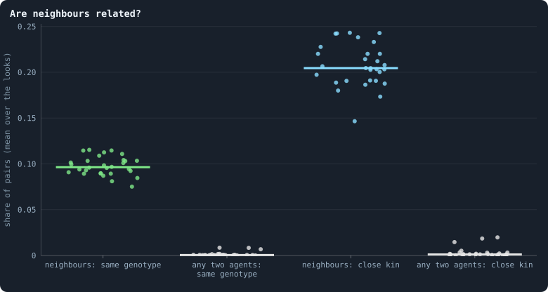

**Are neighbours related?** One dot per world. For the pairs of agents joined by a connection ("neighbours"), and for pairs of agents drawn at random from the whole world (2,000 per look), the share that carry the same genotype, and the share that are close kin: the same genotype, or one's genotype the parent of the other's, or both with the same parent genotype. At the start of the games of every 100th iteration from 500 on.

> [!example]- How to make this figure
> **Runs.** The 30 baseline runs `B1-100000-s001` … `B1-100000-s030`: the baseline B1 at 100,000 tokens, seeds 1 to 30, 1,500 iterations each (every setting is listed in [Thirty worlds](b1-lives-and-wealth.md#thirty-worlds)). They are made with `python3 gol_lab.py run E10`.
>
> **Data.** From each run's frames, `GraphOfLifeRuns/<run>/frames/`, read with `gol_store.read_frame(run, index)`; frame `2·t` is iteration *t* after reproduction and frame `2·t + 1` after the game.
>
> 1. For every 100th iteration t from 500 on, read frame `2·t`: each agent's genotype (`brain_ids`) and its parent genotype (`parent_brain_ids`).
> 2. For every connection of `edges`, test the two relations; also for 2,000 pairs of agents drawn at random (generator seeded with 11).
> 3. Divide the counts by the pairs, per run.
>
> **To make it again:** `python3 book_figures.py cooperation`.
<!-- /figure -->

Yes, strongly. In the median world, **9.6%** of neighbours carry the
same genotype, against **0.05%** of two agents drawn at random: 200
times as often. At 10,000 tokens it was 10.6% against 0.28%, 38 times. Counted
over all pairs of a world rather than a sample of them, chance is rarer still:
0.03%. [Like next to like](b1-the-network-size-and-scaling.md#like-next-to-like-how-alike-agents-are-at-a-distance) puts the ratio near 290.

Count close kin too: one's genotype the parent of the other's, or both sharing
a parent genotype. Then 20% of neighbours are kin, against 0.12% of random
pairs. The share of kin among neighbours is the same at both sizes. What a
larger world changes is how rare kin are far away.

This is the picture of [One world, many colours](measures-atlases-and-assembly.md#one-world-many-colours-what-the-viewer-can-colour-by) in
numbers: families live together. A brain's copies sit next to it, for two
reasons. A brain spreads by taking neighbouring nodes
([Where the tokens flow](b1-the-game-and-its-flows.md#where-tokens-flow)), and children are joined
to their parents.

So the precondition of kin selection is met: the relatedness *r* between
neighbours is high.

### Do agents treat their own kind differently?

<!-- figure cooperation/kin-stakes -->
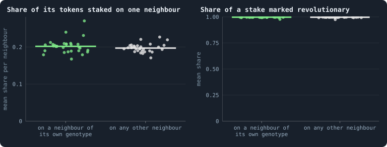

**Does an agent treat its own kind differently?** Only agents that had at least one neighbour of their own genotype and at least one of another, in the games of every 100th iteration from 500 on; one dot per world. Left: the share of its tokens an agent staked on each neighbour, averaged over the neighbours of its own genotype (green) and over the others (grey), then over the agents. Right: of what it staked on a neighbour, the share it marked revolutionary.

> [!example]- How to make this figure
> **Runs.** The 30 baseline runs `B1-100000-s001` … `B1-100000-s030`: the baseline B1 at 100,000 tokens, seeds 1 to 30, 1,500 iterations each (every setting is listed in [Thirty worlds](b1-lives-and-wealth.md#thirty-worlds)). They are made with `python3 gol_lab.py run E10`.
>
> **Data.** From each run's frames, `GraphOfLifeRuns/<run>/frames/`, read with `gol_store.read_frame(run, index)`; frame `2·t` is iteration *t* after reproduction and frame `2·t + 1` after the game.
>
> 1. For every 100th iteration t from 500 on, take the genotypes from frame `2·t` and the stakes from `decisions.allocations` of frame `2·t + 1`.
> 2. For each agent with neighbours of both kinds: the mean of `alloc` / `tokens` over each kind, and the mean of `revolt` / `alloc` over the neighbours it staked on.
> 3. Average over the agents of a run; one dot per run.
>
> **To make it again:** `python3 book_figures.py cooperation`.
<!-- /figure -->

No. Take the agents that had neighbours of both kinds. On average, an agent
staked 0.202 of its tokens on each neighbour of its own genotype, and 0.197 on
each other neighbour. Only 31% of these agents staked more on kin than on
others. And they mark 99.7% of what they stake on either kind as
revolutionary. At 10,000 tokens it was 99.7% on kin and 99.6% on others.

That is not surprising once one looks at what a brain can see
([What a brain sees](rules-in-detail.md#what-a-brain-sees)). It sees tokens and connections: its
own, the candidate's, and their neighbourhoods'. It reads messages and
random numbers. **Not genotypes.**

So a brain cannot tell kin from stranger, except through messages. A
lineage could, in principle, evolve a "password": send a particular
pattern, and treat those who send it back differently. Biologists call this a
**green-beard** (Hamilton 1964; Dawkins 1976). Nothing in the stakes says that
this has happened.

The pattern itself exists already, without any evolution.
[What agents say to each other](b1-brains-lineages-and-messages.md#what-agents-say-to-each-other) found that
every message names its writer's genotype. Two agents of one genotype write
the same message, but for a thousandth or so. Kin could tell each other by it.
What is missing is a brain that compares what it reads, and the
[baseline](b1-and-b2.md "The stated rules an experiment starts from and changes one thing of: B1 or B2.")'s brains barely see
([What the brains are like](what-the-brains-are-like.md)).

### When a node changes hands, does it stay in the family?

<!-- figure cooperation/succession -->
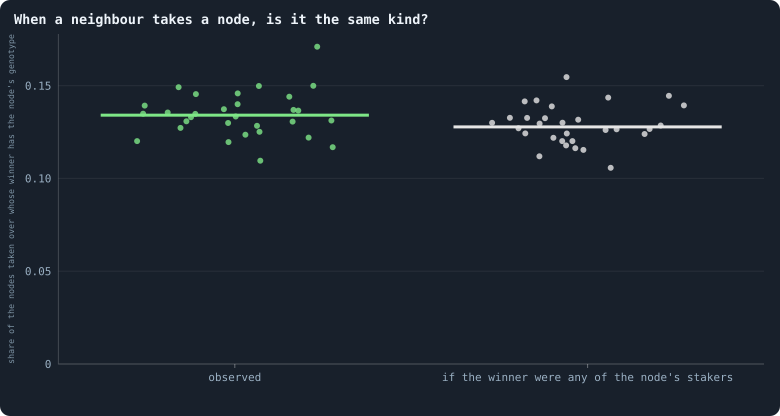

**When a neighbour takes a node, is it the same kind?** Nodes won by a neighbour in the games of every 100th iteration from 500 on; one dot per world. Left: the share in which the winner carried the same genotype as the agent whose node it took — a takeover that changes nothing in the brain. Right: the same share if the winner had been drawn at random from the neighbours that staked on the node.

> [!example]- How to make this figure
> **Runs.** The 30 baseline runs `B1-100000-s001` … `B1-100000-s030`: the baseline B1 at 100,000 tokens, seeds 1 to 30, 1,500 iterations each (every setting is listed in [Thirty worlds](b1-lives-and-wealth.md#thirty-worlds)). They are made with `python3 gol_lab.py run E10`.
>
> **Data.** From each run's frames, `GraphOfLifeRuns/<run>/frames/`, read with `gol_store.read_frame(run, index)`; frame `2·t` is iteration *t* after reproduction and frame `2·t + 1` after the game.
>
> 1. For every 100th iteration t from 500 on, read the genotypes in frame `2·t` and `decisions.winners` and `decisions.allocations` in frame `2·t + 1`.
> 2. For each node whose `winner` is not the node: is the winner's genotype the node's? And: of the agents other than the node that staked on it, the share with the node's genotype.
> 3. Per run: the first count, and the sum of the second, over the nodes taken.
>
> **To make it again:** `python3 book_figures.py cooperation`.
<!-- /figure -->

In the sampled games, neighbours took 2,411,000 nodes. In the median world,
the winner carried the node's own genotype in 13.4% of cases. If the winner
had been any of the neighbours that staked on the node, 12.8% would be
expected. Takeovers do not spare kin, nor seek them out.

### Do agents answer a stake with a stake?

<!-- figure cooperation/returned -->
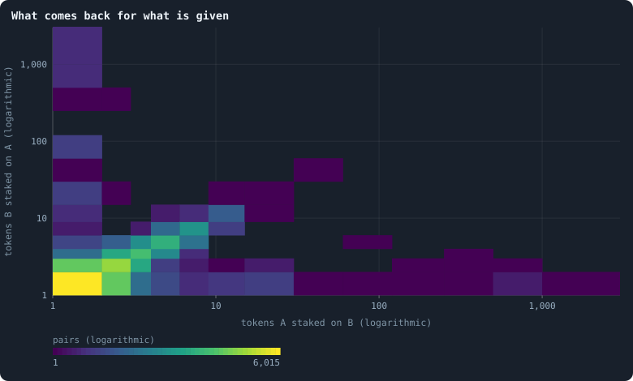

**What comes back for what is given.** Pairs of neighbours that both staked on each other in a game: how many tokens each staked on the other (12,000 pairs, up to 400 drawn at random per world, from the games of every 100th iteration from 500 on). A cell's colour is how many pairs fall in it; the diagonal is an even exchange. In the median world 82% of the pairs staked exactly the same on each other.

> [!example]- How to make this figure
> **Runs.** The 30 baseline runs `B1-100000-s001` … `B1-100000-s030`: the baseline B1 at 100,000 tokens, seeds 1 to 30, 1,500 iterations each (every setting is listed in [Thirty worlds](b1-lives-and-wealth.md#thirty-worlds)). They are made with `python3 gol_lab.py run E10`.
>
> **Data.** From each run's frames, `GraphOfLifeRuns/<run>/frames/`, read with `gol_store.read_frame(run, index)`; frame `2·t` is iteration *t* after reproduction and frame `2·t + 1` after the game.
>
> 1. From `decisions.allocations` of frame `2·t + 1`, for every 100th iteration t from 500 on, collect every pair (A, B) with a stake of A on B and of B on A.
> 2. Draw up to 400 pairs per run (generator seeded with 11) and count them in cells.
>
> **To make it again:** `python3 book_figures.py cooperation`.
<!-- /figure -->

Take the pairs of neighbours that staked on each other in a game. In the
median world, 82% of them staked **exactly the same** amount on each other.
And **66%** of all such pairs exchanged exactly one token each way. The
[correlation](statistics.md#two-numbers-together-correlation-a-fitted-line-and-logarithmic-axes "Whether two quantities go up and down together, from −1 to 1.") of the logarithms of the two stakes is 0.57. (At 10,000 tokens:
79%, 58% and 0.63.)

Is that reciprocity? Two observations say: not in the sense of the theory.
First, an equal exchange cancels: it changes neither balance
([Where the tokens flow](b1-the-game-and-its-flows.md#where-tokens-flow)). What it does is keep the
connection alive at its minimum price, paid by both. Second, it is what the
even split gives. Two poor agents, each splitting a few tokens evenly over a
few candidates, put one token on each other. It is a **handshake**, not a
favour returned.

Real reciprocity would mean that one agent stakes more on another *because*
the other staked on it, beyond what the even split gives. That is the third
measure [below](#how-cooperation-could-be-found-and-counted), not yet taken.

### How long partners last

Direct reciprocity needs the same two to meet again: the "shadow of the
future", *w*. How long do the same two brains face each other across a
connection?

<!-- figure cooperation/partners -->
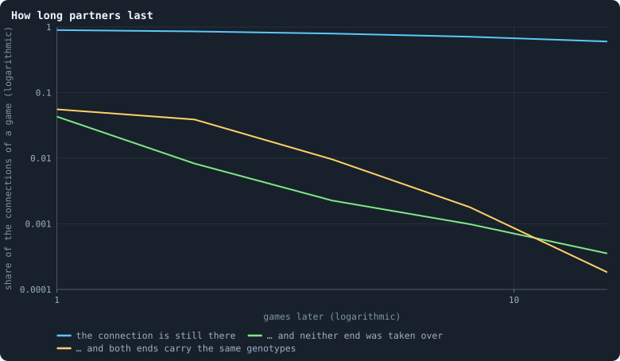

**How long partners last.** Of the connections at the start of a game, the share still there k games later (blue); still there with neither of its two nodes won by a neighbour in any of the k games in between, so that the same two brains face each other, changed at most by the small changes offered after every game (green); and still there with exactly the same two genotypes (yellow). Pooled over the 4,010,315 connections at the start of the games of every 200th iteration from 500 on, in the 30 worlds. Both axes are logarithmic.

> [!example]- How to make this figure
> **Runs.** The 30 baseline runs `B1-100000-s001` … `B1-100000-s030`: the baseline B1 at 100,000 tokens, seeds 1 to 30, 1,500 iterations each (every setting is listed in [Thirty worlds](b1-lives-and-wealth.md#thirty-worlds)). They are made with `python3 gol_lab.py run E10`.
>
> **Data.** From each run's frames, `GraphOfLifeRuns/<run>/frames/`, read with `gol_store.read_frame(run, index)`; frame `2·t` is iteration *t* after reproduction and frame `2·t + 1` after the game.
>
> 1. For every 200th iteration t from 500 on, take the connections of frame `2·t` and the genotypes of their ends.
> 2. For k = 1, 2, 4, 8, 16: read frame `2·(t + k)` — is the connection still in `edges`, and are the ends' genotypes the same? — and the `decisions.winners` of every game frame `2·(t + j) + 1`, j < k: was either end won by a neighbour?
> 3. Pool the counts over the runs and divide by the connections.
>
> **To make it again:** `python3 book_figures.py cooperation`.
<!-- /figure -->

The connections last: 90% of the connections at the start of a game are still
there a game later, and 60% sixteen games later. But the **brains** at their
ends do not. In only **4%** of connections do the same two brains face each
other one game later, with neither end won by a neighbour in between. After
two games it is 0.8%; after four, 0.2%.

The stage stays; the actors change almost every game. About half of all
nodes, and nearly every hub, are taken over in every game
([How the game is played](b1-the-game-and-its-flows.md#how-the-game-is-played-what-agents-stake-and-who-wins-the-nodes),
[Where the tokens flow](b1-the-game-and-its-flows.md#where-tokens-flow)).

Direct reciprocity needs *w* > *C*/*B*, so a benefit at least 1/*w* times its
cost. With *w* ≈ 0.04, that is a benefit twenty-five times the cost (twenty at
10,000 tokens, where *w* ≈ 0.05). In this world, nobody meets anybody twice.

### How cooperation could be found and counted

Nothing measured here shows cooperation beyond what the even split and kinship
by proximity produce. But "not found" depends on where one looks. Here are six
measures the notebook can use, each computable from the
frames every run already writes:

1. **Kin discrimination.** The ratio of stakes on kin to stakes on others,
   per neighbour (here 1.02; 1.01 at 10,000 tokens). A value well above 1
   would mean that brains recognise kin — through messages, since they cannot
   see genotypes.
2. **Hamilton's accounting.** For every stake: its cost *C* to the staker, its
   benefit *B* to the receiving node, and the relatedness *r* of the pair.
   Summed over a world, Σ(*rB* − *C*) says whether helping as practised pays
   the helping genes. (This is the regression form of Price's equation;
   Queller 1992.)
3. **Reciprocity beyond the split.** The correlation between *a*(*u* → *v*)
   and *a*(*v* → *u*) after subtracting what an even split would give each.
   Real reciprocity is what remains.
4. **Partnerships.** The distribution of how long the same two brains keep
   exchanging stakes, against the null of independent takeovers. Lasting
   partnerships would be the first sign of something above the individual.
5. **Coalitions that repeat.** Whether the same agents join forces to take
   nodes again and again.
6. **Groups that win.** Whether regions held by one family grow, survive or
   split more than mixed regions. That is selection between groups. It can be
   read from the families of [One world, many colours](measures-atlases-and-assembly.md#one-world-many-colours-what-the-viewer-can-colour-by)
   and the breaks of [How a world breaks](b1-the-network-size-and-scaling.md#how-a-world-breaks).

None of the six has been computed in the form given here. The work on the
second baseline, B2, judged progress another way. It played a world's
eras against each other
([How to tell a world that keeps evolving](how-to-tell-a-world-that-keeps-evolving.md)).
[Revolutions, handover and gifts: the switches the world was built with](what-the-switches-did-in-pilots.md#revolutions-handover-and-gifts-the-switches-the-world-was-built-with)
judges the rules made for B2 by that test.

Nearby measures were taken instead. Help itself was counted exactly by the
rules ([Help](#help)), with the three signs of cooperation
[above](#from-help-to-cooperation), in
[Gliders, and who helps whom](cooperation-help-and-gliders.md#gliders-and-who-helps-whom).
[Flow modules: the groups tokens stay in](b1-the-game-and-its-flows.md#flow-modules-the-groups-tokens-stay-in) followed how long
the groups that tokens keep to last, pairs of partners among them. And in
pilot worlds under B2's rules, connected groups of one genotype and of close
kin shrank over time, in every world.

### What the rules would have to give

For open-ended evolution this page points at rules, not brains. Three things
would open roads to cooperation:

- an agent that keeps its identity when its node is taken;
- a way to recognise kin;
- a way to commit to a partner.

[Questioning the mechanics](questioning-the-mechanics.md) examines the rules
responsible, and
[What the measurements say about open-ended evolution](what-the-baseline-world-is.md#what-the-measurements-say-about-open-ended-evolution)
proposes changes.

The work on B2 went some way down these roads. B2 gives an incumbent an
advantage, so that a brain keeps its node longer
([Who dies, and why](building-b2-and-the-search-for-a-healthy-rich-world.md#who-dies-and-why)). It
gives agents brains that see, which could read the names of their kin
([Brains that see, and worlds that break](building-b2-and-the-search-for-a-healthy-rich-world.md#brains-that-see-and-worlds-that-break)).
Whether they do has not been measured. A memory of what each neighbour staked
in the last game was tried too. It changed 11 to 24% of decisions, and
evolution stopped all the same.

Two attempts to make helping pay failed
([Why evolution stops](how-to-tell-a-world-that-keeps-evolving.md#why-evolution-stops)).
Stakes that support a neighbour's defence were given up by evolution. A yield
on stakes returned built stars rather than partnerships.

A way to commit to a partner was tested later: alliances by mutual consent
([Alliances](another-game.md#alliances)). The agents took them up at once.
But an alliance protects by peace, not by rescue
([Gliders, and who helps whom](cooperation-help-and-gliders.md#gliders-and-who-helps-whom)).
[Who helps whom](cooperation-help-and-gliders.md#who-helps-whom) puts this beside every other attempt.

### What we learned (do agents cooperate)
- **Help has an exact meaning here.** A stake helps if, without it, the
  neighbour staked on would have been more likely to lose its node. Only
  revolutions and pooled alliances make help possible. Help is cooperation
  only if it goes to kin, comes back or goes round more than chance would have
  it.
- **The precondition is there; the behaviour is not.** Kin live together, so
  kin selection could work. But brains cannot see kinship, and they spread
  their stakes as evenly over kin as over strangers.
- **There is no future to reciprocate in.** Connections persist, but the
  brains at their ends are replaced almost every game. Of the five roads to
  cooperation, the rules close direct reciprocity almost completely.
- **The equal exchanges are handshakes.** They keep connections alive, at the
  price the rules set, and need no cooperation to explain.
- **For open-ended evolution, the rules have to change, not the brains.** An
  agent would need to keep its identity when its node is taken, to recognise
  kin, and to commit to a partner.

### How this was made (do agents cooperate)
Every figure of this page says, folded beneath it, which runs it reads and
how. All five are drawn again with `python3 book_figures.py cooperation`, and
their numbers are kept in `book/results/cooperation.json`.

The numbers for the worlds of 10,000 tokens come from the same measurement on
Experiment 2: thirty worlds, `B1-10000-s001` … `-s030`, of 3,000 iterations
each (`python3 gol_lab.py run E02`). The 26 that lived to the end were read.

#### The runs of Experiment 10

Experiment 10 is 30 runs: B1 at 100,000 tokens, seeds 1 to 30, 1,500
iterations each.

<!-- runs E10 -->
> [!info]- The runs behind this page
> **30 runs.** Every condition below is run once for every seed (1 to 30), for 1,500 iterations — or until its world dies out. Every setting is that of the baseline **B1** (the algorithm exactly as a new run is offered it) unless the condition changes it.
>
> - **baseline** — changes nothing: B1 as it is; 100,000 tokens. Runs `B1-100000-s001` … `B1-100000-s030`.
>
> To make these runs again: `python3 gol_lab.py run E10`, or ▶ in the Research Notebook tab of a computer running `gol_server.py`. Each run writes its settings, seed and engine version beside its frames, in `GraphOfLifeRuns/<run>/meta.json` and `provenance.json`.

> [!info]- Every setting of these runs
> | setting | baseline | what it is |
> |---|---|---|
> | [`total_tokens`](settings.md#total_tokens) | 100,000 | The number of tokens in the world, *T*. It never changes during a run. |
> | [`n_nodes`](settings.md#n_nodes) | 0 | How many founders the world starts with. 0 means one founder per hundred tokens: *n* = ⌊*T* / 100⌋. |
> | [`k_neighbors`](settings.md#k_neighbors) | 0 | How many neighbours each founder starts with in the ring. 0 means *k* = max(⌊*n* / 100⌋, 5); an odd *k* is wired as *k* − 1. |
> | [`rewire_p`](settings.md#rewire_p) | 0.2 | In the starting ring, the probability that a connection is moved to a founder chosen at random (Watts–Strogatz). |
> | [`hidden_layers`](settings.md#hidden_layers) | 50, 45, 40, 35, 30 | The widths of the brain's hidden layers, in order from input to output. |
> | [`hidden_activation`](settings.md#hidden_activation) | sigmoid | The curve each hidden unit applies to its sum: `sigmoid`, which passes on at most a quarter of a change, so that deep brains barely respond to what they see, or `tanh`, the same S-shape centred on zero, through which a change still passes in several layers. |
> | [`brain_kind`](settings.md#brain_kind) | float16 | How weights are stored: `float` (64-bit), `float16` (16-bit, computed in 64-bit) or `binary` (−1, 0, +1). |
> | [`brain_bits`](settings.md#brain_bits) | 16 | Only for binary brains: how many input rows encode one number. Unused by float and float16 brains. |
> | [`message_amount`](settings.md#message_amount) | 30 | How many numbers one message holds. Each agent sends one message to itself and one to each neighbour, every phase. |
> | [`random_input_amount`](settings.md#random_input_amount) | 5 | How many random numbers, drawn uniformly from −2 to 2, a brain reads per neighbour, every time it looks. |
> | [`exchange_messages`](settings.md#exchange_messages) | on | Whether agents send and read messages at all. |
> | [`message_prepass`](settings.md#message_prepass) | on | Whether every phase begins with an extra look in which agents only write messages, so the look that acts reads messages written this phase. |
> | [`allow_handover`](settings.md#allow_handover) | on | Whether a parent may move some of its own connections to its newborn child. |
> | [`allow_revolutions`](settings.md#allow_revolutions) | on | Whether a coalition of smaller stakers can take a node from its largest staker (see the note *How a coalition takes a node*). |
> | [`contest`](settings.md#contest) | largest | Who takes a contested node: the `largest` stake as the game weighs it, or a staker drawn by `lottery` with a chance in proportion to its stake (needs revolutions off). |
> | [`allocation`](settings.md#allocation) | full | How the game's stakes are placed: all at once (`full`), or a token at a time in rounds with the game as it stands in view, the poorest done first (`weakest_first`) or the richest starting alone (`strongest_first`), as the original engine played. |
> | [`allow_gifting`](settings.md#allow_gifting) | off | Whether agents may give tokens to neighbours during reproduction. Off in both baselines; on in a few pilots, in Experiment 24 and in half the worlds of the screen. |
> | [`random_decisions`](settings.md#random_decisions) | off | The control: every number a brain would produce is replaced by a random draw from the standard normal distribution. |
> | [`prune_after`](settings.md#prune_after) | blotto | After which phase connections that carried no tokens are cut: `blotto` (the game), `reproduction`, or `both`. |
> | [`inactive_window`](settings.md#inactive_window) | phase | How long a connection may go unused: `phase` means it must carry tokens in the phase being judged; `iteration` allows the two last phases. |
> | [`redistribution`](settings.md#redistribution) | uniform | How the tokens of removed agents are shared: `uniform` gives every survivor the same chance at each token; `by_tokens` weights by what a survivor holds; `poorest` raises the poorest to one common level first; `newborns` gives them to this iteration's children, `parents` to their parents, once per child (both `uniform` in an iteration without births); `children` leaves each dead agent's estate to its own living children (`uniform` where there are none); `local` lets each estate flow through the network to the nearest living agents, split evenly at every step. |
> | [`tokens_created_per_phase`](settings.md#tokens_created_per_phase) | 0 | Tokens added to the world at every cleanup. 0 keeps the supply fixed. |
> | [`mutate_on_replication`](settings.md#mutate_on_replication) | off | Whether a brain changes only when it is copied — into a newborn, or into a node its owner has just won — instead of also after every game, wherever it sits. |
> | [`incumbency`](settings.md#incumbency) | 1.0 | How many times over an agent's stake on its own node counts when the game decides who takes the node. 1 is the old rule. |
> | [`birth_links`](settings.md#birth_links) | 0 | How many of its parent's neighbours a newborn is joined to, drawn at random, besides its parent itself; 0 leaves every link to the brain's choice. |
> | [`mend_on_death`](settings.md#mend_on_death) | off | Whether the neighbours of an agent that dies are joined up where its death would leave them in separate pieces. |
> | [`prune_needs`](settings.md#prune_needs) | 0 | How many neighbours the two ends of an unused connection must share for it to be cut; 0 cuts every unused connection. |
> | [`valence`](settings.md#valence) | 0 | The most connections an agent's brain may choose to hold (0 = no limit). An agent at its limit cannot have a child. |
> | [`link_token`](settings.md#link_token) | off | Whether every link holds one token: its maker pays for it, a lapsing link gives it back to one of its ends, and a link of a dead agent to the end that lives on, so the links can never outnumber the tokens. |
> | [`link_upkeep`](settings.md#link_upkeep) | off | Whether an agent may pay a token an iteration to keep a link, each brain deciding for each neighbour: `paid_or_used` keeps a link that was paid for or used, `paid_only` only one that was paid for; `off`, only use keeps a link. |
> | [`upkeep_to`](settings.md#upkeep_to) | end | Where a link's upkeep goes: to the link's other end (`end`), or into the estate of the dead (`estate`), shared out by the world's redistribution rule. |
> | [`keep_home`](settings.md#keep_home) | 0.0 | The share of an agent's tokens — rounded up, never less than one — that stays on its own node whatever its brain says; a parent also keeps one. 0 is the old rule. |
> | [`max_age`](settings.md#max_age) | 0 | The age at which an agent dies (0 = never); its tokens are shared out like those of any other dead agent. |
> | [`buy_life`](settings.md#buy_life) | off | Whether an agent that has reached max_age may live on by paying one token an iteration into the estate of the dead — never its last, so one with a single token left dies. Needs max_age. |
> | [`min_child`](settings.md#min_child) | 1 | The fewest tokens a child can be born with; a parent that would give less has no child. |
> | [`child_floor`](settings.md#child_floor) | fixed | The least a child may start with: min_child alone (fixed), or also the median holding of its parent's neighbours (neighbours), so that a world grows only as rich as it is. |
> | [`mix_at_birth`](settings.md#mix_at_birth) | off | Whether a newborn's brain is its parent's mixed with a mate's — one of the parent's neighbours, drawn at random — each hidden unit whole from one or the other by an even chance, before it mutates; off, a newborn has a copy of its parent's brain. |
> | [`mix_mates`](settings.md#mix_mates) | any | Under mix_at_birth, who may be the mate: any neighbour of the parent, or only parents — a neighbour with a living child of its own (with none, the newborn's brain is a copy). |
> | [`mate_pays`](settings.md#mate_pays) | off | Under mix_at_birth, whether the mate pays the child as many tokens as the parent gave it, as far as it can and never its last. |
> | [`self_message`](settings.md#self_message) | own | What an agent writes to itself, which each neighbour reads: what its own column says (own), or the largest, number by number, of what it writes to anyone (largest), so that news one column marks reaches every neighbour. |
> | [`link_search`](settings.md#link_search) | off | Whether an agent may reach beyond its neighbours to propose a link: off; jump, a walk as many steps long as the tokens it spends in one iteration, with a link proposed where it ends; walk, a scout that goes one step further in every iteration it pays for; or reach, a jump whose steps are free, as many as the tokens it holds would pay for. A paid step costs one token, paid to the agent it enters, and never the last. |
> | [`link_steering`](settings.md#link_steering) | random | Which way each step of a search goes: to a neighbour drawn at random, or to the one the searcher would most like a link with (looking). |
> | [`link_consent`](settings.md#link_consent) | mutual | Who has to agree to a link a search proposes: both ends (mutual), or only the one who proposes (forced). Nobody at its valence gets a new link either way. |
> | [`proto`](settings.md#proto) | none | Rules first played in the pilots' prototype, by name: came_from and helped_by (an input row each), contest = lottery, pool by genotype or family, kin_sense, tag_rate, mate_pays, grow, unit_token, link_token. Empty in every run but those that ask for one; only the prototype's world plays them (see the settings note). |
> | [`mutation_probability`](settings.md#mutation_probability) | 0.2 | The probability that a brain changes when it is copied to a child, and again, for every brain, after every game. |
> | [`mutation_noise_std`](settings.md#mutation_noise_std) | 0.2 | How large a change to one weight is: a normal draw with standard deviation this times 1/√(fan-in) of its layer. |
> | [`mutation_sparsity`](settings.md#mutation_sparsity) | 0.1 | The share of a brain's numbers a change touches; also the probability, for each weight matrix and bias vector, of a rarer reset that redraws that share of it. |
> | [`extinction_threshold`](settings.md#extinction_threshold) | 20 | A run stops, as extinct, when an iteration ends (after its game) with this many agents or fewer. |
> | seeds | 1 to 30 | one run per seed |
> | iterations | 1,500 | how far each run goes, unless its world dies first |
>
> A value in **bold** differs from the baseline B1.
<!-- /runs -->

## Gliders, and who helps whom

When an agent takes a neighbour's node with at least half of its tokens, its
wealth and a copy of its brain move there together. They form chains far more
often than chance: *puffers* in B2, a lineage copying itself outward, and
*gliders* in B1, rich agents moving on. But no chain keeps a direction, and no
ring of tokens lasts fifty games; what lasts is gifts running downhill. Help,
counted exactly by the rules, is almost absent in B2, a by-product of
revolutions in B1, and rare among allies, whom peace protects instead. None of
it is cooperation, and a sense of direction and a sense of who helped, given to
the brains, did not change that.

### Patterns that outlast their parts

In Conway's Game of Life, every cell of a grid is alive or dead. A simple rule
about its eight neighbours decides its next generation. The interesting
objects are not the cells but the **patterns** they make. A **glider** is five
live cells that rebuild themselves one cell further on, diagonally, every four
generations. The cells that make it are born and die; the glider goes on.

Patterns are sorted by what they do:

- a *still life* never changes;
- an *oscillator* repeats in place, like the *blinker*: three cells in a row
  that turn into three in a column and back;
- a *spaceship* moves, and the glider is one;
- a *puffer* moves and leaves debris behind it;
- a *gun* stays where it is and sends out gliders.

Built from such patterns and the ways they meet, the Game of Life goes far: up
to machines that compute anything.

Could the worlds of Graph of Life hold patterns like these? The measures of
open-ended evolution so far look at agents one by one.
They ask what an agent holds, what it stakes, and how its brain does in a
contest.
[Why evolution stops](how-to-tell-a-world-that-keeps-evolving.md#why-evolution-stops)
found one blind spot in them: contests too short for what pays over a
lifetime. The author suggested another. Perhaps the worlds hold structures
above the single agent that none of the measures can see. They might be
cyclic, like the gliders of the Game of Life. And they might be harder to spot,
because they live on a network rather than a grid.

A network has no shapes: no diagonal, no row of three. So a pattern has to be
recognised by what it does, and its motion measured in steps through a network
that itself changes. Every pattern found must also be compared with what chance
would make. A world of 3,000 agents makes almost any small pattern somewhere by
accident.

Cooperation is the other thing such structure could hide.
[Alliances](another-game.md#alliances) *gave* the agents a way to cooperate.
It did not ask whether the worlds without alliances cooperate in some way of
their own.

This page reads the record of play: every game, with every agent's stakes. The
worlds are B2's ten worlds of Experiment 16 and the first ten worlds of B1's
baseline set, all of 10,000 tokens. Read are the games of iterations 1,000 to
2,000: settled worlds, long after the founders. For alliances, pilot worlds
with and without them are played on from a checkpoint for 200 iterations.
Their games are recorded in the same form
([How this was made](#how-this-was-made-gliders)).

### Chains of takeovers

The game moves two things over the network: tokens, and copies of brains. When
an agent takes a neighbour's node, the node gets a copy of the agent's brain,
and it keeps every token staked on it.

Call a takeover made with at least half of the taker's tokens a **move**. In a
move, the agent's wealth and a copy of its brain go to the node taken together,
as one parcel: a **packet**. If, in the next game, the node taken makes a move
of its own, the packet has travelled on. A run of such moves, each made from
the node the last one took, is a **chain**.

#### A chain, step by step

Take four nodes in a row, P, Q, R and S, each joined to the next. The agent on
P holds 20 tokens, the agent on Q holds 4, and the agent on R holds 6.

**Game 1.** P stakes 15 tokens on Q's node and 5 on its own. Q stakes its 4 at
home. P's 15 is the largest stake on Q's node, so P takes it. In B2, Q's own
stake counts one and a half times, as 6, and 15 still wins. Q's node now
carries a copy of P's brain, and it holds the 19 tokens staked on it. P staked
15 of its 20 tokens, at least half: this takeover is a move, and its packet is
15 tokens.

**Game 2.** The agent now on Q, P's brain with 19 tokens, stakes 12 on R's node
and 7 on its own. R stakes its 6 at home, and 12 beats them (or B2's 9). Since
12 is at least half of 19, this is a move too, made from the node the last move
took. The packet has travelled from P to Q to R: a chain of two moves.

What the chain leaves behind depends on the node it left:

- If no neighbour outbid the 5 tokens P kept at home, P keeps its node. A copy
  of the brain stays behind while the packet moves on: the chain is a
  **puffer**, leaving a copy at every step.
- If a neighbour took P's node, the brain is gone from it. The same happens if
  P staked everything away and nobody staked on its node, which then starves.
  The chain is a **glider**: it carries the brain on and leaves nothing.
- If, in game 3, the agent on R takes Q's node back, the packet swings between
  two nodes: a **blinker**.
- A node that launches chain after chain while staying where it is, is a
  **gun**.

The drawing shows each kind over three games.

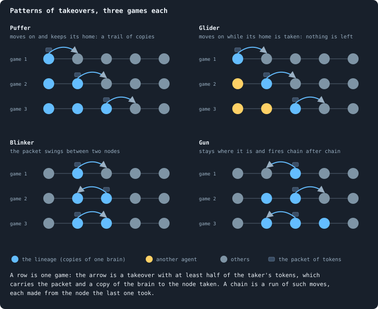

#### Against chance

Chance is the measure of all of these. Suppose every node holding a packet
moved it on with the same chance as any agent makes a move in a game, whatever
came before. Call that chance *p*: the share of agents that make a move in a
game. A chain would then make a second move with chance *p*, a third with
chance *p*², and so on. Of *N* chains, about *N* (1 − *p*) *p*^(*L*−1) would
have exactly *L* moves.

In words: after every move, a coin decides whether the packet goes on, and it
says yes with chance *p*. That chance is about 0.07 a game in B2, and 0.06 in
B1. At 0.07, one chain in fifteen would make a second move, and one in two
hundred a third.

<!-- figure patterns/chains -->
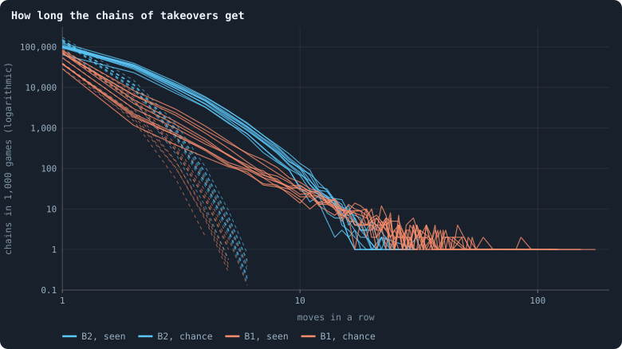

**How long the chains of takeovers get.** One line per world. A move is a takeover made with at least half of the taker's tokens; a chain is a run of moves, each made from the node the last one took. Dashed: the chains there would be if every node holding a packet moved it on with the same chance as any agent moves one in a game, whatever came before.

> [!example]- How to make this figure
> **Runs.** The ten B2 worlds of Experiment 16, `B2-10000-s001` … `-s010`, and the first ten worlds of the baseline set, `B1-10000-s001` … `-s010` (B1 at 10,000 tokens, Experiment 2). Both record every game with every agent's stakes; read are the games of iterations 1,000 to 2,000.
>
> **Data.** From each run's frames of the game phase, with its agents' decisions.
>
> 1. In every game, find the moves: an agent's stake on a neighbour's node that took it and was at least half of the agent's tokens (`research/oee/checks/gliders.py`).
> 2. A move made from a node that a move took in the game before continues that chain; any other starts one. Count the chains by their number of moves.
> 3. Chance: with p the share of agents that make a move in a game, averaged over the games (`structures.py`, `packet_go_on_chance`), and N the chains, N (1 − p) p^(L−1) chains would have L moves.
>
> **To make it again:** `python3 book_figures.py patterns`.
<!-- /figure -->

The chains are far longer than that. **In B2 almost every takeover is a
move**: 99.6% of the nodes taken were taken with at least half of the taker's
tokens. Chains of three moves or more are 23 times as many as chance would
make (18 to 54 times in the ten worlds). And 31% of all takeovers belong to
them. The longest chain of a world has 18 to 32 moves.

**In B1** only 11% of takeovers are moves, since its agents spread their
tokens over every neighbour. Chains of three or more are 11 times chance (6.5
to 26). And the longest are longer: 69 to 175 moves.

#### Puffers in B2, gliders in B1

<!-- figure patterns/zoo -->
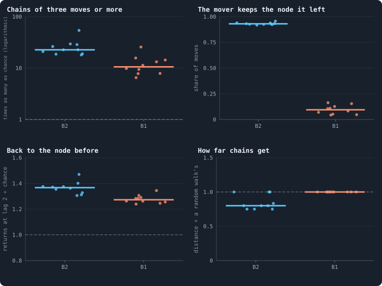

**What the chains are.** One dot per world, the bar the median of ten. Chains of at least three moves, over games 1,000 to 2,000. Top right: after how many of their moves the mover still held its own node, a puffer leaving copies behind (high) or a glider leaving nothing (low). Bottom left: how often a move went back to the node the packet held two moves before, divided by the chance of picking that node among the mover's neighbours. Bottom right: the distance from a chain's first node to its last, divided by a random walk's of the same length from the same node, for the 300 longest chains of each world.

> [!example]- How to make this figure
> **Runs.** The ten B2 worlds of Experiment 16, `B2-10000-s001` … `-s010`, and the first ten worlds of the baseline set, `B1-10000-s001` … `-s010` (B1 at 10,000 tokens, Experiment 2). Both record every game with every agent's stakes; read are the games of iterations 1,000 to 2,000.
>
> **Data.** From each run's frames of the game phase, with its agents' decisions.
>
> 1. Find the chains as for the figure above (`research/oee/checks/gliders.py`).
> 2. Chance of a chain of at least three moves: N p² for N chains and p as above (`structures.py`).
> 3. For every move, note whether the mover won its own node in the same game.
> 4. For every move from the third on, note whether it went to the node the packet held two moves before, and the chance 1/k of that node among the mover's k neighbours.
> 5. Distance: steps through the network at the chain's end between its first and last node; the walk's: the median of five random walks with as many steps from the first node.
>
> **To make it again:** `python3 book_figures.py patterns`.
<!-- /figure -->

**B2's chains are puffers.** The mover still holds the node it left after 93%
of its moves, and it never leaves it to starve. A chain is a
lineage copying itself outward, node by node. Its
packet is small: three tokens at the start and two at the end, in the median
of each world's 300 longest chains.

**B1's chains are gliders.** The mover keeps the node it left after only 9% of
its moves. After 8% that node starves, and after the rest another agent takes
it. The brain moves on, and the packet grows as it goes, from 18 tokens to 82.
B1's gliders are rich agents travelling the network, gathering what is staked
on the nodes they take.

In both, the brain changes as it goes. In B2 a brain may change by
mutation each time it is copied, and in B1 every brain may also
change after every game. In the median of the longest chains, after 70% of the
moves the node taken no longer carries the genotype the chain
started with.

Here is one chain of each kind, drawn on its network: of each world's 300
longest, the one that took the most different nodes. B2's took 28 nodes in 31
moves, patch after patch. B1's took 66 in 100, round and round one region of
its world. It carried a fortune that grew from 380 tokens to 1,358, a seventh
of all the tokens in that world.

<!-- figure patterns/example -->
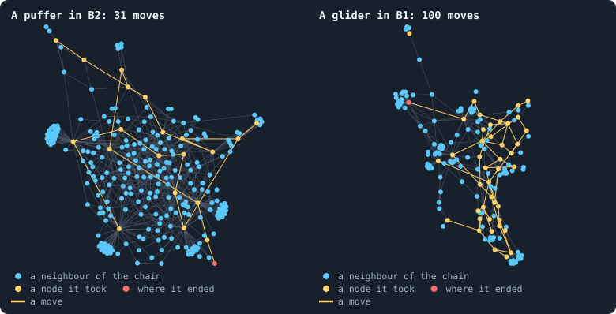

**Two chains on their networks.** Left, in `B2-10000-s001`, the chain of its 300 longest that took the most different nodes: 31 moves over 28 nodes in games 1,120 to 1,150, its packet 4 tokens at the first move and 2 at the last. Right, the same for `B1-10000-s001`: 100 moves over 66 nodes, games 1,544 to 1,643, its packet 380 tokens, then 1358. Drawn is the network of each chain's last game around the nodes it took, with their neighbours; the chain's moves are the coloured links, drawn even where the connection a move crossed has gone since. A node the chain took that no longer exists at its last game is not drawn, the node where it began among them.

> [!example]- How to make this figure
> **Runs.** The ten B2 worlds of Experiment 16, `B2-10000-s001` … `-s010`, and the first ten worlds of the baseline set, `B1-10000-s001` … `-s010` (B1 at 10,000 tokens, Experiment 2). Both record every game with every agent's stakes; read are the games of iterations 1,000 to 2,000.
>
> **Data.** From the two runs' frames of the game phase, with their agents' decisions.
>
> 1. Track the chains as for the figures below and keep the 300 longest of each world, with the nodes each took (`research/oee/checks/gliders.py`).
> 2. Of those, take the chain that took the most different nodes.
> 3. Take the network of its last game, the nodes it took that are still there and their neighbours; add the moves as links; lay it out with `networkx.forceatlas2_layout(G, max_iter=300, seed=1)`.
>
> **To make it again:** `python3 book_figures.py patterns`.
<!-- /figure -->

#### They blink a little

A move goes straight back to the node the packet has just left (in the example,
from R back to Q) more often than chance. In B2 it does so 1.37 times as often
as a random pick among the mover's neighbours would (1.31 to 1.47). In B1 it
does so 1.27 times as often.

In B2 the likely reason is in the rules. The node a packet came from has just
staked at least half of its tokens away. So it is now among the weakest of the
new holder's neighbours.

Going round a triangle is rare in both: a third move that brings the packet
back to the node where the chain began. In B1 it is no more common than
chance.

#### They wander

A chain gets no farther from where it started than a random walk would: as
many steps, from the same node, on the same network. It gets 0.8 of the walk's
distance in B2, and 1.0 in B1. A glider in the Game of Life flies straight;
these have no direction.

Nothing an agent senses says from which neighbour it came. Its inputs are its
own and each neighbour's tokens and connections, messages and
noise ([What a brain sees](rules-in-detail.md#what-a-brain-sees)). Messages could carry it in
principle. But the brains write the name of their genotype in them
([What agents say to each other](b1-brains-lineages-and-messages.md#what-agents-say-to-each-other)). Along a
puffer's trail, every neighbour carries the same name.

#### Guns without a rhythm

The nodes that launch chains launch them very unevenly. If every launching
node launched at the same rate, the variance of the launches per node would
equal their mean. It is 2.6 times their mean in B2, and 13 times in B1. In the
median world, the busiest node launched 34 chains in 1,000 games in B2, and 128
in B1.

But a gun fires without a rhythm. Counted by their length, the gaps between one
node's launches fall off steadily from a single game. There is no period at
which a gun fires.

#### Musical chairs

In B1, three quarters of all takeovers are made by an agent whose own node is
taken in the same game. Everyone moves up a seat.

Two agents taking each other's nodes in one game is a **swap**. In B1, swaps
happen as often as if every taker had picked its targets at random among its
neighbours. They are 1.02 times as common as that (0.99 to 1.04 in the ten
worlds). [Loops](measuring-networks.md#loops "A path through the network that comes back to where it started without using a connection twice.") of three agents or more, each taking the
next one's node in the same game, are common too. They happen 1,500 to 4,800
times in a world's 1,000 games, with up to fourteen agents round one loop. How
many chance would make is not known.

In B2 swaps are rarer than chance, 0.54 to 0.85 of it. Loops of three or more
almost never happen: 0 to 8 in a world's 1,000 games, among a quarter of a
million takeovers.

### Channels and feuds

A stake from one agent on the same neighbour, game after game, is a
**channel**. Its chance level supposes that each agent staked on as many of
its neighbours as it did, but picked them at random. In B2 a channel that
carried tokens in one game carries them again in the next 1.5 times as often
as that: 0.117 against 0.077. In B1 the agents stake on almost every neighbour
every game. So channels repeat 92.6% of the time, against 93.6% by chance.

Two agents staking on each other for three games or more look, in a record of
stakes, like partners. In B2 they are not. Agents in such a pair keep their
own node less often than other agents that stake out: 0.80 of the time against
0.89. They do so in every one of the ten worlds. In B2 a stake on someone's
node is an attack. Two agents attacking each other game after game are in a
**feud**. [Flow modules](b1-the-game-and-its-flows.md#how-long-modules-live) finds B2's flow
falling into pairs that last longer than chance would have them. The two
measures have not been compared, so whether those pairs are these feuds is not
known.

In B1 the pairs keep their nodes about as often as others: 0.44 against 0.41,
more often in seven worlds and less often in three. In the pilots without
alliances the feuds are worse: 0.49 against 0.88, and 0.48 against 0.86.

Among allies, most lasting pairs are allied: 85% and 56% of them in the two
worlds read from iteration 500. In their game, an ally's stake counts for the
owner's side. Yet agents in such pairs keep their nodes *less* often than
other agents that stake out: 0.94 against 0.97, and 0.91 against 0.95.

Help goes where it is needed, so those who get it are those under attack.
Comparing them with the rest measures the attack, not the help. To see help,
it has to be defined by what it does in the game itself. That comes after the
tokens.

### Where the tokens go

Every stake moves tokens over a connection, to the node staked on. Add up what
each connection carried each way over a stretch of 50 games. What went one way
minus what came back is the connection's **net flow**. That flow splits
exactly into two parts. One runs downhill, from some agents to others. The
other goes round loops: a **circulation**
([Flows that go round](measuring-tokens.md#flows-that-go-round) shows how, with a
worked example).

Tokens going round a ring of agents, each giving to the next, would be a Kula
ring. Bronisław Malinowski described the one of the Trobriand Islands:
armshells and necklaces passed from island to island, round and round.

A network with loops makes some circulation by chance. So the chance level
keeps each connection's amount and throws its direction at random
([Against what?](measuring-tokens.md#against-what)). The flow is also split by what
its stakes did. A **gift** is a stake that did not take its target: its tokens
went to whoever held the node. A **takeover** is a stake that did.

<!-- figure patterns/flows -->
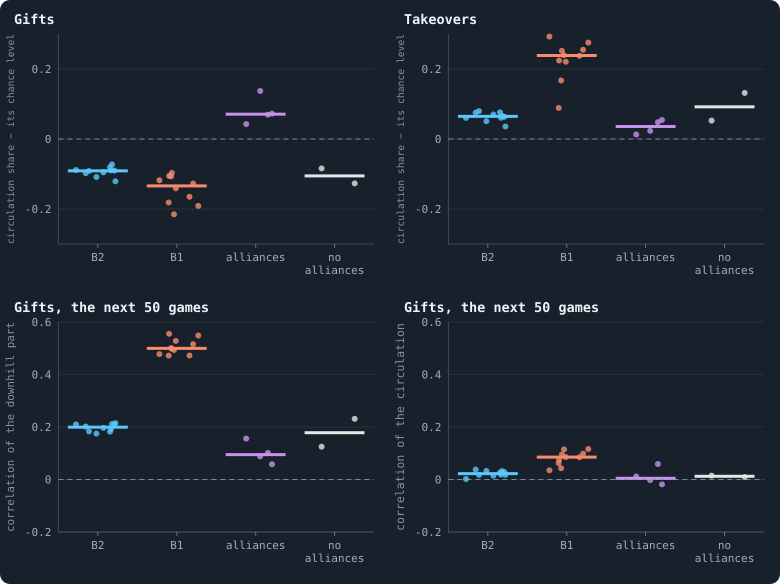

**Where the tokens go.** One dot per world, the bar the median. The tokens each connection carried, net, over 50 games, split into the part that runs downhill and the part that goes round loops (the note *Flows that go round*). Top: how much more of the flow goes round than if each connection's net flow had a random direction; above zero it goes round, below it runs downhill. Gifts are stakes that did not take their target, takeovers stakes that did. Bottom: how much of each part comes back on the same connections in the next 50 games.

> [!example]- How to make this figure
> **Runs.** The ten B2 worlds of Experiment 16, `B2-10000-s001` … `-s010`, and the first ten worlds of the baseline set, `B1-10000-s001` … `-s010` (B1 at 10,000 tokens, Experiment 2). Both record every game with every agent's stakes; read are the games of iterations 1,000 to 2,000. Pilot worlds of [Alliances](another-game.md#alliances) (`GraphOfLifeRuns/.pilots`): with alliances `A10k/allies-s1` and `-s2` from iteration 500 and `AL/allies10k-s3` and `-s4` from iteration 2,000; without, `A10k/ctrl-s1` and `-s2` from iteration 500. Each goes on from its checkpoint for 200 iterations with every game recorded in the lab's form (`python3 research/oee/checks/pilot_frames.py <world> --at <iteration> --games 200`).
>
> **Data.** From the recorded games.
>
> 1. Add up, over each stretch of 50 games, the tokens staked from each node on each neighbour's node, one way minus the other, separately for gifts and takeovers (`research/oee/checks/circulation.py`).
> 2. Find the pressure that explains as much of that net flow as possible (least squares, by conjugate gradients on the network's Laplacian); the circulation is the rest. Its share is its sum of squares over the flow's.
> 3. Chance level: the same with each connection's direction thrown at random, four times, averaged.
> 4. Persistence: over the connections two consecutive stretches both used, the correlation of their downhill parts, and of their circulations.
> 5. Each world's number is the median over its stretches.
>
> **To make it again:** `python3 book_figures.py patterns`.
<!-- /figure -->

**Gifts run downhill, and keep running down the same slopes.** In all twenty
worlds, less of the gift flow goes round than chance would make. It is 0.09
less in the median B2 world, and 0.13 less in B1. So gifts flow from some
agents to others. And the slope lasts. The downhill part of one stretch
correlates with the next stretch's on the same connections: 0.20 in B2, and
0.50 in B1.

In B1, whose agents spread their stakes over every neighbour, the gifts drain
towards the best-connected agents. Picture each agent's height on the slope:
tokens run from high agents to low ones. In two worlds checked, the rank
correlation of that height with an agent's number of
connections is −0.28 and −0.33. That is the even split again, tokens settling
in proportion to connections
([The game as a random walk](b1-the-game-and-its-flows.md#the-game-as-a-random-walk)).
In B2, whose gifts are failed raids, they drain weakly towards the richer
(−0.16 in two worlds). That is tribute, paid by failed raids to whoever
withstood them.

**Takeovers go round, but never in the same place twice.** More of the
takeover flow goes round than chance would make, in every world: 0.065 more in
B2, and 0.24 more in B1. But the circulation of one stretch has nothing to do
with the next's: the correlation is 0.00 in both. The loops are made and gone
within 50 games. The chains above are their likeliest makers. A route through
a network counts as circulation even when it never closes
([What it can and cannot say](measuring-tokens.md#what-it-can-and-cannot-say)).

Taken whole, the net flow of fifty games goes round more than chance: about
0.2 more in B1, and less than 0.1 more in B2.
[A greedy count and an exact one](b1-the-game-and-its-flows.md#a-greedy-count-and-an-exact-one)
sets this beside the loops found in single games.

**With alliances, gifts go round.** The pilots with alliances are the only
worlds in which more of the gift flow goes round than chance would make. At
iteration 500 it is 0.07 and 0.04 more, where the same pilots without
alliances are 0.13 and 0.08 *below*. In the two long worlds at iteration
2,000, when one alliance holds almost all of their agents, it is 0.14 and 0.07
more. Allies give to allies who give to allies.

But these rings do not last either: their circulation correlates with the next
stretch's at −0.02 to 0.06. Nowhere does the circulation of gifts come back
much: 0.02 in B2, and 0.09 in B1.

### Help, counted by the rules

Cooperation needs an act that helps. In this game every act is a stake, so
what helps must be a stake. A stake on a neighbour's node **helps** if,
without it, the neighbour would have been more likely to lose that node.
[Do agents cooperate?](cooperation-help-and-gliders.md#help) makes this exact. It counts
both chances from the world's own rule for deciding a node, and works an
example through ([A worked example](cooperation-help-and-gliders.md#a-worked-example)).

Only two rules make help possible. In a revolution, a crowd
of small revolutionary stakes overthrows the largest staker. So a neighbour's
stake can join the holder's own in the crowd that saves its node. B1 and B2
both have revolutions. With alliances, an ally's stake counts for the holder's
side. Without either, every stake on another's node is a bid against its
holder, and can only lower its chance. The pilots without alliances have
neither, and in them no stake ever helped.

Help alone is not yet cooperation: it can be a by-product. Three signs, each
against chance, would show more
([From help to cooperation](cooperation-help-and-gliders.md#from-help-to-cooperation)).
Help goes to **clones**, agents carrying the helper's own brain. Help is
**returned** within a stretch of 50 games. Or help **goes round**: one agent
helps a second, the second a third, and the third the first.

<!-- figure patterns/help -->
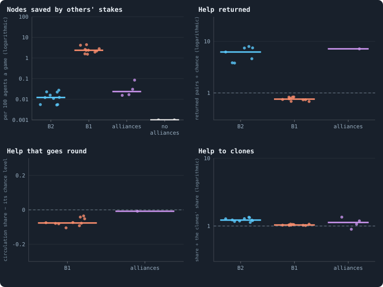

**Who helps whom.** One dot per world, the bar the median. A stake on a neighbour's node helps if, without it, the neighbour would have been less likely to keep its node (the note *Help*). Top left: the nodes so saved, counted as the sum of those effects, per 100 agents and game; the pilots without alliances, in which no stake can help, are drawn at 0.001. Top right: the pairs in which help went both ways within a stretch of 50 games, summed over the stretches, divided by the number expected from how long each pair were neighbours; worlds in which chance expects fewer than one have no dot. Bottom: whether the net help between agents goes round loops more than chance (only where stretches have at least 100 helping pairs and their help closes loops), and whether help goes to agents carrying the helper's brain more than such agents are among its neighbours (only where at least 100 stakes helped).

> [!example]- How to make this figure
> **Runs.** The ten B2 worlds of Experiment 16, `B2-10000-s001` … `-s010`, and the first ten worlds of the baseline set, `B1-10000-s001` … `-s010` (B1 at 10,000 tokens, Experiment 2). Both record every game with every agent's stakes; read are the games of iterations 1,000 to 2,000. Pilot worlds of [Alliances](another-game.md#alliances) (`GraphOfLifeRuns/.pilots`): with alliances `A10k/allies-s1` and `-s2` from iteration 500 and `AL/allies10k-s3` and `-s4` from iteration 2,000; without, `A10k/ctrl-s1` and `-s2` from iteration 500. Each goes on from its checkpoint for 200 iterations with every game recorded in the lab's form (`python3 research/oee/checks/pilot_frames.py <world> --at <iteration> --games 200`).
>
> **Data.** From the recorded games.
>
> 1. For every stake u → v on another agent's node, the chance that v keeps its node with all stakes and without u's, from the world's rule for deciding a node counted exactly: the largest stake, the owner's counting 1.5 times in B2 and the pilots, ties drawn, and the revolution's crowd (B1, B2), or the sides of allies (the pilots with alliances) (`research/oee/checks/decisive.py`). The difference is the stake's effect; above zero it is help.
> 2. Saved: the sum of the positive effects over the games, per 100 agents and game.
> 3. Returned: in each stretch of 50 games, the pairs with help from u to v that also had help from v to u; chance, for each such pair, 1 − (1 − q)^n for the n games in which v had u for a neighbour and q the help per neighbour and game of the stretch; both summed over the stretches.
> 4. Round: the net help between two agents in a stretch, split as the token flow above, minus the same for random directions.
> 5. Clones: the share of the help that went to an agent with the helper's brain id, divided by the share of such agents among the helper's neighbours, both weighted by the help.
>
> **To make it again:** `python3 book_figures.py patterns`.
<!-- /figure -->

#### In B2, nobody helps

In B2's ten worlds, others' stakes saved 0.005 to 0.028 nodes per 100 agents a
game. They cost 6.5 nodes per 100 agents a game in the median world (4.6 to
7.9). Revolutions are on in B2, but its agents stake all-in on one target. So
the small stakes a crowd is made of are rare. And the owner's stake counts one
and a half times, which weighs against any crowd.

Evolution made help rarer still. In three worlds measured at three times, it
fell from 0.03–0.07 nodes per 100 agents a game at iteration 100 to
0.002–0.012 at iteration 1,900. Meanwhile the nodes lost to attacks fell from
11–14 to 6.

What little help there is in B2 passes both ways. In a stretch of 50 games,
two neighbours that helped each other are rare. But over the ten worlds there
were 156 such pairs, where chance would make 28 from how long the pairs were
neighbours. There were more than chance in every world. And help goes to
clones 1.2 times their share of neighbours.

Both fit a situation better than a choice. Help needs two neighbours whose
revolutionary stakes can join against the same attacker. That situation is the
same seen from either of them, so help that passes in it passes both ways. And
nothing an agent senses says who staked on its node: no agent could repay help
if it wanted to.

#### In B1, help by accident

In B1 neighbours save each other's nodes: 2.4 nodes per 100 agents a game in
the median world (1.5 to 4.4). That is a thirteenth of the 31 lost to attacks.
The help comes from the crowds of revolutionaries that B1's agents make by
spreading a little over every neighbour. Of all stakes on others' nodes, 2.3%
help.

But nothing about this help is cooperation, in any of the ten worlds:

- **It is not returned.** Take the pairs in which one agent helped the other
  within 50 games. The other helped back in 40% of them, less than the 53%
  expected from how long those pairs were neighbours. That is 0.76 times
  chance, summed over the stretches, and less than chance in every world.
- **It does not go round.** Less of the net help circulates than if each
  pair's had a random direction: 0.08 less, in every world.
- **It does not stay in the family.** Clones get 1.03 times their share of
  neighbours.

It is help by accident, the by-product of a habit, as
[What the brains are like](what-the-brains-are-like.md) found the habit itself
to be. Since iteration 100 it has doubled, from 0.9–1.4 nodes saved per 100
agents a game to 2.0–3.7 at iteration 1,000. It has gone no further since,
rising in one world and falling in two by iteration 2,850.

#### Among allies, peace instead of rescue (gliders)
Allies hardly rescue each other either. They put a third to almost all of
their stakes on each other's nodes. That is 36% and 69% of all stakes at
iteration 500, and 95% and 99% in the long worlds at 2,000. Almost none of
these stakes decides anything. Others' stakes saved 0.015 to 0.085 nodes per
100 agents a game in the four alliance worlds, 28 to 150 times less than in
B1.

Yet agents with an ally keep their node in 99–100% of games, and agents
without one in 90–95%. An alliance protects by **peace**, not by rescue. A
stake from an ally counts for its holder, so an allied neighbour can never
take the node. The neighbour that would have been the threat is the one that
has been turned.

In the long worlds, where one alliance holds nearly everyone, nodes are lost
to attacks at 0.06 and 0.5 per 100 agents a game. In the median B2 world it is
6.5. The stakes allies put on each other's nodes are gifts to holders who
would have kept their nodes anyway.

The little rescue there is among allies passes both ways too. In the alliance
world with the most rescue, 26 pairs rescued each other where chance would
make 3.6. In the long worlds it was 10 against 0.1, and 6 against 0.5. Rescue
goes to clones 1.1 times their share. And in the one alliance world with
enough of it to tell, it does not go round.

Here an answer would be possible, since the agents of these pilots see the
stakes of the last game. But it cannot be told apart from the rule. Only
allies can rescue each other, and an alliance is mutual by definition. So
rescue that passes between allies passes both ways.

### What cooperation is here

Three things go by the name, and the record of play can tell them apart.

- **Rescue**: a stake without which a neighbour would have lost its node. It
  needs a rule that lets one agent's stake count for another's: revolutions,
  or alliances.
- **Peace**: neighbours that do not take each other's nodes. With alliances it
  is a rule: allies cannot.
- **Exchange**: tokens given that come back round, instead of running
  downhill. It shows in the flow of gifts as circulation above chance.

None of them is in B2. B2's worlds are made of puffers, feuds and tribute:
lineages copying themselves outward, pairs attacking each other, and failed
raids feeding those who withstood them. B1 has rescue, as a by-product that
nobody returns. Alliances bring peace and exchange. With exchange comes the one
ring of this page, gifts going round, though it does not last fifty games on
the same connections.

Where rescue is rare, in B2 and among allies, it passes both ways more often
than chance. But the situations that allow it are the same seen from either
side, and in B2 no agent could know whom to repay. Returned help is the trace
reciprocity would leave, not yet reciprocity.

So the cyclic structures the author asked about exist. Tokens go round loops
in every world, and chains of takeovers blink back and forth. But none of them
is a lasting structure on the network, the way a glider is in the Game of
Life. Every ring found is gone in fifty games, and every chain wanders like a
drunkard. What lasts is the slope: tribute that keeps flowing down the same
connections, stretch after stretch.

### What it means for open-ended evolution

The Game of Life goes far because its patterns are reliable. A glider keeps its
shape and its direction until it meets something. What happens when it does is
always the same, so patterns can be combined into larger ones.

The patterns of these worlds are reliable in neither way. A chain has no
direction and changes its brain at every move, and a ring dissolves within
fifty games. Help is no more reliable: who rescued whom is something no agent
can know.

Two inputs might change that, and neither needs a number:

- **A sense of direction.** One more input per neighbour would say *this is
  the node I came from*. A chain could then keep going away from where it was,
  or come back on purpose. Brains could make gliders that travel instead of
  wander, and a signal could cross a world.
- **A sense of who helped.** One more input per neighbour, *its stake saved my
  node in the last game*, computed by the rules exactly as this page computes
  help. [Alliances](another-game.md#alliances) found support given up because
  "whoever receives it owes nothing back". An agent that can see who rescued it
  can owe something back. Rescue could then be returned on purpose, by
  revolution in B1 or by support, without a pact. The measures of this page
  would show whether it was.

#### Both inputs, tested

Both inputs were built: `came_from` and `helped_by` in
`research/oee/pilots/proto.py`, the second computed by the rules exactly as
above. They were given to B2 worlds of 10,000 tokens for 2,000 iterations:
each alone and both together, two seeds each, beside two
control worlds. This is batch P, of 16 October 2026. Then 200 games from
iteration 2,000 were recorded in each world, and read as above.

- **The sense of direction made no gliders.** With `came_from` alone, chains
  of three takeovers or more were 20–35% more common than in the control:
  3,500–4,000 against 2,900–3,000 in 200 games. With both inputs, one world had
  more and one fewer. In the four worlds with the input, a chain went straight
  back to the node it had just left 1.38 to 1.57 times as often as chance has
  it, against 1.25 and 1.36 in the controls. But
  one world with only the other input went back 1.66 times as often. So two
  seeds cannot lay the going back to the sense of direction. Chains did not
  travel further: the longest reached no further for the steps they took than
  a random walk would. In two of the four worlds with the input they reached
  less far, three quarters of it. At most, the input made blinkers.
- **The sense of who helped changed nothing.** Help stayed where it was,
  0.006–0.012 nodes saved per 100 agents a game, against 0.009 in the control.
  It was returned no more than in the control. In 200 games, 4 and 2 pairs
  passed help both ways in two of the six worlds with an input. In the two
  control worlds, 6 and 2 did. Gifts still ran downhill. Their circulation was
  0.33–0.37 of their energy, against 0.42–0.48 for the sign-flip chance level,
  as in the control. Where helping is all but impossible, knowing who helped
  is knowing nothing.
- **Evolution went on, at about the control's pace.** The contests were a
  lifetime long, 100 iterations
  ([A contest a lifetime long](measuring-evolution.md#a-contest-a-lifetime-long)).
  With an input, the brains of iteration 1,000 held 0.64–0.78 of a contested
  world against those of 500. In the control they held 0.64–0.71. Those of
  2,000 held 0.50–0.70 against those of 1,000, and 0.65–0.80 in the control.
  The lowest, 0.50 and 0.55, are one world with both inputs.

So information alone does not make cooperation: the rules have to make it pay.
[Who helps whom](cooperation-help-and-gliders.md#who-helps-whom) puts this beside every other attempt.

The measure itself is the third result. Help computed from the rules can be
measured in any world that records its games. It gives the nodes saved per 100
agents a game, and the three signs of cooperation against chance. For the
worlds so far it is not a statistic that keeps rising. In B1 it doubles early
and then stays where it is, and in B2 it falls.

### What we learned (gliders)
- **The game makes chains of takeovers, far more than chance.** In B2 they are
  puffers, a lineage copying itself outward. In B1 they are gliders, rich
  agents that move on and grow.
- **No pattern keeps a direction or lasts.** Chains wander like random walks,
  blink a little and change their brain as they go. Rings of tokens are gone
  within fifty games.
- **What lasts is a slope.** Gifts run downhill along the same connections,
  stretch after stretch: towards the well connected in B1, towards the richer
  in B2.
- **Help needs a rule.** Only revolutions and alliances let a stake help. B2
  has almost none, B1 has it as a by-product, and alliances protect by peace
  and exchange rather than rescue.
- **Information alone makes no cooperation.** A sense of direction made no
  gliders, and a sense of who helped changed nothing.

### How this was made (gliders)
The lab worlds are the ten B2 worlds of Experiment 16, `B2-10000-s001` …
`-s010`. With them are the first ten worlds of B1's baseline set,
`B1-10000-s001` … `-s010` (B1 at 10,000 tokens, Experiment 2). Both record
every game with every agent's stakes. Read are the games of iterations 1,000
to 2,000.

The alliance worlds are pilots of
[Alliances](another-game.md#alliances), kept in `GraphOfLifeRuns/.pilots`.
With alliances, `A10k/allies-s1` and `-s2` go on from iteration 500, and the
long worlds `AL/allies10k-s3` and `-s4` from iteration 2,000. Without them,
`A10k/ctrl-s1` and `-s2` go on from iteration 500. Each goes on from its
checkpoint for 200 iterations, with every game recorded in the lab's form
(`python3 research/oee/checks/pilot_frames.py <world> --at <iteration> --games 200`).
The worlds of batch P were read the same way, from iteration 2,000
(`GraphOfLifeRuns/.pilots/frames_P_*.json`). Their contests a lifetime long
are in `GraphOfLifeRuns/.pilots/batch_P_T100.json`.

Every check is a script in `research/oee/checks/`:

- `gliders.py`: the chains;
- `structures.py`: channels, lasting pairs and the chance of a move;
- `rotations.py`: swaps and loops of takeovers;
- `circulation.py`: the split of the flow;
- `decisive.py`: help.

Every figure says, folded beneath it, which runs it reads and how. All five
are drawn again with `python3 book_figures.py patterns`, and their numbers are
kept in `book/results/patterns.json`.

## Where to go next

- [Other contests: a lottery, and alliances](another-game.md): stakes pooled
  by clones and families, senses of kin, and alliances.
- [Flow modules: the groups tokens stay in](b1-the-game-and-its-flows.md#flow-modules-the-groups-tokens-stay-in): the groups the
  flow of tokens keeps to, and B2's pairs of partners.
- [What agents say to each other](b1-brains-lineages-and-messages.md#what-agents-say-to-each-other): messages
  that name their writer's genotype.
- [Flows that go round](measuring-tokens.md#flows-that-go-round): how a flow splits
  into a part that runs downhill and a part that goes round.

## How our view changed

- *Who helps whom*:
  - **24 October 2026.** Since 16 October, this page said that with the two new
    inputs of batch P, help stayed rare and "none was returned". It also said
    that "the sense of direction was used to go back".
    [Gliders, and who helps whom](cooperation-help-and-gliders.md#both-inputs-tested)
    has since set those numbers right from batch P's records. Help was returned
    in 4 and 2 pairs in two of the six worlds with an input. The two controls
    had 6 and 2. And a world with only the sense of who helped went back 1.66
    times as often as chance. So two seeds cannot lay the going back to the
    sense of direction.
  - **24 October 2026.** Since 16 October, this page said of B1 that "stakes are
    returned as often as chance has it". It gave
    [Do agents cooperate?](cooperation-help-and-gliders.md#do-agents-answer-a-stake-with-a-stake)
    as its source. That page never set the return of stakes against chance.
    [Where tokens flow](b1-the-game-and-its-flows.md#stakes-that-are-returned) finds
    that a stake comes back in 90% of cases, about what the breadth of B1's
    staking gives alone. And help, counted by the rules, is returned less than
    chance: 0.76 times
    ([In B1, help by accident](cooperation-help-and-gliders.md#in-b1-help-by-accident)).
- *Do agents cooperate? Help, kin and partners*:
  - **24 October 2026.** Since 11 October, this page said that agents mark
    99.7% of their stakes on neighbours revolutionary at 10,000 tokens too, "to
    the third digit". There it was 99.7% on kin but 99.6% on others. These
    are the medians of the 26 worlds, 0.9965 and 0.9964, in the results of
    9 October
    ([Do agents treat their own kind differently?](#do-agents-treat-their-own-kind-differently)).
  - **24 October 2026.** Since 14 October, a note on this page said that two
    agents of one genotype write exactly the same message.
    [What agents say to each other](b1-brains-lineages-and-messages.md#what-agents-say-to-each-other) had
    corrected that the same day: the two messages are the same but for a
    thousandth or so.
- *Gliders, and who helps whom*:
  - **16 October 2026.** The day before, this page had proposed two inputs: a
    sense of direction and a sense of who helped. It said that they "would
    change" how unreliable its patterns and its help are. Chains could then
    travel instead of wander, and rescue could be returned on purpose. Batch P
    tested both that night. Chains did not travel further, and help stayed as
    rare as before ([Both inputs, tested](#both-inputs-tested)).
  - **24 October 2026.** The note that recorded that test, added on 16 October,
    was folded into the page. Its numbers were checked against batch P's files
    (`frames_P_*.json`, `batch_P_T100.json`). Some were finished after the note
    was written: the recorded games of `helped_by` alone, seed 2, and most
    contests of the two worlds with both inputs. Four things changed.
    - The note said that no help was returned in any world with an input.
      Counted as this page counts it in B2, it was, in two of the six worlds: in
      4 and 2 pairs. Chance would make 0.3 and 0.15 there, and the controls had
      6 and 2.
    - It said that the sense of direction was used to go back: 1.4–1.5 times
      chance, against 1.2–1.35 in the control. But the world with only
      `helped_by`, seed 2, went back 1.66 times. So two seeds cannot say that the
      input did it.
    - Gifts' circulation is 0.33–0.37 of their energy against 0.42–0.48 by
      chance, not 0.34–0.37 against 0.44–0.48.
    - It said that the later brains beat the earlier "in 0.67–0.78 of games",
      and in 0.56–0.70. These are shares of a contested world. With every world
      counted, they are 0.64–0.78 and 0.50–0.70.
  - **24 October 2026.** Five numbers of this page were checked against
    `book/results/patterns.json` and the checks' files, and made exact. B2's
    attacks cost 4.6 to 7.9 nodes per 100 agents a game (6.5 in the median
    world), not "6 to 7". The takeover flow of B2 goes round 0.065 more than
    chance (0.0647), not 0.07. Allies' rescue saved 0.015 to 0.085 nodes per 100
    agents a game, not 0.016 to 0.085. The chance of a move is about 0.07 in B2
    and 0.06 in B1, not 0.07 in both. And in the pilots without alliances, the
    feuding pairs kept their nodes in 0.49 and 0.48 of games, not 0.49 in both.
  - **24 October 2026.** This page said that with the sense of direction a
    chain went straight back 1.4–1.5 times as often as chance, against 1.2–1.35
    in the controls. Batch P's records (`GraphOfLifeRuns/.pilots/frames_P_*.json`)
    give 1.38 to 1.57 in the four worlds with the input, and 1.25 and 1.36 in
    the controls.
- **11 November 2026.** Three pages on cooperation, help and gliders became
  this page's sections, and it moved to the Archive as a side study. Whether
  agents work together no longer bears on the notebook's question as it stands.
  The pages are kept so that every figure here can be read and made again.
  Nothing was cut.

<!-- turns -->
---

[Side studies](../README.md#side-studies) · [Space at scale (side study)](space-at-scale.md) →

**Also about:** [Groups and cooperation](../README.md#groups-and-cooperation).

> [!info]- Pages that link here (17)
> [What this notebook is about](what-this-notebook-is-about.md) · [Did evolution happen? Fourteen ways to find out](did-evolution-happen.md) · [A hundred thousand iterations](a-hundred-thousand-iterations.md) · [Questioning the mechanics](questioning-the-mechanics.md) · [The rules in detail](rules-in-detail.md) · [Measuring tokens: inequality and flow](measuring-tokens.md) · [Physical inspiration](physical-inspiration.md) · [Particles: patterns that outlast what carries them](particles.md) · [Other contests: a lottery, and alliances](another-game.md) · [Every simulation: what was run, and what was measured](every-simulation.md) · [What B1 is, and what stood in its way](what-the-baseline-world-is.md) · [B1: the game and its flows](b1-the-game-and-its-flows.md) · [B1: the network, size and scaling](b1-the-network-size-and-scaling.md) · [B1: brains, lineages and messages](b1-brains-lineages-and-messages.md) · [What the switches did in pilots (indicative)](what-the-switches-did-in-pilots.md) · [Building B2, and the search for a healthy, rich world](building-b2-and-the-search-for-a-healthy-rich-world.md) · [Measures, atlases and assembly (side studies)](measures-atlases-and-assembly.md)
<!-- /turns -->
