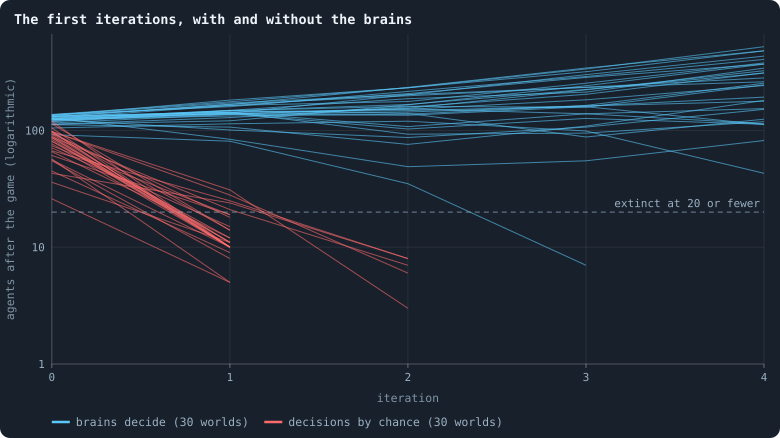
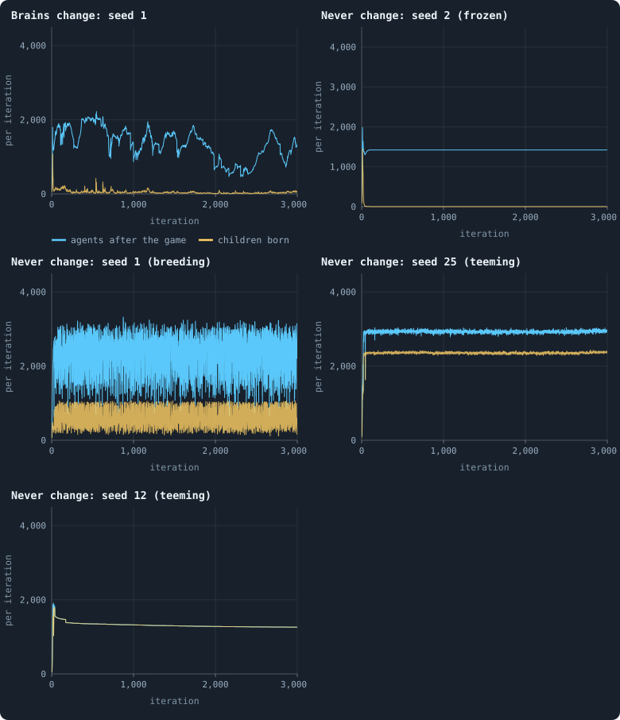
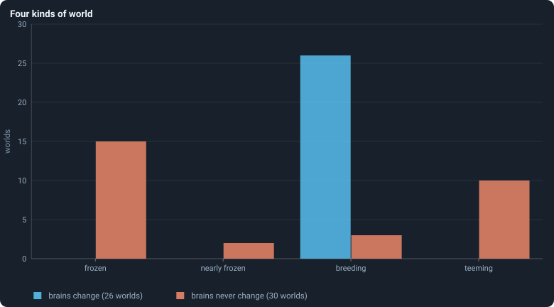
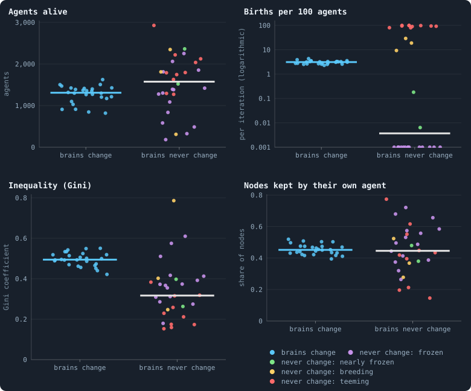
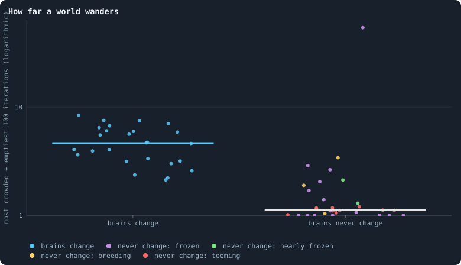
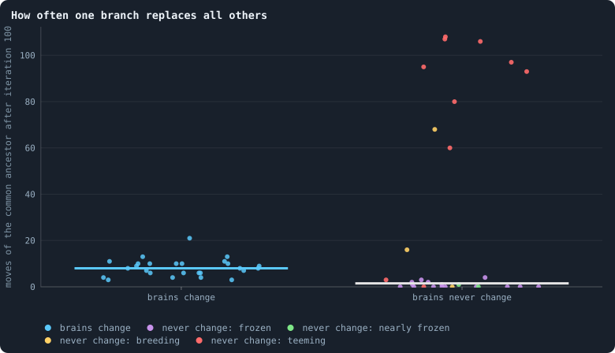

# Do the brains matter?

> [!question] Questions of this page
> - Can a world live if its [agents](the-world.md#agents-and-tokens "One member of a world: it lives on a node of the network, holds tokens and has a brain that takes all its decisions.") decide by pure chance?
> - What happens to a world whose brains never change — whose agents keep
>   the [founders](starting-ring.md "One of the agents a world starts with, each holding the same tokens, on a ring with a few shortcuts.")' brains, copied, forever?
> - Do the worlds that evolve and the worlds that do not differ on average,
>   or in how alike they are?
> - Do lines still take over a world in which no brain is better than
>   another?

## In short

Experiment 7 took away the brains of the first [baseline](b1-and-b2.md "The stated rules an experiment starts from and changes one thing of: B1 or B2."), [B1](b1-and-b2.md "The first baseline: the algorithm exactly as a new run is offered it."), in two ways, for
the same thirty [seeds](random-numbers.md "The number that fixes every random choice of a run: the same settings and the same seed make the same world."). Worlds whose every decision was drawn by chance all
died within three iterations, while worlds of random, unselected brains live:
the brains matter. Worlds whose brains never change live on, each with the
habits of the founder whose line fills it: some stop having children, some
teem. Worlds that evolve all end up in one narrow band, so evolution is what
makes the worlds alike, as the thesis predicted. And without evolution a line
of descent still takes a world over, by chance alone: a takeover is not, by
itself, evidence of selection.

## Taking the brains away

How do you find out whether something matters? Take it away, and see what
changes. A doctor tests a new medicine that way, against a sugar pill that
looks the same and does nothing. The sugar pill is the **control**.

Every agent of a Graph of Life world decides with its brain, a small neural
network that reads what is around it ([The brain](the-brain.md)). The study of
the baseline found many facts about worlds of such agents ([What B1 is, and
what stood in its way](what-the-baseline-world-is.md)). But it had nothing to
hold them against. Perhaps a world would look much the same whatever its
agents decided. This page builds the control. It takes the brains away in two
ways, and compares both with B1 itself.

## The three conditions

Each condition changes one setting of B1 and keeps every other. All three are
run at 10,000 [tokens](the-world.md#agents-and-tokens "The one thing of value in a world: every agent holds a whole number of them, and their total never changes."), for the same thirty seeds, 1 to 30. Each run lasts 3,000
iterations, or until its world dies out ([The runs of Experiment
7](#the-runs-of-experiment-7)).

- **baseline**: B1 as it is. These are the thirty runs of 10,000 tokens of
  Experiment 2 ([Two sizes of world](a-worlds-life.md#two-sizes-of-world)),
  reused.
- **brains never change**:
  [`mutation_sparsity`](settings.md#mutation_sparsity) = 0. A brain is still
  offered a change with probability one in five, at birth and after every
  game. When it "changes", it gets a new genotype number, but not one of its
  weights moves ([A new genotype](mutation.md#a-new-genotype)). So the only
  brains a world ever has are its founders', copied. The family tree of
  genotype numbers still branches exactly as often as in the baseline, which
  keeps the two comparable. And once one founder's descendants fill a world,
  every agent in it carries the same brain.
- **decisions by chance**: [`random_decisions`](settings.md#random_decisions)
  on ([The control: decisions by
  chance](the-brain.md#the-control-decisions-by-chance)). The agents never
  read their inputs. Every number a brain would have given is drawn instead
  from a standard normal distribution: the bell curve with mean 0 and standard
  deviation 1. Every decision then follows from those numbers by the usual
  rules.

## What was expected

In the baseline the seed hardly matters. Thirty worlds that differ only in
their seed all wander through the same range ([How much does the seed
decide?](how-much-does-the-seed-decide.md)). Is evolution what keeps them
alike? Two [pilot](the-lab.md#pilot-worlds "A world made by hand to see whether an idea is worth an experiment, without a thesis or many seeds.") worlds whose brains never change suggested so. They ended up
nothing alike: one froze, with the same agents game after game, while the
other boomed and crashed. Without new brains, it seemed, nothing can move a
world off the habits its founders brought.

So we expected the worlds without change to be far more different from each
other than the worlds that evolve: some still, some teeming. The thesis puts
numbers on "far more different". Take each world's level over its settled
life, from iteration 500 on. The spread of the worlds' numbers of agents
should be at least twice the baseline's, and so should the spread of their
births. The spread is the standard deviation of the worlds' levels divided by
their mean ([Spread between
worlds](median-and-quantiles.md#spread-between-worlds)). And more than half of
all the variation in their number of agents should lie between the worlds, not
within each over time. [Between worlds and within
them](variance-split.md#between-worlds-and-within-them) explains the split.
The thesis speaks only of the worlds whose brains never change. Here it is, as
it was written down:

<!-- thesis E07 -->
> [!quote] The thesis of Experiment 7, written down before any of its runs existed
> **The claim.** Evolution is what makes the worlds alike. A world whose brains never change is stuck with the brain of whichever founder's line takes it over, and worlds of different seeds, stuck with different founders, end up far more different from each other than worlds that keep evolving: some still, some teeming.
>
> **Why it would be so.** In the baseline the seed hardly matters (Chapter [4](how-much-does-the-seed-decide.md)): every world wanders through the same range. Two pilots of a world without change, run to plan this chapter, ended up nothing alike. In one, the descendants of a single founder filled the world by iteration 50, and from about iteration 100 no one was born and no one died: the same 1,420 agents, game after game. In the other, a different founder's descendants kept the world in boom and bust, between about 1,000 and 3,200 agents, with hundreds of births in every iteration. With no new brains, nothing can move a world off the policy it was dealt.
>
> **It holds if:** Over the settled life of the runs, from iteration 500 on: the number of agents varies across the surviving worlds without change by at least twice as much as across the baseline's (a spread, sd ÷ mean, of at least 0.34 against 0.17); births vary across them at least twice as much as well; and more than half of all the variation in a world's number of agents lies between the worlds rather than within each of them over time (against 0.17 in the baseline).
>
> **It fails if:** The worlds without change are about as alike as the baseline's, and wander as much. Then evolution is not what keeps the seed from mattering, and the brain a world starts with does not decide its fate.
>
> *Written while the notebook still numbered its chapters: each number is a link to the page it meant that day.*
<!-- /thesis -->

## Chance cannot keep a world

Give every agent a die, and let it roll afresh for every decision it takes.
That is a world deciding by chance. The figure follows thirty such worlds, and
the thirty of the baseline, through their first five iterations.

<!-- figure brains/chance -->

**The first iterations, with and without the brains.** Each line is one world: the agents alive after the game of iterations 0 to 4. Blue: the baseline, whose agents decide with their brains; red: the same 30 seeds with every decision drawn at random. A red line ends where its world died.

> [!example]- How to make this figure
> **Runs.** The 90 runs of Experiment 7 — B1 at 10,000 tokens, seeds 1 to 30, 3,000 iterations — in three conditions: the 30 baseline runs `B1-10000-s001` … `-s030`; *brains never change*, `B1-10000-a8525d-s001` … `-s030` (`mutation_sparsity` 0); and *decisions by chance*, `B1-10000-e7f450-s001` … `-s030` (`random_decisions` on). They are made with `python3 gol_lab.py run E07`; every setting is listed in the box of the runs behind this page.
>
> **Data.** From each run's `GraphOfLifeRuns/<run>/stats.jsonl`, which holds one row per recorded phase: `phase` 1 is the world just after reproduction, `phase` 2 just after the game, and every statistic is a field of the row (see [What a run records](frames-and-stats.md)).
>
> 1. Plot `nodes` of the rows with `phase` = 2 and `iteration` ≤ 4, one line per run.
>
> **To make it again:** `python3 book_figures.py brains`.
<!-- /figure -->

All thirty worlds deciding by chance died: 25 after their second iteration, 5
after their third. In each world's last game, a median of 62% of the agents
were cut off, and another 15% starved. Random stakes leave [connections](the-world.md#the-network "A link between two agents of the network: they are neighbours, and can stake on each other's nodes.") without
tokens. A connection that carries no tokens in a game is cut after the game
([Phase 2: the game](one-iteration.md#phase-2-the-game)). And anything no
longer joined to the largest piece of the world is removed
([Cleanup](one-iteration.md#cleanup)).

The baseline's founders also start with brains nobody chose: their weights are
drawn at random. Yet their worlds live. Why the difference? Perhaps because
even a random brain is a *function* of what it sees. What it does on one
connection hangs together with what it does on the next, and with what it did
in the last game. Noise has nothing of the kind.

[What the brains are like](what-the-brains-are-like.md) later showed how
closely a brain's answers hang together. A brain of B1 is nearly blind ([How a
signal fades through layers](the-brain.md#how-a-signal-fades-through-layers)).
A change in what it sees reaches its outputs about a thousand times smaller.
So a founder's brain gives nearly the same outputs for every candidate, game
after game, like a fixed habit. Noise gives new ones every time. Whether that
is what keeps a world alive, this experiment does not test.

Decisions by chance are a crude control in another way too. Take how much a
parent gives its child. The [share function](share-function.md "How a brain's two numbers become one share between 0 and 1: of tokens for a child, or of a stake marked revolutionary.") turns two of the brain's numbers
into that share. It gives all the parent's tokens when the first number is
positive and the second is not. It gives exactly half when neither is positive
([A birth, decision by
decision](how-agents-have-children.md#a-birth-decision-by-decision)). Drawn by
chance, each happens about one time in four: far more often than in any
settled world.

A sharper control would draw every decision at random **from the distribution
of that decision in the evolved worlds themselves**. It would draw it first as
it is overall, then given the agent's own tokens and connections. Agents that
decide like that behave, on average, exactly like evolved ones, but respond to
nothing. If such a world looks like the baseline, what the brains contribute
is their average. If it does not, what they respond to matters. It is planned
as *Brains replaced by their average*.

## Without change: frozen or teeming

What does a world do when its brains never change? Four single worlds show it,
beside one of the baseline:

<!-- figure brains/traces -->

**Five single worlds.** Each panel is one world: the number of agents alive after every game (blue) and of children born in every reproduction phase (yellow), on the same scale in every panel. Top left: a baseline world, whose brains change (seed 1). The others are worlds whose brains never change: seed 2, frozen — no child born after iteration 95, the same agents game after game; seed 1, breeding; seeds 25 and 12, teeming — about one child for every agent in every iteration. In seed 12 every child is lost again at once, so the yellow line lies above the blue.

> [!example]- How to make this figure
> **Runs.** `B1-10000-s001` (baseline), and `B1-10000-a8525d-s002`, `-s001`, `-s025` and `-s012` (brains never change), all from Experiment 7.
>
> **Data.** From each run's `GraphOfLifeRuns/<run>/stats.jsonl`, which holds one row per recorded phase: `phase` 1 is the world just after reproduction, `phase` 2 just after the game, and every statistic is a field of the row (see [What a run records](frames-and-stats.md)).
>
> 1. Plot `nodes` of the rows with `phase` = 2 and `births` of the rows with `phase` = 1 against `iteration`.
>
> **To make it again:** `python3 book_figures.py brains`.
<!-- /figure -->

Sort the thirty worlds whose brains never change by how many children they
have from iteration 500 on. They fall into kinds the baseline never shows:

<!-- figure brains/kinds -->

**Four kinds of world.** Every world that lived to iteration 3,000, sorted by its mean births per 100 agents per iteration from iteration 500 on: frozen — none at all; nearly frozen — fewer than 0.5; breeding — 0.5 to 50; teeming — more than 50, about one child per agent per iteration.

> [!example]- How to make this figure
> **Runs.** The 90 runs of Experiment 7 — B1 at 10,000 tokens, seeds 1 to 30, 3,000 iterations — in three conditions: the 30 baseline runs `B1-10000-s001` … `-s030`; *brains never change*, `B1-10000-a8525d-s001` … `-s030` (`mutation_sparsity` 0); and *decisions by chance*, `B1-10000-e7f450-s001` … `-s030` (`random_decisions` on). They are made with `python3 gol_lab.py run E07`; every setting is listed in the box of the runs behind this page.
>
> **Data.** From each run's `GraphOfLifeRuns/<run>/stats.jsonl`, which holds one row per recorded phase: `phase` 1 is the world just after reproduction, `phase` 2 just after the game, and every statistic is a field of the row (see [What a run records](frames-and-stats.md)).
>
> 1. Compute each run's births per 100 agents as for the figure of births above.
> 2. Sort the runs into the four kinds by that number and count them.
>
> **To make it again:** `python3 book_figures.py brains`.
<!-- /figure -->

- **frozen**: 15 worlds without a single birth after iteration 500. Their last
  child was born between iterations 29 and 439. Thirteen of them then kept
  exactly the same number of agents to the end of the run, between 183 and
  2,062 depending on the world. They played the game every iteration, with no
  one born and no one dying. A fourteenth, seed 18, lost five agents after its
  last child, the last of them at iteration 1,363, and ended with 2,252. The
  fifteenth, seed 20, lost agents without ever replacing them, from 1,165 at
  iteration 300 to 23 by iteration 2,024. Then it sat at 23, three above the
  line at which a run counts as [extinct](extinction.md "A world's end before its last iteration: it has dropped to its threshold of agents or fewer.").
- **nearly frozen**: 2 worlds. Seed 19 had a birth in about one iteration in
  ten, the last at iteration 1,960. Seed 10 had a birth in every iteration
  until iteration 695, and none after.
- **breeding**: 3 worlds, with 8 to 24 births per hundred agents per
  iteration.
- **teeming**: 10 worlds, with 75 to 100 births per hundred agents per
  iteration. That is about one child for every agent, every iteration, and
  about as many agents lost again. In nine of the ten worlds, the game takes
  most of them. It starves or cuts off 56% to 100% as many agents as were
  born. The rest are lost the moment they are born, joined to no one.
  Seed 12 goes furthest. From iteration 39 on, every child it has is lost the moment it is
  born, joined to no one. Its agents, 1,297 of them at iteration 1,500, try to
  have a child in every iteration, and not one of these children lives.

All 26 baseline worlds that lived to the end are breeding, at three births per
hundred agents. And not one of the thirty worlds without change died out,
against four of the baseline's thirty.

A frozen world is frozen in more than its numbers. [Flow modules: the groups
tokens stay in](flow-modules.md#groups-in-every-world) followed five of these
worlds for fifty games. In four of them, the frozen ones, the groups that
tokens stay in never changed either. The same agents played the same game,
game after game.

## Where the worlds settle

To compare worlds, sum each one up by where it settles: its mean over its
settled life, iterations 500 to 2,999. In the figure each world is one dot,
and the worlds without change are coloured by their kind.

<!-- figure brains/settled -->

**Where the worlds settle, with and without change.** One dot per world that lived to iteration 3,000, at its mean over iterations 500 to 2,999. In each panel, the left column holds the 26 baseline worlds, whose brains change (blue); the right column the 30 worlds whose brains never change, coloured by the kind of world each became (see the figure of the four kinds above): violet frozen, green nearly frozen, yellow breeding, red teeming. The bars are the medians. The panel of births has a logarithmic axis; the 15 frozen worlds, which had no births at all, are drawn at its bottom, 0.001. No world deciding by chance lived more than 3 iterations, so that condition has no dots. The dots are spread sideways only so that they do not hide each other.

> [!example]- How to make this figure
> **Runs.** The 90 runs of Experiment 7 — B1 at 10,000 tokens, seeds 1 to 30, 3,000 iterations — in three conditions: the 30 baseline runs `B1-10000-s001` … `-s030`; *brains never change*, `B1-10000-a8525d-s001` … `-s030` (`mutation_sparsity` 0); and *decisions by chance*, `B1-10000-e7f450-s001` … `-s030` (`random_decisions` on). They are made with `python3 gol_lab.py run E07`; every setting is listed in the box of the runs behind this page.
>
> **Data.** From each run's `GraphOfLifeRuns/<run>/stats.jsonl`, which holds one row per recorded phase: `phase` 1 is the world just after reproduction, `phase` 2 just after the game, and every statistic is a field of the row (see [What a run records](frames-and-stats.md)).
>
> 1. For agents, the Gini coefficient and nodes kept: average `nodes`, `gini` and `heldHomeShare` over the rows with `phase` = 2 and 500 ≤ `iteration` ≤ 2,999.
> 2. For births: divide `births` in each row with `phase` = 1 by the row's `nodes_before`, multiply by 100, and average from iteration 500 to 2,999.
> 3. Sort the worlds whose brains never change into the four kinds by their births (frozen: none; nearly frozen: below 0.5; teeming: above 50; breeding: between).
> 4. Plot one dot per run that reached iteration 3,000, one column per condition.
>
> **To make it again:** `python3 book_figures.py brains`.
<!-- /figure -->

- **Agents.** The worlds without change have a median of 1,574 agents, against
  the baseline's 1,309. But they range from 183 to 2,928, against 819 to
  1,626. Their spread is 0.45, against 0.17.
- **Births.** The evolving worlds all sit near 3 per hundred agents, between
  2.3 and 4.3. The worlds without change range from none at all to one per
  agent: a spread of 1.33, against 0.15.
- **Inequality.** Wealth is spread more evenly without change, and most evenly
  in the teeming worlds. The [Gini coefficient](gini-coefficient.md "How unequally tokens are held: 0 if every agent holds as many, near 1 if one holds nearly all.") is 0 when every agent holds as
  many tokens, and near 1 when one holds nearly all. Its median is 0.32
  without change, against 0.49. Set against the baseline world of the same
  seed, the difference is 0.17, with a 95% interval of 0.11 to 0.23 by the
  [bootstrap](bootstrap.md#for-a-difference).
- **Nodes kept.** The share of agents that keep their own node in a game is
  the same on average, 45% in both. But it runs from 15% to 77% without
  change, against 39% to 52%.

The same spread shows in every other statistic of the baseline's study. Of
all the tokens staked, agents put 30% on their own nodes in both conditions,
but from 4% to 51% without change. So it goes for
[the core](bridges.md#core-trees-and-leaves) and for the bridges. On average
a world without change looks much like an evolving one, with two exceptions:

- **[Coalitions](revolution.md "A node taken by stakers who each marked part of their stake revolutionary and together staked more than the largest single stake.")** take a smaller share of the nodes in a game: 44% in the
  median world, against 52%.
- **The [clustering](degree.md#clustering "How often an agent's neighbours are also each other's neighbours.")** is lower: 0.020, against 0.075.

Set against the baseline world of the same seed, both differences are clear
(*p* = 0.013 and 0.015). But above all, the evolving worlds sit close
together, and the worlds without change spread over almost everything each
statistic can be.

## How much a world wanders

A single world does not settle at one level. Its number of agents drifts up
and down over hundreds of iterations: it **wanders**. A baseline world
remembers where it was for a few hundred iterations, and not much longer ([How
long a world remembers](autocorrelation.md)). How far does a world wander when
its brains never change?

<!-- figure brains/wander-dots -->

**How far a world wanders.** For each world that lived to the end, coloured as in the figure above: cut its life from iteration 100 to 2,999 into 29 stretches of 100 iterations, take its mean number of agents in each, and divide the largest of the 29 by the smallest. 1 means a world that never moved; 4 that its most crowded stretch held four times as many agents as its emptiest.

> [!example]- How to make this figure
> **Runs.** The 90 runs of Experiment 7 — B1 at 10,000 tokens, seeds 1 to 30, 3,000 iterations — in three conditions: the 30 baseline runs `B1-10000-s001` … `-s030`; *brains never change*, `B1-10000-a8525d-s001` … `-s030` (`mutation_sparsity` 0); and *decisions by chance*, `B1-10000-e7f450-s001` … `-s030` (`random_decisions` on). They are made with `python3 gol_lab.py run E07`; every setting is listed in the box of the runs behind this page.
>
> **Data.** From the analysis of Experiment 7 (`python3 gol_lab.py analyse E07`), whose results file holds every run's ratio under `wandering.nodes`; or from each run's `GraphOfLifeRuns/<run>/stats.jsonl`, which holds one row per recorded phase: `phase` 1 is the world just after reproduction, `phase` 2 just after the game, and every statistic is a field of the row (see [What a run records](frames-and-stats.md)).
>
> 1. Cut iterations 100–2,999 into 29 stretches of 100 and average `nodes` in each.
> 2. Divide the largest of the 29 by the smallest.
>
> **To make it again:** `python3 book_figures.py brains`.
<!-- /figure -->

A world without change hardly wanders. Its most crowded stretch of a hundred
iterations holds a median 1.11 times as many agents as its emptiest, against
4.65 for an evolving world. Set against the baseline world of the same seed,
the difference is 3.5, with a 95% interval of 2.8 to 4.2.

And a world without change stays where it is. Take each world's mean number of
agents over iterations 100 to 1,499, and over 1,500 to 2,999. Across the
thirty worlds without change, the two halves have a [correlation](correlation.md "Whether two quantities go up and down together, from −1 to 1.") of 0.96: a
world's first half says almost everything about its second. Across the
baseline's worlds the correlation is 0.12.

The same shows when all the variation in the number of agents is split in two
([Between worlds and within
them](variance-split.md#between-worlds-and-within-them)). One part is how much
the worlds' own averages differ: the part between the worlds, which each seed
fixes. The other is how much each world moves around its own average over
time: the part within. Without change, 96% of the variation lies between the
worlds; in the baseline, 17%. So the seed of a world without change tells
nearly everything about its size.

## Was the thesis right?

Yes. The thesis **holds**, on all three counts and by wide margins:

- the spread of the number of agents is 0.45 against 0.17; it asked for at
  least 0.34;
- births per iteration spread 1.39 against 0.19, and births per hundred agents
  1.33 against 0.15; it asked for at least twice the baseline's;
- 96% of the variation in the number of agents lies between the worlds without
  change; it asked for more than half.

## Lines by chance

In a village where nobody is better than anybody, family names still die out,
one by one, until one is left. Lines of brains can do the same. A line of
descent, or lineage, is one genotype together with every genotype descended
from it ([Families](genotype.md#families)).

In a world whose brains never change, the founders' lines still compete until
one of them fills the world. In the median world that happens between
iterations 75 and 100. In the baseline the median over all thirty worlds is
iteration 175, as [Worlds of 100,000
tokens](how-does-a-worlds-size-follow-its-tokens.md#worlds-of-100000-tokens)
counts it. Among the 26 baseline worlds that lived to the end, it is 125. From
then on, every agent of a world without change carries the same brain, and
which genotype spreads is pure chance.

How often does chance sweep such a world? The **common ancestor** of the
living is the newest genotype that every living agent descends from ([The
common ancestor of the
living](genotype.md#the-common-ancestor-of-the-living)). When one branch of
the family tree replaces all the others, in a **sweep**, the common ancestor
moves forward to a younger genotype. The figure counts those moves.

<!-- figure brains/moves-dots -->

**How often one branch replaces all others.** For each world that lived to the end, coloured as above: how many times after iteration 100 the newest common ancestor of all the living moved forward to a younger genotype ([The common ancestor](genotype.md#the-common-ancestor-of-the-living)). In a world whose brains never change, every genotype is a renamed copy of one founder's brain once that founder's line fills the world, so which branch wins is chance.

> [!example]- How to make this figure
> **Runs.** The 90 runs of Experiment 7 — B1 at 10,000 tokens, seeds 1 to 30, 3,000 iterations — in three conditions: the 30 baseline runs `B1-10000-s001` … `-s030`; *brains never change*, `B1-10000-a8525d-s001` … `-s030` (`mutation_sparsity` 0); and *decisions by chance*, `B1-10000-e7f450-s001` … `-s030` (`random_decisions` on). They are made with `python3 gol_lab.py run E07`; every setting is listed in the box of the runs behind this page.
>
> **Data.** From the lineage analysis of Experiment 7, `book/results/E07.json` (`lineage.<condition>.runs.<run>.ancestor.moves`).
>
> 1. As in [Genotypes and lineages](genotypes-and-lineages.md), for every run.
>
> **To make it again:** `python3 book_figures.py brains`.
<!-- /figure -->

In the frozen worlds the common ancestor hardly moves once one founder's line
has filled the world: a median of 0 moves. Nodes still change hands, but no
later branch takes the whole world again. In four worlds without change (seeds
7, 14, 18 and 19) the living still descended from more than one founder at the
end. In the teeming worlds, chance sweeps the whole world about every thirty
iterations. That is a median of 94 moves, against the baseline's 8: more than
ten times as often.

So chance alone can make one line take a world over. It can do so much faster
than in the baseline, or never, depending on how often agents are born and
die. The sweeps of [Genotypes and lineages](genotypes-and-lineages.md) are
therefore not, by themselves, evidence of selection. A fair comparison needs a
world that is born and dies as the baseline does, while no brain is better
than another. None of these worlds is one. The three breeding worlds come
closest, with 0, 16 and 68 moves.

The question was settled from the brains' side instead ([Selection, or
chance?](genotypes-and-lineages.md#selection-or-chance)). Played against the
brains of their own past, the brains of a settled B1 world only tie. So the
lines that take a settled world over do not carry brains that play better.

## What we learned

- **The brains matter.** No world survives on decisions taken at random, while
  brains of random weights that nothing has selected keep a world alive. [What
  the brains are like](what-the-brains-are-like.md) later found how they
  matter: as constants, habits that barely depend on what an agent sees.
- **Evolution is what makes the worlds alike.** Without it, a world is stuck
  with the brains of whichever founder's line fills it, usually within a
  hundred iterations. And the brains a hundred random founders bring are
  anything but alike. Half of the worlds stop having children altogether, and
  a third have a child for every agent in every iteration. The seed decides
  which, and with it nearly everything about the world. With evolution, the 26
  worlds that lived to the end, each from a different set of founders, all end
  up in the same narrow band.
- **Is that selection?** Arriving at the same place from different starting
  points is what selection towards a shared optimum would look like. It is not
  proof of it: the churn of mutation could also keep brains from settling
  anywhere extreme. Changing how often brains change can tell the two apart.
  If three births per hundred agents is what selection finds, it should hold
  at other rates of mutation. If it is mutation's churn, it should move with
  them.
- **A balance of the two.** Two pilot worlds of B1 later tried two other
  rates, with seed 1 for 600 iterations ([Why the question moved to
  B2](how-fast-should-brains-change.md#why-the-question-moved-to-b2)). Births
  moved with the rate: 2.0 per hundred agents at a rate of 0.05, 2.9 at the
  baseline's 0.2, and 8.0 at 0.8. Selection is at work too. It pushed the
  brains towards fewer children, the same way in every world ([What evolution
  changed](what-the-brains-are-like.md#what-evolution-changed)). So three
  births per hundred agents is a balance between selection and mutation.
- **The wander needs evolution.** A world without change hardly wanders at
  all. But it is not the sweeps that drive the wander. In the large worlds of
  [Worlds of 100,000
  tokens](how-does-a-worlds-size-follow-its-tokens.md#worlds-of-100000-tokens),
  a world forgets its level within three hundred iterations. But a line needs
  about a thousand to take a world over. So the wander is faster than the
  sweeps, and not made by them ([One slow wander, in
  everything](what-the-baseline-world-is.md#one-slow-wander-in-everything)).

## Where to go next

- [What the brains are like](what-the-brains-are-like.md): why B1's brains
  matter only as constants, and why they barely see.
- [Genotypes and lineages](genotypes-and-lineages.md): how lines of descent
  take worlds over, and whether the winners are better.
- [How much does the seed decide?](how-much-does-the-seed-decide.md): how
  alike thirty baseline worlds are, and how long each one remembers.
- [How fast should brains change?](how-fast-should-brains-change.md): what the
  rate of change does to a world.

## How this was made

Every figure of this page says, folded beneath it, which runs it reads and
how. The command `python3 book_figures.py brains` draws them all. The numbers
come from `book/results/E07.json`, made with `python3 gol_lab.py analyse E07`.
The analysis takes about 14 minutes, because the lineages read every frame of
every run.

- **Survived to iteration 3,000:** baseline 26, brains never change 30,
  decisions by chance 0 (25 died after 2 iterations, 5 after 3).
- **[Engine](the-lab.md "The program that runs an experiment's plan as runs, each on a frozen copy of the engine, the code that plays a world."):** snapshot `f820369a1583af53`, commit `4bc7165`, for all 90 runs
  ([Is a run reproducible?](is-a-run-reproducible.md)).
- **Cost:** the new runs took 35 hours of computing, done in 9.1 hours on four
  workers. They take 11 GB on disk, and one run needed at most 746 MB of
  memory.
- **Comparisons:** paired by seed, each world without change set against the
  baseline world of the same seed. The intervals come from resampling the
  differences, and *p* from flipping their signs at random, 10,000 times each
  ([The bootstrap](bootstrap.md#the-bootstrap), [Permutation
  tests](bootstrap.md#permutation-tests)).

### The runs of Experiment 7

<!-- runs E07 -->
> [!info]- The runs behind this page
> **90 runs.** Every condition below is run once for every seed (1 to 30), for 3,000 iterations — or until its world dies out. Every setting is that of the baseline **B1** (the algorithm exactly as a new run is offered it) unless the condition changes it.
>
> - **baseline** — changes nothing: B1 as it is; 10,000 tokens. Runs `B1-10000-s001` … `B1-10000-s030`.
> - **brains never change** — changes `mutation_sparsity` = 0; 10,000 tokens. Runs `B1-10000-a8525d-s001` … `B1-10000-a8525d-s030`.
> - **decisions by chance** — changes `random_decisions` = on; 10,000 tokens. Runs `B1-10000-e7f450-s001` … `B1-10000-e7f450-s030`.
>
> To make these runs again: `python3 gol_lab.py run E07`, or ▶ in the Research Notebook tab of a computer running `gol_server.py`. Each run writes its settings, seed and engine version beside its frames, in `GraphOfLifeRuns/<run>/meta.json` and `provenance.json`.

> [!info]- Every setting of these runs
> | setting | baseline | brains never change | decisions by chance | what it is |
> |---|---|---|---|---|
> | [`total_tokens`](settings.md#total_tokens) | 10,000 | 10,000 | 10,000 | The number of tokens in the world, *T*. It never changes during a run. |
> | [`n_nodes`](settings.md#n_nodes) | 0 | 0 | 0 | How many founders the world starts with. 0 means one founder per hundred tokens: *n* = ⌊*T* / 100⌋. |
> | [`k_neighbors`](settings.md#k_neighbors) | 0 | 0 | 0 | How many neighbours each founder starts with in the ring. 0 means *k* = max(⌊*n* / 100⌋, 5); an odd *k* is wired as *k* − 1. |
> | [`rewire_p`](settings.md#rewire_p) | 0.2 | 0.2 | 0.2 | In the starting ring, the probability that a connection is moved to a founder chosen at random (Watts–Strogatz). |
> | [`hidden_layers`](settings.md#hidden_layers) | 50, 45, 40, 35, 30 | 50, 45, 40, 35, 30 | 50, 45, 40, 35, 30 | The widths of the brain's hidden layers, in order from input to output. |
> | [`hidden_activation`](settings.md#hidden_activation) | sigmoid | sigmoid | sigmoid | The curve each hidden unit applies to its sum: `sigmoid`, which passes on at most a quarter of a change, so that deep brains barely respond to what they see, or `tanh`, the same S-shape centred on zero, through which a change still passes in several layers. |
> | [`brain_kind`](settings.md#brain_kind) | float16 | float16 | float16 | How weights are stored: `float` (64-bit), `float16` (16-bit, computed in 64-bit) or `binary` (−1, 0, +1). |
> | [`brain_bits`](settings.md#brain_bits) | 16 | 16 | 16 | Only for binary brains: how many input rows encode one number. Unused by float and float16 brains. |
> | [`message_amount`](settings.md#message_amount) | 30 | 30 | 30 | How many numbers one message holds. Each agent sends one message to itself and one to each neighbour, every phase. |
> | [`random_input_amount`](settings.md#random_input_amount) | 5 | 5 | 5 | How many random numbers, drawn uniformly from −2 to 2, a brain reads per neighbour, every time it looks. |
> | [`exchange_messages`](settings.md#exchange_messages) | on | on | on | Whether agents send and read messages at all. |
> | [`message_prepass`](settings.md#message_prepass) | on | on | on | Whether every phase begins with an extra look in which agents only write messages, so the look that acts reads messages written this phase. |
> | [`allow_handover`](settings.md#allow_handover) | on | on | on | Whether a parent may move some of its own connections to its newborn child. |
> | [`allow_revolutions`](settings.md#allow_revolutions) | on | on | on | Whether a coalition of smaller stakers can take a node from its largest staker (see the note *How a coalition takes a node*). |
> | [`contest`](settings.md#contest) | largest | largest | largest | Who takes a contested node: the `largest` stake as the game weighs it, or a staker drawn by `lottery` with a chance in proportion to its stake (needs revolutions off). |
> | [`allocation`](settings.md#allocation) | full | full | full | How the game's stakes are placed: all at once (`full`), or a token at a time in rounds with the game as it stands in view, the poorest done first (`weakest_first`) or the richest starting alone (`strongest_first`), as the original engine played. |
> | [`allow_gifting`](settings.md#allow_gifting) | off | off | off | Whether agents may give tokens to neighbours during reproduction. Off in both baselines; on in a few pilots, in Experiment 24 and in half the worlds of the screen. |
> | [`random_decisions`](settings.md#random_decisions) | off | off | **on** | The control: every number a brain would produce is replaced by a random draw from the standard normal distribution. |
> | [`prune_after`](settings.md#prune_after) | blotto | blotto | blotto | After which phase connections that carried no tokens are cut: `blotto` (the game), `reproduction`, or `both`. |
> | [`inactive_window`](settings.md#inactive_window) | phase | phase | phase | How long a connection may go unused: `phase` means it must carry tokens in the phase being judged; `iteration` allows the two last phases. |
> | [`redistribution`](settings.md#redistribution) | uniform | uniform | uniform | How the tokens of removed agents are shared: `uniform` gives every survivor the same chance at each token; `by_tokens` weights by what a survivor holds; `poorest` raises the poorest to one common level first; `newborns` gives them to this iteration's children, `parents` to their parents, once per child (both `uniform` in an iteration without births); `children` leaves each dead agent's estate to its own living children (`uniform` where there are none); `local` lets each estate flow through the network to the nearest living agents, split evenly at every step. |
> | [`tokens_created_per_phase`](settings.md#tokens_created_per_phase) | 0 | 0 | 0 | Tokens added to the world at every cleanup. 0 keeps the supply fixed. |
> | [`mutate_on_replication`](settings.md#mutate_on_replication) | off | off | off | Whether a brain changes only when it is copied — into a newborn, or into a node its owner has just won — instead of also after every game, wherever it sits. |
> | [`incumbency`](settings.md#incumbency) | 1.0 | 1.0 | 1.0 | How many times over an agent's stake on its own node counts when the game decides who takes the node. 1 is the old rule. |
> | [`birth_links`](settings.md#birth_links) | 0 | 0 | 0 | How many of its parent's neighbours a newborn is joined to, drawn at random, besides its parent itself; 0 leaves every link to the brain's choice. |
> | [`mend_on_death`](settings.md#mend_on_death) | off | off | off | Whether the neighbours of an agent that dies are joined up where its death would leave them in separate pieces. |
> | [`prune_needs`](settings.md#prune_needs) | 0 | 0 | 0 | How many neighbours the two ends of an unused connection must share for it to be cut; 0 cuts every unused connection. |
> | [`valence`](settings.md#valence) | 0 | 0 | 0 | The most connections an agent's brain may choose to hold (0 = no limit). An agent at its limit cannot have a child. |
> | [`link_token`](settings.md#link_token) | off | off | off | Whether every link holds one token: its maker pays for it, a lapsing link gives it back to one of its ends, and a link of a dead agent to the end that lives on, so the links can never outnumber the tokens. |
> | [`link_upkeep`](settings.md#link_upkeep) | off | off | off | Whether an agent may pay a token an iteration to keep a link, each brain deciding for each neighbour: `paid_or_used` keeps a link that was paid for or used, `paid_only` only one that was paid for; `off`, only use keeps a link. |
> | [`upkeep_to`](settings.md#upkeep_to) | end | end | end | Where a link's upkeep goes: to the link's other end (`end`), or into the estate of the dead (`estate`), shared out by the world's redistribution rule. |
> | [`keep_home`](settings.md#keep_home) | 0.0 | 0.0 | 0.0 | The share of an agent's tokens — rounded up, never less than one — that stays on its own node whatever its brain says; a parent also keeps one. 0 is the old rule. |
> | [`max_age`](settings.md#max_age) | 0 | 0 | 0 | The age at which an agent dies (0 = never); its tokens are shared out like those of any other dead agent. |
> | [`buy_life`](settings.md#buy_life) | off | off | off | Whether an agent that has reached max_age may live on by paying one token an iteration into the estate of the dead — never its last, so one with a single token left dies. Needs max_age. |
> | [`min_child`](settings.md#min_child) | 1 | 1 | 1 | The fewest tokens a child can be born with; a parent that would give less has no child. |
> | [`child_floor`](settings.md#child_floor) | fixed | fixed | fixed | The least a child may start with: min_child alone (fixed), or also the median holding of its parent's neighbours (neighbours), so that a world grows only as rich as it is. |
> | [`mix_at_birth`](settings.md#mix_at_birth) | off | off | off | Whether a newborn's brain is its parent's mixed with a mate's — one of the parent's neighbours, drawn at random — each hidden unit whole from one or the other by an even chance, before it mutates; off, a newborn has a copy of its parent's brain. |
> | [`mix_mates`](settings.md#mix_mates) | any | any | any | Under mix_at_birth, who may be the mate: any neighbour of the parent, or only parents — a neighbour with a living child of its own (with none, the newborn's brain is a copy). |
> | [`mate_pays`](settings.md#mate_pays) | off | off | off | Under mix_at_birth, whether the mate pays the child as many tokens as the parent gave it, as far as it can and never its last. |
> | [`self_message`](settings.md#self_message) | own | own | own | What an agent writes to itself, which each neighbour reads: what its own column says (own), or the largest, number by number, of what it writes to anyone (largest), so that news one column marks reaches every neighbour. |
> | [`link_search`](settings.md#link_search) | off | off | off | Whether an agent may reach beyond its neighbours to propose a link: off; jump, a walk as many steps long as the tokens it spends in one iteration, with a link proposed where it ends; walk, a scout that goes one step further in every iteration it pays for; or reach, a jump whose steps are free, as many as the tokens it holds would pay for. A paid step costs one token, paid to the agent it enters, and never the last. |
> | [`link_steering`](settings.md#link_steering) | random | random | random | Which way each step of a search goes: to a neighbour drawn at random, or to the one the searcher would most like a link with (looking). |
> | [`link_consent`](settings.md#link_consent) | mutual | mutual | mutual | Who has to agree to a link a search proposes: both ends (mutual), or only the one who proposes (forced). Nobody at its valence gets a new link either way. |
> | [`proto`](settings.md#proto) | none | none | none | Rules first played in the pilots' prototype, by name: came_from and helped_by (an input row each), contest = lottery, pool by genotype or family, kin_sense, tag_rate, mate_pays, grow, unit_token, link_token. Empty in every run but those that ask for one; only the prototype's world plays them (see the settings note). |
> | [`mutation_probability`](settings.md#mutation_probability) | 0.2 | 0.2 | 0.2 | The probability that a brain changes when it is copied to a child, and again, for every brain, after every game. |
> | [`mutation_noise_std`](settings.md#mutation_noise_std) | 0.2 | 0.2 | 0.2 | How large a change to one weight is: a normal draw with standard deviation this times 1/√(fan-in) of its layer. |
> | [`mutation_sparsity`](settings.md#mutation_sparsity) | 0.1 | **0** | 0.1 | The share of a brain's numbers a change touches; also the probability, for each weight matrix and bias vector, of a rarer reset that redraws that share of it. |
> | [`extinction_threshold`](settings.md#extinction_threshold) | 20 | 20 | 20 | A run stops, as extinct, when an iteration ends (after its game) with this many agents or fewer. |
> | seeds | 1 to 30 | 1 to 30 | 1 to 30 | one run per seed |
> | iterations | 3,000 | 3,000 | 3,000 | how far each run goes, unless its world dies first |
>
> A value in **bold** differs from the baseline B1.
<!-- /runs -->

## How our view changed

- **14 October 2026.** From 8 October, this page said that fourteen of the
  frozen worlds kept exactly the same number of agents to the end. Their
  numbers lay between 183 and 2,252. A pass through the whole notebook found
  that one of them, seed 18, lost five agents after its last child, the last
  at iteration 1,363. So thirteen kept exactly the same number, between 183
  and 2,062 ([Without change: frozen or
  teeming](#without-change-frozen-or-teeming)).
- **14 October 2026.** From 8 October, this page gave the spread of births per
  hundred agents as 1.39, against the baseline's 0.19. The same pass found
  that these are the spreads of births per iteration. Per hundred agents,
  births spread 1.33 against 0.15. The thesis holds on both counts.
- **14 October 2026.** From 8 October, this page gave iteration 125 as the
  baseline's median for one founder's line to fill a world. That is the median
  of the 26 worlds that lived to the end. [Worlds of 100,000
  tokens](how-does-a-worlds-size-follow-its-tokens.md#worlds-of-100000-tokens)
  counts all thirty, and finds 175. The same pass made the two pages agree:
  this page now gives both.
- **24 October 2026.** From 8 October, this page said that the 1,297 agents of
  seed 12 try to have a child in every iteration. And it said that not one of
  their children ever lives. The run's record (`stats.jsonl` of
  `B1-10000-a8525d-s012`), read for this rewrite, says more. The first
  children did live: the world grew from 100 founders to 1,909 agents by
  iteration 22. Every child is lost at once only from iteration 39 on. And the
  number of agents is not fixed. It fell slowly, from 1,350 at iteration 500
  to 1,259 at the end, and passed 1,297 around iteration 1,500.
- **24 October 2026.** From 8 October, this page said that the nodes taken by
  coalitions are the same on average with and without change. It said the
  same of the clustering. Paired by seed, both are lower without change
  (`book/results/E07.json`). Coalitions take 44% of the nodes in a game,
  against 52% (*p* = 0.013). The clustering is 0.020, against 0.075 (*p* =
  0.015). The other statistics are the same on average, as
  it said ([Where the worlds settle](#where-the-worlds-settle)).
- **24 October 2026.** From 8 October, this page said that both nearly frozen
  worlds had a birth in about one iteration in ten. That holds for seed 19.
  Seed 10 had a birth in every iteration until iteration 695, and none after.
  The page also said that the teeming worlds lose about as many agents in the
  following game as are born. In nine of them the game takes 56% to 100% as
  many; the rest are lost the moment they are born.

<!-- turns -->
---

← [What agents say to each other](what-agents-say-to-each-other.md) · [Brains, and how alike agents are](../README.md#brains-and-how-alike-agents-are) · [How different are the agents?](how-different-are-the-agents.md) →

> [!info]- Pages that link here (18)
> [What this notebook is about](what-this-notebook-is-about.md) · [The ideas this builds on](the-ideas-this-builds-on.md) · [The brain](the-brain.md) · [Questioning the mechanics](questioning-the-mechanics.md) · [Every setting](settings.md) · [How a brain changes](mutation.md) · [What B1 is, and what stood in its way](what-the-baseline-world-is.md) · [Births, deaths and ages](births-deaths-and-ages.md) · [How the game is played: what agents stake, and who wins the nodes](how-the-game-is-played.md) · [Where tokens flow](where-the-tokens-flow.md) · [Flow modules: the groups tokens stay in](flow-modules.md) · [How alike the agents are](how-alike-the-agents-are.md) · [Genotypes and lineages](genotypes-and-lineages.md) · [What the brains are like](what-the-brains-are-like.md) · [Genotypes, families and the common ancestor](genotype.md) · [Every world side by side](every-world-side-by-side.md) · [How worlds are measured](how-worlds-are-measured.md) · [Every simulation: what was run, and what was measured](every-simulation.md)
<!-- /turns -->
