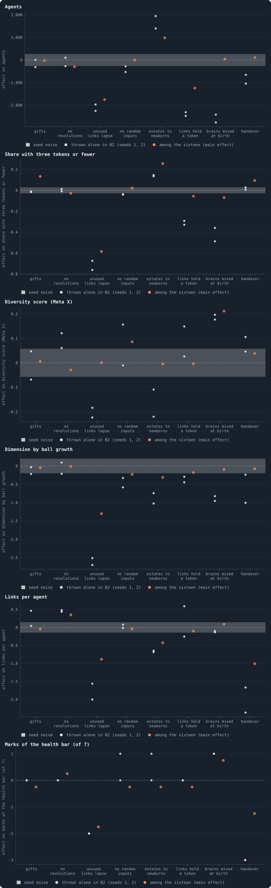
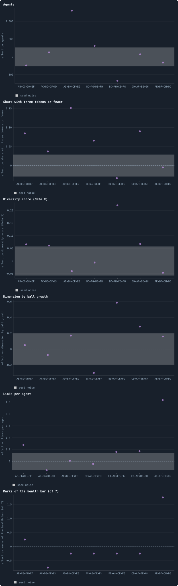
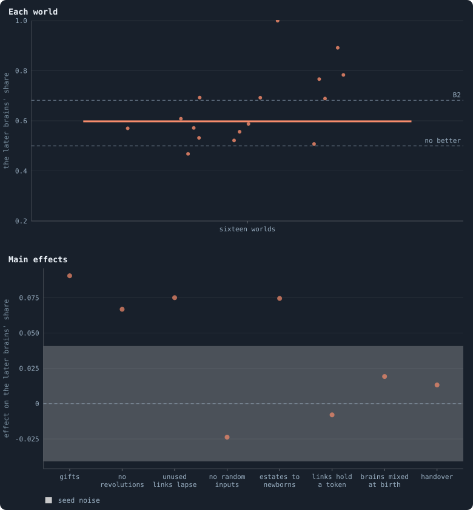
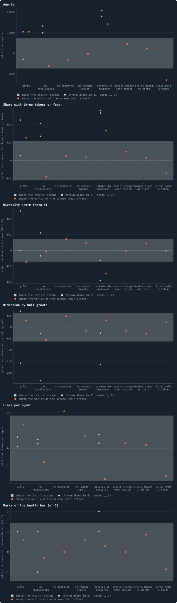
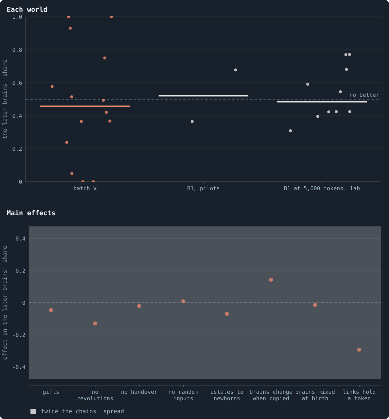

# Eight switches at once, and how sixteen worlds can test them

> [!question] Questions of this page
> - The notebook has thrown its switches into B2 one at a time. What does each
>   do when several are thrown together?
> - How can sixteen worlds tell what each of eight switches does, and what
>   can they not tell apart?
> - Which switches move a world's riches, its diversity, its size and its
>   network the most?
> - Do their effects add up, or does one switch change what another does?
> - Do the same switches do the same on B1, the world that can break?

## In short

Most experiments threw one switch at a time into B2, the baseline whose
network cannot break. Batch U threw eight together in sixteen worlds,
chosen by a **fractional factorial design** so that each switch's effect can
still be read. Whatever else is on, every unused link lapsing makes a world
rich and small, and the [estate](estate.md "The tokens a dead agent leaves, and who gets them.") to the newborns makes it large and poor. But
pairs of switches act together strongly, so what a switch does alone is
often not what it does among others. The later [brains](the-brain.md "The neural network each agent decides with: inputs about itself and its neighbours, outputs that become its decisions.") still beat the
earlier ones in fifteen of the sixteen worlds. On B1, in batch V, few
switches stood out, and none made evolution go on better than in B1 itself.

## Eight switches at once

Most experiments on B2 threw one switch into it and compared the world with
B2 itself. [B1 and B2: the two baselines](b1-and-b2.md) says what B2 is,
and [Building B2: a world that cannot break](a-world-that-cannot-break.md)
how it was made. That tells what a switch does *in B2*. It cannot tell whether the switch
does the same once other switches are thrown as well: whether the effects
add up.

On 16 October 2026 the author asked for the existing settings tested in
combination. One answer plays each pair of rules in full, a square of four
worlds for every pair
([One switch beside every other rule](the-switches-the-world-was-built-with.md#one-switch-beside-every-other-rule)).
This page throws eight switches at once. Every combination of eight switches
would be 2⁸ = 256 worlds. A **fractional factorial design** plays sixteen of
them. It chooses them so that each switch is on in eight and off in eight.
And every pair of switches meets in all four ways equally often. The next
section shows how that works.

## Many switches in few worlds: fractional factorial designs

How can sixteen worlds say what each of eight switches does? The trick is
easiest to see with four switches in eight worlds. The same trick then fits
eight switches into sixteen.

### Four switches in eight worlds

Take four switches, A, B, C and D. Write each as −1 when it is off and +1
when it is on. All their combinations would be 2⁴ = 16 worlds; play only
eight. Let A, B and C take all eight of their combinations, and set D by
multiplying them: D = A·B·C. So D is on where the product of the other
three is +1.

The last column below is made up, to show the arithmetic. It is the share of
a world's [agents](the-world.md#agents-and-tokens "One member of a world: it lives on a node of the network, holds tokens and has a brain that takes all its decisions.") holding three [tokens](the-world.md#agents-and-tokens "The one thing of value in a world: every agent holds a whole number of them, and their total never changes.") or fewer, in a world without noise.
There A adds 20 points, B takes 10 off, C adds 4 and D does nothing. And A
and B act together: A adds 26 points where B is on, but only 14 where B is
off.

| world | A | B | C | D = A·B·C | agents with 3 tokens or fewer (made up) |
|---|---|---|---|---|---|
| 1 | − | − | − | − | 56% |
| 2 | + | − | − | + | 70% |
| 3 | − | + | − | + | 40% |
| 4 | + | + | − | − | 66% |
| 5 | − | − | + | + | 60% |
| 6 | + | − | + | − | 74% |
| 7 | − | + | + | − | 44% |
| 8 | + | + | + | + | 70% |

**Balance.** Every switch is on in four worlds and off in four. Every pair
of switches meets in all four ways, on–on, on–off, off–on and off–off, in
two worlds each. Take A and D: both are off in worlds 1 and 7, and both on
in 2 and 8. A is on and D off in 4 and 6; A is off and D on in 3 and 5.

**A main effect.** A switch's **main effect** is the mean over the worlds
where it is on, minus the mean over those where it is off. A is on in worlds
2, 4, 6 and 8, which hold 70% of their agents at three tokens or fewer on
average. It is off in worlds 1, 3, 5 and 7, which hold 50%. So A's main
effect is 20 points, just what was put in. Within each group of four, B, C
and D are each on twice and off twice, so their own effects cancel. Read the
same way, B's main effect is −10 points, C's is +4 and D's is 0.

**A pair.** Two switches **act together** when the effect of one depends on
whether the other is on. A's effect is 26 points with B on and 14 with B
off. The pair's effect is half the difference: 6 points. The worlds show it
in the column A·B. It is +1 in worlds 1, 4, 5 and 8, which average 63%, and
−1 in the other four, which average 57%. The difference is 6 again.

**What cannot be told apart.** Now multiply C by D. That column too is +1 in
worlds 1, 4, 5 and 8, the same as A·B. It must be: C·D = C·(A·B·C) = A·B,
since C·C = 1. So the eight worlds cannot say whether the 6 points come from
A with B, or from C with D. The two pairs are **aliases**, and their column
measures the sum AB + CD. Eight worlds give seven independent differences:
the four main effects, and three such sums, AB + CD, AC + BD and AD + BC.

**Why a main effect is safe.** A's column is the same as B·C·D. So a main
effect shares its column with three switches acting together, but never with
a pair. Designs like this assume that three switches together add little, so
a main effect is read clean of every pair. Such a design is said to be of
**resolution IV**. Had D been set to A·B instead, its column would be the
pair's. Then D's effect could not be told from A and B acting together.

### Sixteen worlds for eight switches

The same trick, one size up. Take four switches, A, B, C and D, in all
sixteen combinations, and set the other four by multiplying:

$$E = BCD, \quad F = ACD, \quad G = ABC, \quad H = ABD.$$

In words: E is on where the product of B, C and D is +1, and so on. Take
the world where A, B and C are on and D off. There G = (+1)(+1)(+1) = +1 is
on, H = (+1)(+1)(−1) = −1 off, and so on. It is the world with A, B, C and G
on, a row of the tables below. Every switch is then on in eight of the sixteen
worlds and off in the other eight. And every *pair* of switches is on–on,
on–off, off–on and off–off in four worlds each: the design is balanced.

### Reading an effect

Take any measure *y* of a world. A switch's main effect on *y* is the mean
of *y* over the eight worlds with it on, minus the mean over the other
eight:

$$\text{effect}(A) = \bar y_{A=+1} - \bar y_{A=-1}.$$

The first mean is over the eight worlds with A on, the second over the eight
with A off. Because the design is balanced, every other switch is on in half
of each eight. Their effects cancel out of the difference, *if the effects
add up*.

### What cannot be told apart

Sixteen worlds give fifteen independent differences. But eight switches have
eight main effects, twenty-eight pairs and more besides, so some must share
a difference. A pair's effect is read as in the small example. It is half
the difference between A's effect with B on and A's effect with B off. The
worlds give it as the mean of *y* where A·B = +1, minus the mean where
A·B = −1.

In this design the column A·B is the same as C·G, D·H and E·F. Multiply out
the definitions: C·G = C·ABC = AB, since C·C = 1. So one difference measures
the four pairs together, a **chain** of aliases:

| chain | the pairs it adds up |
|---|---|
| AB | AB + CG + DH + EF |
| AC | AC + BG + DF + EH |
| AD | AD + BH + CF + EG |
| BC | BC + AG + DE + FH |
| BD | BD + AH + CE + FG |
| CD | CD + AF + BE + GH |
| ABCD | AE + BF + CH + DG |

Eight main effects and these seven chains are the fifteen differences. A
main effect shares its column only with triples of switches (A = BCG = …).
So the design is of resolution IV: no main effect is confused with a pair.
If a chain is large, some pair in it acts together. Which one, the sixteen
worlds cannot say.

### How large is large?

Each world is played once, with one [seed](random-numbers.md "The number that fixes every random choice of a run: the same settings and the same seed make the same world."). How far can a difference of
means between two groups of eight move by chance alone? Worlds that differ
*only* in their seed tell. If one world's measure varies with the seed by a
standard deviation σ, a difference of two means of eight varies by

$$\sigma \sqrt{1/8 + 1/8} = \sigma / 2.$$

In words: a mean of eight worlds wobbles by σ/√8, and the difference of two
such means by √2 times as much, which is σ/2. An effect several times σ/2 is
not the seed. ([How sure can we be?](bootstrap.md) says more about how sure
a difference is.)

The chains give a second check. If every pair added nothing, the seven
chains would scatter like chance too. On B2 this page takes its yardstick
from ten worlds that differ only in their seed. On B1 it takes it from the
chains ([The same eight switches on B1](#the-same-eight-switches-on-b1)).

## The sixteen worlds

The eight switches of batch U, each one the notebook has played alone in B2
before:

| | switch | the setting | alone in |
|---|---|---|---|
| A | gifts | [`allow_gifting`](settings.md#allow_gifting), with unused links cut after reproduction once unused for an [iteration](one-iteration.md "One step of a world's time: a phase of reproduction, then a phase of the game.") | batch S ([The switches the world was built with](the-switches-the-world-was-built-with.md)) |
| B | no [revolutions](revolution.md "A node taken by stakers who each marked part of their stake revolutionary and together staked more than the largest single stake.") | [`allow_revolutions`](settings.md#allow_revolutions) off | batch S ([The switches the world was built with](the-switches-the-world-was-built-with.md)) |
| C | every unused link lapses | [`prune_needs`](settings.md#prune_needs) = 0 | batch S ([The switches the world was built with](the-switches-the-world-was-built-with.md)) |
| D | no random inputs | [`random_input_amount`](settings.md#random_input_amount) = 0 | Experiment 16 ([Why evolution stops](how-to-tell-a-world-that-keeps-evolving.md#why-evolution-stops)) |
| E | estates to the newborns | [`redistribution`](settings.md#redistribution) = `newborns` | [Who inherits?](who-inherits.md) |
| F | links hold a token | a link costs a token to keep, with no cap on links | batch P ([Rules without numbers](rules-without-numbers.md)) |
| G | brains mixed at birth | a newborn's brain mixed from its parent's and a [neighbour](the-world.md#the-network "An agent joined to another by a connection.")'s | [Brains mixed at birth, units that cost, an eye for raids on kin](mixed-brains-costly-units.md) |
| H | handover | [`allow_handover`](settings.md#allow_handover): a parent may pass links to its newborn | batch T's control (`T/handover`) |

Two of them need a word. With **gifts**, an agent may hand tokens to its
neighbours during reproduction
([Three switches, and two more](the-switches-the-world-was-built-with.md#three-switches-and-two-more)).
A link is then cut only once it has gone unused for a whole iteration, so a
gift can keep it alive.
**Random inputs** are five random numbers that a brain reads, fresh every
time, for each [candidate](one-iteration.md#phase-1-reproduction "An agent itself and each of its neighbours, the ones its brain looks at when it decides.") it looks at. Without them it reads none.

A, B, C and D are on and off in all sixteen combinations. E, F, G and H are
set from them: E = BCD, F = ACD, G = ABC and H = ABD. Each world is B2 at 10,000 tokens, seed 1, played for
1,000 iterations (pilot batch U). Each is read at iteration 1,000 as
[Healthy and rich](healthy-and-rich.md) reads every world. The world with
no switch on is B2's own world of seed 1, game for game.

For each world, the table gives its number of agents, and the share of them
holding three tokens or fewer: the poor. Since 19 October 2026 that share
only stands in for what the author's picture asks, tokens not held too
evenly ([Too even, not too poor](healthy-and-rich.md#too-even-not-too-poor)).
Then comes its [diversity score](diversity-score.md "How much the agents of a world differ, in one number from 0 to 1: in tokens, links, ages and genotypes."): how much its agents differ, from 0
to 1. Then the marks of the [health bar](health-bar.md "The seven marks a world's network must meet to count as healthy: one piece, mostly on loops, no fatal cut, no hub, three to twelve links per agent, a dimension of 2.3 to 4.") it meets, of seven; its
[dimension](ball-dimension-and-curvature.md "How fast the number of agents within a distance grows with the distance: as its square in a plane, its cube in space."); and its links per agent. The rows run from the
richest world to the poorest.

| switches on | agents | agents with 3 tokens or fewer | diversity score | marks (of 7) | dimension | links per agent |
|---|---|---|---|---|---|---|
| C, D, G, H | 931 | 1% | 0.61 | 5 | 2.31 | 3.7 |
| B, C, F, H | 1,128 | 2% | 0.10 | 4 | 1.97 | 3.4 |
| A, B, C, G | 1,023 | 2% | 0.49 | 4 | 1.73 | 3.6 |
| C, E, F, G | 1,279 | 13% | 0.63 | 4 | 2.43 | 3.1 |
| B, C, D, E | 1,502 | 17% | 0.52 | 3 | 2.23 | 3.3 |
| A, C, D, F | 1,334 | 17% | 0.36 | 2 | 2.14 | 3.0 |
| B, D, F, G | 652 | 25% | 0.68 | 7 | 3.67 | 5.4 |
| A, C, E, H | 1,470 | 28% | 0.46 | 3 | 2.45 | 2.7 |
| all eight | 1,408 | 54% | 0.81 | 3 | 2.14 | 3.4 |
| A, F, G, H | 1,456 | 61% | 0.72 | 4 | 3.68 | 3.2 |
| none (B2) | 3,598 | 77% | 0.51 | 6 | 4.39 | 5.5 |
| A, B, D, H | 3,031 | 80% | 0.53 | 4 | 3.95 | 3.7 |
| A, B, E, F | 1,945 | 85% | 0.24 | 7 | 3.46 | 5.3 |
| D, E, F, H | 2,906 | 88% | 0.42 | 3 | 2.39 | 2.5 |
| B, E, G, H | 5,196 | 91% | 0.49 | 4 | 3.40 | 3.1 |
| A, D, E, G | 5,313 | 93% | 0.39 | 7 | 2.86 | 4.6 |

## What each switch does

<!-- figure eightswitches/effects -->

**What each switch does, among the sixteen and alone.** Orange: each switch's main effect among the sixteen worlds of batch U — the mean of the eight worlds with it on, minus the mean of the eight with it off — at iteration 1,000. Grey: the same switch thrown alone in B2, the world with it minus its twin without it, seeds 1 and 2. The grey band round zero is the seed's own noise: one standard deviation of the measure over the lab's ten B2 worlds, twice the noise of a main effect.

> [!example]- How to make this figure
> **Runs.** Batch U's sixteen pilot worlds (`GraphOfLifeRuns/.pilots/U/`): B2 at 10,000 tokens, seed 1, 1,000 iterations, with each of eight switches on in eight of them (`research/oee/pilots/make_jobs_TU.py`); each switch alone in B2, seeds 1 and 2, from the batch or lab experiment that made it; and the lab's ten B2 worlds (Experiment 16) for the seed's own noise.
>
> **Data.** From each world's checkpoint at iteration 1,000, or the lab's whole world kept then (`research/atlas/at.py --at 1000`, `GraphOfLifeRuns/.pilots/atlas/at1000.json`).
>
> 1. Read each world as `research/atlas/profile.py` reads every world.
> 2. A switch's main effect: the mean of the eight worlds with it on, minus the mean of the eight with it off.
> 3. Thrown alone: the world with the switch minus its twin without it, each seed.
> 4. The seed noise: the standard deviation of the lab's ten B2 worlds at iteration 1,000.
>
> **To make it again:** `python3 book_figures.py eightswitches`.
<!-- /figure -->

A switch's main effect is the mean of the eight worlds with it on minus the
mean of the eight with it off. How large is large? The lab's ten B2
worlds at iteration 1,000 differ only in their seed. Their spread, one
standard deviation, is the grey band, twice the noise of a main effect. The
seed moves the share of poor agents by 0.03, the diversity score by 0.06,
the dimension by 0.2 and the agents by 270. It never moves the marks: all
ten B2 worlds meet six.

- **Every unused link lapsing (C) is the strongest switch.** It takes 1,750
  agents off a world, and 0.58 off the share of agents holding three tokens
  or fewer. It takes 1.3 off the dimension, 0.9 links off each agent and
  1.75 marks off the health bar. Seven of the eight worlds with it hold less than a third
  of their agents at three tokens or fewer. Seven of the eight without it
  hold more than three fifths.
- **The estate to the newborns (E) fills a world**: 980 agents more, and
  0.26 more of them poor.
- **Links that hold a token (F) shrink it**, by 1,240 agents.
- **Mixing (G) raises diversity the most**, by 0.21: almost four times the
  seed's spread of 0.06. It also adds 0.75 marks.
- **Handover (H) costs links and health**: a link per agent and 1.25 marks.
- **Gifts (A) make worlds poorer**: 0.13 more of their agents hold three
  tokens or fewer. No revolutions (B) leave a world a third of a link
  richer per agent. No random inputs (D) raise diversity by 0.09, just above
  the seed's spread.

## Alone and together

The grey dots of the same figure are the switches thrown alone into B2, two
seeds each. For several switches the two disagree:

- **Mixing** alone takes about 2,600 agents off B2's world, and 0.36 to
  0.49 off its share of poor agents. Among the sixteen, it takes 40 agents *on* and 0.07 off. Its rise in
  diversity is the same alone (0.18 and 0.20) as among the sixteen (0.21).
  So, nearly, is its gain in marks: one alone, 0.75 among the sixteen.
- **Links that hold a token** alone take 0.29 and 0.33 off B2's share of
  the poor; among the sixteen, 0.06.
- **Every unused link lapsing** alone takes 2.5 and 2.7 off the dimension;
  among the sixteen, 1.3.
- **The estate to the newborns** alone adds 0.13 and 0.15 to the share of
  the poor; among the sixteen, twice that.
- **Handover** alone costs three marks and 1.7 and 2.4 links per agent, and
  takes 660 and 1,040 agents off the world. Among the sixteen it costs 1.25
  marks and a link, and no agents.

A switch does on average among the sixteen what it does alone in B2 only if
no pair of switches acts together. Here pairs do:

<!-- figure eightswitches/pairs -->

**Switches that act together.** The seven chains of pairs of batch U (book/notes/fractional-factorial.md): for each, the mean of the eight worlds where the product of the pair's two switches is +1, minus the mean of the other eight — the sum of the four pairs' effects that one chain cannot tell apart. The grey band: the seed's own noise, as in the figure above.

> [!example]- How to make this figure
> **Runs.** Batch U's sixteen pilot worlds (`GraphOfLifeRuns/.pilots/U/`): B2 at 10,000 tokens, seed 1, 1,000 iterations, with each of eight switches on in eight of them (`research/oee/pilots/make_jobs_TU.py`); each switch alone in B2, seeds 1 and 2, from the batch or lab experiment that made it; and the lab's ten B2 worlds (Experiment 16) for the seed's own noise.
>
> **Data.** From each world's checkpoint at iteration 1,000, or the lab's whole world kept then (`research/atlas/at.py --at 1000`, `GraphOfLifeRuns/.pilots/atlas/at1000.json`).
>
> 1. Read each world as `research/atlas/profile.py` reads every world.
> 2. A chain's effect: the mean of the eight worlds where the product of a pair's switches is +1, minus the mean of the other eight.
>
> **To make it again:** `python3 book_figures.py eightswitches`.
<!-- /figure -->

Each chain adds up four pairs the sixteen worlds cannot tell apart
([What cannot be told apart](#what-cannot-be-told-apart)). Three of them
stand far outside the seed's noise:
- the chain AD + BH + CF + EG adds 1,300 agents and 0.15 to the share of the
  poor;
- BD + AH + CE + FG adds 0.22 to the diversity and 0.59 to the dimension;
- AE + BF + CH + DG adds a link per agent and 1.75 marks.

Which pair in a chain does it, the design cannot say. But the worlds of
batch Y, each mixing with one other rule beside the rule alone, say it for
two of them:

- **Mixing with the estate to the newborns (EG).** B2 with the estate to the
  newborns holds 90% and 91% of its agents at three tokens or fewer. With
  mixing as well, 91% and 90%. Mixing takes nothing off, where alone it
  takes 0.36 to 0.49. Among the sixteen, likewise, mixing takes 0.22 off the
  share of the poor in the worlds whose estate is shared evenly. It adds
  0.08 in those whose estate goes to the newborns. That is the rise of the
  chain AD + BH + CF + EG. Yet A with D, B with H, or C with F could hide in
  the same difference.
- **Mixing with lapsing links (CG).** With every unused link lapsing, 1% and
  9% are poor; with mixing as well, 6% and 4%. A world already rich is not
  made richer.

So mixing's riches mostly vanish among the sixteen, where most worlds have
four switches on. [Brains mixed at birth, with every other rule](mixing-with-every-other-rule.md) found them
surviving sixteen of 23 other rules one at a time. But of the eight mixed
worlds here, four hold the estate to the newborns, which cancels them. Four
hold the lapse, which leaves nothing to add, and two hold both. Of the other
two, one has handover, which cancels mixing's riches too
([Handover, with every other rule](the-switches-the-world-was-built-with.md#handover-with-every-other-rule)):
61% of its agents are poor.

Only one mixed world has none of the three. It has B, D, F and G on: no
revolutions, no random inputs, links that hold a token, and mixing. It
meets the author's picture better than any of the sixteen. It meets all
seven marks at a dimension of 3.7. A quarter of its 652 agents hold three
tokens or fewer, and its diversity score is 0.68. Its tokens are not too
even either: their [Gini coefficient](gini-coefficient.md) is 0.53, within
the 0.49 to 0.56 of B2's ten worlds at iteration 1,000
(`GraphOfLifeRuns/.pilots/atlas/at1000.json`).

But it is one world of one seed, and its network is folded. A typical agent
reaches half the world in 1.19 times the steps its [random twin](random-twin.md "A network with the same agents and as many links each, wired at random: what a world would be if it were no space at all.") needs
([What folds a world](how-many-dimensions-does-a-world-have.md#what-folds-a-world)).
Played on to 10,000 iterations as a candidate world
([The candidates, played on](the-candidates-played-on.md#the-candidates-played-on)),
it fell back on a single mark. One agent came to be joined to more than 5%
of the others. It was still rich and diverse: 4% of its 399 agents held
three tokens or fewer, at a diversity score of 0.66.

## Does evolution go on?

Do the brains of these worlds still get better? To tell, each world's brains
of iteration 1,000 are played against its brains of iteration 500
([Eras, contests and invasions](eras-and-contests.md)). Every agent gets a
brain of one era or the other. Then the world plays on for 100 iterations, a
[lifetime](age-and-lifetime.md "How many iterations an agent lives, from its birth to its death.") of B2 ([A contest a lifetime long](eras-and-contests.md#a-contest-a-lifetime-long)).
If the later brains then hold more than half of the world, they are better.

<!-- figure eightswitches/evolution -->

**Do the brains of 1,000 beat those of 500?** Above: each world of batch U, the share of a contested world its brains of iteration 1,000 hold after 100 iterations against those of 500, the mean of two contests, one in each era's world; the dashed line marked B2 is the median of the lab's ten B2 worlds, played the same way. Below: each switch's main effect on that share; the grey band is the spread of the ten B2 worlds (one standard deviation), twice the noise of a main effect.

> [!example]- How to make this figure
> **Runs.** Batch U's sixteen pilot worlds (`GraphOfLifeRuns/.pilots/U/`): B2 at 10,000 tokens, seed 1, 1,000 iterations, with each of eight switches on in eight of them (`research/oee/pilots/make_jobs_TU.py`); each switch alone in B2, seeds 1 and 2, from the batch or lab experiment that made it; and the lab's ten B2 worlds (Experiment 16) for the seed's own noise.
>
> **Data.** From `GraphOfLifeRuns/.pilots/batch_TUV_T100.json` and, for B2, `long_steps.json` (`research/oee/checks/rejudge.py`).
>
> 1. Seat the brains of the two eras on alternate agents of each era's world and play 100 iterations.
> 2. Count the agents the later era's brains hold, as a share of all.
> 3. A switch's main effect: the mean of the eight worlds with it on, minus the other eight.
>
> **To make it again:** `python3 book_figures.py eightswitches`.
<!-- /figure -->

The brains of 1,000 hold more than half of a contested world in fifteen of
the sixteen worlds. They hold from 0.47, with C, D, G and H on, to 1.0 with
all eight on. There the later brains took the whole world in both
eras' worlds. The [median](median-and-quantiles.md "The middle value: half of the numbers lie below it and half above.") is 0.60, below B2's own 0.69. The lab's ten
B2 worlds give a median of 0.68, with a spread of 0.04. Gifts, no
revolutions, lapsing links and the estate to the newborns each speed
evolution a little. They add 0.07 to 0.09, about twice the spread of B2's
worlds. The other four switches do nothing a
contest can tell. Pairs act together here too: three chains add 0.11 to
0.14.

## The same eight switches on B1

B1 is the world that can break
([The switches the world was built with](the-switches-the-world-was-built-with.md)).
Its revolutions take most of the nodes that change hands, a parent may pass
links to its newborn, and pieces cut off are culled. Batch V, whose worlds
were read on 18 October 2026, plays the same design on it. Its sixteen
worlds hold 10,000 tokens each, with seed 1, for 1,000 iterations. As on
B2, the world with no switch on is B1's own world of seed 1.

Its eight switches are ones that mean something there. So three letters
stand for other switches than in batch U:

| | on B1, in batch V | on B2, in batch U |
|---|---|---|
| A | gifts | gifts |
| B | no revolutions | no revolutions |
| C | no handover | every unused link lapses |
| D | no random inputs | no random inputs |
| E | estates to the newborns | estates to the newborns |
| F | brains that change only when copied (B2's rule) | links hold a token |
| G | brains mixed at birth | brains mixed at birth |
| H | links that hold a token | handover |

| switches on | agents | agents with 3 tokens or fewer | diversity score | marks (of 7) | dimension | links per agent |
|---|---|---|---|---|---|---|
| none (B1) | 871 | 2% | 0.72 | 3 | 2.56 | 2.7 |
| A, B, D, H | 264 | 9% | 0.67 | 2 | 1.65 | 2.2 |
| B, C, F, H | 501 | 11% | 0.69 | 3 | 2.28 | 3.3 |
| A, B, C, G | 1,374 | 21% | 0.56 | 4 | 2.25 | 6.8 |
| C, D, G, H | 336 | 25% | 0.88 | 3 | 2.75 | 4.9 |
| D, E, F, H | 1,560 | 36% | 0.31 | 3 | 2.49 | 2.3 |
| B, D, F, G | 1,140 | 37% | 0.66 | 2 | 2.19 | 2.7 |
| B, E, G, H | 1,718 | 40% | 0.35 | 3 | 2.35 | 2.4 |
| all eight | 1,567 | 44% | 0.60 | 4 | 2.66 | 3.2 |
| C, E, F, G | 2,584 | 57% | 0.68 | 3 | 2.14 | 3.2 |
| A, B, E, F | 3,619 | 72% | 0.20 | 3 | 2.43 | 2.9 |
| A, C, D, F | 2,933 | 75% | 0.62 | 4 | 3.02 | 9.6 |
| A, C, E, H | 1,841 | 82% | 0.26 | 1 | 4.32 | 2.5 |
| A, D, E, G | 4,413 | 84% | 0.35 | 6 | 2.44 | 3.7 |
| A, F, G, H | died out by iteration 341, after at most 398 agents | | | | | |
| B, C, D, E | died out after iteration 781, after 3,483 agents | | | | | |

**Two worlds died out**, and they are each other's mirror: every switch on
in one is off in the other. That has a use. Every switch still has seven
living worlds with it and seven without, so a main effect is still the
difference of two means of seven. And it has a cost a student should know.
With a world and its mirror gone, one combination of the eight main effects
can no longer be told apart from the rest. No fit can recover it. Every
living world agrees with the dead world A, F, G, H in exactly four of the
eight switches. So the effects of A, F, G and H together, set against those
of B, C, D and E, never show in the fourteen.

### What each switch does on B1

<!-- figure eightswitches/b1effects -->

**The same eight switches on B1.** Orange: each switch's main effect among the worlds of batch V that lived to iteration 1,000 (14 of 16; V-AFGH-s1 and V-BCDE-s1 died out, and are each other's mirror, so every switch keeps seven worlds on and seven off): the mean of the seven with it on, minus the mean of the seven with it off. Grey dots: the switch thrown alone in B1, the world with it minus its twin without it, seeds 1 and 2, where the notebook has them. The grey band round zero is twice the spread of the seven chains of pairs, read the same way: what a main effect would scatter by if pairs of switches did not act together.

> [!example]- How to make this figure
> **Runs.** Batch V's sixteen pilot worlds (`GraphOfLifeRuns/.pilots/V/`): B1 at 10,000 tokens, seed 1, 1,000 iterations, with each of eight switches on in eight of them (`research/oee/pilots/make_jobs_TU.py`): gifts, no revolutions, no handover, no random inputs, estates to the newborns, brains that change only when copied, brains mixed at birth, links that hold a token; and the switches the notebook has played alone in B1, seeds 1 and 2 (batches S, T and R).
>
> **Data.** From each world's checkpoint at iteration 1,000 (`research/atlas/at.py --at 1000`, `GraphOfLifeRuns/.pilots/atlas/at1000.json`).
>
> 1. Read each world as `research/atlas/profile.py` reads every world; leave out the worlds with fewer than 20 agents.
> 2. A switch's main effect: the mean of the worlds with it on, minus the mean of those with it off.
> 3. The band: twice the root mean square of the seven chains of pairs, read the same way.
> 4. Thrown alone: the world with the switch minus its twin without it, each seed.
>
> **To make it again:** `python3 book_figures.py eightswitches`.
<!-- /figure -->

B1's worlds are far less alike than B2's: the two seeds of B1 itself differ
in diversity by 0.34. So the spread of B2's ten worlds is no yardstick here.
The design gives one of its own: the seven chains of pairs. If no pair
acted together, they would scatter as the main effects do
([How large is large?](#how-large-is-large)). The grey band is twice their
spread. Against it, few switches stand out:

- **The estate to the newborns moves B1 as it moves B2.** It adds 1,410
  agents and 0.33 to the share at three tokens or fewer, and takes 0.29 off
  the diversity score. It does the same when thrown alone in B1
  ([Who inherits?](who-inherits.md)).
- **Without handover, a world keeps more links**: two more per agent. That
  is the other side of what handover did in B2
  ([Handover, with every other rule](the-switches-the-world-was-built-with.md#handover-with-every-other-rule)).
- **Gifts make B1 larger and poorer**: 1,040 more agents, 0.25 more of them
  poor. Links that hold a token make it smaller, by 1,310 agents.
- **No revolutions does not do in company what it did alone.** Thrown alone,
  B1 without revolutions became a world of mayflies. It was larger by 990
  and 1,320 agents, and poorer: 0.27 and 0.41 more at three tokens or
  fewer. Among the fourteen its effect is within the chains' spread, and if
  anything the other way: 620 agents fewer, 0.18 fewer poor.

### Evolution on B1

<!-- figure eightswitches/b1evolution -->

**On B1: do the brains of 1,000 beat those of 500?** Above, in orange: each world of batch V that lived, the share of a contested world its brains of iteration 1,000 hold after 100 iterations against those of 500, the mean of two contests, one in each era's world; in grey, B1 itself played the same way — two pilot worlds of 10,000 tokens, and the lab's ten worlds of 5,000. Below: each switch's main effect on that share, seven worlds with it against seven without; the grey band is twice the spread of the seven chains of pairs.

> [!example]- How to make this figure
> **Runs.** Batch V's sixteen pilot worlds (`GraphOfLifeRuns/.pilots/V/`): B1 at 10,000 tokens, seed 1, 1,000 iterations, with each of eight switches on in eight of them (`research/oee/pilots/make_jobs_TU.py`): gifts, no revolutions, no handover, no random inputs, estates to the newborns, brains that change only when copied, brains mixed at birth, links that hold a token. For B1 itself: the pilots `GraphOfLifeRuns/.pilots/L/B1-long-s1` and `-s2` (10,000 tokens), and the lab's ten B1 worlds of 5,000 tokens (Experiment 12, `B1-5000-s001` … `-s010`).
>
> **Data.** From `GraphOfLifeRuns/.pilots/batch_TUV_T100.json`, `batch_TUVWX4_T100.json`, `batch_TUVWX5_T100.json` and `rejudge_T100.json` (`research/oee/checks/rejudge.py`).
>
> 1. Seat the brains of the two eras on alternate agents of each era's world and play 100 iterations.
> 2. Count the agents the later era's brains hold, as a share of all.
> 3. A switch's main effect: the mean of the worlds with it on, minus those with it off.
>
> **To make it again:** `python3 book_figures.py eightswitches`.
<!-- /figure -->

**Evolution goes on no better than in B1 itself.** In the same contests of
100 iterations, the later brains hold more than half of the world in six of
the fourteen worlds that lived. Their median is 0.46. That is as in B1
itself. Its ten lab worlds of 5,000 tokens gave a median of 0.49
([The verdict of Experiment 12](how-to-tell-a-world-that-keeps-evolving.md#the-verdict-of-experiment-12)).
Its two pilots of 10,000 tokens gave 0.37 and 0.68.

But the fourteen scatter far more. In two worlds the brains of 500 took the
whole world in both eras' worlds. One of them is the world with all eight
switches on, where on B2 the brains of 1,000 had taken it all. In two others
the later brains took the whole world. No
switch moves the share beyond the spread of the chains of pairs. The largest
effect, of links that hold a token (−0.29), is within it. Two of the eight
are B2's own rules, no handover and brains that change only when copied.
Neither moves it beyond the chains either (−0.02 and +0.14).

## What we learned

- **Sixteen worlds can test eight switches.** In a fractional factorial
  design each main effect is a difference of two means of eight, clean of
  every pair. Pairs can be read only in chains of four, which the worlds
  cannot tell apart.
- **A switch measured alone tells what it does in B2, not what it does.**
  Among combinations, mixing's riches and the riches of links that hold a
  token mostly vanish, and the lapse's fall in dimension halves. Pairs of
  switches act together often and strongly.
- **Three effects hold whatever else is on.** Every unused link lapsing
  makes worlds rich, small and low in dimension, and costs marks. The estate
  to the newborns makes them large and poor. Mixing makes the agents differ
  more.
- **One of the sixteen meets the author's picture better than any.** It is
  B, D, F and G, the one mixed world with no rule that cancels mixing's
  riches. It is one world of one seed, folded, and at 10,000 iterations it
  had lost a mark.
- **Evolution goes on** in fifteen of the sixteen worlds, in most of them
  more slowly than in B2 itself; four switches speed it a little.
- **On B1** few switches stand out against the spread of the chains of
  pairs. The estate to the newborns makes a world larger, poorer and more
  alike, as on B2. No handover keeps more links. No revolutions, which alone
  made B1 a world of mayflies, does not in company. Two of the sixteen
  worlds died out. And no switch makes B1's evolution go on better. The
  later brains won in six of the fourteen worlds that lived, about as often
  as in B1 itself.

## Where to go next

- [Rules in company](rules-in-company.md): what every batch of rules played
  in company says together.
- [Revolutions, handover and gifts: the switches the world was built with](the-switches-the-world-was-built-with.md):
  three of these switches, each beside every other rule, one pair at a time.
- [Brains mixed at birth, with every other rule](mixing-with-every-other-rule.md):
  which rules cancel mixing's riches.
- [The candidates, played on and played again](the-candidates-played-on.md):
  the best of the sixteen and the other candidate worlds at 10,000
  iterations.

## How this was made

Every world on this page is a pilot, made with `research/oee/pilots/run.py`
in the engine's own code (`--proto engine=true`) and kept in
`GraphOfLifeRuns/.pilots` ([Pilot worlds](the-lab.md#pilot-worlds)). No experiment
of the lab stands behind it, so the page has no box of runs. Every figure
says, folded beneath it, which worlds it reads and how. The numbers it
quotes are in `book/results/eightswitches.json`.

### The pilots of batch U

- **The worlds**: sixteen, in `GraphOfLifeRuns/.pilots/U/`, each named for
  the switches it has on (`U-ABDH-s1`; `U-none-s1` is B2 itself). Each is
  B2 at 10,000 tokens, seed 1, played for 1,000 iterations, with a whole
  world every 100 (`--ckpt 100`) and the health rows every 50.
- **The design**: `research/oee/pilots/make_jobs_TU.py` writes the job list
  `jobs_U.txt` from its `u_design()`, with the settings of the table below.
  Like every job list of the pilots, it is kept on the machine that ran
  them.
- **Each world at iteration 1,000**: `research/atlas/at.py --at 1000`, into
  `GraphOfLifeRuns/.pilots/atlas/at1000.json`, each world read as
  `research/atlas/profile.py` reads every world.
- **The seed's noise**: the lab's ten B2 worlds of Experiment 16,
  `B2-10000-s001` to `-s010`, read the same way.
- **Contests a lifetime long**: `research/oee/checks/rejudge.py`, 100
  iterations, once in each era's world, into
  `GraphOfLifeRuns/.pilots/batch_TUV_T100.json`.
- **The figures**: `python3 book_figures.py eightswitches`
  (`book_chapters/screens.py`).

### The pilots of batch V

- **The worlds**: sixteen, in `GraphOfLifeRuns/.pilots/V/`, made the same
  way on B1 at 10,000 tokens, seed 1, 1,000 iterations (`jobs_V.txt`).
- **The worlds that died out**: the analysis leaves out every world with
  fewer than 20 agents at iteration 1,000, `V-AFGH-s1` and `V-BCDE-s1`.
- **Contests a lifetime long**: as for batch U, in
  `GraphOfLifeRuns/.pilots/batch_TUV_T100.json`, `batch_TUVWX4_T100.json`,
  `batch_TUVWX5_T100.json` and `rejudge_T100.json`. B1 itself: the pilots
  `GraphOfLifeRuns/.pilots/L/B1-long-s1` and `-s2`, and the lab's ten B1
  worlds of 5,000 tokens (Experiment 12).
- **The switches alone in B1**: the pilots of batches S, T and R, seeds 1
  and 2.

### What each switch sets

A switch that is on adds these settings to its baseline. The pilots'
prototype keys go with `--proto`.

| | batch U, on B2 | batch V, on B1 |
|---|---|---|
| A | `allow_gifting=true prune_after=reproduction inactive_window=iteration` | the same |
| B | `allow_revolutions=false` | `allow_revolutions=false` |
| C | `prune_needs=0` | `allow_handover=false` |
| D | `random_input_amount=0` | `random_input_amount=0` |
| E | `redistribution=newborns` | `redistribution=newborns` |
| F | `valence=0`, and the prototype's `link_token=true` | `mutate_on_replication=true` |
| G | the prototype's `mix=true` | the prototype's `mix=true` |
| H | `allow_handover=true` | the prototype's `link_token=true` |

## How our view changed

- **17 October 2026.** Diversity scores had been percentiles among all the
  worlds read so far, so they moved a little whenever worlds were added.
  Since that day they are ranked among a frozen set of worlds
  ([Two halves](healthy-and-rich.md#two-halves)). Two numbers of this page
  moved by 0.01. No random inputs had raised diversity by 0.08, now 0.09;
  mixing alone by 0.17 and 0.19, now 0.18 and 0.20.
- **24 October 2026.** Since 18 October this page said that pairs of
  switches act together more on B1 than on B2. The chains of pairs do not
  show that. Their root mean square is smaller on B1 for the agents (370
  against 580) and the diversity score (0.07 against 0.10). Yet B1's chains
  also carry its larger seed noise. It is larger for the share of the poor
  (0.11 against 0.08) and links per agent (0.92 against 0.42). It is about
  the same for dimension and marks (`book/results/eightswitches.json`). The
  chains stay the yardstick for the page's other reason: B1's worlds differ
  far more by seed than B2's
  ([What each switch does on B1](#what-each-switch-does-on-b1)).

<!-- turns -->
---

← [Brains mixed at birth, with every other rule](mixing-with-every-other-rule.md) · [Changing the rules](../README.md#changing-the-rules)

**Also about:** [Methods and statistics](../README.md#methods-and-statistics).

> [!info]- Pages that link here (4)
> [Glossary](glossary.md) · [Rules in company](rules-in-company.md) · [Revolutions, handover and gifts: the switches the world was built with](the-switches-the-world-was-built-with.md) · [Every simulation: what was run, and what was measured](every-simulation.md)
<!-- /turns -->
