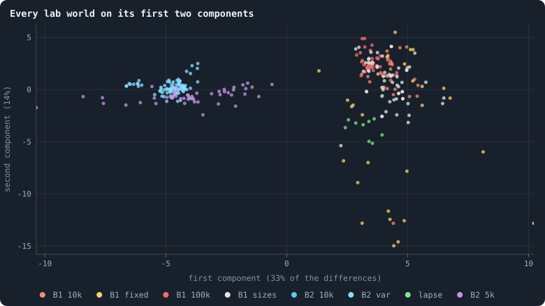
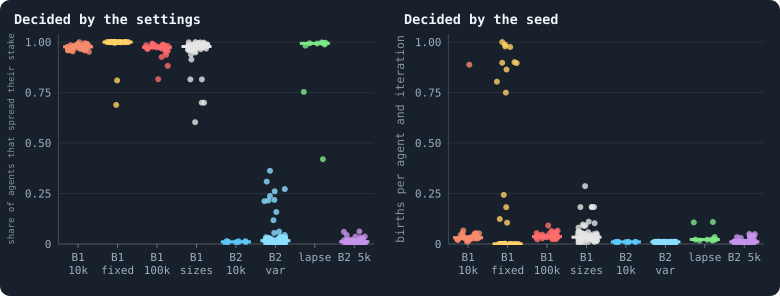

# Every world side by side

> [!question] Questions of this page
> - What does every simulation made so far look like when all of them are
>   measured the same way?
> - Along which directions do the worlds differ most?
> - Which statistics do the [settings](settings.md "One number or switch of a run's rules, fixed before it starts.") decide, and which does the [seed](random-numbers.md "The number that fixes every random choice of a run: the same settings and the same seed make the same world.") — the
>   chance a world is born with?
> - Which measures has the notebook applied to which kinds of world, and which
>   not yet?

Until now each page measured the worlds of one experiment, or of a few. That
is how experiments are read: one change against its control. But the notebook has
by now made **369 [lab](the-lab.md "The program that runs an experiment's plan as runs, each on a frozen copy of the engine, the code that plays a world.") worlds** in fifteen experiments, and about a hundred
[pilot](pilot-worlds.md "A world made by hand to see whether an idea is worth an experiment, without a thesis or many seeds.") worlds besides, and each was measured only for what its own page
asked. This page puts them all in one table and looks at them together. It
is a meta page: it builds nothing new into the worlds, it gathers what is
there.

## One table for every world

A lab run records about ninety-five statistics after every phase of every
[iteration](one-iteration.md "One step of a world's time: a phase of reproduction, then a phase of the game.") (the note [What a run records](frames-and-stats.md)). A
pilot world keeps only a few of them, and its checkpoints. To compare them,
`research/atlas/across.py` takes every world over the same stretches of
iterations — 400–499, 900–999, 1,900–1,999, and the last fifth of its life —
and makes one row of means for each:

- a **lab world's** row is the means of its own record over the stretch;
- a **pilot's** is made the same way from frames: the world is played on from
  its checkpoint at 1,000 and from its last, twenty [games](one-iteration.md#phase-2-the-game "The second phase of an iteration: every agent stakes all its tokens on its own node and its neighbours', and every node goes to someone.") are recorded as the
  lab records its own, and each game is summarised by the same function the
  lab uses (`gol_series.frame_stats`). So every pilot that plays the engine's
  game gets the lab's statistics too. The older pilots that play the
  prototype's own game record no decisions and keep the statistics of their
  series.

The table is `book/results/worlds.json`. The Research tab can draw any two of
its statistics against each other: **Research → Correlations → Every world**,
each world a dot, coloured by its rule set and named when you point at it.

## Two clouds

Which directions do the worlds differ in most? Take the statistics that do
not grow with the size of a world (shares, means, ratios; the counts of
births, deaths and [revolutions](revolution.md "A node taken by stakers who each marked part of their stake revolutionary and together staked more than the largest single stake.") divided by the [agents](the-world.md#agents-and-tokens "One member of a world: it lives on a node of the network, holds tokens and has a brain that takes all its decisions.")), standardise each, and
find the principal components: the directions along which the cloud of
worlds is longest. (The note [How many directions a cloud has](participation-ratio.md)
explains the idea.)

<!-- figure side_by_side/components -->

**Every lab world on its first two components.** Each dot is one of the 304 lab worlds that lived to iteration 500, placed by the two directions along which the 60 statistics that do not grow with a world differ most (principal components of their standardised means over iterations 400–499). B1 10k: the thirty B1 worlds of 10,000 tokens (Experiment 2); B1 fixed: the same with brains that never change (Experiment 7); B1 100k: B1 at 100,000 tokens (Experiment 10); B1 sizes: B1 at 800 to 409,600 tokens (Experiment 8) and at 5,000 with and without a hidden layer (Experiments 12 and 13); B2 10k: the ten B2 worlds of Experiment 16; B2 var: B2 with one rule or rate changed (Experiments 9, 15 and 16); B2 5k: B2 at 5,000 tokens, with all its rules or with one taken away (Experiment 14) — except lapse: the condition in which any unused link lapses; B1 and B2 pilots: the pilot worlds that play the engine's game.

> [!example]- How to make this figure
> **Runs.** every simulation made so far, as `book/results/worlds.json` holds it (`python3 research/atlas/across.py lab`, `pilots`, `write`): a lab run's statistics are the means of its record over a stretch of iterations; a pilot's, of 20 games recorded from its checkpoint and summarised the same way; the lab worlds that lived to iteration 500.
>
> **Data.** From each world's means over iterations 400–499.
>
> 1. Keep the statistics that do not grow with the size of a world; divide the counts of agents (births, deaths, revolutions, leaves) by the agents.
> 2. Fill a missing value with the median of the worlds; standardise each statistic.
> 3. Take the principal components (a singular value decomposition) and draw every world on the first two.
>
> **To make it again:** `python3 book_figures.py side_by_side`.
<!-- /figure -->

The first component holds a third of all the differences, and it splits the
worlds into **two clouds**: [B1](b1-and-b2.md "The first baseline: the algorithm exactly as a new run is offered it.") on the right, [B2](b1-and-b2.md "The second baseline: B1 with the rules that keep its network from breaking and its agents from staking or breeding themselves to death.") on the left, with nothing in
between. It is made of how agents play:

- whether they spread their stake over several nodes or go all in
  (`spreadShare`);
- whether the flow cancels or runs one way (`flowImbalance`, `netFlowShare`);
- how much agents keep on their own node, and whether they hold it
  (`selfAllocationShare`, `heldHomeShare`);
- how many revolutions there are, and how much of the world sits in its core.

Every one of the many settings an experiment changed in B2 — [mutation](mutation.md "A random change to a brain, made with a set probability when it is copied, and in B1 also after every game: a changed brain is a new genotype.") rates,
what a parent keeps, old age, random inputs, valence, mending, links at birth,
handing links over — moved its worlds only within the left cloud. Without
mending, and with handover, the worlds moved furthest, about a third of the way
towards the middle. One setting crossed over: the worlds of Experiment 14 in
which **any unused link lapses** (green) sit with B1. [Lightning in every world](where-the-tokens-flow.md#lightning-in-every-world) found the same
in the flow: where a link must carry [tokens](the-world.md#agents-and-tokens "The one thing of value in a world: every agent holds a whole number of them, and their total never changes.") to survive, agents stake on each
other and play the way B1's agents play.

The second component (14%) is how much a world breeds: births, the share of
tokens given to children, handovers, and the long tail of [degrees](degree.md "The number of an agent's connections: how many neighbours it has.") that
breeding builds. It is spread wide only in one kind of world: the B1 worlds
whose [brains](the-brain.md "The neural network each agent decides with: inputs about itself and its neighbours, outputs that become its decisions.") never change (yellow), some of which breed every agent every
iteration and others not at all ([Do the brains matter?](do-the-brains-matter.md)).

## What the settings decide, and what the seed does

For each statistic, how much of its spread between worlds lies *between*
conditions rather than between seeds of one condition? That share is
**eta squared**, the same split of variance the note [Between worlds and
within them](between-and-within.md) explains; here the groups are the
35 conditions of the fifteen experiments.

<!-- figure side_by_side/decided -->

**What the settings decide, and what the seed does.** Left: the share of agents that spread their stake over several nodes rather than going all in — 99% of its differences between worlds lie between conditions. Right: births per agent — under a third do; worlds of one condition differ from each other as much as the conditions do. Each dot is a world, over iterations 400–499. B1 10k: the thirty B1 worlds of 10,000 tokens (Experiment 2); B1 fixed: the same with brains that never change (Experiment 7); B1 100k: B1 at 100,000 tokens (Experiment 10); B1 sizes: B1 at 800 to 409,600 tokens (Experiment 8) and at 5,000 with and without a hidden layer (Experiments 12 and 13); B2 10k: the ten B2 worlds of Experiment 16; B2 var: B2 with one rule or rate changed (Experiments 9, 15 and 16); B2 5k: B2 at 5,000 tokens, with all its rules or with one taken away (Experiment 14) — except lapse: the condition in which any unused link lapses; B1 and B2 pilots: the pilot worlds that play the engine's game.

> [!example]- How to make this figure
> **Runs.** every simulation made so far, as `book/results/worlds.json` holds it (`python3 research/atlas/across.py lab`, `pilots`, `write`): a lab run's statistics are the means of its record over a stretch of iterations; a pilot's, of 20 games recorded from its checkpoint and summarised the same way.
>
> **Data.** From each world's `spreadShare` and `births` ÷ `nodes`.
>
> 1. Take each world's mean over iterations 400–499.
> 2. Group the worlds as in the other figures; draw a dot per world and the median.
>
> **To make it again:** `python3 book_figures.py side_by_side`.
<!-- /figure -->

| the settings decide | share | the seed decides | share |
|---|---|---|---|
| spread or all in (`spreadShare`) | 0.99 | tokens given to children (`reproTokenShare`) | 0.29 |
| the fewest links (`minDegree`) | 0.96 | agents cut off (`orphaned`) | 0.27 |
| kept at home (`selfAllocationShare`) | 0.95 | tokens per agent (`meanTokens`) | 0.24 |
| brains per agent (`brainDiversity`) | 0.94 | its [median](median-and-quantiles.md "The middle value: half of the numbers lie below it and half above.") (`medianTokens`) | 0.22 |
| own node held (`heldHomeShare`) | 0.91 | curvature of the network (`ricciCurvature`) | 0.22 |
| flow that runs one way (`flowImbalance`) | 0.88 | flow per link (`meanEdgeFlow`) | 0.19 |
| net ÷ staked flow (`netFlowShare`) | 0.87 | [net flow](token-flow.md "The tokens a game moves along each connection, from the agent who stakes to the node staked on.") on [loops](bridges.md#loops "A path through the network that comes back to where it started without using a connection twice.") (`netCyclingShare`) | 0.16 |
| revolutions per agent | 0.87 | the poorest agent (`minTokens`) | 0.15 |
| [evenness](gini-coefficient.md#entropy-and-evenness "How evenly something is shared out among the agents, from all in one place to spread perfectly evenly.") of wealth (`tokenEntropy`) | 0.82 | starved per agent | 0.14 |
| agents in the core (`coreShare`) | 0.81 | fit of the degree law (`degreeGammaR2`) | 0.13 |

The settings decide **how agents play**: whether they spread or go all in,
what they keep at home, whether the flow runs one way. Those are nearly
settled by the rules, whatever the seed. The seed decides **how many agents
the tokens are spread over** (tokens per agent, the poorest, the cut-off and
the starved) and how much a world breeds. Two worlds of the same rules can
differ in these as much as two worlds of different rules, because they are
set by what happens early and by chance. The same was seen inside one
condition in [What goes with what](what-goes-with-what.md): half the differences
between thirty [baseline](b1-and-b2.md "The stated rules an experiment starts from and changes one thing of: B1 or B2.") worlds are the size of their largest [hub](stars-and-hubs.md "An agent joined to far more agents than most; a star is a world held together by a single hub.").

For [open-ended evolution](open-ended-test.md "Evolution that keeps producing new things without end, not only up to a plateau.") this is worth keeping in mind. The things
evolution could change — how agents play — are pinned by the rules. The
things left free are decided by chance, early, and then stay.

## What has been measured where

The notebook's measures were each made for one question and applied to the worlds
that question was about. Gathered:

| measure | lab worlds | pilot worlds |
|---|---|---|
| the ~95 recorded statistics, [lightning](lightning.md "A closed loop of the flow of a game: tokens that go round and come back where they started.") among them | every run | the engine's pilots, from recorded games (new); the prototype's, their series |
| [flow modules](map-equation.md "A group of agents that a token, following the flow, tends to stay inside.") ([Flow modules: the groups tokens stay in](flow-modules.md)) | up to five seeds of every condition (new) | the engine's pilots (new) |
| loops and the exact [circulation](circulation.md "The part of a flow that goes round in loops, as against the part that runs from sources to sinks."), chains, help ([Gliders, and who helps whom](gliders-and-who-helps-whom.md)) | ten B1 and ten B2 worlds | the alliance pilots, batches P and Q |
| lifetime contests between [eras](eras-and-contests.md "Brains of a world at two moments, its eras, played against each other: do the later ones win?") ([Why evolution stops](how-to-tell-a-world-that-keeps-evolving.md#why-evolution-stops)) | B2, through the long runs that go on from its worlds | every pilot batch |
| correlations among agents ([What goes with what](what-goes-with-what.md)) | ten B1 and ten B2 worlds; now any run, in the Research tab (new) | any run made on the server or in the browser (new) |
| how different the agents are ([How different are the agents?](how-different-are-the-agents.md)) | B1 and B2, over a world's life (new) | the long runs (new) |
| [exploitability](exploitability.md "How much better than a world's brains the best reply to them would do: zero only at the top.") ([Why evolution stops](how-to-tell-a-world-that-keeps-evolving.md#why-evolution-stops)) | Experiment 16 | — |

What is still missing: the lifetime contests for the lab's B1 worlds, whose
runs keep no archives of their brains, and every measure for the worlds of
the many experiments that ran at 5,000 tokens or fewer, which the notebook no
longer makes.

## What this says

- **There are two kinds of world, not a continuum.** Every lab world is B1-like
  or B2-like in how its agents play, and only one of all the changes tried —
  letting unused links lapse — moved a world from one kind to the other.
- **The rules pin the play; the seed sets the population.** How agents stake is
  decided by the settings; how many agents the tokens are spread over, how
  much a world breeds and how many are cut off are decided by chance, early.
- **Every measure the notebook has can now be taken of every world** that plays
  the engine's game, lab or pilot, and the table that holds them is in the
  notebook and in the Research tab.

**Related notes:** [What a run records](frames-and-stats.md) ·
[Between worlds and within them](between-and-within.md) ·
[How many directions a cloud has](participation-ratio.md) ·
[Spread between worlds](spread-between-worlds.md) ·
[What goes with what](what-goes-with-what.md) ·
[Lightning in every world](where-the-tokens-flow.md#lightning-in-every-world)

<!-- turns -->
---

[Methods and statistics](../README.md#methods-and-statistics) · [The lab, the engine and pilots](the-lab.md) →

> [!info]- Pages that link here (3)
> [Where tokens flow](where-the-tokens-flow.md) · [Healthy and rich](healthy-and-rich.md) · [Every simulation: what was run, and what was measured](every-simulation.md)
<!-- /turns -->
