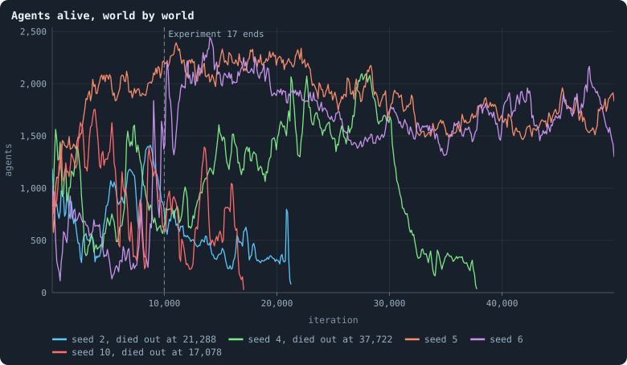
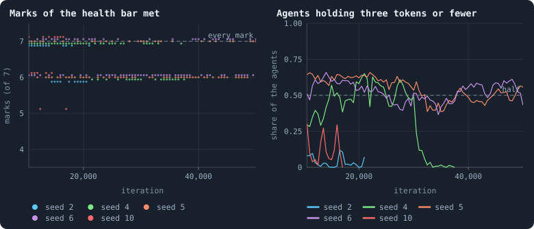
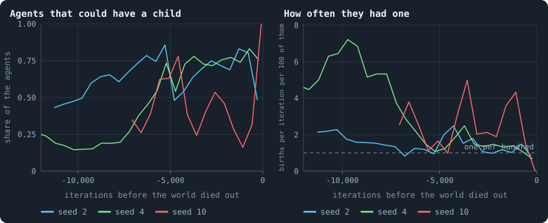
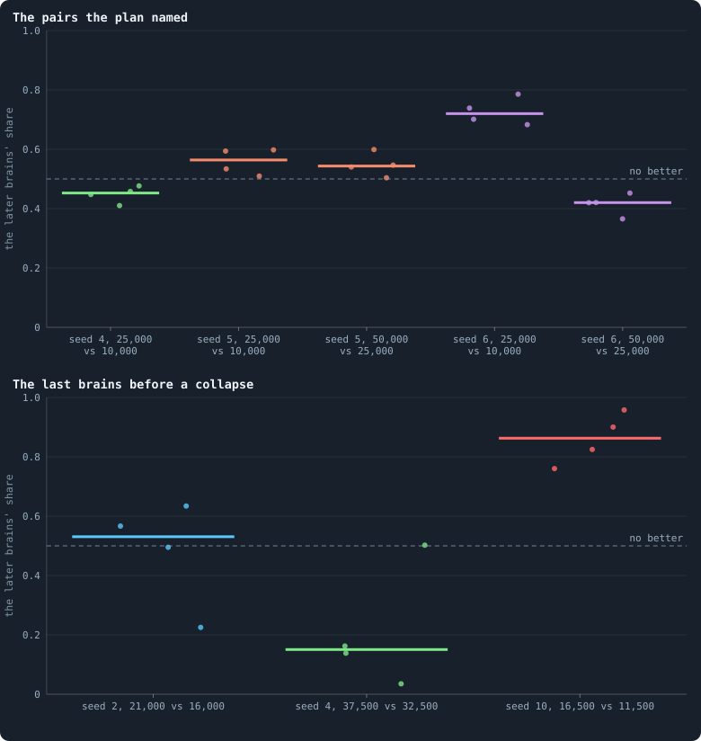

# Five mixed worlds, fifty thousand iterations

> [!question] Questions of this chapter
> - A world whose brains are mixed at birth was healthy and rich for 10,000
>   iterations. Is that a state it keeps, or one it passes through?
> - What does such a world do over 50,000 iterations: does its size keep
>   drifting, does it die out, does it end up as poor as B2?

<!-- experiment E18 -->

## Why ask

The author's picture of a world that might keep evolving is a decentralised,
resilient, nearly three-dimensional network of agents that differ in almost
every way ([Meta X](healthy-and-rich.md)). Whatever else such a
world does, it has to *last*: a world that meets the picture for 10,000
iterations and then shrinks to nothing, or fills up with agents holding a
token each, is not a world that keeps evolving. The author asked for the most
promising settings to be run for a long time, and this is that run.

[Chapter 80](mixed-at-birth-ten-long-worlds.md) ran B2 with brains mixed at
birth in ten worlds for 10,000 iterations. It found three things that make
the question open:

- **The worlds are rich because their agents put off having children.** An
  agent that could have a child has one about fourteen times less often than
  in B2, so the world never fills up to the point where almost nobody can
  afford a child, as B2's does.
- **Their size drifts, and their health and riches follow it.** With 10,000
  tokens, a world of 2,000 agents is a poor one, and its network's dimension
  rises above the bar's 4; a world below 300 agents has a best-connected agent
  joined to more than 5% of the others. Worlds of 600 to 1,000 agents met
  every mark of the health bar at 98% of the moments they were kept whole.
- **One world in ten died out**, at iteration 5,376, after shrinking for
  nearly three thousand iterations from 1,424 agents; two others fell below a
  hundred agents — to 40 and to 91 — and came back.

So whether a mixed world stays healthy and rich depends on where its drift
takes it. Ten thousand iterations showed each world wandering through a
range of sizes. Fifty thousand will show whether that range has edges.

## The experiment

Experiment 18 takes the five worlds of Experiment 17 that met every mark of
the health bar at iteration 10,000 — seeds 2, 4, 5, 6 and 10 — and plays them
on to iteration 50,000. They are the same runs: the lab goes on from each
one's checkpoint at 10,000 with the engine that made it, and records as
before, the graph statistics every 25 iterations and a whole world every 500.
Nothing is changed, so the first 10,000 iterations are Chapter 80's.

When the plan was written (16 October 2026), the five worlds stood like this
at iteration 10,000:

| world | agents | median tokens | 3 tokens or fewer | moments with every mark, of 20 (500 to 10,000) | its fewest and most agents, 500 to 10,000 |
|---|---|---|---|---|---|
| seed 2 | 744 | 11 | 6% | 16 | 337–1,437 |
| seed 4 | 628 | 11 | 20% | 17 | 337–1,371 |
| seed 5 | 2,257 | 2 | 63% | 6 | 1,032–2,257 |
| seed 6 | 1,302 | 4 | 42% | 11 | 188–1,688 |
| seed 10 | 618 | 10 | 15% | 16 | 296–1,649 |

The worlds are read as [Meta X](healthy-and-rich.md) reads every
world, every 500 iterations, from the whole worlds the lab keeps. A run
records every game, so the five runs will take about 16 GB more disk; on the
lab's four workers, the panel's estimate says how long.

## The thesis

<!-- thesis E18 -->
> [!quote] The thesis of Experiment 18, written down before any of its runs existed
> **The claim.** Over a long life, a world whose brains are mixed at birth stays mostly healthy and rich. The five worlds of Experiment 17 that met every mark of the health bar at iteration 10,000, played on to 50,000, meet every mark at half or more of the moments they are kept whole, and at 50,000 at most one of them has half its agents or more holding three tokens or fewer.
>
> **Why it would be so.** Over Experiment 17's 10,000 iterations, these five worlds met every mark at 66 of the 100 moments they were kept whole (every 500 iterations from 500 on): 16, 17, 6, 11 and 16 of 20 each. A world that met every mark still did 500 iterations later four times in five (95 of 120 times, in all ten worlds), and one that missed a mark met them all again a third of the time (21 of 60): health comes back. At iteration 10,000 four of the five had fewer than half their agents at three tokens or fewer (6%, 20%, 42%, 15%) and one had 63%, where B2's worlds have 66% to 79% at every moment. But a mixed world's size drifts, and its health and its riches follow its size: worlds of 600 to 1,000 agents met every mark at 98% of their moments, worlds below 300 at 4% (their best-connected agent is joined to more than 5% of the others), worlds above 1,500 at 35% to 60% (their dimension rises above 4). And with 10,000 tokens, a world of 2,000 agents is a poor one. In ten worlds one shrank below 20 agents and died out, at iteration 5,376; two others fell below a hundred agents, to 40 and to 91, and came back. Forty thousand iterations more is time for every one of the five to drift through those sizes.
>
> **It holds if:** From iteration 10,500 to 50,000, each world read every 500 iterations from its archive as research/atlas/profile.py reads every world (Meta X): at half or more of the five worlds' 400 moments together, a world meets all seven marks of Chapter 46's health bar (a world that has died out misses them at every moment after); and at iteration 50,000, at most one of the five worlds has died out or has half its agents or more holding three tokens or fewer.
>
> **It fails if:** Fewer than half the moments meet every mark, or two or more of the five worlds dead or with half their agents or more at three tokens or fewer at 50,000: the health and the riches of a mixed world do not last.
<!-- /thesis -->

## The runs

<!-- runs E18 -->
> [!info] The runs behind this chapter
> **5 runs.** Every condition below is run once for every seed (2, 4, 5, 6, 10), for 50,000 iterations — or until its world dies out. Every setting is that of the baseline **B2** (a world that cannot break) unless the condition changes it.
>
> - **mixed at birth** — changes `mix_at_birth` = on; 10,000 tokens. Runs `B2-10000-4af4a3-s002` … `B2-10000-4af4a3-s010`.
>
> To make these runs again: `python3 gol_lab.py run E18`, or ▶ in the Book tab of a computer running `gol_server.py`. Each run writes its settings, seed and engine version beside its frames, in `GraphOfLifeRuns/<run>/meta.json` and `provenance.json`.

> [!info]- Every setting of these runs
> | setting | mixed at birth | what it is |
> |---|---|---|
> | [`total_tokens`](settings.md#total_tokens) | 10,000 | The number of tokens in the world, *T*. It never changes during a run. |
> | [`n_nodes`](settings.md#n_nodes) | 0 | How many founders the world starts with. 0 means one founder per hundred tokens: *n* = ⌊*T* / 100⌋. |
> | [`k_neighbors`](settings.md#k_neighbors) | 0 | How many neighbours each founder starts with in the ring. 0 means *k* = max(⌊*n* / 100⌋, 5); an odd *k* is wired as *k* − 1. |
> | [`rewire_p`](settings.md#rewire_p) | 0.2 | In the starting ring, the probability that a connection is moved to a founder chosen at random (Watts–Strogatz). |
> | [`hidden_layers`](settings.md#hidden_layers) | 16 | The widths of the brain's hidden layers, in order from input to output. |
> | [`brain_kind`](settings.md#brain_kind) | float16 | How weights are stored: `float` (64-bit), `float16` (16-bit, computed in 64-bit) or `binary` (−1, 0, +1). |
> | [`brain_bits`](settings.md#brain_bits) | 16 | Only for binary brains: how many input rows encode one number. Unused by float and float16 brains. |
> | [`message_amount`](settings.md#message_amount) | 8 | How many numbers one message holds. Each agent sends one message to itself and one to each neighbour, every phase. |
> | [`random_input_amount`](settings.md#random_input_amount) | 5 | How many random numbers, drawn uniformly from −2 to 2, a brain reads per neighbour, every time it looks. |
> | [`exchange_messages`](settings.md#exchange_messages) | on | Whether agents send and read messages at all. |
> | [`message_prepass`](settings.md#message_prepass) | off | Whether every phase begins with an extra look in which agents only write messages, so the look that acts reads messages written this phase. |
> | [`allow_handover`](settings.md#allow_handover) | off | Whether a parent may move some of its own connections to its newborn child. |
> | [`allow_revolutions`](settings.md#allow_revolutions) | on | Whether a coalition of smaller stakers can take a node from its largest staker (see the note *How a coalition takes a node*). |
> | [`allow_gifting`](settings.md#allow_gifting) | off | Whether agents may give tokens to neighbours during reproduction. Off in every run of this book. |
> | [`random_decisions`](settings.md#random_decisions) | off | The control: every number a brain would produce is replaced by a random draw from the standard normal distribution. |
> | [`prune_after`](settings.md#prune_after) | blotto | After which phase connections that carried no tokens are cut: `blotto` (the game), `reproduction`, or `both`. |
> | [`inactive_window`](settings.md#inactive_window) | phase | How long a connection may go unused: `phase` means it must carry tokens in the phase being judged; `iteration` allows the two last phases. |
> | [`redistribution`](settings.md#redistribution) | uniform | How the tokens of removed agents are shared: `uniform` gives every survivor the same chance at each token; `by_tokens` weights by what a survivor holds; `poorest` raises the poorest to one common level first; `newborns` gives them to this iteration's children, `parents` to their parents, once per child (both `uniform` in an iteration without births); `children` leaves each dead agent's estate to its own living children (`uniform` where there are none). |
> | [`tokens_created_per_phase`](settings.md#tokens_created_per_phase) | 0 | Tokens added to the world at every cleanup. 0 keeps the supply fixed. |
> | [`mutate_on_replication`](settings.md#mutate_on_replication) | on | Whether a brain changes only when it is copied — into a newborn, or into a node its owner has just won — instead of also after every game, wherever it sits. |
> | [`incumbency`](settings.md#incumbency) | 1.5 | How many times over an agent's stake on its own node counts when the game decides who takes the node. 1 is the old rule. |
> | [`birth_links`](settings.md#birth_links) | 2 | How many of its parent's neighbours a newborn is joined to, drawn at random, besides its parent itself; 0 leaves every link to the brain's choice. |
> | [`mend_on_death`](settings.md#mend_on_death) | on | Whether the neighbours of an agent that dies are joined up where its death would leave them in separate pieces. |
> | [`prune_needs`](settings.md#prune_needs) | 2 | How many neighbours the two ends of an unused connection must share for it to be cut; 0 cuts every unused connection. |
> | [`valence`](settings.md#valence) | 8 | The most connections an agent's brain may choose to hold (0 = no limit). An agent at its limit cannot have a child. |
> | [`keep_home`](settings.md#keep_home) | 0.3 | The share of an agent's tokens — rounded up, never less than one — that stays on its own node whatever its brain says; a parent also keeps one. 0 is the old rule. |
> | [`max_age`](settings.md#max_age) | 100 | The age at which an agent dies (0 = never); its tokens are shared out like those of any other dead agent. |
> | [`buy_life`](settings.md#buy_life) | off | Whether an agent that has reached max_age may live on by paying one token an iteration into the estate of the dead — never its last, so one with a single token left dies. Needs max_age. |
> | [`min_child`](settings.md#min_child) | 10 | The fewest tokens a child can be born with; a parent that would give less has no child. |
> | [`child_floor`](settings.md#child_floor) | fixed | The least a child may start with: min_child alone (fixed), or also the median holding of its parent's neighbours (neighbours), so that a world grows only as rich as it is. |
> | [`mix_at_birth`](settings.md#mix_at_birth) | **on** | Whether a newborn's brain is its parent's mixed with a mate's — one of the parent's neighbours, drawn at random — each hidden unit whole from one or the other by an even chance, before it mutates; off, a newborn has a copy of its parent's brain. |
> | [`mix_mates`](settings.md#mix_mates) | any | Under mix_at_birth, who may be the mate: any neighbour of the parent, or only parents — a neighbour with a living child of its own (with none, the newborn's brain is a copy). |
> | [`self_message`](settings.md#self_message) | own | What an agent writes to itself, which each neighbour reads: what its own column says (own), or the largest, number by number, of what it writes to anyone (largest), so that news one column marks reaches every neighbour. |
> | [`link_search`](settings.md#link_search) | off | Whether an agent may reach beyond its neighbours to propose a link: off; jump, a walk as many steps long as the tokens it spends in one iteration, with a link proposed where it ends; walk, a scout that goes one step further in every iteration it pays for; or reach, a jump whose steps are free, as many as the tokens it holds would pay for. A paid step costs one token, paid to the agent it enters, and never the last. |
> | [`link_steering`](settings.md#link_steering) | random | Which way each step of a search goes: to a neighbour drawn at random, or to the one the searcher would most like a link with (looking). |
> | [`link_consent`](settings.md#link_consent) | mutual | Who has to agree to a link a search proposes: both ends (mutual), or only the one who proposes (forced). Nobody at its valence gets a new link either way. |
> | [`proto`](settings.md#proto) | none | Rules first played in the pilots' prototype, by name: came_from and helped_by (an input row each), contest = lottery, pool by genotype or family, kin_sense, tag_rate, mate_pays, grow, unit_token, link_token. Empty in every run but those that ask for one; only the prototype's world plays them (see the settings note). |
> | [`mutation_probability`](settings.md#mutation_probability) | 0.2 | The probability that a brain changes when it is copied to a child, and again, for every brain, after every game. |
> | [`mutation_noise_std`](settings.md#mutation_noise_std) | 0.2 | How large a change to one weight is: a normal draw with standard deviation this times 1/√(fan-in) of its layer. |
> | [`mutation_sparsity`](settings.md#mutation_sparsity) | 0.1 | The share of a brain's numbers a change touches; also the probability, for each weight matrix and bias vector, of a rarer reset that redraws that share of it. |
> | [`extinction_threshold`](settings.md#extinction_threshold) | 20 | A run stops, as extinct, when an iteration ends (after its game) with this many agents or fewer. |
> | seeds | 2, 4, 5, 6, 10 | one run per seed |
> | iterations | 50,000 | how far each run goes, unless its world dies first |
>
> A value in **bold** differs from the baseline B2.
<!-- /runs -->

## What the five worlds did

<!-- figure longmixed/sizes -->

**Agents alive, world by world.** Each line is one world, its agents after each game (means over 100 iterations), from its birth in Experiment 17 to iteration 50,000 or to the game after which 20 agents or fewer were left, where the lab stops a world.

> [!example]- How to make this figure
> **Runs.** The five runs of Experiment 18 — Experiment 17's worlds of seeds 2, 4, 5, 6 and 10 (B2 at 10,000 tokens with brains mixed at birth), played on by the lab from iteration 10,000 to 50,000 or until they died out (`python3 gol_lab.py run E18`); their first 10,000 iterations are Experiment 17's.
>
> **Data.** From Each run's `stats.jsonl`.
>
> 1. Read the agents after each game (`nodes`, phase 2).
> 2. Average over stretches of 100 iterations.
>
> **To make it again:** `python3 book_figures.py longmixed`.
<!-- /figure -->

Three of the five worlds died out:

- **Seed 10** grew from 620 agents to 1,450 by iteration 13,556 and died out
  at 17,078, falling from 1,168 agents to 19 in the last thousand iterations.
- **Seed 2** wandered between 230 and 740 agents for eight thousand iterations,
  rose to 989 at 20,874, and was gone 413 iterations later, at 21,288.
- **Seed 4** grew to 2,191 agents by 21,260 and stayed near two thousand until
  28,000; then it fell to 123 by 34,000, came back to 345, and died out at
  37,722.

Two lived to 50,000, and both ended up larger and poorer than they began.
**Seeds 5 and 6** grew past 2,000 agents within a few thousand iterations of
10,000 and settled, over their last 20,000 iterations, between 1,262 and 2,252
agents, with 37% to 61% of them holding three tokens or fewer — between the
mixed worlds' riches and B2's poverty.

## The verdict

**The thesis is refuted, on both counts.** It asked that the worlds meet
every mark at half or more of their moments from 10,500 to 50,000, a dead
world missing them all: they met them at 115 of 400, 29%. And it allowed at
most one world dead or with half its agents poor at 50,000: three had died
out, and seed 5 ended with 56% of its agents at three tokens or fewer. Only
seed 6, at 43%, ended alive and richer than half.

## Health and riches

<!-- figure longmixed/health -->

**Health and riches, every 500 iterations.** Each world read as Meta X reads every world, from the whole worlds the lab kept every 500 iterations from 10,500 on, while it lived. Left: how many of the seven marks of [Chapter 46](how-to-tell-a-world-that-keeps-evolving.md)'s health bar it meets (the dots of each world are set a little apart so that they do not hide each other). Right: the share of its agents holding three tokens or fewer.

> [!example]- How to make this figure
> **Runs.** The five runs of Experiment 18 — Experiment 17's worlds of seeds 2, 4, 5, 6 and 10 (B2 at 10,000 tokens with brains mixed at birth), played on by the lab from iteration 10,000 to 50,000 or until they died out (`python3 gol_lab.py run E18`); their first 10,000 iterations are Experiment 17's.
>
> **Data.** From Each run's `archive/world_<iteration>.npz` (`research/oee/checks/e17_health.py --seeds 2,4,5,6,10 --from 10500 --to 50000`).
>
> 1. Read each whole world as `research/atlas/profile.py` reads every world.
> 2. Count the marks it meets and its agents at three tokens or fewer.
>
> **To make it again:** `python3 book_figures.py longmixed`.
<!-- /figure -->

The marks a world misses follow its size, as
[Chapter 80](mixed-at-birth-ten-long-worlds.md#the-marks-a-world-misses)
found: the worlds that died missed the hub mark while they were small, and the
two that lived missed only the dimension, at every one of their moments that
missed a mark — 50 of 80 each — with 1,300 to 2,300 agents and a dimension of
3.8 to 4.3. The riches follow the size too: the dead worlds were rich to the
end, the living ones poorer the larger they grew.

## How a mixed world dies

<!-- figure longmixed/collapse -->

**The worlds that died out.** Each line is a world that died out, read every 500 iterations up to its end: left, the share of its agents that could have a child (11 tokens or more and fewer than 8 links); right, how often they had one in the next 50 iterations, per hundred of them. Every agent dies at 100, so a world whose agents all could have a child dies out once they have fewer than one per hundred an iteration.

> [!example]- How to make this figure
> **Runs.** The five runs of Experiment 18 — Experiment 17's worlds of seeds 2, 4, 5, 6 and 10 (B2 at 10,000 tokens with brains mixed at birth), played on by the lab from iteration 10,000 to 50,000 or until they died out (`python3 gol_lab.py run E18`); their first 10,000 iterations are Experiment 17's.
>
> **Data.** From Each run's whole worlds and births (`research/oee/checks/e17_breeding.py --seeds 2,4,10 --from 10000 --to 50000`).
>
> 1. In each whole world, count the agents with 11 tokens or more and fewer than 8 links.
> 2. Divide the births per iteration of the next 50 iterations by them.
>
> **To make it again:** `python3 book_figures.py longmixed`.
<!-- /figure -->

Not by a sudden blow. Every agent of these worlds lives out its hundred
iterations, and a world keeps its size only while one agent in a hundred is
born every iteration ([Chapter 80](mixed-at-birth-ten-long-worlds.md#why-a-mixed-world-is-rich)).
The worlds that died had hovered near that line for thousands of iterations,
and then fell below it and stayed below: in the last world kept before each
end, births had fallen to 0.39, 0.51 and 0.47 per hundred agents an
iteration, while a third to three quarters of the agents could have had a
child. In seed 10's last world, 31 agents were left, every one of them able to
have a child, and none had one. The ages were spread evenly — this was not a
generation dying at once, but a world that stopped replacing its dead.

## Did evolution go on?

<!-- figure longmixed/contests -->

**Later brains against earlier ones.** Each dot is a contest between two of a world's moments: the brains of the later moment against those of the earlier, half and half on the same world, for 100 iterations, in each moment's world with two seeds; the bar is the median of the four. Above: the pairs the plan named, for the worlds alive then. Below: the brains of the last world kept before each collapse that still had a few hundred agents, against those of 5,000 iterations before.

> [!example]- How to make this figure
> **Runs.** The five runs of Experiment 18 — Experiment 17's worlds of seeds 2, 4, 5, 6 and 10 (B2 at 10,000 tokens with brains mixed at birth), played on by the lab from iteration 10,000 to 50,000 or until they died out (`python3 gol_lab.py run E18`); their first 10,000 iterations are Experiment 17's.
>
> **Data.** From `GraphOfLifeRuns/.pilots/e18_T100.json` (`research/oee/checks/rejudge.py --seeds 17,18`).
>
> 1. Seat the brains of the two moments on alternate agents of each moment's world and play 100 iterations, an agent's lifetime.
> 2. Count the agents the later moment's brains hold at the end, as a share of all.
>
> **To make it again:** `python3 book_figures.py longmixed`.
<!-- /figure -->

**Hardly.** In the pairs the plan named, the brains of 25,000 beat those of
10,000 in seed 6 (73% of a contested world) and narrowly in seed 5 (56%), and
did no better in seed 4 (45%); the brains of 50,000 took 55% from those of
25,000 in seed 5, and lost to them in seed 6 (42%). Over the first 10,000
iterations the mixed worlds' later brains had won 84%, then 66%, then 54%
([Chapter 80](mixed-at-birth-ten-long-worlds.md#does-evolution-go-on)):
the steps shrink towards nothing, and in the long run a later era is as likely
to lose as to win.

Before the collapses the contests differ from world to world. In seed 10 the
brains of the last good years beat those of 5,000 iterations before by 86% —
the brains that let the world die out were winners: selection itself carried
it to its end, what biologists call **evolutionary suicide**. In seed 4 the
last brains lost to their forebears (21%), and in seed 2 they tied (48%). One
world in three is not a law; it is enough to say that a mixed world can be
led to extinction by the very brains that win in it.

## What it teaches

- **A mixed world is mortal.** Three of five worlds that had met every mark at
  10,000 iterations died out before 40,000, each the same way: births fell
  below the one per hundred agents that replaces the dead, while many of its
  agents could have afforded a child. Nothing holds the reluctance to breed
  that makes a mixed world rich, and a world that drifts too far towards it
  dies.
- **The survivors drift the other way.** The two worlds that lived ended
  larger and poorer, missing the dimension mark at most of their moments —
  closer to B2 than to the worlds that came closest in Meta X.
- **Evolution fades.** Later brains beat earlier ones by less and less, and by
  25,000 to 50,000 iterations an era is as likely to lose as to win against
  the one before it.
- **What next.** [Meta XI](what-holds-a-worlds-size.md) gathers
  what holds a world's size, and why mixing loosens it: a mate spreads its
  brain for free, so having children pays less. Taking that free ride away is
  [Experiment 19](mixed-at-birth-with-parents-as-mates.md)'s test.

**Related notes:** [Chapter 80 · Mixed at birth: ten long worlds](mixed-at-birth-ten-long-worlds.md) ·
[Chapter 46 · How to tell a world that keeps evolving](how-to-tell-a-world-that-keeps-evolving.md) ·
[Meta X · Healthy and rich](healthy-and-rich.md) ·
[Chapter 69 · A hundred thousand iterations](a-hundred-thousand-iterations.md) ·
[Every setting](settings.md#mix_at_birth)

<!-- turns -->
---

← [Mixed at birth: ten long worlds](mixed-at-birth-ten-long-worlds.md) · [Looking for a healthy, rich world](../README.md#looking-for-a-healthy-rich-world) · [Mixed at birth, with parents as mates](mixed-at-birth-with-parents-as-mates.md) →
<!-- /turns -->
