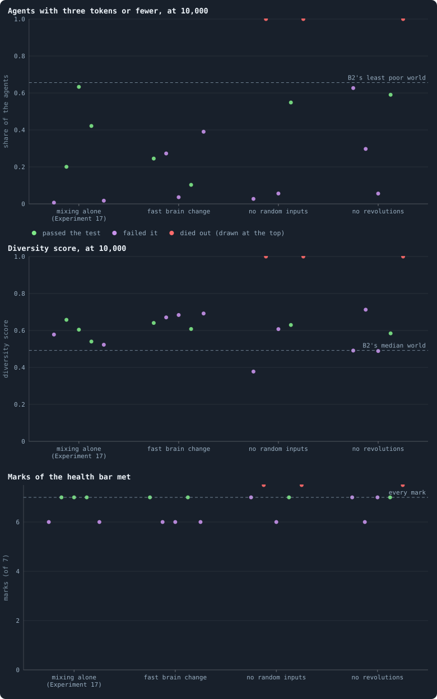
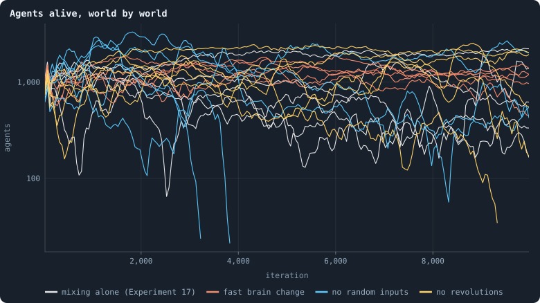
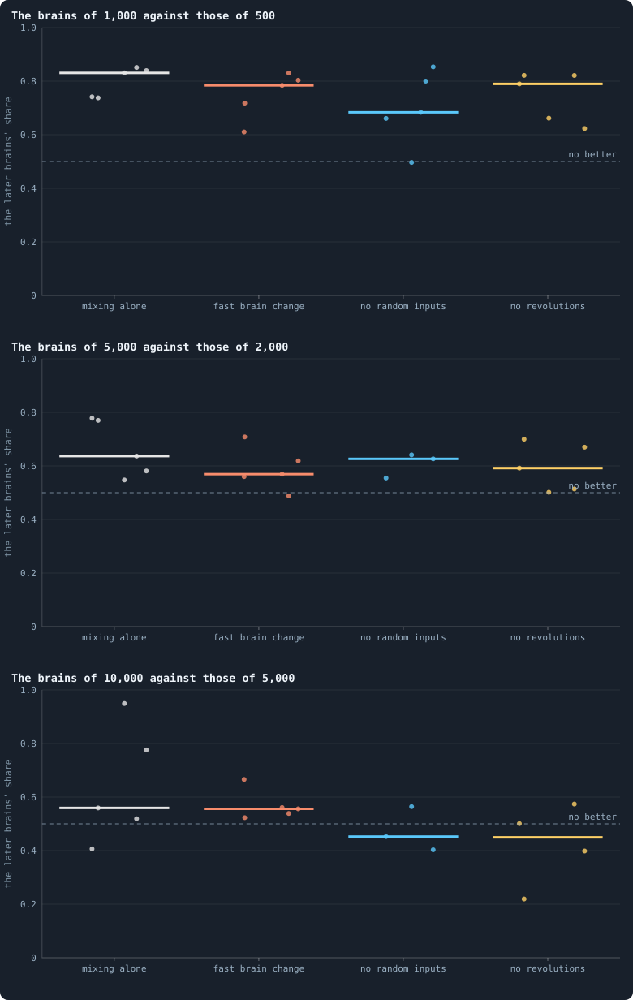

# Five more seeds for the rules that held

> [!question] Questions of this chapter
> - A few candidate worlds stayed healthy, diverse and richer than B2's for
>   10,000 iterations. Was it their rules, or their luck?
> - Does any rule make a mixed world hold more often than mixing alone?

<!-- experiment E21 -->

## Why ask

Of the candidates played on to 10,000 iterations
([Chapter 92](the-candidates-played-on.md)), a few passed Meta X's test of
a long run — alive, every mark of the health bar met, more diverse than B2's
median world, and poorer than none of B2's worlds. Three rules stood out, all
of them with brains mixed at birth:

| rule, with mixing | seed | agents at 10,000 | agents with 3 tokens or fewer | diversity score |
|---|---|---|---|---|
| a fast change of brains (mutation probability 0.8) | 1 | 1,244 | 25% | 0.66 |
| a fast change of brains (mutation probability 0.8) | 2 | 407 | 2% | 0.75 |
| no random inputs | 2 | 372 | 4% | 0.63 |
| no revolutions | 2 | 948 | 24% | 0.61 |

But a mixed world's size drifts, and its riches drift with it
([Meta XI](what-holds-a-worlds-size.md)): plain mixing passed the
same test in five of Experiment 17's ten worlds
([Chapter 80](mixed-at-birth-ten-long-worlds.md)), and no revolutions
failed it in its own seed 1 (2,221 agents, 64% poor). One world can be luck.
So Meta X's second step gives each rule that held **five seeds more, from the
start** — seeds 3 to 7, which no batch has used for these rules — and sets
them beside Experiment 17's worlds of the same seeds, plain mixing, which
passed in three of the five.

A fourth rule held in one seed too: mixing with an input that tells each
agent where its brain came from. That input exists so far only in the pilots'
prototype; it joins this experiment once it is part of the engine.

## The thesis

<!-- thesis E21 -->
> [!quote] The thesis of Experiment 21, written down before any of its runs existed
> **The claim.** A rule whose candidate held over 10,000 iterations holds again in new worlds: for each of three rules — brains mixed at birth with a fast change of brains (a mutation probability of 0.8), with no random inputs, and with no revolutions — at least four of five new worlds (seeds 3 to 7) live to iteration 10,000 and there meet every mark of the health bar, have a diversity score above that of B2's median world at 10,000 (0.49), and hold a smaller share of their agents at three tokens or fewer than the least poor of B2's ten worlds (0.66).
>
> **Why it would be so.** Meta X's candidates were played on to 10,000 iterations as pilots (batch LC), and by Meta X's test — it lives, meets every mark, is more diverse than B2's median world and poorer than none of B2's — some held: mixing with a fast change of brains in both its seeds (1,244 agents, 25% at three tokens or fewer, a diversity score of 0.66; 407 agents, 2%, 0.75), mixing without random inputs in seed 2 (372 agents, 4%, 0.63), mixing without revolutions in seed 2 (948 agents, 24%, 0.61; its seed 1 fell back, 2,221 agents, 64%). Plain mixing held in five of Experiment 17's ten worlds, three of them among seeds 3 to 7. One world can be luck: Meta X's second step gives each rule that held five seeds more, from the start. Mixed worlds' size drifts, and their riches go with it (Meta XI), so a rule earns its place only if it holds more often than mixing alone. The control is Experiment 17's worlds of the same seeds.
>
> **It holds if:** For a rule: at least four of its five worlds live to 10,000 and pass Meta X's test there.
>
> **It fails if:** For a rule: three or fewer pass — it does no better than mixing alone, which passed in three of the same five seeds.
<!-- /thesis -->

## The runs

<!-- runs E21 -->
> [!info] The runs behind this chapter
> **20 runs.** Every condition below is run once for every seed (3 to 7), for 10,000 iterations — or until its world dies out. Every setting is that of the baseline **B2** (a world that cannot break) unless the condition changes it.
>
> - **mixed at birth** — changes `mix_at_birth` = on; 10,000 tokens. Runs `B2-10000-4af4a3-s003` … `B2-10000-4af4a3-s007`.
> - **mixed at birth, fast brain change** — changes `mix_at_birth` = on, `mutation_probability` = 0.8; 10,000 tokens. Runs `B2-10000-0df8be-s003` … `B2-10000-0df8be-s007`.
> - **mixed at birth, no random inputs** — changes `mix_at_birth` = on, `random_input_amount` = 0; 10,000 tokens. Runs `B2-10000-1109f3-s003` … `B2-10000-1109f3-s007`.
> - **mixed at birth, no revolutions** — changes `mix_at_birth` = on, `allow_revolutions` = off; 10,000 tokens. Runs `B2-10000-1f9b27-s003` … `B2-10000-1f9b27-s007`.
>
> To make these runs again: `python3 gol_lab.py run E21`, or ▶ in the Book tab of a computer running `gol_server.py`. Each run writes its settings, seed and engine version beside its frames, in `GraphOfLifeRuns/<run>/meta.json` and `provenance.json`.

> [!info]- Every setting of these runs
> | setting | mixed at birth | mixed at birth, fast brain change | mixed at birth, no random inputs | mixed at birth, no revolutions | what it is |
> |---|---|---|---|---|---|
> | [`total_tokens`](settings.md#total_tokens) | 10,000 | 10,000 | 10,000 | 10,000 | The number of tokens in the world, *T*. It never changes during a run. |
> | [`n_nodes`](settings.md#n_nodes) | 0 | 0 | 0 | 0 | How many founders the world starts with. 0 means one founder per hundred tokens: *n* = ⌊*T* / 100⌋. |
> | [`k_neighbors`](settings.md#k_neighbors) | 0 | 0 | 0 | 0 | How many neighbours each founder starts with in the ring. 0 means *k* = max(⌊*n* / 100⌋, 5); an odd *k* is wired as *k* − 1. |
> | [`rewire_p`](settings.md#rewire_p) | 0.2 | 0.2 | 0.2 | 0.2 | In the starting ring, the probability that a connection is moved to a founder chosen at random (Watts–Strogatz). |
> | [`hidden_layers`](settings.md#hidden_layers) | 16 | 16 | 16 | 16 | The widths of the brain's hidden layers, in order from input to output. |
> | [`brain_kind`](settings.md#brain_kind) | float16 | float16 | float16 | float16 | How weights are stored: `float` (64-bit), `float16` (16-bit, computed in 64-bit) or `binary` (−1, 0, +1). |
> | [`brain_bits`](settings.md#brain_bits) | 16 | 16 | 16 | 16 | Only for binary brains: how many input rows encode one number. Unused by float and float16 brains. |
> | [`message_amount`](settings.md#message_amount) | 8 | 8 | 8 | 8 | How many numbers one message holds. Each agent sends one message to itself and one to each neighbour, every phase. |
> | [`random_input_amount`](settings.md#random_input_amount) | 5 | 5 | **0** | 5 | How many random numbers, drawn uniformly from −2 to 2, a brain reads per neighbour, every time it looks. |
> | [`exchange_messages`](settings.md#exchange_messages) | on | on | on | on | Whether agents send and read messages at all. |
> | [`message_prepass`](settings.md#message_prepass) | off | off | off | off | Whether every phase begins with an extra look in which agents only write messages, so the look that acts reads messages written this phase. |
> | [`allow_handover`](settings.md#allow_handover) | off | off | off | off | Whether a parent may move some of its own connections to its newborn child. |
> | [`allow_revolutions`](settings.md#allow_revolutions) | on | on | on | **off** | Whether a coalition of smaller stakers can take a node from its largest staker (see the note *How a coalition takes a node*). |
> | [`allow_gifting`](settings.md#allow_gifting) | off | off | off | off | Whether agents may give tokens to neighbours during reproduction. Off in every run of this book. |
> | [`random_decisions`](settings.md#random_decisions) | off | off | off | off | The control: every number a brain would produce is replaced by a random draw from the standard normal distribution. |
> | [`prune_after`](settings.md#prune_after) | blotto | blotto | blotto | blotto | After which phase connections that carried no tokens are cut: `blotto` (the game), `reproduction`, or `both`. |
> | [`inactive_window`](settings.md#inactive_window) | phase | phase | phase | phase | How long a connection may go unused: `phase` means it must carry tokens in the phase being judged; `iteration` allows the two last phases. |
> | [`redistribution`](settings.md#redistribution) | uniform | uniform | uniform | uniform | How the tokens of removed agents are shared: `uniform` gives every survivor the same chance at each token; `by_tokens` weights by what a survivor holds; `poorest` raises the poorest to one common level first; `newborns` gives them to this iteration's children, `parents` to their parents, once per child (both `uniform` in an iteration without births); `children` leaves each dead agent's estate to its own living children (`uniform` where there are none). |
> | [`tokens_created_per_phase`](settings.md#tokens_created_per_phase) | 0 | 0 | 0 | 0 | Tokens added to the world at every cleanup. 0 keeps the supply fixed. |
> | [`mutate_on_replication`](settings.md#mutate_on_replication) | on | on | on | on | Whether a brain changes only when it is copied — into a newborn, or into a node its owner has just won — instead of also after every game, wherever it sits. |
> | [`incumbency`](settings.md#incumbency) | 1.5 | 1.5 | 1.5 | 1.5 | How many times over an agent's stake on its own node counts when the game decides who takes the node. 1 is the old rule. |
> | [`birth_links`](settings.md#birth_links) | 2 | 2 | 2 | 2 | How many of its parent's neighbours a newborn is joined to, drawn at random, besides its parent itself; 0 leaves every link to the brain's choice. |
> | [`mend_on_death`](settings.md#mend_on_death) | on | on | on | on | Whether the neighbours of an agent that dies are joined up where its death would leave them in separate pieces. |
> | [`prune_needs`](settings.md#prune_needs) | 2 | 2 | 2 | 2 | How many neighbours the two ends of an unused connection must share for it to be cut; 0 cuts every unused connection. |
> | [`valence`](settings.md#valence) | 8 | 8 | 8 | 8 | The most connections an agent's brain may choose to hold (0 = no limit). An agent at its limit cannot have a child. |
> | [`keep_home`](settings.md#keep_home) | 0.3 | 0.3 | 0.3 | 0.3 | The share of an agent's tokens — rounded up, never less than one — that stays on its own node whatever its brain says; a parent also keeps one. 0 is the old rule. |
> | [`max_age`](settings.md#max_age) | 100 | 100 | 100 | 100 | The age at which an agent dies (0 = never); its tokens are shared out like those of any other dead agent. |
> | [`buy_life`](settings.md#buy_life) | off | off | off | off | Whether an agent that has reached max_age may live on by paying one token an iteration into the estate of the dead — never its last, so one with a single token left dies. Needs max_age. |
> | [`min_child`](settings.md#min_child) | 10 | 10 | 10 | 10 | The fewest tokens a child can be born with; a parent that would give less has no child. |
> | [`child_floor`](settings.md#child_floor) | fixed | fixed | fixed | fixed | The least a child may start with: min_child alone (fixed), or also the median holding of its parent's neighbours (neighbours), so that a world grows only as rich as it is. |
> | [`mix_at_birth`](settings.md#mix_at_birth) | **on** | **on** | **on** | **on** | Whether a newborn's brain is its parent's mixed with a mate's — one of the parent's neighbours, drawn at random — each hidden unit whole from one or the other by an even chance, before it mutates; off, a newborn has a copy of its parent's brain. |
> | [`mix_mates`](settings.md#mix_mates) | any | any | any | any | Under mix_at_birth, who may be the mate: any neighbour of the parent, or only parents — a neighbour with a living child of its own (with none, the newborn's brain is a copy). |
> | [`self_message`](settings.md#self_message) | own | own | own | own | What an agent writes to itself, which each neighbour reads: what its own column says (own), or the largest, number by number, of what it writes to anyone (largest), so that news one column marks reaches every neighbour. |
> | [`link_search`](settings.md#link_search) | off | off | off | off | Whether an agent may reach beyond its neighbours to propose a link: off; jump, a walk as many steps long as the tokens it spends in one iteration, with a link proposed where it ends; walk, a scout that goes one step further in every iteration it pays for; or reach, a jump whose steps are free, as many as the tokens it holds would pay for. A paid step costs one token, paid to the agent it enters, and never the last. |
> | [`link_steering`](settings.md#link_steering) | random | random | random | random | Which way each step of a search goes: to a neighbour drawn at random, or to the one the searcher would most like a link with (looking). |
> | [`link_consent`](settings.md#link_consent) | mutual | mutual | mutual | mutual | Who has to agree to a link a search proposes: both ends (mutual), or only the one who proposes (forced). Nobody at its valence gets a new link either way. |
> | [`proto`](settings.md#proto) | none | none | none | none | Rules first played in the pilots' prototype, by name: came_from and helped_by (an input row each), contest = lottery, pool by genotype or family, kin_sense, tag_rate, mate_pays, grow, unit_token, link_token. Empty in every run but those that ask for one; only the prototype's world plays them (see the settings note). |
> | [`mutation_probability`](settings.md#mutation_probability) | 0.2 | **0.8** | 0.2 | 0.2 | The probability that a brain changes when it is copied to a child, and again, for every brain, after every game. |
> | [`mutation_noise_std`](settings.md#mutation_noise_std) | 0.2 | 0.2 | 0.2 | 0.2 | How large a change to one weight is: a normal draw with standard deviation this times 1/√(fan-in) of its layer. |
> | [`mutation_sparsity`](settings.md#mutation_sparsity) | 0.1 | 0.1 | 0.1 | 0.1 | The share of a brain's numbers a change touches; also the probability, for each weight matrix and bias vector, of a rarer reset that redraws that share of it. |
> | [`extinction_threshold`](settings.md#extinction_threshold) | 20 | 20 | 20 | 20 | A run stops, as extinct, when an iteration ends (after its game) with this many agents or fewer. |
> | seeds | 3 to 7 | 3 to 7 | 3 to 7 | 3 to 7 | one run per seed |
> | iterations | 10,000 | 10,000 | 10,000 | 10,000 | how far each run goes, unless its world dies first |
>
> A value in **bold** differs from the baseline B2.
<!-- /runs -->

## What the twenty worlds did

<!-- figure fiveseeds/verdict -->

**Experiment 21 at iteration 10,000.** Each dot is a world at iteration 10,000, seeds 3 to 7 from left to right within each rule: green if it passed Meta X's test of a long run — alive, every mark of the health bar met, more diverse than B2's median world and poorer than none of B2's ten worlds played on to 10,000 — violet if it failed it, red, at the top, if it died out before 10,000. Grey column: plain mixing, Experiment 17's worlds of the same seeds.

> [!example]- How to make this figure
> **Runs.** The twenty runs of Experiment 21 — B2 at 10,000 tokens with brains mixed at birth, alone (Experiment 17's runs `B2-10000-4af4a3-s003` … `s007`) or with a mutation probability of 0.8 (`B2-10000-0df8be-…`), no random inputs (`B2-10000-1109f3-…`) or no revolutions (`B2-10000-1f9b27-…`), seeds 3 to 7, 10,000 iterations (`python3 gol_lab.py run E21`) — and B2's ten worlds played on to 10,000 (`GraphOfLifeRuns/.pilots/L/B2-long-s001` … `s010`).
>
> **Data.** From each run's whole world kept at iteration 10,000 (`archive/world_010000.npz`, read by `research/atlas/at.py --at 10000`, `GraphOfLifeRuns/.pilots/atlas/at10000.json`).
>
> 1. Read each world as `research/atlas/profile.py` reads every world.
> 2. Rank its four spreads among the frozen reference worlds; the diversity score is their mean.
> 3. A world that died out (20 agents or fewer) fails.
>
> **To make it again:** `python3 book_figures.py fiveseeds`.
<!-- /figure -->

**No rule held more often than mixing alone.** Plain mixing passed Meta X's
test in three of its five worlds (seeds 4, 5 and 6). A fast change of brains
passed in two (seeds 3 and 6), no random inputs in one (seed 6), and no
revolutions in one (seed 6). Every rule needed four.

**A fast change of brains: alive, diverse and not poor, but short of a mark.**
All five of its worlds lived to 10,000, none of them poor — 4% to 39% of
their agents at three tokens or fewer — and all five more diverse than B2's
median world, with diversity scores of 0.61 to 0.69, where plain mixing's
ranged from 0.52 to 0.66. What three of them missed was one mark each: two
had a dimension just above the bar's limit of 4 (4.03 and 4.22), and the
third, a small world of 445 agents, had an agent joined to more than 5% of
the others.

**Without random inputs, two of five worlds died out**, at iterations 3,835
and 3,209. Of the three that lived, one passed (1,969 agents, 55% poor); one
was small and rich but less diverse than any of B2's worlds (521 agents, a
diversity score of 0.38); one small world had a hub.

**Without revolutions, one world died out**, at iteration 9,338. Of the four
that lived, one passed (1,996 agents, 59% poor); two missed B2's median
diversity by a hair — 0.491 and 0.489, against 0.492 — and one small world
of 212 agents had a hub.

<!-- figure fiveseeds/sizes -->

**Agents alive, world by world.** Each line is one world, its agents after each game (means over 50 iterations), on a logarithmic axis; a line that stops early is a world that died out.

> [!example]- How to make this figure
> **Runs.** The twenty runs of Experiment 21 — B2 at 10,000 tokens with brains mixed at birth, alone (Experiment 17's runs `B2-10000-4af4a3-s003` … `s007`) or with a mutation probability of 0.8 (`B2-10000-0df8be-…`), no random inputs (`B2-10000-1109f3-…`) or no revolutions (`B2-10000-1f9b27-…`), seeds 3 to 7, 10,000 iterations (`python3 gol_lab.py run E21`) — and B2's ten worlds played on to 10,000 (`GraphOfLifeRuns/.pilots/L/B2-long-s001` … `s010`).
>
> **Data.** From each run's `stats.jsonl`.
>
> 1. Read the agents after each game (`nodes`, phase 2).
> 2. Average over stretches of 50 iterations.
>
> **To make it again:** `python3 book_figures.py fiveseeds`.
<!-- /figure -->

**Each death was a slow shrinking.** The three worlds that died out had
reached 1,614, 2,983 and 1,931 agents, and held 745, 685 and 188 five hundred
iterations before the end: for hundreds of iterations fewer were born than
died, as in the mixed worlds of [Chapter 81](five-mixed-worlds-fifty-thousand-iterations.md).

**Size still sets riches.** Across the seventeen worlds alive at 10,000, the
more agents a world held, the poorer they were (a rank correlation of 0.86):
the small worlds are rich, and the large ones half poor
([Meta XI](what-holds-a-worlds-size.md)).

**Room is rare.** Fifteen of the seventeen are folded, as near as B2's
worlds to their random twins (a typical distance of 1.09 to 1.29 times the
twin's). The two that are wider, 1.68 and 1.40, are the worlds without random
inputs and without revolutions that passed — two of the largest, half of
their agents poor — while other worlds as large are as folded as the small
ones ([Chapter 87](what-folds-a-world.md)).

<!-- figure fiveseeds/evolution -->

**Do later brains beat earlier ones?** Each dot is a world: the share of a contested world the later moment's brains hold after 100 iterations against the earlier moment's, the mean of two contests, one in each moment's world; the bar is the median world. Mixing alone: Experiment 17's worlds of the same seeds. A world that died out has the steps before its death only.

> [!example]- How to make this figure
> **Runs.** The twenty runs of Experiment 21 — B2 at 10,000 tokens with brains mixed at birth, alone (Experiment 17's runs `B2-10000-4af4a3-s003` … `s007`) or with a mutation probability of 0.8 (`B2-10000-0df8be-…`), no random inputs (`B2-10000-1109f3-…`) or no revolutions (`B2-10000-1f9b27-…`), seeds 3 to 7, 10,000 iterations (`python3 gol_lab.py run E21`) — and B2's ten worlds played on to 10,000 (`GraphOfLifeRuns/.pilots/L/B2-long-s001` … `s010`).
>
> **Data.** From `GraphOfLifeRuns/.pilots/e21_T100.json` and `e17_T100.json` (`research/oee/checks/rejudge.py`, `research/oee/checks/e20_e21_rejudge_worlds.txt`).
>
> 1. Seat the brains of the two moments on alternate agents of each moment's world and play 100 iterations.
> 2. Count the agents the later moment's brains hold, as a share of all.
>
> **To make it again:** `python3 book_figures.py fiveseeds`.
<!-- /figure -->

**Evolution slows under every rule.** The brains of 1,000 beat those of 500
in nearly every world, with a median share of a contested world of 0.68 to
0.83; those of 5,000 beat those of 2,000 less clearly (0.57 to 0.64); and
those of 10,000 against those of 5,000 hold 0.56 with mixing alone and with a
fast change of brains — whose later brains won in all five of its worlds — but
0.45 without random inputs and without revolutions, where the later brains
won in only one of the three worlds and two of the four that lived.

## The verdict

**The thesis fails for all three rules.** No rule's worlds passed Meta X's
test in four of five seeds; none did better than mixing alone, which passed
in three of the same five. The candidates that held over 10,000 iterations
held by their seed's luck as much as by their rule's.

> [!info] Added later (19 October 2026): too even, not too poor
> The author's worry was a world too even, not one with many poor
> ([Meta X](healthy-and-rich.md)). No world here failed on the
> share of the poor alone, so leaving it out changes nothing. Asking instead
> that a world be no more even than B2 (a [Gini coefficient](gini-coefficient.md) of its agents' tokens of at
> least 0.47, the least of B2's ten worlds at 10,000) changes one rule.
> Fast brain change passes in none of five:
> - its two worlds that passed are more even than any of B2's (0.38 and
>   0.34);
> - four of its five are, at 8 to 22 tokens per agent.
>
> Its "not poor" was evenness. Plain mixing still passes in three, no random
> inputs and no revolutions in one each (Gini 0.52 to 0.55), so the verdict
> stands. The author also counts a configuration that shows open-ended
> evolution in a few seeds as enough, which is a claim about what a
> configuration can do. This test asked how often a rule's worlds stay
> healthy, which is not that, and its answer stays as it was.

## What it teaches

- **One world says little about a rule.** A candidate that held was one
  draw from a wide spread: of the same rule's next five worlds, some held,
  some fell back and some died.
- **A fast change of brains is the steadiest of the three**: every one of its
  worlds lived, and every one was diverse and not poor. What it misses are
  single marks of the health bar, two of them by a dimension a little above
  four. It stays a rule worth building on, beside mixing.
- **Taking away the dice or the revolutions makes mixed worlds mortal**: three
  of ten died out within 10,000 iterations, where plain mixing lost none of
  the same seeds.
- **Riches and room still pull apart**: the worlds that stay small are rich
  and folded; the large ones are half poor, and only some of them wide.

**Related notes:** [Chapter 92 · The candidates, played on](the-candidates-played-on.md) ·
[Meta X · Healthy and rich](healthy-and-rich.md) ·
[Meta XI · What holds a world's size](what-holds-a-worlds-size.md) ·
[Chapter 80 · Mixed at birth: ten long worlds](mixed-at-birth-ten-long-worlds.md) ·
[Chapter 82 · Brains mixed at birth, with every other rule](mixing-with-every-other-rule.md)

<!-- turns -->
---

← [The candidates, played on](the-candidates-played-on.md) · [Looking for a healthy, rich world](../README.md#looking-for-a-healthy-rich-world) · [The search's best world, in new seeds](the-searchs-best-world-in-new-seeds.md) →
<!-- /turns -->
