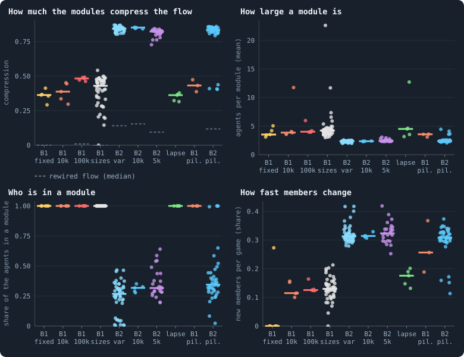
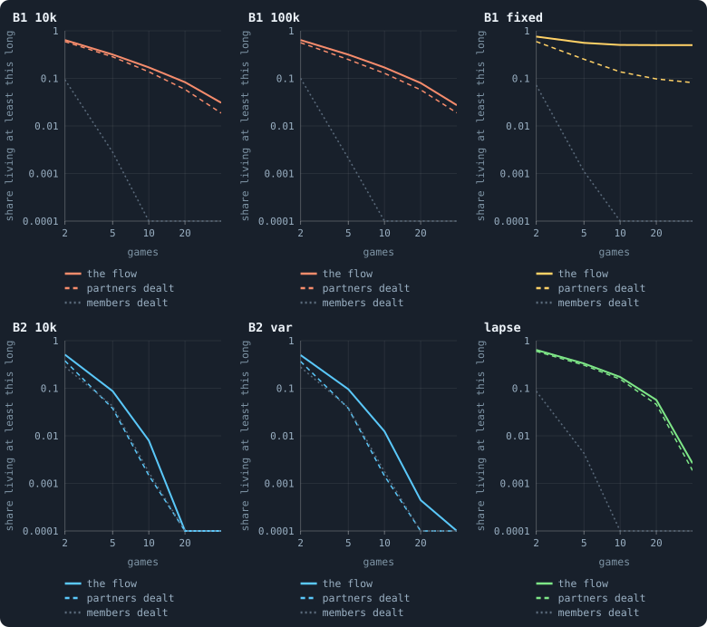
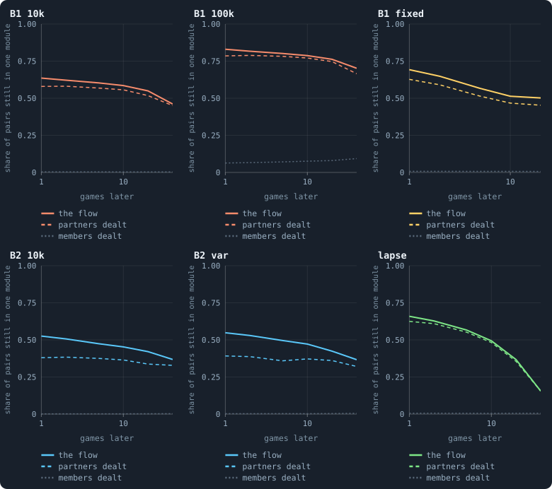
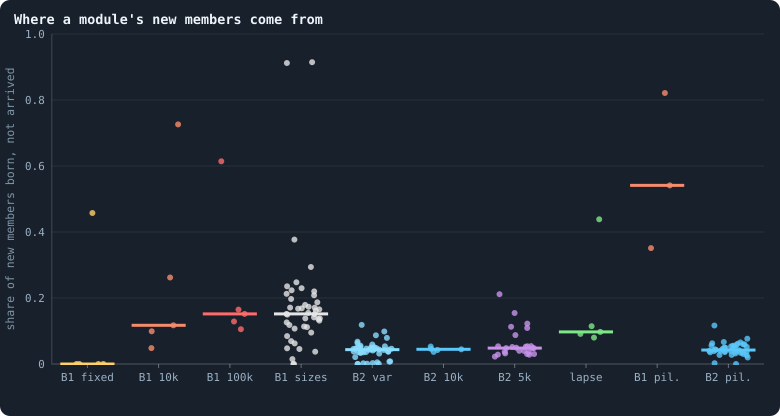

# Flow modules: the groups tokens stay in

> [!question] Questions of this page
> - When [agents](the-world.md#agents-and-tokens "One member of a world: it lives on a node of the network, holds tokens and has a brain that takes all its decisions.") stake [tokens](the-world.md#agents-and-tokens "The one thing of value in a world: every agent holds a whole number of them, and their total never changes.") on one another, do the tokens stay inside
>   groups? How large are the groups, and who belongs to one?
> - How are such groups found, followed from [game](one-iteration.md#phase-2-the-game "The second phase of an iteration: every agent stakes all its tokens on its own node and its neighbours', and every node goes to someone.") to game, and checked
>   against chance?
> - Are the groups the network's own regions, or something the agents make?
> - Do the groups last from game to game — longer than chance would make
>   them, and longer than the network alone would?
> - Can a group outlast the agents it began with?
> - Is it the same in every world the notebook has made?

## In short

When an agent stakes tokens on a [neighbour](the-world.md#the-network "An agent joined to another by a connection.")'s node, the tokens flow along the
[connection](the-world.md#the-network "A link between two agents of the network: they are neighbours, and can stake on each other's nodes.") between them. A **flow module** is a group of agents that a token
wandering this flow tends to stay inside, and the **map equation** finds such
groups. In all 183 worlds measured, the tokens keep to groups. In [B1](b1-and-b2.md "The first baseline: the algorithm exactly as a new run is offered it.") the
groups are the network's own regions: redeal every agent's stakes among its
neighbours, and the flow compresses as well (0.388 against 0.384). In [B2](b1-and-b2.md "The second baseline: B1 with the rules that keep its network from breaking and its agents from staking or breeding themselves to death.") the
flow falls into short-lived pairs, and 9% last five games against 4% with the
stakes redealt: the one structure the agents add. A group outlasts its first
members only as a region of the network does.

## Flow modules and the map equation

Which agents belong together? There are many ways to ask: agents joined to
each other, agents related to each other — or agents **between whom the
tokens actually go**. A flow module is a group of the third kind. Picture a
token wandering the flow from agent to agent: a flow module is a set of agents
it tends to stay inside. This section explains how such groups are found,
followed through time and checked against chance. The Research tab's *Flow
modules* view draws them for any run, and the study below uses the same
program (`web/js/flowmodules.js`, run through `tools/flowmodules_cli.js`).

### The flow of one game

In every game, each agent splits its tokens over its own node and its
neighbours' nodes ([How the game is played](how-the-game-is-played.md)). A
token staked on a neighbour's node **flows** along the connection between
them ([Token flow](token-flow.md#token-flow)). Add up, for each pair of
neighbours, the tokens that crossed between them in either direction. That
sum is the weight of their connection in this game, and the game becomes a
weighted network: the **flow**. Tokens an agent keeps on its own node say
nothing about whom it is grouped with, so they are left out.

### Describing a walk in as few bits as possible

Think of street names. Many towns have a Station Road, and nobody is
confused: you name the town only when you travel to another one. So a
street's name can be short, because it has to be unique only within its town.

The map equation (Rosvall and Bergstrom, 2008) does the same with the flow.
Imagine a walker that steps along the weighted connections for ever, choosing
each step in proportion to the weights. It spends a share p_a of its time at
agent a. To write down where it goes, you could give every agent a code word
and write one word per step. Groups can do better:

- give every group a name;
- give every agent a short code word that has to be unique only *within* its
  group, so that other groups can use it again;
- write the group's name only when the walk enters it.

If the walk lingers in groups, with many steps inside and few between, group
names are rarely needed. Then the description is shorter than the plain one.
Its length per step is

$$
L = q \log_2 q \;-\; 2\sum_i q_i \log_2 q_i \;-\; \sum_a p_a \log_2 p_a \;+\; \sum_i (q_i + p_i)\log_2 (q_i + p_i)
$$

with p_i the share of time inside group i, q_i the share of steps that leave
it, and q the sum of the q_i. In words: the first term and half of the second
are the cost of group names, paid each time the walk moves into a group. The
rest is the cost of naming the agents within their groups, with one more word
to say that the walk leaves. The best grouping is the one with the smallest
L. One group holding everyone describes the walk with no structure at all, in
L₀ bits a step, and

$$
\text{compression} = \frac{L_0 - L}{L_0}
$$

says how much the groups shorten the description: 0 for flow with no group
structure, and more the more the flow keeps to groups.

**An example.** Four agents form two pairs, A–B and C–D, and tokens cross
only within each pair. The walker spends a quarter of its time at each agent.
Without groups, naming one agent of four takes 2 bits a step. With the two
pairs as groups, naming one agent of two takes 1 bit. No group's name is ever
needed, because the walk never leaves its pair. So L₀ = 2, L = 1, and the
compression is (2 − 1)/2 = 0.5. With more pairs L₀ grows while L stays at
1 bit, so flow made of many separate pairs compresses far more.

### Finding the groups

Trying every grouping is impossible, so the program starts with every agent
alone. It takes the agents one at a time, in a shuffled but fixed order. Each
moves into whichever of its partners' groups shortens L most, or stays if none
does. The program goes round again until no move helps, twelve times at most.
This is the local-moving step of the Louvain method (Blondel and others,
2008). The result is a good
grouping, not always the best.

### Following groups through time

A group of one game and a group of the next are taken to be **the same
module** when they share enough agents. Their overlap is the Jaccard index:
the agents they share, divided by the agents in either. "Enough" can be
decided in two ways:

- **above a floor**: the best overlaps first, each module used once, and none
  below 0.3. This is the view's default, which you can move, and the rule of
  the study below.
- **mutually best**: of the pairs above the floor, only those in which each
  module is the other's best overlap. With the floor at 0, this matches at
  any overlap at all.

A small module can be "followed" on very little: two modules of two agents
that share one agent overlap by a third. A B2 agent that stakes on a
neighbour at all puts its whole stake on one. So B2's flow is made mostly of
pairs, and there a matching at any overlap follows chains of chance. The
notebook therefore matches above the floor, and checks the result against
chance (below).

A module is known by its overlap, not by its members. So it can keep going
while its agents change, as a town keeps its name while its people change.
Its **turnover** is the share of its agents in a game that were not in it the
game before. The change has two sources, and the difference matters:

- **regeneration**: newcomers that were born, and members that died. The
  module makes and loses its own agents, and the pattern outlives every one of
  them, as a town lasts through its births and deaths.
- **exchange**: newcomers that were alive before, in another module or in
  none, and members that left while still alive. The agents were there all
  along, and the border moved, as when people move between neighbouring
  towns.

### Checking against chance

Flow on any network has some group structure, because neighbours trade with
neighbours. So each measure is set beside a **null**: the same measure with
one thing shuffled at random and the rest kept. Three nulls answer three
questions.

- **Is there group structure at all?** The same game's flow is **rewired**.
  Every token that crossed a connection is cut into two halves, one at each
  end, and the halves are paired again at random. Every agent keeps how much
  flow it sends and receives; whom it trades with is shuffled. A real module
  structure compresses the flow better than the rewired one does.
- **Is the structure the network's, or the agents'?** Rewired tokens cross
  between agents that are not neighbours, which no token can. The fair
  yardstick, **partners dealt**, keeps the network and deals every agent's
  stakes among its own neighbours at random. Why it is fair is told in
  [What the network makes, and what the agents make](#what-the-network-makes-and-what-the-agents-make).
- **Do modules last longer than chance?** The rewired flow cannot say: its
  modules are pairs and threes, which "live" long on single shared agents.
  Instead each game's own modules are kept, with their sizes, and their
  agents are dealt among them at random, game by game: **members dealt**.
  Followed the same way, they show what following finds when nothing but the
  sizes carries over.

Two more measures complete the set. One needs no following at all, and the
other asks what following finds:

- **Kept together**: of two agents in one module, the share still in one
  module so many games later. Beside it stands the same share with the later
  game's agents dealt at random: what chance alone keeps together.
- **Outlasting**: of the modules followed for many games, the share in which
  none of the first members is left at the end. That is the sense in which a
  group can outlast its members.

## Flow modules in the worlds

When tokens move, do they stay inside groups of agents? And are those groups
the network's own regions, or something the agents make? To find out, we read
183 worlds for fifty games in a row, each world counted once. They are of
every kind the notebook had made by 16 October 2026
([How this was made](#how-this-was-made)). The first and the last figure
show them all; the two between set eighteen [lab](the-lab.md "The program that runs an experiment's plan as runs, each on a frozen copy of the engine, the code that plays a world.") worlds beside the nulls.

### Groups in every world

<!-- figure flowmodules/every_world -->

**Flow modules in every world.** Each dot is a world, over fifty games. Compression: how much shorter the modules make a description of a token wandering the flow (0: no group structure); the dashed bars are the same games' flow rewired at random, each agent's amounts kept. Size: agents per module. Who is in a module: the share of the agents that send or receive any flow, which is what puts an agent in a module. How fast members change: of a module followed from one game to the next, the share of its members that are new. B1 10k: the thirty B1 worlds of 10,000 tokens (Experiment 2); B1 fixed: the same with brains that never change (Experiment 7); B1 100k: B1 at 100,000 tokens (Experiment 10); B1 sizes: B1 at 800 to 409,600 tokens (Experiment 8) and at 5,000 with and without a hidden layer (Experiments 12 and 13); B2 10k: the ten B2 worlds of Experiment 16; B2 var: B2 with one rule or rate changed (Experiments 9, 15 and 16); B2 5k: B2 at 5,000 tokens, with all its rules or with one taken away (Experiment 14) — except lapse: the condition in which any unused link lapses; B1 pil. and B2 pil.: the pilot worlds that play the engine's game, except those that replay a lab world with its settings and seed.

> [!example]- How to make this figure
> **Runs.** Fifty consecutive games of each world: a lab run's from its record, from iteration 950 when it lived that long (up to five seeds of every condition); a pilot's played on from its checkpoint at 1,000 (`python3 research/atlas/flowmodules.py lab`, `pilots`).
>
> **Data.** From `GraphOfLifeRuns/.pilots/atlas/flowmodules/*.json`.
>
> 1. For every game, the flow between each pair of neighbours: the tokens staked either way.
> 2. Group the agents by the map equation (web/js/flowmodules.js, through tools/flowmodules_cli.js).
> 3. Follow the groups from game to game as the Research view does: best overlap first, above its floor of 0.3 of the members two modules share.
> 4. Do the same on each game's flow rewired at random, every agent's amounts kept: the null.
>
> **To make it again:** `python3 book_figures.py flowmodules`.
<!-- /figure -->

The worlds fall into the same two kinds as everywhere else in the notebook.

**In B1's worlds**, and in every world where unused links lapse, the flow is
grouped, but loosely. The modules compress it by 0.36–0.48 (the [medians](median-and-quantiles.md "The middle value: half of the numbers lie below it and half above.") of
the groups of worlds), where the same flow rewired at random compresses by
about 0. A module holds about four agents, and every agent is in one. B1's
agents spread their stake over nearly all their neighbours
([How widely agents stake](where-the-tokens-flow.md#how-widely-agents-stake)),
so every agent sends and receives. From one game to the next, a module of
the lab's B1 worlds changes about an eighth of its members (0.11–0.13). Where
B2's unused links lapse, and in the B1 [pilots](the-lab.md#pilot-worlds "A world made by hand to see whether an idea is worth an experiment, without a thesis or many seeds."), it changes more (0.18 and
0.26).

**In B2's worlds** the flow falls apart into pairs. The modules compress it
by 0.82–0.85 and hold 2.3–2.4 agents, and only about three agents in ten are
in a module at all. A B2 agent puts its whole stake on one node, its own in
about two games of three. And half of B2's agents hold a single token, which
stays at home ([How different are the agents?](how-different-are-the-agents.md)).
So in a game most B2 agents send nothing, and those that do send it to one
neighbour: the two are a module. Such flow compresses even when rewired at
random (0.09–0.15), since pairs are groups of a kind
([the example above](#describing-a-walk-in-as-few-bits-as-possible)). A
module changes a third of its members every game.

Some worlds stand apart within their kind:

- Where **[brains](the-brain.md "The neural network each agent decides with: inputs about itself and its neighbours, outputs that become its decisions.") never change** (Experiment 7), the modules never change
  either, in four worlds of five. These are the frozen worlds of
  [Do the brains matter?](do-the-brains-matter.md): the same agents playing
  the same game, game after game.
- Two of Experiment 15's rules leave almost nobody in a module: **children
  of any size** (1% of the agents) and **no old age** (4–7%). So do the pilot
  worlds of
  [Links that hold a token, and nobody dies of age](mixed-brains-costly-units.md#links-that-hold-a-token-and-nobody-dies-of-age)
  (2–8%). In those worlds hardly anyone stakes on a neighbour.
- Batch S's pilot worlds with **lapsing links**, with gifts and without, are
  B1-like, as are the lab's worlds with lapsing links. It is the same split
  that [Lightning in every world](where-the-tokens-flow.md#lightning-in-every-world)
  found for [loops](bridges.md#loops "A path through the network that comes back to where it started without using a connection twice.") of flow.

### What the network makes, and what the agents make

Compression against rewired flow says that the flow has groups. It does not
say who made them. Rewired flow sends tokens between agents that are not
neighbours, which no token can. So any flow that keeps to the network looks
grouped beside it: the network itself has regions.

A fairer yardstick keeps the network. In every game, each agent keeps its
stake at home and the amounts it staked on neighbours. But the amounts are
dealt among its own neighbours at random
(`tools/flowmodules_cli.js --neighbours`). Everything is as it was except the
agent's choice of whom to stake on. What the real flow has beyond this is the
agents' doing; the rest is the network's.

The compression hardly changes: 0.388 against 0.384 in a B1 world, and 0.845
against 0.846 in a B2 world. It changes as little in the others measured. In
B1 that is no surprise. An agent that splits its stake evenly over its
neighbours gives every neighbour the same, and dealing equal amounts changes
nothing ([The even split](even-split.md)). B1's flow modules are its
network's regions. Whether they last, and whether B2's agents choose their
partners, the next two sections ask.

### How long modules live

<!-- figure flowmodules/lives -->

**How long modules live.** Of all the modules fifty games hold, the share followed for at least so many games, as the Research view follows them (the median of each group's worlds; logarithmic axes, a share of 0 drawn at the bottom). The flow: as it was. Partners dealt: the same games with every agent's stakes on its neighbours dealt among the same neighbours at random — the network and every agent's amounts kept, its choice of whom to stake on undone. Members dealt: the real modules with their agents dealt among them at random, game by game — only the sizes kept. B1 fixed: two worlds whose brains never change, one frozen (every module lasts) and one teeming with births (almost none does), so their median lies between. B2 var: B2 without random inputs, at mutation rates 0.05 and 0.8, and at 5,000 tokens; lapse: B2 at 5,000 tokens where any unused link lapses.

> [!example]- How to make this figure
> **Runs.** The same fifty games of eighteen lab worlds: B1 at 10,000 tokens (three seeds), B2 at 10,000 (three), B1 at 100,000 (two), B1 whose brains never change (two), B2 without random inputs (two), B2 at mutation rates 0.05 and 0.8 (one each), B2 at 5,000 tokens (two) and with lapsing links (two) (`python3 research/atlas/flowpersist.py`).
>
> **Data.** From `GraphOfLifeRuns/.pilots/atlas/flowpersist/*.json`.
>
> 1. For every game, the flow between each pair of neighbours: the tokens staked either way.
> 2. Group the agents by the map equation (web/js/flowmodules.js, through tools/flowmodules_cli.js).
> 3. Follow the groups from game to game as the Research view does: best overlap first, above its floor of 0.3 of the members two modules share.
> 4. Deal every agent's stakes on its neighbours among the same neighbours at random and do the same (`tools/flowmodules_cli.js --neighbours 1`).
> 5. Deal each game's agents at random among modules of the sizes that game had, and follow those (`--shuffle 1`).
>
> **To make it again:** `python3 book_figures.py flowmodules`.
<!-- /figure -->

Eighteen lab worlds of every kind were read again, the same fifty games. Each
was followed three ways: as it was, with partners dealt, and with members
dealt.

- **B1**: a third of the modules are followed for five games or more, and
  one in six for ten or more. That is 0.32 and 0.17, the median of B1's
  worlds at 10,000 and at 100,000 tokens alike. With members dealt, almost
  none last (0.003 and 0): B1's modules are no accident of their sizes. But
  with partners dealt, nearly as many last (0.25–0.28 and 0.13–0.14): it is
  the network that holds them together. The two B2 worlds whose unused links
  lapse are the same (0.33 and 0.17, against 0.31 and 0.16).
- **B2**: pairs rarely outlive a few games. 9% are followed for five games,
  and 0.8% for ten. With partners dealt, fewer than half as many last five
  games (4%), and about a fifth as many last ten (0.15%). So B2's agents keep
  a partner longer than chance would: the one structure in the flow that the
  agents themselves add. They keep it longest without random inputs. In the
  two worlds of that kind measured (Experiment 16), about two pairs in a
  hundred last ten games. That is nine to twelve times as many as with
  partners dealt. The dice B2's brains read
  ([Why evolution stops](how-to-tell-a-world-that-keeps-evolving.md#why-evolution-stops))
  break up partnerships too.
- **Brains that never change**: in the frozen world every module lasts all
  fifty games, and with partners dealt only a quarter last ten. A world whose
  agents repeat the same moves for ever keeps the same groups; the groups are
  those moves, fixed.

Some long-lived modules outlast the agents they began with. Of B1's modules
followed for ten games or more, a fifth end with none of their first members
(0.21 at 10,000 tokens, 0.17 at 100,000). On average, two thirds of the first
members are still there. But the same is true with partners dealt (0.21 and
0.17): the network's regions outlast their occupants, not groups that the
agents hold together. In B2, pairs followed for ten games are about four
times as many as with partners dealt. Half of them end with neither first
member.

### Two agents of one module, games later

<!-- figure flowmodules/together -->

**Two agents of one module, games later.** Of two agents in one module, the share still in one module so many games later, over the pairs whose agents are both in a module then (the median of each group's worlds). The flow: as it was; partners dealt: every agent's stakes dealt among its own neighbours at random; members dealt: the later game's agents dealt at random among modules of its sizes. No module is followed, so no rule for following one is needed.

> [!example]- How to make this figure
> **Runs.** The same fifty games of eighteen lab worlds: B1 at 10,000 tokens (three seeds), B2 at 10,000 (three), B1 at 100,000 (two), B1 whose brains never change (two), B2 without random inputs (two), B2 at mutation rates 0.05 and 0.8 (one each), B2 at 5,000 tokens (two) and with lapsing links (two) (`python3 research/atlas/flowpersist.py`).
>
> **Data.** From `GraphOfLifeRuns/.pilots/atlas/flowpersist/*.json`.
>
> 1. For every game, the flow between each pair of neighbours: the tokens staked either way.
> 2. Group the agents by the map equation (web/js/flowmodules.js, through tools/flowmodules_cli.js).
> 3. For every two games lag apart, the pairs of agents sharing a module in the first that are both in a module in the second; the share that share one there.
> 4. The same on the flow with every agent's stakes dealt among its neighbours (`--neighbours 1`), and with the later game's agents dealt among modules of its sizes (three deals).
>
> **To make it again:** `python3 book_figures.py flowmodules`.
<!-- /figure -->

Following modules needs a rule for when a module of one game is the same as
one of the next. The measure *kept together* needs none. Of two agents in one
module, how often are both in one module again so many games later, if both
are in a module then?

- **B1**: of two agents in one module, 0.64 are together a game later and
  0.46 forty games later. That is the median of B1's worlds at 10,000 tokens.
  With partners dealt: 0.58 and 0.45, nearly the same. At 100,000 tokens more
  pairs stay together (0.83 and 0.70), and as many with partners dealt (0.79
  and 0.67). But only two worlds were measured there, so the median is their
  mean. One of the two is a star, a world held together by a single hub
  ([Stars and hubs](stars-and-hubs.md)). Its flow has one module of nearly
  6,000 agents, two fifths of the world. The other keeps 0.73 and 0.46 of its
  pairs together: more than B1 at 10,000 tokens a game later, the same forty
  games later.
- **B2**: 0.53 are together a game later and 0.37 forty games later. With
  partners dealt: 0.38 and 0.33. So B2's agents go back to the same partner
  more often than chance for a few games. Over forty, they do so hardly more
  often than their neighbourhood makes them.
- **Lapsing links**: 0.66 are together a game later, but only 0.16 forty
  games later, as with partners dealt (0.62 and 0.16). Where unused links
  lapse, the network itself changes fast.
- **Members dealt**: dealt at random among modules of the same sizes, two
  agents are together again less than once in a hundred. The one exception
  is B1 at 100,000 tokens. There the star's great module keeps 6 to 9 pairs
  in a hundred together, even with its members dealt at random. Being
  neighbours is what keeps pairs together.

### Where new members come from

<!-- figure flowmodules/renewal -->

**Where a module's new members come from.** Of the new members of modules followed from one game to the next, the share that had been born since (the rest were alive before, in another module or none). A module that renews itself from births regenerates; one that takes in agents from around it exchanges them. Each dot is a world. B1 10k: the thirty B1 worlds of 10,000 tokens (Experiment 2); B1 fixed: the same with brains that never change (Experiment 7); B1 100k: B1 at 100,000 tokens (Experiment 10); B1 sizes: B1 at 800 to 409,600 tokens (Experiment 8) and at 5,000 with and without a hidden layer (Experiments 12 and 13); B2 10k: the ten B2 worlds of Experiment 16; B2 var: B2 with one rule or rate changed (Experiments 9, 15 and 16); B2 5k: B2 at 5,000 tokens, with all its rules or with one taken away (Experiment 14) — except lapse: the condition in which any unused link lapses; B1 pil. and B2 pil.: the pilot worlds that play the engine's game, except those that replay a lab world with its settings and seed.

> [!example]- How to make this figure
> **Runs.** Fifty consecutive games of each world: a lab run's from its record, from iteration 950 when it lived that long (up to five seeds of every condition); a pilot's played on from its checkpoint at 1,000 (`python3 research/atlas/flowmodules.py lab`, `pilots`).
>
> **Data.** From `GraphOfLifeRuns/.pilots/atlas/flowmodules/*.json`.
>
> 1. For every game, the flow between each pair of neighbours: the tokens staked either way.
> 2. Group the agents by the map equation (web/js/flowmodules.js, through tools/flowmodules_cli.js).
> 3. Follow the groups from game to game as the Research view does: best overlap first, above its floor of 0.3 of the members two modules share.
> 4. A new member is born if its id was not alive the game before.
>
> **To make it again:** `python3 book_figures.py flowmodules`.
<!-- /figure -->

A module renews its members in the two ways of
[Following groups through time](#following-groups-through-time). It
**regenerates** when agents born since the last game join it. It
**exchanges** when agents that were already alive move in from around it,
and its border moves.

Modules renew mostly by exchange. Of a B1 module's new members, 12–15% were
born since the game before, in the medians of the groups of B1 worlds. Of a B2
module's, 4% were. Only where agents are born and die often does a module
renew from births. In the B1 world whose modules lose 4.5% of their members to
death every game, three new members in four were born. In the pilot worlds of
B1 without [revolutions](revolution.md "A node taken by stakers who each marked part of their stake revolutionary and together staked more than the largest single stake."), where agents come and go faster, between a third and
four fifths were.

## What we learned

- **Tokens keep to groups in every world, and the groups are the
  network's.** In B1 a module is about four agents of one region of the
  network. Dealing every agent's stakes among its neighbours at random gives
  the same modules, lasting nearly as long. Agents that split their stake
  evenly cannot choose a group; their neighbourhood is their group.
- **B2's flow is pairs, and most agents take no part in it.** In a game two
  agents in three stake nothing on anyone. A pair lasts a game or two. But
  pairs that last five games are twice as common as with partners dealt at
  random among the same neighbours. They are the only structure in the flow
  that the agents themselves make, and they make more of it without random
  inputs.
- **Groups outlast their first members only as regions do.** A fifth of B1's
  long-lived modules end with none of the agents they began with. A module
  renews mostly by agents moving in from around it, rather than by births.
  The same happens when every agent's partners are dealt at random.
- **Some rules leave almost no flow at all.** Where children may be of any
  size, or nobody dies of age, almost no agent stakes on a neighbour.
- **For [open-ended evolution](open-ended-test.md "Evolution that keeps producing new things without end, not only up to a plateau.")**, a group that holds together while its
  members change is what a higher level of individual would be built from.
  It is the step from single cells to organisms that Maynard Smith and
  Szathmáry (1995) call a major transition. These worlds make no such group beyond
  the regions of their network. That fits what
  [Who helps whom](who-helps-whom.md) found for help: nothing in the game
  rewards staying with a partner. A group of the agents' own needs a rule that
  does. It could be a support stake that counts only if it is returned, or a
  share in what a partnership wins. [Alliances](another-game.md#alliances)
  are such a rule, and were taken up at once. This measure, run on worlds
  with alliances, would show whether their groups outlast the network's.

## Where to go next

- [Where tokens go](where-tokens-go.md): every measure of the flow side by
  side, these groups among them.
- [Where tokens flow](where-the-tokens-flow.md): the budget of a game, the
  random walk the tokens follow, and the loops they make.
- [Measuring the flow: token flow, lightning and circulation](token-flow.md):
  how the flow of a game is measured, and how much of it goes round.
- [Who helps whom](who-helps-whom.md): why nothing in the game rewards
  keeping a partner.

## How this was made

This page reads the runs of many experiments and many pilot worlds, so it has
no single box of runs. Every figure says, folded beneath it, which worlds it
reads and how.

- **Every world, fifty games.** `research/atlas/flowmodules.py` (`lab`, then
  `pilots`) reads fifty consecutive games of every world. A lab run is read
  from its record, from [iteration](one-iteration.md "One step of a world's time: a phase of reproduction, then a phase of the game.") 950 when it lived that long, for up to five
  [seeds](random-numbers.md "The number that fixes every random choice of a run: the same settings and the same seed make the same world.") of every condition. A pilot is played on from its checkpoint at
  iteration 1,000. That makes 183 worlds of every kind, each counted once.
  Sixteen pilot worlds replay a lab world, with its [settings](settings.md "One number or switch of a run's rules, fixed before it starts.") and seed, game
  for game; they are left out. And seven worlds give another's answer to the
  last digit, a condition that never came into play, so each is counted once. The results are kept in
  `GraphOfLifeRuns/.pilots/atlas/flowmodules/`.
- **Eighteen worlds, three ways.** `research/atlas/flowpersist.py` reads the
  same fifty games of eighteen lab worlds again. It follows each world as it
  was, with partners dealt (`tools/flowmodules_cli.js --neighbours 1`) and
  with members dealt (`--shuffle 1`). The results are kept in
  `GraphOfLifeRuns/.pilots/atlas/flowpersist/`. The worlds are:
  - B1 at 10,000 tokens (three seeds), at 100,000 (two), and with brains that
    never change (two);
  - B2 at 10,000 tokens (three), without random inputs (two), and at [mutation](mutation.md "A random change to a brain, made with a set probability when it is copied, and in B1 also after every game: a changed brain is a new genotype.")
    rates 0.05 and 0.8 (one each);
  - B2 at 5,000 tokens (two), and with lapsing links (two).
- **The modules** are found and followed by the Research view's own program,
  `web/js/flowmodules.js`, through `tools/flowmodules_cli.js`.
- **The figures** are drawn again by `python3 book_figures.py flowmodules`,
  and the numbers they hold are in `book/results/flowmodules.json`.

## How our view changed

- **16 October 2026.** The note on the map equation, written that day, first
  said that the mutual matching needs no floor, but the program matched above
  the floor. As its test against chance, it also said that real modules live
  longer than those of the rewired flow. That is no fair test: the rewired
  flow's modules are pairs and threes that "live" long on single shared
  agents. The note was corrected the same day, and the study on this page
  uses the nulls of [Checking against chance](#checking-against-chance).
- **24 October 2026.** When the note was merged into this page, the page's
  numbers were checked against `book/results/flowmodules.json` and the worlds'
  own files in `GraphOfLifeRuns/.pilots/atlas/`. Six were set right. With
  partners dealt, B2's pairs that last ten games were said to be "an eighth as
  many" (0.1%). They are 0.15% against 0.8%, about a fifth. In the two worlds
  without random inputs, such pairs were said to be "eight to nine times" as
  many as with partners dealt. The two worlds give 9.4 and 11.7 times. Both
  ratios are what the shares give when rounded to three decimals, as the
  analysis printed them. Of B1's long-lived modules at 100,000 tokens, 0.17
  end with none of their first members, not 0.18: the same share as with
  partners dealt. Where unused links lapse, 0.62 of pairs are together a game
  later with partners dealt, not 0.63. Members dealt at random were said to
  keep two agents together less than once in a hundred. In B1 at 100,000
  tokens they keep 6 to 9 in a hundred. One of the two worlds there is a star,
  with a module of nearly 6,000 agents. That star, more than "modules a little
  larger", is also why more pairs stay together there. And a turnover of an
  eighth (0.11–0.13) was said of every world where unused links lapse. It
  holds for the lab's B1 worlds. Where B2's unused links lapse, modules change
  0.18 of their members a game, and in the B1 pilots 0.26.
- **24 October 2026.** How this was made said that eighteen pilot worlds
  replay a lab world and are left out. Counted again, with every lab run's
  settings readable (`book_chapters/everyworld.replicas`), sixteen do. Seven
  more give the same answer as another world to the last digit, and are
  counted once. So 206 complete results make the 183 worlds of this page.

## References

- Blondel, V. D., Guillaume, J.-L., Lambiotte, R. and Lefebvre, E. (2008).
  Fast unfolding of communities in large networks. *Journal of Statistical
  Mechanics: Theory and Experiment*, P10008.
- Maynard Smith, J. and Szathmáry, E. (1995). *The Major Transitions in
  Evolution*. Oxford: W. H. Freeman.
- Rosvall, M. and Bergstrom, C. T. (2008). Maps of random walks on complex
  networks reveal community structure. *Proceedings of the National Academy
  of Sciences* 105, 1118–1123.

<!-- turns -->
---

← [Where tokens flow](where-the-tokens-flow.md) · [The game and the flow of tokens](../README.md#the-game-and-the-flow-of-tokens) · [Measuring the flow: token flow, lightning and circulation](token-flow.md) →

**Also about:** [Groups and cooperation](../README.md#groups-and-cooperation).

> [!info]- Pages that link here (12)
> [Glossary](glossary.md) · [What B1 is, and what stood in its way](what-the-baseline-world-is.md) · [Where tokens go](where-tokens-go.md) · [Where tokens flow](where-the-tokens-flow.md) · [Measuring the flow: token flow, lightning and circulation](token-flow.md) · [How alike the agents are](how-alike-the-agents-are.md) · [Who helps whom](who-helps-whom.md) · [Do agents cooperate? Help, kin and partners](do-agents-cooperate.md) · [Gliders, and who helps whom](gliders-and-who-helps-whom.md) · [Brains mixed at birth, in long worlds](mixed-at-birth-ten-long-worlds.md) · [Every world side by side](every-world-side-by-side.md) · [Every simulation: what was run, and what was measured](every-simulation.md)
<!-- /turns -->
