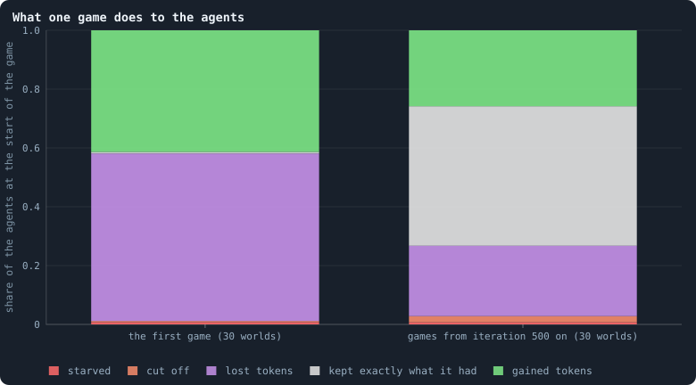
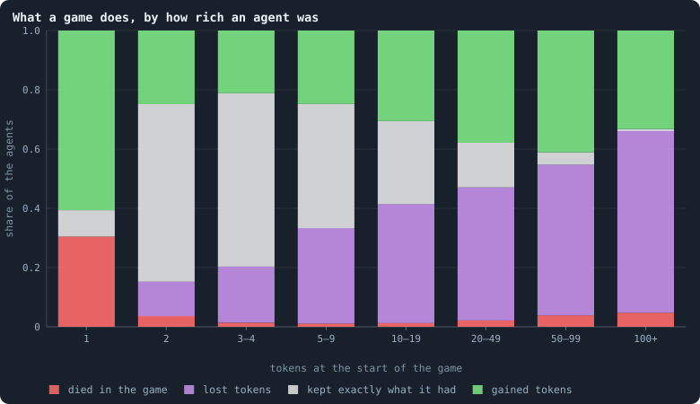
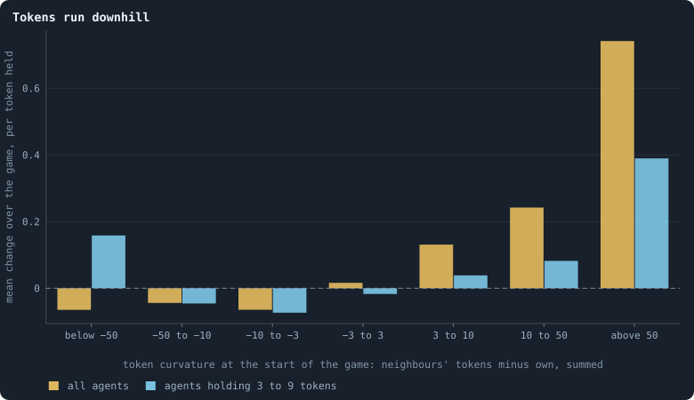
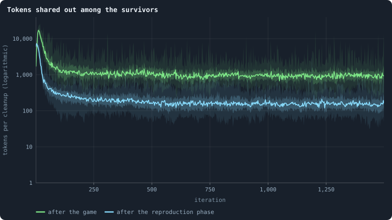

# Gains and losses: who gains, who loses, and the share-out

> [!question] Questions of this page
> - What does one game do to the [agents](the-world.md#agents-and-tokens "One member of a world: it lives on a node of the network, holds tokens and has a brain that takes all its decisions."): how many die, lose, keep exactly what
>   they had, or gain?
> - Does that depend on how rich an agent is? What becomes of a rich agent
>   with few [connections](the-world.md#the-network "A link between two agents of the network: they are neighbours, and can stake on each other's nodes.")?
> - Do [tokens](the-world.md#agents-and-tokens "The one thing of value in a world: every agent holds a whole number of them, and their total never changes.") run "downhill", from agents richer than their [neighbours](the-world.md#the-network "An agent joined to another by a connection.") to
>   agents poorer than them?
> - How large is the lottery in which the tokens of the dead are dealt out,
>   and how is it drawn?

## In short

Every token is staked in every game. Yet in a settled world nearly half the
agents end a game with exactly what they had, because what they send out comes
back. The poorest live on a coin toss: an agent with one token dies in 30% of
games, and the survivors multiply their tokens. The rich lose: agents with 100
tokens or more shrink by 48% in a game on average, and those with few
connections die most often. Tokens run downhill, from agents richer than their
neighbours to poorer ones. So a rich agent with few connections drains back,
within a few games, to the share its connections give it.

## The bookkeeping of a game

A game reshuffles every token of a world, every iteration. Each agent stakes
**all** of its tokens, on its own node and on its neighbours' nodes. Every
node then ends the game holding exactly the tokens staked on it
([One iteration, step by step](one-iteration.md#phase-2-the-game)). This page
follows what that does to each agent: who gains, who loses, who dies, and
whether there is a law to it.

Start with two neighbours. A holds 6 tokens and B holds 2. A stakes 3 at home
and 3 on B; B stakes 1 at home and 1 on A. After the game A's node holds
3 + 1 = 4 tokens: its change is Δ = −2. B's node holds 1 + 3 = 4, a change of
Δ = +2. Now suppose A had put 5 at home and only 1 on B. Then the two stakes
across the connection would have matched. Neither balance would have changed:
A would hold 5 + 1 = 6, and B 1 + 1 = 2.

The rule behind the example is simple. What an agent puts on its own node, it
keeps. What it puts on a neighbour's node, it loses. What others put on its
node, it gains. To write it down, let *a*(*u* → *v*) be the tokens agent *u*
stakes on node *v*. Here *v* is *u* itself or one of its neighbours. Every
agent stakes everything, so Σᵥ *a*(*u* → *v*) = τᵤ, the tokens *u* held at the
start. After the game node *u* holds the stakes on it, so its change is

$$
\Delta_u \;=\; \underbrace{\sum_{v \ne u} a(v \to u)}_{\text{staked on } u \text{ by others}} \;-\; \underbrace{\sum_{v \ne u} a(u \to v)}_{\text{staked by } u \text{ on others}} .
$$

In words: the tokens others staked on *u*, minus the tokens *u* staked on
others. An agent's change is exactly zero when the two are equal: what goes
out comes back.

Who *wins* a node, and so whose [brain](the-brain.md "The neural network each agent decides with: inputs about itself and its neighbours, outputs that become its decisions.") the node takes, is a separate question
([How a coalition takes a node](revolution.md)). The tokens stay with the
node, whoever wins it. So on this page an agent is its node, as in the frames
a run records ([What a run records](frames-and-stats.md)).

The worlds are the thirty [B1](b1-and-b2.md "The first baseline: the algorithm exactly as a new run is offered it.") worlds of 100,000 tokens of Experiment 10
([Thirty worlds](a-worlds-life.md#thirty-worlds)). This page was first written
from the thirty worlds of 10,000 tokens; where those differ, both numbers are
given.

## Gains, losses and the share-out

Every frame of a run records each agent's change of tokens over the phase,
for every agent alive at its end. This change is `delta`: its tokens now
minus its tokens when the phase began. A newborn counts its whole endowment as gained. Five statistics of
every frame sum these changes up.

### The five statistics

| field | definition |
|---|---|
| `gainers` | agents alive at the end with `delta` > 0 |
| `losers` | agents alive at the end with `delta` < 0 |
| `maxTokenAdded` | the largest `delta` |
| `maxTokenLost` | minus the smallest `delta`, as a positive number |
| `redistributed` | the tokens the cleanup dealt out among the survivors |

The agents with `delta` = 0 are counted by neither. There are
`nodes` − `gainers` − `losers` of them.

### Why gains and losses do not balance

Tokens are never made or destroyed, so one might expect the gains to equal
the losses. They do not, because a frame only describes the agents **still
alive**. An agent that died in the phase lost everything. But it is not in
the frame, so its loss is never counted. The tokens it let go of turn up as
gains of the survivors: the cut-off agents' tokens through the share-out, the
others' through stakes. Summed over the frame,

$$
\sum_{\text{survivors}} \text{delta} = \text{tokens held by the agents that died, at the start of the phase} .
$$

In words: the survivors' changes add up to exactly what the dead held when
the phase began.

### The share-out

The cleanup removes the agents that hold nothing, and those cut off from the
largest piece of the network. It pools the tokens of the dead. In B1 only the
cut-off ones hold any; in [B2](b1-and-b2.md "The second baseline: B1 with the rules that keep its network from breaking and its agents from staking or breeding themselves to death."), agents that die of old age hold theirs too
([`max_age`](settings.md#max_age)). Then it deals the pool out in one
multinomial draw: each token goes to a survivor chosen uniformly at random
([Seeds and the random stream](random-numbers.md)). The size of that pool is
`redistributed`. Both [baselines](b1-and-b2.md "The stated rules an experiment starts from and changes one thing of: B1 or B2.") deal the tokens out this way; the setting
[`redistribution`](settings.md#redistribution) offers other ways
([The estate of the dead](estate.md)).

**An example.** 100 tokens are dealt out among 1,000 survivors. Each survivor
gets a binomial number of them, with mean 0.1. About 90% get none, 9% get
one, and fewer than 1% get two or more. For an agent holding 2 tokens, one
extra token is a 50% gain. So the share-out is a small lottery that matters
most to the poor ([The lottery](#the-lottery)).

### In the code

The [engine](the-lab.md "The program that runs an experiment's plan as runs, each on a frozen copy of the engine, the code that plays a world.") computes `delta` (`GraphOfLifeSimple.py`, `_frame`), and
`gol_series.frame_stats` the five statistics. `redistributed` comes from the
cleanup report of each frame.

## What one game does

<!-- figure gains/outcome -->

**What one game does to the agents.** Every agent alive at the start of a game ends it in one of five ways: it starved (no one staked on its node), it was cut off from the largest piece of the network, or it survived holding fewer tokens, exactly as many, or more than before. Left: the game of iteration 0 in all 30 worlds. Right: every game from iteration 500 on in the 30 worlds, pooled.

> [!example]- How to make this figure
> **Runs.** The 30 baseline runs `B1-100000-s001` … `B1-100000-s030`: the baseline B1 at 100,000 tokens, seeds 1 to 30, 1,500 iterations each (every setting is listed in [Thirty worlds](a-worlds-life.md#thirty-worlds)). They are made with `python3 gol_lab.py run E10`.
>
> **Data.** From each run's `GraphOfLifeRuns/<run>/stats.jsonl`, which holds one row per recorded phase: `phase` 1 is the world just after reproduction, `phase` 2 just after the game, and every statistic is a field of the row (see [What a run records](frames-and-stats.md)).
>
> 1. Take the rows with `phase` = 2 (iteration 0, or 500 to 1,499).
> 2. Sum over them: `nodes_before` (agents at the start), `starved`, `orphaned`, `gainers`, `losers`, and `nodes` − `gainers` − `losers` (survivors whose tokens did not change).
> 3. Divide each sum by the sum of `nodes_before` and stack the shares.
>
> **To make it again:** `python3 book_figures.py gains`.
<!-- /figure -->

The first game is a scramble. Of the agents alive at its start, 57% lose
tokens and 41% gain. Fewer than one in a hundred come out with exactly what
they had. Few die in it. 0.8% starve: nobody, not even they themselves, staked
on their node. And 0.4% are cut off from the network. The worlds of 10,000
tokens were different. Their [founders](starting-ring.md "One of the agents a world starts with, each holding the same tokens, on a ring with a few shortcuts.") had four neighbours each instead of ten,
and their first game was violent: 3.8% starved and 4.0% were cut off.

Settled games, from iteration 500 on, are calm. 0.7% starve and 2.1% are cut
off; 24% lose and 26% gain. And **47% of the agents end the game with exactly
the tokens they began with**. Nearly half the world is, in tokens, untouched
by a game in which every token was staked.

That is not because they stake nothing on their neighbours: 71% of the tokens
staked go to neighbours ([How the game is played](how-the-game-is-played.md)).
It is because what they send out comes back in equal measure.
[Where tokens flow](where-the-tokens-flow.md#the-budget-of-a-game) counts how
much: 51% of all the tokens staked in a settled game are matched by a stake
coming back.

How much changes hands? In a settled world of about 14,400 agents, some 3,800
agents gain in a game and 3,600 lose. The largest single gain is about 1,400
tokens, and the largest loss about 1,400. That is a [hub](stars-and-hubs.md "An agent joined to far more agents than most; a star is a world held together by a single hub.")'s worth, changing
hands in one game
([The largest gain is the largest loss](the-largest-and-the-smallest.md#the-largest-gain-is-the-largest-loss)).
At 10,000 tokens it was 330 and 320 agents, and about 640 and 620 tokens.

## Rich and poor

<!-- figure gains/by-tokens -->

**What a game does, by how rich an agent was.** Agents alive at the start of a game, sorted by the tokens they held then; for each class, the share that died in the game (starved or cut off), and of the rest the shares that lost tokens, kept exactly as many, or gained. From the games of every 100th iteration from 500 on, in the 30 worlds (4,520,044 agents in all).

> [!example]- How to make this figure
> **Runs.** The 30 baseline runs `B1-100000-s001` … `B1-100000-s030`: the baseline B1 at 100,000 tokens, seeds 1 to 30, 1,500 iterations each (every setting is listed in [Thirty worlds](a-worlds-life.md#thirty-worlds)). They are made with `python3 gol_lab.py run E10`.
>
> **Data.** From each run's frames, read every 25 iterations by `book_figures.sample_pass` (frame `2·t` after the reproduction phase of iteration *t*, frame `2·t + 1` after its game; `gol_store.read_frame(run, index)`).
>
> 1. For every 100th iteration t from 500 on, take each agent in frame `2·t` (the start of the game) with its `tokens`.
> 2. Find it in frame `2·t + 1`: if it is not there, it died in the game; if it is, its `delta` there is its change over the game.
> 3. Sort the agents by their tokens at the start into the classes shown, and count the four outcomes in each class.
>
> **To make it again:** `python3 book_figures.py gains`.
<!-- /figure -->

The picture changes completely with wealth.

- **One token.** An agent with a single token can stake it at home or on one
  neighbour. It cannot lose without dying: if it sends its token away and
  nobody stakes on it, its node holds nothing. In a game, 30% of 1-token
  agents die, 61% gain, and only 9% stay at 1. The survivors gain a lot: their
  tokens grow by 321% on average (416% at 10,000 tokens). A node with its own
  token on it and a neighbour's stake besides holds several times what it had.
- **The middle.** Agents with 2 to 9 tokens most often keep exactly what they
  had (42% to 60%), and die rarely (1.1% to 3.6%).
- **The rich.** Agents with 100 tokens or more lose in 61% of games and gain
  in 33%. They almost never keep exactly what they had (0.7%). On average,
  over those that survive the game, their tokens shrink by 48% in one game.
  Those with 50 to 99 tokens shrink by 18%.

The risk of dying is U-shaped. It is high for the poorest and lowest in the
middle. For the rich it rises again, to 4.7% per game for agents with 100
tokens or more. Which rich agents die? Almost only those with few connections.
Among the agents with 100 tokens or more in the sample, the share that died in
the game falls steeply with their connections:

| connections | 1–2 | 3–9 | 10+ |
|---|---|---|---|
| agents with 100 tokens or more, in the sample | 4,845 | 4,978 | 4,757 |
| died in the game | 10.4% | 3.1% | 0.7% |

All these shares are as at 10,000 tokens, within a few points.

A rich agent with one connection can die in two ways of its own, both visible
in the rules. It can put all its tokens on its neighbour while nobody stakes
on it. Then it starves, and its tokens are not lost: they have moved to the
neighbour's node. Or its connection carries nothing in the game and is cut.
Then it is cut off, and dies with its tokens. Otherwise it can only go with
its branch. That happens when a connection further in is cut, so that its
whole branch is no longer joined to the largest piece.

## Token curvature

Picture the tokens of a world as a landscape. An agent richer than its
neighbours stands on a hill; an agent poorer than them sits in a valley. The
**token curvature** says how deep a valley or how high a hill is. It adds up,
over an agent's neighbours *N*(*u*), how many more tokens each holds than the
agent does:

$$
\kappa(u) = \sum_{v \in N(u)} (\tau_v - \tau_u)
         = \sum_{v \in N(u)} \tau_v \;-\; \deg(u)\, \tau_u .
$$

Here τ is an agent's tokens, and deg(*u*) its number of connections.

- κ > 0: the agent is in a **valley**. Its neighbours hold more than it does.
- κ < 0: the agent is on a **hill**. It holds more than its neighbours.
- κ = 0: it is as much above some neighbours as below others.

**Example.** An agent with 5 tokens has neighbours holding 2, 8 and 20. Its
curvature is (2 − 5) + (8 − 5) + (20 − 5) = −3 + 3 + 15 = 15: a valley. A hub
with 200 tokens has 50 neighbours holding 4 each. Its curvature is
κ = 50 · (4 − 200) = −9,800: a high hill.

### Why it is called curvature: heat

Take agents in a row, each joined to the next. For an agent in the middle, κ
is the tokens on its left plus those on its right, minus twice its own. That
is the discrete second derivative of the token landscape: how it bends at the
agent. A valley bends up and a hill bends down. This is where the name comes
from. On any network, κ is the **discrete Laplacian** of the tokens.

It is also the quantity that drives heat. Suppose heat spreads along the
connections of a network. Then each node's temperature changes in proportion
to the sum of its differences with its neighbours, which is exactly κ. A
valley warms up, a hill cools down, and the landscape smooths out. In the
language of matrices, κ = −*L*τ. Here *L* is the network's Laplacian matrix,
with the [degrees](degree.md "The number of an agent's connections: how many neighbours it has.") on its diagonal and −1 for every connection.

If tokens behaved like heat, an agent's change of tokens in a game would
follow its curvature at the start of the game.
[Tokens run downhill](#tokens-run-downhill) tests that.

### In the viewer

The viewer can colour every agent by its token curvature
([What the viewer can colour by](viewer-colours.md)). The field
`token_curvature` is measured on the frame itself. The field
`token_curvature_pre` is measured on the network and the tokens as they were
when the phase began. So it can be read against the change the phase then
produced. On a signed colour scale, blue is a hill and
red a valley.

## Tokens run downhill

<!-- figure gains/downhill -->

**Tokens run downhill.** The token curvature of an agent is the sum, over its neighbours, of how many more tokens the neighbour holds than it does ([Token curvature](gains-and-losses.md#token-curvature)): negative for an agent richer than its neighbourhood, positive for one poorer. For each class of curvature, the mean change of an agent's tokens over the game divided by the tokens it held at the start, over the agents that survived the game. Yellow: all agents; cyan: only agents that held 3 to 9 tokens, so that wealth itself cannot explain the pattern. A class with fewer than 1,000 agents is left out (drawn at 0).

> [!example]- How to make this figure
> **Runs.** The 30 baseline runs `B1-100000-s001` … `B1-100000-s030`: the baseline B1 at 100,000 tokens, seeds 1 to 30, 1,500 iterations each (every setting is listed in [Thirty worlds](a-worlds-life.md#thirty-worlds)). They are made with `python3 gol_lab.py run E10`.
>
> **Data.** From each run's frames, read every 25 iterations by `book_figures.sample_pass` (frame `2·t` after the reproduction phase of iteration *t*, frame `2·t + 1` after its game; `gol_store.read_frame(run, index)`).
>
> 1. For every 100th iteration t from 500 on, read frame `2·t`: for every agent u, κ(u) = Σ over its neighbours v of (τ(v) − τ(u)).
> 2. Find each agent in frame `2·t + 1` and take its `delta` (agents not there died and are left out).
> 3. Sort by κ into the classes shown and average `delta` / τ(u) in each.
>
> **To make it again:** `python3 book_figures.py gains`.
<!-- /figure -->

The tokens run downhill. Agents in deep valleys (κ > 50) gain 74% on average
in a game; agents on hills (κ < −50) lose 6.5%. At 10,000 tokens it was 113%
and 6.6%.

Is that only because valleys are poor and hills rich, and we saw above that
the poor gain? The cyan line answers. Take only agents that hold 3 to 9
tokens. Those in valleys still gain: +39% above κ = 50 (+63% at 10,000
tokens). And those on hills still lose: −7% between κ = −10 and −3.

One class goes the other way. The few agents of 3 to 9 tokens on the steepest
hills, κ < −50, gain. They are hubs among many poorer neighbours. With fewer
tokens than neighbours, they cannot send one token to each, while each
neighbour sends them one or two.

There is a reason to expect the tokens to run downhill. Suppose every agent
split its tokens evenly over its own node and its *d* neighbours, and every
agent had the same number *d*. Node *u* would receive τᵤ/(*d*+1) from itself
and τᵥ/(*d*+1) from each neighbour, so

$$
\Delta_u = \frac{\tau_u + \sum_{v \in N(u)} \tau_v}{d+1} - \tau_u = \frac{\kappa(u)}{d+1} .
$$

The change would be **proportional to the curvature**. This is the discrete
heat equation of [Why it is called curvature](#why-it-is-called-curvature-heat):
heat flows from warm to cold in proportion to the difference
([Physical inspiration](physical-inspiration.md)). Real agents do
not split exactly evenly, and degrees differ. That is why the relation is a
tendency and not a law. But
[Where tokens flow](where-the-tokens-flow.md#the-game-as-a-random-walk) shows
how close to an [even split](even-split.md "What the rules do when a brain scores no candidate above zero: the stake is spread evenly.") the brains in fact play.

## How a rich agent drains back

If the rich lose 48% of their tokens in a game, how can the [richest tenth](gini-coefficient.md#the-richest-tenths-share "The share of all tokens held by the richest tenth of the agents.")
always hold 42% of all tokens
([Inequality over time](where-do-the-tokens-go.md#inequality-over-time))?
Because wealth has places where it can rest, and whoever sits in such a place
is rich, game after game.

The places are set by the connections. Under the even split, tokens move like
a random walk. The walk comes to rest when every agent holds tokens in
proportion to its connections plus one
([Where tokens flow](where-the-tokens-flow.md#the-game-as-a-random-walk)).
Call that an agent's **resting share**. In the thirty worlds after their last
game, rest would mean 1.7 tokens for each candidate: an agent's own node, and
each neighbour's. Agents of every class of connections hold about that on
average
([How properties scale together](how-properties-scale-together.md#tokens-and-connections)).
So an agent with one connection rests at about 3.4 tokens, and a hub with a
hundred connections at about 170.

A rich agent with few connections is far above its resting share, and the even
split takes the excess away. Take an agent with one connection, holding τ
tokens, and write *s* for the tokens per candidate at rest. The agent keeps
τ/2 at home and stakes τ/2 on its neighbour. If the neighbour holds its own
resting share, it stakes *s* on each of its candidates, so *s* comes back. The
agent ends the game with τ/2 + *s*. Its resting share is 2*s*, and its excess
over it has halved:

$$
\left(\frac{\tau}{2} + s\right) - 2s = \frac{\tau - 2s}{2} .
$$

An agent with one connection and 40 tokens ends such a game with about 22. If
little comes back in the next games either, the excess halves again and again.
Within a few games, little of it is left at the agent. The tokens are not
lost. They run downhill into the neighbourhood, and spread from there.

Real agents do not split exactly evenly. But the rich do lose: those with 100
tokens or more shrink by 48% in a game on average. And many of the richest are
rich far beyond their place. Take the tail of the distribution of tokens: the
3,358 agents that held 49 tokens or more after the last game of the thirty
worlds. Of them, 33% have only one or two connections
([Power laws, real and apparent](power-laws-real-and-apparent.md#the-tokens-a-power-law-in-the-tail)).

Some die before they drain. A rich agent with one or two connections dies in
about one game in ten ([Rich and poor](#rich-and-poor)). If it is cut off, the
share-out deals its tokens out among all the survivors
([The lottery](#the-lottery)). Either way, its wealth returns to the world.

Wealth that sits on many connections is near its resting share, and lasts.
Nearly half of the richest hundredth of a world are hubs with ten connections
or more. The survivors among the richest keep 87% of their tokens over ten
games, in the [median](median-and-quantiles.md "The middle value: half of the numbers lie below it and half above.")
([The fate of the richest](where-do-the-tokens-go.md#the-fate-of-the-richest)).
Even there, wealth sways. On a hub with many leaves the even split overshoots.
Tokens slosh between the hub and its leaves, with a period of two games
([A two-game rhythm](where-do-the-tokens-go.md#a-two-game-rhythm)).

So the rich are replaced as fast as they shrink: tokens pile up again wherever
there are many connections. Who is rich is mostly a matter of **where** an
agent is.

## The lottery

When the cleanup removes the agents cut off from the network, it pools their
tokens. Then it deals them out, token by token, to survivors drawn at random,
every survivor with the same chance ([The share-out](#the-share-out)).

<!-- figure gains/lottery -->

**Tokens shared out among the survivors.** How many tokens the cleanup dealt out at random among the survivors — the tokens of the agents that were cut off — after each game (green) and after each reproduction phase (cyan), on a logarithmic axis. For each, the line is the median of the worlds at each iteration, the darker band holds the middle half of them (from the 25th to the 75th percentile) and the paler band nine in ten (5th to 95th).

> [!example]- How to make this figure
> **Runs.** The 30 baseline runs `B1-100000-s001` … `B1-100000-s030`: the baseline B1 at 100,000 tokens, seeds 1 to 30, 1,500 iterations each (every setting is listed in [Thirty worlds](a-worlds-life.md#thirty-worlds)). They are made with `python3 gol_lab.py run E10`.
>
> **Data.** From each run's `GraphOfLifeRuns/<run>/stats.jsonl`, which holds one row per recorded phase: `phase` 1 is the world just after reproduction, `phase` 2 just after the game, and every statistic is a field of the row (see [What a run records](frames-and-stats.md)).
>
> 1. Take `redistributed` of the rows with `phase` = 2 and of those with `phase` = 1.
> 2. Cut the 1,500 iterations into 600 stretches of 2.5 and take each world's mean in each stretch.
> 3. In each stretch, take the median, the 25th and 75th and the 5th and 95th percentiles of those means over the worlds that still have a value there (a world that died has none after its death).
>
> **To make it again:** `python3 book_figures.py gains`.
<!-- /figure -->

In a settled world, about 1,300 tokens are dealt out after each game, and
about 210 after each reproduction phase. Per agent and game that is 0.10
tokens (the thirty worlds: 0.05 to 0.15; 0.11 at 10,000 tokens): on average
one token every ten games. That is small. But half of all agents hold 5 tokens
or fewer, and for an agent with 1 token, one lottery token doubles its wealth.
The share-out is a small basic income that matters only to the poor.
[The estate of the dead](estate.md) shows what other ways of sharing the
tokens out would do.

## What we learned

- **A game is an exchange, plus diffusion.** Nearly half the agents end a game
  with exactly what they had, because what they send out comes back. What does
  move runs downhill, from agents richer than their neighbourhood to agents
  poorer than it. In tokens, a world works much like heat spreading through a
  network.
- **The poor live on a knife's edge.** Nearly a third of 1-token agents die in
  every game; the survivors multiply their tokens. Being poor in this world is not a
  slow decline, it is a coin toss.
- **Wealth above its resting share does not last.** A rich agent with few
  connections loses its excess to its neighbours within a few games. Or it
  dies on its dead end, and its tokens are shared out. The rich are replaced
  where connections are many.
- **Wealth is a place, not a memory.** An agent's tokens drain back to the
  share its connections give it, so its wealth cannot record that its brain
  did well in the past. For evolution, that matters: selection needs
  differences in success that last long enough to be inherited
  ([What the measurements say about open-ended evolution](what-the-baseline-world-is.md#what-the-measurements-say-about-open-ended-evolution)).
- **The share-out is a lottery for the poor.** It deals out 0.10 tokens per
  agent and game: nothing to the rich, and a doubling to an agent with one
  token.

## Where to go next

- [Where tokens flow](where-the-tokens-flow.md): where each staked token goes,
  and the random walk that sets every agent's resting share.
- [How unequal is a world, and who stays rich](where-do-the-tokens-go.md#do-the-rich-stay-rich):
  whether the same agents stay rich, game after game.
- [The largest and the smallest](the-largest-and-the-smallest.md): the richest
  agent, the largest gain and loss of a game, and the stars.
- [Physical inspiration](physical-inspiration.md): the heat equation, and the
  other physics the notebook borrows from.

## How this was made

Every figure of this page reads the thirty runs of Experiment 10, listed
below. They are worlds of the baseline B1 at 100,000 tokens, seeds 1 to 30,
run for 1,500 iterations each. The command `python3 gol_lab.py run E10` makes
them, and `python3 book_figures.py gains` draws every figure of this page.
Each figure says, folded beneath it, which runs it reads and how. The numbers
given for the worlds of 10,000 tokens come from the thirty runs of
Experiment 2, from which this page was first written.

### The runs of Experiment 10

<!-- runs E10 -->
> [!info]- The runs behind this page
> **30 runs.** Every condition below is run once for every seed (1 to 30), for 1,500 iterations — or until its world dies out. Every setting is that of the baseline **B1** (the algorithm exactly as a new run is offered it) unless the condition changes it.
>
> - **baseline** — changes nothing: B1 as it is; 100,000 tokens. Runs `B1-100000-s001` … `B1-100000-s030`.
>
> To make these runs again: `python3 gol_lab.py run E10`, or ▶ in the Research Notebook tab of a computer running `gol_server.py`. Each run writes its settings, seed and engine version beside its frames, in `GraphOfLifeRuns/<run>/meta.json` and `provenance.json`.

> [!info]- Every setting of these runs
> | setting | baseline | what it is |
> |---|---|---|
> | [`total_tokens`](settings.md#total_tokens) | 100,000 | The number of tokens in the world, *T*. It never changes during a run. |
> | [`n_nodes`](settings.md#n_nodes) | 0 | How many founders the world starts with. 0 means one founder per hundred tokens: *n* = ⌊*T* / 100⌋. |
> | [`k_neighbors`](settings.md#k_neighbors) | 0 | How many neighbours each founder starts with in the ring. 0 means *k* = max(⌊*n* / 100⌋, 5); an odd *k* is wired as *k* − 1. |
> | [`rewire_p`](settings.md#rewire_p) | 0.2 | In the starting ring, the probability that a connection is moved to a founder chosen at random (Watts–Strogatz). |
> | [`hidden_layers`](settings.md#hidden_layers) | 50, 45, 40, 35, 30 | The widths of the brain's hidden layers, in order from input to output. |
> | [`brain_kind`](settings.md#brain_kind) | float16 | How weights are stored: `float` (64-bit), `float16` (16-bit, computed in 64-bit) or `binary` (−1, 0, +1). |
> | [`brain_bits`](settings.md#brain_bits) | 16 | Only for binary brains: how many input rows encode one number. Unused by float and float16 brains. |
> | [`message_amount`](settings.md#message_amount) | 30 | How many numbers one message holds. Each agent sends one message to itself and one to each neighbour, every phase. |
> | [`random_input_amount`](settings.md#random_input_amount) | 5 | How many random numbers, drawn uniformly from −2 to 2, a brain reads per neighbour, every time it looks. |
> | [`exchange_messages`](settings.md#exchange_messages) | on | Whether agents send and read messages at all. |
> | [`message_prepass`](settings.md#message_prepass) | on | Whether every phase begins with an extra look in which agents only write messages, so the look that acts reads messages written this phase. |
> | [`allow_handover`](settings.md#allow_handover) | on | Whether a parent may move some of its own connections to its newborn child. |
> | [`allow_revolutions`](settings.md#allow_revolutions) | on | Whether a coalition of smaller stakers can take a node from its largest staker (see the note *How a coalition takes a node*). |
> | [`allow_gifting`](settings.md#allow_gifting) | off | Whether agents may give tokens to neighbours during reproduction. Off in both baselines; on in a few pilots, in Experiment 24 and in half the worlds of the screen. |
> | [`random_decisions`](settings.md#random_decisions) | off | The control: every number a brain would produce is replaced by a random draw from the standard normal distribution. |
> | [`prune_after`](settings.md#prune_after) | blotto | After which phase connections that carried no tokens are cut: `blotto` (the game), `reproduction`, or `both`. |
> | [`inactive_window`](settings.md#inactive_window) | phase | How long a connection may go unused: `phase` means it must carry tokens in the phase being judged; `iteration` allows the two last phases. |
> | [`redistribution`](settings.md#redistribution) | uniform | How the tokens of removed agents are shared: `uniform` gives every survivor the same chance at each token; `by_tokens` weights by what a survivor holds; `poorest` raises the poorest to one common level first; `newborns` gives them to this iteration's children, `parents` to their parents, once per child (both `uniform` in an iteration without births); `children` leaves each dead agent's estate to its own living children (`uniform` where there are none). |
> | [`tokens_created_per_phase`](settings.md#tokens_created_per_phase) | 0 | Tokens added to the world at every cleanup. 0 keeps the supply fixed. |
> | [`mutate_on_replication`](settings.md#mutate_on_replication) | off | Whether a brain changes only when it is copied — into a newborn, or into a node its owner has just won — instead of also after every game, wherever it sits. |
> | [`incumbency`](settings.md#incumbency) | 1.0 | How many times over an agent's stake on its own node counts when the game decides who takes the node. 1 is the old rule. |
> | [`birth_links`](settings.md#birth_links) | 0 | How many of its parent's neighbours a newborn is joined to, drawn at random, besides its parent itself; 0 leaves every link to the brain's choice. |
> | [`mend_on_death`](settings.md#mend_on_death) | off | Whether the neighbours of an agent that dies are joined up where its death would leave them in separate pieces. |
> | [`prune_needs`](settings.md#prune_needs) | 0 | How many neighbours the two ends of an unused connection must share for it to be cut; 0 cuts every unused connection. |
> | [`valence`](settings.md#valence) | 0 | The most connections an agent's brain may choose to hold (0 = no limit). An agent at its limit cannot have a child. |
> | [`keep_home`](settings.md#keep_home) | 0.0 | The share of an agent's tokens — rounded up, never less than one — that stays on its own node whatever its brain says; a parent also keeps one. 0 is the old rule. |
> | [`max_age`](settings.md#max_age) | 0 | The age at which an agent dies (0 = never); its tokens are shared out like those of any other dead agent. |
> | [`buy_life`](settings.md#buy_life) | off | Whether an agent that has reached max_age may live on by paying one token an iteration into the estate of the dead — never its last, so one with a single token left dies. Needs max_age. |
> | [`min_child`](settings.md#min_child) | 1 | The fewest tokens a child can be born with; a parent that would give less has no child. |
> | [`child_floor`](settings.md#child_floor) | fixed | The least a child may start with: min_child alone (fixed), or also the median holding of its parent's neighbours (neighbours), so that a world grows only as rich as it is. |
> | [`mix_at_birth`](settings.md#mix_at_birth) | off | Whether a newborn's brain is its parent's mixed with a mate's — one of the parent's neighbours, drawn at random — each hidden unit whole from one or the other by an even chance, before it mutates; off, a newborn has a copy of its parent's brain. |
> | [`mix_mates`](settings.md#mix_mates) | any | Under mix_at_birth, who may be the mate: any neighbour of the parent, or only parents — a neighbour with a living child of its own (with none, the newborn's brain is a copy). |
> | [`self_message`](settings.md#self_message) | own | What an agent writes to itself, which each neighbour reads: what its own column says (own), or the largest, number by number, of what it writes to anyone (largest), so that news one column marks reaches every neighbour. |
> | [`link_search`](settings.md#link_search) | off | Whether an agent may reach beyond its neighbours to propose a link: off; jump, a walk as many steps long as the tokens it spends in one iteration, with a link proposed where it ends; walk, a scout that goes one step further in every iteration it pays for; or reach, a jump whose steps are free, as many as the tokens it holds would pay for. A paid step costs one token, paid to the agent it enters, and never the last. |
> | [`link_steering`](settings.md#link_steering) | random | Which way each step of a search goes: to a neighbour drawn at random, or to the one the searcher would most like a link with (looking). |
> | [`link_consent`](settings.md#link_consent) | mutual | Who has to agree to a link a search proposes: both ends (mutual), or only the one who proposes (forced). Nobody at its valence gets a new link either way. |
> | [`proto`](settings.md#proto) | none | Rules first played in the pilots' prototype, by name: came_from and helped_by (an input row each), contest = lottery, pool by genotype or family, kin_sense, tag_rate, mate_pays, grow, unit_token, link_token. Empty in every run but those that ask for one; only the prototype's world plays them (see the settings note). |
> | [`mutation_probability`](settings.md#mutation_probability) | 0.2 | The probability that a brain changes when it is copied to a child, and again, for every brain, after every game. |
> | [`mutation_noise_std`](settings.md#mutation_noise_std) | 0.2 | How large a change to one weight is: a normal draw with standard deviation this times 1/√(fan-in) of its layer. |
> | [`mutation_sparsity`](settings.md#mutation_sparsity) | 0.1 | The share of a brain's numbers a change touches; also the probability, for each weight matrix and bias vector, of a rarer reset that redraws that share of it. |
> | [`extinction_threshold`](settings.md#extinction_threshold) | 20 | A run stops, as extinct, when an iteration ends (after its game) with this many agents or fewer. |
> | seeds | 1 to 30 | one run per seed |
> | iterations | 1,500 | how far each run goes, unless its world dies first |
>
> A value in **bold** differs from the baseline B1.
<!-- /runs -->

## How our view changed

- **11 October 2026.** This page was first written, on 8 October, from the
  thirty worlds of 10,000 tokens. On this day it was rewritten from the thirty
  of 100,000 tokens, with the small worlds' numbers beside the new ones where
  they differ. One claim changed with the size of a world. The page had called
  the first game violent: 3.8% of the agents starved in it and 4.0% were cut
  off. In the large worlds, whose founders have ten neighbours each instead of
  four, few agents die in the first game.
- **14 October 2026.** A pass through the whole notebook corrected two
  statements. The page had given the founders of a world of 10,000 tokens five
  neighbours each. They have four: the rules wire an odd number of neighbours
  as one less. And the page had said that a rich agent with one connection
  dies in one of two ways. It starves, or its only connection is cut. Those
  are its two ways of its own. It can also go with its branch, when a
  connection further in is cut.

<!-- turns -->
---

← [How unequal is a world, and who stays rich](where-do-the-tokens-go.md) · [Wealth: who holds the tokens](../README.md#wealth-who-holds-the-tokens) · [The largest and the smallest](the-largest-and-the-smallest.md) →

**Also about:** [The game and the flow of tokens](../README.md#the-game-and-the-flow-of-tokens).

> [!info]- Pages that link here (15)
> [Glossary](glossary.md) · [Questioning the mechanics](questioning-the-mechanics.md) · [What B1 is, and what stood in its way](what-the-baseline-world-is.md) · [How unequal is a world, and who stays rich](where-do-the-tokens-go.md) · [The largest and the smallest](the-largest-and-the-smallest.md) · [Where tokens flow](where-the-tokens-flow.md) · [Power laws, real and apparent, and how to fit one](power-laws-real-and-apparent.md) · [How properties scale together](how-properties-scale-together.md) · [How a world breaks](how-a-world-breaks.md) · [Physical inspiration](physical-inspiration.md) · [Do agents cooperate? Help, kin and partners](do-agents-cooperate.md) · [One world, many colours](one-world-many-colours.md) · [What goes with what](what-goes-with-what.md) · [What a run records](frames-and-stats.md) · [What the viewer can colour by](viewer-colours.md)
<!-- /turns -->
