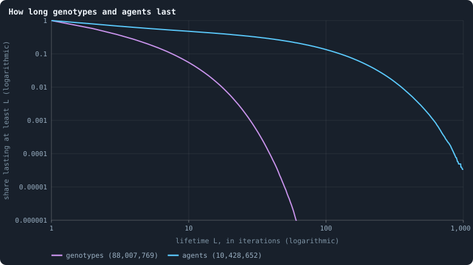
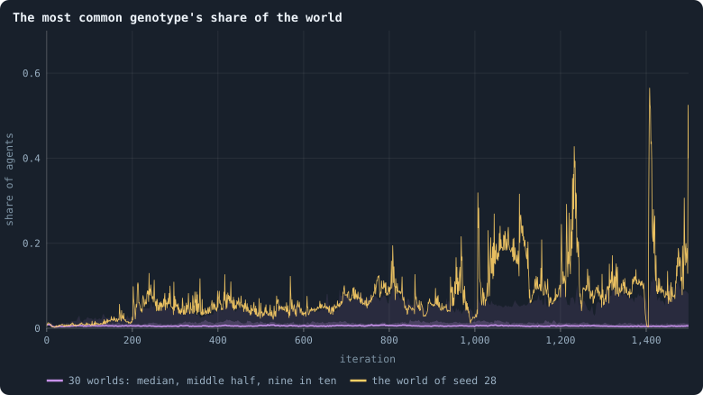
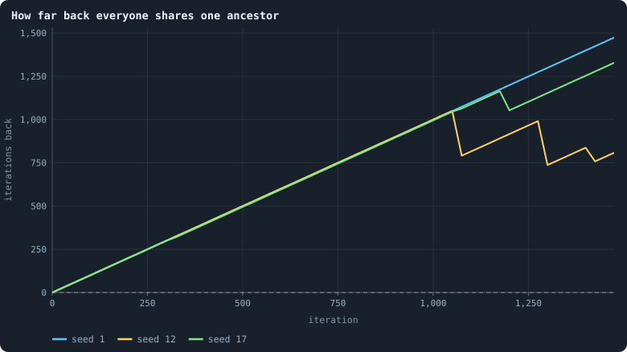
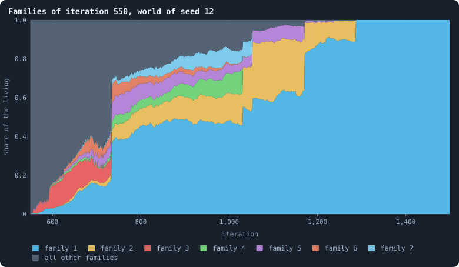
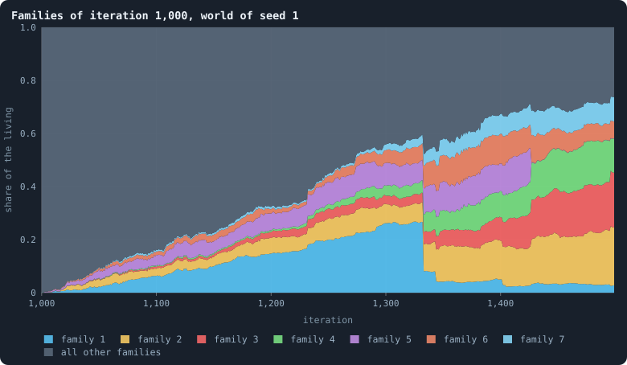
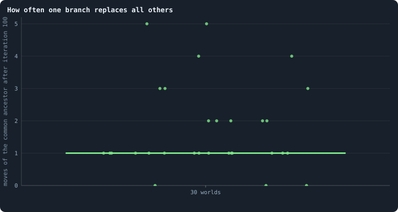

# Genotypes and lineages

> [!question] Questions of this page
> - How long does a genotype last? How long does an [agent](the-world.md#agents-and-tokens "One member of a world: it lives on a node of the network, holds tokens and has a brain that takes all its decisions.")?
> - Does any single genotype ever hold a large part of the world?
> - Does any *line of descent* take the world over — and how often?
> - Does a line that takes a world over carry better [brains](the-brain.md "The neural network each agent decides with: inputs about itself and its neighbours, outputs that become its decisions."), or is it lucky?

## In short

A genotype names one exact brain, and in [B1](b1-and-b2.md "The first baseline: the algorithm exactly as a new run is offered it.") brains change so often that a
genotype lasts about two [iterations](one-iteration.md "One step of a world's time: a phase of reproduction, then a phase of the game."). A world holds about five genotypes for
every eight agents, and the most common one usually holds only about 1% of
it. Yet lines of descent take whole worlds over, about every 350 iterations
at 10,000 [tokens](the-world.md#agents-and-tokens "The one thing of value in a world: every agent holds a whole number of them, and their total never changes.") and about once a run at 100,000. So Experiment 6's thesis,
that no brain wins for long, is refuted: what lasts long enough for
selection is the line, not the genotype. But once a world has settled, the
lines that take it over do not carry brains that play better.

## What lasts long enough to be selected?

Evolution needs something that lasts long enough to be selected. What lasts,
in a Graph of Life world?

Think of a song passed on by ear. Each singer may change a note, and every
changed version is a new version. Any one version is soon gone: sung a few
times, then changed again. But a family of versions, all those that come from
one, can spread through a whole town.

A brain is such a song. It is copied into a child, and into every node its
agent wins in a [game](one-iteration.md#phase-2-the-game "The second phase of an iteration: every agent stakes all its tokens on its own node and its neighbours', and every node goes to someone."). It changes with probability 0.2 at every birth and
after every game ([How a brain changes](mutation.md)). Every change gives the
brain a new number, its **genotype**, and every genotype remembers the one it
came from. So the genotypes of a world form one family tree
([Genotypes and the family tree](genotype.md)).

A genotype is one version of the song. A **line** of descent, or lineage, is
a family of versions: one genotype together with every genotype descended
from it. This page asks how long genotypes last, how much of a world one of
them can hold, and whether lines take whole worlds over.

The worlds are the thirty of 100,000 tokens of
[Thirty worlds](a-worlds-life.md#thirty-worlds), about 14,400 agents each.
This page was first written from thirty worlds of 10,000 tokens, and gives
their numbers beside.

## What was expected

Experiment 6 asked who wins, and for how long. Its thesis was written down
before the runs of 10,000 tokens. It needed no runs of its own: it read the
thirty of Experiment 2.

We expected nobody to win for long. Every brain has one chance in five of
changing after every game, and again when it is copied to a child. A node
that is conquered takes on its conqueror's brain. So a genotype should be
renamed long before it could spread far. [Pilots](pilot-worlds.md "A world made by hand to see whether an idea is worth an experiment, without a thesis or many seeds.") run earlier had found a
typical genotype lasting a single iteration, and fewer than one in ten
lasting more than five.

So we expected hundreds of genotypes at any moment, and no genotype holding
more than a small part of the world. And we expected the living to descend
from many different ancestors. The test counts those ancestors as
**families**: the different genotypes of eight iterations earlier that the
living descend from ([Families](genotype.md#families)). Here is the thesis, as it was
written down:

<!-- thesis E06 -->
> [!quote] The thesis of Experiment 6, written down before any of its runs existed
> **The claim.** No brain wins for long. At any moment the population carries hundreds of different genotypes, the living descend from many different ancestors of eight iterations before, and the most common genotype holds only a small part of the world — none takes over.
>
> **Why it would be so.** Every brain has one chance in five of changing at the end of every game and again when it is copied to a child, and a conquered node takes on its conqueror's brain. A genotype is therefore renamed long before it could spread far: at this rate of change, earlier pilots found a typical genotype lasting a single iteration, and fewer than one in ten lasting more than five.
>
> **It holds if:** From iteration 100 on, the median number of distinct genotypes across the thirty runs is above a fifth of the population, the number of families stays above ten, and no single genotype ever holds more than a tenth of the agents in more than one run in ten.
>
> **It fails if:** One lineage takes over: the families fall to a handful, or a single genotype holds a large share of the world for hundreds of iterations. Then selection has something to work on even at this rate of change, which would change what [Part II](../README.md#does-evolution-keep-going) has to fix first.
>
> *Written while the notebook still numbered its chapters: each number is a link to the page it meant that day.*
<!-- /thesis -->

## Genotypes come and go

How long does one version of the song last? Follow every genotype from the
first game after which some agent carries it to the last. Follow every agent
from its birth to the last game it is alive after.

<!-- figure lineage/lives -->

**How long genotypes and agents last.** Of all genotypes that appeared, and all agents born, at iteration 500 or later in the 30 worlds, the share that lasted at least L iterations. A genotype lasts from the first game after which some agent carries it to the last; an agent from its birth to the last game it is alive after. Lives still going at the end are counted as far as they went (Kaplan–Meier).

> [!example]- How to make this figure
> **Runs.** The 30 baseline runs `B1-100000-s001` … `B1-100000-s030`: the baseline B1 at 100,000 tokens, seeds 1 to 30, 1,500 iterations each (every setting is listed in [Thirty worlds](a-worlds-life.md#thirty-worlds)). They are made with `python3 gol_lab.py run E10`.
>
> **Data.** From each run's frames, `GraphOfLifeRuns/<run>/frames/`, read with `gol_store.read_frame(run, index)`; frame `2·t` is iteration *t* after reproduction and frame `2·t + 1` after the game.
>
> 1. Read every frame with `phase` = 2; for every genotype (brain id in `brain_ids`) and every agent (id in `ids`) note the first and last iteration it appears.
> 2. Keep those first seen at iteration 500 or later; one still present in the last frame is censored.
> 3. Kaplan–Meier as in [Births, deaths and ages](births-deaths-and-ages.md).
>
> **To make it again:** `python3 book_figures.py lineage`.
<!-- /figure -->

The two curves are [survival curves](kaplan-meier.md) on logarithmic axes.
They follow every genotype and every agent that appeared from iteration 500
on in the thirty worlds, if it was there after a game. Each curve gives the
share that lasted at least *L* iterations.

- **Genotypes** (violet) are short-lived. More than half, 57%, last at least
  2 iterations; 20% last at least 5, and 6% at least 10. Only one in a
  hundred thousand reaches 50, and none reached 100, exactly as at 10,000
  tokens. The [median](median-and-quantiles.md "The middle value: half of the numbers lie below it and half above.") genotype lasts two iterations.
- **Agents** (blue) last far longer: 48% at least 10 iterations, 13% at least
  100. These are the agents that lived through their first game, as in
  [Births, deaths and ages](births-deaths-and-ages.md#how-long-agents-live).
  Nearly a third of all newborns do not.

Why the difference? An agent keeps its node, its id and its age when its
brain changes, and when a conqueror's brain replaces its own. A genotype ends
when the last agent carrying it mutates, dies, or has its node won by another
genotype. One brain in five changes after every game, and half of all nodes
change hands in every game
([How the game is played](how-the-game-is-played.md)). So a genotype has
little time.

In its [settled life](settled-life.md "A world from iteration 500 to its end, after its youth, where it is measured."), from iteration 500 on, a world holds about one genotype
for every 1.6 agents. That is five genotypes for every eight agents: a world
of some 14,400 agents holds about 9,000 different genotypes at once. The
measure is the number of distinct genotypes divided by the number of agents
(`distinctBrains/nodes`), averaged over iterations 500 to 1,499. It is 0.63
in the median world, between 0.61 and 0.66 across the thirty, and 0.63 at
10,000 tokens too.

## But some genotypes get big

<!-- figure lineage/top-share -->

**The most common genotype's share of the world.** After every game, the share of the living that carry the most common genotype. The line is the median of the worlds at each iteration, the darker band holds the middle half of them (from the 25th to the 75th percentile) and the paler band nine in ten (5th to 95th). The yellow line is the single world with seed 28.

> [!example]- How to make this figure
> **Runs.** The 30 baseline runs `B1-100000-s001` … `B1-100000-s030`: the baseline B1 at 100,000 tokens, seeds 1 to 30, 1,500 iterations each (every setting is listed in [Thirty worlds](a-worlds-life.md#thirty-worlds)). They are made with `python3 gol_lab.py run E10`.
>
> **Data.** From each run's frames, `GraphOfLifeRuns/<run>/frames/`, read with `gol_store.read_frame(run, index)`; frame `2·t` is iteration *t* after reproduction and frame `2·t + 1` after the game.
>
> 1. After every game, count the agents per genotype in `brain_ids`; the largest count divided by the number of agents.
> 2. Cut the 1,500 iterations into 600 stretches of 2.5 and take each world's mean in each stretch.
> 3. In each stretch, take the median, the 25th and 75th and the 5th and 95th percentiles of those means over the worlds that still have a value there (a world that died has none after its death).
>
> **To make it again:** `python3 book_figures.py lineage`.
<!-- /figure -->

Most of the time the most common genotype holds a tiny part of the world.
After iteration 100 its median share is 0.6% (1.6% at 10,000 tokens). In a
world of some 14,400 agents, that is fewer than a hundred of them.

But not always. After iteration 100, a single genotype held more than a
tenth of the world at some moment in 10 of the 30 worlds. One held more than
a fifth in 7, more than a third in 2, and more than half in one. That one
held 56% of all agents at iteration 1,408, in the world with [seed](random-numbers.md "The number that fixes every random choice of a run: the same settings and the same seed make the same world.") 28 (the
yellow line). This world is a [star](stars-and-hubs.md "An agent joined to far more agents than most; a star is a world held together by a single hub."), held together by a single hub, and
[The largest and the smallest](the-largest-and-the-smallest.md) looks inside
it. Its collapse had just left it some 2,100 agents
([No world died — but one came close](a-worlds-life.md#no-world-died--but-one-came-close)).
At 10,000 tokens large shares were more common: a tenth in 21 of 26 worlds,
a fifth in 17.

No genotype lasts long. So a long stretch of one large share is several
genotypes in turn, each changed from the one before: a **line** spreading.

## Lines take over

To see a line, follow the family tree backwards. Start from every agent
alive now, and climb from its genotype to that genotype's parent, and on.
Where two agents share an ancestor, their branches meet. If the living all
descend from one [founder](starting-ring.md "One of the agents a world starts with, each holding the same tokens, on a ring with a few shortcuts."), all their branches meet, sooner or later, in one
genotype. The newest genotype in which they all meet is the
[common ancestor](genotype.md#the-common-ancestor-of-the-living) of the living. How many iterations
back it lived is its **depth**.

Watch that depth over time, and it tells a story. While no line takes over,
the common ancestor stays the same genotype and simply grows older: the depth
rises by one iteration per iteration. When one branch of the family tree
outlives all the others, the common ancestor jumps forward to a younger
genotype, and the depth drops. Every drop is a moment when one line has
replaced all the others: a **sweep**.

<!-- figure lineage/ancestor -->

**How far back everyone shares one ancestor.** Every 25 iterations, for three worlds (seeds 1, 12 and 17, one colour each): how many iterations earlier the newest genotype lived from which every living agent descends ([The common ancestor](genotype.md#the-common-ancestor-of-the-living)). While a line rises by 25 every 25 iterations, that ancestor stays the same and simply grows older; each drop is a moment when it moves forward to a younger genotype, because all the other branches of the family tree have died out. Before the first drop the living descend from more than one founder, and the line is drawn at the age of the world.

> [!example]- How to make this figure
> **Runs.** `B1-100000-s001`, `-s012` and `-s017`.
>
> **Data.** From each run's frames, `GraphOfLifeRuns/<run>/frames/`, read with `gol_store.read_frame(run, index)`; frame `2·t` is iteration *t* after reproduction and frame `2·t + 1` after the game.
>
> 1. Read every frame in order; remember each genotype's parent and the iteration it first appeared.
> 2. Every 25 iterations, after the game, count the agents per living genotype and climb the family tree from them, newest genotype first, adding each genotype's count to its parent's ([The common ancestor](genotype.md#the-common-ancestor-of-the-living)).
> 3. The first genotype reached that carries all agents is their newest common ancestor; plot the iterations since it first appeared.
>
> **To make it again:** `python3 book_figures.py lineage`.
<!-- /figure -->

Each curve is one world. While its living still descend from more than one
founder, they have no common ancestor. The curve is then drawn at the age of
the world. The first drop is the moment everyone alive descends from one
founder ([One founder for everyone](a-worlds-life.md#one-founder-for-everyone)).
In the median world it came at iteration 1,000, among the 27 that got there;
three never did.
[Worlds of 100,000 tokens](how-does-a-worlds-size-follow-its-tokens.md#worlds-of-100000-tokens)
counts it, and finds it 5.9 times as late as in the worlds of 10,000 tokens.
After that the curve rises steadily again, one iteration per iteration. It
drops whenever one branch of the family tree has outlived all the others.

From iteration 500 on, everyone alive shared one ancestor that had lived a
median of 946 iterations earlier. For many worlds that is the start of the
world itself, since their living did not yet all descend from one founder.
Nine in ten of the living shared one from 745 iterations earlier, and half of
them one from 468. (At 10,000 tokens: 730, 590 and 300.)

What does a takeover look like while it happens? Take every genotype alive
at one moment, and let each start a **family**: itself and every genotype
descended from it. It is the same idea as in [Families](genotype.md#families), with
the moment held fixed instead of eight iterations back. Then follow the
share of the living in each family over the following iterations, stacked
one on top of the other ([Muller plots](muller-plot.md)):

<!-- figure lineage/families-12 -->

**Families of iteration 550, world of seed 12.** Every genotype alive after the game of iteration 550 founds a family: itself and every genotype descended from it. After every later game, the share of the living in each family, stacked; the seven families that ever held the largest share in colour, all others together in grey.

> [!example]- How to make this figure
> **Runs.** `B1-100000-s012`.
>
> **Data.** From each run's frames, `GraphOfLifeRuns/<run>/frames/`, read with `gol_store.read_frame(run, index)`; frame `2·t` is iteration *t* after reproduction and frame `2·t + 1` after the game.
>
> 1. Note the genotypes alive after the game of iteration 550.
> 2. After every later game, follow each living agent's genotype up its parents until one of those is reached; count the agents per family and divide by the number of agents.
> 3. Stack the shares, the families with the largest share ever at the bottom.
>
> **To make it again:** `python3 book_figures.py lineage`.
<!-- /figure -->

In the world with seed 12, from iteration 550, one family takes the world.
The descendants of a single genotype of iteration 550 pass half of the world
at iteration 1,031, and hold all of it from iteration 1,287. That family is
not one brain. Once it fills the world, every genotype of the world belongs
to it: 0.63 for each of some 11,800 agents, thousands at once. Each is a
changed copy of the one it came from. Together they replaced every other line
of the world in about 740 iterations. (At 10,000 tokens, in the world with
the same seed, a family went from nothing to all in about 270.)

<!-- figure lineage/families-1 -->

**Families of iteration 1,000, world of seed 1.** Every genotype alive after the game of iteration 1,000 founds a family: itself and every genotype descended from it. After every later game, the share of the living in each family, stacked; the seven families that ever held the largest share in colour, all others together in grey.

> [!example]- How to make this figure
> **Runs.** `B1-100000-s001`.
>
> **Data.** From each run's frames, `GraphOfLifeRuns/<run>/frames/`, read with `gol_store.read_frame(run, index)`; frame `2·t` is iteration *t* after reproduction and frame `2·t + 1` after the game.
>
> 1. Note the genotypes alive after the game of iteration 1,000.
> 2. After every later game, follow each living agent's genotype up its parents until one of those is reached; count the agents per family and divide by the number of agents.
> 3. Stack the shares, the families with the largest share ever at the bottom.
>
> **To make it again:** `python3 book_figures.py lineage`.
<!-- /figure -->

In the world with seed 1, from iteration 1,000, nothing like it happens in
500 iterations. The largest family peaks at 27% of the world and ends at 3%,
with many others beside it.

How often does one branch replace all the others? Count the drops of each
world:

<!-- figure lineage/moves -->

**How often one branch replaces all others.** One dot per world: how many times, between iteration 100 and the end, the newest common ancestor of all the living moved forward to a younger genotype (one of the drops in the figure above). The bar is the median.

> [!example]- How to make this figure
> **Runs.** The 30 baseline runs `B1-100000-s001` … `B1-100000-s030`: the baseline B1 at 100,000 tokens, seeds 1 to 30, 1,500 iterations each (every setting is listed in [Thirty worlds](a-worlds-life.md#thirty-worlds)). They are made with `python3 gol_lab.py run E10`.
>
> **Data.** From the lineage analysis of Experiment 10 (`python3 gol_lab.py analyse E10`), in `book/results/E10.json` (`ancestor.moves` of every run).
>
> 1. Take the common-ancestor depth every 25 iterations as above.
> 2. Count the checks after iteration 100 at which the depth is smaller than the previous depth plus 25.
>
> **To make it again:** `python3 book_figures.py lineage`.
<!-- /figure -->

After iteration 100, the common ancestor moved forward a median of once per
world, between 0 and 5 times. For most worlds that once is the moment they
first come down to a single founder. At 10,000 tokens it moved a median of 8
times, about once every 350 iterations. In a world ten times larger, a line
needs about as long to take it over as the whole run lasts. Why so much
longer?
[How a line takes over](how-does-a-worlds-size-follow-its-tokens.md#how-a-line-takes-over)
asks that question, and [Selection, or chance?](#selection-or-chance) below
gives its answer.

## Was the thesis right?

No. At both sizes the thesis is **refuted**, and on the same clause. Far
more than one world in ten had a single genotype holding more than a tenth
of it.

**At 10,000 tokens** its first part holds. There are always hundreds of
genotypes, about one for every 1.6 agents, and each lasts a couple of
iterations. The number of families of eight iterations stays in the
hundreds: a median of 315 from iteration 100 on. That is because a spreading
line branches into many genotypes within eight iterations. The families fell
to ten or fewer in only two worlds, briefly, in the booms and crashes of
their early life. But single genotypes do hold large shares of the world for
a while. A single genotype held more than a tenth of the world in 21 of the
26 worlds. The thesis allowed at most one world in ten. And, more
importantly, whole lines take the world over again and again.

**At 100,000 tokens**, checked the same way from iteration 100 on, the
thesis is refuted again on the same clause. There are 0.63 genotypes per
agent. The families of eight iterations number a median of 3,300 per world.
In no world did they ever fall to ten: the lowest, 47, came in one world's
worst stretch. But a single genotype held more than a tenth of the world in
10 of the 30 worlds. Lines take the world over here too: 27 of 30 came from a
single founder by iteration 1,500. But they do so slowly, about once a run.

## Selection, or chance?

A line that takes a world over looks like a winner. It need not be better
than the others. In any population that reproduces, all lines but one die out
sooner or later by chance alone. Family names die out that way in a village
where nobody is better than anybody. Followed backwards, the lines of the
living merge, two by two, until all meet in one ancestor: the
[coalescent](the-ideas-this-builds-on.md). So a sweep is not, by itself,
evidence of selection. The question is whether lines take over here *faster
than chance would make them*, because some brains do better.

To tell, we need a world in which no brain is better than another.
[Do the brains matter?](do-the-brains-matter.md) built worlds whose brains
never change. Once one founder's line fills such a world, every agent
carries the same brain, and which branch spreads is pure chance. How often
chance swept them depended on how often their agents were born and died.
Where no one was born any more, the common ancestor hardly moved: a median of
0 moves. Where about one child was born for every agent in every iteration,
chance swept the whole world about every thirty iterations. That is a median
of 94 moves, against 8 in the [baseline](b1-and-b2.md "The stated rules an experiment starts from and changes one thing of: B1 or B2.") worlds of the same size. None of these
worlds is born and dies as the baseline does, so they could not settle the
question.

The brains themselves could.
[How to tell a world that keeps evolving](how-to-tell-a-world-that-keeps-evolving.md)
played the brains of different [eras](eras-and-contests.md "Brains of a world at two moments, its eras, played against each other: do the later ones win?") of ten worlds of 5,000 tokens against
each other. By iteration 50 the brains already beat their founders', by 361
Elo points in the median world. In a world shared between the two, they ended
up with nine tenths of it. After that, every era ties with the one before it.
Against the brains of iteration 300, those of iteration 1,000 held 0.483 of a
shared world: a tie. So the lines that take a settled world over do not carry
brains that play better.
[What the brains are like](what-the-brains-are-like.md) says why there is
little to be better at. The brains are nearly blind, and agree on every
decision that matters.

The pace of a takeover tells a little more.
[How a line takes over](how-does-a-worlds-size-follow-its-tokens.md#how-a-line-takes-over)
sets out three paces for a world ten times larger. Chance alone would need
ten times as long. A better brain in a well-mixed world, where every agent
could meet every other, would need barely longer. A better line spreading
outwards as a front, the way a fire crosses a field, would need two to three
times as long. The worlds of 100,000 tokens took 5.9 times as long to come
down to one founder.

Ten times the tokens, 5.9 times the time: since 10^0.77 = 5.9, the time
grows as the tokens to the power 0.77. A front's time would grow as the
width of the world: the tokens to the power 0.30. Chance's would grow as the
number of agents: the power 1. The measured pace lies between the two. It
fits a line that spreads as a random walker wanders: its patch of the world
widens more and more slowly
([Where the lines live](how-does-a-worlds-size-follow-its-tokens.md#where-the-lines-live)).

## What we learned

- **A genotype is a name that changes fast.** The median genotype lasts two
  iterations. A settled world holds five genotypes for every eight agents,
  at both sizes. The most common one usually holds a tiny part of it: a
  median of 0.6% at 100,000 tokens, 1.6% at 10,000.
- **The unit of evolution here is the line, not the genotype.** A genotype
  lasts a couple of iterations, far too short for selection to act on it. A
  line that takes over the world lasts hundreds. The first step of the
  ladder in [What this notebook is about](what-this-notebook-is-about.md)
  asks for lineages that last long enough for selection to act. Only lines
  can meet it.
- **Lines take worlds over, more slowly in larger worlds.** One line
  replaced all the others about every 350 iterations at 10,000 tokens, and
  about once a run at 100,000.
- **In a settled world, the winners are not better.** The lines that take it
  over carry no brains that play better, and they spread as a random walk
  does, not as a front.

## Where to go next

- [How a line takes over](how-does-a-worlds-size-follow-its-tokens.md#how-a-line-takes-over):
  how long a line needs to fill a world ten times larger, and why.
- [Do the brains matter?](do-the-brains-matter.md): worlds whose brains
  never change, where every sweep is chance.
- [What the brains are like](what-the-brains-are-like.md): why the brains
  give one line so little to be better at.
- [Does evolution keep going?](how-to-tell-a-world-that-keeps-evolving.md):
  playing a world's brains against their own past.

## How this was made

Every figure of this page says, folded beneath it, which runs it reads and
how. The command `python3 book_figures.py lineage` draws them all, and
writes the numbers it measures to `book/results/lineage.json`.

The worlds are the thirty B1 worlds of 100,000 tokens of Experiment 10. The
numbers given for worlds of 10,000 tokens come from the lineage analysis of
Experiment 6, which read the thirty runs of Experiment 2. They are in
`book/results/E06.json`, made with `python3 gol_lab.py analyse E06`, and
count the 26 of those worlds that lived to the end of their 3,000
iterations.

### The runs of Experiment 10

<!-- runs E10 -->
> [!info]- The runs behind this page
> **30 runs.** Every condition below is run once for every seed (1 to 30), for 1,500 iterations — or until its world dies out. Every setting is that of the baseline **B1** (the algorithm exactly as a new run is offered it) unless the condition changes it.
>
> - **baseline** — changes nothing: B1 as it is; 100,000 tokens. Runs `B1-100000-s001` … `B1-100000-s030`.
>
> To make these runs again: `python3 gol_lab.py run E10`, or ▶ in the Research Notebook tab of a computer running `gol_server.py`. Each run writes its settings, seed and engine version beside its frames, in `GraphOfLifeRuns/<run>/meta.json` and `provenance.json`.

> [!info]- Every setting of these runs
> | setting | baseline | what it is |
> |---|---|---|
> | [`total_tokens`](settings.md#total_tokens) | 100,000 | The number of tokens in the world, *T*. It never changes during a run. |
> | [`n_nodes`](settings.md#n_nodes) | 0 | How many founders the world starts with. 0 means one founder per hundred tokens: *n* = ⌊*T* / 100⌋. |
> | [`k_neighbors`](settings.md#k_neighbors) | 0 | How many neighbours each founder starts with in the ring. 0 means *k* = max(⌊*n* / 100⌋, 5); an odd *k* is wired as *k* − 1. |
> | [`rewire_p`](settings.md#rewire_p) | 0.2 | In the starting ring, the probability that a connection is moved to a founder chosen at random (Watts–Strogatz). |
> | [`hidden_layers`](settings.md#hidden_layers) | 50, 45, 40, 35, 30 | The widths of the brain's hidden layers, in order from input to output. |
> | [`brain_kind`](settings.md#brain_kind) | float16 | How weights are stored: `float` (64-bit), `float16` (16-bit, computed in 64-bit) or `binary` (−1, 0, +1). |
> | [`brain_bits`](settings.md#brain_bits) | 16 | Only for binary brains: how many input rows encode one number. Unused by float and float16 brains. |
> | [`message_amount`](settings.md#message_amount) | 30 | How many numbers one message holds. Each agent sends one message to itself and one to each neighbour, every phase. |
> | [`random_input_amount`](settings.md#random_input_amount) | 5 | How many random numbers, drawn uniformly from −2 to 2, a brain reads per neighbour, every time it looks. |
> | [`exchange_messages`](settings.md#exchange_messages) | on | Whether agents send and read messages at all. |
> | [`message_prepass`](settings.md#message_prepass) | on | Whether every phase begins with an extra look in which agents only write messages, so the look that acts reads messages written this phase. |
> | [`allow_handover`](settings.md#allow_handover) | on | Whether a parent may move some of its own connections to its newborn child. |
> | [`allow_revolutions`](settings.md#allow_revolutions) | on | Whether a coalition of smaller stakers can take a node from its largest staker (see the note *How a coalition takes a node*). |
> | [`allow_gifting`](settings.md#allow_gifting) | off | Whether agents may give tokens to neighbours during reproduction. Off in both baselines; on in a few pilots, in Experiment 24 and in half the worlds of the screen. |
> | [`random_decisions`](settings.md#random_decisions) | off | The control: every number a brain would produce is replaced by a random draw from the standard normal distribution. |
> | [`prune_after`](settings.md#prune_after) | blotto | After which phase connections that carried no tokens are cut: `blotto` (the game), `reproduction`, or `both`. |
> | [`inactive_window`](settings.md#inactive_window) | phase | How long a connection may go unused: `phase` means it must carry tokens in the phase being judged; `iteration` allows the two last phases. |
> | [`redistribution`](settings.md#redistribution) | uniform | How the tokens of removed agents are shared: `uniform` gives every survivor the same chance at each token; `by_tokens` weights by what a survivor holds; `poorest` raises the poorest to one common level first; `newborns` gives them to this iteration's children, `parents` to their parents, once per child (both `uniform` in an iteration without births); `children` leaves each dead agent's estate to its own living children (`uniform` where there are none). |
> | [`tokens_created_per_phase`](settings.md#tokens_created_per_phase) | 0 | Tokens added to the world at every cleanup. 0 keeps the supply fixed. |
> | [`mutate_on_replication`](settings.md#mutate_on_replication) | off | Whether a brain changes only when it is copied — into a newborn, or into a node its owner has just won — instead of also after every game, wherever it sits. |
> | [`incumbency`](settings.md#incumbency) | 1.0 | How many times over an agent's stake on its own node counts when the game decides who takes the node. 1 is the old rule. |
> | [`birth_links`](settings.md#birth_links) | 0 | How many of its parent's neighbours a newborn is joined to, drawn at random, besides its parent itself; 0 leaves every link to the brain's choice. |
> | [`mend_on_death`](settings.md#mend_on_death) | off | Whether the neighbours of an agent that dies are joined up where its death would leave them in separate pieces. |
> | [`prune_needs`](settings.md#prune_needs) | 0 | How many neighbours the two ends of an unused connection must share for it to be cut; 0 cuts every unused connection. |
> | [`valence`](settings.md#valence) | 0 | The most connections an agent's brain may choose to hold (0 = no limit). An agent at its limit cannot have a child. |
> | [`keep_home`](settings.md#keep_home) | 0.0 | The share of an agent's tokens — rounded up, never less than one — that stays on its own node whatever its brain says; a parent also keeps one. 0 is the old rule. |
> | [`max_age`](settings.md#max_age) | 0 | The age at which an agent dies (0 = never); its tokens are shared out like those of any other dead agent. |
> | [`buy_life`](settings.md#buy_life) | off | Whether an agent that has reached max_age may live on by paying one token an iteration into the estate of the dead — never its last, so one with a single token left dies. Needs max_age. |
> | [`min_child`](settings.md#min_child) | 1 | The fewest tokens a child can be born with; a parent that would give less has no child. |
> | [`child_floor`](settings.md#child_floor) | fixed | The least a child may start with: min_child alone (fixed), or also the median holding of its parent's neighbours (neighbours), so that a world grows only as rich as it is. |
> | [`mix_at_birth`](settings.md#mix_at_birth) | off | Whether a newborn's brain is its parent's mixed with a mate's — one of the parent's neighbours, drawn at random — each hidden unit whole from one or the other by an even chance, before it mutates; off, a newborn has a copy of its parent's brain. |
> | [`mix_mates`](settings.md#mix_mates) | any | Under mix_at_birth, who may be the mate: any neighbour of the parent, or only parents — a neighbour with a living child of its own (with none, the newborn's brain is a copy). |
> | [`self_message`](settings.md#self_message) | own | What an agent writes to itself, which each neighbour reads: what its own column says (own), or the largest, number by number, of what it writes to anyone (largest), so that news one column marks reaches every neighbour. |
> | [`link_search`](settings.md#link_search) | off | Whether an agent may reach beyond its neighbours to propose a link: off; jump, a walk as many steps long as the tokens it spends in one iteration, with a link proposed where it ends; walk, a scout that goes one step further in every iteration it pays for; or reach, a jump whose steps are free, as many as the tokens it holds would pay for. A paid step costs one token, paid to the agent it enters, and never the last. |
> | [`link_steering`](settings.md#link_steering) | random | Which way each step of a search goes: to a neighbour drawn at random, or to the one the searcher would most like a link with (looking). |
> | [`link_consent`](settings.md#link_consent) | mutual | Who has to agree to a link a search proposes: both ends (mutual), or only the one who proposes (forced). Nobody at its valence gets a new link either way. |
> | [`proto`](settings.md#proto) | none | Rules first played in the pilots' prototype, by name: came_from and helped_by (an input row each), contest = lottery, pool by genotype or family, kin_sense, tag_rate, mate_pays, grow, unit_token, link_token. Empty in every run but those that ask for one; only the prototype's world plays them (see the settings note). |
> | [`mutation_probability`](settings.md#mutation_probability) | 0.2 | The probability that a brain changes when it is copied to a child, and again, for every brain, after every game. |
> | [`mutation_noise_std`](settings.md#mutation_noise_std) | 0.2 | How large a change to one weight is: a normal draw with standard deviation this times 1/√(fan-in) of its layer. |
> | [`mutation_sparsity`](settings.md#mutation_sparsity) | 0.1 | The share of a brain's numbers a change touches; also the probability, for each weight matrix and bias vector, of a rarer reset that redraws that share of it. |
> | [`extinction_threshold`](settings.md#extinction_threshold) | 20 | A run stops, as extinct, when an iteration ends (after its game) with this many agents or fewer. |
> | seeds | 1 to 30 | one run per seed |
> | iterations | 1,500 | how far each run goes, unless its world dies first |
>
> A value in **bold** differs from the baseline B1.
<!-- /runs -->

### The runs of Experiment 6

<!-- runs E06 -->
> [!info]- The runs behind this page
> These are the runs of Experiment 2; nothing new was run for this page.
>
> **30 runs.** Every condition below is run once for every seed (1 to 30), for 3,000 iterations — or until its world dies out. Every setting is that of the baseline **B1** (the algorithm exactly as a new run is offered it) unless the condition changes it.
>
> - **baseline** — changes nothing: B1 as it is; 10,000 tokens. Runs `B1-10000-s001` … `B1-10000-s030`.
>
> To make these runs again: `python3 gol_lab.py run E02`, or ▶ in the Research Notebook tab of a computer running `gol_server.py`. Each run writes its settings, seed and engine version beside its frames, in `GraphOfLifeRuns/<run>/meta.json` and `provenance.json`.

> [!info]- Every setting of these runs
> | setting | baseline | what it is |
> |---|---|---|
> | [`total_tokens`](settings.md#total_tokens) | 10,000 | The number of tokens in the world, *T*. It never changes during a run. |
> | [`n_nodes`](settings.md#n_nodes) | 0 | How many founders the world starts with. 0 means one founder per hundred tokens: *n* = ⌊*T* / 100⌋. |
> | [`k_neighbors`](settings.md#k_neighbors) | 0 | How many neighbours each founder starts with in the ring. 0 means *k* = max(⌊*n* / 100⌋, 5); an odd *k* is wired as *k* − 1. |
> | [`rewire_p`](settings.md#rewire_p) | 0.2 | In the starting ring, the probability that a connection is moved to a founder chosen at random (Watts–Strogatz). |
> | [`hidden_layers`](settings.md#hidden_layers) | 50, 45, 40, 35, 30 | The widths of the brain's hidden layers, in order from input to output. |
> | [`brain_kind`](settings.md#brain_kind) | float16 | How weights are stored: `float` (64-bit), `float16` (16-bit, computed in 64-bit) or `binary` (−1, 0, +1). |
> | [`brain_bits`](settings.md#brain_bits) | 16 | Only for binary brains: how many input rows encode one number. Unused by float and float16 brains. |
> | [`message_amount`](settings.md#message_amount) | 30 | How many numbers one message holds. Each agent sends one message to itself and one to each neighbour, every phase. |
> | [`random_input_amount`](settings.md#random_input_amount) | 5 | How many random numbers, drawn uniformly from −2 to 2, a brain reads per neighbour, every time it looks. |
> | [`exchange_messages`](settings.md#exchange_messages) | on | Whether agents send and read messages at all. |
> | [`message_prepass`](settings.md#message_prepass) | on | Whether every phase begins with an extra look in which agents only write messages, so the look that acts reads messages written this phase. |
> | [`allow_handover`](settings.md#allow_handover) | on | Whether a parent may move some of its own connections to its newborn child. |
> | [`allow_revolutions`](settings.md#allow_revolutions) | on | Whether a coalition of smaller stakers can take a node from its largest staker (see the note *How a coalition takes a node*). |
> | [`allow_gifting`](settings.md#allow_gifting) | off | Whether agents may give tokens to neighbours during reproduction. Off in both baselines; on in a few pilots, in Experiment 24 and in half the worlds of the screen. |
> | [`random_decisions`](settings.md#random_decisions) | off | The control: every number a brain would produce is replaced by a random draw from the standard normal distribution. |
> | [`prune_after`](settings.md#prune_after) | blotto | After which phase connections that carried no tokens are cut: `blotto` (the game), `reproduction`, or `both`. |
> | [`inactive_window`](settings.md#inactive_window) | phase | How long a connection may go unused: `phase` means it must carry tokens in the phase being judged; `iteration` allows the two last phases. |
> | [`redistribution`](settings.md#redistribution) | uniform | How the tokens of removed agents are shared: `uniform` gives every survivor the same chance at each token; `by_tokens` weights by what a survivor holds; `poorest` raises the poorest to one common level first; `newborns` gives them to this iteration's children, `parents` to their parents, once per child (both `uniform` in an iteration without births); `children` leaves each dead agent's estate to its own living children (`uniform` where there are none). |
> | [`tokens_created_per_phase`](settings.md#tokens_created_per_phase) | 0 | Tokens added to the world at every cleanup. 0 keeps the supply fixed. |
> | [`mutate_on_replication`](settings.md#mutate_on_replication) | off | Whether a brain changes only when it is copied — into a newborn, or into a node its owner has just won — instead of also after every game, wherever it sits. |
> | [`incumbency`](settings.md#incumbency) | 1.0 | How many times over an agent's stake on its own node counts when the game decides who takes the node. 1 is the old rule. |
> | [`birth_links`](settings.md#birth_links) | 0 | How many of its parent's neighbours a newborn is joined to, drawn at random, besides its parent itself; 0 leaves every link to the brain's choice. |
> | [`mend_on_death`](settings.md#mend_on_death) | off | Whether the neighbours of an agent that dies are joined up where its death would leave them in separate pieces. |
> | [`prune_needs`](settings.md#prune_needs) | 0 | How many neighbours the two ends of an unused connection must share for it to be cut; 0 cuts every unused connection. |
> | [`valence`](settings.md#valence) | 0 | The most connections an agent's brain may choose to hold (0 = no limit). An agent at its limit cannot have a child. |
> | [`keep_home`](settings.md#keep_home) | 0.0 | The share of an agent's tokens — rounded up, never less than one — that stays on its own node whatever its brain says; a parent also keeps one. 0 is the old rule. |
> | [`max_age`](settings.md#max_age) | 0 | The age at which an agent dies (0 = never); its tokens are shared out like those of any other dead agent. |
> | [`buy_life`](settings.md#buy_life) | off | Whether an agent that has reached max_age may live on by paying one token an iteration into the estate of the dead — never its last, so one with a single token left dies. Needs max_age. |
> | [`min_child`](settings.md#min_child) | 1 | The fewest tokens a child can be born with; a parent that would give less has no child. |
> | [`child_floor`](settings.md#child_floor) | fixed | The least a child may start with: min_child alone (fixed), or also the median holding of its parent's neighbours (neighbours), so that a world grows only as rich as it is. |
> | [`mix_at_birth`](settings.md#mix_at_birth) | off | Whether a newborn's brain is its parent's mixed with a mate's — one of the parent's neighbours, drawn at random — each hidden unit whole from one or the other by an even chance, before it mutates; off, a newborn has a copy of its parent's brain. |
> | [`mix_mates`](settings.md#mix_mates) | any | Under mix_at_birth, who may be the mate: any neighbour of the parent, or only parents — a neighbour with a living child of its own (with none, the newborn's brain is a copy). |
> | [`self_message`](settings.md#self_message) | own | What an agent writes to itself, which each neighbour reads: what its own column says (own), or the largest, number by number, of what it writes to anyone (largest), so that news one column marks reaches every neighbour. |
> | [`link_search`](settings.md#link_search) | off | Whether an agent may reach beyond its neighbours to propose a link: off; jump, a walk as many steps long as the tokens it spends in one iteration, with a link proposed where it ends; walk, a scout that goes one step further in every iteration it pays for; or reach, a jump whose steps are free, as many as the tokens it holds would pay for. A paid step costs one token, paid to the agent it enters, and never the last. |
> | [`link_steering`](settings.md#link_steering) | random | Which way each step of a search goes: to a neighbour drawn at random, or to the one the searcher would most like a link with (looking). |
> | [`link_consent`](settings.md#link_consent) | mutual | Who has to agree to a link a search proposes: both ends (mutual), or only the one who proposes (forced). Nobody at its valence gets a new link either way. |
> | [`proto`](settings.md#proto) | none | Rules first played in the pilots' prototype, by name: came_from and helped_by (an input row each), contest = lottery, pool by genotype or family, kin_sense, tag_rate, mate_pays, grow, unit_token, link_token. Empty in every run but those that ask for one; only the prototype's world plays them (see the settings note). |
> | [`mutation_probability`](settings.md#mutation_probability) | 0.2 | The probability that a brain changes when it is copied to a child, and again, for every brain, after every game. |
> | [`mutation_noise_std`](settings.md#mutation_noise_std) | 0.2 | How large a change to one weight is: a normal draw with standard deviation this times 1/√(fan-in) of its layer. |
> | [`mutation_sparsity`](settings.md#mutation_sparsity) | 0.1 | The share of a brain's numbers a change touches; also the probability, for each weight matrix and bias vector, of a rarer reset that redraws that share of it. |
> | [`extinction_threshold`](settings.md#extinction_threshold) | 20 | A run stops, as extinct, when an iteration ends (after its game) with this many agents or fewer. |
> | seeds | 1 to 30 | one run per seed |
> | iterations | 3,000 | how far each run goes, unless its world dies first |
>
> A value in **bold** differs from the baseline B1.
<!-- /runs -->

## How our view changed

- **14 October 2026.** From 8 October, this page said that its survival
  curves follow everything that appeared from iteration 500 on. A review of
  the whole notebook found that they follow only what was alive after a
  game. That leaves out nearly a third of all newborns, which die in the
  iteration of their birth
  ([Births, deaths and ages](births-deaths-and-ages.md)). The agents' 48%
  and 13% hold for the agents that lived through their first game.
- **14 October 2026.** From 8 October, this page said that
  [Do the brains matter?](do-the-brains-matter.md) builds a world in which no
  brain is better than another. That is the comparison that tells selection
  from chance. But its worlds are not born and do not die as the baseline
  does. How often chance sweeps a world depends on just that, so they could
  not settle the question. A note added that day answered it from the
  brains' side. From iteration 50 on, every era of ten worlds ties with the
  one before
  ([How to tell a world that keeps evolving](how-to-tell-a-world-that-keeps-evolving.md)).
  So the lines that take a settled world over do not carry brains that play
  better. The note became part of
  [Selection, or chance?](#selection-or-chance) on 24 October 2026.
- **24 October 2026.** From 11 October, this page called the family that
  took over the world of seed 12 "hundreds of different brains". Once it
  fills the world, it holds every genotype there: 0.63 for each of some
  11,800 agents, so thousands at once. These are the means of seed 12 over
  iterations 1,000 to 1,500, in `book/results/E10.json`.

<!-- turns -->
---

← [How alike the agents are](how-alike-the-agents-are.md) · [Brains, and how alike agents are](../README.md#brains-and-how-alike-agents-are) · [What the brains are like](what-the-brains-are-like.md) →

**Also about:** [Does evolution keep going?](../README.md#does-evolution-keep-going).

> [!info]- Pages that link here (19)
> [The ideas this builds on](the-ideas-this-builds-on.md) · [The brain](the-brain.md) · [Questioning the mechanics](questioning-the-mechanics.md) · [How a brain changes](mutation.md) · [What B1 is, and what stood in its way](what-the-baseline-world-is.md) · [The life of a B1 world](a-worlds-life.md) · [Births, deaths and ages](births-deaths-and-ages.md) · [How unequal is a world, and who stays rich](where-do-the-tokens-go.md) · [Like next to like: how alike agents are at a distance](like-next-to-like.md) · [Worlds of many sizes](how-does-a-worlds-size-follow-its-tokens.md) · [How alike the agents are](how-alike-the-agents-are.md) · [What agents say to each other](what-agents-say-to-each-other.md) · [Do the brains matter?](do-the-brains-matter.md) · [How different are the agents?](how-different-are-the-agents.md) · [Genotypes, families and the common ancestor](genotype.md) · [A hundred thousand iterations](a-hundred-thousand-iterations.md) · [Every simulation: what was run, and what was measured](every-simulation.md) · [Survival curves (Kaplan–Meier)](kaplan-meier.md) · [Muller plots](muller-plot.md)
<!-- /turns -->
