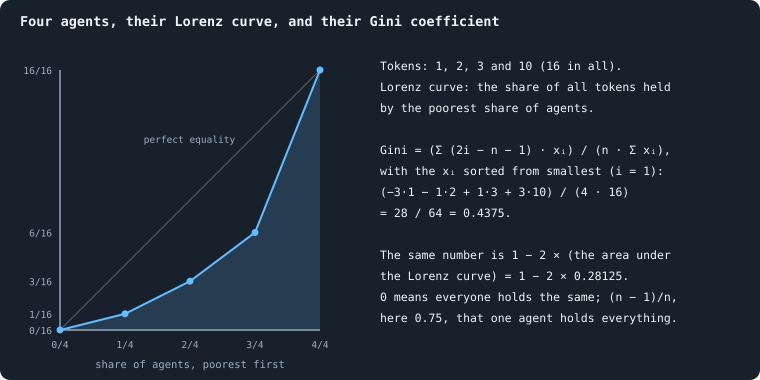

# Measuring inequality: the Gini coefficient, the richest tenth, entropy and mobility

## In short

Four kinds of number say how unequally a world's [tokens](the-world.md#agents-and-tokens "The one thing of value in a world: every agent holds a whole number of them, and their total never changes.") are held, and the
notebook records them after every phase. The **Gini coefficient** sums up the
whole Lorenz curve in one number, and the **richest tenth's share** reads one
point of it. The **mean, median, richest and poorest** describe the [agents](the-world.md#agents-and-tokens "One member of a world: it lives on a node of the network, holds tokens and has a brain that takes all its decisions.")
directly, while **entropy** and **evenness** say how evenly anything is
spread, [connections](the-world.md#the-network "A link between two agents of the network: they are neighbours, and can stake on each other's nodes.") and [genotypes](genotype.md "The identity of a brain: a number that a copy keeps and a change replaces, and that remembers the genotype it came from.") too. **Mobility** compares two moments: whether the same agents
stay rich. In a settled [B1](b1-and-b2.md "The first baseline: the algorithm exactly as a new run is offered it.") world of 100,000
tokens the Gini is about 0.47, and the richest tenth hold about 42% of all
tokens.

## The Gini coefficient and the Lorenz curve

How unequal is the wealth of a world? The [founders](starting-ring.md "One of the agents a world starts with, each holding the same tokens, on a ring with a few shortcuts.") start equal; later, some
agents hold one token and some hold thousands. Two standard tools measure
this: the **Lorenz curve**, a picture, and the **Gini coefficient**, one
number (Lorenz 1905; Gini 1912).

### The Lorenz curve

Line the agents up from the poorest to the richest, and walk along the line,
adding up their tokens as you go. After each agent, note how far along the
line you are, and what share of all tokens you have counted so far. Joined
up, these points are the Lorenz curve.

Precisely: sort the *n* agents from poorest to richest,
*x*₍₁₎ ≤ *x*₍₂₎ ≤ … ≤ *x*₍ₙ₎. Let *S* = Σ *x*₍ᵢ₎ be all their tokens; in a
world of *T* tokens, *S* = *T*. For every *i*, mark the point

$$
\left( \frac{i}{n},\ \frac{x_{(1)} + \dots + x_{(i)}}{S} \right):
$$

the share of agents counted from the poorest, against the share of all tokens
they hold. Join the points, starting at (0, 0). The curve ends at (1, 1).

- If everyone holds the same, the poorest *i*/*n* of the agents hold *i*/*n*
  of the tokens: the curve is the **diagonal**.
- The more unequal the world, the further the curve **sags** below the
  diagonal. If one agent holds everything, it runs along the bottom and
  jumps to 1 at the end.

### The Gini coefficient

The Gini coefficient turns the sag into one number. It is the area between
the diagonal and the Lorenz curve, divided by the whole area under the
diagonal (which is ½):

$$
G = \frac{A}{A + B} = 1 - 2B ,
$$

where *A* is the area between the diagonal and the curve and *B* the area
under the curve. It is 0 when everyone holds the same, and (*n* − 1)/*n* —
almost 1 — when one agent holds everything.

For sorted values it can be computed directly. The agent in place *i* counts
with the weight 2*i* − *n* − 1: negative in the poorer half, positive in the
richer. The weights add up to zero, so a world of equals scores 0:

$$
G = \frac{\sum_{i=1}^{n} (2i - n - 1)\, x_{(i)}}{n \sum_{i=1}^{n} x_{(i)}} .
$$

The drawing works out both ways for four agents holding 1, 2, 3 and 10
tokens.

### What a Gini value means

A second, equivalent definition makes values easier to read. *G* is half the
**mean absolute difference** between two agents, relative to the mean:

$$
G = \frac{1}{2\bar x} \cdot \frac{1}{n^2} \sum_{i=1}^{n} \sum_{j=1}^{n} \lvert x_i - x_j \rvert .
$$

So a Gini of 0.5 says that two agents picked at random differ, on average, by
as much as the average agent holds. (They are picked independently, so the
same agent may be picked twice.)

Chance alone leaves a world unequal. A random exchange of tokens would leave
a Gini of (*m* − 1)/(2*m* − 1), with *m* tokens per agent on average. That is
0.40 at three tokens per agent, and 0.46 at seven
([Too even, not too poor](healthy-and-rich.md#too-even-not-too-poor)).

### The Gini coefficient: a worked example

Five agents with 1, 1, 2, 4 and 12 tokens: *n* = 5, *S* = 20.

| *i* | *x*₍ᵢ₎ | 2*i* − *n* − 1 | product |
|---|---|---|---|
| 1 | 1 | −4 | −4 |
| 2 | 1 | −2 | −2 |
| 3 | 2 | 0 | 0 |
| 4 | 4 | 2 | 8 |
| 5 | 12 | 4 | 48 |
| | | sum | 50 |

*G* = 50 / (5 · 20) = **0.5**.

Check with the second definition. The mean is 4. The sum of |*xᵢ* − *xⱼ*|
over all 25 ordered pairs is 100, so two agents differ by 100/25 = 4 tokens
on average. That is as much as the average agent holds, and indeed
4/(2 · 4) = 0.5. ✓

The Lorenz points are (0.2, 0.05), (0.4, 0.10), (0.6, 0.20), (0.8, 0.40)
and (1, 1). The poorest 80% hold 40% of the tokens, and the richest agent
holds 60%.

### Where the Gini coefficient is used

`_gini(values)` in `gol_series.py` computes
(*n* + 1 − 2 Σᵢ *C*ᵢ / *C*ₙ) / *n*. Here *C*ᵢ = *x*₍₁₎ + … + *x*₍ᵢ₎ are the
running sums of the sorted values. It is the same number as the formula
above, rearranged, and it is recorded as `gini` after every phase.

- In a settled B1 world of 100,000 tokens the Gini stays near 0.47. The
  thirty worlds lie between 0.40 and 0.55
  ([Inequality over time](where-do-the-tokens-go.md#inequality-over-time)).
- A healthy world must not be too even. Its Gini may be no lower than that
  of [B2](b1-and-b2.md "The second baseline: B1 with the rules that keep its network from breaking and its agents from staking or breeding themselves to death.")'s most even world at the same [iteration](one-iteration.md "One step of a world's time: a phase of reproduction, then a phase of the game."): 0.46 at iteration 2,000
  ([The six criteria](what-makes-a-world-interesting.md#the-six-criteria)).
- A Gini looks at one moment, so it cannot tell whether the same agents stay
  rich. [Mobility](#mobility) compares two moments.

## The richest tenth's share

A second, plainer measure of inequality than the Gini coefficient: **what
share of all tokens do the richest ten percent of agents hold?** If everyone
held the same, it would be 10%.

### The richest tenth: definition

With *n* agents, the richest tenth is the top

$$
m = \max\bigl(1,\ \lfloor 0.1\,n + 0.5 \rfloor\bigr)
$$

agents — a tenth of *n*, rounded to the nearest whole number (halves rounded
up), and at least one. Sort the agents' tokens from largest to smallest and
add up the first *m* (square brackets count from the richest):

$$
\text{topDecileShare} = \frac{x_{[1]} + x_{[2]} + \dots + x_{[m]}}{S},
$$

where *S* is all the tokens. Recorded as `topDecileShare` after every phase.

### The richest tenth: an example

Twelve agents: 0.1 · 12 + 0.5 = 1.7, so *m* = 1: the share of the single
richest agent. Fifteen agents: 2.0, so *m* = 2. With 1,300 agents, *m* = 130.

For the five agents of the
[Gini example](#the-gini-coefficient-a-worked-example), 0.1 · 5 + 0.5 = 1,
so *m* = 1 again. Their richest tenth is the agent with 12 of the 20
tokens, and it holds 60%.

### The richest tenth and the Lorenz curve

The richest tenth hold 1 minus what the poorest 90% hold. That is one minus
the height of the [Lorenz curve](#the-lorenz-curve) at 0.9, up to the
rounding of *m*. The Gini coefficient sums up the whole curve; this share
reads one point of it, the one people most often ask about.

In a settled B1 world of 100,000 tokens the richest tenth hold about 42% of
all tokens. Between worlds it ranges from 33% to 50%
([Inequality over time](where-do-the-tokens-go.md#inequality-over-time)).

## Tokens per agent: mean, median, extremes

Four simple numbers describe how the tokens of a world are held, after every
phase. The viewer shows them in its *General* section, beside the Gini
coefficient, the richest tenth's share, and the token entropy and evenness.

### The four numbers

For the *n* agents alive, holding τ₁, …, τₙ tokens, with *T* = Σ τᵢ:

| statistic | field | definition |
|---|---|---|
| mean tokens | `meanTokens` | *T* / *n* |
| median tokens | `medianTokens` | the middle value of the sorted τᵢ ([Median](median-and-quantiles.md)) |
| richest | `maxTokens` | max τᵢ |
| poorest | `minTokens` | min τᵢ |

With an even number of agents, the median is halfway between the two middle
values.

### What each of the four says

- **The mean is not about wealth at all.** Tokens are conserved, so *T* is
  the same after every phase, and the mean is *T* divided by the number of
  agents. It rises when agents die and falls when they are born. A world
  holds 10,000 tokens unless its plan names another size. The thirty B1
  worlds of Experiment 10, which most measurements of B1 read, hold 100,000
  ([Thirty worlds](a-worlds-life.md#thirty-worlds)). A settled B1 world has
  a mean of about 7 at 100,000 tokens, 9 at 10,000. B2's worlds hold only
  about three tokens per agent
  ([Too even, not too poor](healthy-and-rich.md#too-even-not-too-poor)).
- **The median is the typical agent.** About 4.5 in a settled B1 world of
  100,000 tokens (5 at 10,000 tokens). The gap between mean and median is
  itself a reading of inequality. A few rich agents pull the mean up, and
  leave the median where it is.
- **The richest** is a reading of how far concentration goes. In a settled
  B1 world of 100,000 tokens the richest agent holds about 2% of all tokens,
  some 2,100. At 10,000 tokens it holds about 7%, some 690, over the same
  iterations, 500 to 1,499. Over those worlds' longer settled life, to
  iteration 2,999, it holds about 8%, some 800
  ([Inequality over time](where-do-the-tokens-go.md#inequality-over-time)).
- **The poorest is almost always 1.** An agent left with 0 tokens is removed
  by the [cleanup](one-iteration.md#cleanup "The end of every phase: only the largest connected piece of the network lives on, and the tokens of the dead are shared out.") at the end of the phase. So the poorest survivor holds at
  least 1 ([Births and the four ways to die](births-and-deaths.md)).
  Averaged over the settled life, the poorest agent of the median B1 world
  holds 1.001 tokens
  ([The largest, over a world's life](the-largest-and-the-smallest.md#the-largest-over-a-worlds-life)).

### Tokens per agent: an example

Five agents with 1, 2, 2, 5 and 40 tokens: the mean is 50/5 = 10, the median
2, the richest 40, the poorest 1. The richest holds 80% of everything; the
mean is five times the median.

## Entropy and evenness

How evenly is something shared out — tokens over agents, agents over
genotypes, agents over numbers of connections? **Shannon entropy** answers
with one number, measured in **bits** (Shannon 1948). This section explains
it from the beginning, then the two numbers built on it that the notebook
uses: **evenness** and the **effective number**.

### Entropy: how many yes-or-no questions?

Suppose you pick one item at random and want to find out which category it
belongs to by asking yes-or-no questions. If there are 8 equally common
categories, 3 questions always suffice: 8 = 2³. Is it in the first four? Is
it in the first two of those? Is it the first of those two? If one category
holds almost everything, you need almost no questions — the answer is nearly
certain.

Entropy measures the average number of questions a clever questioner needs.
When every share is a half, a quarter, an eighth and so on, it is exactly
that number. Otherwise it is a floor. No questioner needs fewer on average,
and asking about many picks at once comes as close to it as you like.
Entropy is large when things are spread evenly over many categories, and
small when they are concentrated.

### Entropy: the definition

If the categories have shares *p*₁, …, *p*_k (each ≥ 0, adding up to 1), the
entropy is

$$
H = -\sum_{i=1}^{k} p_i \log_2 p_i \qquad (\text{with } 0 \log_2 0 = 0) .
$$

In words: singling out a category that holds a share *p* takes about
log₂ (1/*p*) questions, one for a half and two for a quarter. *H* is the
average of that over the categories, each weighted by its share.

- *H* = 0 when one share is 1 and the rest are 0: no uncertainty.
- *H* = log₂ *k* when every share is 1/*k*: the most uncertainty *k*
  categories allow.

**Example.** Shares (½, ¼, ¼): *H* = −(½·log₂ ½ + ¼·log₂ ¼ + ¼·log₂ ¼) =
½·1 + ¼·2 + ¼·2 = 1.5 bits. A questioner asks first about the large
category and then, if need be, which of the other two: 1.5 questions on
average. Three equal shares would give log₂ 3 ≈ 1.585. One pick at a time,
no questioner gets that low: the best needs 5/3 ≈ 1.67 questions on average.

### Three uses of entropy in Graph of Life

| what is shared | the shares *pᵢ* | the field | its ceiling |
|---|---|---|---|
| tokens over agents | τᵢ / *T*, one per agent | `tokenEntropy` | log₂ *n* (*n* agents) |
| agents over [degrees](degree.md "The number of an agent's connections: how many neighbours it has.") | share of agents with exactly *d* connections, one per *d* that occurs | `degreeEntropy` | log₂ (number of distinct degrees) |
| agents over genotypes | share of agents carrying genotype *g*, one per genotype | (computed for [How even is a world?](where-do-the-tokens-go.md#how-even-is-a-world)) | log₂ *n* |

For tokens the question is: *if you pick one token at random, whose is it?*

### Evenness

Entropy grows with the number of categories, so the entropy of a world of
2,000 agents cannot be compared with one of 1,000. Dividing by the ceiling
removes that:

$$
J = \frac{H}{H_{\max}} ,
$$

between 0 and 1 — **Pielou's evenness** (Pielou 1966). `tokenEvenness` is
`tokenEntropy` / log₂ *n*; `degreeEvenness` is `degreeEntropy` divided by
log₂ of the number of distinct degrees.

In a settled B1 world of 100,000 tokens the token evenness is 0.91. The
degree evenness is only 0.47. Agents pile up on a few numbers of
connections, while [hubs](stars-and-hubs.md "An agent joined to far more agents than most; a star is a world held together by a single hub.") add rare numbers that raise the ceiling
([How even is a world?](where-do-the-tokens-go.md#how-even-is-a-world)).

### The effective number

$$
N_{\text{eff}} = 2^{H}
$$

is the number of **equally common** categories that would have the same
entropy. Shares (½, ¼, ¼) have *N*_eff = 2^1.5 ≈ 2.83: as diverse as 2.83
equal categories. Ecologists call this a Hill number (Hill 1973; Jost 2006).
It is the most readable form of entropy, because it is in the units of the
things counted. For tokens, *N*_eff is the number of agents who, holding
equal shares, would spread the tokens as evenly as they are spread.

The tokens of a settled B1 world are as even as if 47% of its agents held
them in equal shares
([Effective numbers](where-do-the-tokens-go.md#effective-numbers)). The
[diversity score](diversity-score.md) reads three of its four spreads in the
same way.

### Entropy and the Gini coefficient

Both measure how unequally tokens are held, but they weigh differently. The
[Gini coefficient](#the-gini-coefficient-and-the-lorenz-curve) is about
differences between agents. Entropy is about the logarithms of shares, so it
is more sensitive to the many small holdings, and less to the few large ones.
Two worlds with the same Gini can have different evenness. Across 1,200
looks at thirty B1 worlds the two correlate at −0.72. But they do not lie on
one curve
([Two measures of the same inequality](where-do-the-tokens-go.md#two-measures-of-the-same-inequality)).

### Entropy in the code

`_shannon(counts)` in `gol_series.py` computes it, from the token counts and
from the histogram of degrees. Both entropies, and both evenness values, are
recorded after every phase.

## Mobility

A world can be unequal in two very different ways. In one, the same agents
are rich [game](one-iteration.md#phase-2-the-game "The second phase of an iteration: every agent stakes all its tokens on its own node and its neighbours', and every node goes to someone.") after game. In the other, wealth is just as unequal at every
moment, but who holds it keeps changing. The Gini coefficient cannot tell the
two apart, because it looks at one moment. **Mobility** compares two moments.
Economists measure it for incomes across years and generations (Shorrocks
1978; Chetty and others 2014). The notebook uses three measures.

### Rank correlation over time

Take the agents alive at a moment *t* and again *k* games later. Rank them by
their tokens at each moment, the poorest first; agents with equal tokens share
the mean of their ranks. **Spearman's rank correlation** ρ is the ordinary
[correlation](correlation.md) of the two lists of ranks:

- ρ = 1: every agent kept its place in the order of wealth;
- ρ = 0: the later order has nothing to do with the earlier;
- ρ < 0: the order turned round, and the poor became the rich.

Ranks rather than tokens make ρ deaf to how unequal the world is. They also
keep a few very rich agents from deciding it, as they would decide an ordinary
correlation of the tokens themselves. Drawn against *k*, ρ shows how long
wealth is remembered.

### A table of moves

Sort the agents at *t* into fifths by their rank of wealth, from the poorest
fifth to the richest. Do the same *k* games later. For every pair of fifths,
count the agents that went from the one to the other, and add a column for
those no longer alive. Divide each row by its total. Then each row says where
the agents of one fifth went.

This is a **transition matrix** *P*. Its entry *Pᵢⱼ* is the share of the
agents of fifth *i* found in fifth *j* later. A world where nobody moves has 1
on the diagonal and 0 elsewhere.

### One number: the Shorrocks index

For *n* classes, with the diagonal entries *Pᵢᵢ* computed among the agents
still alive,

$$
M = \frac{n - \sum_i P_{ii}}{n - 1}
$$

(Shorrocks 1978). In words: count how far the diagonal falls short of *n*,
the sum it would have if nobody moved, and scale it.

If nobody moves, every *Pᵢᵢ* is 1 and *M* = 0. Suppose instead that where an
agent ends up has nothing to do with where it started. Then every row is
(⅕, ⅕, ⅕, ⅕, ⅕), the diagonal adds up to 1, and *M* = 1. So *M* runs from 0,
a rigid world, to 1, a world without memory of wealth. It can exceed 1 when
the order tends to reverse.

### Where mobility is used

[Do the rich stay rich?](where-do-the-tokens-go.md#do-the-rich-stay-rich)
measures all three in the [baseline](b1-and-b2.md "The stated rules an experiment starts from and changes one thing of: B1 or B2.") worlds.

## Where to go next

- [How unequal is a world, and who stays rich](where-do-the-tokens-go.md):
  each of these measures, read in thirty B1 worlds.
- [Effective numbers: how many kinds there really are](effective-number.md):
  the effective number beside other ways of counting kinds.
- [What a run records](frames-and-stats.md): every number recorded after a
  phase, these among them.

## How our view changed

- **24 October 2026.** When four short pages became this one, two statements
  were made exact.
  - The page on entropy said that entropy *is* the average number of
    questions an optimal questioner needs. That holds only when every share
    is a half, a quarter, an eighth and so on. For three equal shares the
    best questioner needs 5/3 ≈ 1.67 questions per pick, against an entropy
    of 1.585 bits
    ([Entropy: how many yes-or-no questions?](#entropy-how-many-yes-or-no-questions)).
  - The page on tokens per agent gave its numbers for "a settled baseline
    world". It was written when B1 was the only baseline, and the numbers
    are B1's. B2's worlds hold only about three tokens per agent
    ([What each of the four says](#what-each-of-the-four-says)).
- **24 October 2026.** This page called the line of evenness "B2's least
  even world". It is B2's most even world, the one with the lowest Gini
  ([What makes a world interesting](what-makes-a-world-interesting.md#how-our-view-changed)).

## References

- Chetty, R., Hendren, N., Kline, P. and Saez, E. (2014). Where is the land
  of opportunity? The geography of intergenerational mobility in the United
  States. *Quarterly Journal of Economics* 129, 1553–1623.
- Gini, C. (1912). *Variabilità e mutabilità*. Bologna: Tipografia di Paolo
  Cuppini.
- Hill, M. O. (1973). Diversity and evenness: a unifying notation and its
  consequences. *Ecology* 54, 427–432.
- Jost, L. (2006). Entropy and diversity. *Oikos* 113, 363–375.
- Lorenz, M. O. (1905). Methods of measuring the concentration of wealth.
  *Publications of the American Statistical Association* 9, 209–219.
- Pielou, E. C. (1966). The measurement of diversity in different types of
  biological collections. *Journal of Theoretical Biology* 13, 131–144.
- Shannon, C. E. (1948). A mathematical theory of communication. *Bell System
  Technical Journal* 27, 379–423 and 623–656.
- Shorrocks, A. F. (1978). The measurement of mobility. *Econometrica* 46,
  1013–1024.

<!-- turns -->
---

← [The largest and the smallest](the-largest-and-the-smallest.md) · [Wealth: who holds the tokens](../README.md#wealth-who-holds-the-tokens)

**Also about:** [Methods and statistics](../README.md#methods-and-statistics).

> [!info]- Pages that link here (16)
> [What this notebook is about](what-this-notebook-is-about.md) · [Glossary](glossary.md) · [The ideas this builds on](the-ideas-this-builds-on.md) · [The estate of the dead](estate.md) · [How unequal is a world, and who stays rich](where-do-the-tokens-go.md) · [The largest and the smallest](the-largest-and-the-smallest.md) · [An agent's connections: degree, clustering, assortativity, attachment and scaling](degree.md) · [Genotypes, families and the common ancestor](genotype.md) · [What would count as open-ended evolution](open-ended-test.md) · [Eight switches at once, and how sixteen worlds can test them](eight-switches-at-once.md) · [Healthy and rich](healthy-and-rich.md) · [What makes a world interesting](what-makes-a-world-interesting.md) · [The diversity score](diversity-score.md) · [The candidates, played on and played again](the-candidates-played-on.md) · [What a run records](frames-and-stats.md) · [Effective numbers: how many kinds, and how many directions](effective-number.md)
<!-- /turns -->
