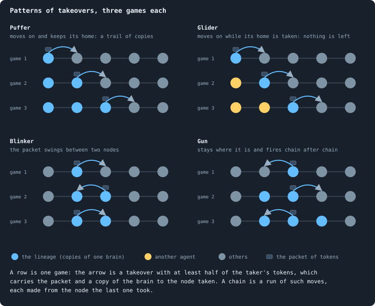
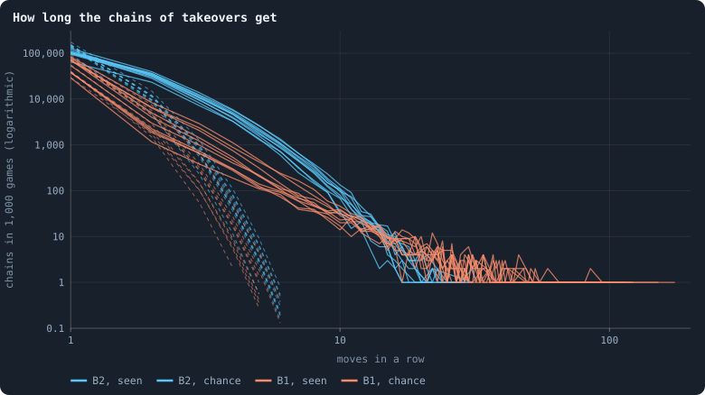
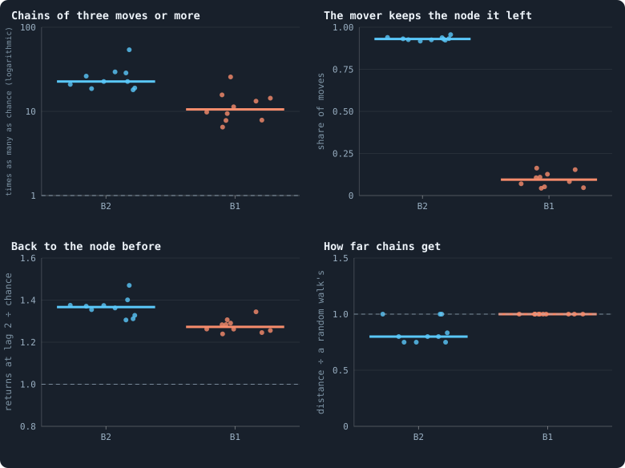
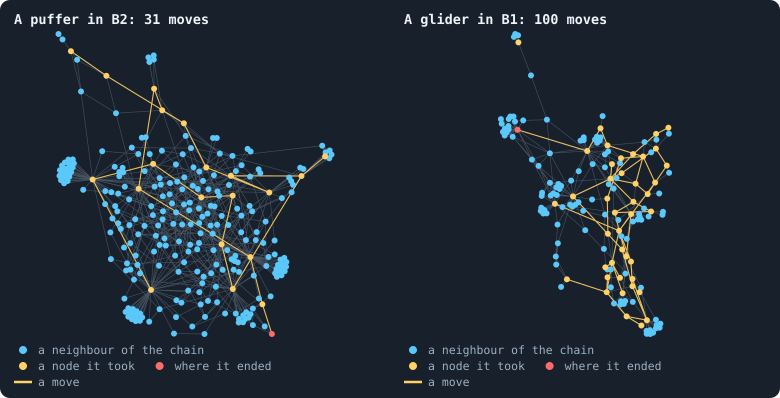
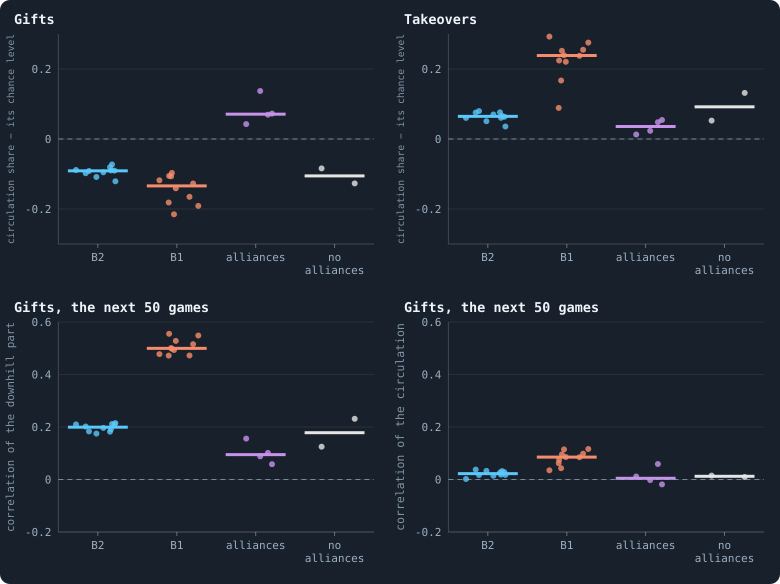
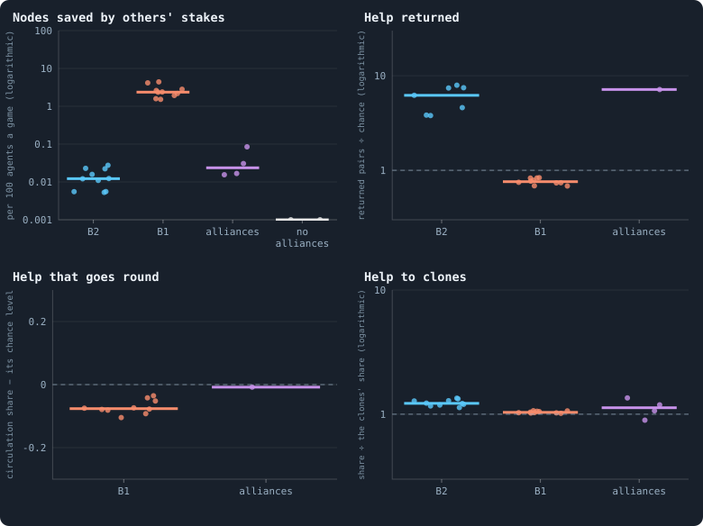

# Gliders, and who helps whom

> [!question] Questions of this page
> - Does the [game](one-iteration.md#phase-2-the-game "The second phase of an iteration: every agent stakes all its tokens on its own node and its neighbours', and every node goes to someone.") make patterns that last while the [agents](the-world.md#agents-and-tokens "One member of a world: it lives on a node of the network, holds tokens and has a brain that takes all its decisions.") in them change, as
>   Conway's Game of Life makes gliders out of cells that are born and die?
> - Do [tokens](the-world.md#agents-and-tokens "The one thing of value in a world: every agent holds a whole number of them, and their total never changes.") go round the network in rings, or run downhill?
> - What would cooperation be in a game whose only act is a stake, and how can
>   it be seen without knowing what an agent meant?
> - Is there any, in [B2](b1-and-b2.md "The second baseline: B1 with the rules that keep its network from breaking and its agents from staking or breeding themselves to death."), in [B1](b1-and-b2.md "The first baseline: the algorithm exactly as a new run is offered it."), and among allies?

## In short

When an agent takes a [neighbour](the-world.md#the-network "An agent joined to another by a connection.")'s node with at least half of its tokens, its
wealth and a copy of its [brain](the-brain.md "The neural network each agent decides with: inputs about itself and its neighbours, outputs that become its decisions.") move there together. They form chains far more
often than chance: *puffers* in B2, a [lineage](genotype.md#families "A line of descent: the agents whose genotypes go back to one ancestor.") copying itself outward, and
*gliders* in B1, rich agents moving on. But no chain keeps a direction, and no
ring of tokens lasts fifty games; what lasts is gifts running downhill. Help,
counted exactly by the rules, is almost absent in B2, a by-product of
[revolutions](revolution.md "A node taken by stakers who each marked part of their stake revolutionary and together staked more than the largest single stake.") in B1, and rare among allies, whom peace protects instead. None of
it is cooperation, and a sense of direction and a sense of who helped, given to
the brains, did not change that.

## Patterns that outlast their parts

In Conway's Game of Life, every cell of a grid is alive or dead. A simple rule
about its eight neighbours decides its next generation. The interesting
objects are not the cells but the **patterns** they make. A **glider** is five
live cells that rebuild themselves one cell further on, diagonally, every four
generations. The cells that make it are born and die; the glider goes on.

Patterns are sorted by what they do:

- a *still life* never changes;
- an *oscillator* repeats in place, like the *blinker*: three cells in a row
  that turn into three in a column and back;
- a *spaceship* moves, and the glider is one;
- a *puffer* moves and leaves debris behind it;
- a *gun* stays where it is and sends out gliders.

Built from such patterns and the ways they meet, the Game of Life goes far: up
to machines that compute anything.

Could the worlds of Graph of Life hold patterns like these? The measures of
[open-ended evolution](open-ended-test.md "Evolution that keeps producing new things without end, not only up to a plateau.") so far look at agents one by one.
They ask what an agent holds, what it stakes, and how its brain does in a
contest.
[Why evolution stops](how-to-tell-a-world-that-keeps-evolving.md#why-evolution-stops)
found one blind spot in them: contests too short for what pays over a
[lifetime](age-and-lifetime.md "How many iterations an agent lives, from its birth to its death."). The author suggested another. Perhaps the worlds hold structures
above the single agent that none of the measures can see. They might be
cyclic, like the gliders of the Game of Life. And they might be harder to spot,
because they live on a network rather than a grid.

A network has no shapes: no diagonal, no row of three. So a pattern has to be
recognised by what it does, and its motion measured in steps through a network
that itself changes. Every pattern found must also be compared with what chance
would make. A world of 3,000 agents makes almost any small pattern somewhere by
accident.

Cooperation is the other thing such structure could hide.
[Alliances](another-game.md#alliances) *gave* the agents a way to cooperate.
It did not ask whether the worlds without alliances cooperate in some way of
their own.

This page reads the record of play: every game, with every agent's stakes. The
worlds are B2's ten worlds of Experiment 16 and the first ten worlds of B1's
[baseline](b1-and-b2.md "The stated rules an experiment starts from and changes one thing of: B1 or B2.") set, all of 10,000 tokens. Read are the games of [iterations](one-iteration.md "One step of a world's time: a phase of reproduction, then a phase of the game.") 1,000 to
2,000: settled worlds, long after the [founders](starting-ring.md "One of the agents a world starts with, each holding the same tokens, on a ring with a few shortcuts."). For alliances, [pilot](pilot-worlds.md "A world made by hand to see whether an idea is worth an experiment, without a thesis or many seeds.") worlds
with and without them are played on from a checkpoint for 200 iterations.
Their games are recorded in the same form
([How this was made](#how-this-was-made)).

## Chains of takeovers

The game moves two things over the network: tokens, and copies of brains. When
an agent takes a neighbour's node, the node gets a copy of the agent's brain,
and it keeps every token staked on it.

Call a takeover made with at least half of the taker's tokens a **move**. In a
move, the agent's wealth and a copy of its brain go to the node taken together,
as one parcel: a **packet**. If, in the next game, the node taken makes a move
of its own, the packet has travelled on. A run of such moves, each made from
the node the last one took, is a **chain**.

### A chain, step by step

Take four nodes in a row, P, Q, R and S, each joined to the next. The agent on
P holds 20 tokens, the agent on Q holds 4, and the agent on R holds 6.

**Game 1.** P stakes 15 tokens on Q's node and 5 on its own. Q stakes its 4 at
home. P's 15 is the largest stake on Q's node, so P takes it. In B2, Q's own
stake counts one and a half times, as 6, and 15 still wins. Q's node now
carries a copy of P's brain, and it holds the 19 tokens staked on it. P staked
15 of its 20 tokens, at least half: this takeover is a move, and its packet is
15 tokens.

**Game 2.** The agent now on Q, P's brain with 19 tokens, stakes 12 on R's node
and 7 on its own. R stakes its 6 at home, and 12 beats them (or B2's 9). Since
12 is at least half of 19, this is a move too, made from the node the last move
took. The packet has travelled from P to Q to R: a chain of two moves.

What the chain leaves behind depends on the node it left:

- If no neighbour outbid the 5 tokens P kept at home, P keeps its node. A copy
  of the brain stays behind while the packet moves on: the chain is a
  **puffer**, leaving a copy at every step.
- If a neighbour took P's node, the brain is gone from it. The same happens if
  P staked everything away and nobody staked on its node, which then starves.
  The chain is a **glider**: it carries the brain on and leaves nothing.
- If, in game 3, the agent on R takes Q's node back, the packet swings between
  two nodes: a **blinker**.
- A node that launches chain after chain while staying where it is, is a
  **gun**.

The drawing shows each kind over three games.

### Against chance

Chance is the measure of all of these. Suppose every node holding a packet
moved it on with the same chance as any agent makes a move in a game, whatever
came before. Call that chance *p*: the share of agents that make a move in a
game. A chain would then make a second move with chance *p*, a third with
chance *p*², and so on. Of *N* chains, about *N* (1 − *p*) *p*^(*L*−1) would
have exactly *L* moves.

In words: after every move, a coin decides whether the packet goes on, and it
says yes with chance *p*. That chance is about 0.07 a game in B2, and 0.06 in
B1. At 0.07, one chain in fifteen would make a second move, and one in two
hundred a third.

<!-- figure patterns/chains -->

**How long the chains of takeovers get.** One line per world. A move is a takeover made with at least half of the taker's tokens; a chain is a run of moves, each made from the node the last one took. Dashed: the chains there would be if every node holding a packet moved it on with the same chance as any agent moves one in a game, whatever came before.

> [!example]- How to make this figure
> **Runs.** The ten B2 worlds of Experiment 16, `B2-10000-s001` … `-s010`, and the first ten worlds of the baseline set, `B1-10000-s001` … `-s010` (B1 at 10,000 tokens, Experiment 2). Both record every game with every agent's stakes; read are the games of iterations 1,000 to 2,000.
>
> **Data.** From each run's frames of the game phase, with its agents' decisions.
>
> 1. In every game, find the moves: an agent's stake on a neighbour's node that took it and was at least half of the agent's tokens (`research/oee/checks/gliders.py`).
> 2. A move made from a node that a move took in the game before continues that chain; any other starts one. Count the chains by their number of moves.
> 3. Chance: with p the share of agents that make a move in a game, averaged over the games (`structures.py`, `packet_go_on_chance`), and N the chains, N (1 − p) p^(L−1) chains would have L moves.
>
> **To make it again:** `python3 book_figures.py patterns`.
<!-- /figure -->

The chains are far longer than that. **In B2 almost every takeover is a
move**: 99.6% of the nodes taken were taken with at least half of the taker's
tokens. Chains of three moves or more are 23 times as many as chance would
make (18 to 54 times in the ten worlds). And 31% of all takeovers belong to
them. The longest chain of a world has 18 to 32 moves.

**In B1** only 11% of takeovers are moves, since its agents spread their
tokens over every neighbour. Chains of three or more are 11 times chance (6.5
to 26). And the longest are longer: 69 to 175 moves.

### Puffers in B2, gliders in B1

<!-- figure patterns/zoo -->

**What the chains are.** One dot per world, the bar the median of ten. Chains of at least three moves, over games 1,000 to 2,000. Top right: after how many of their moves the mover still held its own node, a puffer leaving copies behind (high) or a glider leaving nothing (low). Bottom left: how often a move went back to the node the packet held two moves before, divided by the chance of picking that node among the mover's neighbours. Bottom right: the distance from a chain's first node to its last, divided by a random walk's of the same length from the same node, for the 300 longest chains of each world.

> [!example]- How to make this figure
> **Runs.** The ten B2 worlds of Experiment 16, `B2-10000-s001` … `-s010`, and the first ten worlds of the baseline set, `B1-10000-s001` … `-s010` (B1 at 10,000 tokens, Experiment 2). Both record every game with every agent's stakes; read are the games of iterations 1,000 to 2,000.
>
> **Data.** From each run's frames of the game phase, with its agents' decisions.
>
> 1. Find the chains as for the figure above (`research/oee/checks/gliders.py`).
> 2. Chance of a chain of at least three moves: N p² for N chains and p as above (`structures.py`).
> 3. For every move, note whether the mover won its own node in the same game.
> 4. For every move from the third on, note whether it went to the node the packet held two moves before, and the chance 1/k of that node among the mover's k neighbours.
> 5. Distance: steps through the network at the chain's end between its first and last node; the walk's: the median of five random walks with as many steps from the first node.
>
> **To make it again:** `python3 book_figures.py patterns`.
<!-- /figure -->

**B2's chains are puffers.** The mover still holds the node it left after 93%
of its moves, and it never leaves it to starve. A chain is a
lineage copying itself outward, node by node. Its
packet is small: three tokens at the start and two at the end, in the [median](median-and-quantiles.md "The middle value: half of the numbers lie below it and half above.")
of each world's 300 longest chains.

**B1's chains are gliders.** The mover keeps the node it left after only 9% of
its moves. After 8% that node starves, and after the rest another agent takes
it. The brain moves on, and the packet grows as it goes, from 18 tokens to 82.
B1's gliders are rich agents travelling the network, gathering what is staked
on the nodes they take.

In both, the brain changes as it goes. In B2 a brain may change by
[mutation](mutation.md "A random change to a brain, made with a set probability when it is copied, and in B1 also after every game: a changed brain is a new genotype.") each time it is copied, and in B1 every brain may also
change after every game. In the median of the longest chains, after 70% of the
moves the node taken no longer carries the [genotype](genotype.md "The identity of a brain: a number that a copy keeps and a change replaces, and that remembers the genotype it came from.") the chain
started with.

Here is one chain of each kind, drawn on its network: of each world's 300
longest, the one that took the most different nodes. B2's took 28 nodes in 31
moves, patch after patch. B1's took 66 in 100, round and round one region of
its world. It carried a fortune that grew from 380 tokens to 1,358, a seventh
of all the tokens in that world.

<!-- figure patterns/example -->

**Two chains on their networks.** Left, in `B2-10000-s001`, the chain of its 300 longest that took the most different nodes: 31 moves over 28 nodes in games 1,120 to 1,150, its packet 4 tokens at the first move and 2 at the last. Right, the same for `B1-10000-s001`: 100 moves over 66 nodes, games 1,544 to 1,643, its packet 380 tokens, then 1358. Drawn is the network of each chain's last game around the nodes it took, with their neighbours; the chain's moves are the coloured links, drawn even where the connection a move crossed has gone since. A node the chain took that no longer exists at its last game is not drawn, the node where it began among them.

> [!example]- How to make this figure
> **Runs.** The ten B2 worlds of Experiment 16, `B2-10000-s001` … `-s010`, and the first ten worlds of the baseline set, `B1-10000-s001` … `-s010` (B1 at 10,000 tokens, Experiment 2). Both record every game with every agent's stakes; read are the games of iterations 1,000 to 2,000.
>
> **Data.** From the two runs' frames of the game phase, with their agents' decisions.
>
> 1. Track the chains as for the figures below and keep the 300 longest of each world, with the nodes each took (`research/oee/checks/gliders.py`).
> 2. Of those, take the chain that took the most different nodes.
> 3. Take the network of its last game, the nodes it took that are still there and their neighbours; add the moves as links; lay it out with `networkx.forceatlas2_layout(G, max_iter=300, seed=1)`.
>
> **To make it again:** `python3 book_figures.py patterns`.
<!-- /figure -->

### They blink a little

A move goes straight back to the node the packet has just left (in the example,
from R back to Q) more often than chance. In B2 it does so 1.37 times as often
as a random pick among the mover's neighbours would (1.31 to 1.47). In B1 it
does so 1.27 times as often.

In B2 the likely reason is in the rules. The node a packet came from has just
staked at least half of its tokens away. So it is now among the weakest of the
new holder's neighbours.

Going round a triangle is rare in both: a third move that brings the packet
back to the node where the chain began. In B1 it is no more common than
chance.

### They wander

A chain gets no farther from where it started than a random walk would: as
many steps, from the same node, on the same network. It gets 0.8 of the walk's
distance in B2, and 1.0 in B1. A glider in the Game of Life flies straight;
these have no direction.

Nothing an agent senses says from which neighbour it came. Its inputs are its
own and each neighbour's tokens and [connections](the-world.md#the-network "A link between two agents of the network: they are neighbours, and can stake on each other's nodes."), [messages](messages.md "Numbers an agent writes to itself and to each neighbour every phase, which their brains read.") and
noise ([What a brain sees](brain-inputs.md)). Messages could carry it in
principle. But the brains write the name of their genotype in them
([What agents say to each other](what-agents-say-to-each-other.md)). Along a
puffer's trail, every neighbour carries the same name.

### Guns without a rhythm

The nodes that launch chains launch them very unevenly. If every launching
node launched at the same rate, the variance of the launches per node would
equal their mean. It is 2.6 times their mean in B2, and 13 times in B1. In the
median world, the busiest node launched 34 chains in 1,000 games in B2, and 128
in B1.

But a gun fires without a rhythm. Counted by their length, the gaps between one
node's launches fall off steadily from a single game. There is no period at
which a gun fires.

### Musical chairs

In B1, three quarters of all takeovers are made by an agent whose own node is
taken in the same game. Everyone moves up a seat.

Two agents taking each other's nodes in one game is a **swap**. In B1, swaps
happen as often as if every taker had picked its targets at random among its
neighbours. They are 1.02 times as common as that (0.99 to 1.04 in the ten
worlds). [Loops](bridges.md#loops "A path through the network that comes back to where it started without using a connection twice.") of three agents or more, each taking the
next one's node in the same game, are common too. They happen 1,500 to 4,800
times in a world's 1,000 games, with up to fourteen agents round one loop. How
many chance would make is not known.

In B2 swaps are rarer than chance, 0.54 to 0.85 of it. Loops of three or more
almost never happen: 0 to 8 in a world's 1,000 games, among a quarter of a
million takeovers.

## Channels and feuds

A stake from one agent on the same neighbour, game after game, is a
**channel**. Its chance level supposes that each agent staked on as many of
its neighbours as it did, but picked them at random. In B2 a channel that
carried tokens in one game carries them again in the next 1.5 times as often
as that: 0.117 against 0.077. In B1 the agents stake on almost every neighbour
every game. So channels repeat 92.6% of the time, against 93.6% by chance.

Two agents staking on each other for three games or more look, in a record of
stakes, like partners. In B2 they are not. Agents in such a pair keep their
own node less often than other agents that stake out: 0.80 of the time against
0.89. They do so in every one of the ten worlds. In B2 a stake on someone's
node is an attack. Two agents attacking each other game after game are in a
**feud**. [Flow modules](flow-modules.md#how-long-modules-live) finds B2's flow
falling into pairs that last longer than chance would have them. The two
measures have not been compared, so whether those pairs are these feuds is not
known.

In B1 the pairs keep their nodes about as often as others: 0.44 against 0.41,
more often in seven worlds and less often in three. In the pilots without
alliances the feuds are worse: 0.49 against 0.88, and 0.48 against 0.86.

Among allies, most lasting pairs are allied: 85% and 56% of them in the two
worlds read from iteration 500. In their game, an ally's stake counts for the
owner's side. Yet agents in such pairs keep their nodes *less* often than
other agents that stake out: 0.94 against 0.97, and 0.91 against 0.95.

Help goes where it is needed, so those who get it are those under attack.
Comparing them with the rest measures the attack, not the help. To see help,
it has to be defined by what it does in the game itself. That comes after the
tokens.

## Where the tokens go

Every stake moves tokens over a connection, to the node staked on. Add up what
each connection carried each way over a stretch of 50 games. What went one way
minus what came back is the connection's **net flow**. That flow splits
exactly into two parts. One runs downhill, from some agents to others. The
other goes round loops: a **circulation**
([Flows that go round](token-flow.md#flows-that-go-round) shows how, with a
worked example).

Tokens going round a ring of agents, each giving to the next, would be a Kula
ring. Bronisław Malinowski described the one of the Trobriand Islands:
armshells and necklaces passed from island to island, round and round.

A network with loops makes some circulation by chance. So the chance level
keeps each connection's amount and throws its direction at random
([Against what?](token-flow.md#against-what)). The flow is also split by what
its stakes did. A **gift** is a stake that did not take its target: its tokens
went to whoever held the node. A **takeover** is a stake that did.

<!-- figure patterns/flows -->

**Where the tokens go.** One dot per world, the bar the median. The tokens each connection carried, net, over 50 games, split into the part that runs downhill and the part that goes round loops (the note *Flows that go round*). Top: how much more of the flow goes round than if each connection's net flow had a random direction; above zero it goes round, below it runs downhill. Gifts are stakes that did not take their target, takeovers stakes that did. Bottom: how much of each part comes back on the same connections in the next 50 games.

> [!example]- How to make this figure
> **Runs.** The ten B2 worlds of Experiment 16, `B2-10000-s001` … `-s010`, and the first ten worlds of the baseline set, `B1-10000-s001` … `-s010` (B1 at 10,000 tokens, Experiment 2). Both record every game with every agent's stakes; read are the games of iterations 1,000 to 2,000. Pilot worlds of [Alliances](another-game.md#alliances) (`GraphOfLifeRuns/.pilots`): with alliances `A10k/allies-s1` and `-s2` from iteration 500 and `AL/allies10k-s3` and `-s4` from iteration 2,000; without, `A10k/ctrl-s1` and `-s2` from iteration 500. Each goes on from its checkpoint for 200 iterations with every game recorded in the lab's form (`python3 research/oee/checks/pilot_frames.py <world> --at <iteration> --games 200`).
>
> **Data.** From the recorded games.
>
> 1. Add up, over each stretch of 50 games, the tokens staked from each node on each neighbour's node, one way minus the other, separately for gifts and takeovers (`research/oee/checks/circulation.py`).
> 2. Find the pressure that explains as much of that net flow as possible (least squares, by conjugate gradients on the network's Laplacian); the circulation is the rest. Its share is its sum of squares over the flow's.
> 3. Chance level: the same with each connection's direction thrown at random, four times, averaged.
> 4. Persistence: over the connections two consecutive stretches both used, the correlation of their downhill parts, and of their circulations.
> 5. Each world's number is the median over its stretches.
>
> **To make it again:** `python3 book_figures.py patterns`.
<!-- /figure -->

**Gifts run downhill, and keep running down the same slopes.** In all twenty
worlds, less of the gift flow goes round than chance would make. It is 0.09
less in the median B2 world, and 0.13 less in B1. So gifts flow from some
agents to others. And the slope lasts. The downhill part of one stretch
correlates with the next stretch's on the same connections: 0.20 in B2, and
0.50 in B1.

In B1, whose agents spread their stakes over every neighbour, the gifts drain
towards the best-connected agents. Picture each agent's height on the slope:
tokens run from high agents to low ones. In two worlds checked, the rank
[correlation](correlation.md "Whether two quantities go up and down together, from −1 to 1.") of that height with an agent's number of
connections is −0.28 and −0.33. That is the [even split](even-split.md "What the rules do when a brain scores no candidate above zero: the stake is spread evenly.") again, tokens settling
in proportion to connections
([The game as a random walk](where-the-tokens-flow.md#the-game-as-a-random-walk)).
In B2, whose gifts are failed raids, they drain weakly towards the richer
(−0.16 in two worlds). That is tribute, paid by failed raids to whoever
withstood them.

**Takeovers go round, but never in the same place twice.** More of the
takeover flow goes round than chance would make, in every world: 0.065 more in
B2, and 0.24 more in B1. But the circulation of one stretch has nothing to do
with the next's: the correlation is 0.00 in both. The loops are made and gone
within 50 games. The chains above are their likeliest makers. A route through
a network counts as circulation even when it never closes
([What it can and cannot say](token-flow.md#what-it-can-and-cannot-say)).

Taken whole, the net flow of fifty games goes round more than chance: about
0.2 more in B1, and less than 0.1 more in B2.
[A greedy count and an exact one](where-the-tokens-flow.md#a-greedy-count-and-an-exact-one)
sets this beside the loops found in single games.

**With alliances, gifts go round.** The pilots with alliances are the only
worlds in which more of the gift flow goes round than chance would make. At
iteration 500 it is 0.07 and 0.04 more, where the same pilots without
alliances are 0.13 and 0.08 *below*. In the two long worlds at iteration
2,000, when one alliance holds almost all of their agents, it is 0.14 and 0.07
more. Allies give to allies who give to allies.

But these rings do not last either: their circulation correlates with the next
stretch's at −0.02 to 0.06. Nowhere does the circulation of gifts come back
much: 0.02 in B2, and 0.09 in B1.

## Help, counted by the rules

Cooperation needs an act that helps. In this game every act is a stake, so
what helps must be a stake. A stake on a neighbour's node **helps** if,
without it, the neighbour would have been more likely to lose that node.
[Do agents cooperate?](do-agents-cooperate.md#help) makes this exact. It counts
both chances from the world's own rule for deciding a node, and works an
example through ([A worked example](do-agents-cooperate.md#a-worked-example)).

Only two rules make help possible. In a revolution, a crowd
of small revolutionary stakes overthrows the largest staker. So a neighbour's
stake can join the holder's own in the crowd that saves its node. B1 and B2
both have revolutions. With alliances, an ally's stake counts for the holder's
side. Without either, every stake on another's node is a bid against its
holder, and can only lower its chance. The pilots without alliances have
neither, and in them no stake ever helped.

Help alone is not yet cooperation: it can be a by-product. Three signs, each
against chance, would show more
([From help to cooperation](do-agents-cooperate.md#from-help-to-cooperation)).
Help goes to **clones**, agents carrying the helper's own brain. Help is
**returned** within a stretch of 50 games. Or help **goes round**: one agent
helps a second, the second a third, and the third the first.

<!-- figure patterns/help -->

**Who helps whom.** One dot per world, the bar the median. A stake on a neighbour's node helps if, without it, the neighbour would have been less likely to keep its node (the note *Help*). Top left: the nodes so saved, counted as the sum of those effects, per 100 agents and game; the pilots without alliances, in which no stake can help, are drawn at 0.001. Top right: the pairs in which help went both ways within a stretch of 50 games, summed over the stretches, divided by the number expected from how long each pair were neighbours; worlds in which chance expects fewer than one have no dot. Bottom: whether the net help between agents goes round loops more than chance (only where stretches have at least 100 helping pairs and their help closes loops), and whether help goes to agents carrying the helper's brain more than such agents are among its neighbours (only where at least 100 stakes helped).

> [!example]- How to make this figure
> **Runs.** The ten B2 worlds of Experiment 16, `B2-10000-s001` … `-s010`, and the first ten worlds of the baseline set, `B1-10000-s001` … `-s010` (B1 at 10,000 tokens, Experiment 2). Both record every game with every agent's stakes; read are the games of iterations 1,000 to 2,000. Pilot worlds of [Alliances](another-game.md#alliances) (`GraphOfLifeRuns/.pilots`): with alliances `A10k/allies-s1` and `-s2` from iteration 500 and `AL/allies10k-s3` and `-s4` from iteration 2,000; without, `A10k/ctrl-s1` and `-s2` from iteration 500. Each goes on from its checkpoint for 200 iterations with every game recorded in the lab's form (`python3 research/oee/checks/pilot_frames.py <world> --at <iteration> --games 200`).
>
> **Data.** From the recorded games.
>
> 1. For every stake u → v on another agent's node, the chance that v keeps its node with all stakes and without u's, from the world's rule for deciding a node counted exactly: the largest stake, the owner's counting 1.5 times in B2 and the pilots, ties drawn, and the revolution's crowd (B1, B2), or the sides of allies (the pilots with alliances) (`research/oee/checks/decisive.py`). The difference is the stake's effect; above zero it is help.
> 2. Saved: the sum of the positive effects over the games, per 100 agents and game.
> 3. Returned: in each stretch of 50 games, the pairs with help from u to v that also had help from v to u; chance, for each such pair, 1 − (1 − q)^n for the n games in which v had u for a neighbour and q the help per neighbour and game of the stretch; both summed over the stretches.
> 4. Round: the net help between two agents in a stretch, split as the token flow above, minus the same for random directions.
> 5. Clones: the share of the help that went to an agent with the helper's brain id, divided by the share of such agents among the helper's neighbours, both weighted by the help.
>
> **To make it again:** `python3 book_figures.py patterns`.
<!-- /figure -->

### In B2, nobody helps

In B2's ten worlds, others' stakes saved 0.005 to 0.028 nodes per 100 agents a
game. They cost 6.5 nodes per 100 agents a game in the median world (4.6 to
7.9). Revolutions are on in B2, but its agents stake all-in on one target. So
the small stakes a crowd is made of are rare. And the owner's stake counts one
and a half times, which weighs against any crowd.

Evolution made help rarer still. In three worlds measured at three times, it
fell from 0.03–0.07 nodes per 100 agents a game at iteration 100 to
0.002–0.012 at iteration 1,900. Meanwhile the nodes lost to attacks fell from
11–14 to 6.

What little help there is in B2 passes both ways. In a stretch of 50 games,
two neighbours that helped each other are rare. But over the ten worlds there
were 156 such pairs, where chance would make 28 from how long the pairs were
neighbours. There were more than chance in every world. And help goes to
clones 1.2 times their share of neighbours.

Both fit a situation better than a choice. Help needs two neighbours whose
revolutionary stakes can join against the same attacker. That situation is the
same seen from either of them, so help that passes in it passes both ways. And
nothing an agent senses says who staked on its node: no agent could repay help
if it wanted to.

### In B1, help by accident

In B1 neighbours save each other's nodes: 2.4 nodes per 100 agents a game in
the median world (1.5 to 4.4). That is a thirteenth of the 31 lost to attacks.
The help comes from the crowds of revolutionaries that B1's agents make by
spreading a little over every neighbour. Of all stakes on others' nodes, 2.3%
help.

But nothing about this help is cooperation, in any of the ten worlds:

- **It is not returned.** Take the pairs in which one agent helped the other
  within 50 games. The other helped back in 40% of them, less than the 53%
  expected from how long those pairs were neighbours. That is 0.76 times
  chance, summed over the stretches, and less than chance in every world.
- **It does not go round.** Less of the net help circulates than if each
  pair's had a random direction: 0.08 less, in every world.
- **It does not stay in the family.** Clones get 1.03 times their share of
  neighbours.

It is help by accident, the by-product of a habit, as
[What the brains are like](what-the-brains-are-like.md) found the habit itself
to be. Since iteration 100 it has doubled, from 0.9–1.4 nodes saved per 100
agents a game to 2.0–3.7 at iteration 1,000. It has gone no further since,
rising in one world and falling in two by iteration 2,850.

### Among allies, peace instead of rescue

Allies hardly rescue each other either. They put a third to almost all of
their stakes on each other's nodes. That is 36% and 69% of all stakes at
iteration 500, and 95% and 99% in the long worlds at 2,000. Almost none of
these stakes decides anything. Others' stakes saved 0.015 to 0.085 nodes per
100 agents a game in the four alliance worlds, 28 to 150 times less than in
B1.

Yet agents with an ally keep their node in 99–100% of games, and agents
without one in 90–95%. An alliance protects by **peace**, not by rescue. A
stake from an ally counts for its holder, so an allied neighbour can never
take the node. The neighbour that would have been the threat is the one that
has been turned.

In the long worlds, where one alliance holds nearly everyone, nodes are lost
to attacks at 0.06 and 0.5 per 100 agents a game. In the median B2 world it is
6.5. The stakes allies put on each other's nodes are gifts to holders who
would have kept their nodes anyway.

The little rescue there is among allies passes both ways too. In the alliance
world with the most rescue, 26 pairs rescued each other where chance would
make 3.6. In the long worlds it was 10 against 0.1, and 6 against 0.5. Rescue
goes to clones 1.1 times their share. And in the one alliance world with
enough of it to tell, it does not go round.

Here an answer would be possible, since the agents of these pilots see the
stakes of the last game. But it cannot be told apart from the rule. Only
allies can rescue each other, and an alliance is mutual by definition. So
rescue that passes between allies passes both ways.

## What cooperation is here

Three things go by the name, and the record of play can tell them apart.

- **Rescue**: a stake without which a neighbour would have lost its node. It
  needs a rule that lets one agent's stake count for another's: revolutions,
  or alliances.
- **Peace**: neighbours that do not take each other's nodes. With alliances it
  is a rule: allies cannot.
- **Exchange**: tokens given that come back round, instead of running
  downhill. It shows in the flow of gifts as circulation above chance.

None of them is in B2. B2's worlds are made of puffers, feuds and tribute:
lineages copying themselves outward, pairs attacking each other, and failed
raids feeding those who withstood them. B1 has rescue, as a by-product that
nobody returns. Alliances bring peace and exchange. With exchange comes the one
ring of this page, gifts going round, though it does not last fifty games on
the same connections.

Where rescue is rare, in B2 and among allies, it passes both ways more often
than chance. But the situations that allow it are the same seen from either
side, and in B2 no agent could know whom to repay. Returned help is the trace
reciprocity would leave, not yet reciprocity.

So the cyclic structures the author asked about exist. Tokens go round loops
in every world, and chains of takeovers blink back and forth. But none of them
is a lasting structure on the network, the way a glider is in the Game of
Life. Every ring found is gone in fifty games, and every chain wanders like a
drunkard. What lasts is the slope: tribute that keeps flowing down the same
connections, stretch after stretch.

## What it means for open-ended evolution

The Game of Life goes far because its patterns are reliable. A glider keeps its
shape and its direction until it meets something. What happens when it does is
always the same, so patterns can be combined into larger ones.

The patterns of these worlds are reliable in neither way. A chain has no
direction and changes its brain at every move, and a ring dissolves within
fifty games. Help is no more reliable: who rescued whom is something no agent
can know.

Two inputs might change that, and neither needs a number:

- **A sense of direction.** One more input per neighbour would say *this is
  the node I came from*. A chain could then keep going away from where it was,
  or come back on purpose. Brains could make gliders that travel instead of
  wander, and a signal could cross a world.
- **A sense of who helped.** One more input per neighbour, *its stake saved my
  node in the last game*, computed by the rules exactly as this page computes
  help. [Alliances](another-game.md#alliances) found support given up because
  "whoever receives it owes nothing back". An agent that can see who rescued it
  can owe something back. Rescue could then be returned on purpose, by
  revolution in B1 or by support, without a pact. The measures of this page
  would show whether it was.

### Both inputs, tested

Both inputs were built: `came_from` and `helped_by` in
`research/oee/pilots/proto.py`, the second computed by the rules exactly as
above. They were given to B2 worlds of 10,000 tokens for 2,000 iterations:
each alone and both together, two [seeds](random-numbers.md "The number that fixes every random choice of a run: the same settings and the same seed make the same world.") each, beside two
control worlds. This is batch P, of 16 October 2026. Then 200 games from
iteration 2,000 were recorded in each world, and read as above.

- **The sense of direction made no gliders.** With `came_from` alone, chains
  of three takeovers or more were 20–35% more common than in the control:
  3,500–4,000 against 2,900–3,000 in 200 games. With both inputs, one world had
  more and one fewer. A chain went straight back to the node it had just left
  1.4–1.5 times as often as chance has it, against 1.2–1.35 in the control. But
  one world with only the other input went back 1.66 times as often. So two
  seeds cannot lay the going back to the sense of direction. Chains did not
  travel further: the longest reached no further for the steps they took than
  a random walk would. In two of the four worlds with the input they reached
  less far, three quarters of it. At most, the input made blinkers.
- **The sense of who helped changed nothing.** Help stayed where it was,
  0.006–0.012 nodes saved per 100 agents a game, against 0.009 in the control.
  It was returned no more than in the control. In 200 games, 4 and 2 pairs
  passed help both ways in two of the six worlds with an input. In the two
  control worlds, 6 and 2 did. Gifts still ran downhill. Their circulation was
  0.33–0.37 of their energy, against 0.42–0.48 for the sign-flip chance level,
  as in the control. Where helping is all but impossible, knowing who helped
  is knowing nothing.
- **Evolution went on, at about the control's pace.** The contests were a
  lifetime long, 100 iterations
  ([A contest a lifetime long](eras-and-contests.md#a-contest-a-lifetime-long)).
  With an input, the brains of iteration 1,000 held 0.64–0.78 of a contested
  world against those of 500. In the control they held 0.64–0.71. Those of
  2,000 held 0.50–0.70 against those of 1,000, and 0.65–0.80 in the control.
  The lowest, 0.50 and 0.55, are one world with both inputs.

So information alone does not make cooperation: the rules have to make it pay.
[Who helps whom](who-helps-whom.md) puts this beside every other attempt.

The measure itself is the third result. Help computed from the rules can be
measured in any world that records its games. It gives the nodes saved per 100
agents a game, and the three signs of cooperation against chance. For the
worlds so far it is not a statistic that keeps rising. In B1 it doubles early
and then stays where it is, and in B2 it falls.

## What we learned

- **The game makes chains of takeovers, far more than chance.** In B2 they are
  puffers, a lineage copying itself outward. In B1 they are gliders, rich
  agents that move on and grow.
- **No pattern keeps a direction or lasts.** Chains wander like random walks,
  blink a little and change their brain as they go. Rings of tokens are gone
  within fifty games.
- **What lasts is a slope.** Gifts run downhill along the same connections,
  stretch after stretch: towards the well connected in B1, towards the richer
  in B2.
- **Help needs a rule.** Only revolutions and alliances let a stake help. B2
  has almost none, B1 has it as a by-product, and alliances protect by peace
  and exchange rather than rescue.
- **Information alone makes no cooperation.** A sense of direction made no
  gliders, and a sense of who helped changed nothing.

## Where to go next

- [Do agents cooperate? Help, kin and partners](do-agents-cooperate.md#help):
  help defined exactly, with a worked example, and the three signs of
  cooperation.
- [Who helps whom](who-helps-whom.md): every page that looked for cooperation,
  side by side.
- [Flows that go round](token-flow.md#flows-that-go-round): how a flow splits
  into a part that runs downhill and a part that goes round.
- [Other contests: a lottery, and alliances](another-game.md#alliances): the
  alliance worlds this page reads.

## How this was made

The [lab](the-lab.md "The program that runs an experiment's plan as runs, each on a frozen copy of the engine, the code that plays a world.") worlds are the ten B2 worlds of Experiment 16, `B2-10000-s001` …
`-s010`. With them are the first ten worlds of B1's baseline set,
`B1-10000-s001` … `-s010` (B1 at 10,000 tokens, Experiment 2). Both record
every game with every agent's stakes. Read are the games of iterations 1,000
to 2,000.

The alliance worlds are pilots of
[Alliances](another-game.md#alliances), kept in `GraphOfLifeRuns/.pilots`.
With alliances, `A10k/allies-s1` and `-s2` go on from iteration 500, and the
long worlds `AL/allies10k-s3` and `-s4` from iteration 2,000. Without them,
`A10k/ctrl-s1` and `-s2` go on from iteration 500. Each goes on from its
checkpoint for 200 iterations, with every game recorded in the lab's form
(`python3 research/oee/checks/pilot_frames.py <world> --at <iteration> --games 200`).
The worlds of batch P were read the same way, from iteration 2,000
(`GraphOfLifeRuns/.pilots/frames_P_*.json`). Their contests a lifetime long
are in `GraphOfLifeRuns/.pilots/batch_P_T100.json`.

Every check is a script in `research/oee/checks/`:

- `gliders.py`: the chains;
- `structures.py`: channels, lasting pairs and the chance of a move;
- `rotations.py`: swaps and loops of takeovers;
- `circulation.py`: the split of the flow;
- `decisive.py`: help.

Every figure says, folded beneath it, which runs it reads and how. All five
are drawn again with `python3 book_figures.py patterns`, and their numbers are
kept in `book/results/patterns.json`.

## How our view changed

- **16 October 2026.** The day before, this page had proposed two inputs: a
  sense of direction and a sense of who helped. It said that they "would
  change" how unreliable its patterns and its help are. Chains could then
  travel instead of wander, and rescue could be returned on purpose. Batch P
  tested both that night. Chains did not travel further, and help stayed as
  rare as before ([Both inputs, tested](#both-inputs-tested)).
- **24 October 2026.** The note that recorded that test, added on 16 October,
  was folded into the page. Its numbers were checked against batch P's files
  (`frames_P_*.json`, `batch_P_T100.json`). Some were finished after the note
  was written: the recorded games of `helped_by` alone, seed 2, and most
  contests of the two worlds with both inputs. Four things changed.
  - The note said that no help was returned in any world with an input.
    Counted as this page counts it in B2, it was, in two of the six worlds: in
    4 and 2 pairs. Chance would make 0.3 and 0.15 there, and the controls had
    6 and 2.
  - It said that the sense of direction was used to go back: 1.4–1.5 times
    chance, against 1.2–1.35 in the control. But the world with only
    `helped_by`, seed 2, went back 1.66 times. So two seeds cannot say that the
    input did it.
  - Gifts' circulation is 0.33–0.37 of their energy against 0.42–0.48 by
    chance, not 0.34–0.37 against 0.44–0.48.
  - It said that the later brains beat the earlier "in 0.67–0.78 of games",
    and in 0.56–0.70. These are shares of a contested world. With every world
    counted, they are 0.64–0.78 and 0.50–0.70.
- **24 October 2026.** Five numbers of this page were checked against
  `book/results/patterns.json` and the checks' files, and made exact. B2's
  attacks cost 4.6 to 7.9 nodes per 100 agents a game (6.5 in the median
  world), not "6 to 7". The takeover flow of B2 goes round 0.065 more than
  chance (0.0647), not 0.07. Allies' rescue saved 0.015 to 0.085 nodes per 100
  agents a game, not 0.016 to 0.085. The chance of a move is about 0.07 in B2
  and 0.06 in B1, not 0.07 in both. And in the pilots without alliances, the
  feuding pairs kept their nodes in 0.49 and 0.48 of games, not 0.49 in both.

<!-- turns -->
---

← [Other contests: a lottery, and alliances](another-game.md) · [Groups and cooperation](../README.md#groups-and-cooperation)

**Also about:** [The game and the flow of tokens](../README.md#the-game-and-the-flow-of-tokens).

> [!info]- Pages that link here (11)
> [Where tokens go](where-tokens-go.md) · [Where tokens flow](where-the-tokens-flow.md) · [Measuring the flow: token flow, lightning and circulation](token-flow.md) · [Who helps whom](who-helps-whom.md) · [Do agents cooperate? Help, kin and partners](do-agents-cooperate.md) · [Revolutions, handover and gifts: the switches the world was built with](the-switches-the-world-was-built-with.md) · [Brains mixed at birth, units that cost, an eye for raids on kin](mixed-brains-costly-units.md) · [Brains mixed at birth, in long worlds](mixed-at-birth-ten-long-worlds.md) · [Every world side by side](every-world-side-by-side.md) · [What goes with what](what-goes-with-what.md) · [Every simulation: what was run, and what was measured](every-simulation.md)
<!-- /turns -->
