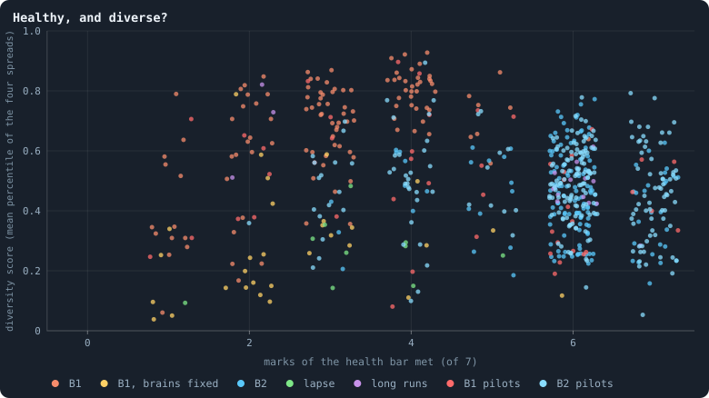
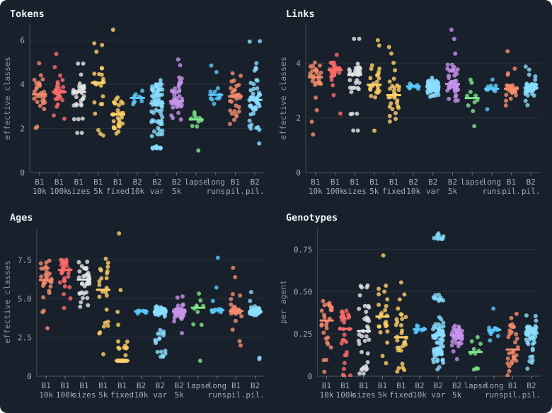
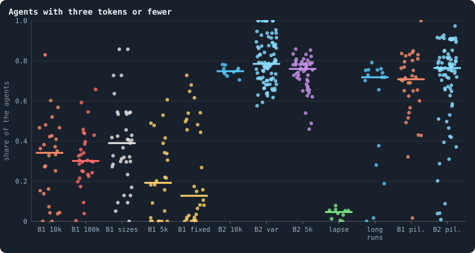

# Healthy and rich

> [!question] Questions of this page
> - What would a world that might keep evolving look like from the outside?
> - How close does every world the notebook has made come to that picture?
> - Which worlds come closest, and what do the others miss?
> - Do the worlds that come closest stay there when they are played on?

## In short

The author's picture of a world that might keep evolving has two halves: a
decentralised, resilient, almost three-dimensional network, and [agents](the-world.md#agents-and-tokens "One member of a world: it lives on a node of the network, holds tokens and has a brain that takes all its decisions.") that
differ in almost everything. This page reads the 624 worlds counted on
17 October 2026 against both halves: [B1](b1-and-b2.md "The first baseline: the algorithm exactly as a new run is offered it.")'s are rich but fragile, [B2](b1-and-b2.md "The second baseline: B1 with the rules that keep its network from breaking and its agents from staking or breeding themselves to death.")'s healthy
but poor, and none has both. The worlds that come closest mix their [brains](the-brain.md "The neural network each agent decides with: inputs about itself and its neighbours, outputs that become its decisions.")
at birth. Played on to 10,000 [iterations](one-iteration.md "One step of a world's time: a phase of reproduction, then a phase of the game."), most of them did not hold, and
every rich one folded into a small world rather than a space. On the way,
the worry about poor agents became a sharper one: [tokens](the-world.md#agents-and-tokens "The one thing of value in a world: every agent holds a whole number of them, and their total never changes.") spread too evenly.

## A picture of a world that might keep evolving

A world in which every agent holds one, two or three tokens does not look
like a world in which much can happen. The author put the picture the other
way round, on 16 October 2026. A world that might keep evolving would have a
network that is **decentralised, resilient and almost three-dimensional**.
And its agents would **differ in almost every statistic**: in wealth, in
links, in age, in their genes and in what they do.

Three days later the author made that first worry sharper. What looks
unhealthy is not that agents hold few tokens, but that they all hold the
same few ([Too even, not too poor](#too-even-not-too-poor)).

This page turns the picture into measurements and reads every world the
notebook has made against them. When they were last counted, on 17 October
2026, they were 624 worlds. The [lab](the-lab.md "The program that runs an experiment's plan as runs, each on a frozen copy of the engine, the code that plays a world.")'s runs are read at their end. The [pilot](pilot-worlds.md "A world made by hand to see whether an idea is worth an experiment, without a thesis or many seeds.")
worlds, made by hand in batches, are read at their last checkpoint: the
last whole world the run saved. Each world is counted once.
[Every world side by side](every-world-side-by-side.md) compares the same
kinds of world through the statistics a run records.

## Two halves

The picture asks two things of a world at once. Its network must hold
together: no single agent or link whose loss cuts off much of it, and no
[hub](stars-and-hubs.md "An agent joined to far more agents than most; a star is a world held together by a single hub.") it hangs on. And its agents must differ, or selection has nothing to
choose from. Each half has a measure of its own.

**The network: the health bar.** [The health bar](health-bar.md), set in
[How to tell a world that keeps evolving](how-to-tell-a-world-that-keeps-evolving.md#the-network-that-holds-in-numbers),
already says what a decentralised, resilient network is. It has seven
marks, each checked on a world at one moment:

1. one piece;
2. a [2-core](core-trees-leaves.md "What is left of a network when agents with one connection or none are peeled away again and again: the agents on loops or between them."), the agents on [loops](loops.md "A path through the network that comes back to where it started without using a connection twice.") or between them, holding at least 0.8 of
   the agents;
3. no agent whose loss cuts off more than 2% of the others;
4. no link whose loss cuts off more than 1%;
5. no agent joined to more than 5% of the others;
6. 3 to 12 links per agent;
7. a [dimension](ball-dimension-and-curvature.md "How fast the number of agents within a distance grows with the distance: as its square in a plane, its cube in space.") between 2.3 and 4: the number of agents within *r* steps
   grows about as fast as *r* to that power
   ([How many dimensions does a world have?](how-many-dimensions-does-a-world-have.md)).

The author's "almost three" is the middle of that range. The tables below
give the marks a world meets as "marks (of 7)", and the health bar's own
page says why each mark is there.

One mark needs care. A tangle in which everyone is a few steps from
everyone can also read "three dimensions" over its first few steps. Telling
the two apart takes a second test, the [random twin](random-twin.md)
([Healthy, but not a space](#healthy-but-not-a-space)).

**The agents: the diversity score.** How much the agents differ is counted
without drawing any line ([The diversity score](diversity-score.md)). For
tokens, links and ages, the agents are sorted into doubling classes: 1,
2–3, 4–7, 8–15, and so on. The **spread** is the effective number of
classes they fill
([Effective numbers: how many kinds there really are](effective-number.md)).
It is 1 if every agent is in one class, and *k* if they are spread evenly
over *k*. Agents holding one to three tokens fill at most two, the classes 1
and 2–3. [Genotypes](genotype.md "The identity of a brain: a number that a brain keeps until it changes, and that records whose copy it was.") are counted as an effective number per agent: 1 when
every agent has a genotype of its own, near 0 when one genotype is
everywhere.

Each spread is then ranked. A world's percentile on it is the share of a
set of reference worlds whose agents spread less widely. A world's
**diversity score** is the mean of its four percentiles: 1 for a world at
the top of all four, 0 for one at the bottom of all four.

The reference is frozen: the 653 worlds read on 17 October 2026. A later
world gets the percentile its spreads would have among them, so no score
moves unless the set is deliberately made again.

The score sees what the agents hold and what they are, not what they do.
How differently they decide is measured apart, as kinds of staking
([How different are the agents?](how-different-are-the-agents.md)).

## Every world on both halves

Put each world on a map. Across: how many marks of the health bar its
network meets. Up: how diverse its agents are. The author's picture is the
top right corner.

<!-- figure healthy/map -->

**Healthy, and diverse?** Each dot is a world at its last checkpoint. Across: how many of the seven marks of [How to tell a world that keeps evolving](how-to-tell-a-world-that-keeps-evolving.md)'s health bar it meets — one piece, a 2-core of at least 0.8, no agent whose loss cuts off more than 2%, no link more than 1%, no agent joined to more than 5% of the others, 3 to 12 links per agent, a dimension of 2.3 to 4 (the dots are spread sideways within each count only so that they do not hide each other). Up: how widely its agents spread over tokens, links, ages and genotypes, as the mean of its percentiles among all worlds. The author's picture of a world that might keep evolving is the top right. B1: B1 at every size and its variants (Experiments 2, 8, 10, 12, 13); brains fixed: Experiment 7; B2: B2 and its variants (Experiments 9, 14, 15, 16), except lapse, where any unused link lapses; long runs: the pilot worlds played to 10,000 iterations; pilots: the other pilot worlds, by the rule set they start from.

> [!example]- How to make this figure
> **Runs.** Every world the notebook has made that settled (500 iterations or more), each once, at its last checkpoint: the lab's runs at their end, the pilot worlds at theirs, the long runs at 10,000 iterations; pilots that replay a lab world are counted as that world (`python3 research/atlas/profile.py`).
>
> **Data.** From `GraphOfLifeRuns/.pilots/atlas/profile.json`.
>
> 1. Read each world's checkpoint: its agents' tokens, links, birth times and genotypes.
> 2. The network: pieces, the 2-core, the worst cut by one agent and by one link (one depth-first search), the best-connected agent's share, links per agent; the dimension by ball growth on the same checkpoint (the lab's measure, gol_series).
> 3. The spreads: the effective number of doubling classes the agents fill (exp of the entropy), for tokens, links and ages; genotypes per agent (1 / sum of squared shares, over the agents).
> 4. Rank every world on each spread; the score is the mean of its four percentiles.
>
> **To make it again:** `python3 book_figures.py healthy`.
<!-- /figure -->

The worlds fall into two clouds, and the author's corner — every mark met,
the agents most diverse — is empty.

- **B1's worlds are rich but fragile.** B1 is the first [baseline](b1-and-b2.md "The stated rules an experiment starts from and changes one thing of: B1 or B2."), the rules
  exactly as a new run is offered them. Its agents spread widely: over 5.6
  to 6.9 classes of age and 3.5 to 4.1 of tokens, with a diversity score of
  0.67 to 0.75. But its networks meet two to four of the seven marks. Only
  half the agents are in the 2-core, and in the [median](median-and-quantiles.md "The middle value: half of the numbers lie below it and half above.") world one agent's
  loss cuts off 13% to 35% of the others. Where tokens move along every
  link and unused links are cut
  ([What crosses a connection](where-the-tokens-flow.md#what-crosses-a-connection)), the network
  is a tree of blobs held together by single agents.
- **B2's worlds are healthy but poor.** B2 is the second baseline, built so
  that its network cannot break
  ([Building B2: a world that cannot break](a-world-that-cannot-break.md)).
  Its networks meet six or seven marks: one piece, the whole world in the
  2-core, nothing that one loss could cut off, no hub. But three agents in
  four hold three tokens or fewer, and the median agent holds one. Its
  agents' ages fill about 4 classes, against B1's 6 to 7, since every agent
  dies at age 100. And at 10,000 tokens B2 misses the one mark B1 meets:
  its dimension is 4.5, above the bar and far from three. That number
  turned out to say more about B2's size than about its shape
  ([What B2's dimension measures](#what-b2s-dimension-measures)).

The four spreads behind the score, world by world:

<!-- figure healthy/spreads -->

**How widely the agents spread.** Each dot is a world. Tokens, links, ages: the effective number of doubling classes its agents fill (1, 2–3, 4–7, …; for ages, age + 1) — 1 if every agent is in one class, k if they are spread evenly over k. Genotypes: the effective number of genotypes per agent (1 for every agent its own genotype, near 0 for one genotype everywhere).

> [!example]- How to make this figure
> **Runs.** Every world the notebook has made that settled (500 iterations or more), each once, at its last checkpoint: the lab's runs at their end, the pilot worlds at theirs, the long runs at 10,000 iterations; pilots that replay a lab world are counted as that world (`python3 research/atlas/profile.py`).
>
> **Data.** From `GraphOfLifeRuns/.pilots/atlas/profile.json`.
>
> 1. For each world, exp of the Shannon entropy of its agents' shares over the doubling classes of each quantity; the effective genotypes, 1 / sum of squared shares, per agent.
>
> **To make it again:** `python3 book_figures.py healthy`.
<!-- /figure -->

And the measure of poverty this page started from, the share of agents
holding three tokens or fewer:

<!-- figure healthy/poor -->

**Agents with three tokens or fewer.** Each dot is a world: the share of its agents holding one, two or three tokens. B1 10k: B1 at 10,000 tokens (Experiment 2); 100k: Experiment 10; sizes: Experiment 8; 5k: Experiments 12 and 13; fixed: brains that never change (Experiment 7); B2 10k: Experiment 16; B2 var: B2 with one rule or rate changed (Experiments 9, 15, 16); B2 5k: Experiment 14, except lapse, where any unused link lapses; long runs: the pilot worlds played to 10,000 iterations; pil.: the other pilot worlds, by the rule set they start from.

> [!example]- How to make this figure
> **Runs.** Every world the notebook has made that settled (500 iterations or more), each once, at its last checkpoint: the lab's runs at their end, the pilot worlds at theirs, the long runs at 10,000 iterations; pilots that replay a lab world are counted as that world (`python3 research/atlas/profile.py`).
>
> **Data.** From `GraphOfLifeRuns/.pilots/atlas/profile.json`.
>
> 1. Count the agents of each world's checkpoint holding at most three tokens.
>
> **To make it again:** `python3 book_figures.py healthy`.
<!-- /figure -->

### Too even, not too poor

Picture two worlds, each with 10,000 tokens among 3,400 agents: about three
tokens per agent. In one, nearly every agent holds two, three or four. In
the other, most hold one, and a few hold dozens. The two are equally rich,
but only the first is even.

On 19 October 2026 the author made the picture precise. What looks
unhealthy is not that agents hold few tokens, but that they hold them
**evenly**: almost everyone the same few. The share at three tokens or
fewer only stood in for that, and measured directly it stands in badly.
Every world read so far now also carries the
[Gini coefficient](gini-coefficient.md) of its agents' tokens, 0 when all
hold the same and near 1 when one agent holds nearly all. It also carries
the share of all tokens that its [richest tenth](richest-tenth.md "The share of all tokens held by the richest tenth of the agents.") hold.

Across the 502 worlds read at iteration 1,000, the share at three or fewer
follows the tokens per agent: a [correlation](correlation.md "Whether two quantities go up and down together, from −1 to 1.") of −0.77, and −0.92 across the
54 read at 10,000. It does not follow the Gini: 0.01, and 0.52 at 10,000.
It counts how many agents share the tokens, not how evenly they share
them.

**B2 is poor but not even.** Its Gini is 0.49 to 0.56 at iteration 1,000,
and 0.47 to 0.51 at 10,000. That is above the 0.40 that a random exchange
of tokens would leave at its three tokens per agent. A random exchange
leaves the spread of greatest [entropy](entropy-and-evenness.md "How evenly something is shared out among the agents, from all in one place to spread perfectly evenly."): a geometric spread, in which each
extra token is less likely than the one before by the same factor. With a
mean of *m* tokens per agent, its Gini is

$$
G = \frac{m - 1}{2m - 1} .
$$

It is 0 when every agent holds one token, and comes nearer to one half the
richer the agents are. It draws no line of its own.

The evenest worlds are others:
- where every unused link lapses: a median Gini of 0.26 over 29 worlds, at
  seven tokens per agent, where random exchange would leave 0.46;
- Experiment 15's children of any size: almost every agent holds one token,
  a Gini of 0.02;
- at 10,000 iterations, four of the five candidate worlds that held
  ([Candidates and long runs](#candidates-and-long-runs)): rich worlds with
  a Gini of 0.37 to 0.44
  ([The candidates, played on and played again](the-candidates-played-on.md#too-even-not-too-poor)).

So a thesis no longer counts a world's poor. Since 19 October 2026 it asks
instead that the world be **no more even than B2**: a Gini no lower than
the least of B2's worlds read at the same iteration. Old theses keep their
wording.
[The candidates, played on](the-candidates-played-on.md#the-candidates-played-on),
[Five more seeds for the rules that held](the-candidates-played-on.md#five-more-seeds-for-the-rules-that-held)
and [Rules in company](rules-in-company.md) say what the clarified reading
changes.

### What B2's dimension measures

How can a network without positions have a dimension? Count the agents
within one step of an agent, within two steps, within three. In a plane the
count grows like the square of the steps, in space like their cube. The
power is the dimension, and the health bar reads it over the first five
steps.

In B2's kind of network that number rises with the number of agents
([The marks a world misses](mixed-at-birth-ten-long-worlds.md#the-marks-a-world-misses)).
B2 at 5,000 tokens, with 1,200 to 1,800 agents, reads 3.6 to 4.1, and six
of its ten worlds meet every mark. The worlds of Experiment 17, B2 with
brains mixed at birth, read about 3.1 below 300 agents and 4 above 1,500.
That is a correlation of 0.78 with the logarithm of the size. B1's does not
rise: from 40 agents to 70,000 it stays between about 2.5 and 4.

So for B2's kind of network, two marks of the bar are partly marks of size.
The dimension fails a large world. The hub mark fails a small one, where a
single well-linked agent is already more than 5% of the world. Worlds of
600 to 1,000 agents met both at 98% of their moments. Health compared
between worlds of different sizes has to be read with that in mind.

[What folds a world](how-many-dimensions-does-a-world-have.md#what-folds-a-world) found why. B2's networks are
nearly small worlds, not spaces: everyone is a few steps from everyone. A
typical agent's ball grows four to six times a step, and holds a quarter of
a world of 3,400 agents within four steps. A typical agent is about as near
to everyone as in a random network with the same links: 1.18 times as far,
against 2.3 in B1. A small world has no dimension to find, and the number
read off its first few steps grows with the room it has.

B2's worlds start as spaces. They fold once their first generation dies,
because each death is mended with a ring of links among the dead agent's
[neighbours](the-world.md#the-network "An agent joined to another by a connection."). The rise with size holds for B2 itself and for its mixed
worlds, but not for every variant of B2. With the [estate](estate.md "The tokens a dead agent leaves, and who gets them.") of the dead left
to the newborns or to the parents, B2's worlds hold more than 5,000 agents
at a dimension of 3.4 to 3.9. They stay spaces, of about three dimensions
([Who inherits?](who-inherits.md#healthy-and-diverse)).

## The worlds that come closest

The author's corner is empty, but some worlds come near it. When last
counted, on 17 October 2026, 99 worlds of 624 met all seven marks:
- 26 of the lab's B2 worlds: fifteen of B2 or its variants at 5,000 tokens
  (Experiment 14: smaller worlds, with a dimension of about 3.8), nine
  without old age (Experiment 15), one of B2 itself, and one whose brains
  rarely change (Experiment 9);
- 67 pilot worlds built on B2: among them 28 of batch Y, which mix brains
  at birth with one other rule
  ([Brains mixed at birth, with every other rule](mixing-with-every-other-rule.md)),
  and 12 of batch W;
- five alliance pilots of B1 ([Alliances](alliances.md)), four of them at
  3,000 tokens, below the notebook's rule of 10,000;
- and one long run.

A healthy network is not enough. Nine of the ten B2 worlds without old age
meet every mark, and have stopped. In a world of 3,800 agents there are
about 0.4 births an iteration. Of the agents, 86 to 95% hold three tokens
or fewer, and nearly all are of one age: the [founders](starting-ring.md "One of the agents a world starts with, each holding the same tokens, on a ring with a few shortcuts.")' generation, which
never dies. Their ages fill 1.3 to 2.3 classes, and their diversity scores
are among the lowest of all.

Ranked by how diverse their agents are, the twelve most diverse worlds that
meet every mark are:

<!-- table healthy/closest -->
| world | group | at iteration | marks (of 7) | diversity score | median tokens | agents with 3 tokens or fewer | dimension | agents |
|---|---|---|---|---|---|---|---|---|
| `Y/mix-mut80-s2` | B2 pil. | 1,000 | 7 | 0.79 | 5 | 36% | 3.8 | 1,238 |
| `Y/mix-mut80-s1` | B2 pil. | 1,000 | 7 | 0.78 | 5 | 41% | 3.8 | 1,299 |
| `Y/mix-keepone-s2` | B2 pil. | 1,000 | 7 | 0.70 | 1 | 77% | 3.4 | 1,537 |
| `Y/mix-kinsense-s2` | B2 pil. | 1,000 | 7 | 0.70 | 8 | 32% | 3.7 | 821 |
| `U/U-BDFG-s1` | B2 pil. | 1,000 | 7 | 0.68 | 8 | 25% | 3.7 | 652 |
| `W/norev-mix-s1` | B2 pil. | 1,000 | 7 | 0.68 | 2 | 67% | 3.7 | 2,245 |
| `Y/mix-linktoken-s1` | B2 pil. | 1,000 | 7 | 0.66 | 8 | 36% | 3.4 | 588 |
| `Y/mix-came-s2` | B2 pil. | 1,000 | 7 | 0.66 | 3 | 53% | 3.7 | 1,521 |
| `M/mix-children-s2` | B2 pil. | 5,000 | 7 | 0.65 | 10 | 23% | 3.3 | 486 |
| `Y/mix-grow-s1` | B2 pil. | 1,000 | 7 | 0.65 | 12 | 23% | 3.3 | 366 |
| `Y/mix-helped-s1` | B2 pil. | 1,000 | 7 | 0.63 | 5 | 38% | 3.7 | 1,075 |
| `Y/mix-nodice-s2` | B2 pil. | 1,000 | 7 | 0.63 | 3 | 53% | 3.5 | 1,468 |
<!-- /table -->

Every one of the twelve mixes its brains at birth. A newborn's brain then
comes from two agents: its parent, and a mate among the parent's
neighbours. Each hidden unit of the brain comes whole from one or the other
([Brains mixed at birth, units that cost, an eye for raids on kin](mixed-brains-costly-units.md)).
Each world also changes something else. The two at the top add a faster
change of brains, a [mutation](mutation.md "A random change to a brain, made with a set probability when it is copied, and in B1 also after every game: a changed brain is a new genotype.") probability of 0.8 where B2 has 0.2. They have
diversity scores of 0.79 and 0.78, with about 40% of their agents at three
tokens or fewer. The world of batch W that mixes without [revolutions](revolution.md "A node taken by stakers who each marked part of their stake revolutionary and together staked more than the largest single stake.") is
larger and poorer: 2,245 agents, two in three of them at three tokens or
fewer. But its agents spread widely in age, links and genotypes.

The first worlds to come this close, on 16 October 2026, were the two of
batch Q, which mix brains at birth and change nothing else. At iteration
2,000 both met every mark at a dimension of 3.5. Their agents were richer
and more varied than in any other world that met every mark then. The
median agent held 5 and 11 tokens, and 37% and 20% held three or fewer.
Their wealth spread over six doubling classes, wider than in any of those
worlds. They are smaller worlds — 660 to 910 agents for 10,000 tokens,
where B2 holds 3,400 — so each agent holds more. They were also among the
worlds whose evolution went on most strongly. They have left the tables
since. The lab's engine and the pilots' prototype play a mixed world alike,
so Experiment 17 made the same two worlds again, agent for agent.
`Q/mix-s1` and `s2`, and their long runs, now count as Experiment 17's
worlds s001 and s002.

## Candidates and long runs

A world that comes this close at one moment may only be passing through.
So it is a **candidate world**, and is played on to see whether it stays.
The rule draws no line of its own. A candidate world meets every mark of
the health bar. Its diversity score is above the median of Experiment 16's
B2 worlds, 0.51. And it has at least 10,000 tokens. So it comes closer than
B2 itself to the author's picture.

Three worlds met the rule first: the two mixed worlds of batch Q, and a
world of batch S whose agents have an eye for a family tag and no
revolutions. Three more followed as batches W and Y finished: mixing
without revolutions, links that hold a token without revolutions, and
mixing with the estates of the dead left to the poorest. Each was played on
to 10,000 iterations in a copy of its own. The table shows the four that
are not Experiment 17's worlds, where each was chosen and where it ended:

<!-- table healthy/long -->
| world | group | at iteration | marks (of 7) | diversity score | median tokens | agents with 3 tokens or fewer | dimension | agents |
|---|---|---|---|---|---|---|---|---|
| `S/G4-familysense-s2` | B2 pil. | 1,000 | 7 | 0.53 | 1 | 74% | 4.0 | 2,935 |
| `LC/S-G4-familysense-s2` | long runs | 10,000 | 6 | 0.51 | 2 | 69% | 4.5 | 3,097 |
| `W/norev-linktoken-s1` | B2 pil. | 1,000 | 7 | 0.59 | 5 | 42% | 4.0 | 921 |
| `LC/W-norev-linktoken-s1` | long runs | 10,000 | 6 | 0.45 | 3 | 51% | 4.1 | 1,359 |
| `W/norev-mix-s1` | B2 pil. | 1,000 | 7 | 0.68 | 2 | 67% | 3.7 | 2,245 |
| `LC/W-norev-mix-s1` | long runs | 10,000 | 6 | 0.61 | 2 | 64% | 4.1 | 2,221 |
| `Y/mix-poorest-s1` | B2 pil. | 1,000 | 7 | 0.57 | 3 | 51% | 3.4 | 1,455 |
| `LC/Y-mix-poorest-s1` | long runs | 10,000 | 7 | 0.28 | 1 | 69% | 3.2 | 2,288 |
<!-- /table -->

**The two mixed worlds of batch Q** parted on the way. The first swung
towards B2's poverty at 2,500 iterations: half as many agents again, half
of them at three tokens or fewer. Then it came back: at 5,500, 38% held
three or fewer, and the median agent six. The second grew richer and
smaller to 4,500 iterations (514 agents, the median holding 13 tokens),
then larger again. At 7,500 it had 883 agents, 19% at three tokens or
fewer and the median holding eight, and met every mark at a dimension of
3.9. At 10,000, read as Experiment 17's worlds, the first held 2,221
agents, 65% of them at three tokens or fewer, and the second 744, 6%
([Mixed at birth: ten long worlds](mixed-at-birth-ten-long-worlds.md#mixed-at-birth-ten-long-worlds)).

**The other four** all reached 10,000, and none kept everything it had at
1,000. The world with an eye for a family tag fell back early. At 2,000
iterations 72% of its agents held three tokens or fewer, as in B2, and a
dimension of 4.3 had cost it a mark. It and two others lost a mark as they
grew: their dimension rose above 4, at 1,359 to 3,097 agents. The fourth,
mixing with the estate left to the poorest, kept every mark but grew poor
and alike. Its diversity score fell to 0.28, and 69% of its agents held
three tokens or fewer.

**The test of a long run.** A candidate world holds if, at iteration
10,000:
- it is still alive: it never fell to 20 agents or fewer, where the lab
  calls a world [extinct](extinction.md "A world's end before its last iteration: it has dropped to its threshold of agents or fewer.");
- it meets every mark of the health bar;
- it is more diverse than B2's median world at 10,000, a diversity score of
  0.49;
- fewer of its agents hold three tokens or fewer than in the least poor of
  B2's ten worlds played on that far, 66%.

Since 19 October 2026 the last line asks instead for tokens no more even
than in B2's least even world
([Too even, not too poor](#too-even-not-too-poor)).

The long runs were planned in three steps. Here is what each found.

1. **Every candidate to 10,000 iterations.** A candidate that falls back
   towards B2's poverty, or loses a mark, says its rule does not hold.
   Nineteen more candidates followed the first six, most of them mixed
   worlds of batch Y. By 19 October 2026 every candidate that could be read
   at 10,000 iterations had been: again nineteen worlds, the four above
   among them. Five held, eleven fell back — most of them into B2's poverty
   — and three died out on the way. All five that held mix their brains at
   birth. By the clarified test of evenness, three held. Four candidates
   whose rules exist only in the pilots' prototype wait for Experiment 23
   ([The candidates, played on](the-candidates-played-on.md#the-candidates-played-on)).
2. **More [seeds](random-numbers.md "The number that fixes every random choice of a run: the same settings and the same seed make the same world.") for what holds.** One world can be luck. A rule whose
   candidate is still healthy and diverse at 10,000 iterations gets five
   seeds more, from the start, to 10,000. Experiment 21 gave three such
   rules five new seeds each, and none held more often than mixing alone
   ([Five more seeds for the rules that held](the-candidates-played-on.md#five-more-seeds-for-the-rules-that-held)).
3. **A pre-registered lab experiment** for what holds in most seeds: ten
   seeds to 10,000 iterations, and the best world on to a hundred thousand,
   as [A hundred thousand iterations](a-hundred-thousand-iterations.md)
   plans for one world. Mixing alone went first. It became a setting of the
   engine, [`mix_at_birth`](settings.md#mix_at_birth), off unless a run
   turns it on. Experiment 17 played ten worlds of B2 with mixing for
   10,000 iterations
   ([Mixed at birth: ten long worlds](mixed-at-birth-ten-long-worlds.md#mixed-at-birth-ten-long-worlds)).
   They are rich: 11% of the agents hold three tokens or fewer in the
   median world at 10,000 iterations. But only five of the ten met every
   mark, so its thesis is refuted. Experiment 18 played those five on to
   50,000 iterations, and they did not stay healthy. Three died out, and
   the two that lived ended between the mixed worlds' riches and B2's
   poverty
   ([Five mixed worlds, fifty thousand iterations](mixed-at-birth-ten-long-worlds.md#five-mixed-worlds-fifty-thousand-iterations)).
   Since no rule held more often than mixing alone, step 3 has no rule to
   take up yet.

The pilot batches T to Y
([Every simulation: what was run, and what was measured](every-simulation.md))
and the search for settings by elimination added candidates as they
finished. The search, batch Z, drew every setting of a world at random, and
dropped the values that made worlds worse, round after round. Experiment 24
played the settings of its best world again, in new seeds. They made
diverse, wide and rich worlds, but thin, easily cut and too even ones
([The search's best world, in new seeds](the-candidates-played-on.md#the-searchs-best-world-in-new-seeds)).
The same idea is now a lab experiment:
[A screen of random worlds](a-screen-of-random-worlds.md).

## Healthy, but not a space

The health bar's dimension mark does not tell a space from a small world. A
B2 world of 600 to 1,500 agents passes it because it is small
([What folds a world](how-many-dimensions-does-a-world-have.md#what-folds-a-world)). A stronger test sets a world
beside its [random twin](random-twin.md): the same agents, with as many
links each, wired at random. Count the steps within which a typical
agent's ball holds half the world, and divide by the same count in the
twin: that ratio is the world's **width**. A small world has a width of
about 1. The notebook calls a world a space when its width is 1.5 or
more.

Read this way, the candidate worlds are folded. At iteration 1,000 the 23
candidates read 1.13 to 1.92, most of them below 1.5 and near B2's 1.18;
B1 reads 2.3 at 1,500 agents. Three were spaces then. By
10,000 all but one had folded, and the exception, mixing with the estate
left to the poorest (1.79), is one of the poor worlds
([The candidates, played on](the-candidates-played-on.md#the-candidates-played-on)).

Of the 388 worlds read at iteration 1,000, the ones that are spaces and not
poor are of three kinds:
- B1's worlds;
- worlds whose every unused link lapses: rich, but about two-dimensional,
  and missing three or four marks;
- a few others. One mixes with a slow change of brains (`Y/mix-mut05-s1`:
  2.38, 44% at three tokens or fewer, every mark met at a dimension of 2.9,
  a diversity score of 0.48). Two are worlds of the search
  (`Z/r1-15-s1015`: 3.40, 43%, five marks, 0.73; `Z/r1-22-s1022`: 3.42,
  27%, three marks, 0.83).

So the author's "almost three-dimensional" asks more than the bar's mark
does. That is why [What makes a world interesting](what-makes-a-world-interesting.md)
asks for a dimension of 2 to 4 *and* a width of at least 1.5.

## What we learned

- **No world yet fits the picture.** The two rule sets each have half of
  it: B1 the diverse agents, B2 the healthy network. Neither has both.
- **B2's network rules work; its agents are many, and so poor.** A world of
  10,000 tokens that holds 3,400 agents has about three tokens per agent,
  and in B2 the median agent holds one. What made worlds richer — mixing
  brains at birth, links that hold a token, lapsing links — made them
  smaller ([What holds a world's size](what-holds-a-worlds-size.md)).
- **Poor is not even.** The share of poor agents counts how many agents
  share the tokens. B2 is poor, but its tokens are spread less evenly than
  a random exchange would leave them. Among the candidate worlds, the small
  rich ones are the even ones.
- **Age is capped by a rule.** B2's agents die at 100, so their ages cannot
  spread as B1's do. Without old age, B2's worlds meet every mark of the
  bar and stop: hardly a birth, nearly every agent poor and of one age
  (Experiment 15). Links that hold a token without old age did the same
  ([Brains mixed at birth, units that cost, an eye for raids on kin](mixed-brains-costly-units.md)).
  Something between, a death that depends on what an agent does rather
  than on a fixed age, would let ages spread without stopping the world.
- **A healthy network is not yet a space.** The candidate worlds' networks
  are folded small worlds, and "almost three-dimensional" asks more than
  the bar's mark does ([What folds a world](how-many-dimensions-does-a-world-have.md#what-folds-a-world)).
- **A good moment is not a good world.** Most candidate worlds did not hold
  over 10,000 iterations, and no rule held more often than mixing alone.
- **A world might be judged by this map before it is judged by its
  evolution.** A rule that moves worlds towards the top right is a
  candidate for the long runs and the lifetime contests. The
  [screen of random worlds](a-screen-of-random-worlds.md) is built this
  way: it judges each world's health before any strategy is tried in it.

## Where to go next

- [What makes a world interesting](what-makes-a-world-interesting.md): the
  picture turned into six criteria, and the screen that uses them.
- [The candidates, played on and played again](the-candidates-played-on.md):
  what became of the worlds that came closest.
- [What holds a world's size](what-holds-a-worlds-size.md): why a world's
  riches, and much of its health, follow its size.
- [The random twin: is a world a space?](random-twin.md): the test the
  dimension mark needs beside it.

## How this was made

- **Every world** is read at its last checkpoint by
  `research/atlas/profile.py` (`GraphOfLifeRuns/.pilots/atlas/profile.json`):
  the seven marks of the health bar, and the four spreads. A pilot that
  replays a lab world is counted as that world.
  `python3 book_figures.py healthy` draws this page's figures and tables,
  and the recipe folded under each figure gives every step.
- **The diversity scores** are ranked among the frozen reference worlds,
  `book/results/diversity_reference.json`, made by
  `research/atlas/profile.py --freeze`. This page's figures and tables were
  last drawn on 17 October 2026, from the 624 worlds of that count, a few
  hours before the reference was frozen. So their scores are ranked among
  those 624; drawn again, they would be ranked among the reference.
- **The Gini** and the richest tenth's share of every world:
  `research/atlas/evenness.py`.
- **The width** of a world against its random twin:
  `research/atlas/space.py`.
- **The candidate worlds**: the rule is `research/oee/pilots/candidates.py`,
  the list `research/oee/candidates.md`, and their long runs are in
  `GraphOfLifeRuns/.pilots/LC/`.
- **The search by elimination**: `research/oee/pilots/search.py`, whose
  judge writes `research/oee/search.md`.

## How our view changed

- **16 October 2026.** This page first counted 34 worlds that met every
  mark. A world's dimension was then taken from the table of every world,
  as a mean over the stretch at its end. The same day it was measured
  instead on the same checkpoint as the other six marks, by the same
  measure at one moment
  ([How many dimensions does a world have?](how-many-dimensions-does-a-world-have.md)).
  The two agree for B2's worlds, half of them within 0.12, and swing for
  B1's, whose networks change fast. Worlds with no entry in that table, and
  the batches finished since, were counted too: 424 worlds. Then the
  genotypes of worlds whose brains are mixed at birth were counted by their
  weights. The prototype's rule had given a mixture of two clones — the
  parent's brain again — a number of its own. So those worlds looked richer
  in genotypes than they were. `Y/mix-poorest-s1` fell from a diversity
  score of 0.66 to 0.57. Later that day, 56 worlds met every mark.
- **16 October 2026.** The page read B2's 4.5 at 10,000 tokens as a
  dimension above the bar and far from three.
  [Brains mixed at birth, in long worlds](mixed-at-birth-ten-long-worlds.md#the-marks-a-world-misses)
  found that in B2's kind of network the dimension read by ball growth
  rises with the number of agents. So two marks of the bar are partly marks
  of size.
- **17 October 2026.** [What folds a world](how-many-dimensions-does-a-world-have.md#what-folds-a-world) found
  why: B2's networks are folded small worlds, with no dimension to find.
  This page had taken the bar's dimension mark for the author's "almost
  three-dimensional". But the mark cannot tell a space from a small world,
  and the candidate worlds turned out to be folded.
- **17 October 2026.** The page counted again, with batches K, M, R, SW
  and Y: 99 worlds of 624 met every mark. The two worlds of batch Q were
  now counted once, as Experiment 17's. The closest of all were no longer
  those two, but two that mix brains at birth with a faster change of
  brains.
- **17 October 2026.** The page had said that the two mixed worlds of
  batch Q go on healthy and richer than B2's, at 5,500 and 7,500
  iterations. At 10,000 the first had grown to 2,221 agents, 65% of them at
  three tokens or fewer
  ([Mixed at birth: ten long worlds](mixed-at-birth-ten-long-worlds.md#mixed-at-birth-ten-long-worlds)).
  Played on in Experiment 18, the second died out at iteration 21,288
  ([Five mixed worlds, fifty thousand iterations](mixed-at-birth-ten-long-worlds.md#five-mixed-worlds-fifty-thousand-iterations)).
- **17 October 2026.** Diversity scores had been percentiles among all the
  worlds read so far, so they moved whenever worlds were added: by up to
  0.01 between the scores on this page and those of the batches read since.
  Since then they are ranked among a frozen set of 653 worlds (on this page;
  see [The diversity score](diversity-score.md)).
- **19 October 2026.** The page took agents holding three tokens or fewer
  as the mark of a world in which little can happen. The author made the
  picture precise: the worry is agents that hold their tokens evenly. The
  share at three or fewer follows the tokens per agent, not the Gini, and
  B2 is poor but not even. Theses since ask for a Gini no lower than B2's
  least even world (on this page; see
  [The candidates, played on and played again](the-candidates-played-on.md#too-even-not-too-poor)).
- **19 October 2026.** On 17 October this page said that none of the
  candidate worlds is a space. By the line the notebook drew later, a
  width of 1.5, a few were spaces at iteration 1,000. By 10,000 all but one
  had folded, and that one had grown poor
  ([The candidates, played on](the-candidates-played-on.md#the-candidates-played-on)).

<!-- turns -->
---

[Looking for a healthy, rich world](../README.md#looking-for-a-healthy-rich-world) · [What makes a world interesting](what-makes-a-world-interesting.md) →

> [!info]- Pages that link here (24)
> [What this notebook is about](what-this-notebook-is-about.md) · [Every setting](settings.md) · [B1 and B2: the two baselines](b1-and-b2.md) · [What B1 is, and what stood in its way](what-the-baseline-world-is.md) · [Building B2: a world that cannot break](a-world-that-cannot-break.md) · [Is a world a space? Dimension, and what folds it](how-many-dimensions-does-a-world-have.md) · [The random twin: is a world a space?](random-twin.md) · [What holds a world's size](what-holds-a-worlds-size.md) · [How alike the agents are](how-alike-the-agents-are.md) · [What would count as open-ended evolution](open-ended-test.md) · [Rules in company](rules-in-company.md) · [Who inherits?](who-inherits.md) · [Links to strangers](links-to-strangers.md) · [Brains mixed at birth, with every other rule](mixing-with-every-other-rule.md) · [Eight switches at once](eight-switches-at-once.md) · [What makes a world interesting](what-makes-a-world-interesting.md) · [The health bar](health-bar.md) · [The diversity score](diversity-score.md) · [Brains mixed at birth, in long worlds](mixed-at-birth-ten-long-worlds.md) · [Who may be a mate](mixed-at-birth-with-parents-as-mates.md) · [The candidates, played on and played again](the-candidates-played-on.md) · [Room and riches for the steadiest world](room-for-the-steadiest-world.md) · [A screen of random worlds](a-screen-of-random-worlds.md) · [Every simulation: what was run, and what was measured](every-simulation.md)
<!-- /turns -->
