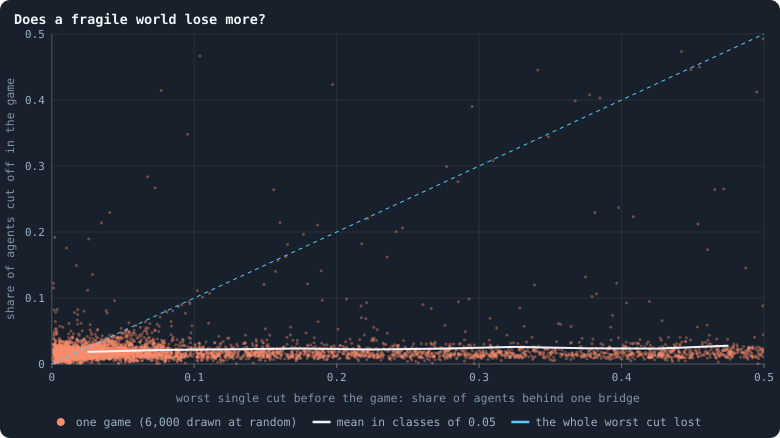
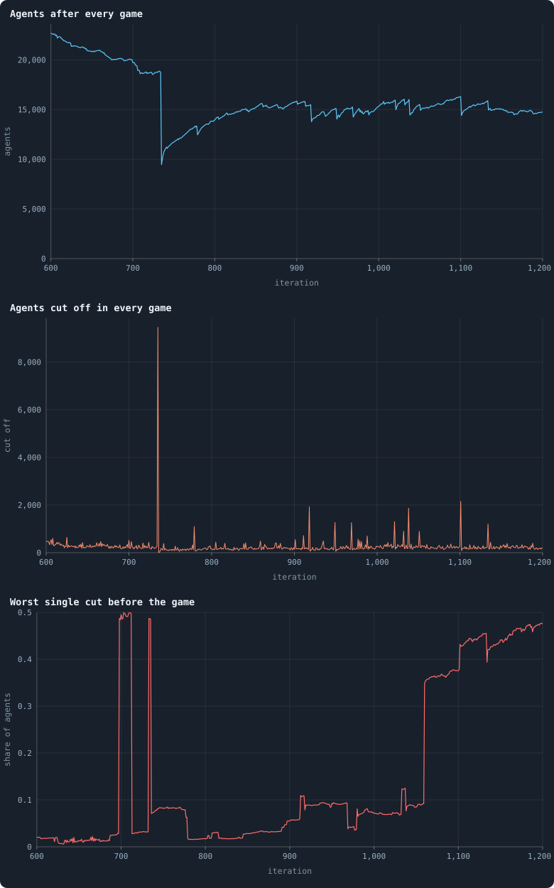
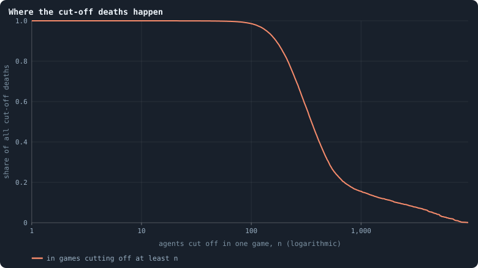

# How a world breaks

At the end of every phase the cleanup keeps only the **largest connected
piece** of the network; every [agent](the-world.md#agents-and-tokens "One member of a world: it lives on a node of the network, holds tokens and has a brain that takes all its decisions.") outside it dies, however many [tokens](the-world.md#agents-and-tokens "The one thing of value in a world: every agent holds a whole number of them, and their total never changes.") it
holds, and its tokens are dealt out among the survivors
([One iteration, step by step](one-iteration.md)). Three deaths in four are of this kind
([Births, deaths and ages](births-deaths-and-ages.md)), and [Power laws, real and apparent](power-laws-real-and-apparent.md)
found that they come in lumps: half of them in games that cut off hundreds of
agents at once. This page asks how fragile a world is, whether its breaks
can be foreseen, and what actually severs a region from the rest.

> [!question] Questions of this page
> - How much of a world hangs on single [connections](the-world.md#the-network "A link between two agents of the network: they are neighbours, and can stake on each other's nodes.")?
> - Does a world in which a large part hangs on one connection lose more
>   agents?
> - When a game cuts off a thousand agents, what severed them — and why there?

The worlds are the thirty of 100,000 tokens of [Thirty worlds](a-worlds-life.md#thirty-worlds);
where the thirty of 10,000 tokens this page was first written from differ,
both are given. A "big" cut is counted against the size of a world: a
thousand agents or more here, a hundred in the worlds of 10,000 tokens — a
hundredth of the world's tokens' worth.

<!-- runs E10 -->
> [!info]- The runs behind this page
> **30 runs.** Every condition below is run once for every seed (1 to 30), for 1,500 iterations — or until its world dies out. Every setting is that of the baseline **B1** (the algorithm exactly as a new run is offered it) unless the condition changes it.
>
> - **baseline** — changes nothing: B1 as it is; 100,000 tokens. Runs `B1-100000-s001` … `B1-100000-s030`.
>
> To make these runs again: `python3 gol_lab.py run E10`, or ▶ in the Research Notebook tab of a computer running `gol_server.py`. Each run writes its settings, seed and engine version beside its frames, in `GraphOfLifeRuns/<run>/meta.json` and `provenance.json`.

> [!info]- Every setting of these runs
> | setting | baseline | what it is |
> |---|---|---|
> | [`total_tokens`](settings.md#total_tokens) | 100,000 | The number of tokens in the world, *T*. It never changes during a run. |
> | [`n_nodes`](settings.md#n_nodes) | 0 | How many founders the world starts with. 0 means one founder per hundred tokens: *n* = ⌊*T* / 100⌋. |
> | [`k_neighbors`](settings.md#k_neighbors) | 0 | How many neighbours each founder starts with in the ring. 0 means *k* = max(⌊*n* / 100⌋, 5); an odd *k* is wired as *k* − 1. |
> | [`rewire_p`](settings.md#rewire_p) | 0.2 | In the starting ring, the probability that a connection is moved to a founder chosen at random (Watts–Strogatz). |
> | [`hidden_layers`](settings.md#hidden_layers) | 50, 45, 40, 35, 30 | The widths of the brain's hidden layers, in order from input to output. |
> | [`brain_kind`](settings.md#brain_kind) | float16 | How weights are stored: `float` (64-bit), `float16` (16-bit, computed in 64-bit) or `binary` (−1, 0, +1). |
> | [`brain_bits`](settings.md#brain_bits) | 16 | Only for binary brains: how many input rows encode one number. Unused by float and float16 brains. |
> | [`message_amount`](settings.md#message_amount) | 30 | How many numbers one message holds. Each agent sends one message to itself and one to each neighbour, every phase. |
> | [`random_input_amount`](settings.md#random_input_amount) | 5 | How many random numbers, drawn uniformly from −2 to 2, a brain reads per neighbour, every time it looks. |
> | [`exchange_messages`](settings.md#exchange_messages) | on | Whether agents send and read messages at all. |
> | [`message_prepass`](settings.md#message_prepass) | on | Whether every phase begins with an extra look in which agents only write messages, so the look that acts reads messages written this phase. |
> | [`allow_handover`](settings.md#allow_handover) | on | Whether a parent may move some of its own connections to its newborn child. |
> | [`allow_revolutions`](settings.md#allow_revolutions) | on | Whether a coalition of smaller stakers can take a node from its largest staker (see the note *How a coalition takes a node*). |
> | [`allow_gifting`](settings.md#allow_gifting) | off | Whether agents may give tokens to neighbours during reproduction. Off in both baselines; on in a few pilots, in Experiment 24 and in half the worlds of the screen. |
> | [`random_decisions`](settings.md#random_decisions) | off | The control: every number a brain would produce is replaced by a random draw from the standard normal distribution. |
> | [`prune_after`](settings.md#prune_after) | blotto | After which phase connections that carried no tokens are cut: `blotto` (the game), `reproduction`, or `both`. |
> | [`inactive_window`](settings.md#inactive_window) | phase | How long a connection may go unused: `phase` means it must carry tokens in the phase being judged; `iteration` allows the two last phases. |
> | [`redistribution`](settings.md#redistribution) | uniform | How the tokens of removed agents are shared: `uniform` gives every survivor the same chance at each token; `by_tokens` weights by what a survivor holds; `poorest` raises the poorest to one common level first; `newborns` gives them to this iteration's children, `parents` to their parents, once per child (both `uniform` in an iteration without births); `children` leaves each dead agent's estate to its own living children (`uniform` where there are none). |
> | [`tokens_created_per_phase`](settings.md#tokens_created_per_phase) | 0 | Tokens added to the world at every cleanup. 0 keeps the supply fixed. |
> | [`mutate_on_replication`](settings.md#mutate_on_replication) | off | Whether a brain changes only when it is copied — into a newborn, or into a node its owner has just won — instead of also after every game, wherever it sits. |
> | [`incumbency`](settings.md#incumbency) | 1.0 | How many times over an agent's stake on its own node counts when the game decides who takes the node. 1 is the old rule. |
> | [`birth_links`](settings.md#birth_links) | 0 | How many of its parent's neighbours a newborn is joined to, drawn at random, besides its parent itself; 0 leaves every link to the brain's choice. |
> | [`mend_on_death`](settings.md#mend_on_death) | off | Whether the neighbours of an agent that dies are joined up where its death would leave them in separate pieces. |
> | [`prune_needs`](settings.md#prune_needs) | 0 | How many neighbours the two ends of an unused connection must share for it to be cut; 0 cuts every unused connection. |
> | [`valence`](settings.md#valence) | 0 | The most connections an agent's brain may choose to hold (0 = no limit). An agent at its limit cannot have a child. |
> | [`keep_home`](settings.md#keep_home) | 0.0 | The share of an agent's tokens — rounded up, never less than one — that stays on its own node whatever its brain says; a parent also keeps one. 0 is the old rule. |
> | [`max_age`](settings.md#max_age) | 0 | The age at which an agent dies (0 = never); its tokens are shared out like those of any other dead agent. |
> | [`buy_life`](settings.md#buy_life) | off | Whether an agent that has reached max_age may live on by paying one token an iteration into the estate of the dead — never its last, so one with a single token left dies. Needs max_age. |
> | [`min_child`](settings.md#min_child) | 1 | The fewest tokens a child can be born with; a parent that would give less has no child. |
> | [`child_floor`](settings.md#child_floor) | fixed | The least a child may start with: min_child alone (fixed), or also the median holding of its parent's neighbours (neighbours), so that a world grows only as rich as it is. |
> | [`mix_at_birth`](settings.md#mix_at_birth) | off | Whether a newborn's brain is its parent's mixed with a mate's — one of the parent's neighbours, drawn at random — each hidden unit whole from one or the other by an even chance, before it mutates; off, a newborn has a copy of its parent's brain. |
> | [`mix_mates`](settings.md#mix_mates) | any | Under mix_at_birth, who may be the mate: any neighbour of the parent, or only parents — a neighbour with a living child of its own (with none, the newborn's brain is a copy). |
> | [`self_message`](settings.md#self_message) | own | What an agent writes to itself, which each neighbour reads: what its own column says (own), or the largest, number by number, of what it writes to anyone (largest), so that news one column marks reaches every neighbour. |
> | [`link_search`](settings.md#link_search) | off | Whether an agent may reach beyond its neighbours to propose a link: off; jump, a walk as many steps long as the tokens it spends in one iteration, with a link proposed where it ends; walk, a scout that goes one step further in every iteration it pays for; or reach, a jump whose steps are free, as many as the tokens it holds would pay for. A paid step costs one token, paid to the agent it enters, and never the last. |
> | [`link_steering`](settings.md#link_steering) | random | Which way each step of a search goes: to a neighbour drawn at random, or to the one the searcher would most like a link with (looking). |
> | [`link_consent`](settings.md#link_consent) | mutual | Who has to agree to a link a search proposes: both ends (mutual), or only the one who proposes (forced). Nobody at its valence gets a new link either way. |
> | [`proto`](settings.md#proto) | none | Rules first played in the pilots' prototype, by name: came_from and helped_by (an input row each), contest = lottery, pool by genotype or family, kin_sense, tag_rate, mate_pays, grow, unit_token, link_token. Empty in every run but those that ask for one; only the prototype's world plays them (see the settings note). |
> | [`mutation_probability`](settings.md#mutation_probability) | 0.2 | The probability that a brain changes when it is copied to a child, and again, for every brain, after every game. |
> | [`mutation_noise_std`](settings.md#mutation_noise_std) | 0.2 | How large a change to one weight is: a normal draw with standard deviation this times 1/√(fan-in) of its layer. |
> | [`mutation_sparsity`](settings.md#mutation_sparsity) | 0.1 | The share of a brain's numbers a change touches; also the probability, for each weight matrix and bias vector, of a rarer reset that redraws that share of it. |
> | [`extinction_threshold`](settings.md#extinction_threshold) | 20 | A run stops, as extinct, when an iteration ends (after its game) with this many agents or fewer. |
> | seeds | 1 to 30 | one run per seed |
> | iterations | 1,500 | how far each run goes, unless its world dies first |
>
> A value in **bold** differs from the baseline B1.
<!-- /runs -->

## Bridges and the worst cut

A **bridge** is a connection on no [loop](loops.md "A path through the network that comes back to where it started without using a connection twice."): cut it, and the network falls in two
([Bridges](bridges.md)). A settled world has about 6,400 of them — 26%
of its connections ([What shape does the network take?](what-shape-does-the-network-take.md)). Most
hold a single leaf. The **cut risk** asks about the worst one: the largest
share of the world that one bridge holds to the rest ([Cut risk](cut-risk.md)).
In the [median](median-and-quantiles.md "The middle value: half of the numbers lie below it and half above.") world it is **11%** (12% at 10,000 tokens): somewhere, a single
connection is all that joins a ninth of the world to the rest.

## Does a fragile world lose more?

If the worst bridge failed, the game would cut off that ninth. Does it?

<!-- figure breaking/risk -->

**Does a fragile world lose more?** Every game from iteration 500 on of the 30 worlds. x: before the game, the largest share of the world that one bridge held to the rest — if that one connection were cut, that many would be cut off ([Cut risk](cut-risk.md)). y: the share of agents the game really cut off. White: the mean of y in classes of x 0.05 wide; dashed: y = x.

> [!example]- How to make this figure
> **Runs.** The 30 baseline runs `B1-100000-s001` … `B1-100000-s030`: the baseline B1 at 100,000 tokens, seeds 1 to 30, 1,500 iterations each (every setting is listed in [Thirty worlds](a-worlds-life.md#thirty-worlds)). They are made with `python3 gol_lab.py run E10`.
>
> **Data.** From each run's `GraphOfLifeRuns/<run>/stats.jsonl`, which holds one row per recorded phase: `phase` 1 is the world just after reproduction, `phase` 2 just after the game, and every statistic is a field of the row (see [What a run records](frames-and-stats.md)).
>
> 1. Take the rows with `phase` = 2 and 500 ≤ `iteration` ≤ 1,499: `cutRiskBefore`, and `orphaned` / `nodes_before`.
> 2. Plot one against the other; average y in classes of x.
>
> **To make it again:** `python3 book_figures.py breaking`.
<!-- /figure -->

Over 30,000 settled games, the cut risk before a game and the share of agents
the game cut off have a [correlation](correlation.md "Whether two quantities go up and down together, from −1 to 1.") of **0.09**: almost nothing. The mean risk
is 11%; the mean share cut off is 2.0%. In 32% of games more than a tenth of
the world hung on one connection; in only 1.1% of games was more than a tenth
cut off. The worst bridge almost never fails. (At 10,000 tokens: 0.06, 41%
and 1.25%.)

The rules say why. A connection is cut only if **no** token crosses it, in
either direction, during the game ([`prune_after`](settings.md#prune_after)).
A bridge with a hundred agents behind it is, for the same reason that makes it
important, a busy connection: whatever flows between the branch and the rest
flows across it.

## One world, six hundred iterations

<!-- figure breaking/one-world -->

**600 iterations of one world.** The world with seed 26, iterations 600 to 1,200. Top: its number of agents after every game. Middle: how many agents each game cut off. Bottom: before each game, the largest share of the world held to the rest by a single bridge, measured on the network as it stood before the cleanup.

> [!example]- How to make this figure
> **Runs.** `B1-100000-s026`.
>
> **Data.** From each run's `GraphOfLifeRuns/<run>/stats.jsonl`, which holds one row per recorded phase: `phase` 1 is the world just after reproduction, `phase` 2 just after the game, and every statistic is a field of the row (see [What a run records](frames-and-stats.md)).
>
> 1. Take `nodes`, `orphaned` and `cutRiskBefore` of the rows with `phase` = 2 and 600 ≤ `iteration` ≤ 1,200.
>
> **To make it again:** `python3 book_figures.py breaking`.
<!-- /figure -->

The world of [seed](random-numbers.md "The number that fixes every random choice of a run: the same settings and the same seed make the same world.") 26 between iterations 600 and 1,200. It shrinks from about
22,800 agents to 19,000 by iteration 734. Then a single game, that of
iteration 735, cuts off **9,460** agents — half the world, the largest cut of
all thirty worlds. Before that game 49% of the world hung on one connection;
the game cut off a region of about that size, across 79 connections that all
carried nothing in it. The world grows back to 15,000 within a hundred
iterations and wanders there, losing a thousand or two in a few games. The
worst single cut (bottom) lives in **plateaus**: the same bridge holds a few
percent to a tenth of the world for tens of iterations, until the plateau
ends abruptly — because a new connection closed a loop around the bridge, or
because the branch was lost. From iteration 1,060 on, a third to almost half
of the world hung on one connection, for 140 iterations, and none of it was
lost through it.

## Where the cut-off deaths happen

<!-- figure breaking/deaths-by-size -->

**Where the cut-off deaths happen.** Of all agents cut off in games from iteration 500 on of the 30 worlds, the share that died in games which cut off at least n agents, for every n. Where the line is at 0.5, half of all such deaths happened in games at least that large.

> [!example]- How to make this figure
> **Runs.** The 30 baseline runs `B1-100000-s001` … `B1-100000-s030`: the baseline B1 at 100,000 tokens, seeds 1 to 30, 1,500 iterations each (every setting is listed in [Thirty worlds](a-worlds-life.md#thirty-worlds)). They are made with `python3 gol_lab.py run E10`.
>
> **Data.** From each run's `GraphOfLifeRuns/<run>/stats.jsonl`, which holds one row per recorded phase: `phase` 1 is the world just after reproduction, `phase` 2 just after the game, and every statistic is a field of the row (see [What a run records](frames-and-stats.md)).
>
> 1. Take `orphaned` of the rows with `phase` = 2 and 500 ≤ `iteration` ≤ 1,499.
> 2. For every n, add up `orphaned` over the rows with `orphaned` ≥ n and divide by the total.
>
> **To make it again:** `python3 book_figures.py breaking`.
<!-- /figure -->

Half of all agents cut off died in games that cut off at least 353; the
largest single loss was 9,460 agents. One game in fifty cuts off a thousand or
more agents, and these games account for a sixth of all deaths by cutting.
Counted against the size of a world, it is much as at 10,000 tokens, where
half died in games that cut off at least 42 and one game in forty cut off a
hundred or more — a fifth of the deaths.

## What severs a region

Which rule cuts a region off? There is a clean way to tell. Take a game, the
agents it cut off, and the survivors. A cut-off agent that had a [neighbour](the-world.md#the-network "An agent joined to another by a connection.")
among the survivors before the game must have **lost that connection to
pruning** — otherwise it would still be joined to them, and would have
survived. So the connections between the lost and the kept, as they stood
before the game, are exactly the connections pruned across the cut: the
region's **border**. Counting them tells what kind of break it was.

Of the 601 games that cut off a thousand agents or more (30 worlds, [settled
life](settled-life.md "A world from iteration 500 to its end, after its youth, where it is measured.")), **every one** was a whole border going quiet: ten or more connections
between a region and the rest of the world, all carrying nothing in the same
game — 1.4 million agents cut off in them. Not one big cut was a bridge
failing.

At 10,000 tokens it was nine in ten: of the 1,614 games that cut off a
hundred or more, 32 went through one or two connections, 161 through three
to nine, and 1,421 through ten or more. There, too, a single line of [brains](the-brain.md "The neural network each agent decides with: inputs about itself and its neighbours, outputs that become its decisions.")
once cut itself off — in the world of seed 1 at iteration 541, 60% of the 319
lost agents carried one [genotype](genotype.md "The identity of a brain: a number that a brain keeps until it changes, and that records whose copy it was."), and the typical one staked all its tokens
on its own node. In the large worlds no such cut shows: in the six largest
cuts of the world of seed 1, from 2,177 to 4,608 agents, lost across 202 to
843 connections, no genotype held more than 4% of the lost.

## Poverty disconnects

Why would ten connections go quiet at once? Look at the agents on the two
sides of the quiet borders (the games with ten or more border connections):

| | median tokens | median connections | hold fewer tokens than connections |
|---|---|---|---|
| lost side of the border | 1 | 2 | 52% |
| kept side of the border | 3 | 4 | 72% |
| every agent, same games | 3 | 2 | 13% |

The agents on both sides of a quiet border are **poor for their connections**.
Here is the arithmetic that makes that fatal. A connection survives a game only
if at least one token crosses it. An agent with τ tokens can send a token
across at most τ of its connections — fewer, if it keeps any at home. An agent
with one token and two connections can keep at most one of them alive by
itself; the other depends on the neighbour's stake. Every connection costs at
least one token of flow per game, and a poor region cannot pay for its
connections. When the richer agents beyond the border spend their stakes
elsewhere, the border goes quiet — and the region dies, all of it, with its
tokens handed out by lottery to the survivors.

## What this means

- **A world breaks along its poor regions, not at its weakest bridge.** The
  most fragile-looking connection almost never fails; the big losses are
  borders of agents too poor to keep their connections in use.
- **Connections have a price.** One token of flow per game, per connection,
  paid by one side or the other. That caps how many connections a world of
  *T* tokens can hold, which may be part of why a world's size follows its
  tokens ([How does a world's size follow its tokens?](how-does-a-worlds-size-follow-its-tokens.md)).
- **The cull is global, and blind.** A region that is cut off dies whatever its
  brains did, even if it was doing well inside. Selection here acts on regions
  through their borders, not on agents through what they do — and a world can
  never split into two populations that go their own ways, which in nature is
  how new species begin. [Questioning the mechanics](questioning-the-mechanics.md)
  questions this rule, and [What the measurements say about open-ended evolution](what-the-baseline-world-is.md#what-the-measurements-say-about-open-ended-evolution) what changing it might do.

> [!info] Added later: worlds that cannot break
> In the [baseline](b1-and-b2.md "The stated rules an experiment starts from and changes one thing of: B1 or B2.")'s worlds of 5,000 tokens the cull removes about 2% of the
> agents in every iteration, four times as many as starve, and no world
> passes the [health bar](health-bar.md "The seven marks a world's network must meet to count as healthy: one piece, mostly on loops, no fatal cut, no hub, three to twelve links per agent, a dimension of 2.3 to 4.") of
> [How to tell a world that keeps evolving](how-to-tell-a-world-that-keeps-evolving.md), one of whose
> lines is a cut risk of at most 1%
> ([Brains that see, and worlds that break](a-world-that-cannot-break.md#brains-that-see-and-worlds-that-break)).
> [A world that cannot break](a-world-that-cannot-break.md) answers with local rules —
> two links at birth, a death mended in a ring, only redundant links
> lapsing — under which neither a death nor a lapsed link can split a world.
> Letting separated populations live on is planned for *Local rules only*.

To make every figure of this page: `python3 book_figures.py breaking`.

<!-- turns -->
---

← [How properties scale together](how-properties-scale-together.md) · [The shape and health of the network](../README.md#the-shape-and-health-of-the-network) · [Degree](degree.md) →

> [!info]- Pages that link here (15)
> [Questioning the mechanics](questioning-the-mechanics.md) · [What B1 is, and what stood in its way](what-the-baseline-world-is.md) · [The life of a B1 world](a-worlds-life.md) · [Births, deaths and ages](births-deaths-and-ages.md) · [How unequal is a world, and who stays rich](where-do-the-tokens-go.md) · [Where tokens flow](where-the-tokens-flow.md) · [The shape of the network](what-shape-does-the-network-take.md) · [Power laws, real and apparent](power-laws-real-and-apparent.md) · [Bridges](bridges.md) · [Cut risk](cut-risk.md) · [Physical inspiration](physical-inspiration.md) · [Like next to like](like-next-to-like.md) · [Worlds of many sizes](how-does-a-worlds-size-follow-its-tokens.md) · [Do agents cooperate?](do-agents-cooperate.md) · [One world, many colours](one-world-many-colours.md)
<!-- /turns -->
