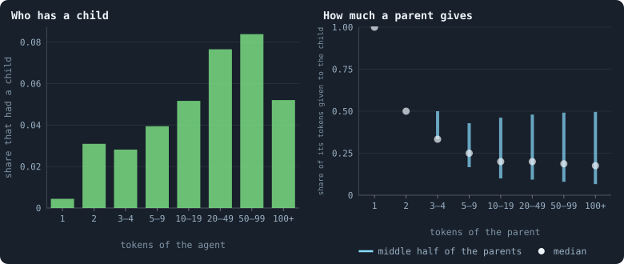
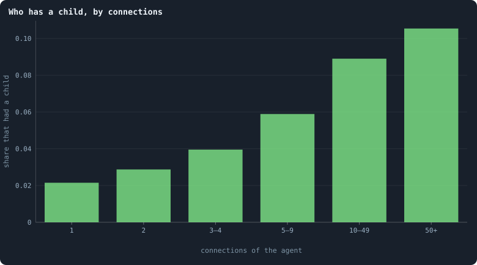
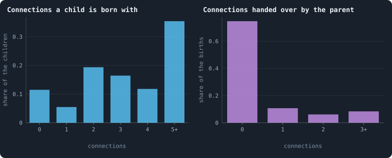
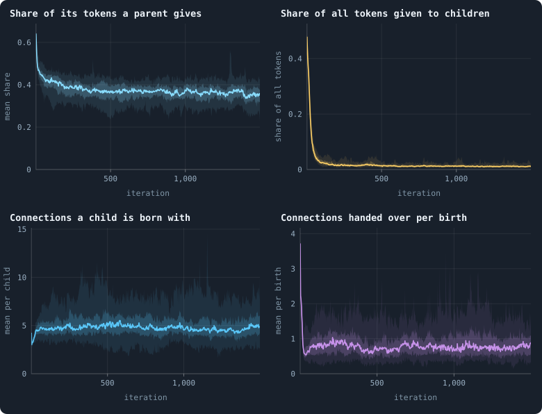

# How births build the network

> [!question] Questions of this page
> - Which [agents](the-world.md#agents-and-tokens "One member of a world: it lives on a node of the network, holds tokens and has a brain that takes all its decisions.") have children: the rich, the well connected, anyone?
> - How much of its [tokens](the-world.md#agents-and-tokens "The one thing of value in a world: every agent holds a whole number of them, and their total never changes.") does a parent give, and why do some shares come up
>   again and again?
> - How is a child joined to the world, and how often is it born cut off?
> - Where do a world's [connections](the-world.md#the-network "A link between two agents of the network: they are neighbours, and can stake on each other's nodes.") come from, and what would a world look
>   like without births?
> - Do the well connected gain more connections than the poorly connected, and
>   lose more? In proportion to what they have?
> - Do agents gather connections as they grow old, so that the oldest are the
>   [hubs](stars-and-hubs.md "An agent joined to far more agents than most; a star is a world held together by a single hub.")?

## In short

In the first [baseline](b1-and-b2.md "The stated rules an experiment starts from and changes one thing of: B1 or B2."), [B1](b1-and-b2.md "The first baseline: the algorithm exactly as a new run is offered it."), every new node of a world's network is a newborn
agent, and every new connection is made at a birth. Only three or four agents
in a hundred have a child in an iteration, and connections raise the chance
more than wealth does. A child is joined only inside its parent's
neighbourhood, so a new connection never brings two agents closer together.
That is why a world keeps a shape in space. Agents gain connections in
proportion to those they have, and lose them a little faster, so no hub runs
away with the network. Age gives an agent no connections; connections give
it age.

## How agents have children

Where does a world's network come from? Each new node is a newborn agent.
And each new connection, as [Births build the network](#births-build-the-network)
shows, is made at a birth. So to see how the network grows, start with how
agents have children.

Every iteration begins with a reproduction phase, in which any agent may
have one child ([One iteration, step by step](one-iteration.md)).
[Births, deaths and ages](births-deaths-and-ages.md) counted the births. This
section looks at the decisions behind them: who has a child, how much it
gives, and how the child is joined to the world.

The worlds are the thirty of 100,000 tokens of
[Thirty worlds](a-worlds-life.md#thirty-worlds), the runs of Experiment 10.
This page was first written from the thirty worlds of 10,000 tokens; where
those differ, both are given.

### A birth, decision by decision

A birth is three decisions, all taken by the parent's [brain](the-brain.md "The neural network each agent decides with: inputs about itself and its neighbours, outputs that become its decisions."). Take
agent *u*, holding τ tokens. Its brain gives one column of outputs for each
of its candidates: *u* itself and each of its [neighbours](the-world.md#the-network "An agent joined to another by a connection."). From these
columns:

1. **How much.** Two of the outputs, averaged over all the columns, give two
   numbers (*ā*, *b̄*). The child gets *c* = ⌊*f*(*ā*, *b̄*) · τ⌋ tokens: the
   share *f* of the parent's tokens, rounded down. Here *f* is the share
   function ([The share function](share-function.md)). It gives the positive
   part of *ā* as a share of the positive parts of both, or ½ if neither is
   positive. If *c* = 0, there is no child.
2. **Whom it joins.** For every candidate, the parent included, a [yes-or-no
   decision](binary-decision.md "A yes or no a brain gives from four numbers: how strongly it means yes and no, and whether the stronger always wins or chance decides in proportion."): join the child to it or not.
3. **What it is handed.** For every neighbour of the parent, a yes-or-no
   decision: move the parent's connection to that neighbour over to the child.

Two consequences follow from the arithmetic alone, before any data:

- **A poor agent can only give a lot.** With 1 token, *c* ≥ 1 needs *f* = 1:
  the parent gives its only token. Left with none, it starves at the end of
  the phase. With 2 tokens, *c* ≥ 1 needs *f* ≥ ½: it gives half or
  everything. Only a richer agent can give a small share.
- **"All", "half" and "nothing" are easy to say.** The share *f* is exactly 1
  when *ā* is positive and *b̄* is not, and exactly ½ when neither is. It is
  exactly 0, and there is no child, when *b̄* is positive and *ā* is not. A
  brain does not need to compute a ratio to give half; it only needs two
  negative numbers.

### Who has a child

Sort the agents of a settled world, from iteration 500 on, by the tokens they
hold. What share of each class has a child, and how much of its tokens does
it give?

<!-- figure children/by-tokens -->

**Children, by the wealth of the parent.** Agents alive at the start of the reproduction phases of every 100th iteration from 500 on, in the 30 worlds, sorted by the tokens they held. Left: the share of them that had a child. Right: for those that did, the share of their tokens they gave it — the white dot is the median, the cyan bar runs from the 25th to the 75th percentile.

> [!example]- How to make this figure
> **Runs.** The 30 baseline runs `B1-100000-s001` … `B1-100000-s030`: the baseline B1 at 100,000 tokens, seeds 1 to 30, 1,500 iterations each (every setting is listed in [Thirty worlds](a-worlds-life.md#thirty-worlds)). They are made with `python3 gol_lab.py run E10`.
>
> **Data.** From each run's frames, read every 25 iterations by `book_figures.sample_pass` (frame `2·t` after the reproduction phase of iteration *t*, frame `2·t + 1` after its game; `gol_store.read_frame(run, index)`).
>
> 1. For every 100th iteration t from 500 on, take the agents of frame `2·t − 1` (after the game before) with their `tokens`.
> 2. In frame `2·t`, `decisions.births` lists every parent (`agent`) with `tokens_before` and `invested`, the tokens its child got.
> 3. Per class of tokens: the share of agents that are parents, and the quantiles of `invested` / `tokens_before` over the parents.
>
> **To make it again:** `python3 book_figures.py children`.
<!-- /figure -->

In the first reproduction phase, three [founders](starting-ring.md "One of the agents a world starts with, each holding the same tokens, on a ring with a few shortcuts.") in four (74.7%) had a child.
In a settled world, only a few agents in a hundred do in any one phase:

| tokens | 1 | 2 | 3–4 | 5–9 | 10–19 | 20–49 | 50–99 | 100+ |
|---|---|---|---|---|---|---|---|---|
| had a child | 0.4% | 3.1% | 2.8% | 3.9% | 5.2% | 7.7% | 8.4% | 5.2% |
| [median](median-and-quantiles.md "The middle value: half of the numbers lie below it and half above.") share given | 1 | ½ | ⅓ | ¼ | 0.2 | 0.2 | 0.19 | 0.18 |

The 1-token parents all give their only token, and starve for it. The 2-token
parents mostly give half. From 3 tokens on, the median share falls to a
third, then to a quarter and a fifth for the richer. But the spread is wide:
the bars run up to ½ in every class from 10 tokens on. The mean over all
parents is 36% of what they hold. All of this is much as at 10,000 tokens.
There the rich were a little less likely to have a child: 6.5% at 50 to 99
tokens.

Wealth helps: an agent with 50 to 99 tokens is three times as likely to have
a child as one with 3 or 4. Connections help more:

<!-- figure children/by-degree -->

**Who has a child, by connections.** As the left panel of the figure above, with the agents sorted by their number of connections at the start of the reproduction phase instead of their tokens.

> [!example]- How to make this figure
> **Runs.** The 30 baseline runs `B1-100000-s001` … `B1-100000-s030`: the baseline B1 at 100,000 tokens, seeds 1 to 30, 1,500 iterations each (every setting is listed in [Thirty worlds](a-worlds-life.md#thirty-worlds)). They are made with `python3 gol_lab.py run E10`.
>
> **Data.** From each run's frames, read every 25 iterations by `book_figures.sample_pass` (frame `2·t` after the reproduction phase of iteration *t*, frame `2·t + 1` after its game; `gol_store.read_frame(run, index)`).
>
> 1. As for the figure above, counting each agent's connections in frame `2·t − 1`.
>
> **To make it again:** `python3 book_figures.py children`.
<!-- /figure -->

The share with a child rises from 2.1% of agents with one connection to 10.5%
of agents with fifty or more. That is a fivefold rise (fourfold at 10,000
tokens). Part of this is wealth, because well-connected agents are richer
([Where the tokens flow](where-the-tokens-flow.md)). And part is an effect of
the rules themselves. The child-share outputs are **averaged** over all of an
agent's candidates. So an agent with many neighbours decides by an average of
many columns. And an average of many columns is less extreme than one column.
[Decisions averaged over neighbours](questioning-the-mechanics.md#decisions-averaged-over-neighbours)
comes back to it.

### How a child is joined

Once born, a child needs at least one connection, or it is not part of the
world. It can get connections in two ways: its parent joins it to some of its
candidates, and may hand it some of its own connections.

<!-- figure children/links -->

**How a child is joined to the world.** Every birth in the reproduction phases of every 100th iteration from 500 on, in the 30 worlds. Left: how many of its parent's candidates — the parent itself and its neighbours — the child was joined to at birth. Right: how many of its own connections the parent handed to the child. A child with no connection at all is cut off at once.

> [!example]- How to make this figure
> **Runs.** The 30 baseline runs `B1-100000-s001` … `B1-100000-s030`: the baseline B1 at 100,000 tokens, seeds 1 to 30, 1,500 iterations each (every setting is listed in [Thirty worlds](a-worlds-life.md#thirty-worlds)). They are made with `python3 gol_lab.py run E10`.
>
> **Data.** From each run's frames, read every 25 iterations by `book_figures.sample_pass` (frame `2·t` after the reproduction phase of iteration *t*, frame `2·t + 1` after its game; `gol_store.read_frame(run, index)`).
>
> 1. In frame `2·t` of every 100th iteration t from 500 on, read `decisions.births`: the length of `links` and of `handed_over` for every birth.
> 2. Count the births by these lengths and divide by all births.
>
> **To make it again:** `python3 book_figures.py children`.
<!-- /figure -->

**11.5% of children are joined to none of their parent's candidates at
birth.** Two in five of these (39%) are handed connections by their parent
(the right panel), and live. The rest, some 7% of all children, belong to no
network. The cleanup that ends every phase keeps only the largest connected
piece of the network. So it removes these children at once, with the tokens
they were given, and shares those tokens out among the survivors.

The others are most often joined to two, three or four candidates, and 35% of
all children to five or more. On average a child is joined to 5.1, pooled
over the worlds and counting the children with no link at birth. At 10,000
tokens it was 4.6, because agents had fewer connections to pass on.

Most parents hand over nothing (75%). Of all parents, 11% hand over one
connection, 6% two and 8% three or more: about three for every four births,
on average. Rare as it is, a handover can be enormous. A star is a world
held together by a single hub. Every so often its centre has a child, and
hands it nearly all its connections
([How a star is handed down](the-largest-and-the-smallest.md#how-a-star-is-handed-down)).

### Reproduction over a world's life

Four of these numbers are recorded after every reproduction phase, so they
can be followed through a world's whole life:

<!-- figure children/over-time -->

**Reproduction over a world's life.** After every reproduction phase of the 30 baseline worlds ([Reproduction statistics](reproduction-statistics.md)): the mean share of its tokens a parent gave its child (`meanInvestedShare`); the tokens given to all children as a share of all tokens (`reproTokenShare`); the mean number of connections a child was born with (`meanChildLinks`); and the connections handed over per birth (`handovers` / `births`). The line is the median of the worlds at each iteration, the darker band holds the middle half of them (from the 25th to the 75th percentile) and the paler band nine in ten (5th to 95th).

> [!example]- How to make this figure
> **Runs.** The 30 baseline runs `B1-100000-s001` … `B1-100000-s030`: the baseline B1 at 100,000 tokens, seeds 1 to 30, 1,500 iterations each (every setting is listed in [Thirty worlds](a-worlds-life.md#thirty-worlds)). They are made with `python3 gol_lab.py run E10`.
>
> **Data.** From each run's `GraphOfLifeRuns/<run>/stats.jsonl`, which holds one row per recorded phase: `phase` 1 is the world just after reproduction, `phase` 2 just after the game, and every statistic is a field of the row (see [What a run records](frames-and-stats.md)).
>
> 1. Take the rows with `phase` = 1: `meanInvestedShare`, `reproTokenShare`, `meanChildLinks`, and `handovers` divided by `births`.
> 2. Cut the 1,500 iterations into 600 stretches of 2.5 and take each world's mean in each stretch.
> 3. In each stretch, take the median, the 25th and 75th and the 5th and 95th percentiles of those means over the worlds that still have a value there (a world that died has none after its death).
>
> **To make it again:** `python3 book_figures.py children`.
<!-- /figure -->

Over the [settled life](settled-life.md "A world from iteration 500 to its end, after its youth, where it is measured."), the median world's parents give 36% of what they
hold. All the tokens given to children in one phase are 1.3% of the world's
tokens. And in the median world, a child is joined at birth to 4.8 of its
parent's candidates on average. Births move little wealth.

### Births build the network

One fact about the rules makes births more important than their numbers
suggest. Look at where connections come from. In B1, the only rule that
**adds** connections is a birth: a newborn is joined to some of its parent's
candidates. A handover only **moves** a connection, from the parent to its
child, or removes it, if the child is already joined to that neighbour. The
game only **removes** connections: after it, every connection that carried no
tokens is cut. And an agent that dies takes its connections with it. So,
apart from the ring the founders start on, **every connection in a world was
made at a birth.** ([B2](b1-and-b2.md "The second baseline: B1 with the rules that keep its network from breaking and its agents from staking or breeding themselves to death.") adds a second source: it mends the network where a
death would cut it in pieces, as
[Mending a death](a-world-that-cannot-break.md#mending-a-death) explains.)

So the network is grown by births and pruned by games. In a settled world,
about 480 children are born per iteration, joined to about 4.8 agents each:
some 2,300 new connections. Each game cuts about 1,600 unused ones, and the
dead take theirs with them. The two balance, and the number of connections
wanders but does not drift
([The life of a B1 world](a-worlds-life.md#connections)). A world without
births could only lose connections, never gain one.

Births also keep a world alive. A world loses agents in every iteration. In
worlds of 5,000 tokens, the cull alone takes two to five agents in a hundred
each time. The cull is the part of the cleanup that removes everyone cut off
from the largest piece. Such a world lives only while its births keep up.
Brains that
see what is around them, built with fewer layers than B1's, can give up
having children. Then their worlds die out
([Brains that see, and worlds that break](a-world-that-cannot-break.md#brains-that-see-and-worlds-that-break)).

## How the network grows

A world's network is not given. The rules make and unmake it, connection by
connection: births make connections, and games and deaths unmake them
([Births build the network](#births-build-the-network)).
[What shape does the network take?](what-shape-does-the-network-take.md)
describes the shape that results. This section watches the making and the
unmaking, and asks the question that decides the shape: who gains
connections, and who loses them?

### How a newborn is wired

Of 600,854 births in the reproduction phases of every 25th iteration from
500 on, **80%** of the children were joined to their own parent. Of all the
children, 6% were joined to just one of their parent's candidates, 56% to two
to five, and 27% to six or more. The other 12% were joined to none of them.
[How a child is joined](#how-a-child-is-joined) follows what becomes of
these, in a smaller sample. A child is born into its parent's neighbourhood
and nowhere else.

That has a consequence worth stating exactly. Every connection the rules make
runs from a newborn to its parent or to one of its parent's neighbours. A
handover only moves a parent's connection to its child. So **no connection
ever brings two agents that already lived closer together**. Two neighbours
of a parent were at most two steps apart, through the parent, before the
child arrived. The child adds only another path of two steps. Distances in a
world can grow, but new connections never shorten them. This is why a world
keeps a shape in space at all
([How many dimensions does a world have?](how-many-dimensions-does-a-world-have.md)).

The same rule limits what births can build. Every [loop](loops.md "A path through the network that comes back to where it started without using a connection twice.") a birth closes is
small, through agents at most two steps apart. Nothing closes a large loop,
through distant parts of the world. So a network grown by births alone is, at
large scale, a tree: a network without loops, whose nodes are dense blobs of
agents. The blobs hang on each other by necks that one death can cut
([A tree of blobs](a-world-that-cannot-break.md#a-tree-of-blobs)).

### Who gains and who loses

Picture one agent with *k* connections. In a reproduction phase it can gain
connections. Its own child may be joined to it, or a neighbour's child. Or a
neighbour may hand its connection with it over to a newborn child. In the
game that follows, the agent can lose connections. One that carried nothing
is cut, or a neighbour dies. Or the agent dies itself, and all of them go. Do
the well connected gain more, and lose more?

To measure it, sort the agents by their connections *k* at the start of a
reproduction phase. Count the connections each class gains in it. Then sort
them again at the start of the game that follows, and count what each class
loses in it. Divided by the agents in the class, these are the **gain
kernel** and the **loss kernel** of the network. They say what an agent with
*k* connections gains, and loses, on average
([Preferential attachment and its kernel](preferential-attachment.md)).

<!-- figure grows/kernel -->

**Who gains and who loses connections.** Agents sorted by their number of connections k at the start of a phase, in classes of growing width (dots at the middle of each class). Green: the new connections an agent alive before and after a reproduction phase gained in it, per agent — to its own newborn child, to a neighbour's child, or handed over. Red: the connections an agent had after the reproduction phase and no longer had after the game that followed — cut for carrying nothing, or gone with it if it died — per agent. Pooled over the reproduction phases and games of every 25th iteration from 500 on, in the 30 worlds. Dashed: straight lines fitted on these logarithmic axes; dotted: a line of slope 1, in proportion to k.

> [!example]- How to make this figure
> **Runs.** The 30 baseline worlds that lived to the end (`B1-100000-s001` … `-s030`, [Thirty worlds](a-worlds-life.md#thirty-worlds); `python3 gol_lab.py run E10`).
>
> **Data.** From each run's frames, `GraphOfLifeRuns/<run>/frames/`, read with `gol_store.read_frame(run, index)`; frame `2·t` is iteration *t* after reproduction and frame `2·t + 1` after the game.
>
> 1. For t = 500, 525, …, 1,475 read frames 2·t − 1 (before the reproduction phase of t), 2·t (after it) and 2·t + 1 (after the game).
> 2. Gained: the edges in 2·t not in 2·t − 1, counted at both ends, for agents in both frames, by their degree in 2·t − 1. Lost: the edges in 2·t not in 2·t + 1, counted for agents of 2·t by their degree there (all of them if the agent is gone).
> 3. Sum over t and worlds per class, divide by the agents; least squares of ln(rate) on ln(class middle).
>
> **To make it again:** `python3 book_figures.py grows`.
<!-- /figure -->

Both are straight lines on logarithmic axes, over two decades of *k*, from 1
to more than 100:

- **Gains grow as *k*^1.02.** An agent with one connection gains 0.05 new
  ones per reproduction phase. One with ten to nineteen gains about 0.65, and
  one with a hundred or more, 15. Gaining in proportion to what one has is
  **linear preferential attachment**. Barabási and Albert (1999) proposed it
  as the mechanism of heavy-tailed networks, in which a few nodes have far
  more connections than most. Here it is reached by copying (*k*^0.94 at
  10,000 tokens). A child joins some of its parent's candidates. So an agent gains a
  connection whenever one of its neighbours has a child that is joined to
  it. An agent with twice the neighbours has twice the chances.
- **Losses grow as *k*^1.20**, faster than in proportion (*k*^1.11 at 10,000
  tokens). From two connections on, every class loses at least as much in a
  game as it gained in the reproduction phase before. Hubs of a hundred
  connections or more gain 15 and lose 22. Only agents with a single
  connection gain more than they lose: 0.053 against 0.027.

One caution about these counts. When a parent hands a connection over to its
child, the neighbour at the other end is counted as gaining a connection,
though the connection only changed hands, and the parent's loss is not
counted. So part of what the leaves gain may be handovers. The hubs' real
losses are, if anything, larger than counted.

So no agent can run away with the network. Linear preferential attachment on
its own makes a few nodes grow without limit, as in a growing web. Here every
gain is offset by losses that grow slightly faster. So the well connected
drift back down, and only agents with a single connection drift up.

The connections of an agent go up and down by a random factor, game after
game. Meanwhile the world's total of connections stays in place, held there
by its tokens, which set how many agents it can hold. Growth by random
factors, kept off zero from below, makes heavy tails (Gabaix 1999). Losses
that grow faster than gains bend the tail down at the top. That fits what
[Power laws, real and apparent](power-laws-real-and-apparent.md) finds. Among
the best-connected hundredth of agents, the connections follow a [power law](power-law-fit.md "A quantity whose frequency falls as a power of its size: few huge values, many small ones.") of
exponent about 3 (the best-connected twentieth at 10,000 tokens). Below that
tail, nothing is scale-free: nothing follows a power law.

### Connections and age

In the model of Barabási and Albert, a network grows one node at a time.
Each new node links to old ones, with a chance in proportion to their
connections. There the oldest nodes are the hubs. They had the longest time
to gather connections, and preferential attachment rewards the early. Is that
so here?

<!-- figure grows/age -->

**Connections and age.** The agents alive after the last game of the 30 worlds, sorted by age — the iterations since their node was born — in classes doubling in width: the median number of connections of each class, with the band from its 25th to its 75th percentile, and the 99th percentile (dashed).

> [!example]- How to make this figure
> **Runs.** The 30 baseline worlds that lived to the end (`B1-100000-s001` … `-s030`, [Thirty worlds](a-worlds-life.md#thirty-worlds); `python3 gol_lab.py run E10`).
>
> **Data.** From each run's frames, `GraphOfLifeRuns/<run>/frames/`, read with `gol_store.read_frame(run, index)`; frame `2·t` is iteration *t* after reproduction and frame `2·t + 1` after the game.
>
> 1. Read frame 2,999 of each run: `ages`, and each agent's connections in `edges`.
> 2. Classes of age [0, 1), [1, 2), [2, 4), …, [1,024, 1,500); in each class with at least 30 agents, the median, quartiles and 99th percentile of the connections.
>
> **To make it again:** `python3 book_figures.py grows`.
<!-- /figure -->

For the typical agent, **no**. The median agent has 3 connections when it is
born, and **2** at every age after that, from a few iterations to over 700.
Only the few agents older than a thousand iterations have a median of 4.
Across all agents, the correlation of age and connections (both as
logarithms) is −0.01: none at all.

For the very best connected, a little. Take the best-connected hundredth of
the agents of each age. Up to an age of a hundred iterations, they have 16 to
22 connections. In the class of ages around 362 (256 to 511 iterations) they
have 40, and around 724 (512 to 1,023), 126. The great hubs are old. But
this is mostly survival, not accumulation. A hub is about half as likely to
die within ten games as a leaf, an agent with a single connection
([Do the rich stay rich?](where-do-the-tokens-go.md#the-fate-of-the-richest)).
So among the old, the hubs are overrepresented. Age gives an agent no
connections; connections give it age.

The very greatest hubs, the centres of a world's stars, are the exception the
other way. They pass from parent to newborn child, as
[How a child is joined](#how-a-child-is-joined) showed.

## What we learned

- **Reproduction is rare, and cheap for the world.** Three or four agents in
  a hundred have a child in a phase, and children take about 1.3% of the
  tokens. Founders, with random brains and 100 tokens each, reproduced some
  twenty times as often: something over the world's youth made brains that
  reproduce less.
- **Births are how the network grows.** Every connection beyond the ring the
  founders start on was made at a birth, so births are the world's only
  source of structure. They also keep a world alive, as long as they make up
  for its losses.
- **Growth is local.** A connection is only ever made inside a parent's
  neighbourhood, and never brings two agents closer together. That is what
  lets a world keep a geometry. A network that added connections between
  random agents would collapse into a small world, in which everything is a
  few steps from everything. The price is that births close only small
  loops, and leave a tree of blobs that one death can cut.
- **The network grows by preferential attachment and shrinks by preferential
  loss.** Both are close to proportional to an agent's connections. What a
  node has, it gains more of, and loses more of.
- **There is no first-mover advantage.** Old agents are no better connected
  than young ones, except that the best connected live longest.
- **Births are not the main road of inheritance.** About 480 children are
  born per iteration, but about 8,100 nodes take on a neighbour's brain in
  every game
  ([Two roads of inheritance](questioning-the-mechanics.md#two-roads-of-inheritance)).
  A brain spreads by conquest seventeen times more than by birth. In most
  models of evolution, reproduction is where heredity and variation happen;
  here, it is a side road.
- **For [open-ended evolution](open-ended-test.md "Evolution that keeps producing new things without end, not only up to a plateau."), the network is a churn.**
  [Do the rich stay rich?](where-do-the-tokens-go.md#do-the-rich-stay-rich) found connections to be
  the only lasting form of wealth. Yet they too are gained and lost in
  proportion, at every scale. No structure is built up that lasts longer than
  the agents in it.
  [What the measurements say about open-ended evolution](what-the-baseline-world-is.md#what-the-measurements-say-about-open-ended-evolution)
  asks what this means.

## Where to go next

- [What shape does the network take?](what-shape-does-the-network-take.md):
  the shape that all this making and unmaking leaves.
- [Power laws, real and apparent](power-laws-real-and-apparent.md): whether
  the connections follow a power law, and where.
- [Questioning the mechanics](questioning-the-mechanics.md): why a brain
  spreads by conquest more than by birth, and other rules worth questioning.
- [Building B2: a world that cannot break](a-world-that-cannot-break.md):
  rules that mend what births alone cannot build.

## How this was made

Every figure of this page reads the thirty runs of Experiment 10, listed
below. They are the baseline B1 at 100,000 tokens, [seeds](random-numbers.md "The number that fixes every random choice of a run: the same settings and the same seed make the same world.") 1 to 30, run for
1,500 iterations each. The command `python3 book_figures.py children` draws
the figures of [How agents have children](#how-agents-have-children), and
`python3 book_figures.py grows` those of
[How the network grows](#how-the-network-grows). Each figure says, folded
beneath it, which of the runs it reads and how.

The 39% of [How a child is joined](#how-a-child-is-joined) is counted in the
samples behind its figure. The function `book_figures.sample_pass` keeps, for
every run, a table of the parents of every 100th iteration from 500 on. Each
row holds the child's `links` and `handed`, and the table is kept in
`GraphOfLifeRuns/.book/<run>.sample.npz`. Of the 153,590 births there,
17,638 had no link, and 6,823 of these were handed at least one
connection.

The values given for the worlds of 10,000 tokens were measured the same way,
in the thirty worlds of Experiment 2 (`python3 gol_lab.py run E02`). They
date from when the two pages this one joins were first written.

### The runs of Experiment 10

<!-- runs E10 -->
> [!info]- The runs behind this page
> **30 runs.** Every condition below is run once for every seed (1 to 30), for 1,500 iterations — or until its world dies out. Every setting is that of the baseline **B1** (the algorithm exactly as a new run is offered it) unless the condition changes it.
>
> - **baseline** — changes nothing: B1 as it is; 100,000 tokens. Runs `B1-100000-s001` … `B1-100000-s030`.
>
> To make these runs again: `python3 gol_lab.py run E10`, or ▶ in the Research Notebook tab of a computer running `gol_server.py`. Each run writes its settings, seed and engine version beside its frames, in `GraphOfLifeRuns/<run>/meta.json` and `provenance.json`.

> [!info]- Every setting of these runs
> | setting | baseline | what it is |
> |---|---|---|
> | [`total_tokens`](settings.md#total_tokens) | 100,000 | The number of tokens in the world, *T*. It never changes during a run. |
> | [`n_nodes`](settings.md#n_nodes) | 0 | How many founders the world starts with. 0 means one founder per hundred tokens: *n* = ⌊*T* / 100⌋. |
> | [`k_neighbors`](settings.md#k_neighbors) | 0 | How many neighbours each founder starts with in the ring. 0 means *k* = max(⌊*n* / 100⌋, 5); an odd *k* is wired as *k* − 1. |
> | [`rewire_p`](settings.md#rewire_p) | 0.2 | In the starting ring, the probability that a connection is moved to a founder chosen at random (Watts–Strogatz). |
> | [`hidden_layers`](settings.md#hidden_layers) | 50, 45, 40, 35, 30 | The widths of the brain's hidden layers, in order from input to output. |
> | [`brain_kind`](settings.md#brain_kind) | float16 | How weights are stored: `float` (64-bit), `float16` (16-bit, computed in 64-bit) or `binary` (−1, 0, +1). |
> | [`brain_bits`](settings.md#brain_bits) | 16 | Only for binary brains: how many input rows encode one number. Unused by float and float16 brains. |
> | [`message_amount`](settings.md#message_amount) | 30 | How many numbers one message holds. Each agent sends one message to itself and one to each neighbour, every phase. |
> | [`random_input_amount`](settings.md#random_input_amount) | 5 | How many random numbers, drawn uniformly from −2 to 2, a brain reads per neighbour, every time it looks. |
> | [`exchange_messages`](settings.md#exchange_messages) | on | Whether agents send and read messages at all. |
> | [`message_prepass`](settings.md#message_prepass) | on | Whether every phase begins with an extra look in which agents only write messages, so the look that acts reads messages written this phase. |
> | [`allow_handover`](settings.md#allow_handover) | on | Whether a parent may move some of its own connections to its newborn child. |
> | [`allow_revolutions`](settings.md#allow_revolutions) | on | Whether a coalition of smaller stakers can take a node from its largest staker (see the note *How a coalition takes a node*). |
> | [`allow_gifting`](settings.md#allow_gifting) | off | Whether agents may give tokens to neighbours during reproduction. Off in both baselines; on in a few pilots, in Experiment 24 and in half the worlds of the screen. |
> | [`random_decisions`](settings.md#random_decisions) | off | The control: every number a brain would produce is replaced by a random draw from the standard normal distribution. |
> | [`prune_after`](settings.md#prune_after) | blotto | After which phase connections that carried no tokens are cut: `blotto` (the game), `reproduction`, or `both`. |
> | [`inactive_window`](settings.md#inactive_window) | phase | How long a connection may go unused: `phase` means it must carry tokens in the phase being judged; `iteration` allows the two last phases. |
> | [`redistribution`](settings.md#redistribution) | uniform | How the tokens of removed agents are shared: `uniform` gives every survivor the same chance at each token; `by_tokens` weights by what a survivor holds; `poorest` raises the poorest to one common level first; `newborns` gives them to this iteration's children, `parents` to their parents, once per child (both `uniform` in an iteration without births); `children` leaves each dead agent's estate to its own living children (`uniform` where there are none). |
> | [`tokens_created_per_phase`](settings.md#tokens_created_per_phase) | 0 | Tokens added to the world at every cleanup. 0 keeps the supply fixed. |
> | [`mutate_on_replication`](settings.md#mutate_on_replication) | off | Whether a brain changes only when it is copied — into a newborn, or into a node its owner has just won — instead of also after every game, wherever it sits. |
> | [`incumbency`](settings.md#incumbency) | 1.0 | How many times over an agent's stake on its own node counts when the game decides who takes the node. 1 is the old rule. |
> | [`birth_links`](settings.md#birth_links) | 0 | How many of its parent's neighbours a newborn is joined to, drawn at random, besides its parent itself; 0 leaves every link to the brain's choice. |
> | [`mend_on_death`](settings.md#mend_on_death) | off | Whether the neighbours of an agent that dies are joined up where its death would leave them in separate pieces. |
> | [`prune_needs`](settings.md#prune_needs) | 0 | How many neighbours the two ends of an unused connection must share for it to be cut; 0 cuts every unused connection. |
> | [`valence`](settings.md#valence) | 0 | The most connections an agent's brain may choose to hold (0 = no limit). An agent at its limit cannot have a child. |
> | [`keep_home`](settings.md#keep_home) | 0.0 | The share of an agent's tokens — rounded up, never less than one — that stays on its own node whatever its brain says; a parent also keeps one. 0 is the old rule. |
> | [`max_age`](settings.md#max_age) | 0 | The age at which an agent dies (0 = never); its tokens are shared out like those of any other dead agent. |
> | [`buy_life`](settings.md#buy_life) | off | Whether an agent that has reached max_age may live on by paying one token an iteration into the estate of the dead — never its last, so one with a single token left dies. Needs max_age. |
> | [`min_child`](settings.md#min_child) | 1 | The fewest tokens a child can be born with; a parent that would give less has no child. |
> | [`child_floor`](settings.md#child_floor) | fixed | The least a child may start with: min_child alone (fixed), or also the median holding of its parent's neighbours (neighbours), so that a world grows only as rich as it is. |
> | [`mix_at_birth`](settings.md#mix_at_birth) | off | Whether a newborn's brain is its parent's mixed with a mate's — one of the parent's neighbours, drawn at random — each hidden unit whole from one or the other by an even chance, before it mutates; off, a newborn has a copy of its parent's brain. |
> | [`mix_mates`](settings.md#mix_mates) | any | Under mix_at_birth, who may be the mate: any neighbour of the parent, or only parents — a neighbour with a living child of its own (with none, the newborn's brain is a copy). |
> | [`self_message`](settings.md#self_message) | own | What an agent writes to itself, which each neighbour reads: what its own column says (own), or the largest, number by number, of what it writes to anyone (largest), so that news one column marks reaches every neighbour. |
> | [`link_search`](settings.md#link_search) | off | Whether an agent may reach beyond its neighbours to propose a link: off; jump, a walk as many steps long as the tokens it spends in one iteration, with a link proposed where it ends; walk, a scout that goes one step further in every iteration it pays for; or reach, a jump whose steps are free, as many as the tokens it holds would pay for. A paid step costs one token, paid to the agent it enters, and never the last. |
> | [`link_steering`](settings.md#link_steering) | random | Which way each step of a search goes: to a neighbour drawn at random, or to the one the searcher would most like a link with (looking). |
> | [`link_consent`](settings.md#link_consent) | mutual | Who has to agree to a link a search proposes: both ends (mutual), or only the one who proposes (forced). Nobody at its valence gets a new link either way. |
> | [`proto`](settings.md#proto) | none | Rules first played in the pilots' prototype, by name: came_from and helped_by (an input row each), contest = lottery, pool by genotype or family, kin_sense, tag_rate, mate_pays, grow, unit_token, link_token. Empty in every run but those that ask for one; only the prototype's world plays them (see the settings note). |
> | [`mutation_probability`](settings.md#mutation_probability) | 0.2 | The probability that a brain changes when it is copied to a child, and again, for every brain, after every game. |
> | [`mutation_noise_std`](settings.md#mutation_noise_std) | 0.2 | How large a change to one weight is: a normal draw with standard deviation this times 1/√(fan-in) of its layer. |
> | [`mutation_sparsity`](settings.md#mutation_sparsity) | 0.1 | The share of a brain's numbers a change touches; also the probability, for each weight matrix and bias vector, of a rarer reset that redraws that share of it. |
> | [`extinction_threshold`](settings.md#extinction_threshold) | 20 | A run stops, as extinct, when an iteration ends (after its game) with this many agents or fewer. |
> | seeds | 1 to 30 | one run per seed |
> | iterations | 1,500 | how far each run goes, unless its world dies first |
>
> A value in **bold** differs from the baseline B1.
<!-- /runs -->

## How our view changed

- **14 October 2026.** From 8 October on,
  [How a child is joined](#how-a-child-is-joined) said that every child
  joined to none of its parent's candidates is cut off at once. That was
  11.4% of the children at 10,000 tokens, and 11.5% at 100,000. A pass
  through the whole notebook corrected it. About a third of these children
  are handed connections by their parent, and live; only some 7% of all
  children are cut off. The same pass corrected
  [How a newborn is wired](#how-a-newborn-is-wired). It had said that the
  other children were joined to two to six of their parent's candidates,
  often more. In fact 6% of all children are joined to just one.
- **23 October 2026.** [How a newborn is wired](#how-a-newborn-is-wired) had
  kept the old claim since it was first written, on 9 October. It said that
  the 12% of children joined to no one are cut off at once. Merging the two
  pages into this one put it right. The samples
  behind the figure *How a child is joined to the world* also sharpen "about
  a third". Of the children with no link at birth, two in five (39%) were
  handed connections. So 7.0% of all children were cut off.

<!-- turns -->
---

← [Births, deaths and ages](births-deaths-and-ages.md) · [Agents' lives: births, deaths, ages](../README.md#agents-lives-births-deaths-ages) · [Births and the four ways to die](births-and-deaths.md) →

**Also about:** [The shape and health of the network](../README.md#the-shape-and-health-of-the-network).

> [!info]- Pages that link here (17)
> [Questioning the mechanics](questioning-the-mechanics.md) · [The share function f(a, b)](share-function.md) · [A yes-or-no decision](binary-decision.md) · [What B1 is, and what stood in its way](what-the-baseline-world-is.md) · [The life of a B1 world](a-worlds-life.md) · [Births, deaths and ages](births-deaths-and-ages.md) · [Reproduction statistics](reproduction-statistics.md) · [The largest and the smallest](the-largest-and-the-smallest.md) · [The shape of the network](what-shape-does-the-network-take.md) · [Power laws, real and apparent](power-laws-real-and-apparent.md) · [Stars and hubs](stars-and-hubs.md) · [Preferential attachment and its kernel](preferential-attachment.md) · [Like next to like](like-next-to-like.md) · [How many dimensions does a world have?](how-many-dimensions-does-a-world-have.md) · [Worlds of many sizes](how-does-a-worlds-size-follow-its-tokens.md) · [Do the brains matter?](do-the-brains-matter.md) · [Do agents cooperate?](do-agents-cooperate.md)
<!-- /turns -->
