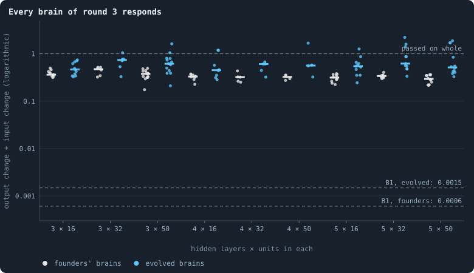
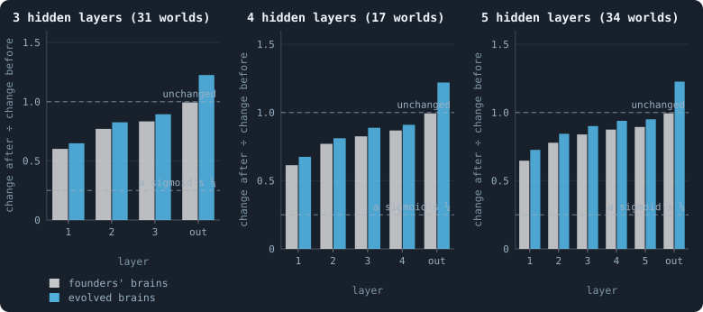
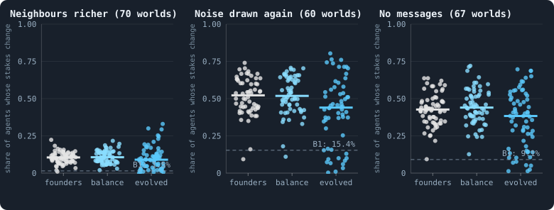
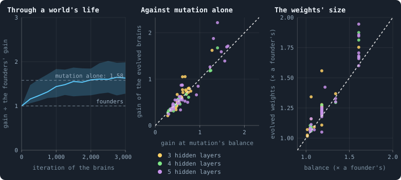
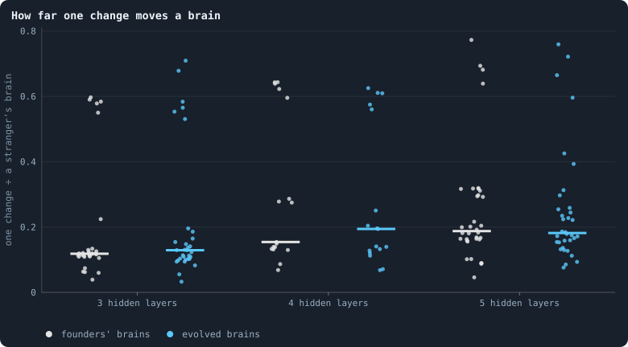
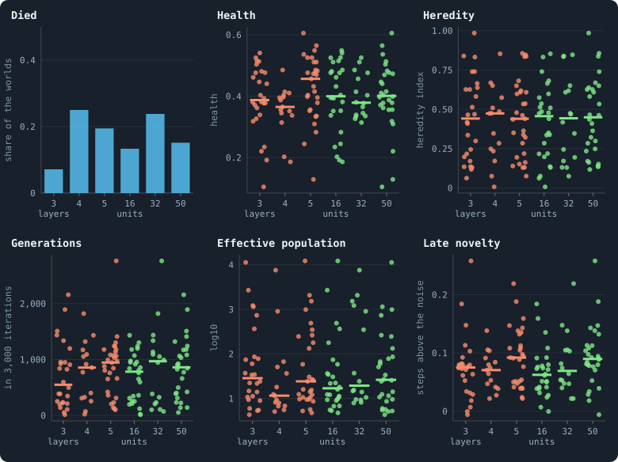
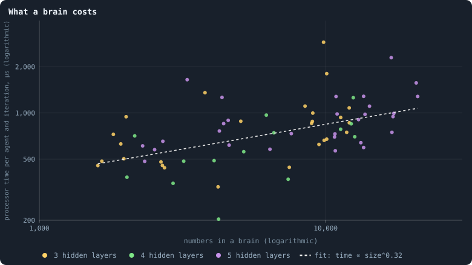

# How big should a brain be?

> [!question] Questions of this page
> - Do brains of three to five tanh layers respond to what they see, or are they as blind as [B1](b1-and-b2.md "The first baseline: the algorithm exactly as a new run is offered it.")'s?
> - Does the brain's depth or width decide whether a world lives, how healthy it grows, or how it evolves?
> - Did evolution make the brains respond more, and was that selection, or mutation alone?
> - Which brain should the next random worlds be drawn with?

## In short

Round 3 of the random screen gave every world one of nine brains, three to
five hidden layers of 16, 32 or 50 tanh units, and all nine see: a small
change in what a brain sees reaches its outputs at a third of its size in a
founder and at more than half after evolution, nearly 400 times as much as in
B1's evolved brains. Depth costs them little, since every tanh layer after
the first passes on 80 to 90% of a change. Evolution raised this gain by about
1.6 times, but mutation alone does as much, and selection added little if
anything. Nor did the shape make a difference we can tell from chance to
whether a world lived, how healthy it grew or how it evolved. So the cheapest
brain, three layers of 16, is enough for the next rounds, until contests
between a world's eras show whether a larger one lets evolution go further.

## A planned experiment, answered from round 3

This page was planned on 2 October 2026 as an experiment: [B2](b1-and-b2.md "The second baseline: B1 with the rules that keep its network from breaking and its agents from staking or breeding themselves to death."), the world that
cannot break, played with brains of one hidden layer of 8, 16 or 32 units, or
two of 16, and judged by contests between each world's eras
([Eras, contests and invasions](measuring-evolution.md#eras-contests-and-invasions-does-a-world-keep-getting-better)). It was never played.
Round 3 of the random screen gave the brain's shape to chance instead
([Round 3: the author's settings](a-screen-of-random-worlds.md#round-3-the-authors-settings)).
Every world drew three, four or five hidden layers, each of 16, 32 or 50
units, all with tanh. So the question can now be asked of a hundred worlds
that already exist, with no new runs.

Two things differ from the plan. Round 3's brains are all tanh and at least
three layers deep, so the plan's smallest brains are not among them. And the
worlds differ in every other [setting](settings.md "One number or switch of a run's rules, fixed before it starts.") too, so a small effect of the brain can
hide among the large effects of the rest. About eight living worlds share each
shape, and every difference between shapes on this page is *indicative*
([How many seeds an experiment needs](statistics.md#how-many-seeds-an-experiment-needs)).

## Why depth blinded B1, and why tanh need not

Picture five people in a row, each repeating what they hear at a quarter of
the loudness. A shout at one end arrives at the other as a whisper, a
thousandth as loud. B1's brain is such a row: each of its five hidden layers
ends in a sigmoid, whose slope is at most ¼, so a change in what it sees
reaches what it does about a thousand times smaller
([What the brains are like](what-the-brains-are-like.md#does-a-brain-see-what-it-is-shown)).

Now let each person repeat what they hear at full loudness, and only cut off
a shout. That is a layer of tanh units. tanh is the same S-shape as the
sigmoid, centred on zero and twice as tall, and its slope at zero is 1, four
times the sigmoid's. Where a unit's sum is near zero, a change passes through
it whole. Where the sum reaches into the flat ends of the S, less gets
through.

Exactly: a tanh unit with sum *z* passes a small change on at tanh′(*z*) =
1 − tanh²(*z*). A founder's weights keep each layer's sums about as large as
its inputs ([The neural network](the-brain.md#the-neural-network)). So a
layer's **gain**, the root-mean-square change of its outputs over that of its
inputs ([The gain of one layer](the-brain.md#the-gain-of-one-layer)), is about
the typical size of tanh′ over its sums. For sums of typical size 1 that is
0.68, for sums of size 0.5 it is 0.85; a sigmoid's would be 0.21 and 0.24.
Each tanh layer also squeezes its outputs a little, so the next layer's sums
are smaller and it passes on more. A founder's weights put a tanh brain right
on the border between brains that damp every change and brains that amplify
it (Poole and others, 2016): deep inside such a brain a layer passes on
nearly all of a change. Depth should then cost tanh brains little. Round 3
can check.

## Round 3's nine brains

Of round 3's hundred worlds, 82 lived to the end of their 3,000
[iterations](one-iteration.md): 70 of Experiment 40's 84 draws, and 12 of the
16 worlds of Experiments 41 and 42, eight draws each played twice with the
stakes placed a [token](the-world.md#agents-and-tokens "The one thing of value in a world: every agent holds a whole number of them, and their total never changes.") at a time
([What round 3 found](a-screen-of-random-worlds.md#what-round-3-found)).

<!-- table brainsize/shapes -->
| hidden layers × units | lived, of the worlds drawn (Experiment 40) | more living worlds (Experiments 41 and 42) | numbers in a brain (median) | founders' gain | evolved gain | processor time per agent and iteration, µs (median) |
|---|---|---|---|---|---|---|
| 3 × 16 | 10 of 10 | 1 | 2,009 | 0.36 | 0.47 | 494 |
| 3 × 32 | 4 of 5 | 2 | 8,999 | 0.47 | 0.74 | 882 |
| 3 × 50 | 12 of 13 | 2 | 10,081 | 0.38 | 0.62 | 860 |
| 4 × 16 | 6 of 9 | 2 | 2,790 | 0.33 | 0.45 | 433 |
| 4 × 32 | 5 of 6 | 0 | 6,205 | 0.32 | 0.61 | 559 |
| 4 × 50 | 4 of 5 | 0 | 12,380 | 0.33 | 0.57 | 817 |
| 5 × 16 | 10 of 11 | 1 | 3,283 | 0.31 | 0.55 | 708 |
| 5 × 32 | 7 of 10 | 4 | 7,961 | 0.34 | 0.62 | 731 |
| 5 × 50 | 12 of 15 | 0 | 15,579 | 0.30 | 0.52 | 986 |
<!-- /table -->

A brain's size is the number of its weights and biases. The shape sets most
of it, and the world's other settings the rest: a brain reads more inputs
where more messages and random numbers were drawn, from 31 to 176 in the living
worlds of round 3. The smallest brains, three layers of 16, hold about 2,000
numbers; the largest, five layers of 50, about 15,600, nearly eight times as
many. What each costs to run is [below](#what-a-brain-costs).

## Every brain of round 3 responds

To see whether a brain responds, we did what
[What the brains are like](what-the-brains-are-like.md) did for B1. In each
living world, at its end, we took 300 [agents](the-world.md#agents-and-tokens "One member of a world: it lives on a node of the network, holds tokens and has a brain that takes all its decisions.") at random among those holding a
token. We rebuilt what each of them sees, exactly as the [engine](runs-and-records.md#the-lab-the-engine-and-pilots "The program that runs an experiment's plan as runs, each on a frozen copy of the engine, the code that plays a world.") builds it,
and ran its brain on it. Then we moved every input by a small random amount
and ran it again. The brain's gain is how much of that change reached its
outputs. We did the same with a fresh founder's brain of the same shape,
shown exactly the same inputs.

<!-- figure brainsize/gain -->

**Every brain of round 3 responds.** Each dot is a living world of round 3, placed by its brains' shape: the median, over 300 of its agents, of how much a small change of every input reaches the outputs — every input moved by a normal amount of standard deviation 0.1, and the root-mean-square change of the outputs over that of the inputs, the brain's gain. Blue: the agents' own brains at the end of the world; grey: fresh founders' brains of the same shape (weights normal with standard deviation 1/√(fan-in), biases 0) shown exactly the same inputs; the bar is the median. The dashed lines are B1's five sigmoid layers ([What the brains are like](what-the-brains-are-like.md)).

> [!example]- How to make this figure
> **Runs.** Round 3 of the random screen: Experiment 40's 84 worlds, each a draw of its own, and the 16 of Experiments 41 and 42, eight draws played twice with the stakes placed a token at a time (30,000 tokens, 3,000 iterations; [A screen of random worlds](a-screen-of-random-worlds.md))
>
> **Data.** From each living world's checkpoint, `GraphOfLifeRuns/<run>/checkpoint.npz` (the world after its last iteration), and its archive, `GraphOfLifeRuns/<run>/archive/world_<iteration>.npz` (the whole world every 250 iterations, from the founders on), read by `book_chapters.brainsize.kept_world` with the brains of the agents probed only.
>
> 1. For 300 agents drawn at random among those holding a token or more (seed 53), their inputs exactly as the engine builds them for a look at their candidates (`World._precompute_features`, `World._inputs`).
> 2. Draw ε, normal with standard deviation 0.1 (seed 5301), the shape of each agent's input matrix X; the gain is RMS(forward(X + ε) − forward(X)) / RMS(ε), for its own brain and for a fresh founder's (seed 5303).
> 3. The median over the agents of a world (`book_chapters.brainsize.probe`).
>
> **To make it again:** `python3 book_figures.py brainsize`.
<!-- /figure -->

Every brain of round 3 responds. A founder's brain passes a change on at a
median of **0.34** of its size (the 82 worlds: 0.18 to 0.52), and an evolved
brain at **0.56** (0.21 to 2.2). B1's founders passed on 0.0006 and its evolved
brains 0.0015 ([What the brains are like](what-the-brains-are-like.md)). So a
round-3 brain is nearly 400 times as sensitive as an evolved B1 brain, and more
than B2's single sigmoid layer of 16, whose founders pass on about 0.2
([Brains that see, and worlds that break](a-world-that-cannot-break.md#brains-that-see-and-worlds-that-break)).

Depth matters a little, and only in the founders. A founder's brain of three
layers passes on 0.38 in the median world, one of four or five layers 0.32: a
trend beyond chance in Experiment 40's 70 living worlds (a chance of 0.001,
by the shuffling test [below](#how-it-is-tested), with the width taken into
account). Width does not matter: 0.34 at every width. Among the evolved
brains even the trend with depth is gone: three layers pass on 0.61, five
0.55, a difference that chance makes easily (0.87). The score a brain gives
each candidate for its stake, the one output that says *this* candidate
rather than *that* one, follows its inputs nearly as strongly as all the
outputs together: a median gain of 0.29 in founders and 0.45 when evolved.

## Layer by layer

<!-- figure brainsize/layers -->

**Layer by layer.** How a small change of the inputs grows or shrinks through each layer of the brain: the root-mean-square change after the layer over that before it, the median over the agents probed of a world and then over the living worlds of each depth. Every hidden layer (1 to 5) ends in tanh; the output layer (out) is linear. Grey: fresh founders' brains; blue: the agents' own brains at the end. The lower dashed line is the most a sigmoid layer could pass on.

> [!example]- How to make this figure
> **Runs.** Round 3 of the random screen: Experiment 40's 84 worlds, each a draw of its own, and the 16 of Experiments 41 and 42, eight draws played twice with the stakes placed a token at a time (30,000 tokens, 3,000 iterations; [A screen of random worlds](a-screen-of-random-worlds.md))
>
> **Data.** From each living world's checkpoint, `GraphOfLifeRuns/<run>/checkpoint.npz` (the world after its last iteration), and its archive, `GraphOfLifeRuns/<run>/archive/world_<iteration>.npz` (the whole world every 250 iterations, from the founders on), read by `book_chapters.brainsize.kept_world` with the brains of the agents probed only.
>
> 1. For 300 agents drawn at random among those holding a token or more (seed 53), their inputs exactly as the engine builds them for a look at their candidates (`World._precompute_features`, `World._inputs`).
> 2. With ε as for the gain, follow X and X + ε through the brain one layer at a time, and divide the root-mean-square difference after each layer by that before it (`through_layers`).
>
> **To make it again:** `python3 book_figures.py brainsize`.
<!-- /figure -->

The layers show why depth costs so little. The first hidden layer passes a
change on at 0.60 to 0.65. It reads the raw inputs, so its sums are the
largest, of a typical size of 1.1 to 1.25 in a founder's brain: an agent
with 20 tokens reads ln(1 + 20) = 3 for them, and the random numbers reach 2.
Every later layer passes on more, from 0.77 to 0.89, as its sums shrink. The output
layer, which is linear, passes the change on whole. So a fourth and a fifth
layer each multiply the gain by about 0.87, not by a quarter. Two more tanh
layers cost a founder's brain about a sixth of its gain (0.38 with three
layers, 0.32 with five); two more sigmoid layers would cost fifteen
sixteenths of it.

In the evolved brains every layer passes on a little more than in the
founders', and the output layer enlarges a change by a fifth (1.22). The
section after next says why.

## Do the decisions follow?

A brain with a gain of a third could still decide the same thing whatever it
sees, if its outputs moved too little to change a decision. So we asked the
same question of the stakes: change one thing about what an agent sees, and do
its stakes change at all? Only Experiment 40's 70 living worlds are counted
here, whose agents place all their stakes at once, as the probe does.

<!-- figure brainsize/decisions -->

**What changes a decision.** One dot per living world of Experiment 40, whose agents place all their stakes at once: the share of the agents probed whose stakes would differ at all if one thing about their inputs were different. Left: every neighbour's tokens, as the agent sees them, doubled; middle: the random numbers of every column drawn again (only in worlds whose brains read random numbers); right: every message read set to 0 (only in worlds with messages). Grey: fresh founders' brains; cyan: founders' brains taken to mutation's balance, where its changes alone would bring them, with nothing selected (see the text); blue: the agents' own brains; the bar is the median. The dashed line is B1's evolved brains.

> [!example]- How to make this figure
> **Runs.** Round 3 of the random screen: Experiment 40's 84 worlds, each a draw of its own, and the 16 of Experiments 41 and 42, eight draws played twice with the stakes placed a token at a time (30,000 tokens, 3,000 iterations; [A screen of random worlds](a-screen-of-random-worlds.md))
>
> **Data.** From each living world's checkpoint, `GraphOfLifeRuns/<run>/checkpoint.npz` (the world after its last iteration), and its archive, `GraphOfLifeRuns/<run>/archive/world_<iteration>.npz` (the whole world every 250 iterations, from the founders on), read by `book_chapters.brainsize.kept_world` with the brains of the agents probed only.
>
> 1. For 300 agents drawn at random among those holding a token or more (seed 53), their inputs exactly as the engine builds them for a look at their candidates (`World._precompute_features`, `World._inputs`).
> 2. Each brain's stakes by the engine's rules (`_apportion`, or all on the best-scored candidate), once on X and once on X with one thing changed: row `its_tokens` of every neighbour's column replaced by ln(1 + 2·(eˣ − 1)); the noise rows drawn again, uniform on (−2, 2) (seed 5302); the message rows set to 0.
> 3. Count the agents whose stakes differ in any candidate.
>
> **To make it again:** `python3 book_figures.py brainsize`.
<!-- /figure -->

They do follow. Shown every [neighbour](the-world.md#the-network "An agent joined to another by a connection.") twice as rich as it is, the stakes of
**9%** of the agents change in the median world (B1: 1.5%). Shown fresh random
numbers, those of **44%** change (B1: 15%), and without the messages they read,
**38%** (B1: 9.1%). Founders' brains, and brains at mutation's balance (see
[below](#what-evolution-did-to-the-gain)), change a little more often: 11%,
52% and 43%. So the brains respond to what they see, and most of all to the
noise they read, which in many worlds decides more of a stake than the
neighbours do
([How the drawn settings shape a world](how-the-drawn-settings-shape-a-world.md#what-decides-how-healthy-a-living-world-grows)).

The evolved brains also move less of their stakes when they change them: on
average 2.6% of the stake when the neighbours look richer, against 5.2% for
founders' brains. A stake spread over every candidate shifts by a token or
two, where a stake all on one candidate moves whole. And spreading is what
evolution changed, a constant again: an evolved brain spreads its stake over
its candidates in **94%** of cases in the median world, where a founder's does
in half, as in B1, whose evolved brains spread in 98%.

## What evolution did to the gain

Evolved brains pass on about 1.6 times what their founders did. Was it
selection, favouring brains that respond? Or did mutation alone do it?

Think of a bath with the tap running and the plug a little loose. The water
settles where what runs in equals what drains out. Each change of a brain
adds a little to the spread of its weights: that is the tap. And now and then
it draws a weight afresh at a founder's size: that is the loose plug
([How a brain changes](rules-in-detail.md#how-big-a-little-is)). The weights grow
until the two balance. Larger weights make larger sums, and in a tanh brain a
larger gain.

Exactly: a change jitters a share *s* of a brain's numbers by a normal amount
of standard deviation σ/√*k*, and, with chance *s*, redraws a share *s* of a
matrix at the founders' 1/√*k*. The variance *v* of a weight then settles
where

$$
v = (1 - s^2)\left(v + \frac{s\,\sigma^2}{k}\right) + \frac{s^2}{k},
\qquad\text{so}\qquad
v = \frac{1}{k}\left(1 + \frac{(1 - s^2)\,\sigma^2}{s}\right).
$$

In words: the weights settle at √(1 + (1 − *s*²)σ²/*s*) times a founder's
size. With B1's *s* = 0.1 and σ = 0.2 that is 1.18 times
([What the brains are like](what-the-brains-are-like.md#what-a-brain-listens-to));
round 3 drew *s* and σ too, and the balances of its living worlds run from
1.02 to 1.61 times. The biases settle likewise, at a spread of
σ√((1 + (1 − *s*²)/*s*)/*k*). The engine's own changes, made thousands of
times over to one brain with nothing selected, settle within 1% of this
balance for every *s* and σ round 3 drew.

So we built a third kind of brain for every world: a founder's brain taken to
its world's balance, with its weights scaled up and its biases drawn at their
spread. It is what mutation alone would make of a founder after very many
changes, with nothing selected. We showed it the same inputs.

<!-- figure brainsize/evolution -->

**What evolution did to the gain.** Left: the brains of every world kept along the way (one every 250 iterations, the founders first, the agents' own at the end) shown the same inputs, those of the world's end, and their gain over the founders' gain; the line is the median of the 82 living worlds, the band holds the middle half of them. The upper dashed line is the median gain, over the founders', of founders' brains taken to mutation's balance: where its changes alone would bring them after very many, with nothing selected. Middle: one dot per world, the gain of its evolved brains against that of brains at its mutation's balance; on the dashed line the two are equal. Right: each world's evolved weights, the median over layers of their size as a multiple of a founder's, against the size mutation alone would bring them to.

> [!example]- How to make this figure
> **Runs.** Round 3 of the random screen: Experiment 40's 84 worlds, each a draw of its own, and the 16 of Experiments 41 and 42, eight draws played twice with the stakes placed a token at a time (30,000 tokens, 3,000 iterations; [A screen of random worlds](a-screen-of-random-worlds.md))
>
> **Data.** From each living world's checkpoint, `GraphOfLifeRuns/<run>/checkpoint.npz` (the world after its last iteration), and its archive, `GraphOfLifeRuns/<run>/archive/world_<iteration>.npz` (the whole world every 250 iterations, from the founders on), read by `book_chapters.brainsize.kept_world` with the brains of the agents probed only.
>
> 1. For 300 agents drawn at random among those holding a token or more (seed 53), their inputs exactly as the engine builds them for a look at their candidates (`World._precompute_features`, `World._inputs`).
> 2. For every kept world of the run, 300 brains of agents holding a token, drawn at random (seed 5304 + the iteration), each shown one agent's inputs; their gain as for the figure above.
> 3. Mutation's balance (`balance`): a change jitters a share s of the numbers by a normal amount of standard deviation σ/√k and, with chance s, redraws a share s of a matrix at the founders' 1/√k; the variance of a weight settles at (1 + (1 − s²)σ²/s)/k, and of a bias at σ²(1 + (1 − s²)/s)/k. A founder's weights scaled to it, and biases drawn at it (`drifted`).
> 4. The weights' size: the root mean square of a layer's weights times √(fan-in), the median over the layers and the agents.
>
> **To make it again:** `python3 book_figures.py brainsize`.
<!-- /figure -->

Mutation alone explains the rise. Brains at mutation's balance pass on a
median of 1.58 times the founders' gain, and the evolved brains 1.63 times.
World by world the two go together (a correlation of 0.93): in the
median world the evolved brains' gain is 1.00 times that of the brains at its
balance, above it in 42 of the 82 worlds and below it in 40. And the gain
rose slowly, over the whole run, as the balance is approached (with B1's *s*,
each change closes 1% of the gap): it is 1.24 times the founders' by
iteration 500 and 1.6 times by 2,500.

So the size of a world's changes, not its brain's shape, sets how strongly
its evolved brains respond. Where a change is small (σ = 0.1, 13 worlds), the
evolved brains pass on a median of 0.34, as founders do. Where it is large
(σ = 0.4, 13 worlds), they pass on 1.59: they amplify a change, with weights
pushed past the border where a tanh brain starts to amplify.

Selection may have added a little. The evolved weights are 1.03 times the
size mutation alone would give them in the median world, and larger than that
in 73 of the 82 worlds, beyond the 1% that the balance itself is off by. Where
the weights exceed the balance most, the gain exceeds mutation's most (a
correlation of 0.72). But in the median world the push is too small to show
in the gain. What selection did change is a constant, as in B1: spreading the
stake.

## How far one change moves a brain

How much does one change do to a brain of each shape? It matters for how much
children are like their parents. A change jitters every layer, so a deeper
brain takes more jitters on the way from what it sees to what it does.

<!-- figure brainsize/change -->

**How far one change moves a brain.** One dot per living world, by the depth of its brains: how much one change of a brain ([How a brain changes](rules-in-detail.md#how-a-brain-changes), made for sure, with the world's own settings) moves the outputs that make decisions, over how much the brain of a stranger differs from it, on the same inputs — the root-mean-square differences, the median over the agents probed. Grey: fresh founders' brains, each against another founder's; blue: the agents' own brains at the end, each against another agent's of the same world; the bar is the median. The dots high above the rest are the worlds whose changes touch three numbers in ten (a mutation sparsity of 0.3).

> [!example]- How to make this figure
> **Runs.** Round 3 of the random screen: Experiment 40's 84 worlds, each a draw of its own, and the 16 of Experiments 41 and 42, eight draws played twice with the stakes placed a token at a time (30,000 tokens, 3,000 iterations; [A screen of random worlds](a-screen-of-random-worlds.md))
>
> **Data.** From each living world's checkpoint, `GraphOfLifeRuns/<run>/checkpoint.npz` (the world after its last iteration), and its archive, `GraphOfLifeRuns/<run>/archive/world_<iteration>.npz` (the whole world every 250 iterations, from the founders on), read by `book_chapters.brainsize.kept_world` with the brains of the agents probed only.
>
> 1. For 300 agents drawn at random among those holding a token or more (seed 53), their inputs exactly as the engine builds them for a look at their candidates (`World._precompute_features`, `World._inputs`).
> 2. Each brain changed once with the world's own mutation settings (seed 5305; `mutated`), and both shown the agent's inputs; the stranger is the agent probed half the sample away in the order of their ids, so that it was born far from it in time.
> 3. The ratio of the two differences, per world (`_stake_change`).
>
> **To make it again:** `python3 book_figures.py brainsize`.
<!-- /figure -->

One change moves the outputs of a brain by a median of 0.16 of the difference
between two strangers, in founders' brains and evolved ones alike. Depth adds
to it, as the jitters add up. In the 42 worlds whose brains change as B1's do
(σ = 0.2, *s* = 0.1), a change moves a founder's outputs by 0.12 of a
stranger's difference with three layers, 0.14 with four and 0.17 with five.
The world's own settings matter far more: where a change touches three
numbers in ten (*s* = 0.3, 14 worlds), it moves a brain by about 0.6 of a
stranger's difference. In the stakes, one change of an evolved brain moves
0.36 of what a stranger's brain would, in the median world. Yet how much
children act like their parents did not depend on the shape, as the next
section shows.

## Does the shape matter for the worlds?

### How it is tested

Every world drew its shape apart from every other setting. So the worlds with
deep brains and those with shallow ones differ in everything else by chance
alone, and a difference beyond chance is the shape's doing
([How the drawn settings shape a world](how-the-drawn-settings-shape-a-world.md#why-one-setting-can-be-looked-at-alone)).
Chance is large here, though. Whether a world dies depends mostly on its cap
on links and its gifts, and how healthy it grows on its [estates](measuring-lives.md#the-estate-of-the-dead "The tokens a dead agent leaves, and who gets them."), its upkeep
and its mending. Those settings fell unevenly among the shapes, and can make a
shape look better or worse than it is.

So each test first takes away what is already known. Rank the worlds by an
outcome, say health. Fit the ranks with a straight line on the settings
already found to matter for health (their values as columns of 0 and 1:
[least squares](statistics.md#fitting-a-straight-line)), and keep what the
fit leaves over. That is how much healthier or sicker a world is than its
other settings would say. Then ask whether what is left rises or falls with
depth: its correlation with the rank of the depth. Last, shuffle the depths
among the worlds 20,000 times, as the draw could have handed them out, and
count how often a shuffle gives a correlation at least as strong: that is the
**chance**. The same for width. Only Experiment 40's worlds are tested, each a
draw of its own, as on
[How the drawn settings shape a world](how-the-drawn-settings-shape-a-world.md#how-a-setting-is-tested).

### What it shows

<!-- figure brainsize/worlds -->

**What the shape did to the worlds.** Experiment 40's worlds by the depth of their brains (orange: 3, 4 or 5 hidden layers) and by their width (green: 16, 32 or 50 units a layer): the share that died, of all 84; and for the 70 living worlds, one dot each with a bar at the median, their health (the six criteria multiplied, as their geometric average), how much children act like their parents, how many generations they lived in 3,000 iterations, their effective population, and how far their line of descent kept moving into new behaviour ([Candidates for open-ended evolution](candidates-for-open-ended-evolution.md#how-each-pillar-is-read)). The table below gives, for each, the chance by shuffling of a trend with depth or with width at least as strong, with the settings already known to matter for that outcome taken into account.

> [!example]- How to make this figure
> **Runs.** Round 3 of the random screen: Experiment 40's 84 worlds, each a draw of its own, and the 16 of Experiments 41 and 42, eight draws played twice with the stakes placed a token at a time (30,000 tokens, 3,000 iterations; [A screen of random worlds](a-screen-of-random-worlds.md))
>
> **Data.** From each world's drawn settings (its plan, `book/experiments/E40.json`, drawn by `gol_screen.py`) and what the screen measured of it: whether it died, and for the living its health (`research/screen/health.json`) and how it evolved (`research/screen/effects.json`, from each world's dossier).
>
> 1. For each outcome, the settings whose own shuffling test on it had a chance below 0.05 ([How the drawn settings shape a world](how-the-drawn-settings-shape-a-world.md)), and the other of depth and width.
> 2. Rank the outcome over the worlds; take away a least-squares fit of the ranks on those settings' values (one column of 0 and 1 per value); correlate what is left with the rank of depth (or width).
> 3. The chance: the share of 20,000 shuffles of depth (or width) among the worlds (seed 53) giving a correlation at least as far from 0 (`shape_test`).
>
> **To make it again:** `python3 book_figures.py brainsize`.
<!-- /figure -->

<!-- table brainsize/tests -->
| outcome | 3 / 4 / 5 layers | chance (false discovery rate) | 16 / 32 / 50 units | chance (false discovery rate) | taken into account |
|---|---|---|---|---|---|
| died (the share) | 7% / 25% / 19% | 0.423 (0.62) | 13% / 24% / 15% | 0.393 (0.91) | `valence`, `allow_gifting` |
| health | 0.41 / 0.35 / 0.46 | 0.899 (0.91) | 0.43 / 0.39 / 0.40 | 0.368 (0.91) | `link_upkeep`, `redistribution`, `valence`, `mix_at_birth`, `mend_on_death` |
| decentralised | 0.40 / 0.58 / 0.46 | 0.428 (0.62) | 0.65 / 0.45 / 0.43 | 0.457 (0.91) | `mix_at_birth`, `valence` |
| resilient | 0.47 / 0.28 / 0.56 | 0.909 (0.91) | 0.50 / 0.54 / 0.47 | 0.620 (0.91) | `valence`, `mix_at_birth` |
| almost three-dimensional | 0.42 / 0.53 / 0.51 | 0.035 (0.22) | 0.43 / 0.51 / 0.53 | 0.766 (0.91) | `mend_on_death`, `link_upkeep` |
| diverse | 0.42 / 0.39 / 0.47 | 0.556 (0.72) | 0.46 / 0.33 / 0.45 | 0.611 (0.91) | `mend_on_death`, `link_upkeep`, `redistribution`, `mutate_on_replication` |
| not too even | 0.66 / 0.29 / 0.56 | 0.355 (0.62) | 0.45 / 0.52 / 0.60 | 0.908 (0.91) | `redistribution`, `mix_at_birth`, `contest` |
| few tokens culled | 0.62 / 0.30 / 0.60 | 0.067 (0.22) | 0.65 / 0.60 / 0.52 | 0.186 (0.91) | `mend_on_death`, `link_token` |
| heredity index | 0.44 / 0.47 / 0.44 | 0.698 (0.82) | 0.46 / 0.44 / 0.45 | 0.857 (0.91) | `mutate_on_replication`, `valence`, `mutation_probability`, `link_search`, `mutation_sparsity` |
| generations in 3,000 iterations | 548 / 858 / 947 | 0.069 (0.22) | 783 / 970 / 861 | 0.606 (0.91) | `link_upkeep`, `contest`, `link_token` |
| effective population (log10) | 1.46 / 1.06 / 1.39 | 0.242 (0.56) | 1.23 / 1.29 / 1.42 | 0.740 (0.91) | `mend_on_death`, `link_upkeep` |
| late novelty of the line of descent | 0.08 / 0.07 / 0.09 | 0.258 (0.56) | 0.06 / 0.07 / 0.09 | 0.022 (0.29) | `mend_on_death`, `random_input_amount`, `mix_at_birth`, `valence`, `contest` |
| fertility passed on | 0.13 / 0.18 / 0.12 | 0.030 (0.22) | 0.14 / 0.14 / 0.13 | 0.904 (0.91) | `mend_on_death`, `link_token` |
<!-- /table -->

The shape made no difference we can tell from chance. No test has a false
discovery rate below 0.1, the mark for a finding. Deaths: 2 of 28 worlds with
three layers died, 5 of 20 with four and 7 of 36 with five; with the cap on
links and the gifts taken into account, a chance of 0.42. Health: a median of
0.41, 0.35 and 0.46 by depth, 0.43, 0.39 and 0.40 by width. Heredity was the
same at every depth and width, 0.44 to 0.47.

Three hints stand out, none of them a finding:
- **Wider brains kept moving into new behaviour a little more.** The late
  novelty of the line of descent has a median of 0.06 with 16 units, 0.07 with
  32 and 0.09 with 50 (chance 0.02, false discovery rate 0.29).
- **Deeper brains lived more generations**, a median of 548 with three layers
  and 947 with five (0.07), and their worlds were a little closer to three
  [dimensions](measuring-space.md#three-ways-to-measure-a-networks-dimension "How fast the number of agents within a distance grows with the distance: as its square in a plane, its cube in space.") (0.04).
- **Fertility passed on rose with depth** once the settings known to matter
  for it are taken into account (0.03), though its medians, 0.13, 0.18 and
  0.12, rise and fall again.

Among 26 tests, about one would have a chance below 0.05 by luck alone; here
three do. They are worth looking at again, not yet worth believing.

## What a brain costs

<!-- figure brainsize/cost -->

**What a brain costs.** One dot per living world of Experiment 40: the number of weights and biases in each of its brains, against the processor time its run took per agent and iteration — the seconds of every session of the run, over 3,000 iterations times the world's mean number of agents. The dashed line is a straight line fitted to the logarithms of both.

> [!example]- How to make this figure
> **Runs.** Round 3 of the random screen: Experiment 40's 84 worlds, each a draw of its own, and the 16 of Experiments 41 and 42, eight draws played twice with the stakes placed a token at a time (30,000 tokens, 3,000 iterations; [A screen of random worlds](a-screen-of-random-worlds.md))
>
> **Data.** From each run's `GraphOfLifeRuns/<run>/provenance.json` (the processor seconds of each of its sessions), its settings, and its mean number of agents from iteration 100 on (`research/screen/health.json`).
>
> 1. A brain's size: its weights and biases, `GraphOfLifeSimple.brain_shape`.
> 2. Time: the sum of `cpu` over the sessions, in microseconds, over 3,000 × the mean agents (`cost_of`).
> 3. Least squares of ln(time) on ln(size).
>
> **To make it again:** `python3 book_figures.py brainsize`.
<!-- /figure -->

A world spends its time on much besides its brains: the game, the network and
what it records. So a brain eight times larger costs nowhere near eight times
the time. Over Experiment 40's 70 living worlds, the processor time per agent
and iteration grows only about as the cube root of the brain's size (the
fitted power is 0.32): a brain eight times larger took about twice as long.
Three layers of 16 took a median of about 490 microseconds per agent and
iteration, five layers of 50 about 990. These are read from each run's own
record of its processor time, on a machine that ran three worlds at once, so
they are rough.

## Which brain the next rounds should draw

The author prefers the simpler of two rules that do equally well. Round 3
found no outcome in which a larger brain did better beyond chance, and the
smallest brain, three layers of 16, sees as well as any. It holds an eighth of
the numbers of the largest and runs in half the time. So the next rounds can
draw three layers of 16 for every world, and spend their worlds on the
settings that do matter.

Two cautions. The hint that wider brains keep moving into new behaviour is
the one result here that bears on open-ended evolution, and a round that
fixed the width at 16 could not follow it up. And the gain says only that a
brain *can* respond. Whether a larger brain lets selection find more is a
question about evolution, not about sight.

The decisive test is a contest between a world's eras
([Eras, contests and invasions](measuring-evolution.md#eras-contests-and-invasions-does-a-world-keep-getting-better)), read shape by shape.
Brains of two shapes cannot meet in one world, so each shape is judged in its
own worlds, against its own past:
- **On the worlds that exist.** Round 3 kept every world whole every 250
  iterations, so its eras can meet without a new world being drawn. In every
  living world, the brains of iteration 1,500 play those of 3,000, and those
  of 500 play those of 1,500, in contests as long as an agent's life. How far
  the later brains win is then an outcome like any other on this page, and
  the same shuffling tests say whether it rises with depth or width.
- **On matched worlds.** If a shape stands out, a few draws that lived well,
  say the shortlist's
  ([Candidates for open-ended evolution](candidates-for-open-ended-evolution.md#the-shortlist)),
  are played again with the same settings and seed in two or three shapes
  only: three layers of 16, three of 50, five of 50. Then nothing but the
  brain differs between the worlds compared.

A shape in whose worlds the later brains win by more, in more worlds, is one
in which evolution goes further. A third contest would answer this page's
other question directly: a world's evolved brains against founders' brains
taken to its mutation's balance. Where the evolved brains win, selection has
built something that mutation alone does not.

## What we learned

- **Every round-3 brain sees.** With tanh units, three to five layers pass a
  change on at a third of its size in a founder and more than half when
  evolved, nearly 400 times as much as B1's evolved brains.
- **Depth costs tanh brains little.** After the first, every layer passes on
  80 to 90% of a change, so five layers see nearly as well as three.
- **Evolution raised the gain, and mutation alone explains it.** Its changes
  inflate the weights to a balance set by how large they are and how much of
  a brain they touch, so the size of a world's changes, not its brain's
  shape, sets how strongly its evolved brains respond. Selection kept acting
  on constants, such as spreading the stake.
- **The shape decided nothing we can see** about whether a world lives, how
  healthy it grows, or how it evolves; wider brains kept moving into new
  behaviour a little more, an indicative hint.
- **The smallest brain is enough for now**: three layers of 16, an eighth of
  the numbers and half the time of the largest.

## Where to go next

- [What the brains are like](what-the-brains-are-like.md): B1's blind brains,
  measured the way this page measures round 3's.
- [How the drawn settings shape a world](how-the-drawn-settings-shape-a-world.md):
  the settings that do matter, tested one at a time.
- [Eras, contests and invasions](measuring-evolution.md#eras-contests-and-invasions-does-a-world-keep-getting-better): the contests that
  would show whether a larger brain lets evolution go further.
- [Candidates for open-ended evolution](candidates-for-open-ended-evolution.md):
  heredity, novelty and generations, the outcomes tested here.

## How this was made

The worlds are round 3 of the random screen, listed with every setting on
[A screen of random worlds](a-screen-of-random-worlds.md#the-worlds-of-round-3):
Experiment 40's 84 runs (seeds 3001 to 3100) and the 16 of Experiments 41 and
42 (seeds 4001 to 4008). Nothing was played for this page.

The probe of the brains reads, for each of the 82 living worlds, its
checkpoint (the world after iteration 3,000) and its archive (the whole world
every 250 iterations). A world of ten thousand agents keeps ten thousand
brains, and the probe needs only 300: `book_chapters.brainsize.kept_world`
rebuilds the world with every agent's tokens, links and messages, and the
brains of the agents probed only. Every random choice is seeded. The probe of
a world is kept in `GraphOfLifeRuns/.book/<run>.brainsize.json`; it took from
4 to 70 seconds a world, on a machine busy with other work. The balance of
mutation is checked against the engine's own changes by
`book_chapters.brainsize.balance_check`, which changes brains of three layers
of 16 again and again and plays no world.

The outcomes of the worlds are those the screen measured
(`research/screen/health.json`, `research/screen/effects.json`), and the
settings known to matter for each are those with a chance below 0.05 on
[How the drawn settings shape a world](how-the-drawn-settings-shape-a-world.md#every-setting-in-numbers).

`python3 book_figures.py brainsize` draws every figure and table of this page.

<!-- turns -->
---

← [How different are the agents?](how-different-are-the-agents.md) · [Brains, and how alike agents are](../README.md#brains-and-how-alike-agents-are)

**Also about:** [Does evolution keep going?](../README.md#does-evolution-keep-going).

> [!info]- Pages that link here (5)
> [The brain](the-brain.md) · [What B1 is, and what stood in its way](what-the-baseline-world-is.md) · [What the brains are like](what-the-brains-are-like.md) · [Does evolution keep going?](how-to-tell-a-world-that-keeps-evolving.md) · [Rules without numbers](rules-without-numbers.md)
<!-- /turns -->
