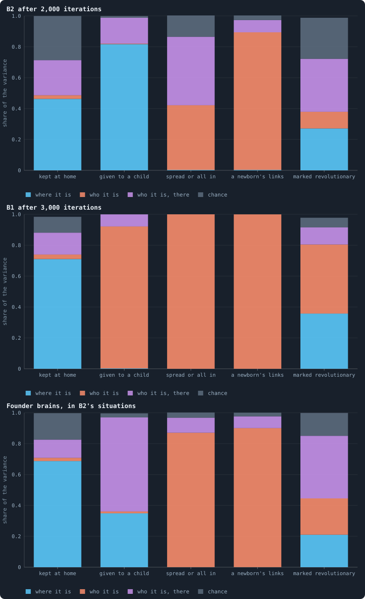
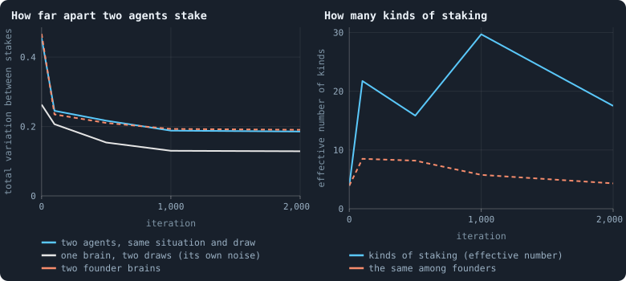
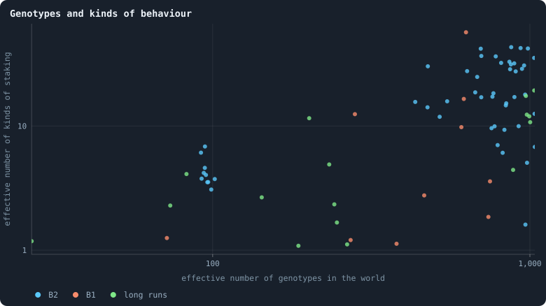
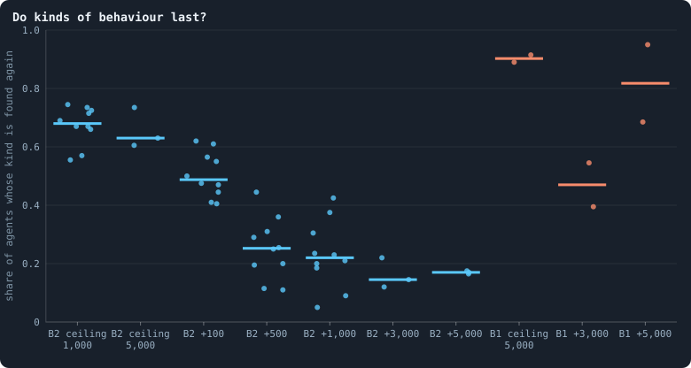

# How different are the agents?

> [!question] Questions of this page
> - Put two agents in exactly the same place, with the same random inputs: do
>   they do the same thing?
> - How much of what an agent does comes from where it is, how much from who
>   it is, and how much from chance?
> - How many kinds of behaviour live side by side in a world, and how does that
>   compare with the number of genotypes?
> - Do the kinds last, and do they live in different places?

A world of 3,000 agents holds about a thousand genotypes
([Genotypes and lineages](genotypes-and-lineages.md)). But a genotype is a name: a brain
gets a new one whenever a mutation touches it, even when the change changes
nothing the brain does ([Brain diversity](brain-diversity.md)).
[What the brains are like](what-the-brains-are-like.md) opened the brains of B1's worlds
and found that selection had set **constants**: never have children, spread
the stake, mark every token revolutionary — the same in every world. So is a
world a thousand variations on one way of playing, or do several ways of
playing live side by side?

This page answers by experiment. It takes a world at one moment, and puts
the brains of its agents into the same situations — exactly the same inputs,
down to the random numbers — and compares what each one does.

## The experiment

- **Situations.** After one game, so that the messages in flight are fresh,
  take 200 living agents at random and record what each of them reads: its
  tokens and links, its neighbours', the messages it holds
  ([What a brain sees](brain-inputs.md)). The messages are part of the
  situation; they are what the agent holds at that moment. A brain also reads a
  few random numbers ([The brain](the-brain.md)). Draw those 8 times for
  each situation, and give every brain the same 8 draws.
- **Brains.** Take 400 agents at random and put each one's brain into every
  situation and draw. A brain carried by many agents is drawn as often as it is
  carried. Beside them, 400 fresh **founder** brains, which have never met
  selection: what brains do by chance.
- **Decisions**, by the engine's own rules (`research/oee/checks/diversity.py`):

| decision | what it is |
|---|---|
| the stake | the shares of its tokens the agent puts on its own node and on each neighbour's |
| kept at home | the share on its own node ([Staking at home](home-stake.md)) |
| given to a child | the share it would give a child; 0 when no child would be made |
| spread or all in | 1 if it spreads its stake over its candidates, 0 if it puts it all on one |
| a newborn's links | how likely a child of its own is to be linked to each of its neighbours |
| marked revolutionary | the share of its stakes on others marked revolutionary ([How a coalition takes a node](revolution.md)) |

The worlds are of 10,000 tokens:

- **B2**: the ten worlds of Experiment 16, from the archives they keep every
  100 iterations, at 0, 100, 500, 1,000 and 2,000 iterations;
- **B1**: the first ten worlds of Experiment 2, at the end of their 3,000
  iterations;
- **the long runs**: two B1 [pilot worlds](pilot-worlds.md) of the
  same settings, from their start to 10,000 iterations, and three of B2's
  ten worlds played on from 2,000 to 10,000.

## Where, who and chance

With every brain in every situation and draw, the variance of a decision
splits exactly into four parts ([Where, who and chance](variance-split.md)):

- **where it is** — every brain does the same in the same place, and agents
  differ because their places differ;
- **who it is** — some brains do more of it than others wherever they are: a
  trait, like a temperament;
- **who it is, there** — brains differ in how they answer a place;
- **chance** — the random inputs decide.

"Do agents behave the same in the same circumstance?" asks whether the two
middle parts are small.

<!-- figure diversity/split -->


**Where, who and chance.** How the variance of each decision splits: into where the agent is (the situation), who it is (its brain, wherever it is), who it is in that situation (how its brain answers that situation), and chance (its random inputs). The median over ten worlds of each part. A decision driven by where agents are is one they all take alike; one driven by who they are is a trait that differs between them.

> [!example]- How to make this figure
> **Runs.** The ten B2 worlds of Experiment 16 at iteration 2,000 (their archives) and the first ten B1 worlds of Experiment 2 at the end of their 3,000 iterations.
>
> **Data.** From `GraphOfLifeRuns/.pilots/diversity/B2.json` and `B1.json` (`research/oee/checks/diversity.py`).
>
> 1. Load the world and play one game, so its messages are fresh (`research/oee/checks/diversity.py`).
> 2. Take what 200 living agents read, and draw their random input rows 8 times, the same draws for every brain.
> 3. Put the brains of 400 agents drawn at random, and 400 fresh founder brains, into every situation and draw, and turn their outputs into decisions by the engine's rules.
> 4. Split each decision's variance over brains, situations and draws into the four parts (the note *Where, who and chance*); take the median over worlds.
>
> **To make it again:** `python3 book_figures.py diversity`.
<!-- /figure -->

**Where an agent stakes depends on where it is, and on how its brain answers
that place — hardly on a fixed leaning.** In B2 the situation makes 46% of the
variance of the share kept at home, how a brain answers the situation 23%,
chance 29% — and the brain on its own, wherever it is, 2%. In B1 the situation
makes 71%.

Where an agent is reaches its decisions in two ways: through what its brain
reads, and through the rules, which turn the same outputs into different
stakes for different agents. The split cannot tell the two apart, and here
much of it is the rules.

- **In B2**, about half the agents hold a single token (49% and 57% in two of
  the worlds at 2,000 iterations). B2's rule [keep_home](settings.md#keep_home)
  keeps 30% of an agent's tokens at home, rounded up, so a single token stays
  at home whatever the brain says. The rest of the agents nearly all go **all
  in** (spreading in only 0.1–4% of cases): they put what is not kept on
  whichever candidate scores highest — their own node about two times in three,
  a neighbour's the third (63–76% and 21–37% of the agents with two tokens or
  more, in three of the worlds at 2,000 iterations). Scores close together let
  the random numbers decide which candidate wins, which is why chance is a
  larger part in B2 than among founders (29% against 17%).
- **In B1** nearly every brain spreads its stake (94–99% of cases in the ten
  worlds), and most split it evenly ([What the brains are like](what-the-brains-are-like.md)).
  An even split puts 1/(*k* + 1) of the stake at home for an agent with *k*
  neighbours: again where the agent is, not what its brain makes of it. That
  fits [What the brains are like](what-the-brains-are-like.md)'s finding that B1's brains are nearly blind; the situation
  reaches B1's stakes mostly through the rules.

**Whether a child is born depends on the place in B2, on the brain in B1.** In
B2, 82% of the variance of a child's share is the situation. B2's rules refuse a
birth to a parent already at its [valence](settings.md#valence) of
8 links, and one whose child would get fewer than
[10 tokens](settings.md#min_child), and those are facts about where
the parent is. B1 has neither rule, and there 92% is who the agent is. Almost
every B1 brain would give a child nothing (the mean share is 0.2–2.7% of its
tokens in the ten worlds); the few that would are particular brains — the near
abolition of reproduction of [What the brains are like](what-the-brains-are-like.md).

**Two decisions are pure traits, and were so before any selection.** Whether a
brain spreads or goes all in, and how readily it links a newborn to its
neighbours, depends almost only on who it is (spread: 42% brain and 44% brain
there in B2, 100% brain in B1; links: 89% and 100%). Founders are no
different (87% and 90%): each brain has its own answer, and keeps it in nearly
every situation. That is how these decisions are built, not something
selection made. What selection did was move the answers — B1's brains to
spreading, B2's to going all in — while the link stayed a trait on which
agents differ widely: some brains would link a newborn to nearly every
neighbour, others to almost none (a standard deviation between agents of
0.34–0.49, on a scale from 0 to 1).

## Two agents in the same place

The split counts decisions one at a time. The stake is the decision every
agent makes in every game, and it is a whole list: a share for its own node
and one for each neighbour. Take two agents in the same situation, with the
same random numbers, and ask how far apart their stakes are — the **total
variation**, the share of tokens one would have to move to stake like the
other (0 when they stake alike, 1 when they share nothing). Set it beside how
far one brain is from *itself* when only the random numbers change: its own
noise.

<!-- figure diversity/life -->


**Through a B2 world's life.** Left: in the same situation and with the same random inputs, how far apart two agents' stakes are (the total variation: the share of tokens one would have to move to stake like the other), against how far one brain is from itself with other random inputs, and against two fresh founders. Right: how many kinds of staking the agents fall into, counted by the agents in each (an effective number), beside the same for founders. Medians of ten worlds.

> [!example]- How to make this figure
> **Runs.** The ten B2 worlds of Experiment 16, from their archives at iterations 0, 100, 500, 1,000 and 2,000.
>
> **Data.** From `GraphOfLifeRuns/.pilots/diversity/B2.json` (`research/oee/checks/diversity.py`).
>
> 1. Load the world and play one game, so its messages are fresh (`research/oee/checks/diversity.py`).
> 2. Take what 200 living agents read, and draw their random input rows 8 times, the same draws for every brain.
> 3. Put the brains of 400 agents drawn at random, and 400 fresh founder brains, into every situation and draw, and turn their outputs into decisions by the engine's rules.
> 4. Two brains are of one kind while their stakes differ by no more than 95% of brains differ from themselves between two halves of the draws; count the kinds by their carriers (1 / sum of squared shares).
>
> **To make it again:** `python3 book_figures.py diversity`.
<!-- /figure -->

In B2 (left):

- At the start two founders differ by 0.46, and each from itself by 0.26 (the
  median of ten worlds).
- By 2,000 iterations two agents differ by 0.19, and one from itself by 0.13.
  The evolved brains are steadier: their stakes depend less on the random
  numbers.
- Two fresh founders put into the situations of iteration 2,000 differ by just
  as much, 0.19. The fall from 0.46 comes from the situations as much as from
  the brains, and **B2's agents are no more alike than brains drawn at
  random**.

Every one of these numbers is an average over situations of which about half,
in B2, are agents with a single token: there every brain stakes alike, because
the rules leave nothing to choose. The differences all come from the other
half.

In B1 two agents differ by 0.075 (median of ten worlds; from themselves by
0.035), and two founders in the same situations by 0.51. **B1's agents are
nearly seven times more alike than random brains.**

## Kinds of behaviour

When do two agents behave differently, rather than by chance? When their
stakes differ by more than a brain differs from itself. Each brain's stakes in
the 200 situations are averaged over two halves of the draws (four each); the
distance between its two halves is its own noise; two brains count as acting
differently when they are further apart than 95% of brains are from
themselves — a test at the usual five per cent. Brains are then grouped into
**kinds**, merging the closest groups as long as they are no further apart than
that line, and the kinds are counted by their carriers as an **effective
number** ([Effective numbers](effective-number.md)): ten equally
common kinds count 10, one kind with nearly everyone counts close to 1.

**The test checks itself.** [What the brains are like](what-the-brains-are-like.md) found that many B1 agents score every
candidate zero or below, so that the rules split their stake exactly evenly
([Splitting tokens into whole numbers](largest-remainder.md)). Such
agents all stake alike, and should be one kind. In nine of the ten B1 worlds
the largest kind of staking holds just the share of such agents, to within two
hundredths (4% of the agents in one world, 90% in another). In the tenth, the
largest kind (94%) also takes in agents whose positive scores are so close
that they split nearly evenly too.

Founders fall into about 4 kinds of staking (the right panel of *Through a B2
world's life*, above). Half of them spread
their stake, almost evenly — at the start these make one kind holding half of
all founders in every world — and the other half go all in and differ. In B2:

- after 100 iterations the agents fall into about 22 kinds of staking; after
  2,000 into 17.5 (from 1.6 to 42.5 in the ten worlds);
- nine pairs of agents in ten stake measurably differently (0.90–0.95 at every
  moment after the start);
- counted over every decision, not only the stake, there are about 54 kinds
  (from 6 to 114).

In B1 the median world has 3.2 kinds of staking (from 1.1 to 57) and 9 over
every decision, and in four worlds of ten one kind, built around the even
split, holds 73–94% of the agents.

So B2's agents differ as widely as random brains, but unlike random brains
their differences are real: they are steady enough to tell apart. They share
one habit — all in, at home two times in three — and differ in *when* and *on
whom* they go all in.

## Genotypes and kinds

<!-- figure diversity/kinds -->


**Genotypes and kinds of behaviour.** Each dot is a world at one moment: across, how many genotypes it holds, counted by their carriers; up, how many kinds of staking its agents fall into, counted the same way. Far more genotypes than kinds means most genetic differences change nothing an agent does.

> [!example]- How to make this figure
> **Runs.** Every world measured: B2 over its life, B1 at its end, the long pilot worlds.
>
> **Data.** From `GraphOfLifeRuns/.pilots/diversity/*.json` (`research/oee/checks/diversity.py`).
>
> 1. Load the world and play one game, so its messages are fresh (`research/oee/checks/diversity.py`).
> 2. Take what 200 living agents read, and draw their random input rows 8 times, the same draws for every brain.
> 3. Put the brains of 400 agents drawn at random, and 400 fresh founder brains, into every situation and draw, and turn their outputs into decisions by the engine's rules.
>
> **To make it again:** `python3 book_figures.py diversity`.
<!-- /figure -->

A B2 world of 3,400 agents holds about 950 effective genotypes and 17 kinds of
staking, or 54 over every decision: most genetic differences change nothing an
agent does. And the number of kinds hardly follows the number of genotypes:
worlds with about a thousand genotypes hold anything from 1.6 to 43 kinds of
staking.

The long runs add time. B1's first long world converges: at 5,000 iterations
one kind of staking holds 92% of its agents, and its genotypes have fallen to
27 effective; at 10,000 one kind holds 96%. Its second goes the other way, to
12 kinds at 10,000. B2's three long worlds keep 4–19 kinds of staking and
35–75 over every decision at 5,000 and at 10,000 iterations: B2 does not
converge on one way of playing.

## Do kinds last?

A kind of one moment lasts if, at a later moment, some agent still behaves that
way. Take 200 agents from each of two moments of one world, put all their
brains into the situations of the first, and group them into kinds together —
over the stake and every other decision, which makes the kinds finer than
kinds of staking alone. What share of the first moment's agents belong to a
kind that is found among the second moment's 200?

A sample of 200 agents can miss a rare kind, so even a world that had not
changed at all would not score 1. The **ceiling** is the same moment sampled
twice: in B2 at 1,000 iterations, 0.68 of the agents' kinds are found again
(the median of ten worlds; 0.56–0.75).

<!-- figure diversity/persist -->


**Do kinds of behaviour last?** For two moments of the same world: 200 agents drawn from each, their brains put into the situations of the first and grouped into kinds together, over the stake and every other decision. The share of the first moment's agents whose kind is found among the second's, +N iterations later. The *ceiling* draws the second 200 from the same world at the same moment (at iteration 1,000 in Experiment 16's worlds, 5,000 in the long runs): it is as much as a sample of 200 can find, since a rare kind can be missed. Each dot is a world.

> [!example]- How to make this figure
> **Runs.** The ten B2 worlds of Experiment 16 at 1,000 (against themselves, and 100 iterations later), 500→1,000 and 1,000→2,000; three of them played on as pilots, at 5,000 against themselves, 2,000→5,000 and 5,000→10,000; and B1's two long pilot worlds, at 5,000 against themselves, 2,000→5,000 and 5,000→10,000.
>
> **Data.** From `GraphOfLifeRuns/.pilots/diversity/persist.json` and `persist_gaps.json` (`research/oee/checks/diversity.py --persist`).
>
> 1. Load the world and play one game, so its messages are fresh (`research/oee/checks/diversity.py`).
> 2. Take what 200 living agents read, and draw their random input rows 8 times, the same draws for every brain.
> 3. Draw 200 agents from each moment and put their brains into the first moment's situations and draws.
> 4. Group the brains of both moments together, over the stake and the five decisions; ask which kinds of the first are found in the second.
>
> **To make it again:** `python3 book_figures.py diversity`.
<!-- /figure -->

In B2 the share found falls fast and then slowly:

- 100 iterations later 0.49 are found, seven tenths of the ceiling. B2's
  agents live at most 100 iterations, so by then every agent of the first
  moment has died: the kinds found again are carried by new agents;
- 500 iterations later 0.25, and 1,000 later 0.22: about a third of the
  ceiling;
- in the long runs, 3,000 and 5,000 iterations later, 0.145 and 0.17, against a
  ceiling of 0.63 at 5,000: about a quarter.

So most of B2's kinds are gone within a few hundred iterations, and others
take their place: the number of kinds stays about where it was. A core lasts
far longer — about a quarter of what a sample can find is still there 5,000
iterations later.

B1's long worlds keep their kinds: 0.47 of them are found again 3,000
iterations later and 0.82 5,000 later, against a ceiling of 0.90 — B1 has few
kinds, and a sample of 200 finds nearly all of them. The first of the two worlds
is the extreme: from 5,000 iterations on one kind of staking holds more than
nine tenths of its agents.

## Do kinds live in different places?

If kinds were adaptations to different places in the network, the agents of
one kind would sit in similar places. How much of the variance of the
carriers' tokens and links does their kind account for (η², the share of
variance between groups)? Compare it with the same for kinds shuffled among
the carriers: groups of the same sizes, drawn at random, which account for
some variance by chance alone.

- **B2** after 2,000 iterations: the kind accounts for 31% of the variance of
  its carriers' number of links, against 16% for shuffled kinds, and more than
  all 200 shuffles in every one of the ten worlds; and for 22% of their tokens,
  against 16% (both counted on a logarithmic scale).
- **B1**: 31% of the tokens, against 16%; but of the links, 15% against 16% —
  no more than chance.

Kinds do sit in somewhat different places: in B2 by how many links their
carriers have, in B1 by how rich they are. That fits niches, but it fits
kinship as well: relatives carry similar brains and live near one another
([Like next to like](like-next-to-like.md)), so a kind may share a place because it
is a family, not because the place suits it. Telling the two apart needs an
experiment: move a kind to another place and see whether it does worse there.

## The same questions for any world

Nothing here is particular to B1 or B2. The measure needs only a world at one
moment — a lab run's checkpoint or archive, or a pilot's:

```
python3 research/oee/checks/diversity.py B2-10000-s001:1000 --label mine
python3 research/oee/checks/diversity.py pilot:GraphOfLifeRuns/.pilots/Q/mix-s1:2000 --label mine
python3 research/oee/checks/diversity.py --persist B2-10000-s001:1000 B2-10000-s001:2000 --label mine
```

Two checks come with it. A world without random inputs (Experiment 16's second
condition) must give chance a share of exactly 0, and does. And a kind the rules
make — the even split — must come out as one kind, and does. [How alike the agents are](how-alike-the-agents-are.md),
*[How alike the agents are](how-alike-the-agents-are.md) · How alike the agents are*, applies the measure to every condition of
every experiment and to the pilot worlds.

## What this says

- **In the same place, with the same dice, B2's agents do not act alike.** Nine
  pairs in ten stake measurably differently; there are about 17 effective kinds
  of staking and about 54 over every decision, in worlds of about 950 effective
  genotypes.
- **B1's agents mostly do.** They are nearly seven times more alike than
  random brains, and in four worlds of ten one kind, built around the even
  split, holds 73–94% of the agents.
- **Where an agent is decides more than who it is**, for most decisions in both
  rule sets. Agents differ in how they answer a place, not in a fixed
  temperament. Where they do differ by temperament — spreading, linking a
  newborn — they did so before selection began.
- **Genotypes overstate the variety of behaviour**: B2's worlds hold about 950
  effective genotypes and 17 kinds of staking (54 over every decision), and
  across worlds the number of genotypes does not predict the number of kinds.
- **B2's kinds turn over; B1's last.** Within 500 iterations two thirds of the
  kinds a sample of B2 can find are gone and new ones have taken their place;
  a core lasts thousands of iterations. B1's few kinds are still there 5,000
  iterations later.
- **Kinds sit in somewhat different places**, by links in B2 and by tokens in
  B1 — niches or families, not yet told apart.
- **For open-ended evolution**, B2 has the raw material and B1 has not: many
  kinds of behaviour at once, steadily renewed. What B2 lacks is a reason for a
  kind to *stay*: a place where it does better than the others, so that new
  kinds are added to the old ones rather than replacing them. Whether the
  turnover is selection or drift is open. The lifetime contests of
  [Why evolution stops](why-evolution-stops.md#would-we-notice-if-it-went-on) say
  that later brains beat earlier ones in these worlds (0.73 for those of 2,000
  against those of 500), so at least some of it is selection. The next measure
  is to play each kind against the kinds that replaced it.

**Related notes:** [Where, who and chance](variance-split.md) ·
[Effective numbers](effective-number.md) ·
[Brain diversity](brain-diversity.md) ·
[Genotypes and the family tree](genotype.md) ·
[What a brain sees](brain-inputs.md) ·
[Genotypes and lineages](genotypes-and-lineages.md) ·
[What the brains are like](what-the-brains-are-like.md) ·
[Like next to like](like-next-to-like.md) ·
[Do the brains matter?](do-the-brains-matter.md)

<!-- turns -->
---

← [Do the brains matter?](do-the-brains-matter.md) · [Brains, and how alike agents are](../README.md#brains-and-how-alike-agents-are) · [Genotypes and the family tree](genotype.md) →

> [!info]- Pages that link here (11)
> [Flow modules: the groups tokens stay in](flow-modules.md) · [How alike the agents are](how-alike-the-agents-are.md) · [What would count as open-ended evolution](open-ended-test.md) · [Healthy and rich](healthy-and-rich.md) · [What makes a world interesting](what-makes-a-world-interesting.md) · [Mixed at birth: ten long worlds](mixed-at-birth-ten-long-worlds.md) · [A screen of random worlds](a-screen-of-random-worlds.md) · [Every world side by side](every-world-side-by-side.md) · [Every simulation: what was run, and what was measured](every-simulation.md) · [Where, who and chance: splitting a decision's variance](variance-split.md) · [Effective numbers: how many kinds there really are](effective-number.md)
<!-- /turns -->
