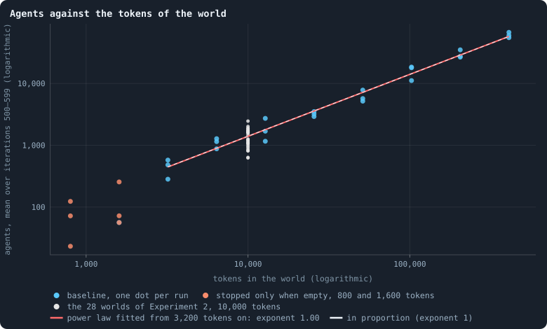
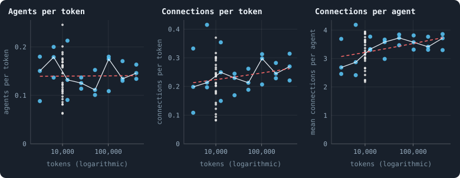
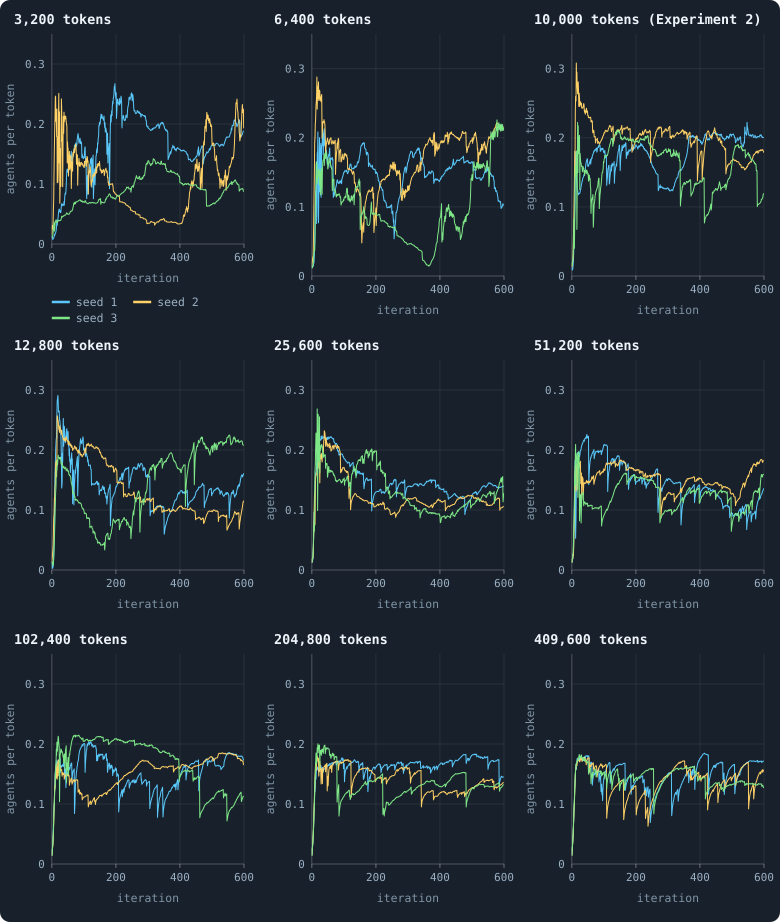
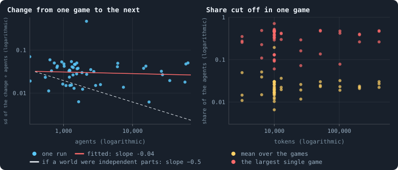
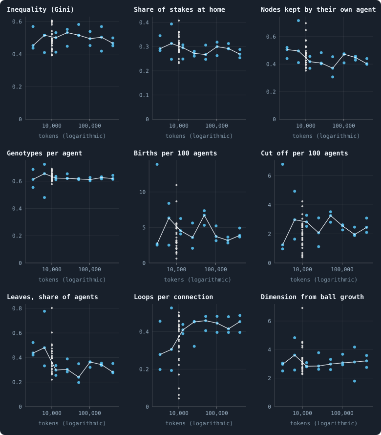
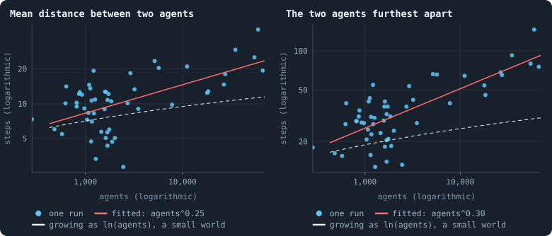
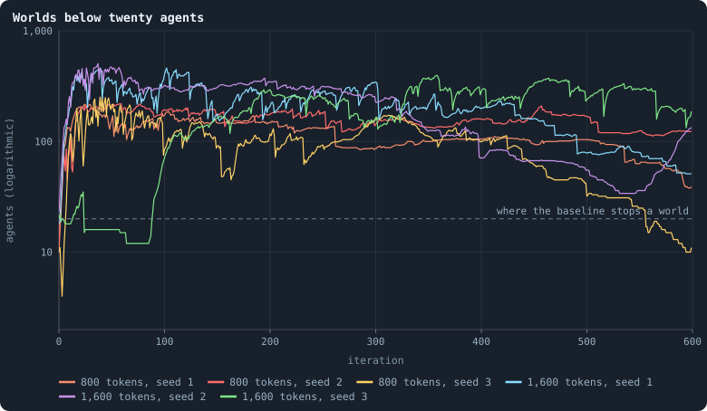

# Worlds of many sizes

> [!question] Questions of this page
> - Does a world of twice the [tokens](the-world.md#agents-and-tokens "The one thing of value in a world: every agent holds a whole number of them, and their total never changes.") hold twice the [agents](the-world.md#agents-and-tokens "One member of a world: it lives on a node of the network, holds tokens and has a brain that takes all its decisions.") and twice the
>   [connections](the-world.md#the-network "A link between two agents of the network: they are neighbours, and can stake on each other's nodes.")?
> - Is a big world the same kind of world as a small one: as unequal, as
>   diverse, as well connected per agent? Is a world of 100,000 tokens ten
>   copies of a world of 10,000?
> - Do big worlds settle down, or do they wander as much as small ones?
> - How do distances grow as a world grows, and does its [dimension](ball-dimension-and-curvature.md "How fast the number of agents within a distance grows with the distance: as its square in a plane, its cube in space.") change?
> - How small can a world be and still live?
> - How does a line of descent take over a world ten times the size: ten
>   times slower, as chance would; about as fast, as a better [brain](the-brain.md "The neural network each agent decides with: inputs about itself and its neighbours, outputs that become its decisions.") in a
>   well-mixed world would; or at the pace of a front that has twice as far
>   to go?

## In short

Experiment 8 ran the first [baseline](b1-and-b2.md "The stated rules an experiment starts from and changes one thing of: B1 or B2."), [B1](b1-and-b2.md "The first baseline: the algorithm exactly as a new run is offered it."), at ten sizes, from 800 to 409,600
tokens. As its thesis said, agents and connections followed the tokens in
proportion: about 0.14 agents per token. But big worlds do not calm down: at
every size, a single game can cut off nearly half a world. Experiment 10 then
set thirty worlds of 100,000 tokens beside thirty of 10,000. One founder's
line took about six times as long to take them over: slower than the front
of its thesis, faster than chance. Per agent, a large world lives as ten
small ones do; but its distances grow as in a three-dimensional body.

## How does a world's size follow its tokens?

Think of a city twice the size of another. Does it simply have twice the
people and twice the streets? Or does size change what kind of city it is?
Experiment 8 asks the same of a world.

A world is given one number before it starts: its tokens, whose total never
changes. The study of the baseline looks at worlds of two sizes, 10,000 and
100,000 tokens ([The life of a B1 world](a-worlds-life.md)). Experiment 8
runs the baseline B1 at ten sizes, from 800 tokens to 409,600, each double
the one before. It asks what changes with size, and what does not.

### Why ask

Whether what the notebook has found holds at other sizes rests first on this
question. If agents and connections grow in proportion to the tokens, a
bigger world is more of the same. Then the size of a world can be chosen for
what an experiment can afford. If they do not, size changes what a world is,
and every result belongs to the size it was found at.

### How it was measured

Experiment 8 runs worlds of the baseline B1 at ten sizes, three [seeds](random-numbers.md "The number that fixes every random choice of a run: the same settings and the same seed make the same world.") each,
for 600 iterations each. A world starts with one founder for every hundred
tokens, so the founders go from 8 to 4,096.

**What is measured.** For every run, two numbers: the agents alive after the
game, and the connections. Each is averaged over iterations 500 to 599, well
past the youth of a world
([The first hundred iterations](a-worlds-life.md#the-first-hundred-iterations)).
The same means over iterations 400 to 499 say whether a world had settled.

**How it is read.** Suppose the agents follow a [power law](power-laws-real-and-apparent.md#fitting-a-power-law-properly "A quantity whose frequency falls as a power of its size: few huge values, many small ones.") of the tokens:
agents = *a* × tokens^*b*, some number *a* times the tokens to the power *b*.
On logarithmic axes, on both sides, such a law is a straight line. Its slope
is the exponent *b*
([Logarithmic axes and power laws](correlation.md#logarithmic-axes-and-power-laws)). An exponent of 1
means in proportion: twice the tokens, twice the agents. Below 1, bigger
worlds hold fewer agents per token; above 1, more.

The line is fitted by least squares to the baseline worlds of 3,200 tokens
and more, every run a point ([Fitting a straight line](correlation.md#fitting-a-straight-line)).
Its interval comes from resampling the runs within each size 10,000 times
([The bootstrap](bootstrap.md)). A second fit, with a squared term, says
whether the points bend away from a straight line.

**The small end.** Two rules of the baseline limit how small a world can be.
The founders' starting ring needs at least six founders
([The starting ring](starting-ring.md)), so no world can have fewer than 600
tokens. And a run stops, as extinct, once a game leaves 20 agents or fewer
([When a world ends](extinction.md)). Worlds of 800 and 1,600 tokens start
with 8 and 16 founders, below that line. So the small worlds were also run a
second way, *stopped only when empty* (`extinction_threshold` 0), from 800
to 6,400 tokens. A world that never falls to twenty agents is then exactly
the baseline's world of the same seed.

**A check from elsewhere.** The 28 worlds of
[A world's life](a-worlds-life.md#a-worlds-life) that reached iteration 600,
at 10,000 tokens, are drawn beside the new runs wherever they can be. They
are a size the experiment did not run, measured the same way.

### What was expected

We expected a world of twice the tokens to be two worlds of the same kind.
Everything an agent does is local. It plays the game with its [neighbours](the-world.md#the-network "An agent joined to another by a connection."),
has its children beside itself, and dies when its own tokens run out. Only
one rule seemed to reach across a whole world: the tokens of the dead are
shared out among all survivors. That rule gives every survivor the same
chance, whatever the size of the world. So at every size we expected about
as many agents and connections per token as at 10,000 tokens.

<!-- thesis E08 -->
> [!quote] The thesis of Experiment 8, written down before any of its runs existed
> **The claim.** A world's size follows its tokens in proportion. From a few thousand tokens up to 409,600, a settled world holds about 0.13 agents and 0.2 connections for every token, whatever its size: agents and connections are each a power law of the tokens with exponent 1. A world of twice the tokens is two worlds of the same kind.
>
> **Why it would be so.** Everything an agent does is local. It plays the game with its neighbours, has its children beside itself, and dies when its own tokens run out; nothing in the rules reaches across the world except the sharing out of the tokens of the dead, which gives every survivor the same chance whatever the size of the world. So a bigger world should be more of the same, with as many agents per token and as many connections per agent. At 10,000 tokens the settled worlds of Chapter [3](a-worlds-life.md) held 0.13 agents and 0.20 connections per token, from iteration 500 on.
>
> **It holds if:** For the baseline worlds of 3,200 to 409,600 tokens that live to iteration 600, each measured by its mean over iterations 500 to 599: the exponent fitted to agents against tokens lies between 0.9 and 1.1 and its 95% interval contains 1; the same holds for connections; and neither set of points bends away from a straight line on logarithmic axes — the interval of the bend contains 0.
>
> **It fails if:** The exponent's interval leaves out 1, so that bigger worlds hold clearly fewer or more agents (or connections) per token than smaller ones, or the points bend on logarithmic axes. Then a world's size is more than its tokens, something in the dynamics reaches across the whole world, and every result in this book belongs to the size it was found at.
>
> *Written while the notebook still numbered its chapters: each number is a link to the page it meant that day.*
<!-- /thesis -->

### Agents and connections follow the tokens

<!-- figure size/agents -->

**Agents against the tokens of the world.** Every run that lived to iteration 600 is a dot: the tokens of its world, and the number of agents alive after each game, averaged over iterations 500 to 599 — both on logarithmic axes, on which a power law, agents = a · tokens^b, is a straight line of slope b ([Logarithmic axes](correlation.md#logarithmic-axes-and-power-laws)). Blue: the baseline, three seeds per size (at 1,600 tokens only one of three lived through its first iteration, and its dot lies under the orange one of the same world; at 800 none did). Orange: the same worlds of 800 and 1,600 tokens with the stopping rule switched off. Grey: the baseline worlds of [A world's life](a-worlds-life.md), a check from another experiment. Red: the straight line fitted to the blue dots from 3,200 tokens on, exponent 1.00 (95% interval 0.95 to 1.06). Dashed: exponent exactly 1.

> [!example]- How to make this figure
> **Runs.** The 42 runs of Experiment 8 — B1 at 800 to 409,600 tokens, each size double the one before, seeds 1 to 3, 600 iterations — in two conditions: the baseline, `B1-800-s001` … `B1-409600-s003`; and *stopped only when empty* (`extinction_threshold` 0) at 800 to 6,400 tokens, `B1-800-57b358-s001` … `B1-6400-57b358-s003`. They are made with `python3 gol_lab.py run E08`; every setting is listed in the box of the runs behind this page. As a check at 10,000 tokens, the 28 baseline runs of Experiment 2 that reached iteration 600 (`B1-10000-s001` … `-s030`, [A world's life](a-worlds-life.md)).
>
> **Data.** From each run's `GraphOfLifeRuns/<run>/stats.jsonl`, which holds one row per recorded phase: `phase` 1 is the world just after reproduction, `phase` 2 just after the game, and every statistic is a field of the row (see [What a run records](frames-and-stats.md)).
>
> 1. For every run, the mean of `nodes` over the rows with `phase` = 2 and 500 ≤ `iteration` ≤ 599; leave out a run that stopped before iteration 600.
> 2. Fit log₁₀(agents) = log₁₀ a + b · log₁₀(tokens) by least squares over the baseline runs of 3,200 tokens and more; the interval of b from 10,000 resamplings of the runs within each size (`gol_analysis.power_fit`, run by `python3 gol_lab.py analyse E08`).
>
> **To make it again:** `python3 book_figures.py size`.
<!-- /figure -->

From 3,200 tokens to 409,600, the number of agents follows the tokens in
proportion, as closely as three seeds per size can tell. The fitted exponent
is **1.00** (95% interval 0.95 to 1.06). The line explains 98% of the
scatter, and the points do not bend away from it. A settled world holds
about 0.14 agents per token, so a world of 409,600 tokens holds about 60,000
agents.

The worlds of [A world's life](a-worlds-life.md#a-worlds-life) fall where the
line says they should. The [median](median-and-quantiles.md "The middle value: half of the numbers lie below it and half above.") one holds 0.124 agents per token, against
0.140 predicted, well inside their own spread (0.06 to 0.25).

Below 3,200 tokens the line ends. The baseline stopped all three worlds of
800 tokens, and two of the three of 1,600, after their first game. With the
stopping rule switched off, they lived. They held fewer agents per token than
bigger worlds, 0.09 at 800 tokens and 0.08 at 1,600. But these are only three
worlds each, spread widely.

A log–log plot squeezes everything onto a line. To see how close to
proportion the worlds are, divide by the tokens:

<!-- figure size/per-token -->

**The same law, seen through a magnifying glass.** The quantities of the figure above divided by what proportion would scale them by, so that growth in proportion is a flat line. Blue: every baseline run of 3,200 tokens and more that lived to iteration 600, its mean over iterations 500 to 599; grey: the 28 worlds of [A world's life](a-worlds-life.md) at 10,000 tokens; white: the median of the three runs of each size; dashed red: the power law fitted to the runs, divided by the tokens (for connections per agent, the law fitted to the connections per agent themselves, whose exponent says by how much they grow with size).

> [!example]- How to make this figure
> **Runs.** The 42 runs of Experiment 8 — B1 at 800 to 409,600 tokens, each size double the one before, seeds 1 to 3, 600 iterations — in two conditions: the baseline, `B1-800-s001` … `B1-409600-s003`; and *stopped only when empty* (`extinction_threshold` 0) at 800 to 6,400 tokens, `B1-800-57b358-s001` … `B1-6400-57b358-s003`. They are made with `python3 gol_lab.py run E08`; every setting is listed in the box of the runs behind this page. As a check at 10,000 tokens, the 28 baseline runs of Experiment 2 that reached iteration 600 (`B1-10000-s001` … `-s030`, [A world's life](a-worlds-life.md)).
>
> **Data.** From each run's `GraphOfLifeRuns/<run>/stats.jsonl`, which holds one row per recorded phase: `phase` 1 is the world just after reproduction, `phase` 2 just after the game, and every statistic is a field of the row (see [What a run records](frames-and-stats.md)).
>
> 1. For every run, the means of `nodes`, `edges` and `meanDegree` over the rows with `phase` = 2 and 500 ≤ `iteration` ≤ 599; divide the first two by the tokens.
> 2. The red lines are the fits of `book/results/E08.json`, made by `python3 gol_lab.py analyse E08`.
>
> **To make it again:** `python3 book_figures.py size`.
<!-- /figure -->

Agents per token scatter between 0.09 and 0.21, with no trend. The medians of
the eight sizes run 0.15, 0.18, 0.13, 0.13, 0.11, 0.18, 0.13, 0.15.
Connections follow the tokens with an exponent of **1.04** (0.97 to 1.12),
again without a bend.

The difference shows in the third panel. Connections per agent rise slowly
with size, with an exponent of 0.04 (0.004 to 0.072). Over the 128-fold range
of sizes, the fitted law adds about a fifth. The medians rise from 2.7 at
3,200 tokens to 3.7 at 409,600. Big worlds are a little more richly
connected.

### Six hundred iterations, at nine sizes

<!-- figure size/lives -->

**Six hundred iterations, at nine sizes.** The number of agents after every game, divided by the tokens of the world, over the 600 iterations of every baseline run of 3,200 tokens and more — one panel per size, one line per seed — and, in the third panel, the first three worlds of [A world's life](a-worlds-life.md) at 10,000 tokens, over their first 600 iterations. The same vertical scale in every panel.

> [!example]- How to make this figure
> **Runs.** The 42 runs of Experiment 8 — B1 at 800 to 409,600 tokens, each size double the one before, seeds 1 to 3, 600 iterations — in two conditions: the baseline, `B1-800-s001` … `B1-409600-s003`; and *stopped only when empty* (`extinction_threshold` 0) at 800 to 6,400 tokens, `B1-800-57b358-s001` … `B1-6400-57b358-s003`. They are made with `python3 gol_lab.py run E08`; every setting is listed in the box of the runs behind this page. The runs of [A world's life](a-worlds-life.md) with seeds 1, 2 and 3.
>
> **Data.** From each run's `GraphOfLifeRuns/<run>/stats.jsonl`, which holds one row per recorded phase: `phase` 1 is the world just after reproduction, `phase` 2 just after the game, and every statistic is a field of the row (see [What a run records](frames-and-stats.md)).
>
> 1. Take `nodes` of every row with `phase` = 2 and `iteration` ≤ 599, divided by the tokens of the world.
>
> **To make it again:** `python3 book_figures.py size`.
<!-- /figure -->

Every world, whatever its size, shoots up within its first twenty iterations
and then wanders. The small worlds wander widely: at 3,200 tokens, between
0.03 and 0.27 agents per token. The big ones stay within a narrower band,
0.07 to 0.19 at 409,600 tokens. But the way they move is striking: a
**sawtooth**. They climb slowly for tens of iterations. Then, in a single
game, they fall by a tenth, a third, sometimes nearly half.

### Big worlds do not average out

A familiar law of large numbers predicts the opposite. Picture a world of
twice the tokens as two independent worlds of the same kind, side by side.
Their ups and downs would partly cancel. So the relative size of a world's
changes would shrink as one over the square root of its size.

Here is why. Let each of *N* parts change by a random amount with standard
deviation σ, independently of the others. The variances add, so the total
changes with standard deviation √*N* σ. As a share of a world that grows as
*N*, that is σ/√*N*. A world a hundred times larger would change, relatively,
ten times less.

<!-- figure size/fluctuations -->

**Big worlds do not average out.** Over the last 300 iterations (300 to 599) of every baseline run of 3,200 tokens and more, and of the 28 worlds of [A world's life](a-worlds-life.md). Left: for each run, the standard deviation of the change in the number of agents from one game to the next, divided by the mean number of agents — against that mean, on logarithmic axes. If a world were made of independent parts, its relative changes would shrink as one over the square root of its size (dashed, drawn through the runs of 3,200 tokens); red is the line fitted to the runs. Right: for each run, the share of the agents alive at the start of a game that the game cut off from the network — the mean over the games (yellow) and the largest in any one game (red).

> [!example]- How to make this figure
> **Runs.** The 42 runs of Experiment 8 — B1 at 800 to 409,600 tokens, each size double the one before, seeds 1 to 3, 600 iterations — in two conditions: the baseline, `B1-800-s001` … `B1-409600-s003`; and *stopped only when empty* (`extinction_threshold` 0) at 800 to 6,400 tokens, `B1-800-57b358-s001` … `B1-6400-57b358-s003`. They are made with `python3 gol_lab.py run E08`; every setting is listed in the box of the runs behind this page. As a check at 10,000 tokens, the 28 baseline runs of Experiment 2 that reached iteration 600 (`B1-10000-s001` … `-s030`, [A world's life](a-worlds-life.md)).
>
> **Data.** From each run's `GraphOfLifeRuns/<run>/stats.jsonl`, which holds one row per recorded phase: `phase` 1 is the world just after reproduction, `phase` 2 just after the game, and every statistic is a field of the row (see [What a run records](frames-and-stats.md)).
>
> 1. Take `nodes` of the rows with `phase` = 2 and 300 ≤ `iteration` ≤ 599; the standard deviation of the differences between consecutive rows, divided by the mean.
> 2. Fit the logarithm of that against the logarithm of the mean by least squares; the interval from resampling the runs within each size (`gol_analysis.power_fit`).
> 3. For the right panel, `orphaned` / `nodes_before` of the same rows: the mean and the largest.
>
> **To make it again:** `python3 book_figures.py size`.
<!-- /figure -->

It does not. The typical change from one game to the next, as a share of the
world, is about the same at every size. The fitted exponent is **−0.04**
(−0.15 to 0.07), far from the −0.5 of independent parts. In the worlds of
409,600 tokens, the standard deviation of the change from one game to the
next is about 4.8% of the world. If each of their sixty thousand agents lived
and died independently, it would be about 0.1%.

The right panel shows why. On average a game cuts off about 2% of the agents
of a world: between 1.5% and 3.9%, size by size, with no trend. But the
largest single cut is a large part of the world at every size. It is 35% at
3,200 tokens, 48% at 409,600, and 71% in one world of
[A world's life](a-worlds-life.md#a-worlds-life). In the biggest worlds, one
game has cut off nearly thirty thousand agents at once.

[How a world breaks](how-a-world-breaks.md) found how such cuts happen: a
whole border of poor agents goes quiet. And
[Questioning the mechanics](questioning-the-mechanics.md) found the rule that
makes them fatal: everything outside the largest connected piece dies. This
experiment adds the scale: **the regions a world can lose grow with the
world.** The removal of what is cut off, the *cull*, couples every part of a
world to every other, however big it is.

So the noise comes from a rule, not from small numbers, and only a change of
the rule removes it. The second baseline, [B2](b1-and-b2.md "The second baseline: B1 with the rules that keep its network from breaking and its agents from staking or breeding themselves to death."), makes that change
([A world that cannot break](a-world-that-cannot-break.md#a-world-that-cannot-break)).
When an agent dies, the groups its former neighbours fall into are joined up
in a ring. And a link that carried no tokens may lapse only if its two ends
share at least two neighbours. A death mended so never splits a world, as
that page proves, and such a lapse cannot either. Under these rules the cull
has nothing left to remove, however large the world.

### Is a big world the same kind of world?

Most of what the study of the baseline measured is a share or a rate. Think
of the inequality of tokens, the share staked at home, or births per hundred
agents. Such quantities do not grow with a world by definition. Do they
change with it?

<!-- figure size/same-world -->

**Is a big world the same kind of world?** Nine properties of a world that do not grow with its size by definition — shares, rates per agent, a dimension. Blue: every baseline run of 3,200 tokens and more that lived to iteration 600, its mean over iterations 500 to 599; grey: the 28 worlds of [A world's life](a-worlds-life.md) at 10,000 tokens; white: the median of each size. A world that is the same kind of world at every size gives a flat cloud.

> [!example]- How to make this figure
> **Runs.** The 42 runs of Experiment 8 — B1 at 800 to 409,600 tokens, each size double the one before, seeds 1 to 3, 600 iterations — in two conditions: the baseline, `B1-800-s001` … `B1-409600-s003`; and *stopped only when empty* (`extinction_threshold` 0) at 800 to 6,400 tokens, `B1-800-57b358-s001` … `B1-6400-57b358-s003`. They are made with `python3 gol_lab.py run E08`; every setting is listed in the box of the runs behind this page. As a check at 10,000 tokens, the 28 baseline runs of Experiment 2 that reached iteration 600 (`B1-10000-s001` … `-s030`, [A world's life](a-worlds-life.md)).
>
> **Data.** From each run's `GraphOfLifeRuns/<run>/stats.jsonl`, which holds one row per recorded phase: `phase` 1 is the world just after reproduction, `phase` 2 just after the game, and every statistic is a field of the row (see [What a run records](frames-and-stats.md)).
>
> 1. For every run, the mean over the rows with `phase` = 2 and 500 ≤ `iteration` ≤ 599 of `gini`, `selfAllocationShare`, `heldHomeShare`, `brainDiversity`, `leaves` / `nodes`, `loopDensity` and `dimension` (the last two every 25 iterations).
> 2. Births: `births` of the rows with `phase` = 1, per 100 `nodes_before`; cut off: `orphaned` of the rows with `phase` = 2, per 100 `nodes_before`; each averaged over iterations 500 to 599.
> 3. For the numbers in the text: a power law of each property against the tokens, fitted as for the agents — an exponent near 0 is a property that does not change with size.
>
> **To make it again:** `python3 book_figures.py size`.
<!-- /figure -->

For each property, the same kind of fit as for the agents says how it
changes with size. An exponent of 0 means not at all. Six of the nine are
flat within what three seeds per size can see:

| property | exponent against the tokens | 95% interval |
|---|---|---|
| inequality ([Gini](gini-coefficient.md "How unequally tokens are held: 0 if every agent holds as many, near 1 if one holds nearly all.")) | 0.003 | −0.022 to 0.026 |
| share of stakes at home | −0.017 | −0.041 to 0.007 |
| genotypes per agent | 0.003 | −0.017 to 0.024 |
| births per 100 agents | −0.05 | −0.18 to 0.06 |
| cut off per 100 agents | 0.000 | −0.14 to 0.11 |
| dimension from ball growth | −0.001 | −0.048 to 0.045 |

Genotypes per agent are flatter than anything: 0.61 to 0.66 at every size.
The balance of making and copying of
[How even is a world?](where-do-the-tokens-go.md#how-even-is-a-world) does not care how big the
world is.

Across these eight sizes, three properties of the network's shape seem to
change, slowly:

- **Leaves**, the share of agents with a single connection, fall with an
  exponent of −0.08 (−0.12 to −0.04). Their median falls from 0.44 at 3,200
  tokens to 0.28 at 409,600.
- **[Loops](bridges.md#loops "A path through the network that comes back to where it started without using a connection twice.") per connection** rise with an exponent of 0.08 (0.02 to 0.14): from
  0.28 to 0.45.
- **Nodes kept by their own agent** fall with an exponent of −0.03 (−0.06 to
  −0.01): from 0.51 to 0.40.

Leaves and loops go with the slow rise in connections per agent: more
connections, fewer leaves, more loops. More neighbours would also mean more
neighbours to lose one's node to. Over a 128-fold range of sizes, the three
shift by between a fifth and a half. The worlds of
[A world's life](a-worlds-life.md#a-worlds-life) sit among the others in
every panel. So the numbers the study of the baseline first found at 10,000
tokens hold, roughly, at other sizes. The study, now written from worlds of
100,000 tokens, checks them ([Thirty worlds](a-worlds-life.md#thirty-worlds)).

Three seeds per size cannot see small changes; thirty worlds at each of two
sizes can.
[A large world beside ten small ones](#a-large-world-beside-ten-small-ones),
below, sets thirty worlds of 100,000 tokens beside thirty of 10,000, over
iterations 500 to 1,499. There, inequality, the nodes kept by their own agent
and the genotypes per agent come out within 3% of each other. So the nodes
kept do not fall with size after all.

But at ten times the tokens, the dimension from ball growth is 15% higher
(3.4 against 3.0, [The geometry of a world](what-shape-does-the-network-take.md#the-geometry-of-a-world)).
Births and deaths per agent run 13 to 21% higher, as
[Births, deaths and ages](births-deaths-and-ages.md) and
[How ages change over a world's life](births-deaths-and-ages.md#how-ages-change-over-a-worlds-life) find too. Leaves
are only 5% fewer, and [clustering](degree.md#clustering "How often an agent's neighbours are also each other's neighbours.") is less than half. So births, the rate of
cutting and the dimension do change with size, a little. And the shape
changes more than leaves and loops alone show.

### Distances grow like a power

<!-- figure size/distances -->

**How far apart agents are, as worlds grow.** Every baseline run of 3,200 tokens and more that lived to iteration 600, and the 28 worlds of [A world's life](a-worlds-life.md): the mean number of agents over iterations 500 to 599, and over the same iterations the mean distance between two agents (left) and the largest distance found (right), both estimated by the viewer from breadth-first searches out of 8 to 16 agents every 25 iterations ([Radius and diameter](path-length.md#radius-and-diameter)). Red: a power law fitted to the dots. Dashed: what a small world would do — distances growing in proportion to the logarithm of the number of agents — drawn through the runs of 3,200 tokens.

> [!example]- How to make this figure
> **Runs.** The 42 runs of Experiment 8 — B1 at 800 to 409,600 tokens, each size double the one before, seeds 1 to 3, 600 iterations — in two conditions: the baseline, `B1-800-s001` … `B1-409600-s003`; and *stopped only when empty* (`extinction_threshold` 0) at 800 to 6,400 tokens, `B1-800-57b358-s001` … `B1-6400-57b358-s003`. They are made with `python3 gol_lab.py run E08`; every setting is listed in the box of the runs behind this page. As a check at 10,000 tokens, the 28 baseline runs of Experiment 2 that reached iteration 600 (`B1-10000-s001` … `-s030`, [A world's life](a-worlds-life.md)).
>
> **Data.** From each run's `GraphOfLifeRuns/<run>/stats.jsonl`, which holds one row per recorded phase: `phase` 1 is the world just after reproduction, `phase` 2 just after the game, and every statistic is a field of the row (see [What a run records](frames-and-stats.md)).
>
> 1. For every run, the means of `nodes`, `meanPathLength` and `diameter` over the rows with `phase` = 2 and 500 ≤ `iteration` ≤ 599 (the last two are filled every 25 iterations).
> 2. Fit log(distance) against log(agents) by least squares; the interval from resampling the runs within each size.
>
> **To make it again:** `python3 book_figures.py size`.
<!-- /figure -->

In a random network, the typical distance between two agents grows only with
the **logarithm** of their number ([Path length](path-length.md)). A hundred
times the agents adds only a few steps. Such a network is called a *small
world*. Start from the worlds of 3,200 tokens: about 500 agents, 6 steps
apart on average. A small world drawn through them would have its agents
about 11 steps apart at 60,000 agents. But the worlds of 409,600 tokens have
a median mean distance of 25 steps, and a diameter of 80. As worlds grow,
their agents grow further apart, and faster than a small world would allow.

Fitted as power laws, the mean distance grows as agents^0.25 (0.18 to 0.32),
and the diameter as agents^0.30 (0.26 to 0.36). That is how distances grow in
a space of a fixed dimension *d*: a lump of *N* points has a width of about
*N*^(1/*d*). A cube of a thousand points, for example, is ten points wide.
Here 1/0.30 ≈ 3.3. That is close to the dimension of about 3 that ball growth
reads off every world, at every size. The last panel of the figure in
[Is a big world the same kind of world?](#is-a-big-world-the-same-kind-of-world)
shows it.

At large scales, then, a world is less like a small world than like a
three-dimensional body. It is grown locally, by children joined to their
parents' neighbourhoods ([The geometry of a world](what-shape-does-the-network-take.md#the-geometry-of-a-world)).
It never makes the long jumps that keep a random network small. The mean
distances scatter widely between worlds of one size, and bend a little; the
diameter is the cleaner of the two.

### Worlds below twenty agents

<!-- figure size/small -->

**Worlds below twenty agents.** The six worlds of 800 and 1,600 tokens with the stopping rule switched off (`extinction_threshold` 0): the number of agents after every game, on a logarithmic axis. Five of these six worlds — all three of 800 tokens, and seeds 1 and 3 of 1,600 — were stopped as extinct by the baseline after their first game, at the dashed line or below it.

> [!example]- How to make this figure
> **Runs.** The runs `B1-800-57b358-s001` … `-s003` and `B1-1600-57b358-s001` … `-s003` of Experiment 8 (`python3 gol_lab.py run E08`).
>
> **Data.** From each run's `GraphOfLifeRuns/<run>/stats.jsonl`, which holds one row per recorded phase: `phase` 1 is the world just after reproduction, `phase` 2 just after the game, and every statistic is a field of the row (see [What a run records](frames-and-stats.md)).
>
> 1. Take `nodes` of every row with `phase` = 2.
>
> **To make it again:** `python3 book_figures.py size`.
<!-- /figure -->

With the stopping rule switched off, **all six** worlds of 800 and 1,600
tokens lived to iteration 600. Five of them were worlds the baseline had
stopped as extinct after their first game. Most climbed above twenty agents
within a few iterations.

Two show what life near the edge is like. The world of 800 tokens and seed 3
fell to **4** agents at iteration 3. It recovered, then fell below twenty
again near the end: 51 iterations at twenty or fewer in all. The world of
1,600 tokens and seed 3 spent 78 iterations at twenty agents or fewer, down
to 12, and then grew to 255.

So the stopping rule ends worlds that would have lived. That matters for how
the notebook has counted extinction. In
[A world's life](a-worlds-life.md#no-world-died--but-one-came-close),
"4 of 30 worlds die" means "4 of 30 fell to twenty agents". One of them did
so at iteration 4, when worlds are small and fragile. Whether those worlds
would have recovered, no run can now say.

### Verdict: the thesis holds

The thesis **holds**, on every count it set. The exponent for agents is 1.00,
with an interval from 0.95 to 1.06; for connections it is 1.04, with an
interval from 0.97 to 1.12. Both lie between 0.9 and 1.1, and both intervals
contain 1. Neither set of points bends: the bend is 0.04 for agents
(interval −0.05 to 0.12) and 0.00 for connections (interval −0.12 to 0.12).

But its reasoning missed a rule, and the miss shows. The thesis said nothing
reaches across a world except the sharing out of the tokens of the dead. The
cleanup at the end of every phase does too: it keeps only the largest
connected piece ([One iteration, step by step](one-iteration.md#cleanup)).
That leaves the averages alone, which is all the thesis tested, and shows in
the fluctuations instead. **In its averages, a world of twice the tokens is
two worlds of the same kind. In its ups and downs, it is one world**, which
can lose half of itself in a game.

## Worlds of 100,000 tokens

<!-- experiment E10 -->

Experiment 10 runs thirty worlds of B1 at 100,000 tokens, each for 1,500
iterations. That is ten times the size the baseline was first studied at. It
asks what a world does with more room, and how one line of descent comes to
fill it.

### Why ask for more room

When this experiment was planned, every finding about the baseline had been
made on worlds of 10,000 tokens, about 1,300 agents each. That is small. A
world of 1,300 agents is some 30 steps across
([The geometry of a world](what-shape-does-the-network-take.md#the-geometry-of-a-world)), and its structure
fades within three ([Like next to like](like-next-to-like.md)). There is room
for a dozen regions side by side, no more. Questions about space, about
scale, and about whether different kinds of agents can live side by side need
worlds with more room.

[Experiment 8](#how-does-a-worlds-size-follow-its-tokens) had found that a
bigger world is, on average, more of the same. Agents and connections follow
the tokens in proportion, and births seemed to. But it ran only three worlds
of each size, for 600 iterations. So Experiment 10 makes a **second set of
baseline worlds**: thirty worlds of 100,000 tokens, ten times the first. They
are worlds of B1 itself, not of the second baseline B2 of
[A world that cannot break](a-world-that-cannot-break.md#a-world-that-cannot-break).

The physics of space builds on these worlds. Two planned pages are to read
them: *Dimensions at scale*, for their dimensions, and *Which properties have
no scale?* (see [the contents](../README.md)). And the experiment answers one
question of its own: how a line takes over a world.

### How a line takes over

[Genotypes and lineages](genotypes-and-lineages.md) found that whole lines of
descent take the worlds of 10,000 tokens over again and again, about once
every 350 iterations. Is that chance or merit? Three answers give three
different paces, and the size of the world tells them apart:

1. **Chance.** If no line is better than another, all but one die out by
   chance in the end. That takes a time that grows in proportion to the
   number of agents: ten times the agents, ten times as long. This is the
   coalescent ([The ideas this builds on](the-ideas-this-builds-on.md)).
2. **Merit, in a well-mixed world.** A better line grows by a fixed factor
   every generation. It needs only a time that grows with the logarithm of
   the number of agents: ten times the agents, about a third longer.
3. **Merit, in space.** A better line spreads outwards from where it arose,
   as a front at a steady speed (Fisher 1937), the way a fire crosses a
   field. The time grows with the width of the world.

A world is a space. It has a finite dimension
([How many dimensions does a world have?](how-many-dimensions-does-a-world-have.md)).
New connections are only ever made inside a neighbourhood
([How the network grows](how-agents-have-children.md#how-the-network-grows)), and a node can only be
taken by a neighbour. Ten times the agents make a world only about twice as
wide: its diameter grows as agents^0.30
([Distances grow like a power](#distances-grow-like-a-power)). So the third
answer predicts two to three times as long, the first ten times, and the
second barely longer.

[What the brains are like](what-the-brains-are-like.md) gives a reason to
expect the first answer. The brains are nearly blind and agree on every
decision that matters, which leaves little for one line to be better at. The
worlds of [Experiment 8](#how-does-a-worlds-size-follow-its-tokens) point to
the third. At 102,400 tokens, all three came from a single founder by
iterations 400, 400 and 525, where the median world of 10,000 tokens needed
175.

### The thesis

We expected a front. A world of 100,000 tokens is only about twice as wide as
one of 10,000. So one line should take it over in two to five times as
long: not ten times as long, and not about as fast.

<!-- thesis E10 -->
> [!quote] The thesis of Experiment 10, written down before any of its runs existed
> **The claim.** A line takes a world over the way a front crosses a country: at a steady pace, so that the time it needs grows with the world's width, not with its number of agents. A world of 100,000 tokens holds ten times the agents of the baseline but is only about twice as wide, so a line takes it over in two to five times as long as at 10,000 tokens — not ten times, as chance alone would need, and not about as fast, as a better brain spreading through a well-mixed world would.
>
> **Why it would be so.** Three paces are possible. If no line is better than another, all but one die out by chance, in a time that grows in proportion to the number of agents (the coalescent, Chapter [6](the-ideas-this-builds-on.md)). If a better line spreads through a well-mixed population, it grows by a fixed factor every generation, and the time grows only with the logarithm of the number of agents. If it spreads through space, it does so as a front at a steady speed (Fisher 1937), and the time grows with the width of the world. The worlds are spaces: they have a finite dimension (Chapter [23](how-many-dimensions-does-a-world-have.md)), their diameter grows as agents^0.30 (Chapter [38](how-does-a-worlds-size-follow-its-tokens.md)), and a node can only be taken by a neighbour (Chapter [3](one-iteration.md)). At 10,000 tokens (Experiment 2) the living of the median world all came from a single founder by iteration 175, and of every world by 750. The worlds of Experiment 8 point to the front: at 102,400 tokens, all three worlds got there by iterations 400, 400 and 525.
>
> **It holds if:** Counting each world of 100,000 tokens that reaches iteration 1,500 by the first iteration at which all its living descend from a single founder — and a world that never gets there as later than all of them — the median lies between 350 and 875: two to five times the baseline's 175.
>
> **It fails if:** The median is below 350: a large world is taken over about as fast as a small one, as a better brain spreading through a well-mixed population would take it. Or it is above 875, or most worlds never get there by iteration 1,500: then the pace is set by the number of agents, as chance alone would set it.
>
> *Written while the notebook still numbered its chapters: each number is a link to the page it meant that day.*
<!-- /thesis -->

### Method

The thirty worlds are B1 at 100,000 tokens, with seeds 1 to 30, each run for
1,500 iterations. Nothing else changes. A world of 100,000 tokens starts
with 1,000 founders in a ring, and was expected to settle at about 13,000
agents.

**What is measured.**

- **How lines take over.** After every 25th iteration: how far back all the
  living share one ancestor. And the first iteration at which they all
  descend from a single founder ([The common ancestor](genotype.md#the-common-ancestor-of-the-living)):
  this is what the thesis counts. It is set against the baseline's 30 worlds
  of 10,000 tokens over the same iterations. And it is set against the time a
  front would need, from the worlds' diameters.
- **Everything the study of the baseline measures**, over the [settled life](median-and-quantiles.md#the-settled-life-of-a-world "A world from iteration 500 to its end, after its youth, where it is measured.")
  from iteration 500 to 1,499: agents, connections, births, deaths,
  inequality, genotypes and families. Each is taken per token or per agent,
  and set beside the baseline.
- **Space**, in the frames of iterations 500, 1,000 and 1,499. That means
  the two rulers of
  [How many dimensions does a world have?](how-many-dimensions-does-a-world-have.md)
  and the correlation functions of [Like next to like](like-next-to-like.md).
  It also means the domains of lines, and the widths of the worlds. The
  domain of a line is how far apart two agents can be that share an ancestor
  of 25, 50 and 100 iterations back.

### Results

All thirty worlds lived through their 1,500 iterations
([No world died — but one came close](a-worlds-life.md#no-world-died--but-one-came-close)),
and settled at about 14,400 agents each. As the largest set of worlds of the
notebook, they became the worlds the study of the baseline is written from
([Thirty worlds](a-worlds-life.md#thirty-worlds)). This section answers the
questions of the experiment itself.

<!-- figure takeover/not-yet -->

**Worlds not yet taken over by one founder's line.** For every iteration, the share of the worlds whose living, at the check after that iteration's game (every 25 iterations), still descend from more than one founder. Yellow: the 30 worlds of 10,000 tokens; blue: the 30 of 100,000. A world that died, or never got there, stays in the share. Where a line crosses one half is its median; the thesis of Experiment 10 expected the blue one to cross between the two grey lines.

> [!example]- How to make this figure
> **Runs.** The 30 baseline runs `B1-100000-s001` … `B1-100000-s030`: the baseline B1 at 100,000 tokens, seeds 1 to 30, 1,500 iterations each (every setting is listed in [Thirty worlds](a-worlds-life.md#thirty-worlds)). They are made with `python3 gol_lab.py run E10`. The 30 baseline runs `B1-10000-s001` … `B1-10000-s030`: the baseline B1 at 10,000 tokens, seeds 1 to 30, 3,000 iterations each (every setting is listed in [A world's life](a-worlds-life.md)). They are made with `python3 gol_lab.py run E02`.
>
> **Data.** From the lineage analyses of Experiments 10 and 6 (`book/results/E10.json`, `book/results/E06.json`, `oneFounder` of every run).
>
> 1. For every run, the first check at which every living agent descends from one founder.
> 2. For every t, the share of runs whose first such check is later than t, or that have none.
>
> **To make it again:** `python3 book_figures.py takeover`.
<!-- /figure -->

27 of the 30 worlds came down to a single founder's line within their 1,500
iterations. The other three (seeds 13, 18 and 20) are counted as later than
all. The median world got there at iteration **1,037.5**: the fastest at
125, eight of the thirty by iteration 575, three quarters by 1,275. That is
5.9 times the 175 of the worlds of 10,000 tokens, and above the 875 the
thesis allowed. Only 11 of the 30 worlds got there within it.

### Verdict: slower than a front, faster than chance

The thesis is **refuted**, on the side it gave to chance. A world ten times
the size takes far longer than a front crossing a world twice as wide would
need.

But not all the way to chance either. If no line were better than another,
ten times the agents would take about ten times as long: a median of some
1,750 iterations. Most worlds would then not have got there by iteration
1,500; 27 of 30 did. Between the two sizes, the time grows as the number of
tokens to the power **0.77** (5.9 = 10^0.77). That is faster than the width
of a world, which grows as the power 0.30, and slower than its number of
agents, power 1. A takeover here is neither a front nor pure chance.

### Across sizes

<!-- figure takeover/sizes -->

**How long a takeover takes, by the size of the world.** For every world of Experiment 8 that lived to its end (green, or grey if all its living still came from more than one founder at its last check, at iteration 600, drawn there), and for the median of each set of 30 worlds (blue): the first iteration at which every living agent descends from a single founder. Both axes logarithmic. Dashed: what the two paces of the thesis predict, drawn through the median of the worlds of 10,000 tokens, 175 — a front, whose time grows with the width of the world (orange), and chance, whose time grows with the number of agents (red).

> [!example]- How to make this figure
> **Runs.** the baseline worlds of Experiment 8, three seeds at each of ten sizes from 800 to 409,600 tokens, 600 iterations each ([How does a world's size follow its tokens?](how-does-a-worlds-size-follow-its-tokens.md); `python3 gol_lab.py run E08`); and the two sets of 30 worlds above.
>
> **Data.** From each run's frames, `GraphOfLifeRuns/<run>/frames/`, read with `gol_store.read_frame(run, index)`; frame `2·t` is iteration *t* after reproduction and frame `2·t + 1` after the game.
>
> 1. For the runs of Experiment 8, `gol_analysis.lineage` of every run (kept as the notebook measure `lineage`): its `ancestor.oneFounder`.
> 2. Plot it against the run's tokens; the two sets of 30 as in the figure above.
>
> **To make it again:** `python3 book_figures.py takeover`.
<!-- /figure -->

The worlds of [Experiment 8](#how-does-a-worlds-size-follow-its-tokens) ran
for only 600 iterations, three at each size, and say less. Up to 6,400
tokens, all came from one founder by iteration 300. From 12,800 tokens on,
at every size but one, at least one world did not by iteration 600. Of the
six worlds of 204,800 and 409,600 tokens, only one did, at 525.

Their three worlds of 102,400 tokens, on which the thesis leaned, got there
by iterations 400, 400 and 525. These are three of the fastest a world of
that size does. Of the thirty worlds here, only six got there by iteration
525. Three such in a row come up in fewer than one try in a hundred (6/30
cubed is 0.008). They were not run by different rules. A run of the first of
them on the engine of this experiment reproduces its first twenty frames
exactly. Three worlds were too few to lean on; thirty show the pace.

### Where the lines live

If lines spread as fronts, a line's members should sit together in a region
that widens as the line ages. To look for such regions, give every agent its
**family at lag *k***: the genotype alive *k* iterations earlier from which
its own genotype descends. Then take two agents *r* steps apart. How much
more often than two agents drawn anywhere in the world do they belong to the
same family?

<!-- figure takeover/domains -->

**Do lines of descent hold regions?** An agent's family at lag k is the genotype alive k iterations earlier from which its own genotype descends. For pairs of agents r steps apart — from breadth-first searches out of 100 agents drawn at random, at five moments of each world's settled life — the share that belong to the same family, divided by the share among any two agents of the world, for four lags; each line is the median over the worlds. Left: the 30 worlds of 100,000 tokens; right: the 26 of 10,000. Above 1, neighbours are kin more often than chance; where a line falls to 1 is how far a family reaches.

> [!example]- How to make this figure
> **Runs.** The 30 baseline runs `B1-100000-s001` … `B1-100000-s030`: the baseline B1 at 100,000 tokens, seeds 1 to 30, 1,500 iterations each (every setting is listed in [Thirty worlds](a-worlds-life.md#thirty-worlds)). They are made with `python3 gol_lab.py run E10`. The 26 surviving ones of the 30 baseline runs `B1-10000-s001` … `B1-10000-s030`: the baseline B1 at 10,000 tokens, seeds 1 to 30, 3,000 iterations each (every setting is listed in [A world's life](a-worlds-life.md)). They are made with `python3 gol_lab.py run E02`.
>
> **Data.** From each run's frames, `GraphOfLifeRuns/<run>/frames/`, read with `gol_store.read_frame(run, index)`; frame `2·t` is iteration *t* after reproduction and frame `2·t + 1` after the game.
>
> 1. At five moments t of each run (`book_chapters.space.moments`), read the frames from t − 200 to t and note every genotype's parent; for each lag k, climb from each living agent's genotype to one alive after the game of t − k.
> 2. Breadth-first searches out of 100 agents drawn at random (seed 51), to 30 steps; per r, the pairs and the pairs in one family; chance: Σ c(c − 1) / (n(n − 1)) over the families' counts c (`book_chapters.scale.domains`).
>
> **To make it again:** `python3 book_figures.py takeover`.
<!-- /figure -->

Lines do hold regions, and the regions widen with age. In the median world,
two neighbours belong to the same family of 25 iterations back 99 times as
often as chance would have them. The excess falls with distance and is gone
at about **7 steps**: beyond that, two agents are kin no more often than any
two. For families of 50 iterations back it reaches 8 or 9 steps, and of 100
iterations 10. For 200 iterations back it reaches **12** (between 4 and 17
across the worlds). A family is a patch of the world that grows as its line
ages.

But it grows slowly. From 25 iterations to 200, the patch widens from 7 steps
to 12: 1.7 times over an eightfold time. A front moving at a fixed speed
would widen it eightfold. A random walk on a grid would widen it about
threefold, as the square root of time. On these worlds a walker is slowed by
dead ends, and its distance grows only as about *t*^0.34
([How many dimensions does a world have?](how-many-dimensions-does-a-world-have.md)).
That gives about twofold, close to what is measured.

The rules let a brain spread at most one connection per game, about a step
per iteration. That is because a node can only be won by a neighbour
([Physical inspiration](physical-inspiration.md)). A line's region advances
about a step every thirty-five. The worlds of 10,000 tokens are half as wide,
and their patches were smaller: 6 to 8 steps for the same lags. They were
less marked too: 13 times chance at one step, for 25 iterations back.

So a line spreads through a world as a random walk spreads, not as a front.
It spreads locally, as the rules require, but with no steady speed, slower
and slower as its patch grows. A rough estimate follows. If a patch widens as
*t*^0.34, reaching across a world of width *D* takes a time growing as
*D*^(1/0.34) ≈ *D*^2.9. The width grows as agents^0.30
([Distances grow like a power](#distances-grow-like-a-power)), so that time
grows as agents^0.88. The takeovers measured above grow as tokens^0.77. That
is near the estimate, and between the front's 0.30 and chance's 1, where the
thesis had found no place to put them.

### A large world beside ten small ones

Is a world of 100,000 tokens ten worlds of 10,000 side by side? Every one of
the viewer's statistics can be set beside its value in the worlds of 10,000
tokens, over the same iterations:

<!-- figure takeover/ten-small -->

**One world of 100,000 tokens beside one of 10,000.** For each of 24 of the viewer's statistics, its mean over iterations 500–1,499 in each world that lived to the end; the median of the 30 worlds of 100,000 tokens divided by the median of the 26 worlds of 10,000 — over the same iterations, though the small worlds ran on to 2,999. On logarithmic axes, so that half as much and twice as much lie equally far from 1; each bar rises from 1 or falls from it. Blue: shares and rates per agent; green: the shape of the network; orange: its distances; red: its largest single things; grey: totals. The dashed guides: no change; ×2.0, the factor by which the width of a world grows (tokens^0.30, [How does a world's size follow its tokens?](how-does-a-worlds-size-follow-its-tokens.md)); and ×11, the ratio of the agents.

> [!example]- How to make this figure
> **Runs.** The 30 baseline runs `B1-100000-s001` … `B1-100000-s030`: the baseline B1 at 100,000 tokens, seeds 1 to 30, 1,500 iterations each (every setting is listed in [Thirty worlds](a-worlds-life.md#thirty-worlds)). They are made with `python3 gol_lab.py run E10`. The 26 surviving ones of the 30 baseline runs `B1-10000-s001` … `B1-10000-s030`: the baseline B1 at 10,000 tokens, seeds 1 to 30, 3,000 iterations each (every setting is listed in [A world's life](a-worlds-life.md)). They are made with `python3 gol_lab.py run E02`.
>
> **Data.** From each run's `GraphOfLifeRuns/<run>/stats.jsonl`, which holds one row per recorded phase: `phase` 1 is the world just after reproduction, `phase` 2 just after the game, and every statistic is a field of the row (see [What a run records](frames-and-stats.md)).
>
> 1. For every run and statistic, the mean over the rows of iterations 500 to 1,499 (`phase` 1 for births, 2 for the rest; a ratio such as `edges/nodes` is taken row by row).
> 2. The median over each set's runs; the large set's divided by the small set's.
>
> **To make it again:** `python3 book_figures.py takeover`.
<!-- /figure -->

Per agent, almost nothing changes. The Gini coefficient, the [richest tenth](gini-coefficient.md#the-richest-tenths-share "The share of all tokens held by the richest tenth of the agents.")'s
share and the genotypes per agent are all within 3% of their values at 10,000
tokens. So are the shares of nodes taken by [coalitions](revolution.md "A node taken by stakers who each marked part of their stake revolutionary and together staked more than the largest single stake.") and kept by their own
agent. There are 8% more connections per agent and 5% fewer leaves. Births
and deaths per agent are 13 to 21% higher
([How ages change over a world's life](births-deaths-and-ages.md#how-ages-change-over-a-worlds-life) finds the old
dying more often too). A large world is made of the same kind of agents,
living the same kind of lives, a little faster.

Its shape is not the same. Clustering, the share of an agent's pairs of
neighbours that are joined, is **less than half** (0.039 against 0.088). The
spectral gap, which says how fast a random walk forgets where it began
([The spectral gap](path-length.md#the-spectral-gap)), is half too. The large worlds have
23% more loops per agent, 18% fewer [bridges](bridges.md "A connection that lies on no loop: cut it and the network falls into two pieces."), a 9% larger core, and a ball
dimension 15% higher.

Their distances grow as the width of a world does. The mean distance between
two agents is 1.8 times as long, and the diameter 2.0 times. That is the
10^0.30 = 2.0 of [Distances grow like a power](#distances-grow-like-a-power).
And the largest things are larger. The richest agent holds 3.1 times the
tokens, and the largest gain of a game is 2.9 times as large. The
best-connected agent has 7.7 times the connections. Only the totals, agents
and families of genotypes, grow with the tokens: eleven times.

So a large world is ten small ones in what its agents do and hold, but not in
how they are arranged. It is wider, more meshed and less clustered, and its
extremes are rarer and larger. The pages on the baseline say where each of
these matters.

## What we learned

- **A world's averages follow its tokens.** Agents and connections grow in
  proportion to the tokens, with exponents 1.00 and 1.04. Inequality, [home
  stakes](how-the-game-is-played.md#staking-at-home-and-keeping-ones-node "The tokens an agent stakes on its own node, to keep it.") and genotypes per agent are the same at every size. For its
  averages, a result found at 10,000 tokens holds from a few thousand tokens
  to hundreds of thousands. So size can be chosen for cost.
- **Its ups and downs do not average out.** In every world, at every size, a
  game can remove a third or half of everyone, whatever their brains. The
  noise comes from a rule, the cull, not from small numbers. So for
  [open-ended evolution](open-ended-test.md "Evolution that keeps producing new things without end, not only up to a plateau."), size is not a cure. Only a change of the rule removes
  the noise, as B2 does
  ([What the measurements say about open-ended evolution](what-the-baseline-world-is.md#what-the-measurements-say-about-open-ended-evolution)).
- **Size changes the arrangement more than the agents.** Distances grow like
  a power of size, as in a three-dimensional body, not as in a small world.
  At ten times the tokens, clustering is less than half and the extremes are
  larger. Births and deaths per agent run only 13 to 21% faster. A finding
  made at one size holds, per agent, roughly at another; a finding about
  shape has to be checked at both.
- **A line takes over a world ten times larger in about six times as long.**
  The time to a single founder grows as the tokens to the power 0.77. That
  lies between the width of a world (0.30) and its number of agents (1). The
  front the thesis expected is refuted, and so is chance alone.
- **Lines live in patches that widen as a random walk would.** A family is a
  region of a world, a few steps across at first, a dozen after two hundred
  iterations. It spreads locally, as the rules require, but with no steady
  speed, and far slower than the fastest the rules allow.
- **Size gives room.** A world of 60,000 agents is 25 steps across on average
  and 80 at its widest, and keeps the same number of genotypes per agent. At
  10,000 tokens, one founder's line held the median world from iteration 175
  on. At 100,000, the median world was still shared by several lines until
  iteration 1,000. That is time and room for lines to differ, if anything in
  the brains could make them differ
  ([What the brains are like](what-the-brains-are-like.md)).
- **The stopping rule needs care.** A world at twenty agents is not
  necessarily dying. Future experiments that care about extinction should run
  a condition with the rule off, as Experiment 8 did.

## Where to go next

- [The geometry of a world](what-shape-does-the-network-take.md#the-geometry-of-a-world): distances, ball
  growth and the shape of the worlds of 100,000 tokens.
- [Genotypes and lineages](genotypes-and-lineages.md): how lines of descent
  come and go, and take a world over.
- [A world that cannot break](a-world-that-cannot-break.md#a-world-that-cannot-break):
  the rules of B2, under which no game can cut a world in two.
- [A hundred thousand iterations](a-hundred-thousand-iterations.md): one
  world of 204,800 tokens, planned to run for a hundred thousand iterations.

## How this was made

Every figure of this page says, folded beneath it, which runs it reads and
how. To make the runs again you need a computer with Python 3, numpy and
networkx, and a copy of this repository. Then `python3 gol_lab.py run E08`
and `python3 gol_lab.py run E10` make the runs of the two experiments into
the folder `GraphOfLifeRuns/`.

### The runs of Experiment 8

Experiment 8 is 42 runs: B1 at ten sizes, seeds 1 to 3, 600 iterations each.
The four smallest sizes run once more with the stopping rule switched off.

- **Survived to iteration 600:** in the baseline, 25 of 30. Every world of
  3,200 tokens and more did, one of three at 1,600, and none at 800. Those
  three were stopped after their first game. Stopped only when empty, 12 of
  12 did.
- **[Engine](the-lab.md "The program that runs an experiment's plan as runs, each on a frozen copy of the engine, the code that plays a world."):** snapshot `f820369a1583af53`, commit `4bc7165`, for all 42
  runs.
- **Cost:** 56 hours of computing on one worker, from 6 to 9 October 2026,
  and 28 GB on disk. The largest run, at 409,600 tokens, needed at most
  11.0 GB of memory.
- **Fits:** least squares on logarithmic axes
  ([Fitting a straight line](correlation.md#fitting-a-straight-line)). Intervals come from
  resampling the runs within each size, 10,000 times
  ([The bootstrap](bootstrap.md)). Bends come from a fit with a squared term.
- **Results:** `book/results/E08.json`, made with
  `python3 gol_lab.py analyse E08` (seconds); the figures of
  [How does a world's size follow its tokens?](#how-does-a-worlds-size-follow-its-tokens)
  and every other number with `python3 book_figures.py size`.

<!-- runs E08 -->
> [!info]- The runs behind this page
> **42 runs.** Every condition below is run once for every seed (1 to 3) and every number of tokens it lists, for 600 iterations — or until its world dies out. Every setting is that of the baseline **B1** (the algorithm exactly as a new run is offered it) unless the condition changes it.
>
> - **baseline** — changes nothing: B1 as it is; 800, 1,600, 3,200, 6,400, 12,800, 25,600, 51,200, 102,400, 204,800, 409,600 tokens. Runs `B1-800-s001` … `B1-409600-s003`.
> - **stopped only when empty** — changes `extinction_threshold` = 0; 800, 1,600, 3,200, 6,400 tokens. Runs `B1-800-57b358-s001` … `B1-6400-57b358-s003`.
>
> To make these runs again: `python3 gol_lab.py run E08`, or ▶ in the Research Notebook tab of a computer running `gol_server.py`. Each run writes its settings, seed and engine version beside its frames, in `GraphOfLifeRuns/<run>/meta.json` and `provenance.json`.

> [!info]- Every setting of these runs
> | setting | baseline | stopped only when empty | what it is |
> |---|---|---|---|
> | [`total_tokens`](settings.md#total_tokens) | 800, 1,600, 3,200, 6,400, 12,800, 25,600, 51,200, 102,400, 204,800, 409,600 | 800, 1,600, 3,200, 6,400 | The number of tokens in the world, *T*. It never changes during a run. |
> | [`n_nodes`](settings.md#n_nodes) | 0 | 0 | How many founders the world starts with. 0 means one founder per hundred tokens: *n* = ⌊*T* / 100⌋. |
> | [`k_neighbors`](settings.md#k_neighbors) | 0 | 0 | How many neighbours each founder starts with in the ring. 0 means *k* = max(⌊*n* / 100⌋, 5); an odd *k* is wired as *k* − 1. |
> | [`rewire_p`](settings.md#rewire_p) | 0.2 | 0.2 | In the starting ring, the probability that a connection is moved to a founder chosen at random (Watts–Strogatz). |
> | [`hidden_layers`](settings.md#hidden_layers) | 50, 45, 40, 35, 30 | 50, 45, 40, 35, 30 | The widths of the brain's hidden layers, in order from input to output. |
> | [`brain_kind`](settings.md#brain_kind) | float16 | float16 | How weights are stored: `float` (64-bit), `float16` (16-bit, computed in 64-bit) or `binary` (−1, 0, +1). |
> | [`brain_bits`](settings.md#brain_bits) | 16 | 16 | Only for binary brains: how many input rows encode one number. Unused by float and float16 brains. |
> | [`message_amount`](settings.md#message_amount) | 30 | 30 | How many numbers one message holds. Each agent sends one message to itself and one to each neighbour, every phase. |
> | [`random_input_amount`](settings.md#random_input_amount) | 5 | 5 | How many random numbers, drawn uniformly from −2 to 2, a brain reads per neighbour, every time it looks. |
> | [`exchange_messages`](settings.md#exchange_messages) | on | on | Whether agents send and read messages at all. |
> | [`message_prepass`](settings.md#message_prepass) | on | on | Whether every phase begins with an extra look in which agents only write messages, so the look that acts reads messages written this phase. |
> | [`allow_handover`](settings.md#allow_handover) | on | on | Whether a parent may move some of its own connections to its newborn child. |
> | [`allow_revolutions`](settings.md#allow_revolutions) | on | on | Whether a coalition of smaller stakers can take a node from its largest staker (see the note *How a coalition takes a node*). |
> | [`allow_gifting`](settings.md#allow_gifting) | off | off | Whether agents may give tokens to neighbours during reproduction. Off in both baselines; on in a few pilots, in Experiment 24 and in half the worlds of the screen. |
> | [`random_decisions`](settings.md#random_decisions) | off | off | The control: every number a brain would produce is replaced by a random draw from the standard normal distribution. |
> | [`prune_after`](settings.md#prune_after) | blotto | blotto | After which phase connections that carried no tokens are cut: `blotto` (the game), `reproduction`, or `both`. |
> | [`inactive_window`](settings.md#inactive_window) | phase | phase | How long a connection may go unused: `phase` means it must carry tokens in the phase being judged; `iteration` allows the two last phases. |
> | [`redistribution`](settings.md#redistribution) | uniform | uniform | How the tokens of removed agents are shared: `uniform` gives every survivor the same chance at each token; `by_tokens` weights by what a survivor holds; `poorest` raises the poorest to one common level first; `newborns` gives them to this iteration's children, `parents` to their parents, once per child (both `uniform` in an iteration without births); `children` leaves each dead agent's estate to its own living children (`uniform` where there are none). |
> | [`tokens_created_per_phase`](settings.md#tokens_created_per_phase) | 0 | 0 | Tokens added to the world at every cleanup. 0 keeps the supply fixed. |
> | [`mutate_on_replication`](settings.md#mutate_on_replication) | off | off | Whether a brain changes only when it is copied — into a newborn, or into a node its owner has just won — instead of also after every game, wherever it sits. |
> | [`incumbency`](settings.md#incumbency) | 1.0 | 1.0 | How many times over an agent's stake on its own node counts when the game decides who takes the node. 1 is the old rule. |
> | [`birth_links`](settings.md#birth_links) | 0 | 0 | How many of its parent's neighbours a newborn is joined to, drawn at random, besides its parent itself; 0 leaves every link to the brain's choice. |
> | [`mend_on_death`](settings.md#mend_on_death) | off | off | Whether the neighbours of an agent that dies are joined up where its death would leave them in separate pieces. |
> | [`prune_needs`](settings.md#prune_needs) | 0 | 0 | How many neighbours the two ends of an unused connection must share for it to be cut; 0 cuts every unused connection. |
> | [`valence`](settings.md#valence) | 0 | 0 | The most connections an agent's brain may choose to hold (0 = no limit). An agent at its limit cannot have a child. |
> | [`keep_home`](settings.md#keep_home) | 0.0 | 0.0 | The share of an agent's tokens — rounded up, never less than one — that stays on its own node whatever its brain says; a parent also keeps one. 0 is the old rule. |
> | [`max_age`](settings.md#max_age) | 0 | 0 | The age at which an agent dies (0 = never); its tokens are shared out like those of any other dead agent. |
> | [`buy_life`](settings.md#buy_life) | off | off | Whether an agent that has reached max_age may live on by paying one token an iteration into the estate of the dead — never its last, so one with a single token left dies. Needs max_age. |
> | [`min_child`](settings.md#min_child) | 1 | 1 | The fewest tokens a child can be born with; a parent that would give less has no child. |
> | [`child_floor`](settings.md#child_floor) | fixed | fixed | The least a child may start with: min_child alone (fixed), or also the median holding of its parent's neighbours (neighbours), so that a world grows only as rich as it is. |
> | [`mix_at_birth`](settings.md#mix_at_birth) | off | off | Whether a newborn's brain is its parent's mixed with a mate's — one of the parent's neighbours, drawn at random — each hidden unit whole from one or the other by an even chance, before it mutates; off, a newborn has a copy of its parent's brain. |
> | [`mix_mates`](settings.md#mix_mates) | any | any | Under mix_at_birth, who may be the mate: any neighbour of the parent, or only parents — a neighbour with a living child of its own (with none, the newborn's brain is a copy). |
> | [`self_message`](settings.md#self_message) | own | own | What an agent writes to itself, which each neighbour reads: what its own column says (own), or the largest, number by number, of what it writes to anyone (largest), so that news one column marks reaches every neighbour. |
> | [`link_search`](settings.md#link_search) | off | off | Whether an agent may reach beyond its neighbours to propose a link: off; jump, a walk as many steps long as the tokens it spends in one iteration, with a link proposed where it ends; walk, a scout that goes one step further in every iteration it pays for; or reach, a jump whose steps are free, as many as the tokens it holds would pay for. A paid step costs one token, paid to the agent it enters, and never the last. |
> | [`link_steering`](settings.md#link_steering) | random | random | Which way each step of a search goes: to a neighbour drawn at random, or to the one the searcher would most like a link with (looking). |
> | [`link_consent`](settings.md#link_consent) | mutual | mutual | Who has to agree to a link a search proposes: both ends (mutual), or only the one who proposes (forced). Nobody at its valence gets a new link either way. |
> | [`proto`](settings.md#proto) | none | none | Rules first played in the pilots' prototype, by name: came_from and helped_by (an input row each), contest = lottery, pool by genotype or family, kin_sense, tag_rate, mate_pays, grow, unit_token, link_token. Empty in every run but those that ask for one; only the prototype's world plays them (see the settings note). |
> | [`mutation_probability`](settings.md#mutation_probability) | 0.2 | 0.2 | The probability that a brain changes when it is copied to a child, and again, for every brain, after every game. |
> | [`mutation_noise_std`](settings.md#mutation_noise_std) | 0.2 | 0.2 | How large a change to one weight is: a normal draw with standard deviation this times 1/√(fan-in) of its layer. |
> | [`mutation_sparsity`](settings.md#mutation_sparsity) | 0.1 | 0.1 | The share of a brain's numbers a change touches; also the probability, for each weight matrix and bias vector, of a rarer reset that redraws that share of it. |
> | [`extinction_threshold`](settings.md#extinction_threshold) | 20 | **0** | A run stops, as extinct, when an iteration ends (after its game) with this many agents or fewer. |
> | seeds | 1 to 3 | 1 to 3 | one run per seed |
> | iterations | 600 | 600 | how far each run goes, unless its world dies first |
>
> A value in **bold** differs from the baseline B1.
<!-- /runs -->

### The runs of Experiment 10

Experiment 10 is 30 runs: B1 at 100,000 tokens, seeds 1 to 30, 1,500
iterations each.

- **Survived to iteration 1,500:** all 30.
- **Engine:** snapshot `b840ff37ba4cdad7`, commit `8d99b55`, for all 30
  runs.
- **Cost:** before the runs, the lab estimated about 40 hours on four
  workers and 52 GB of disk (frames and checkpoints). It expected up to
  3.7 GB of memory per run, about 12 seconds per iteration at this size, and
  about five hours per run. With Experiment 9 (48 GB), that fitted on the
  disk with room to spare: 185 GB were free on 9 October 2026. In the event,
  the thirty runs took 211 hours of computing, about 17 seconds per
  iteration, and fill 58 GB.
- **Results:** `book/results/E10.json`, made with
  `python3 gol_lab.py analyse E10`; every figure of
  [Worlds of 100,000 tokens](#worlds-of-100000-tokens) with
  `python3 book_figures.py takeover`.

<!-- runs E10 -->
> [!info]- The runs behind this page
> **30 runs.** Every condition below is run once for every seed (1 to 30), for 1,500 iterations — or until its world dies out. Every setting is that of the baseline **B1** (the algorithm exactly as a new run is offered it) unless the condition changes it.
>
> - **baseline** — changes nothing: B1 as it is; 100,000 tokens. Runs `B1-100000-s001` … `B1-100000-s030`.
>
> To make these runs again: `python3 gol_lab.py run E10`, or ▶ in the Research Notebook tab of a computer running `gol_server.py`. Each run writes its settings, seed and engine version beside its frames, in `GraphOfLifeRuns/<run>/meta.json` and `provenance.json`.

> [!info]- Every setting of these runs
> | setting | baseline | what it is |
> |---|---|---|
> | [`total_tokens`](settings.md#total_tokens) | 100,000 | The number of tokens in the world, *T*. It never changes during a run. |
> | [`n_nodes`](settings.md#n_nodes) | 0 | How many founders the world starts with. 0 means one founder per hundred tokens: *n* = ⌊*T* / 100⌋. |
> | [`k_neighbors`](settings.md#k_neighbors) | 0 | How many neighbours each founder starts with in the ring. 0 means *k* = max(⌊*n* / 100⌋, 5); an odd *k* is wired as *k* − 1. |
> | [`rewire_p`](settings.md#rewire_p) | 0.2 | In the starting ring, the probability that a connection is moved to a founder chosen at random (Watts–Strogatz). |
> | [`hidden_layers`](settings.md#hidden_layers) | 50, 45, 40, 35, 30 | The widths of the brain's hidden layers, in order from input to output. |
> | [`brain_kind`](settings.md#brain_kind) | float16 | How weights are stored: `float` (64-bit), `float16` (16-bit, computed in 64-bit) or `binary` (−1, 0, +1). |
> | [`brain_bits`](settings.md#brain_bits) | 16 | Only for binary brains: how many input rows encode one number. Unused by float and float16 brains. |
> | [`message_amount`](settings.md#message_amount) | 30 | How many numbers one message holds. Each agent sends one message to itself and one to each neighbour, every phase. |
> | [`random_input_amount`](settings.md#random_input_amount) | 5 | How many random numbers, drawn uniformly from −2 to 2, a brain reads per neighbour, every time it looks. |
> | [`exchange_messages`](settings.md#exchange_messages) | on | Whether agents send and read messages at all. |
> | [`message_prepass`](settings.md#message_prepass) | on | Whether every phase begins with an extra look in which agents only write messages, so the look that acts reads messages written this phase. |
> | [`allow_handover`](settings.md#allow_handover) | on | Whether a parent may move some of its own connections to its newborn child. |
> | [`allow_revolutions`](settings.md#allow_revolutions) | on | Whether a coalition of smaller stakers can take a node from its largest staker (see the note *How a coalition takes a node*). |
> | [`allow_gifting`](settings.md#allow_gifting) | off | Whether agents may give tokens to neighbours during reproduction. Off in both baselines; on in a few pilots, in Experiment 24 and in half the worlds of the screen. |
> | [`random_decisions`](settings.md#random_decisions) | off | The control: every number a brain would produce is replaced by a random draw from the standard normal distribution. |
> | [`prune_after`](settings.md#prune_after) | blotto | After which phase connections that carried no tokens are cut: `blotto` (the game), `reproduction`, or `both`. |
> | [`inactive_window`](settings.md#inactive_window) | phase | How long a connection may go unused: `phase` means it must carry tokens in the phase being judged; `iteration` allows the two last phases. |
> | [`redistribution`](settings.md#redistribution) | uniform | How the tokens of removed agents are shared: `uniform` gives every survivor the same chance at each token; `by_tokens` weights by what a survivor holds; `poorest` raises the poorest to one common level first; `newborns` gives them to this iteration's children, `parents` to their parents, once per child (both `uniform` in an iteration without births); `children` leaves each dead agent's estate to its own living children (`uniform` where there are none). |
> | [`tokens_created_per_phase`](settings.md#tokens_created_per_phase) | 0 | Tokens added to the world at every cleanup. 0 keeps the supply fixed. |
> | [`mutate_on_replication`](settings.md#mutate_on_replication) | off | Whether a brain changes only when it is copied — into a newborn, or into a node its owner has just won — instead of also after every game, wherever it sits. |
> | [`incumbency`](settings.md#incumbency) | 1.0 | How many times over an agent's stake on its own node counts when the game decides who takes the node. 1 is the old rule. |
> | [`birth_links`](settings.md#birth_links) | 0 | How many of its parent's neighbours a newborn is joined to, drawn at random, besides its parent itself; 0 leaves every link to the brain's choice. |
> | [`mend_on_death`](settings.md#mend_on_death) | off | Whether the neighbours of an agent that dies are joined up where its death would leave them in separate pieces. |
> | [`prune_needs`](settings.md#prune_needs) | 0 | How many neighbours the two ends of an unused connection must share for it to be cut; 0 cuts every unused connection. |
> | [`valence`](settings.md#valence) | 0 | The most connections an agent's brain may choose to hold (0 = no limit). An agent at its limit cannot have a child. |
> | [`keep_home`](settings.md#keep_home) | 0.0 | The share of an agent's tokens — rounded up, never less than one — that stays on its own node whatever its brain says; a parent also keeps one. 0 is the old rule. |
> | [`max_age`](settings.md#max_age) | 0 | The age at which an agent dies (0 = never); its tokens are shared out like those of any other dead agent. |
> | [`buy_life`](settings.md#buy_life) | off | Whether an agent that has reached max_age may live on by paying one token an iteration into the estate of the dead — never its last, so one with a single token left dies. Needs max_age. |
> | [`min_child`](settings.md#min_child) | 1 | The fewest tokens a child can be born with; a parent that would give less has no child. |
> | [`child_floor`](settings.md#child_floor) | fixed | The least a child may start with: min_child alone (fixed), or also the median holding of its parent's neighbours (neighbours), so that a world grows only as rich as it is. |
> | [`mix_at_birth`](settings.md#mix_at_birth) | off | Whether a newborn's brain is its parent's mixed with a mate's — one of the parent's neighbours, drawn at random — each hidden unit whole from one or the other by an even chance, before it mutates; off, a newborn has a copy of its parent's brain. |
> | [`mix_mates`](settings.md#mix_mates) | any | Under mix_at_birth, who may be the mate: any neighbour of the parent, or only parents — a neighbour with a living child of its own (with none, the newborn's brain is a copy). |
> | [`self_message`](settings.md#self_message) | own | What an agent writes to itself, which each neighbour reads: what its own column says (own), or the largest, number by number, of what it writes to anyone (largest), so that news one column marks reaches every neighbour. |
> | [`link_search`](settings.md#link_search) | off | Whether an agent may reach beyond its neighbours to propose a link: off; jump, a walk as many steps long as the tokens it spends in one iteration, with a link proposed where it ends; walk, a scout that goes one step further in every iteration it pays for; or reach, a jump whose steps are free, as many as the tokens it holds would pay for. A paid step costs one token, paid to the agent it enters, and never the last. |
> | [`link_steering`](settings.md#link_steering) | random | Which way each step of a search goes: to a neighbour drawn at random, or to the one the searcher would most like a link with (looking). |
> | [`link_consent`](settings.md#link_consent) | mutual | Who has to agree to a link a search proposes: both ends (mutual), or only the one who proposes (forced). Nobody at its valence gets a new link either way. |
> | [`proto`](settings.md#proto) | none | Rules first played in the pilots' prototype, by name: came_from and helped_by (an input row each), contest = lottery, pool by genotype or family, kin_sense, tag_rate, mate_pays, grow, unit_token, link_token. Empty in every run but those that ask for one; only the prototype's world plays them (see the settings note). |
> | [`mutation_probability`](settings.md#mutation_probability) | 0.2 | The probability that a brain changes when it is copied to a child, and again, for every brain, after every game. |
> | [`mutation_noise_std`](settings.md#mutation_noise_std) | 0.2 | How large a change to one weight is: a normal draw with standard deviation this times 1/√(fan-in) of its layer. |
> | [`mutation_sparsity`](settings.md#mutation_sparsity) | 0.1 | The share of a brain's numbers a change touches; also the probability, for each weight matrix and bias vector, of a rarer reset that redraws that share of it. |
> | [`extinction_threshold`](settings.md#extinction_threshold) | 20 | A run stops, as extinct, when an iteration ends (after its game) with this many agents or fewer. |
> | seeds | 1 to 30 | one run per seed |
> | iterations | 1,500 | how far each run goes, unless its world dies first |
>
> A value in **bold** differs from the baseline B1.
<!-- /runs -->

## How our view changed

- **14 October 2026.** From 9 October,
  [Is a big world the same kind of world?](#is-a-big-world-the-same-kind-of-world)
  said that the nodes kept by their own agent fall slowly with size. Across
  three worlds per size, they went from 0.51 at 3,200 tokens to 0.40 at
  409,600. It also said that births, the rate of cutting and the dimension
  from ball growth do not change with size. Thirty worlds at each of two sizes
  ([A large world beside ten small ones](#a-large-world-beside-ten-small-ones))
  found the nodes kept within 3% at 10,000 and 100,000 tokens. They found
  births and deaths per agent 13 to 21% higher, and the dimension 15%
  higher, at ten times the tokens.
- **14 October 2026.** From 11 October,
  [Worlds of 100,000 tokens](#worlds-of-100000-tokens) said that size changes
  how a world is arranged, not its agents. Per-agent rates and shares, it
  said, are the same at both sizes. Its own comparison has births and deaths
  per agent 13 to 21% higher in the large worlds. So a large world's agents
  live the same kind of lives, a little faster.

<!-- turns -->
---

← [What holds a world's size](what-holds-a-worlds-size.md) · [Size and riches of a world](../README.md#size-and-riches-of-a-world)

**Also about:** [Space and dimension](../README.md#space-and-dimension).

> [!info]- Pages that link here (30)
> [What this notebook is about](what-this-notebook-is-about.md) · [Questioning the mechanics](questioning-the-mechanics.md) · [Every setting](settings.md) · [When a world ends](extinction.md) · [What B1 is, and what stood in its way](what-the-baseline-world-is.md) · [The life of a B1 world](a-worlds-life.md) · [Building B2: a world that cannot break](a-world-that-cannot-break.md) · [Births, deaths and ages](births-deaths-and-ages.md) · [How unequal is a world, and who stays rich](where-do-the-tokens-go.md) · [The largest and the smallest](the-largest-and-the-smallest.md) · [Where tokens flow](where-the-tokens-flow.md) · [The shape of the network](what-shape-does-the-network-take.md) · [How a world breaks](how-a-world-breaks.md) · [Distances in a network: path length, radius and diameter, the spectral gap](path-length.md) · [Physical inspiration](physical-inspiration.md) · [Like next to like: how alike agents are at a distance](like-next-to-like.md) · [Is a world a space? Dimension, and what folds it](how-many-dimensions-does-a-world-have.md) · [What holds a world's size](what-holds-a-worlds-size.md) · [How alike the agents are](how-alike-the-agents-are.md) · [Genotypes and lineages](genotypes-and-lineages.md) · [What the brains are like](what-the-brains-are-like.md) · [What agents say to each other](what-agents-say-to-each-other.md) · [Do the brains matter?](do-the-brains-matter.md) · [A hundred thousand iterations](a-hundred-thousand-iterations.md) · [How worlds are measured](how-worlds-are-measured.md) · [One world, many colours: what the viewer can colour by](one-world-many-colours.md) · [What a simulation costs](what-a-simulation-costs.md) · [What goes with what](what-goes-with-what.md) · [Every simulation: what was run, and what was measured](every-simulation.md) · [Two numbers together: correlation, a fitted line and logarithmic axes](correlation.md)
<!-- /turns -->
